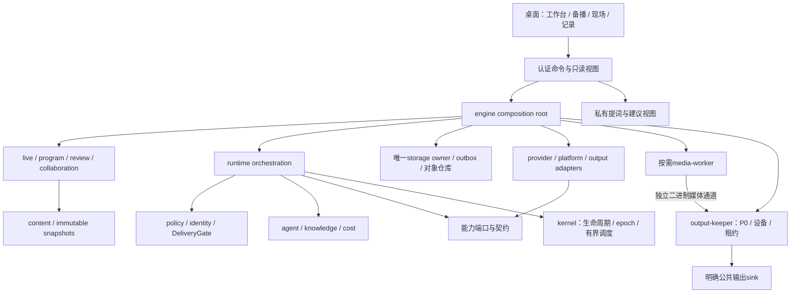

# nai V4.3 产品重构设计

日期：2026-10-22。状态：目标设计已建立；RF01最小装配已实现，业务领域未开始。依据：[V4.3](../digital-host-agent-design-V4.3.md)、[ADR0147](../adr/0147-v43-product-reconstruction-baseline.md)。实施顺序见[任务计划](../v43-reconstruction-plan.md)。本文件是仓库落地裁决，不复制整份原方案；冲突按ADR明确处理。

## 1. 产品目标和不承担的兼容

产品围绕“备播—私有预演—真人协作—复盘—下场复用”，首要用户为真人值守的小型产品讲解团队。默认Assisted/私有建议；数字人是可选呈现角色，现场是否出声由主持权和授权共同决定。

本次不保留旧控制API、Protobuf ABI、数据库表结构、scene/runtime JSON、固定四段节目、旧审批交互或旧插件ABI的兼容层。也不为既有crate位置强行保持业务边界。重用可信算法/测试资产与保持旧接口是两回事。

不兼容不授权删除数据：不修改当前安装或旧数据根，不自动解密/搬迁Key，不复制旧批准/租约。新运行实例使用独立数据根和凭据命名空间；旧资产可由以后独立显式导入工具映射、预览、验证和备份，不承诺通用旧库自动迁移。

## 2. 设计审视与工程裁决

| V4.3方向 | 对当前实现的改变 | 本次裁决 |
|---|---|---|
| LiveSeries/LiveShow为主对象 | 当前以单商品场景、引擎连接和候选为主 | 重写首页、备播及现场流程；连接进入设置，Prepare由任务驱动 |
| ContentOnly/Voice/Avatar/HumanAssist独立 | 当前配置/生成链仍围绕LLM+TTS与媒体 | 依赖解析按呈现裁剪；缺TTS不阻断纯内容，纯内容通过不替代Avatar验收 |
| 统一DeliveryGate | 旧路径以候选审批和音频播放门控为主 | 所有文字/媒体/动作有目标化许可；Utterance只是DeliveryUnit媒体子状态 |
| 字段依赖及会话处置 | 当前知识热发布以先撤权再激活为主 | 区分一般有效更新与即时撤销；局部不受影响须有依赖证明，未知保守阻断 |
| 任务化harness | 当前生产编排大量位于engine/operator | 提取agent/live/runtime领域；角色是任务profile，不建多Agent互聊集群 |
| 单写owner | 壳内ProviderDb管理配置/草稿，引擎另有Store | 产品事实、Provider元数据、预算及审计归引擎storage owner；壳只管OS交互 |
| 分层回执 | 已有设备时钟/窗口尾帧提交和人工确认 | 明确证据层级，不继续用submitted推导Completed；不追求不可证明的“观众已听完” |
| 全能力设计范围 | W01–W12跨度大、含平台/GPU/市场 | 保留全域验收，按纵向用户任务落地，不一次搭完所有crate/服务 |

V4.3的定位正确，但仍需以下工程补足：所有目标路由/示例Schema尚非Frozen；Prepare/主持权/建议采纳的并发关系需形式化；私有与公共输出必须有物理目标隔离；第三方副作用超时需OutcomeUnknown；依赖图水位与新会话竞态要在事务/执行门复核；示例预算/提示频率和性能数字均为待测初值。方案中“未创建仓库”等描述是原方案撰写边界，不代表本仓库没有实现。

## 3. 目标模块与依赖方向

图示为运行/装配关系，不等同Rust编译依赖。端口trait位于消费侧核心/SDK；adapter实现端口，只有组合根引用具体adapter。runtime-core不得反向引用adapter，kernel不含节目、风格、领域事实、平台SDK、ORT或Tauri。

| 领域 | 唯一职责与权威状态 | 目标工程落点 |
|---|---|---|
| kernel | 能力/生命周期、epoch、deadline、取消、队列机制 | nai-kernel |
| identity/policy | 主体范围、风险、四道guard、完整bundle批准、目标许可 | nai-identity / nai-policy-core |
| content/knowledge | 类型事实、版本/来源/权限、依赖/影响、快照；导入与检索计划 | nai-content-core / nai-knowledge-core |
| live/program | Series/Show、段落、主持权、LiveContext、语音债务/恢复；话术AST/cue | nai-live-core / nai-program-core |
| agent/cost | 角色任务、上下文、有限工具/建议；预算预留/用量/对账 | nai-agent-core / nai-cost-core |
| runtime | Session、DeliveryUnit、调度抢占、执行端口、处置计划 | nai-runtime-core |
| presentation/collaboration | 白名单演示/降级；同意/咨询/认领/反馈 | nai-presentation-core / nai-collaboration-core |
| review | 实际记录到具体diff和下场草稿，不自动发布 | nai-review-core |
| storage/extension/update/observability | 单写事务、outbox/备份；包/权限；维护激活；脱敏/回放 | 相应nai-*库 |

目标名字用nai-*，不采纳dh-*。以上是领域边界；按第一条实际用例创建crate，禁止只有占位符/空成功的目录工程。迁移到services/或保留apps/由W01统一确定，首选保留apps/engine、apps/output-keeper、apps/media-worker，减少无业务价值移动；旧render-worker职责归入新media-worker。

## 4. 数据和契约

唯一契约源保留`schemas/`（含catalog/source.json），不同时建立可编辑的`protocols/`镜像。Protobuf用于进程边界，JSON Schema用于配置/资源，OpenAPI用于HTTP；TS/Rust/C++、SDK、表单元数据从源生成。引擎私有进程协议与公共HTTP版本分离，新的主版本握手拒绝旧ABI，不编写V3兼容adapter。

| 聚合 | 关系及关键约束 |
|---|---|
| ProductObject/FactSet/Pack | 字段有类型/单位/来源/有效期/权限；价格用最小币值，草稿与已发布分开 |
| TalkTrack/Scene/HostProfile | 展示/朗读/素材各有版本；风格不是事实授权，音色许可独立 |
| LiveSeries/LiveShow | Series持模板与明确偏好；Show绑定本场版本，不与其他场共享临时队列 |
| PublishedSnapshot | 不可变版本引用集合；不复制模型大文件、凭据、旧批准 |
| Session/LiveContext | Session为一次运行，Show可多次预演；上下文绑定对象/段落/主持/撤销水位 |
| AgentTask/Suggestion | 任务完成、用户采用、交付完成独立；曝光必须有客户端证据 |
| DeliveryUnit/CueBundle | 完整执行内容、目标、依赖、TTL/hash；编辑任何批准范围即失效 |
| Review/ImprovementProposal | 真实证据→具体diff→人采纳→草稿→审核发布，不直接改事实 |
| Consultation/Handoff | 匿名主题与同意身份分开；传输、已读、认领、采纳、解决独立 |

默认一个业务SQLite、对象文件仓库、可重建索引，一个写owner；各领域持事务端口，不各自开写连接。Provider配置和API Key密文统一由引擎写入业务库，主密钥由OS vault保护，运行时通过credential_ref短时解密使用；不把Key改成只能会话输入，普通配置读API只返回存在状态。UI仅在用户显式录入时短暂持新Key，提交后清空，不回填现有Key。

发布事务包含snapshot/依赖/撤销水位/outbox/审计；模型、网络、媒体不放进DB事务。影响报告绑定对象revision、graph_watermark、session_cutoff_seq及expires_at；执行门检查最新水位，不把报告截止后新建会话排除在撤销之外。外部发送使用独立幂等结果表；缺幂等/回执的超时为OutcomeUnknown，不盲重试。

## 5. 三组独立状态机

- Show：Draft→Validated→Published→Archived；运行状态属于Session，不靠改Show状态充当设备事实。
- Session：Created→Preparing→Ready/ReadyDegraded→Running→Draining→Stopped，异常Faulted。behavior/presentation/edition/deployment独立。
- AgentTask：Created→Queued→Running/WaitingHuman→Completed或Cancelled/Expired/Failed；Suggestion有自己的接受/编辑/拒绝/过期。
- DeliveryUnit：Selected→Preparing→Guarded→AwaitingApproval/Approved→Ready→Committed→Delivering→Completed，另OutcomeUnknown等终态；语音分支才执行Synthesizing/Buffering/Playing。

桌面启动轻量engine控制/存储能力即可编辑备播和设置；“开始预演/进入现场”才创建Session并Prepare所选依赖。engine常驻不等于会话已连接或数字人已开播；设备/模型/平台按需启动，停止Session不必退出内容工作台。

Prepare按所选用途构造依赖图并生成CapabilityView：ContentOnly无TTS/keeper/GPU硬依赖；Voice无avatar；Avatar按实际发声加载TTS并校验形象许可；HumanAssist原声直通不做LLM语义预审。人工说话主持权优先，VAD不能自动授予或恢复AI外发。

建议采用执行链：认证主体＋CAS/idempotency→重检相关context/主持权→生成/完善最终bundle→guard/批准→媒体或目标准备→DeliveryGate短许可→发送器/keeper→分层回执。与执行无关的点赞/观测采样不机械取消全部候选，无法确定相关性时重检。

## 6. 完成证据和检查点

| 证据 | 可以说明 | 不能说明 |
|---|---|---|
| selected/generated/approved | 已选/生成/获批 | 已发出/已播 |
| committed/submitted | 队列或API已受理/窗口已提交 | 实际完成/对方已见 |
| local_audio_device_progress | 指定输出流实际样本位置 | 画面已呈现、平台已播 |
| local_visual_presented | 指定图形后端可证实的呈现完成及范围 | OBS采集或观众看到 |
| capture_verified | 录制/采集端已核验的指定范围 | 远端观众已理解 |
| remote_transport_ack | 明确目标接收/业务动作回执 | 真人已读/采纳/解决 |
| human_confirmation | 人工确认及操作者/依据 | 机器完成ACK |

各输出profile明确所需证据集合；自动节目检查点只认本profile足够的完成回执，不能把human_confirmation升级为机器ACK。无图形呈现回执时保留部分状态/人工路径并标明限制，不等待“观众已听完”这一不可证明条件来阻塞所有开发。录制核验与本地执行回执是独立证据，范围可关联但不能相互冒充。

检查点绑定show/segment/step、完成delivery、snapshot/context、输出profile与证据引用。恢复前核对对象/价格/活动/素材/授权及当前主持权/预算；旧候选不复活，已执行副作用不重放。重启仅恢复可审查进度，不恢复旧自动许可或媒体租约。

## 7. UI重构规格

主导航五项：直播工作台、备播与节目、内容与素材、直播记录、扩展与设置。连接/数据路径/诊断不占首页；主流程不填scene/runtime JSON。现场为专门工作布局，不能把五个设置页拼成一页表单。

| 页面 | 首要内容与动作 | 首次切片 |
|---|---|---|
| 工作台 | 体验示例/自己的内容、继续当前场、复用上场 | 无Key仍可做手工事实/节目与明确预录示例 |
| 备播 | 对象/3–5项关键事实/禁说项、节目草稿、声音/形象或纯辅助、私有预演 | 手工准备完整可用，AI候选渐进增加，不强迫先建大库 |
| 内容 | 产品包/FAQ/术语/素材，草稿与发布diff及影响处置 | 保持对象和权限可见，技术依赖图按需展开 |
| 现场 | 固定安全条、当前/下一段、公共预览、私有建议、底部队列 | 看提示/我点播默认；最多3张强调卡为待测初值 |
| 记录 | 已交付/未答/拒绝原因/费用、3项重点改进、用于下一场 | 缺平台指标显示不可用，没数据不画假图 |
| 扩展设置 | Provider列表/主备、设备/输出映射、包、部署、升级 | 保留本轮模型列表易用性原则，换后端契约而非复制旧DB结构 |

停止自动、数字人静音、全bus静音、真人接管、停止OBS推流、结束平台直播为独立命令，不能把一个按钮的ACK推为其他动作成功。私有建议窗和公共输出窗口/目标ID分别创建，公共合成器无私有卡片/联系方式数据权限；OBS动作仅白名单+显式映射/认证/ACK。

每页补默认/空/加载/部分成功/错误/无权限/离线/过期/恢复状态、中文文案、键盘和焦点、撤销/保存/发布/呈现区别。安全范围批准可减少重复点击，但须有事实/对象/目标/TTL范围证明；不得以体验为由直接取消审批。

## 8. 复用、替换与删除旧实现的顺序

| 当前资产 | 处置 | 原因 |
|---|---|---|
| media时钟/重采样/有界槽位/取消算法 | 迁入目标接口后复测 | 有实际证据，设备层值得保留 |
| Provider解析/auth/预算算法 | 抽为adapter/成本端口，补一致suite | 不必重新发明传输，但不能沿用环境变量场景作为产品配置 |
| storage持久/备份与vault | 复用机制，重建业务Schema和写owner | 当前壳内配置库不作为新架构长期真相源 |
| kernel/evaluate的领域规则 | 按职责移往policy/agent/content/live | kernel仅保留机制，不能因旧位置维持业务耦合 |
| operator.rs/program.rs/壳业务编排 | 拆分并替换 | 当前文件分别约85KB/22KB，业务不应长期堆在app |
| main.tsx及旧工作台 | 按pages/features重写 | 约40KB主入口承载过多业务；新导航与新领域不同 |
| 旧CLI/scene JSON/双配置入口/演练生产混用 | 退出新正式路径 | 不做兼容包装和静默回退；演练仅显式测试profile |
| 历史测试/报告/ADR | 保留归档，提取用例 | 是证据来源，不是新ACC自动Passed依据 |

实施采用同仓新目标契约/模块逐卡替换，旧安装继续可用。测试对照不等于长期双内核运行；最终组合根只装配新实现，删除旧生产路径。待相关目标消费者全部切换并通过引用检查后清理旧代码，不以一轮全删重建破坏未提交工作。

## 9. 不变量、风险与交付边界

INV-01–40完整保留并映射到任务计划；P0先执行、撤销先收紧，普通调用/存储/模型锁不得阻断。所有目标包有期限/配额/取消；保留unknown/outcome_unknown，禁止假成功。

高风险点：新旧数据根/凭据误指；发布水位竞态；媒体时基/权限断代；范围批准过宽；私有窗口误采集；共享SQLite多写owner；第三方回执被升级为真人已读。每项都有对应ACC与第一实现卡，不到发布时才补边界。

本轮无新增运行依赖。Tokio/HTTP/测试工具等版本沿用可验证锁定值，是否调整由首工程卡实测决定，不在规划中宣称最新版或凭空更换工具链。未来Native/GPU依赖独立记录许可/资源/更新维护成本。平台、法规则由真实接入任务核验，不将设计稿的外链表述直接当现行准入证据。
