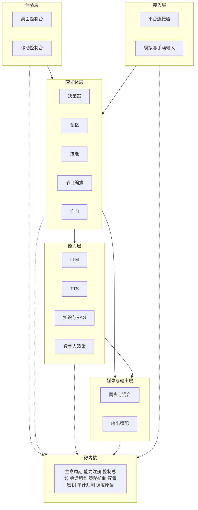
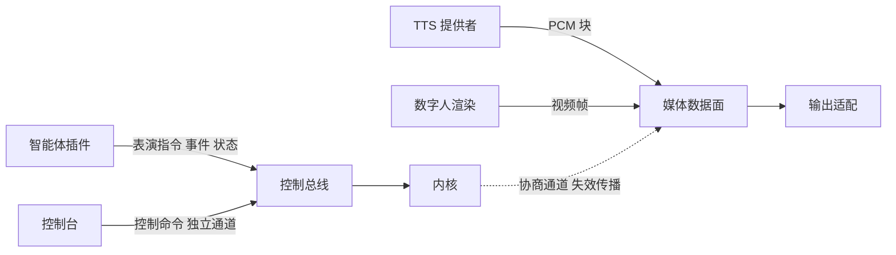
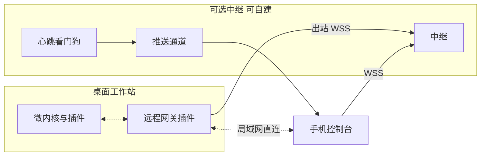

# 直播数字人 + 智能体系统设计方案 V3.2

> 2026-10-07 · 整合 V2.3、V3.0、V3.1 与两轮架构复审意见，范围收敛为可交付主线
>
> 首发抖音，预留快手、视频号。桌面直播为主形态，移动端监控管理是一等公民能力（以可选加装包交付），移动端运行 Lite 为实验档位，云与 API 为一等公民。
>
> 本文是设计与验收方案。凡标注"待验证"的内容，表示尚未经官方文档或实测确认；本版没有做硬件基准，也没有取得任何平台授权。

---

## 〇、版本说明

### 0.1 V3.2 的变化与评审结论

V3.1 的主要问题是首版同时铺开微内核、智能体、插件体系、移动端、云网关、多档位、写实管线、平台桥接，**交付面过宽**。V3.2 把主线收敛为：

> **Lite 桌面垂直切片 + 手机监控可选包 + 写实 Rust ONNX 并行 Gate + 平台正式接入后置（桥接 PoC 前置）+ Lite-Mobile 仅作实验档位**

| 编号 | 问题 | V3.2 的处理 | 章节 |
|---|---|---|---|
| H1 | 交付面过宽，多条高风险轨同时推进 | 新增范围冻结表、发布线 R1/R2/R3、并行轨与止损点 | 17.1–17.3 |
| H2 | 手机监控绑定在 Standard，Lite 用不上 | 手机监控前移为**所有档位可选加装包**；Lite 默认不含，不把 Lite 变成移动端直播工具 | 5.2、8.2 |
| H3 | 手机监控的连接方案存在未验证前提：PWA 需要安全上下文，局域网明文 HTTP 或自签名证书下 Service Worker 与推送可能不可用 | 给出"中继 + PWA"与"原生壳 + 证书指纹固定"两条路线，M0 PoC 后定案；LAN 配对二维码携带证书指纹 | 8.2 |
| H4 | 隔离级别与宿主混为一谈；清单自报信任域存在安全缺陷 | 引入宿主类型与 `supported_hosts`；**信任域由内核按签名验证派生，崩溃隔离由宿主决定，二者都不接受插件自报**；明确进程内宿主的边界 | 3.3、3.6 |
| H5 | 缺少"同一能力多宿主"的验收 | 新增 A14、A14.1、A14.2，范围限定为声明支持多宿主的能力 | 3.9、16 |
| H6 | 手机上运行 Lite 未定义 | 新增 Lite-Mobile 实验档位，含准入门槛、时间盒与止损；明确需要原生壳而非 PWA | 5.6、8.1 |
| H7 | "平台接入后置"会推迟高风险发现 | 正式接入后置，但**用调试版伴侣做桥接 PoC 前置于 M0** | 10.4 |
| H8 | 路线与风险未反映以上变化 | 路线重排（M0a/M0b、M1.1、M1.5）；新增风险条目与新增验收 A14–A17 | 16–18 |

**对外部评审意见的处理摘要**

| 意见 | 处理 |
|---|---|
| 手机监控前移为 Lite 可选包 | 采纳；限定为可选加装，观察者不得执行高危命令 |
| 新增双宿主一致性验收（A14） | 采纳；限定在声明支持多宿主的能力，不要求所有插件双宿主 |
| 清单增加 `trust`、`crash_isolation` 字段 | **修正**：这两项由内核派生，不得由插件自报，否则可被伪造 |
| Lite-Mobile 单进程宿主 | 采纳；补充：内核无法运行在 PWA 中，需原生壳，PWA 只能作为监控客户端 |
| A15 持续 10 分钟无崩溃 | **修正**：10 分钟不足以暴露发热降频，改为 30 分钟并记录温度、电量、内存，门槛在 M0 前确定 |
| 平台接入整体后置 | **修正**：正式接入后置，桥接 PoC 前置 |
| 写实 ONNX 作为并行 Gate | 采纳；补充独立负责人与止损点 |

### 0.2 V3.1 已完成的补齐（保留）

V3.0 立起了微内核骨架，但"从轻量到扩展"主要停留在口号层面。V3.1 补齐了以下缺口：

| 编号 | V3.0 的缺口 | V3.1 的处理 | 章节 |
|---|---|---|---|
| F1 | 没有"最小可用集"，无法证明轻量部署成立 | 定义 Lite / Standard / Pro 发行档位，以及"必需/可选能力"与降级语义 | 五 |
| F2 | T0 插件被写成"插件"，实为编译期模块 | 澄清隔离级别；新增 T3（WASM 沙箱，待验证）；明确哪些能运行时加载 | 3.3 |
| F3 | 智能体层内部没有能力契约 | 新增能力契约目录与关键 Schema（决策、守门、技能、记忆、节目编排） | 四 |
| F4 | 总线主题表含 `media.frame`，与共享内存数据面矛盾 | 控制总线与媒体数据面分离，内核只协商通道，不触碰帧 | 3.5 |
| F5 | 内核混入领域概念（模式、风险分级） | 机制与策略分离：内核提供机制，策略以"策略包"数据加载 | 3.2 |
| F6 | 缺少插件工程配套 | 新增生命周期、热替换规则、签名与更新、Schema 注册、一致性测试、依赖纪律、SDK | 3.6–3.9 |
| F7 | 架构没有可验证标准 | 新增 13 条架构验收用例 | 十六 |

其余内容（智能体运行时、表演指令、形象三档、部署形态、移动端、AI 网关、平台选型）沿用 V3.0 并按新架构调整。

### 0.3 与既有文档的关系

V3.2 为规范性基线。V2.3 第五章（Rust + ONNX 写实管线）与第九章（本地知识库与 RAG）的细节条款继续有效，作为详细附录；本文给出其摘要与接入方式。若与本文冲突，以本文为准。

---

## 一、产品定义

### 1.1 能力域

| 能力域 | 内容 | Lite | Standard | Pro |
|---|---|---|---|---|
| 感知 | 评论、礼物、点赞、关注、粉丝团事件；意图/情绪/风险分类 | 事件手动或模拟输入；关键词分类 | + 平台事件、模型分类 | + 多平台 |
| 认知 | 分级路由、RAG、证据绑定、澄清与拒答 | 模板 + LLM + R0/R1 | + R2 混合检索 | + 第三方知识 |
| 记忆 | 工作记忆、场次记忆、观众记忆 | 工作记忆 | + 场次记忆 | + 观众记忆（默认关） |
| 决策 | 说/不说、节目节奏、预算限频 | 基础规则 | + 节目编排 | + 策略扩展 |
| 行动 | 说话、表演指令、只读技能、通知 | 说话 | + 只读技能 | + 受批准的 R2 技能 |
| 表达 | 多音色、形象、口型 | 2D 形象 | + 写实形象 | + 多形象、云渲染 |
| 治理 | 守门、审批、接管、审计 | 基础守门 + 审批 | + 影子模式、评估 | + 团队权限 |
| 运营 | 场景包、知识中心、监控 | 桌面（可选加装手机监控包） | 手机监控包（默认含） | + 中继、复盘 |

### 1.2 边界

智能体不拥有改价、转账、封禁、商品上下架、对外发布、修改配置的权限。自动互动是否允许，由平台规则和账号权限决定，不由本系统推定；有接管按钮不等于自动互动合规。

---

## 二、架构原则

1. **微内核**：内核只提供机制，不含业务；业务能力全部来自插件。
2. **机制与策略分离**：内核提供租约、取消、权限检查、门控表等机制；模式含义、风险分级、外发规则等策略以数据（策略包）加载。
3. **契约先行**：插件之间只通过"能力名 + 版本"通信，不互相引用实现。
4. **必需与可选分明**：每个能力声明必需性与缺失时的降级行为；缺可选能力不得导致崩溃。
5. **控制面与数据面分离**：控制总线承载小消息，媒体帧走独立数据面，内核只负责协商与失效传播。
6. **诚实的隔离**：区分编译期模块、独立进程、远程服务、沙箱，不把编译期模块称作运行时插件。
7. **默认保守**：默认策略包保守；自动模式需显式放开。
8. **直播优先**：任何插件故障都不得使内核退出；故障转入降级表。

---

## 三、微内核规格

### 3.1 分层



规则：上层只依赖下层的能力契约；插件之间不直接引用；跨层调用经内核的策略检查与审计。

### 3.2 内核服务：机制与策略的划分

| 内核服务 | 内核提供的**机制** | 以数据形式加载的**策略**（策略包） |
|---|---|---|
| 生命周期 | 发现、校验、依赖解析、启停、健康检查、退避重启 | 重启预算、熔断阈值 |
| 能力注册 | 能力声明、版本匹配、绑定解析、主备与降级链 | 绑定表（配置） |
| 控制总线 | 类型化发布订阅、请求响应、双向流、有界队列、背压、**独立控制通道** | 队列容量、TTL |
| 会话与租约 | 会话、`generation_epoch`、播放租约、取消域传播 | 租约时长 |
| 策略机制 | 模式状态机引擎、动作→风险级别→处置查表、数据标签→目的地检查、监督在线（presence）聚合 | **模式定义、各模式允许的动作、风险分级表、外发规则、监督在线阈值、AutoPermitted 的前置条件** |
| 配置与密钥 | 分层配置、Schema 校验、热更新与回滚、凭据引用与保险库 | 配置默认值 |
| 审计与观测 | trace、指标、结构化日志、决策与命令审计 | 保留期、脱敏规则 |
| 调度原语 | 截止期、优先级队列、预算令牌、公平调度原语 | 优先级表、预算比例、TTL |

内核**不硬编码** `Assisted`、`AutoPermitted` 等模式的含义。发行包内置一份**默认保守策略包**（例如：自动模式需能力快照允许、守门级别达标、监督端在线），运营可换用经审核的策略包。

示意（策略包片段，字段为示例）：

```toml
[modes.auto_permitted]
requires = [
  "platform.policy.auto_reply_allowed == true",
  "guard.level >= standard",
  "presence.supervisors >= 1",
]
on_presence_lost = { after_ms = 120000, fallback = "assisted" }

[risk]
R0 = "allow"
R1 = "allow_rate_limited"
R2 = "require_approval"
R3 = "deny"
```

### 3.3 宿主类型、信任域与隔离（修订）

**宿主类型**描述插件在哪里运行；**信任域**描述谁签发；**崩溃隔离**是宿主类型的结果。三者分开，且信任域与崩溃隔离**不由插件自报**。

| 宿主 | 旧称 | 含义 | 加载方式 | 崩溃隔离 | 适用 |
|---|---|---|---|---|---|
| `inproc` | T0 | 与内核同进程 | **编译期静态链接**，由 Cargo feature 与配置选择；不支持运行时加载动态库 | **无**。仅 Rust panic 可在边界捕获，且依赖 unwind 配置；OOM、abort、FFI、驱动崩溃无法隔离 | 官方/企业签名的高可信插件；移动端单进程宿主 |
| `subprocess` | T1 | 独立子进程 | 运行时启动，命名管道/本地 gRPC | 进程级 | GPU 渲染、平台 SDK 桥接、输出、第三方原生程序 |
| `remote` | T2 | 远程服务 | TLS 上的 RPC/WebSocket | 远程 | 云 Provider、AI 网关、第三方知识、云渲染 |
| `wasm` | T3 | 沙箱组件（待验证） | 运行时加载组件，经宿主函数调用 | 沙箱 | 技能、守门规则、话术函数、数据转换 |

文中其余处沿用的 T0–T3 旧称，按上表对应。

**规则**

1. 插件清单声明 `supported_hosts`（可多个）与按平台的 `preferred_host`；内核按运行平台与信任域选择实际宿主。
2. **信任域由内核根据签名验证结果派生**（`official / enterprise / community / dev`）。清单中任何自报的信任或隔离字段一律忽略。
3. `inproc` 仅允许 `official` 与 `enterprise` 信任域。`community` 与未签名插件只能走 `subprocess / remote / wasm`；`dev` 模式允许 `inproc` 仅用于调试，界面显著标注。
4. **进程内实时性约束**：内核控制通道运行在**专用线程**，不与插件共享运行时；`inproc` 插件不得自建阻塞运行时或长时间占用线程；内核提供任务预算与阻塞检测看门狗，超限的插件标记为 `Failed` 并按降级表处理。
5. `inproc` 不提供崩溃隔离，插件中心与文档必须明确标注。
6. **"同一实现，多种宿主"**：同一份源码既可编译进内核（`inproc`），也可编译为独立可执行体（`subprocess`），两者共用契约与一致性套件（见 A14）。**不是所有插件都应支持多宿主**：依赖 GPU 驱动或不稳定原生 SDK 的插件（写实渲染、平台桥接）只声明 `subprocess / remote`。

**官方插件的宿主支持（初始规划）**

| 插件 | `supported_hosts` | 说明 |
|---|---|---|
| 默认决策器、基础守门、本地知识、策略包加载 | inproc、subprocess | 桌面默认 inproc；移动端必须 inproc |
| 2D 形象 | inproc、subprocess | 桌面可用 subprocess 隔离；移动端 inproc |
| 写实形象（ONNX/GPU） | subprocess、remote | 隔离驱动与显存故障 |
| 平台桥接（伴侣 SDK） | subprocess | 由伴侣启动，进程生命周期受外部控制 |
| 输出（虚拟摄像头、RTMP、录制） | subprocess；录制可 inproc | — |
| LLM/TTS/Embedding Provider | inproc 适配器 + remote 服务 | 适配器在进程内，服务在远端 |

**wasm 的决策**：M0b 做 PoC，评估组件模型对异步/流式、宿主函数、资源限额的支持。若不成熟，退而求其次：技能与守门规则用**声明式规则/配置**承载，复杂扩展走 `subprocess`。此决策不阻塞首版。

第三方扩展只通过 `subprocess / remote`（以及将来的 `wasm`）进入；`inproc` 仅限官方与企业签名构建。

### 3.4 能力模型与绑定解析

每个能力由 `名称@主版本` 标识，并带有：

- **必需性**：`required`（缺失则会话不可就绪）、`conditional`（某模式下必需）、`optional`（缺失则降级）。
- **交互模式**：请求响应 / 服务端流 / 双向流 / 事件订阅。
- **降级声明**：消费者在能力缺失或不健康时的行为（见第四章表）。

**绑定解析流程**（会话 `prepare` 时执行）：

1. 读取绑定配置：每个能力 → 主实现 + 备用链。
2. 查找处于 `Ready` 的提供者；主实现不可用则依次尝试备用。
3. 汇总得到会话就绪状态：
   - `Ready`：所有必需能力满足；
   - `ReadyDegraded`：必需满足，部分可选缺失，列出降级项；
   - `NotReady`：缺必需能力，列出原因与修复建议。
4. 向智能体与 UI 暴露 **能力视图**（哪些可用、健康、已降级），智能体据此调整行为，不靠异常驱动。

### 3.5 控制总线与媒体数据面



- **控制总线**：承载事件、表演指令、状态、审批、命令、指标；单条消息有大小上限（设计值，待定），不得携带视频帧或长音频。**`control.command` 使用独立通道，不与业务队列共享容量。**
- **媒体数据面**：内核提供 `channel.open`——生产者与消费者声明格式（音频：采样率/声道/格式；视频：像素格式/分辨率/fps/time_base），内核按拓扑选择传输（同进程环形缓冲、跨进程共享内存环、跨机流协议），并在 epoch 变化或租约失效时通知**丢弃与关闭**。**内核不读取帧内容。**
- 帧与音频块都带 `session_id / utterance_id / generation_epoch / seq / PTS`（沿用 V2.3 第十二章）。

### 3.6 插件清单与生命周期

清单示例（示意）：

```toml
[plugin]
id = "avatar.ort-photoreal"
version = "0.1.0"
kind = "avatar"
supported_hosts = ["subprocess", "remote"]
preferred_host = { desktop = "subprocess", mobile = "none" }
contract_set = ["dh-avatar/1"]

[provides]
"avatar.render@1" = { required_by = ["voice_mode"] }
"avatar.profile@1" = {}

[requires]
"media.clock@1" = "required"
"channel.open@1" = "required"

[permissions]
gpu = true
network = []
assets = ["avatar-packages", "model-packages"]

[health]
interval_ms = 2000
restart = "backoff"

[supply_chain]
bom_ref = "model-bom:<reviewed>"
signature = "<detached-signature-ref>"
```

清单**不包含**信任域与崩溃隔离字段：信任域来自签名验证，隔离由实际宿主决定（见 3.3）。

生命周期状态：

```
Discovered → Verified（签名/哈希/许可/BOM）→ Resolved（依赖能力可满足）
  → Starting → Ready ⇄ Degraded → Stopping → Stopped
                  ↘ Failed（退避重启或熔断）
```

### 3.7 热替换规则

直播进行中默认**冻结插件集变更**，仅允许"配置级降级与已预授权的绑定切换"。

| 对象 | 何时可替换 | 语义 |
|---|---|---|
| LLM / TTS Provider | 语句边界；运行中 | 进行中的请求不迁移；新请求用新绑定；不拼接两个模型的回复 |
| 策略包、守门规则、话术模板 | 运行中，经校验与黄金集通过后 | 原子切换，版本入审计 |
| 知识快照 | 运行中 | 原子发布；旧快照持有者读完即释放；撤销项即时过滤 |
| 决策器实现 | 会话间，或非播报状态 | 状态由内核快照传递 |
| 数字人渲染 | **会话间**；降级链内的预授权切换除外 | 活跃会话拒绝人工切换；降级切换需运营事先授权并写审计 |
| 平台连接器 / 输出适配器 | 会话间 | 重新做能力检查 |
| 内核 | 停止会话后 | 更新前备份，支持回滚 |

### 3.8 打包、签名、更新与回滚

- **插件包** = 清单 + 可执行体/模型 + 哈希清单 + 签名 + BOM（模型、素材、原生依赖许可）。
- **信任域**：官方、企业自签、本地开发。未签名插件仅在开发模式加载，生产模式拒绝并写审计。
- **更新**：通道分 stable/beta；下载后校验再暂存；**不在直播中更新**；保留上一版本以支持一键回滚。
- 许可变化或授权撤销：先阻止新播放，再触发清理与人工处理（沿用 V2.3 BOM 条款）。
- 原生库与模型 external data 必须校验，禁止从未知目录动态加载。

### 3.9 契约演进、依赖纪律与一致性测试

**Schema 注册与演进**

- 所有主题、事件、能力的消息 Schema 登记在 `contracts` 仓库，以 Protobuf/JSON Schema 为准。
- 规则：同一主版本内只增可选字段；删除或语义变更需升主版本；内核同时支持 N 与 N-1 个次版本。
- 版本不兼容时拒绝加载并给出可读原因。

**依赖纪律**（由 CI 强制）

| 规则 | 说明 |
|---|---|
| plugins → contracts / sdk | 插件只能依赖契约 crate 与 SDK |
| plugins ↛ plugins | 插件之间零直接依赖 |
| kernel ↛ plugins | 内核不依赖任何插件 |
| apps → kernel / contracts | 应用装配插件，不含业务逻辑 |
| 内核体量预算 | 为内核设置规模预算并在 CI 中监控，防止"为方便"把业务塞进内核 |

**一致性测试套件**

每个能力配有 conformance suite，覆盖：契约合法性、流式语义（正常结束、错误、超时、取消）、`generation_epoch` 迟到数据丢弃、背压、错误码、幂等。性能探针只报告、不判定。**新插件必须通过对应套件才允许打包发布**；内核加载时执行轻量自检（smoke）。声明支持多个宿主的能力实现，须在**每一种声明的宿主**下通过同一套件（A14）。

**插件 SDK 与模板**

- `dh-plugin-sdk`（Rust）：宿主协议、生命周期钩子、健康与指标上报、日志、能力声明。
- 语言无关的 gRPC/Schema 桩，供 T1/T2 第三方用任意语言实现。注意区别：V2.3 的"正式包不含 Python"针对**随包分发的数字人推理运行时**；第三方 T2 服务可由其自身部署，不受此限。
- 提供各类插件的项目模板与本地模拟宿主，供独立开发与调试。

---

## 四、能力契约目录

### 4.1 目录

| 能力 | 角色 | 交互 | 必需性 | 缺失时降级 |
|---|---|---|---|---|
| `platform.events@1` | 接入 | 事件流（出） | required（可由模拟/手动输入提供） | 会话不可就绪 |
| `platform.capabilities@1` | 接入 | 查询 | required | 视为全部 `unknown`，仅允许人工/演练模式 |
| `platform.lifecycle@1` | 接入 | 事件 | optional | 房间开关需手动标记 |
| `media.output@1` | 输出 | 准备/启停/状态 | required（至少录制） | 会话不可就绪 |
| `media.preview@1` | 输出 | 低码率流 | optional | 移动端无预览，仅状态 |
| `channel.open@1` / `media.clock@1` | 内核 | 通道协商/时钟 | required（内核内置） | — |
| `agent.decide@1` | 智能体 | 请求响应 | required | 无默认实现则不可就绪 |
| `agent.classify@1` | 智能体 | 请求响应 | optional | 关键词规则分类 |
| `memory.session@1` | 智能体 | 读写/摘要 | optional | 仅工作记忆 |
| `memory.viewer@1` | 智能体 | 读写/删除 | optional，默认关 | 不使用观众画像 |
| `skill.list@1` / `skill.invoke@1` | 智能体 | 请求响应 | optional | 不提供工具调用 |
| `show.plan@1` | 智能体 | 请求响应 | optional | 无主动讲解，仅响应互动 |
| `guard.check@1` | 治理 | 请求响应（分阶段） | **required** | 无守门则拒绝任何播出 |
| `llm.generate@1` | 提供者 | 服务端流 | conditional（非模板路径） | 仅模板与转人工 |
| `llm.classify@1` | 提供者 | 请求响应 | optional | 回退规则 |
| `tts.synthesize@1` | 提供者 | 服务端流 | conditional（语音模式） | 仅文字/字幕与人工 |
| `embedding.embed@1` / `rerank.rank@1` | 提供者 | 请求响应 | optional | FTS-only / 跳过重排 |
| `knowledge.facts@1` | 知识 | 请求响应 | optional | 不回答价格、库存、优惠类问题 |
| `knowledge.search@1` | 知识 | 请求响应 | optional | 无检索增强，澄清或转人工 |
| `moderation.check@1` | 提供者 | 请求响应 | optional | 仅基础守门，AutoPermitted 受策略限制 |
| `avatar.render@1` | 形象 | 双向流 | conditional（语音模式） | 切轻量形象（需预授权）或音频+字幕 |
| `avatar.profile@1` | 形象 | 查询 | required（随渲染） | 无声明则按最低子集 |
| `ui.control@1` | 体验 | 命令与状态 | required（至少一端） | 无控制端不得开播 |
| `ui.remote@1` | 体验 | 命令与状态 | optional | 无移动端 |
| `gateway.ai@1` | 提供者聚合 | 同 LLM/TTS 等 | optional | 直连各 Provider |

### 4.2 关键数据契约（示意）

**观察快照（决策输入）**

```json
{
  "session_id": "session-example",
  "mode": "assisted",
  "trigger": { "type": "event", "event_ref": "evt-example" },
  "room": { "status": "live", "segment": "qa", "topic_ref": "sku-01" },
  "queue": { "pending": 3, "speaking": false },
  "recent_utterances": ["…"],
  "viewer_context": { "is_follower": true, "fansclub_level": 1 },
  "capability_view": {
    "llm.generate": "ready",
    "knowledge.search": "degraded",
    "memory.session": "absent"
  },
  "budget": { "llm_tokens_left": 0, "tts_seconds_left": 0 },
  "deadline_ms": 3000
}
```

数值为占位，运行时由内核与调度器填写。

**决策结果**

```json
{
  "action": "speak",
  "route": "C2",
  "cue_ref": "cue-example",
  "requires_approval": true,
  "evidence_refs": ["ev-001"],
  "risk": "R0",
  "reason_code": "faq_hit"
}
```

`action` 取值：`speak / stay_silent / ask_human / invoke_skill / change_scene / defer`。

**守门判定**

```json
{
  "stage": "output",
  "verdict": "pass",
  "reasons": [],
  "rewrite": null,
  "level": "basic",
  "rule_set_version": "rules-example"
}
```

`verdict`：`pass / rewrite / block / escalate`。`level` 标记守门强度，供策略包引用。

**技能描述**

```json
{
  "name": "query_product_fact",
  "params_schema_ref": "schema:query_product_fact/1",
  "side_effect": "none",
  "risk": "R0",
  "timeout_ms": 500,
  "permissions": ["knowledge.facts.read"]
}
```

LLM 只能"请求"调用技能，是否放行由内核策略机制按风险级别决定。

**表演指令（Performance Cue）** 见 7.1。

### 4.3 降级表即数据

"能力缺失/不健康 → 消费者行为"写入**降级表**（数据，随发行档位与场景包提供），不散落在各插件代码中。智能体通过能力视图读取，UI 通过同一视图展示"已降级项"。

---

## 五、发行档位：从轻量到完整

### 5.1 原则

- 发行版是**插件集合 + 默认配置 + 默认策略包**；档位升级 = 加装插件包 + 配置迁移，不重装内核。
- **平台接入包**与档位正交：任何档位都可加装平台连接器，是否使用取决于授权。Lite 在无平台授权时以手动/模拟输入运行。
- 智能体只依赖"必需能力"启动；可选能力缺失时按降级表运行。
- **手机监控包**与档位正交：任何档位都可加装；Lite 默认不含。加装手机监控包不等于 Lite 具备移动端直播能力。

### 5.2 档位定义

| 档位 | 插件集 | 能做什么 | 不能做什么 | 资源目标（待验证） |
|---|---|---|---|---|
| **Lite（基本可用）** | 内核 + 桌面控制台 + 模拟/手动输入连接器 + 默认决策器（规则模板 + LLM API）+ 基础守门 + 本地结构化事实与 FAQ 检索（R0/R1）+ LLM/TTS API Provider + **2D 形象** + 音频同步器 + 录制与窗口采集输出（**可选加装：手机监控包**）| 一次完整的数字人互动闭环：事件→回复→语音→2D 形象口型→录制/供 OBS 采集；审批与接管；知识问答（FTS） | 写实形象；平台正式接入；向量检索；记忆；（未加装监控包时）手机监控 | **不需要独立显卡**；4 核 / 16GB 级别为目标，需实测 |
| **Standard（单机完整）** | Lite + 平台连接器（桥接）+ 写实形象（Rust + ONNX，GPU）+ R2 混合检索 + 场次记忆 + 分类 + 节目编排 + 只读技能 + 影子模式与评估 + 手机监控包（默认含）+ 预览 | 完整单机直播助手 | 云渲染、多会话、观众记忆、中继 | NVIDIA GPU（见 V2.3 §18.3），32GB 内存级 |
| **Pro（团队与云化）** | Standard + AI 网关 + 云中继与告警 + 第三方知识 + 观众记忆 + 多形象 + 云渲染 + 多会话 + 复盘分析 + 多平台 | 团队协作、云端密钥、统一预算、跨设备 | — | 取决于云资源 |
| **Lite-Mobile（实验）** | 单进程内核 + 原生壳 + 手动/模拟输入 + 默认决策器 + 基础守门 + R0/R1 + LLM/TTS API + 2D 形象 + 本地录制 / 局域网送 PC | 前台演练、内容录制、作为 PC 的渲染外设 | 写实形象、本地 TTS/LLM、平台 SDK 桥接、直接 RTMP、后台长时间直播 | 见 5.6，全部待验证 |

### 5.3 必需/可选能力在各档位的取值

| 能力 | Lite | Standard | Pro |
|---|---|---|---|
| `guard.check` | 基础 | 标准（含事实校验） | 标准 + `moderation.check` |
| `knowledge.search` | FTS | FTS + 向量 | + 远端 |
| `memory.session` | 缺失 | 提供 | 提供 |
| `show.plan` | 缺失 | 基础 | 完整 |
| `avatar.render` | 2D | 写实（降级到 2D） | 多形象 / 云渲染 |
| `ui.remote` | 可选加装 | 默认含（路线按 8.2 定案） | + 中继、看门狗 |

### 5.4 降级示例

| 触发 | 降级 | 前提 |
|---|---|---|
| GPU 不可用或写实模型 Gate 未通过 | 切换 2D 形象 | 运营已预授权形象切换 |
| 向量检索不可用 | FTS-only | — |
| 缺 `memory.session` | 仅工作记忆 | — |
| 缺 `show.plan` | 只响应互动，不主动讲解 | — |
| 守门仅"基础"级 | 禁止 AutoPermitted（策略包条件 `guard.level >= standard`） | 策略包决定 |
| 云网关不可用 | Provider 直连 | 本机持有凭据 |
| 所有可选插件移除 | 进入待机；紧急静音可用 | 验收用例 A7 |

### 5.5 升级路径

Lite → Standard：安装"写实形象包""平台接入包""知识增强包""评估包"，运行配置迁移（带版本与回滚），首次体检补齐授权与许可。Standard → Pro：安装网关与中继客户端，迁移密钥到云保险库（可选）。

### 5.6 Lite-Mobile（实验档位）

**定位**：演练、内容录制、PC 渲染外设。**不是手机上的抖音直播工具**，不阻塞主线。

| 项 | 内容 |
|---|---|
| 宿主 | 单进程：全部插件 `inproc`，仅限官方构建；手机上不启动子进程 |
| 外壳 | **原生壳**（Tauri 2 移动端或原生应用，成熟度待验证）。**内核不能运行在 PWA 中**（除非另行编译为 WASM，不在范围内），PWA 只能作为"手机监控包"的客户端 |
| 输入 | 手动/模拟事件 |
| 决策、守门、知识 | 默认决策器、基础守门、R0/R1 本地 SQLite FTS |
| LLM、TTS | API 或云网关 |
| 形象 | 2D 骨骼/Canvas |
| 输出 | 本地录制；经局域网送 PC（由 PC 伴侣上屏，路径 ③） |
| 不做 | 写实 ONNX 口型、本地 TTS/LLM、平台 SDK 桥接、直接 RTMP 推流、后台长时间直播承诺 |

**准入门槛**（M0b 验证；阈值在 M0 开始前写定，不事后调整）：

1. 内核可交叉编译到 Android 并在真机运行；iOS 仅评估可行性。
2. 2D 形象在中端 Android 前台持续帧率与温度满足预设阈值（至少 2 款设备）。
3. 单进程宿主下，取消（`generation_epoch`）、背压与音频主时钟语义成立，且控制通道不被插件阻塞（A14.1）。

**时间盒与止损**：M1.5 不超过 2 周；M0b 未达门槛则**搁置**，不延期主线。

**已知限制**：iOS 后台基本不允许持续渲染与编码；国内 Android 厂商后台管理严格；持续渲染与编码引发发热降频。2D 引擎的移动端商用授权待核对。


---

## 六、智能体运行时

### 6.1 决策循环

```
事件/定时器 → 观察快照 → agent.decide → 行动 → 反馈记录
                  ↑                         │
                  └── 记忆与指标 ◄──────────┘
```

决策结果含 **沉默**。决策器是 `agent.decide@1` 的实现，可替换；默认实现为"规则 + 轻量分类 + LLM 生成"。

### 6.2 分级认知与路由

| 层级 | 触发 | 处理 | 目标耗时（设计值，待实测） |
|---|---|---|---|
| C0 规则/模板 | 欢迎、礼物感谢、固定 FAQ 精确命中 | 模板 + 变量 → 守门 | <50ms 决策 |
| C1 小模型/分类 | 意图、情绪、风险、是否检索 | 远端小模型 API 或轻量分类器（待验证） | 100–400ms |
| C2 检索增强生成 | 产品问答 | 检索 → 生成 → 事实校验 | 取决于供应商与网络 |
| C3 多步/工具 | 需外部系统或多步推理 | 仅人工批准路径或非实时场景 | 不进实时自动路径 |

路由依据：事件类型、风险、证据覆盖、预算余量、期限、能力视图。**不把所有问题送给大模型。**

### 6.3 记忆

| 层 | 内容 | 保存 | 隐私 |
|---|---|---|---|
| 工作记忆 | 当前对话与近期播报 | 内存，会话结束清除 | 低 |
| 场次记忆 | 本场摘要、已讲主题、已回答问题、已承诺事项 | 会话库，滚动摘要 | 中，脱敏 |
| 语义记忆 | 知识库/RAG | 本地/远端 | 按外发策略 |
| 观众记忆 | 称呼偏好、互动次数等极少字段 | **默认关闭**；开启需账号级授权、平台作用域 ID、保留期、一键删除 | 高 |

不跨平台关联身份；不长期保存评论原文画像；平台与法规对观众数据的要求待核对。

### 6.4 风险分级与技能

| 级别 | 示例 | 默认处置 |
|---|---|---|
| R0 只读 | 查商品事实、查知识、查库存快照 | 允许 |
| R1 低风险写 | 通知运营、记录待办 | 允许，限频与审计 |
| R2 影响观众可见内容 | 切商品卡、弹出优惠、触发互动 | 需人工批准 |
| R3 高风险 | 改价、转账、封禁、对外发布、改配置 | 拒绝 |

上表是**默认策略包**的取值，不是内核硬编码。

### 6.5 节目编排（`show.plan@1`）

- 节目由段落构成：开场、讲解、问答、互动、行动号召、收尾；每段有目标时长、素材、可打断程度与恢复点。
- 决定"主动讲解 vs 响应互动"的配比，使用预算与 TTL 作为初值（问答 65%、感谢欢迎 20%、脚本 15%；TTL 初设问答 15 秒、欢迎 5 秒、感谢 20 秒，均为待调参数）。
- 被打断后恢复前重新校验话术有效期（价格、优惠、库存）。
- 长时间无事件不等于获得自动播报授权。

### 6.6 守门（`guard.check@1`）

位于生成与播放之间，不信任上游：

1. 输入侧：昵称与评论按不可信数据处理；识别提示词注入、广告导流、辱骂、敏感话题。
2. 输出侧：违禁词、绝对化用语、承诺类表述、事实与证据一致性（数字、单位、优惠条件）。
3. 流式：语义段审核后才送 TTS；敏感事实整段审核；已播出内容无法撤回，违规发现后取消未播部分并记录。
4. 规则版本化、可热更新、有回归集。

### 6.7 评估与上线爬坡

| 阶段 | 做法 |
|---|---|
| 离线回放 | 导入历史互动，批量跑决策并出对比报告 |
| 受众模拟 | 用模型扮演观众，生成多样提问、刷屏、诱导与注入攻击 |
| 黄金集 | 事实、歧义、无答案、冲突、过期优惠；**改提示词/人设/规则/模型后必须通过才生效** |
| 影子模式 | 真实直播中智能体决策但不发声，由真人对照，记录采纳率 |
| 辅助模式 | 候选回复经人工批准后播放（默认） |
| 获准自动 | 平台允许 + 策略包前置条件满足 + 监督在线 |

首版仅"决策 + 守门"两个角色；场控、运营分析、客服等后续作为新增插件，不引入多智能体自治协作。

---

## 七、数字人层

### 7.1 表演指令（Performance Cue）

智能体与数字人之间的契约，不只是文本：

```json
{
  "cue_id": "cue-example",
  "utterance_id": "utt-example",
  "generation_epoch": 12,
  "text_for_display": "这款适合日常通勤使用。",
  "text_for_speech": "这款适合日常通勤使用。",
  "voice": { "voice_ref": "voice:host-01", "rate": 1.0, "emotion": "friendly" },
  "performance": { "emotion": "friendly", "intensity": 0.5, "gesture_tag": "explain", "gaze": "camera" },
  "stage": { "scene_ref": null, "overlay": null },
  "constraints": { "valid_until_ms": 0, "interruptible": true }
}
```

占位值由调度器在运行时填写。渲染插件通过 `avatar.profile@1` 声明支持的子集；不支持的指令降级处理（忽略或映射到最近的底版片段），并显示在配置界面。

### 7.2 形象三档

| 档位 | 技术路线 | 优点 | 局限 | 形态 |
|---|---|---|---|---|
| A 写实克隆 | V2.3 §5：Rust + ort + ONNX 完整管线 | 真人观感 | 依赖 GPU；制作成本；表演自由度受底版限制；模型许可与导出风险高 | 桌面 GPU、云 GPU |
| B 2D 风格化 | Live2D/Spine 类骨骼动画 + 音素驱动 | 轻量稳定、表现力强、可在 CPU/集成显卡/手机运行 | 非真人；SDK 商用授权待核对 | Lite 默认；移动端载体；降级形象 |
| C 3D 风格化 | glTF/VRM 类 + 视素与混合形状 | 开放格式，镜头与换装自由 | 制作调优成本 | 桌面、移动、云 |

能力对比：

| 能力 | A | B | C |
|---|---|---|---|
| 口型 | 音频驱动嘴部重绘 | 音素映射 | 视素映射 |
| 表情 | 受限（切底版片段） | 丰富 | 丰富 |
| 手势 | 受限（片段库） | 动作剪辑 | 骨骼动画 |
| 终端 | NVIDIA GPU | CPU/集成显卡/手机 | 手机/桌面 GPU |

**B 档的三重价值**：Lite 的默认形象；写实管线 Gate 未通过时的保底；移动端可行路径的验证载体。

### 7.3 写实管线摘要（详细条款见 V2.3 §5）

- 运行：独立 Rust 进程，`ort` + ONNX，无 Python 运行时；音频编码器与视觉子模型均纳入模型包。
- 门槛：Gate A 必需图与预处理跑通；Gate B 与离线基准的特征、帧和时间映射达容差；Gate C 真实形象、中文、分块首包与 25fps 持续余量；Gate D 无 Python 干净环境安装、许可与故障恢复。
- 首发认证：Windows x64 + CUDA EP + 一套模型包；TensorRT/DirectML/CPU 为后续单独认证配置。
- 未通过 Gate 的模型仅标"候选"，不发布正式语音。
- 模型候选（MuseTalk、FeatherTalk、授权商业模型）与许可约束沿用 V2.3，不预设"已认证主力"。

### 7.4 2D/3D 管线（新增，待验证）

```
TTS 音频 → 音素/视素时间轴（TTS 返回或本地轻量分析）
        → 嘴型参数曲线 + 表演指令映射 → 渲染 → 带 PTS 的视频帧
```

验证项：视素时间轴来源与精度、中文口型自然度、音画偏差（沿用初始目标 P95 ≤80ms）、无独显机器持续帧率、手机端发热。

---

## 八、部署形态与移动端

### 8.1 部署形态矩阵

| 形态 | 内核与智能体 | 渲染 | 出画 | 控制 | 依赖 | 可行性 |
|---|---|---|---|---|---|---|
| P1 桌面单机 | 桌面 | 桌面 | 桌面 | 桌面 | 平台事件与输出路径 | **高** |
| P2 桌面 + 手机监控管理 | 桌面 | 桌面 | 桌面 | 桌面 + 手机 | 直连或中继 | **高** |
| P3 桌面 + 云能力 | 桌面 | 桌面 | 桌面 | 桌面/手机 | LLM/TTS/RAG API 或 AI 网关 | **高** |
| P4 云渲染 | 桌面或云 | 云 GPU | 云推流或回传桌面 | 手机/桌面 | GPU 成本、推流权限、延迟 | **中**，待验证推流权限与成本 |
| P5 手机出画（2D/3D） | 手机或云 | 手机 | 手机或经云 | 手机 | **平台能否接收手机端画面** | **中/待验证**，阻塞在平台入口 |
| P6 手机本地写实克隆 | 手机 | 手机 | 同 P5 | 手机 | 手机端口型实时性、发热、许可 | **低/待验证**，不进首版 |
| P7 私有化 | 本地/内网 | 本地 GPU | 本地 | 本地 | 本地 LLM/TTS（作为可选 Provider 插件） | **中**，契约预留，首版不交付 |
| P8 手机运行 Lite（实验） | 手机（单进程） | 手机 2D | 本地录制或局域网送 PC | 手机 | 原生壳、移动后台限制 | **低/待验证**，实验档位，见 5.6 |

P2、P3 可叠加在 P1 上；P4 可作为 P1 的备用渲染。

### 8.2 移动端监控管理（高可行）



- **直连**：同一局域网，手机扫码获取本机地址、一次性令牌与**桌面端证书指纹**，通信使用 TLS 并固定该指纹，不使用明文 HTTP/WS。
- **中继**：桌面主动**出站**连接中继，手机连中继，工作站不开放公网端口；中继可自建或使用托管。
- **配对与安全**：一次性二维码 + 设备密钥对；控制与状态通道端到端加密（目标，协议选型待定）；角色分观察者、场控、主播/管理员、仅桌面；敏感命令二次确认；设备可随时吊销，写审计。
- **紧急静音**不设门槛，所有场控以上已配对设备可用；本地按钮与全局热键仍是最终手段，不得把手机静音当唯一保障。

功能：实时看板、审批流（候选、证据、风险提示，左滑驳回/右滑通过/点开编辑）、接管、快捷话术插播、低码率预览或快照、推送告警、知识速补（进入审核发布流程，不直接生效到价格类事实）。

可靠性：

- **云端心跳看门狗**：桌面失联超阈值，向手机推送告警，覆盖整机故障。
- **监督在线要求**：由策略包定义；自动模式下桌面控制台与所有手机监督端均失联超时，内核降到辅助或待机。
- 命令带幂等 ID；状态差量推送。

**客户端与连接路线（M0b PoC 后定案）**

PWA 需要安全上下文（有效 HTTPS）才能使用 Service Worker 与推送；局域网 IP 的明文 HTTP 或自签名证书在手机浏览器上通常不满足，或需要用户手动信任（工程判断，待验证）。因此"PWA + 局域网直连"**不是零成本方案**。两条路线：

| 路线 | 做法 | 优点 | 代价 |
|---|---|---|---|
| A 中继 + PWA | 桌面出站连接一台持有有效证书的中继（可自建或托管，可以极简），手机 PWA 经 HTTPS 访问 | 零安装、跨平台；同时解决远程访问与失联告警 | 需要域名、证书与一台中继服务；依赖外网 |
| B 原生壳 + 局域网直连 | Tauri 2 移动端或原生壳，TLS + 证书指纹固定，局域网直连 | 无需云；可用生物识别与原生推送 | 需要应用分发（应用商店或企业分发）与移动端成熟度验证 |

两条路线共用同一控制 API 与前端组件。**Lite 手机监控包的最小形态**以 PoC 结果决定：先交付看板、审批、接管与紧急静音；预览与推送可后置。推送在 iOS 网页与国内 Android 厂商通道上均有差异，告警需多通道冗余，均待验证。

**角色与命令权限（补充）**：观察者仅可查看看板与脱敏弹幕，**不能**执行紧急静音、接管、暂停、结束输出等命令（可提供"呼叫场控"）；场控以上可执行紧急静音与接管；高危命令（切换自动模式、结束会话）需二次确认。

### 8.3 移动端数字人直播的可行性（关键）

**本次核对的官方文档事实**（[S2][S3]，2026-10-07 读取）：

| 项 | 事实 |
|---|---|
| 产物类型 | 插件分 exe 类型与小程序类型；exe 仅在直播伴侣运行，小程序类型在抖音 App 与直播伴侣均可运行；**审核通过或上线后产物配置不能变更** [S3] |
| exe 能力 | 仅 Windows 直播伴侣；通过管道通信；C++ SDK；可推送音视频数据上屏为素材，一个插件最多 6 个素材通道 [S2]；视频分辨率限制在不同版本说法不一致，按伴侣版本核实 |
| 小程序形态 | "玩法面板"（半屏小程序页）+"玩法卡片"（Canvas 画布，接收开放数据）；同时只能开一个卡片 [S3] |
| 事件类型 | 点赞、评论、礼物、关注变更、粉丝团变更，均需申请对应权限；**未列进场事件** [S2][S3] |
| 音视频 | 小程序类型文档**未说明**可推送音视频流或承载全屏数字人视频；exe 类型有明确音视频素材通道 |
| 手机开播接入 | **未找到**官方文档说明第三方应用可把手机端画面/声音接入抖音 App 开播；平台 RTMP 推流开通条件也未核实 |

**判断**

1. 移动端监控、审批、接管：与平台无关，完全可行。
2. 云端/API 辅助：完全可行。
3. 数字人画面进入抖音直播：已确认的全屏音视频上屏官方路径是 PC 直播伴侣 exe 类型。**手机端出画的主要阻塞是平台入口，不是手机算力。**
4. 手机相关路径（均待验证，按优先级）：

| 路径 | 做法 | 评价 |
|---|---|---|
| ① 手机遥控 + PC 出画 | 手机控制，PC 渲染与出画（P2） | 已可行，**作为首版"移动端直播"答案** |
| ② 云渲染 + 获授权推流 | 云 GPU 渲染并推流（P4） | 取决于推流权限与平台规则；成本高 |
| ③ 手机渲染 2D/3D，经 PC 伴侣上屏 | 手机算形象，流经局域网送 PC | 可行但价值有限，仅 PC 无 GPU 时有意义 |
| ④ 小程序卡片展示 2D 形象 | 卡片 Canvas 绘制轻量角色 | 声音通路文档未说明，**不能假设可行** |
| ⑤ 手机本地写实克隆 | 手机端运行口型模型 | 无实测，不进首版 |

**首版结论**：移动端直播 = **手机监控管理 + 云/API 辅助 + PC 出画**（P2+P3）。手机直接出画待平台入口确认后，作为 P4/P5 专项验证。

---

## 九、云与 API 层

### 9.1 Provider 抽象

统一能力：`llm.generate/classify`、`tts.synthesize`、`embedding.embed`、`rerank.rank`、`knowledge.search`、`moderation.check`、`asr.transcribe`（后续）。每个 Provider 声明：流式/整句、增量输入、取消、并发、限速、计费单位、数据留存与训练使用政策（人工核对填写）、支持的音色与语言。

**修正 V2.3**：首版**交付范围**不含本地 LLM/TTS，但这不是架构禁令。Provider 插件位保持开放，私有化（P7）无需改内核。

### 9.2 AI 网关（`gateway.ai@1`）

| 模式 | 密钥 | 适用 |
|---|---|---|
| 内置（本机） | 本机保险库 | P1/P3 |
| 自建/托管云网关 | **云端保管，终端只持设备令牌** | 多终端、移动端、团队、统一计费 |

功能：供应商路由与故障切换（仅在尚未播放的语句边界切换）、限流、按会话/角色预算、响应缓存与语义缓存（**价格、优惠、库存类答案不得语义缓存**；缓存键含知识快照与事实版本）、数据外发策略执行（`local_only / embedding_allowed / llm_context_allowed / remote_rag_allowed`）、用量账本、请求签名与设备吊销、区域就近接入。

### 9.3 性能手段

分级路由、流式切句与句级审核、模板音频缓存、对可预测内容空闲预合成、FTS 与查询向量并行、连接复用与就近区域。

---

## 十、平台接入与输出

### 10.1 抖音路径选型

| 方案 | 能做 | 不能确认 | 意义 |
|---|---|---|---|
| exe 类型互动工具 | PC 伴侣内运行；接收开放数据；推送音视频素材上屏 [S2] | 数字人用途准入、招募状态、权限 | **首选**：唯一已确认的全屏音视频上屏官方路径 |
| 小程序类型互动工具 | 抖音 App 与伴侣均可运行；面板 + Canvas 卡片；接收开放数据 [S3] | 能否承载音视频/声音 | 适合互动面板与状态展示，不能假定可承载数字人画面 |
| 直播玩法（V2.3 §3.2） | 回调式数据开放；评论能力有关键词限制 | 数字人用途、覆盖 | 备选 |

产物类型审核后不可变更，申请前必须定案；同一主体能否为两种类型分别建插件待向平台确认；建议先完成调试环境联调再提审。

### 10.2 桥接结构

伴侣以命令行参数启动插件（管道名、最大通道数、伴侣版本、布局模式），伴侣主动退出时插件须自行退出；插件被动退出，伴侣等待重连 [S2]。因此：

```
直播伴侣 ──启动──► 桥接程序（C++ SDK，T1，极薄）
                      │ 共享内存 / 命名管道
                      ▼
                 常驻引擎（内核 + 插件）
```

- 桥接只做管道初始化、事件订阅转发、素材通道创建、音视频包写入；在内核中表现为一个 `platform.events` + `media.output` 的 T1 提供者。
- 引擎常驻，不受伴侣生命周期支配；桥接退出时引擎进入待机，等待下次启动。
- 视频帧与音频块由输出进程经共享内存交给桥接，避免多次序列化。
- 伴侣版本差异由桥接读取并写入能力快照。

### 10.3 能力快照与事件

- 快照沿用 V2.3 §3.3 结构；`enter` 默认标 `unsupported_in_docs`（依据 [S2][S3]），欢迎默认走"首次发言欢迎"。
- 新增 `output.channel_max`、`output.video_limit_source` 记录从伴侣版本读取的约束。
- 事件信封与礼物语义沿用 V2.3 §7；点赞按平台说明单用户约 2 秒聚合推送；礼物为加密 ID，需通过礼物池接口映射名称与价值 [S2]。
- 非官方抓取不作为正式实现基线。

### 10.4 接入节奏（V3.2 新增）

**正式接入后置，风险发现前置。**

- **前置（M0a）：桥接 PoC。** 使用官方文档提供的调试版伴侣包与 C++ Demo [S2]，验证：桥接程序由伴侣启动并读取启动参数；创建素材通道并推送一路测试音视频；订阅并接收模拟互动消息；伴侣主动退出时桥接正确退出，被动退出后可重连；桌面常驻引擎与桥接的共享内存衔接。目的是尽早确认管道、通道数、帧格式、分辨率约束、伴侣版本差异。文档说明调试包仅用于调试、非正式包，包版本与下载以官方最新文档为准（本次未下载或运行）。
- **并行：** 平台准入确认（数字人用途、exe/小程序类型、权限与费用）从 M0 起发出，不等开发。
- **后置（M5）：** 权限获批后的真实事件、真实输出与审核上线。

理由：产物类型审核后不可变更，且 exe 路径是目前唯一已确认的全屏音视频上屏官方路径；若到 M5 才发现约束不符，返工成本高。

---

## 十一、知识与 RAG（摘要，详见 V2.3 §9）

| 级别 | 能力 | Lite | Standard | Pro |
|---|---|---|---|---|
| R0 | 结构化事实、SKU、有效期 | ✔ | ✔ | ✔ |
| R1 | 中文 FTS/FAQ、本地证据 | ✔ | ✔ | ✔ |
| R2 | API Embedding + 本地向量 + 混合融合 | — | ✔ | ✔ |
| R3 | 第三方检索 API | — | 可选 | ✔ |

要点：

- 中文检索需应用层分词，SQLite FTS5 本身不等于中文分词方案。
- 按用途分外发权限；`local_only` 文档不得调用云 Embedding 或注入云 LLM。
- 快照原子发布；撤销即时过滤；删除同步清理全文、向量与缓存。
- 排名融合（如 RRF）而非分数直加；权限与有效期在召回前过滤并在播放前复核。
- 第三方知识区分检索 API、RAG 问答 API、仅答案 API，后两者不等价于可信检索。
- 价格等敏感事实以已发布的结构化事实为准；冲突按字段权威来源处理，无法判定则转人工。
- 与智能体的关系：知识库是语义记忆；由 C1 判断是否检索；多终端形态下索引留在桌面或云端，手机只缓存热点事实并带版本与有效期。
- 质量：≥100 个代表问题的黄金集；敏感事实错误与越权检索为阻断项；检索命中率与最终答案准确率分别报告。

---

## 十二、实时媒体面（摘要，详见 V2.3 §12–13）

- 以音频样本计数为主时钟，视频按 PTS 对齐；缓冲从 200–500ms 测起，按模型前瞻调整。
- 全链路取消：P0 递增 `generation_epoch`，输出先静音并清队列，再取消 LLM/TTS/渲染；迟到数据一律丢弃；本地数字人音轨停止目标 P95 ≤250ms。
- 输出进程为唯一播放权持有者，带可过期的播放租约；内核失联时静音待机，不无限续播过时内容。
- 输出适配器：伴侣素材桥接、虚拟摄像头（不自研驱动）、RTMP、本地录制、WebRTC 预览。只认证一条主链路，不要求全部实现。
- **预览与正式输出隔离**：预览用独立低码率编码，关闭预览不影响正式输出。
- 形象降级切换：音频连续，视频在句间切换，并写审计。
- "暂停自动互动""真人接管""数字人紧急静音""结束输出""结束平台直播"是不同操作，影响范围明确区分。

---

## 十三、易用性与运营

| 设计 | 内容 |
|---|---|
| **场景包** | 可导入导出的版本化包：人设、知识、节目脚本、规则与话术、形象与音色引用、输出模板、策略包引用、黄金集 |
| 首次运行向导 | 模拟/实际模式 → API → 形象 → 知识与权限 → 测试 → 输出 → 接管演练 → 配对手机 |
| **开播体检** | 平台授权、API 连通与余额、模型与形象校验、GPU/显存、音频路由、输出连通、手机监督端在线、预算、**能力视图与降级项** |
| **决策可解释** | 点击任一句查看：触发事件、路由层级、检索证据、守门结果、模型与提示词版本、延迟分解 |
| 模拟演练与影子模式 | 开播前后均可用 |
| 简易/高级模式 | 普通运营只见场景包、知识、话术、审批；高级用户见插件绑定、策略包、协议日志 |
| 档位与插件中心 | 展示当前档位、已装插件、签名状态、更新与回滚 |
| 复盘报告 | 互动量、回答覆盖率、人工修改率、拒答原因、延迟、故障、成本 |

桌面页面：开播检查、直播工作台、回复审批、平台账号、形象音色、知识中心、脚本规则、API 服务、智能体驾驶舱（决策流、记忆、技能调用、风险）、评估中心（回放、受众模拟、黄金集）、设备管理（配对与吊销）、插件与档位、监控审计、系统设置。首次向导之外，高级 TOML 可导出但不是必填流程。

---

## 十四、治理、安全与合规

1. **模式与策略**：由策略包定义，内核执行；默认保守。
2. **平台合规**：公开报道中的数字人倡议为 2023 年资料，现行规则待核对；以平台官方书面确认为准。
3. **数据外发**：按用途分权限，默认 `local_only`；经网关的数据同样受约束；日志脱敏。
4. **密钥**：本机保险库或云网关保管；配置只含引用；设备令牌可吊销。
5. **插件安全**：清单声明权限；T1/T2 隔离；签名与哈希校验；原生库受控路径加载。第三方插件是受信可执行程序，**不是自动具备沙箱**，只有 T3 提供沙箱隔离（待验证）。
6. **控制面**：本地 API 即使仅监听回环地址也要鉴权与 Origin 校验；WebSocket 同样；远程默认关闭，开启需 TLS 与认证。
7. **观众数据**：最小化；观众记忆默认关；保留期与删除流程；平台与法规要求待核对。
8. **许可与 BOM**：模型、形象、音色、2D/3D 引擎与素材、原生依赖分别登记（Live2D/3D 引擎与角色素材授权待核对）。
9. **审计**：事件、决策、证据、审批、实际播放内容、命令来源（桌面/设备 ID）、插件变更全量可追溯。

---

## 十五、性能、扩展与资源

**延迟口径**：沿用 V2.3 §18.1。任务选中至本地开口 P95 ≤3 秒，模板缓存 ≤1.5 秒（设计目标，待实测）；分阶段记录 P50/P95/P99，不以均值相加替代整链路分位数。移动端命令往返单独报告，不计入开口延迟，也不作为安全兜底。

**资源策略**：GPU 只给渲染与编码；LLM/TTS/Embedding 默认 API；本地 CPU 做编排、检索、解析、重采样、守门；索引与解析默认非直播时段，直播中限速。资源治理器区分 GPU OOM、CPU/内存压力、网络/配额压力，只切已认证的降载档位（沿用 V2.3 §5.7）。

**扩展路径**

| 方向 | 做法 |
|---|---|
| 多平台 | 新增连接器与能力快照，不改内核与智能体 |
| 多会话 | 内核会话隔离（独立 epoch、租约、预算、知识绑定）；GPU worker 池；每会话独立输出 |
| 多形象 | 同一渲染插件加载多个形象包 |
| 云渲染 | 渲染能力的远程实现，按会话分配 GPU |
| 新模型 | 实现 `avatar.render@1`，通过 Gate 后发布模型包 |
| 私有化 | 新增本地 LLM/TTS Provider 插件 |

首版限定**单工作站、单会话、单形象**，扩展能力以契约预留，不提前实现。

---

## 十六、架构验收标准

以下用例证明"这是微内核"以及"从轻量到扩展"成立，**用测试而非描述**验收。数值为设计目标，待实测。

| 编号 | 用例 | 通过标准 |
|---|---|---|
| A1 | Lite 在无独立显卡的机器上启动并完成一次完整互动 | 模拟事件→回复→TTS→2D 形象→录制，全流程成功；能力视图正确显示降级项 |
| A2 | 仅改配置替换 LLM/TTS 供应商 | 无需重新编译；下一语句边界生效；进行中的请求不被拼接 |
| A3 | 强杀任一 `subprocess` 插件 | 内核不退出；会话按降级表继续；输出在租约内静音待机；插件重启后重新 Ready |
| A4 | 新增一个平台连接器 | 代码变更不涉及 kernel 与 agent crate |
| A5 | 依赖检查 | CI 证明 plugins 之间零直接依赖、kernel 不依赖 plugins，违反即阻断 |
| A6 | 一致性套件 | 每个能力有 conformance suite；未通过则无法打包发布 |
| A7 | 移除所有可选插件 | 系统进入待机；紧急静音可用，本地停止 P95 ≤250ms |
| A8 | 控制面与数据面隔离 | 媒体面满载压测下，`control.command` 延迟不劣化超过设定阈值（如 P95 ≤50ms，待实测） |
| A9 | 热替换语义 | Provider 在语句边界切换无丢包、无重复播报；活跃会话拒绝人工切换形象；降级切换需预授权并写审计 |
| A10 | 供应链校验 | 篡改插件包或模型文件，加载被拒并写审计；未签名插件仅开发模式可加载 |
| A11 | 策略即数据 | 切换策略包可改变模式门控行为（如 AutoPermitted 前置条件），无需重新编译；默认包保守 |
| A12 | Schema 兼容 | 内核与 N-1 次版本插件互通；主版本不兼容时拒绝加载并给出可读原因 |
| A13 | 档位升级 | Lite→Standard 通过加装插件包与配置迁移完成，不重装内核；迁移可回滚 |
| A14 | 双宿主一致性 | 对**声明支持多个宿主**的能力实现，在 `inproc` 与 `subprocess` 下通过同一套一致性套件；不要求所有插件支持双宿主 |
| A14.1 | 进程内实时性 | 媒体面满载下，`inproc` 插件不阻塞 `control.command`（P95 ≤50ms，待实测）；取消与 `generation_epoch` 语义与 `subprocess` 一致；故意构造的忙循环/阻塞测试插件被阻塞检测发现并按降级表处理 |
| A14.2 | 信任边界 | 信任域由签名派生：清单自报字段被忽略；`community` 与未签名插件无法以 `inproc` 加载（`dev` 模式除外且界面标注）；插件中心标注 `inproc` 无崩溃隔离 |
| A15 | Lite-Mobile 实验 | 至少 2 款中端 Android 设备前台运行 2D 形象 + API TTS + 本地录制，**持续 30 分钟**，记录帧率、温度、电量、内存曲线，无崩溃；通过与否按 M0 前写定的阈值判定 |
| A16 | Lite 手机监控 | Lite 桌面运行，手机配对（含证书指纹固定）后可看板、审批、接管、紧急静音；观察者执行高危命令被拒；吊销设备立即生效并审计；中继路线下中继不可读取业务内容（目标） |
| A17 | 移动后台行为 | Android 切后台/锁屏按策略降级或暂停，恢复后不补播过期内容；iOS 仅记录限制，不承诺后台运行 |

业务与质量验收（ONNX 完整链路、实时帧率、音画同步、打断、稳定性 2/24/72 小时、RAG 质量集、降级、输出与真实平台）沿用 V2.3 §18。

---

## 十七、实施路线

周期为小团队参考估算，不含平台审批等待；阶段之间是依赖关系，不是严格串行。

### 17.1 交付范围冻结

| 级别 | 内容 |
|---|---|
| **Must — R1 发布线** | 微内核（八项服务）；Lite 插件集；智能体 MVP（决策循环、分级路由、守门、表演指令、R0/R1、场次记忆）；2D 形象；LLM/TTS API；录制与 OBS 采集输出；桌面控制台；手机监控包（最小形态）；评估（黄金集、影子模式）；架构验收 A1–A8、A14–A14.2、A16 |
| **Should — R2 发布线（Standard）** | 写实 Rust + ONNX（通过 Gate）；R2 混合检索与第三方检索适配器；节目编排；只读技能；平台正式接入（桥接 + 常驻引擎 + 真实输出）；预览；档位升级与签名更新（A9、A10、A13） |
| **Later — R3 发布线（Pro）** | AI 网关与中继看门狗正式化；云渲染；多形象/多会话；观众记忆；第二平台；`wasm` 宿主 |
| **Experiment（不阻塞主线）** | Lite-Mobile（A15、A17）；手机出画（P5）；手机本地写实（P6，不排期）；私有化 Provider |

R1 可用于：演练、录制，以及经 OBS 与直播伴侣采集的**人工辅助直播**（事件手动或模拟输入）。是否允许自动互动由平台规则与账号权限决定，不由 R1 推定。

### 17.2 里程碑

| 阶段 | 参考时间 | 交付与继续条件 |
|---|---|---|
| **M0a 主线验证** | 约 2 周 | ① 微内核最小骨架（总线、能力注册、生命周期、控制/数据面分离）；② 双宿主 PoC（同一能力在 `inproc` 与 `subprocess` 下通过同一套件）；③ 2D 形象在无独显 PC 上的帧率与口型；④ **平台桥接 PoC（调试版伴侣）**；⑤ 写实管线 Gate 的早期结论（模型轨启动）；⑥ 平台确认事项发出 |
| **M0b 辅助验证** | 与 M1 并行，不阻塞 | ① 内核 Android/iOS 交叉编译；② 2D 形象在中端 Android 的帧率与温度；③ 手机监控路线 A/B PoC；④ `wasm` PoC；⑤ AI 网关 PoC（可降为简单 Provider 抽象） |
| **M1 Lite 桌面垂直切片** | 约 3 周 | Lite 插件集跑通；通过 A1、A2、A3、A7、A8、A14、A14.1、A14.2；最小桌面控制台；P0 取消 |
| **M1.1 手机监控包** | 约 2 周，与 M2 并行 | 按 M0b 结论选定路线；通过 A16 |
| **M1.5 Lite-Mobile 实验** | ≤2 周时间盒 | 仅当 M0b 达到 5.6 的准入门槛；通过 A15、A17；**不阻塞主线** |
| **M2 智能体 MVP** | 3–4 周 | 决策循环、分级路由、场次记忆、守门、表演指令、技能框架（R0/R1）、评估中心（回放 + 黄金集 + 影子模式）；能力契约目录与一致性套件初版 |
| **M3 知识与 RAG** | 2–3 周 | R2 混合检索、第三方检索适配器、快照与权限、知识中心 |
| **M4 Standard 增量** | 3–4 周 | 模型轨汇合：写实形象（过 Gate）；节目编排；预览；档位升级与配置迁移（A13）；插件签名、更新、回滚（A9、A10） |
| **M5 平台正式接入与输出** | 1–3 周（不含审批） | 桥接 + 常驻引擎；一条真实输出；能力快照；真实事件验收（A4） |
| **M6 发布质量** | 约 2 周 | 全部架构验收 A1–A17（A15、A17 仅在 Lite-Mobile 立项时）；干净安装、BOM、故障注入、24/72 小时稳定性、安全评审、SDK 与模板 |
| **M7 受控试播** | 按批准条件 | 影子 → 辅助模式，有限时长，复盘 |
| **M8 Pro 与扩展** | 单独立项 | 中继与看门狗正式化、云网关、云渲染（P4）、手机出画验证（P5）、第二平台、多会话、观众记忆 |

R1 发布线 = M1 + M1.1 + M2 + M6 中针对 R1 的子集。R2 在其上叠加 M3–M5。

### 17.3 并行轨与止损点

| 轨/事项 | 决策点 | 未达标时 |
|---|---|---|
| 写实模型轨（Rust + ONNX） | 独立负责人；**D1：M4 开始前**评估 Gate A–C | 写实形象不进 Standard 首发，保留 2D；可考虑采购授权商业模型或延后；**不得为赶进度跳过 Gate** |
| Lite-Mobile | M0b 结束 | 未达 5.6 准入门槛则搁置 |
| `wasm` 宿主 | M0b 结束 | 技能与守门规则改用声明式规则，复杂扩展走 `subprocess` |
| 平台准入 | M0 发出确认，持续跟进 | 若不允许数字人自动互动：产品定位退回"人工辅助数字人 + 演练录制"，R1 仍可交付 |
| 手机监控包 | M0b 结束 | 两条路线均无法低成本交付时，最小形态仅做局域网看板与紧急静音，原生壳后置 |

**降级路线**：写实模型 Gate 未通过时，不发布写实形象的正式语音，但 Lite 的 2D 形象 + 智能体 + 知识 + 手机监控仍可交付，不被单一高风险项卡住。

---

## 十八、风险与待验证事项

| 风险 | 等级 | 应对 |
|---|---|---|
| 平台是否允许该账号/类目的数字人自动互动 | 高 | 能力快照门控 + 策略包 + 人工监督爬坡；以官方书面确认为准 |
| exe/小程序类型选错且不可变更 | 高 | 联调后再提审；向平台确认能否并存 |
| 手机端画面无官方入口进入抖音直播 | 高 | 首版为"手机遥控 + PC 出画"；确认入口后再投入 P4/P5 |
| 写实克隆管线导出与许可 | 高 | Gate A–D；2D 形象并行保底 |
| 智能体不可控（越权、幻觉、被诱导） | 高 | 风险分级、策略机制、守门、禁止 R3、影子模式、黄金集门禁 |
| 移动控制通道被劫持 | 高 | 配对密钥、端到端加密、权限分级、吊销、审计 |
| 首版交付面过宽，多条高风险轨同时推进 | 高 | 范围冻结（17.1）、发布线 R1/R2/R3、止损点（17.3）；Lite-Mobile 与 `wasm` 作为不阻塞的实验 |
| 平台约束到 M5 才被发现 | 高 | 桥接 PoC 前置于 M0a（10.4） |
| `inproc` 宿主无崩溃隔离，插件缺陷拖垮内核 | 中 | 仅官方/企业签名；控制通道专用线程；阻塞检测；GPU/SDK 类插件禁止 `inproc`（A14.1、A14.2） |
| PWA 在局域网下不满足安全上下文，手机监控包形态落空 | 中 | 两条路线 PoC（8.2）；最小形态先交付看板与紧急静音 |
| 移动端后台被系统限制，Lite-Mobile 价值有限 | 中 | 定位为前台实验；不承诺后台直播；A17 记录限制 |
| 微内核过度抽象拖慢进度 | 中 | 只对多实现点设插件边界；首版 T0 同进程发布；依赖纪律与内核体量预算 |
| `inproc` 被误认为运行时插件，扩展承诺落空 | 中 | 文档与界面明确区分宿主类型与信任域；第三方扩展走 `subprocess / remote / wasm` |
| T3（WASM）成熟度不足 | 中 | M0 PoC；退路为声明式规则 + T1 |
| 契约频繁变更导致插件失效 | 中 | Schema 注册、N/N-1 兼容、一致性套件 |
| 手机命令延迟不确定 | 中 | 本地静音与热键为最终手段 |
| 云网关成为单点或泄露点 | 中 | 密钥分区、最小权限、可自建、可旁路回直连 |
| 2D/3D 引擎与素材授权 | 中 | 纳入 BOM 与许可审查 |
| 观众数据合规 | 中 | 默认不存画像；保留期与删除；核对平台与法规 |
| 推送与后台保活的系统/厂商差异 | 中 | 多通道告警（推送 + 短信/协作工具 webhook） |
| 成本不可控 | 中 | 分级路由、缓存、预算与告警 |

**待向平台/供应商确认**：数字人用途准入与现行规则；exe 与小程序类型的并存与审核；开放数据权限的申请条件与费用；手机端接入直播画面的官方途径与 RTMP 推流条件；伴侣版本与分辨率约束；各 API 供应商的数据留存政策与流式能力；2D/3D 引擎与角色素材的商用授权；WASM 组件模型的异步与流式支持；移动端内核交叉编译、后台运行限制与应用分发方式；手机浏览器对局域网 TLS 与安全上下文的处理。

---

## 十九、资料与核查边界

- **本次（2026-10-07）已读取并核对**：
  - [S2] 抖音开放平台：互动工具开发者指南（仅直播伴侣）  
    https://partner.open-douyin.com/docs/resource/zh-CN/live-interactive-tools/development/tutorial/live-tool-guide
  - [S3] 抖音开放平台：互动工具开发者指南（抖音 App + 直播伴侣）  
    https://partner.open-douyin.com/docs/resource/zh-CN/live-interactive-tools/development/tutorial/app-interaction-guide
- 说明：[S2] 提供调试版伴侣包与 C++ Demo 用于验证 SDK 接入，并注明仅用于调试、非正式包；具体包版本与下载链接以官方最新文档为准，本次未下载或运行。
- **沿用 V2.3 的资料**（[S1]、[S4]–[S16]）：本次未重新核查，使用前仍需按实际版本核对。
- 本文未做任何模型运行、硬件基准、平台授权申请或真实直播验收；所有延迟、帧率、预算与阈值均为设计目标或初始参数。
- 对 WASM 组件模型能力、Tauri 移动端成熟度、移动推送通道、中继端到端加密方案、2D/3D 引擎商用授权、2D 形象在无独显机器上的性能、手机浏览器的安全上下文与局域网 TLS 限制、移动端内核交叉编译与后台限制、`inproc` 宿主的 panic 与资源隔离边界的描述，属于工程判断，待验证。
