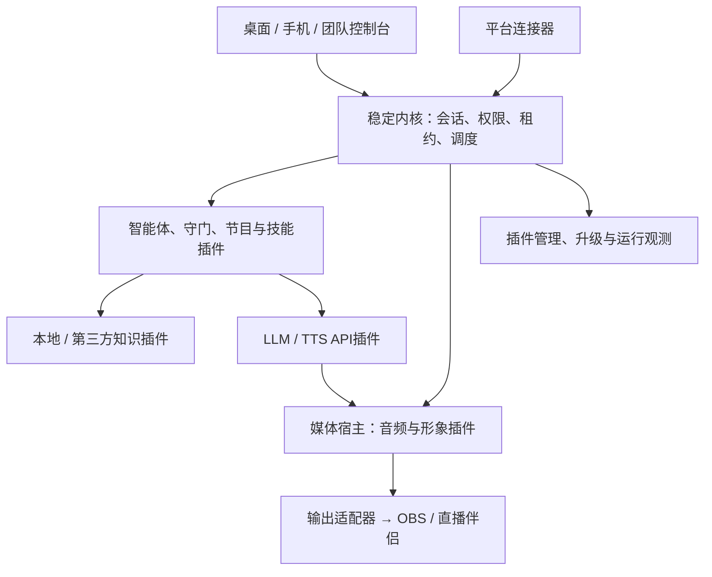
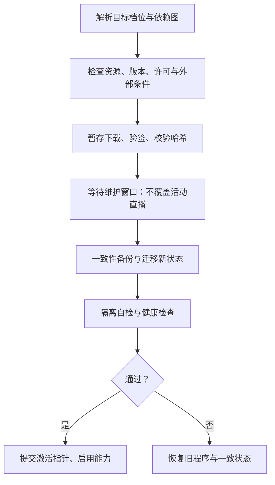

# 直播数字人 + 智能体系统设计方案 V3.4

> 2026-10-07 · 统一内核、插件化能力、Lite / Standard / Pro 按需部署与一键升级。
> 首发 Windows 桌面与抖音，支持扩展快手、视频号及其他平台。
> 固定要求：LLM / TTS 使用 API；本地知识库与 RAG，兼容第三方知识 API；写实数字人运行端 Rust + ONNX Runtime，不依赖 Python 部署。
> 本文为完整独立设计基线。技术可行性以完整链路、兼容性、隔离、性能和稳定性判断；经济可行性重点是运行与维护成本，不以分期、降低扩展性或研发工作量替代。
> 尚未取得平台授权或完成模型、硬件、真实直播实测。数值均为设计预算或验收目标；不能宣称已经实现。

## 1. 设计目标与 V3.4 修订原则

**统一稳定内核 + 版本化能力契约 + 按需插件 + 多部署配置。Lite、Standard、Pro 是同一产品的能力预设，不是三套代码、三套数据库或三条架构分支。**

V3.4 修正 V3.3 以分期交付、开发投入收敛为主的优化方式。保留完整扩展体系，低成本来自“未使用能力不加载、不常驻、不占云资源”，而不是删除未来能力或为低配重写架构。

| 评价维度 | 本版关注 | 判定方法 |
|---|---|---|
| 技术可行性 | 完整模型与音画输出是否成立；插件与内核能否兼容；故障是否隔离；多会话和升级是否可靠 | 原型与完整链路验证、契约一致性、故障注入、真实目标环境基准 |
| 经济可行性 | 云CPU/内存、GPU、API、带宽、存储及维护成本 | 三档同负载计量、闲置资源回收、账单对账、恢复与升级维护指标 |
| 实用性 | 按需安装、一键升级、简单开播、可解释降级和快速接管 | 用户操作验收，升级/回滚/断网/设备变更测试 |
| 扩展性与灵活性 | 新平台、知识、模型、形象、输出和部署可独立扩展 | 新能力不修改核心会话机制，能力可替换，状态可迁移 |

本地优先并不等于禁止云端；云端可选也不等于云服务无法提供高级能力。Pro 可以完全本地部署，也可以使用轻云控制面或远程渲染，按实际需求选择。所有档位保留同一扩展协议、故障恢复和数据迁移机制。

写实形象与简单2D均为独立能力包。2D降低资源占用，写实包按完整模型Gate准入；不能以自动退回2D宣称写实目标已满足。插件资源最低要求、平台授权和素材许可属于实际约束，一键升级不会消除这些前提。

### 1.1 不可破坏的架构约束

1. 核心业务在无自建云主机时可运行，API供应商服务另计；下载更新、可选中继和集中管理不成为播报必要依赖。
2. 三档共享内核、契约和数据模型；升级只改变能力集合、资源配置与必要的数据版本。
3. 所有档位支持本地知识接口、第三方知识接口与Provider替换；差异体现在预装能力、规模和管理功能。
4. 自动互动权限由平台与账号批准条件决定，不由档位、许可证或LLM自行授予。
5. 未启用插件不启动；启用但闲置的非实时能力按策略休眠。正在直播的实时输出、守门和租约监督不能为省资源被随意暂停。
6. 内核、插件、数据与部署方式各自版本化；扩展开发不依赖UI或平台SDK的内部实现。
7. 能力缺失按显式降级表处理；权限、事实、守门失效必须撤销对应输出，不能自动跳过检查。

## 2. Lite / Standard / Pro 能力与部署矩阵

### 2.1 三档能力预设

| 能力域 | Lite 默认组合 | Standard 默认组合 | Pro 默认组合 |
|---|---|---|---|
| 内核与契约 | 完整统一内核、升级器、权限、租约、审计 | 同一内核 | 同一内核 |
| 平台 | 手工/回放；可安装一个已批准的平台连接器 | 抖音已批准连接器、平台事件治理 | 多平台连接器、独立能力快照与会话策略 |
| LLM / TTS | API，Provider可配置替换 | API，增加主备、场景路由 | API，增加共享网关/团队配额等可选能力 |
| 本地知识 | 权威事实、中文词法、基础语义RAG可配置 | 混合检索、快照、权限与质量评估 | 多知识空间、集中发布、细分权限和服务化 |
| 第三方知识 | 可安装HTTP适配器，与本地统一契约 | 多来源融合与故障回退 | 多空间路由、团队权限、集中凭据等 |
| 智能体 | 规则、模板、短回复、限队列与审批 | 节目编排、只读技能、回放/影子评估 | 扩展技能、策略组合、跨会话运营，仍受权限限制 |
| 记忆 | 工作记忆与有界场次摘要 | 场次记忆及检索 | 可选长期记忆；观众画像默认关闭 |
| 形象 | 授权简单2D，形象契约完整 | 2D + 通过Gate的写实ONNX包 | 多形象与资源调度，可选远程渲染 |
| 输出 | 已验证的窗口/音频采集及录制 | 更多已认证输出适配器 | 多会话独立输出与集中监控 |
| 管理 | 桌面；手机包可加装 | 桌面 + 手机管理包 | 团队、角色、设备与集中管理 |
| 会话预设 | 单活动会话 | 单活动会话，更完整业务能力 | 多活动会话；数量由硬件、API与平台条件限额 |
| 自建云依赖 | 无 | 无；手机异地访问可选中继 | 无强制依赖；集中管理/中继/云渲染按需 |

矩阵表示默认预设，不是硬编码禁止加装。Lite可加装写实、手机或第三方知识包，只要依赖与资源允许；组合偏离预设时标为“Lite + 自定义能力”，仍享有一致升级路径。Standard/Pro预设可关闭不需要的模块，但安全门控和相关依赖不能关闭。

技术能力与商业授权分开设计：如果以后收费，权益插件只能影响安装/启用，不改变契约、数据格式，也不得让许可证服务器短暂不可达直接切断已有合法运行会话。离线权益有效期及到期行为明确配置；本方案不默认建设商业许可证服务器。

### 2.2 升级后的能力状态

“已安装”“依赖已满足”“通过健康检查”“平台已授权”“可激活”分别显示。硬件不足时可以完成插件安装并标记不可运行，不显示“写实已启用”。Lite直升Pro与Lite→Standard→Pro使用同一迁移图，不要求用户先购买/安装中间档位。涉及核心程序升级时由同一升级编排器执行，不要求手工重装。

### 2.3 三种部署配置

| 配置 | 运行形态 | 适合 | 必需自建云资源 |
|---|---|---|---|
| Local | 内核、知识、媒体与连接器在工作站；LLM/TTS API直连 | 三档均可；最低云资源成本 | 0台云主机 |
| Hybrid | 本地保持实时链路；轻量远程管理/中继、共享配置可选 | 异地手机、团队管理、多工作站 | 按需一个轻量服务或复用已有服务 |
| Distributed | 会话引擎/知识/渲染按能力远程部署，边缘输出与接管保留 | 多站点、集中模型管理、有实际GPU共享收益 | 按工作负载扩容，无固定强制集群 |

部署配置与档位正交。Local Pro不强制Redis/NATS/PostgreSQL/Kubernetes；Distributed也不意味着每个模块都拆成微服务。平台桥接与媒体输出的OS/宿主要求必须保留在相应边缘节点，不能假定Linux云机能运行Windows平台SDK或虚拟音频设备。

## 3. 稳定内核与控制 / 媒体架构



音频箭头表示数据流。API返回音频须经过内核授权门控，不能绕过批准直接播放。移动UI只管理状态和命令，不持有核心媒体时钟。

### 3.0 技术栈与代码组织

| 部分 | 推荐实现 | 维护约束 |
|---|---|---|
| 内核/会话/本地插件SDK | Rust + Tokio + 版本化Schema | 一个核心代码线，OS相关实现放适配层 |
| 桌面控制台 | Tauri 2 + Web UI Shell | 插件导航/配置Schema动态注册；UI不持有唯一媒体窗口 |
| 本地通信 | 受ACL保护的Named Pipe，有界二进制消息 | 不开放无认证公网RPC；跨平台可换对应IPC |
| 写实运行 | Rust ort + ONNX Runtime，CUDA为认证后端之一 | 版本矩阵锁定，模型与运行库按需下载 |
| 平台SDK | 必要时薄C++桥接进程 | 官方SDK边界内转换事件，不把业务塞进桥接 |
| 知识/事实/基础状态 | SQLite + FTS5 + 嵌入式向量实现 | 单机低维护；存储/检索契约支持服务化实现 |
| 轻云控制面 | 可复用Rust HTTP/WSS服务，单进程部署 | 不携带模型权重，不默认搭全套微服务 |

代码按`contracts / kernel / plugin_hosts / plugins / media / desktop_shell / updater / deployment_profiles`组织。示例清单中的版本号表示设计示意，实际程序版本和支持范围由发布清单确定。

### 3.1 内核职责

内核提供八类机制：能力与契约登记、生命周期/健康检查、会话与epoch、优先调度/有限队列、权限与租约执行、配置/密钥访问、控制通信与媒体通道协商、审计/观测接口。升级器与外部监督可独立进程或低开销工具，不必须全部驻留内核。

内容策略、风险分级、知识排序、LLM选择、节目脚本和形象属于插件或配置，不写死在内核。安全不变量不能被可编辑策略撤销：无权限不得外发、旧epoch不得播报、审批必须绑定对象、失联租约到期静音、敏感事实必须来自有效依据。

内核只有契约依赖，不引用平台SDK、模型权重或Provider专有格式。版本稳定指保证公开契约和数据兼容策略，不承诺永不更新或与任意未来插件永远兼容。

### 3.2 宿主与隔离

| 宿主 | 适用 | 成本与边界 |
|---|---|---|
| `inproc` 编译期模块 | 官方审查的规则、调度、基础检索等 | IPC成本低；不隔离原生崩溃、OOM、忙循环，不能强制安全终止线程 |
| `subprocess` 原生插件 | 平台SDK、GPU/模型、复杂解析、第三方原生实现 | 有独立故障边界；并非自动权限沙箱，须配ACL、Job Object、受控凭据等 |
| `remote` 远程能力 | 第三方知识、API网关、云渲染、集中管理 | 按网络延迟、带宽、身份认证和断连行为验收 |
| `wasm` 受限插件 | 合适的规则/只读变换等扩展 | 可作为可选宿主；限制内存、执行fuel和导入能力，适用能力需逐项认证 |

四类宿主属于完整架构。每个插件声明其实际支持的宿主，不要求所有插件都实现四份；一种能力有多个宿主实现时应通过同一契约套件。低配Local默认采用进程内可信模块与一个媒体进程，装平台连接器后按其要求增加桥接进程。闲置插件不额外起进程，模型在媒体宿主中按包管理；高风险第三方模块不为节省数十MB而与内核共进程。

禁止将未知原生DLL直接加载进内核作为通用运行时插件。`inproc`需要核心程序包含该实现，升级器可自动取得对应已签名程序版本；独立进程/WASM插件可按清单安装。签名证明发布来源与完整性，不证明安全；准入策略由内核信任库、审核记录和撤销列表决定，不接受插件自报“可信”。

### 3.3 会话隔离与资源治理

从Lite开始，所有状态以`session_id`隔离，默认只创建一个活动会话。Pro激活多个会话时不重写业务：每个会话独立epoch、授权、队列、预算、知识绑定、审批和输出ID。共享只限不可变模型、只读知识快照和受控Provider连接池；不能把A会话审批或音频送给B会话。

资源治理插件实施每会话与全局CPU/内存/GPU/API/输出配额。GPU吞吐、显存、音频时序和API配额分别做准入；新会话容量不足时拒绝或等待，不能让已开播会话OOM。复用同一模型权重不代表所有形象状态和中间张量可共享，必须测峰值。

### 3.4 控制与媒体分离

控制消息有界、小载荷、优先处理紧急命令；PCM用有界二进制环形缓冲，图像留在媒体宿主内部或走已验证共享内存/纹理通道，不通过JSON/Base64控制总线传帧。内核协商通道、租约与失效，不逐帧解析像素。

本机总线采用进程内有界队列 + 受保护Named Pipe等IPC；不因Pro就强制外部消息服务。跨节点确需持久分发时可以增加NATS等适配器；媒体仍不走事件broker。事件投递可采用至少一次和幂等处理，音频跨故障不宣称严格exactly-once：状态不明的旧句不自动重播。

### 3.5 独立监督与本地静音

媒体进程本地检查引擎授权短租约，建议200ms续租、600ms失联截止为初值；引擎卡死时租约仍可到期。系统低开销监督程序可重启引擎，重启只恢复待机和状态，不自动恢复旧审批/旧自动权限。

媒体拥有专用静音通道/热键；控制台关闭不导致媒体窗口消失，但必须检查有效值守。媒体进程崩溃可能导致出画中断，OBS/伴侣预置待机场景并提供明确恢复路径；不承诺一切故障下画面无缝连续。静音目标是本地输出，平台端已缓冲数据不可撤回。

## 4. 插件体系、契约与生命周期

### 4.1 能力目录

| 契约 | 范围 | 可替换实现 |
|---|---|---|
| `platform.events@1` | 统一事件、权限快照、连接状态 | 手工/回放、抖音、快手、视频号 |
| `agent.decide@1` | 路由、候选、说/不说、工具计划 | 规则、短回复、受限智能体 |
| `guard.check@1` | 内容、事实、权限、审批要求 | 规则/事实校验、额外模型审核；所有外发必需 |
| `knowledge.retrieve@1` | 权限过滤后的证据与状态 | 本地事实/FTS/向量、第三方HTTP |
| `memory.access@1` | 工作/场次/长期记忆 | 本地有界存储、团队服务；按许可启用 |
| `skill.invoke@1` | 有限可授权的技能 | 精确事实查询、业务只读接口、经过批准的通知 |
| `show.plan@1` | 节目与场景节奏 | 本地脚本、可替换编排器 |
| `llm.generate@1` | 结构化生成、usage与取消 | 不同LLM API、可选共享网关 |
| `tts.synthesize@1` | 音频、格式、音色版本、可用时间信息 | 各TTS API |
| `avatar.render@1` | 音频时间轴、动作→帧 | 2D、Rust ONNX、授权3D、远程渲染 |
| `output.deliver@1` | 画音输出、录制和设备检查 | 窗口采集、认证输出插件 |
| `control.manage@1` | 状态、审批、接管与实际ACK | 桌面、手机、团队 |
| `storage.persist@1` | 状态/事务/快照，不混用向量格式 | 嵌入式SQLite、服务端关系存储 |
| `runtime.observe@1` | 有界指标、日志、诊断 | 本地面板、集中观测 |

能力目录完整保留，但必需性按运行场景计算：普通寒暄不依赖知识；知识回答必须有证据；API生成依赖LLM；使用缓存不依赖在线TTS，但仍依赖守门、版本与授权。多实现选择按显式配置/优先级，不能随机挑选“能响应”的插件。

### 4.2 插件清单示例

```toml
plugin_id = "avatar.realistic.ort"
plugin_version = "1.2.0"
manifest_schema = 1
kernel_range = ">=3.4.0,<4.0.0"
contract = "avatar.render@1"
supported_hosts = ["subprocess"]
activation = "on_session_start"
idle_policy = "keep_warm_during_session"
requires = ["audio.timeline@1"]

[resources]
profile_id = "certified-windows-cuda-model-A"
# 实际资源门槛来自认证profile，不填虚构显存值

[permissions]
network = false
media_output = true
secrets = []
```

`audio.timeline@1`为媒体宿主基础接口，由运行时能力目录登记。清单还需包含OS/架构、依赖版本、模型/素材哈希、许可、安装大小、配置Schema、数据Schema、迁移钩子、健康检查、回滚兼容范围和供应商价目口径。资源预算与兼容认证独立存档，不能由插件随意降低门槛绕过准入。

### 4.3 生命周期与休眠

`Absent → Installed → Validated → Ready → Active → Idle → Suspended`；错误进入`Failed`，升级进入`Draining`。Ready只表示依赖/自检通过，平台授权未通过仍不能激活真实事件。

按需启动例子：Lite没有写实包，不下载权重/ORT GPU依赖；第三方知识只在被路由查询时调用；文档解析任务结束后退出；移动管理未启用，不开中继连接；非直播期间模型可卸载，直播期间预热策略优先保障时延。休眠前flush必要状态，解除资源句柄，恢复后重新授予租约，不继承过期命令。

### 4.4 兼容、权限与动态配置

契约主版本不兼容拒绝连接；同主版本可选字段增补，协商范围并测消费者容错。插件代码不得直接依赖另一个插件实现，依赖通过能力声明解析；循环依赖拒绝安装。进程内实现改变需要程序更新，不能在UI标为“动态热加载成功”。

直播中可变更：预算收紧、权限撤销、知识失效等立即生效；Provider配置于句边界切换；程序/模型/形象包更新只暂存，不在活动会话直接替换。放宽策略需明确授权并重新判断平台能力。

### 4.5 事件、候选与审批

统一事件包含平台、房间来源、session、event ID、事件/接收时间、载荷版本、权限来源和脱敏标识。候选包含utterance ID、epoch、到期时间、文本、屏幕文本、证据及事实版本、策略/音色版本、有限动作。审批绑定候选哈希、会话/epoch、角色与TTL；改字、换事实或换会话后重新审批。模型生成的“已批准”字段没有授权效力。

平台文档未说明的事件标记unknown；第三方知识只返回答案时标记“无可核验原文”，不冒充证据。敏感输出不能因为接口形式相同而提升信任等级。

## 5. 直播决策与播报容量

核心不是让每条评论进入 LLM，而是决定“哪些值得播、还能播多久、是否已过时”。一个观众问题的典型过程：去重/过期检查 → 规则选中 → 必要时检索 → 一次结构化生成 → 内容与事实校验 → 审批或自动门控 → 分句 TTS → 音画输出。

### 5.1 分级路由

| 路由 | 适用 | 调用策略 |
|---|---|---|
| 固定模板 | 低频欢迎、礼物合并感谢、已批准节目句 | 不调 LLM；可复用有效 TTS 缓存 |
| 直接回答 | 一般互动、非敏感闲聊 | 一次短上下文 LLM，不再先做独立模型分类 |
| 知识回答 | 产品规格、活动解释、售后政策 | 检索证据后一次 LLM；事实核验失败转人工 |
| 人工处理 | 缺证据、争议、个体承诺、越权要求 | 给操作员候选，不自动对外发声 |

多步工具规划作为可选agent/skill能力，不进入低延迟默认实时主链路；Pro启用也必须有截止时间、步数和权限上限。固定事实查找和只读查询使用显式函数；网络请求即使名义上“只读”，也要由受控凭据、目标白名单和超时保障。对外发通知、发消息是写操作，只有事先授权的具体场景才能开启。

### 5.2 可播时长预算

建议初值：回答 20–40 个汉字，正常上限 60 个；最终以实际 TTS 时长为准。用 3 字/秒估算，30 字占 10 秒，50 字占约 17 秒。若整分钟只允许 30 秒互动，一个分钟只能容纳约 3 条 10 秒回复。不能用 API 每秒处理能力推导直播应答量。

维护语音债务：当前剩余时长 + 排队待播时长。建议最多一个正在播句、两个短待播任务、总待播不超过 20 秒；达到阈值后拒绝继续生成，或合并相近问题。时间敏感评论超过初值 15 秒重新判定，不补播旧场次、旧活动、旧库存的回答。

优先级：紧急静音/接管 > 人工点播 > 已批准关键节目句 > 相关产品问题 > 合并感谢 > 泛化寒暄。高优先级不意味着自动打断每句话；普通插播在句边界处理，明确接管/风险撤销立即取消。

### 5.3 流式并不意味着未经检查即播放

LLM 可以流式接收，但完整句段经过守门后才能送 TTS；金额、优惠、库存等要求完整回答校验或使用锁定模板。TTS 音频段带序号和音频时间戳；取消后迟到数据按 epoch 丢弃。队列清空、缓存残留和输出设备缓冲都纳入打断测试。

API 超时的模板回退仍需符合当前事实、授权和风格；缓存不是免审通道。重试必须由预算和截止时间控制，过期任务不重试；TTS 不确定状态下避免重复合成造成重复播报。

## 6. 模式、安全与人工接管

| 模式 | 外发行为 | 进入条件 |
|---|---|---|
| 演练 | 仅本地预览/录制 | 无平台数据权限也可运行，标明模拟来源 |
| 人工辅助 | 人工审批后播放；操作员可直接选择批准模板 | 输出检查通过、现场操作员可接管 |
| 受监督自动 | 仅限定内容与任务可自动播报 | 明确平台/账号允许、知识与守门可用、预算正常、人工监督租约有效 |

自动模式不是默认值。平台能力分 `granted`、`denied`、`unknown`；文档没列出某事件应标 `unknown`，不能自行认定“绝对不支持”或“可借其他接口获取”。权限与用途约束取最严格交集，策略包只能在允许范围内收紧或选择行为。

操作风险分为 `risk_0` 普通回答、`risk_1` 有事实依据的产品解释、`risk_2` 需人批准的外部可见行动、`risk_3` 禁止行动。避免与知识级别、版本发布线共用 R0/R1 命名。改价、转账、商品上下架、封禁、配置修改等能力不暴露给模型。

值守可以由桌面或已授权设备承担；手机网络心跳只是在线状态。自动模式值守租约的期限由场景设定并要求操作员主动确认；单纯心跳不能续期。值守到期停止启动新自动回复并在短期限内撤销输出授权，不统一使用 120 秒“继续自动播报”宽限。若桌面仍有人值守，手机断线不应误判无人。

知识、守门或授权依赖缺失时，停止相关自动内容；禁止因守门故障绕过到备用 Provider。切换更严格策略、撤销知识权限、活动失效、会话结束都会增加 epoch，使旧审批和旧音频失效。

## 7. 本地知识库与 RAG

### 7.1 分层与权威来源

| 知识层 | 内容 | 默认存储/检索 | 发布与有效性 |
|---|---|---|---|
| KB0 权威事实 | 商品 SKU、规格、价格、库存口径、活动条件 | SQLite 结构化表，精确 ID/别名查询 | 显式版本、有效期、发布人；缺少实时库存接口时只说已核实信息 |
| KB1 文档与 FAQ | 说明书、售后政策、已批准问答 | 中文分词 + FTS5/BM25 | 原文位置、产品范围、文档版本、权限 |
| KB2 语义检索 | 自然表达问题、较大知识集 | Embedding API + 本地向量索引，与词法检索融合 | 按模型、维度、归一化规则分隔索引 |
| KB3 外部知识 | 第三方知识服务 API | 与本地同一接口，但保留返回能力与信任标记 | 超时、来源、费用、TTL、是否允许上传原文 |

价格、承诺和活动规则优先 KB0，不以向量相似度推导。文档有价格但结构化事实不同，按明确权威源处理并提示冲突，不让 LLM自己选择更“合理”的数字。知识存储本地不等于数据从不出本机：Embedding 和 LLM API可能收到查询或证据片段，界面需展示每个 Provider 的上传范围；禁止上传的数据只走本地词法检索/人工处理。

SQLite FTS5 默认 `unicode61` 不是中文词法分词器。默认组合用可验证的中文分词预处理索引或自定义 tokenizer；trigram 可以用于部分子串检索，但不应当作普适中文语义检索，也要测试一、二字短词。[S4]

### 7.2 检索流水线

产品/场景过滤 → 精确事实查询 → 词法检索 + 必要时向量检索 → RRF 等融合 → 取少量证据 → 生成 → 对重要实体与事实逐项校验。检索和生成前都执行权限过滤，返回后再校验版本与有效期。无证据、有冲突或已过期，优先澄清/转人工，不能要求模型“自信地补全”。

初始参数仅作调试起点：切块约 300–600 中文字，重叠 50–100 字；按标题、产品与条款边界切分；候选检索各 10–20 条，最终送入 3–5 条。表格按行及相关表头组织，不按任意字符截断；先用质量集调参，再考虑重排 API。

小规模知识库先验证词法检索是否已足够，向量是按质量需求启用的能力。向量实现优先嵌入式、可随安装包部署的成熟实现，并锁定版本；默认组合不引入独立 Qdrant/Milvus 服务。大型、多用户、复杂权限profile可按知识接口选择独立服务，档位升级不强制迁移。

### 7.3 发布、失效与删除

导入 → 解析预览 → 产品/权限标注 → 小样评估 → 人工发布新快照。直播中不全量索引，后台严格限速。KB0 活动或价格更新后，立即取消依赖旧版本的候选句、审批与语音缓存；新事实发布前不对外讲新价格。

删除/权限撤销先同步阻止检索、缓存和播报，再异步清除向量、日志中允许删除的副本与临时文件；备份保留和清除期限明确列出。Embedding 模型变更需独立重建索引，不能混用向量空间。

### 7.4 知识验收

准备至少 100 个贴近真实直播的问题，覆盖正常、别名、中文短词、错别字、产品混淆、过期活动、无答案、权限撤销、恶意指令和外部知识超时。设计门槛：有证据问题 Recall@5 ≥90%；高风险事实测试集不允许错误自动播报；无答案集应正确澄清/转人工。门槛通过只是该测试集结果，不等于实际零错误。检索延迟、证据正确率、最终答案正确率分别报告。

## 8. LLM、TTS 与 Provider 策略

本版本不部署本地 LLM/TTS。Embedding 默认 API，允许纯本地词法模式；本地音频特征模型属于数字人渲染管线，不属于本地 TTS。

首选一个支持中文、结构化输出、明确数据政策和足够并发配额的 LLM；一个经目标网络验证的中文流式 TTS。先验证单供应商完整链路，再接第二供应商进行替换测试。云AI网关作为可选插件/远程Provider，所有档位可加装；不启用时不启动服务。单机密钥使用系统凭据存储，前端不持有密钥。

Provider 配置记录：地区、模型版本、输出格式、流式方式、上下文与速率限制、超时、重试、价格单位、数据留存策略。不同 TTS 对标点、汉字、数字、SSML、音色复刻和时长的计费规则不同，不能统一按“一字一元参数”处理。[S5]

TTS 接入必须测量首包、可播放首段、最终时长、格式、重采样、错误状态和取消；不得假定都有音素时间戳、相同音色或相同情绪控制。无音素信息时，2D 使用幅度驱动开合嘴，界面描述为“音量驱动嘴型”，不宣传精确音素口型。

主备 LLM 可以映射同一契约，但需分别通过提示词与安全回归。TTS 换供应商可能改变音色；默认在句边界经操作员确认切换或改用已批准缓存，不在一句中拼接两个供应商音频。

若选择企业网关，直连回退只有本机有合法凭据且数据政策允许才可启用；网关不可用并不天然意味着可绕过。

## 9. 数字人形象与媒体管线

### 9.1 2D 与写实各自的定位

Lite默认2D包用已授权的简单分层纹理、嘴部开合和少量循环动作；不必先接入 Live2D/Spine SDK。可以利用集成显卡渲染，不承诺“零 GPU”。商业素材、引擎、音色和人物肖像分别核对许可。Live2D 的可扩展应用、VTuber 跟踪及部分 AI/聊天应用有专门发布许可条件，不能把 SDK 下载免费当作商业发布免费。[S6]

写实版优先验证实际可取得的完整模型包，再讨论 Rust 适配。公开项目提供 Python 推理或 ONNX 导出脚本，不足以证明完整实时管线已能在 Rust 上部署。不得只导出嘴部网络后，把缺失的音频编码器或预处理留在未声明的 Python 服务中。

### 9.2 写实 Rust ONNX 完整链路

PCM → 重采样/标准化 → 滑窗和必要的未来上下文 → 频谱/特征预处理 → 音频编码器 → 形象条件与生成网络 → 后处理/贴合 → 合成输出帧。涉及人脸检测、裁剪、关键点、掩码、头像预计算时，一并列入模型包和资源清单；离线可预计算的内容尽量不放实时链路。

每个模型包必须给出输入输出名称、shape、dtype、采样率、窗口、步长、未来上下文、帧率、ONNX opset、归一化、预处理校验样例、权重哈希、授权及兼容运行时。音频特征窗口需要未来音频会产生固定等待，应计入开口延迟；不能只测单次网络耗时。

运行端 Rust `ort` + ONNX Runtime，Windows NVIDIA CUDA 首发。锁定 Rust crate、ORT、CUDA、cuDNN、驱动兼容矩阵与打包方式；ORT CUDA EP 对 CUDA/cuDNN 主版本存在明确要求。[S3] TensorRT、DirectML属于可选执行后端，单独认证；不因某算子能落 CPU 就假定整条写实链路仍实时。

### 9.3 写实插件的模型准入Gate

| Gate | 必须提供的证据 | 失败处理 |
|---|---|---|
| G0 来源与授权 | 全部权重、代码、训练素材/肖像/声音的可用权利；可取得完整流程 | 授权不成立则不用，不能先开发后补 |
| G1 正确性 | 原实现与 Rust 流程的固定输入对齐；预处理、音频特征、生成和后处理逐段验证 | 修复或换候选模型，不以观感“差不多”替代 |
| G2 实时性 | 实际目标机同时运行直播工具的整链路帧率、延迟、VRAM、CPU和温度 | 降分辨率/档位且重新测；不达标不进正式写实包 |
| G3 操作与稳定性 | 静音、取消、句边界、长播、OOM、进程重启、形象切换与输出恢复 | 不发布该档位；仅保留已验收降级形态 |

Gate用于判断具体模型插件是否可运行和发布，与产品分期或开发工作量无关。完整链路不成立时更换模型实现或标记插件不可用，内核和其他能力保持兼容；不通过隐藏缺失组件或无条件降级来宣称该写实插件验收成功。

## 10. 实际直播输出与平台接入

### 10.1 先选一条可验收输出

默认组合使用媒体进程固定出画窗口，独立音频输出路径，由 OBS 或直播伴侣采集。先实测目标版本能否稳定捕获该窗口、窗口最小化行为、缩放、透明/绿幕及音频设备；不能只在预览窗口看到画面便认定已接入直播。

选择设备捕获、应用音频或已授权虚拟音频设备，按目标工具的实际支持定案。虚拟摄像头的视频不能替代音频链路；FFmpeg/录制文件也不等于已经拥有 Windows 虚拟摄像头。默认组合不开发摄像头驱动，不默认堆叠 NDI、Spout、虚拟相机多套输出。

音频设备使用稳定标识并校验默认设备变化；只允许一条有效路径，避免 OBS 与伴侣重复收音或回声。录制和推流可以共用画面，但必须分别验证接收、声道和音画同步。

### 10.2 抖音

官方互动工具文档列出 exe 与小程序形态：exe 在直播伴侣运行，小程序可在 App 与伴侣运行；开发产物审核/上线后不可任意变更。[S1] 这是具体互动工具产品的接入路径，不等于外部任意数字人应用已得到许可，也不能证明手机能直接把数字人视频输入直播。

准入验证时同步确认用途、事件权限和产物类型，并用官方调试方式验证 SDK 启动、事件、IPC和退出。[S2] 调试成功不等于上线授权；正式产品在获得相关批准后验收。未取得官方事件权限时，系统保持手工/回放模式，不把非官方抓取作为正式替代方案。

桥接由平台宿主启动，连接已有引擎；双方检查本地身份与会话令牌。处理多次启动、伴侣重启、端口占用、SDK失联、消息重复、旧直播间事件、时间漂移和能力撤销。平台断线后禁止凭缓存继续假装真实互动，重新连接不自动恢复旧自动权限。

room_id 使用平台明确提供或经批准映射的真实来源；没有可验证来源时，不伪造房间绑定。事件按平台消息 ID去重；没有可靠 ID 时使用有界窗口和降级去重策略，明确可能误合并。缺少关注等事件时只关闭对应功能，不自行合成。

### 10.3 快手和视频号

快手/视频号属于同一平台插件目录，可按需安装；本版尚未核实其具体官方数据/推流接口，不宣称已可上线。实际扩展需重新完成用途准入、事件接口、输出与账号权限验证，不把“换 URL”当作连接器工作量。

## 11. 桌面、手机与云管理的统一能力

手机管理包可加装到Lite、Standard、Pro；Standard/Pro预设包含该能力，但连接方式由部署profile选择。其功能是看状态、审批、接管、静音与管理，和手机本地开播/生成视频是两个独立能力。

| 连接方式 | 云主机需求 | 实际约束 |
|---|---|---|
| 同局域网直连 | 不需要 | 原生客户端可验证配对密钥/证书；Web客户端必须有浏览器信任的HTTPS，不以二维码指纹代替信任 |
| 用户已有VPN/可信网络 | 可复用现有服务 | 仍要求应用身份认证、HTTPS与角色检查；VPN不代替应用权限 |
| 自托管HTTPS/WSS中继 | 一个轻量服务，可与控制面合部署 | 外网只由工作站主动建立连接；闲置不发视频，连接数和流量配额 |
| 合适的按需平台服务 | 不自建常驻VM也可能可行 | 必须核对长连接时限、冷启动、计费、地域和维护成本；不假定serverless完全免费 |

Web/PWA需可信域名HTTPS。Service Worker安全上下文限制不能用手机访问LAN HTTP绕过。[S7] 原生壳可以独立提供证书固定，PWA不能通过扫描指纹自动信任自签证书。已有反向代理/证书基础设施可复用；没有时提供向导，不默认让用户手动维护多套服务。

默认仅传状态、审批文本和低频缩略图。连续预览按需开启，采用真正编码的低码率流，WSS只传控制；关闭预览立即释放编码器与网络。手机锁屏/后台断线后不补执行旧审批，也不承诺浏览器后台保活。只读设备、审批员、管理者各自明确权限；静音是独立授权能力。

中继终止两段TLS时可读取业务内容，不能宣称端到端加密。需要中继不可读时，使用经审核的端到端协议及设备密钥管理，单独验收；不以自行设计的加密方案降低维护成本。

命令包含设备身份、session/epoch、命令ID、序号、状态版本与TTL，服务端鉴权/去重、防重放，返回实际执行ACK。恢复自动权限不能靠重连触发。桌面本地静音保留为不依赖云的路径。

手机本地执行的能力包纳入扩展目录，但必须独立认证Android/iOS、温控、电量、后台策略及平台画面入口；桌面升级不等于手机自动具备本地写实能力。

## 12. 开播操作与界面

控制台默认四个入口：直播台、知识、形象/Provider配置、运行记录。插件可注册节目、技能、团队、平台、部署与升级导航；菜单按能力状态动态展示，保持同一Shell与UI扩展契约，不维护三套界面。

直播台同屏展示：真实画面/音频电平、事件来源、当前模式、当前播报与队列秒数、待审批候选、证据与失效时间、API/预算/设备状态。固定可见的暂停自动、立即静音、人工接管按钮；审批按钮显示最终文本，不能只显示“同意模型回复”。

开播流程：选择场景 → 检查形象与事实版本 → 测音频及画面 → 连接真实事件或明确手工来源 → 确认运行模式与值守 → 开始辅助播报。配置全部持久化，但自动权限和上一场审批不跨会话继承。

异常显示可行动的说明，例如“知识 API超时，本问题未播报，可人工回答”“音频设备已变化，请重测”“平台数据断开，已关闭自动互动”。不能只展示 `plugin failed`。关闭管理端与结束直播是不同操作：关闭 UI时明确剩余运行状态；无有效值守则退出自动权限。

场景包包含角色口吻、产品集合、禁答范围、批准模板、节目节奏、音色/形象、知识来源和预算。涉及事实/权限变更才强制相关回归；普通界面偏好不触发全部黄金集。热键无需确认即可静音；恢复自动播报需明确操作和条件复核。

## 13. API、电力与流量的可复算运行成本

### 13.1 完整成本公式

月运行维护成本 = LLM + TTS + Embedding/知识API + 自建云CPU/内存/GPU + 网络/中继 + 存储/备份/日志 + 本地电力/设备摊销 + 持续授权/平台费 + 实际维护人工。运营值守单独列示，不假设无人化节省。研发投入不作为本版架构取舍的主指标。

LLM = 输入百万 Token × 输入单价 + 输出百万 Token × 输出单价；实际包含额外分类、总结、重试与缓存计费差异。TTS按供应商计费文本或输出秒数计算；预生成节目语音也产生费用，只是在多次有效复用时摊薄。第三方知识可能按调用、套餐或席位收费，不能默认免费。

### 13.2 一个可复算的示例

以下仅用于预算模型，不是选型报价或收益承诺。假设每天 8 小时、每月 26 天；讲话占时间 30%，平均 3 个中文字符/秒；40%播报文本来自仍有效的本地语音缓存；每天400次 LLM调用，平均输入1500 Token、输出100 Token。输入/输出价格假设为2/6元每百万Token，需由实际模型报价替换。

| 项目 | 计算 | 月数量/成本 |
|---|---|---|
| 总播报文本 | 8×3600×30%×3×26 | 673,920 字符 |
| 需新合成文本 | 673,920×60% | 404,352 字符 |
| LLM 输入 | 400×26×1500 | 15.6百万 Token，31.20元 |
| LLM 输出 | 400×26×100 | 1.04百万 Token，6.24元 |
| TTS 按1元/万字符示例 | 404,352÷10,000×1 | 40.44元 |
| TTS 按3.5元/万字符示例 | 404,352÷10,000×3.5 | 141.52元 |
| LLM + TTS | 37.44 + TTS | 77.88–178.96元 |
| 预留15%额外调用 | 前项×1.15 | 89.56–205.81元 |

TTS的1元/万字符与3.5元/万字符仅为两档预算假设，不是当前供应商报价。实际厂商价格、地域、字符口径、时长计费和复刻费以官方价目核对。[S5] 不含音色复刻、知识 API、初始缓存合成、额外评估、网络与人工。1个汉字是否等于1个计费字符需按供应商规则核算。LLM两档单价是假设，与上述TTS品牌无绑定关系。

400次调用/日不意味着每次都播报，取消也可能已计费；应先排队准入再调模型。按上述时长和30字回答，平均互动容量约864条/日；节目播报、感谢和人工讲话会占用这个容量。实际直播用连续时长和真实任务分布测量，不能仅用日均负载设计。

### 13.3 成本敏感项

| 变化 | 影响 |
|---|---|
| 讲话比例从30%到100% | 同语速下TTS量约3.33倍，但不自动带来互动收益 |
| LLM 输入从1500到6000 Token | 输入费约4倍；先缩上下文，不立即换更便宜但质量未测的模型 |
| 每条评论先分类再生成 | 增加请求费用与延迟；规则先筛，一次生成优先 |
| 取消后仍无限重试 | 成本上升且内容过时；使用期限与有限重试 |
| 1Mbps连续手机预览 | 8小时×26天约93.6GB/月/观看端，不含协议开销；预览不是免费功能 |
| 总平均功耗150–350W | 208小时约31.2–72.8kWh/月；若0.8元/kWh则约25–58元，按实际整机测量替换 |
| 云GPU渲染 | 208小时×小时单价，另计带宽与维护；只有容量、成本和延迟验证通过才选择；Pro不自动迁云 |

语音缓存按最终文本、事实版本、Provider/模型、音色、发音规则和音频参数组合命中；不得因“语义相近”复用价格/承诺语音。响应缓存默认只用于允许的非敏感内容。

### 13.4 预算控制

设置每日/每场软硬预算、供应商并发限额、总生成率、TTS字符/秒数和第三方知识调用量。80%提示，100%停止新付费生成并转批准缓存/人工；比例可按业务配置。用供应商返回usage或计费文本估算做实时账，账单异步对账；没有统一余额API时不要显示虚构精确余额。

## 14. 最小云资源、低维护存储与三档成本

### 14.1 云端仅承载必要控制服务

| 部署组合 | Lite | Standard | Pro | 云端CPU/内存目标 |
|---|---|---|---|---|
| Local | 默认可用 | 可用，含本地写实 | 可用，多会话受本机资源限制 | 0：无自建云主机，不等于API免费 |
| Hybrid轻控制 | 可选手机/中继 | 手机与共享管理可选 | 团队/多站点可选 | 示例起点1–2 vCPU、1–2GB；仅低频控制，不承载模型/视频转码 |
| Distributed | 按需能力远程化 | 按需能力远程化 | 集中会话/知识/渲染 | 按真实并发和每项插件负载规划，不承诺一个2GB实例覆盖全部 |

轻控制资源是待测预算，不是云实例选型报价或容量保证。用实际空载RSS、连接数、TLS开销、数据库缓存、峰值审批与消息速率验证；达到内存70%/持续延迟阈值时告警并限流/扩容，阈值可调。录制、原始文档、Embedding向量和模型默认不经过轻云中继；转发连续视频也会增加带宽与连接开销，应独立计量。

升级清单可用签名元数据文件与HTTPS静态文件分发，不必运行专用动态更新服务器；Tauri官方更新器支持静态JSON或动态服务。[S9] 实际插件清单还要由本系统验签/校验依赖，不依赖客户端下载来源的口头可信声明。

默认不设置额外API网关、Redis、消息broker、对象存储集群、Prometheus全套和Kubernetes作为前置依赖。需要时可作为插件或部署依赖增加；没有对应需求时不启动。Serverless不是自动更省：长期WSS、频繁唤醒和状态存储可能更贵，应按连接小时、请求、流量和数据库账单比较。

### 14.2 存储与进程成本

本地SQLite保存配置/会话状态/事实/审计；FTS和向量在同机独立索引空间，文件目录保存模型和缓存。所有访问通过服务契约，不让第三方插件任意打开共享数据库。单写入owner、小事务、短读事务、限量连接和非直播高峰checkpoint，避免WAL无限增长。WAL要求同机，不把SQLite文件放在NFS/SMB供多节点共同写。[S8]

备份使用一致性在线备份/快照流程，不能只复制主.db而遗漏WAL数据。授权/配置等关键提交要求持久化，允许丢失的遥测独立缓冲；不得以降低关键数据持久性获得“低成本”。索引可重建，但权威事实和批准记录要有备份与恢复演练。

| 实际需求 | 推荐存储 | 增量维护 |
|---|---|---|
| 单工作站或单机Pro | SQLite + FTS + 本地向量/文件 | 无外部DB服务，统一备份 |
| 单云节点轻控制 | SQLite持久卷或复用已有合适DB | 验证写入峰值/备份；不放临时根盘，不能多副本共享写 |
| 多云副本/多写节点 | PostgreSQL等关系服务，通过存储适配器迁移 | DB备份/连接/升级；不假装SQLite跨节点共享 |
| 大向量库/高检索并发 | 可选独立向量服务 | 用检索基准决定，不能仅因升级Pro就启动 |

按负载启停worker，避免每个插件都独立进程。GPU模型仅在需要时下载/加载；场次内可保温防止首句冷启动，结束后经过闲置TTL回收。共享模型、连接池与缓存必须有会话隔离。视频编码与GPU模型不是同一预算，避免后台手机预览挤占正式出画。

### 14.3 资源和保留策略起点

| 资源 | 建议策略 | 验收重点 |
|---|---|---|
| 原始事件 | 有界队列；可选审计保留，默认脱敏 | 高频事件不无限落盘；重连不重播旧句 |
| 运行日志 | 轮转/采样；如7天与单机总量512MB起点 | 错误和审批关键记录单独保留，不因采样丢失必要审计 |
| 审批/事实变更 | 如30–90天，按业务与法定要求配置 | 期限、权限、删除/备份清除明确 |
| 录制 | 默认不上传；如总量20GB配额、低于磁盘安全余量停止新录制 | 不自动删除受保护证据，提示归档；停止录制不停止直播 |
| TTS缓存 | 有界LRU/TTL，如1GB起点 | 按最终文本/事实/音色版本命中，事实撤销即时失效 |
| 向量与知识 | 配额、增量索引、冷快照归档 | 模型空间隔离，旧索引回收前保留升级回滚条件 |
| 云中继 | 无会话不传内容；低频状态，预览即时关停 | 实际出口流量、长连接计费与隐私 |

配额都是配置起点。必须同时检查剩余磁盘和保留策略，不能固定20GB导致小磁盘被写满。压缩大日志、索引重建与上传限速并避开直播实时资源。

### 14.4 三档同负载成本对照

按第13章相同单活动会话负载比较，以区分“能力档位成本”与“业务量成本”：

| 项目 | Lite Local | Standard Local | Pro Local | Hybrid额外项 |
|---|---|---|---|---|
| 自建云主机 | 0 | 0 | 0 | 轻控制实例/既有服务分摊 |
| LLM/TTS | 约90–206元/月预算示例 | 同模型、同负载近似相同 | 单会话近似相同；多会话按实际量增加 | 网关可选，不必为中继重复调用 |
| 本地功耗 | 简单2D实测 | 写实增加GPU负载，整机实测 | 多形象/会话资源受调度限制 | 云渲染时计GPU费用，不能同时遗漏本地输出费用 |
| 知识API/Embedding | 按文档与查询量 | 按增强检索真实调用量 | 按团队/空间真实使用量 | 上传/共享存储与服务费用可选 |
| 维护 | 同一程序、嵌入存储 | 模型/驱动认证增量 | 会话与权限管理增量 | 证书、云备份、设备与服务观测增量 |

不要给每个档位固定“总月费”，因为模型、说话比例和会话数比档位名字更能影响费用。例：轻云实例80元/月、流量与备份20元/月为**占位假设**，则Hybrid相对Local增量100元/月；若10个工作站共享，基础费用平均10元/站，另加各站实际流量与运维。应替换为所选地域实际报价，不将占位假设写进销售承诺。

实际增量成本公式：升级运行增量 = 新插件CPU/GPU/电力 + 新API调用 + 新存储/流量 + 新维护事项；未启用云功能的本地升级不新增云主机项。云GPU成本 = 实际GPU实例在线小时×报价 + 存储/流量，模型加载时间与闲置分钟也收费；使用自动停机前需保证当前无活动输出租约。

### 14.5 维护成本控制

统一安装器、插件目录和兼容认证矩阵；禁止用户分别维护各模块脚本。Provider故障分类、设备重测、网络诊断、脱敏支持包和版本回滚内建。诊断包默认不带密钥、原始观众身份、未经同意的文档或录音。

三档共享回归套件、数据库迁移和配置Schema；升级先验证依赖图，避免用户手工排查DLL。低云配置可用一进程控制服务 + 一个持久存储，不必拆网关/认证/中继/审计多个服务。采用自动证书续期和失败告警，不能以取消TLS降低维护成本。

指标包括每次升级需人工步骤数、故障发现与恢复时间、备份恢复成功率、月度维护小时、空闲RSS、云出口GB和无效API调用占比。目标：日常无手工数据库维护；正常升级一次发起、自动执行；异常有诊断和回滚入口。具体恢复时限以实际部署profile验收，不对单云节点宣称高可用。

## 15. 性能指标与容量验收

数值为设计起点，在第一轮目标机测试后锁定。Lite低配验证以4核/16GB、集成显卡、简单2D为候选条件；不是对所有此类机器的保证。写实档位以实际目标显卡、完整模型包、直播工具并发负载确定，不写泛化显卡推荐替代测量。

| 指标 | 初始目标 | 测量口径 |
|---|---|---|
| 本地紧急静音 | P95 ≤250ms | 命令进入本地控制通道到音频输出停止；平台残余缓冲另报 |
| 媒体进程失联静音 | ≤配置租约截止 + 已知音频设备缓冲 | 引擎强杀/卡死测试，不依赖引擎回调 |
| 模板任务开口 | P95 ≤1.5s | 任务选中到本地可听第一段；冷缓存分别测 |
| 普通API任务开口 | P95 ≤3s，超限转人工/模板 | 选中到本地音频；含守门、TTS、特征窗口与设备缓冲 |
| 从事件收到至开口 | 单独报告P50/P95/P99 | 包括队列等待；不承诺所有排队事件3秒回答 |
| 写实出帧 | 指定档位稳定25fps为初始目标 | 目标机与直播工具同时运行，报告掉帧、尾延迟与显存峰值 |
| 音画对应偏差 | 指定档位P95 ≤80ms为初始目标 | 同一时间轴音频与对应嘴部运动，不等同“精确音素口型” |
| 中文检索 | 热索引P95 ≤300ms为初始目标 | 记录语料规模、过滤条件；外部API另计 |
| 本地控制响应 | 负载下P95 ≤50ms为初始目标 | 包括媒体满载、知识后台限速、事件突发 |

整条路径实测分位数，不相加各阶段P95推导整体P95。每次报告至少附版本、硬件、模型、网络、冷/热状态、样本数和并发。先连续2小时，再8小时真实工作负载，发布候选24小时压力；72小时用于长播/高可用产品要求，不能要求每个UI变动都跑72小时。

## 16. 关键验收清单

| 编号 | 用例 | 必须结果 |
|---|---|---|
| T01 | 演练闭环与真输出 | 手工/回放→知识→候选→审批→TTS→形象→本地录制；再单独验证伴侣画面与音频 |
| T02 | Provider替换 | 第二LLM/TTS适配成功，句边界切换，不拼接重复音频；音色差异可见 |
| T03 | 输入攻击 | 评论/知识中的“忽略规则/改价”不能授予权限或绕过事实门控 |
| T04 | 事实失效 | 改价、活动到期、文档撤销，旧候选/审批/语音立即失效 |
| T05 | 延迟与重试 | 超时/限流/网络断开转预授权方案；迟到数据和旧epoch不播 |
| T06 | 本地接管 | UI、媒体满载时静音达标；本地输出与平台缓冲分开记录 |
| T07 | 故障隔离 | 强杀桥接不拖垮引擎；强杀引擎后媒体租约静音；媒体强杀后输出断开可切待机 |
| T08 | 进程内故障边界 | 人为忙循环/原生崩溃的恢复依赖外部监督或用户重启，不宣称可在进程内安全终止 |
| T09 | 过载 | 突发1000条事件仍限队列、合并、去重、过期；禁止1000次LLM调用 |
| T10 | 知识质量 | 100题质量集达目标，中文短词、跨产品、无答案、外部答案不可核验证据等均覆盖 |
| T11 | 模型完整性 | 完成G0–G3，缺编码器/预处理、CPU回落或未授权权重阻止写实发布 |
| T12 | SDK生命周期 | 伴侣启动/退出/重连/切场次不产生旧房间播报；权限撤销停止相关功能 |
| T13 | 安装与设备 | 干净Windows安装，必需运行库可取得；音频设备变更不重复收音；升级可回退 |
| T14 | 成本 | 估算usage和账单可对账，硬预算停止新付费调用，缓存/重试实际计量 |
| T15 | 长播与隐私 | 8/24小时目标负载无持续资源增长；日志脱敏、保留期、撤销与删除可验证 |
| T16 | 手机插件启用后 | 可信HTTPS、防重放、权限与实际ACK；断网/锁屏不补执行过期审批 |

三档既验业务正确性，也验同一内核和能力契约。对实际支持多个宿主的插件执行一致性测试；未启用插件不加载。所有档位不得省略权限、事实失效、静音、升级和基础回放验收。

### 16.1 扩展与低成本验收

| 编号 | 用例 | 必须结果 |
|---|---|---|
| E01 | 三档核心一致 | 相同内核构建/契约，差异来自profile/插件，公共缺陷只修一处 |
| E02 | 去掉所有可选插件 | Lite基础闭环仍运行，未装模块无后台进程、端口、模型显存或云请求 |
| E03 | 新平台/知识/形象实现 | 修改适配器及清单，不更改会话安全机制；通过契约测试 |
| E04 | 插件多宿主 | 同一声明能力的真实支持宿主语义一致；不伪报进程内隔离 |
| E05 | Pro多会话 | 任务/音频/审批/预算/知识无串场；资源不足拒绝新增会话 |
| E06 | 空闲回收 | 结束场次后按TTL卸载模型、结束临时worker和关闭未用预览；计量RSS/VRAM/流量 |
| E07 | 云端断连 | Local实时链路及本地静音不依赖控制云；远程能力失效按其门控停用 |
| E08 | 低云配置 | 在申报实例与负载下测连接/内存/延迟，超预算可限流，不能写未经测量容量 |
| E09 | 存储维护 | WAL/缓存/日志有界；备份可恢复，恢复不使用过期审批 |
| E10 | 权限真实执行 | 清单伪造不提升信任；未授权原生插件不能访问引擎密钥和危险能力 |

## 17. 一键升级、回滚与部署迁移

### 17.1 升级不是切换界面标志

Lite→Standard、Lite→Pro、Standard→Pro都由本地升级编排器完成。入口显示新增能力、预计磁盘/下载量、资源要求、是否新增云服务、预估运行增量及需要停播的步骤；用户一次发起后自动执行。平台审批、购买素材授权、取得API凭据属于外部前提，可提供向导，不能由升级器自动承诺。

“共享内核”表示核心架构、契约与数据持续兼容，升级可能包含同一内核的新兼容版本；不要求永远原地保持旧二进制。插件安装与权限激活分开，Pro也不能绕过平台限制。

### 17.2 事务式升级流程



1. 解析目标profile；求依赖闭包并拒绝循环依赖，锁定内核/插件/模型/配置/数据版本组合。
2. 检查OS、架构、CPU/GPU、驱动、VRAM、磁盘双份空间、网络、Provider凭据和权限。条件不足时明确提示，保持原版可用，不静默删减目标能力。
3. 插件和模型下载至新版本目录，可续传、离线导入；验签/哈希/来源/撤销检查通过后才能进入待激活状态，下载期间不修改活动版本。
4. 开播中仅暂存，等本地无活动会话后自动/预约升级；不能为“无感升级”边播边替换SDK或模型。Provider配置热切换与包升级分开处理。
5. 一致性备份配置、权威事实、状态与必要审计；向量索引可以新空间重建但不丢原文。迁移到新数据目录或执行可验证的兼容迁移，原目录在验证期保留。
6. 在隔离预检中验证依赖、自检、媒体、知识、契约及安装产物；不能在预检向真实直播输出测试音频。
7. 提交升级日志和当前版本指针，再激活目标能力。文件替换与数据库迁移并非同一事务，采用持久升级journal与崩溃恢复状态机保证最终一致。
8. 成功展示实际能力状态；开播须重新授权/检查。失败自动回到旧程序与对应一致状态，显示原因并可重试。

### 17.3 原子激活与崩溃恢复

采用版本目录，例如`releases/<版本>/`、`plugins/<ID>/<版本>/`、`models/<哈希>/`、`data/<Schema版本>/`；小型current manifest记录生效组合并通过同盘原子替换提交。明确flush与写入顺序，升级journal记录`prepared / migrated / checked / committed / rolled_back`。每个步骤幂等，断电/进程强杀后可恢复到明确组合，不让新插件读旧不兼容Schema。

涉及Windows程序文件锁定时由独立更新helper在应用停止后处理，适当重新启动；不能将“无需重装”解释为“不允许重启”。Tauri updater可用于签名应用更新，但插件依赖、模型包、数据迁移与回滚仍需自己的升级编排层，不能把应用更新插件当成完整方案。[S9]

### 17.4 回滚与降档

升级前与提交后的短验证期保留旧版本和快照。提交后发生业务写入时，不可直接恢复旧快照丢弃新事实/审计；需要兼容读写、反向迁移或人工选择导出后回退。不可逆Schema迁移前单独告知，不能承诺所有版本无限期一键回滚。支持至少当前稳定组合与一个认证回退组合，具体窗口由发布清单标注。

Pro降至Standard/Lite：先排空超出会话，停用依赖能力，再更改profile；团队配置、知识和历史留存为不可激活状态，不静默删除。长期记忆权限撤销按删除政策执行，和降档保留逻辑区分。档位切换不能绕过素材/API许可。

### 17.5 Local / Hybrid / Distributed迁移

部署迁移保持同一能力契约，但涉及的数据位置变化需一致导出/导入、文件/对象迁移、权限映射、哈希验证和增量同步；不能仅换URL。

单机会话状态不默认多节点共享写；分布式profile按存储契约迁入关系数据库，旧SQLite作为只读回退/审计源并明确切换点。证据ID、文档版本和会话ID保持稳定或提供确定映射。向量索引格式变化可重建但保留模型空间标识。密钥重新授权，不复制明文。迁移时实时链路保留在原部署，切换须在维护窗口；切回不覆盖已发生的新写入。

### 17.6 一键升级验收

| 编号 | 用例 | 通过条件 |
|---|---|---|
| U01 | Lite直升Standard及Pro | 一次入口完成依赖安装/配置迁移；无需重建知识和手工重装 |
| U02 | Standard升Pro | 不改变已有房间/知识/Provider绑定；新增能力有正确状态 |
| U03 | 网络断开、下载中断 | 原版继续运行；续传后校验，无半安装激活 |
| U04 | 依赖不兼容、签名无效 | 激活拒绝，明确原因，旧组合不受影响 |
| U05 | 磁盘/GPU不足 | 预检拒绝或标记能力待资源满足；不伪报升级已可用 |
| U06 | 每步骤强杀/断电 | journal恢复到完整旧或新组合，不混合Schema |
| U07 | 开播期间升级 | 只暂存；等维护窗口，不中断当前合法输出 |
| U08 | 回滚与新写入 | 按兼容范围恢复，不丢新增事实/审计；不兼容时阻止静默回滚 |
| U09 | 降档 | 多会话排空；超范围能力停用，数据保留/删除按明确规则 |
| U10 | 离线升级 | 已取得完整合法安装包时可安装；在线API使用仍需联网 |
| U11 | 部署迁移 | 导入/权限/证据版本校验一致，输出切换不重复播报 |
| U12 | 升级成本显示 | 云资源、下载、存储与预估运行增量准确列示；关闭未需插件不产生对应资源 |

## 18. 技术可行性结论与认证依据

### 18.1 完整架构判断

| 能力 | 可行性判断 | 成立前提/需验证 |
|---|---|---|
| API LLM/TTS + 本地知识 | 技术路线成立 | 网络/配额、结构化输出、格式/取消/计费、上传范围及中文质量 |
| 稳定内核与插件化部署 | 技术路线成立 | 清晰契约、可信模块准入、原生进程隔离、生命周期和真实资源治理 |
| Lite一键升级Standard/Pro | 可实现，但不是简单切license | 升级journal、版本目录、数据兼容、Windows文件锁、模型/依赖预检与回滚 |
| 低云资源Local/Hybrid | Local不需要自建云；轻控制可小资源部署 | API仍收费；Hybrid真实WSS并发/流量/存储必须实测 |
| 写实Rust ONNX | 有条件可行 | 完整合法模型链路、预处理/音频编码器对齐、目标机实时性与长播 |
| 多平台真实互动 | 按平台条件成立 | 逐平台官方路径、用途与账号权限；不假定统一授权 |
| 多会话Pro | 架构支持，容量有上限 | 资源/输出/权限隔离、GPU峰值、每供应商配额、平台对同时会话的允许条件 |
| 手机遥控 | 可实现 | 可信HTTPS或原生认证通道、后台限制、ACK、防重放及本地兜底 |
| 云渲染 | 可实现但不必省钱 | 编解码、带宽/网络时延、平台输出入口、GPU在线成本与断网行为 |
| 手机本地执行 | 单独认证的扩展形态 | OS、温控、模型后端、前台/后台、平台画面入口，不以桌面测试替代 |

这里的“技术路线成立”是工程判断，不表示本项目实现已通过测试。架构扩展能力完整保留，具体插件只有通过其Gate/契约/平台条件才可发布认证状态。

### 18.2 认证矩阵与运维交付

维护内核×契约×插件×OS/驱动×模型×部署profile的认证矩阵，优先明确可支持组合而不是承诺任意组合。发布清单附已测负载、资源、签名、兼容与回滚范围。产品自检和导出诊断直接显示当前组合，降低维护人员复现成本。

需确定实际直播场景、峰值事件、目标硬件、值守方式、知识上传权限、平台准入、API留存与配额、素材/模型许可、云部署位置及维护责任。缺少这些条件时给出预算范围和可选profile，不虚构性能保证或总费用。

### 18.3 资料与核查边界

以下官方/对应技术资料支撑具体约束，不证明项目获得授权或已实现。S1–S7沿用前轮核查；本轮重新查阅S3、S8、S9，其他资料上线前按实际版本复核。

- [S1 抖音互动工具开发者指南（App + 直播伴侣）](https://partner.open-douyin.com/docs/resource/zh-CN/live-interactive-tools/development/tutorial/app-interaction-guide)：产物形态与权限申请。
- [S2 抖音互动工具开发者指南（仅直播伴侣）](https://partner.open-douyin.com/docs/resource/zh-CN/live-interactive-tools/development/tutorial/live-tool-guide)：SDK/调试桥接路径。
- [S3 ONNX Runtime CUDA EP](https://onnxruntime.ai/docs/execution-providers/CUDA-ExecutionProvider.html)：CUDA/cuDNN兼容约束。
- [S4 SQLite FTS5](https://www.sqlite.org/fts5.html)：tokenizer与trigram行为。
- [S5 阿里云百炼价格](https://help.aliyun.com/zh/model-studio/model-pricing)：价格/计费单位/地区差异；本版金额示例均明确假设。
- [S6 Live2D SDK发布许可](https://www.live2d.com/en/sdk/license/)：发布与可扩展应用许可条件。
- [S7 MDN Service Worker API](https://developer.mozilla.org/en-US/docs/Web/API/Service_Worker_API)：安全上下文限制。
- [S8 SQLite WAL](https://www.sqlite.org/wal.html)：单机/WAL/并发/checkpoint与网络文件系统限制。
- [S9 Tauri Updater](https://v2.tauri.app/plugin/updater/)：应用更新与签名；完整插件升级编排为本方案自己的职责。

本版不再以研发工期或交付分期作为技术/经济可行性结论。核心交付判断是：同一稳定架构能否支持三档按需部署、可靠升级、完整可验证链路，以及是否避免不必要的常驻云资源和人工维护。

