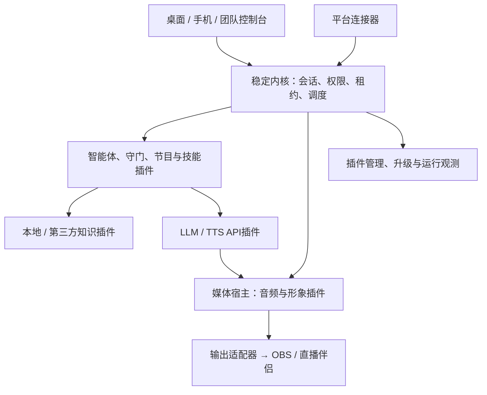
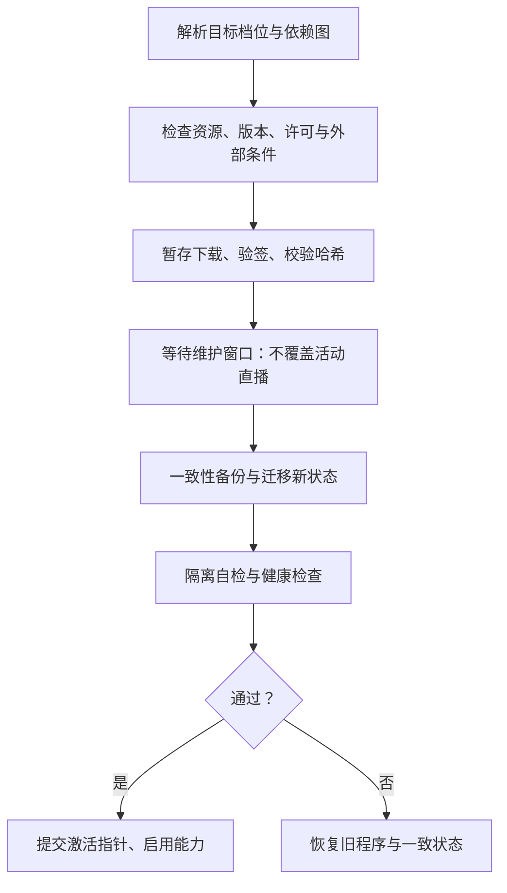

# 直播数字人 + 智能体系统完整设计方案 V3.5

**OpenCode开发指导版：完整功能规格、工程目录、接口、数据、状态机、部署、升级与验收。**

> 2026-10-07 · 统一内核、插件化能力、Lite / Standard / Pro 按需部署与一键升级。
> 首发 Windows 桌面与抖音，支持扩展快手、视频号及其他平台。
> 固定要求：LLM / TTS 使用 API；本地知识库与 RAG，兼容第三方知识 API；写实数字人运行端 Rust + ONNX Runtime，不依赖 Python 部署。
> 本文为完整独立设计基线。技术可行性以完整链路、兼容性、隔离、性能和稳定性判断；经济可行性重点是运行与维护成本，不以分期、降低扩展性或研发工作量替代。
> 尚未取得平台授权或完成模型、硬件、真实直播实测。数值均为设计预算或验收目标；不能宣称已经实现。

## 阅读与使用方式

本文是一份独立开发规范，不需要OpenCode再自行拼接V2.3/V3.2/V3.4。原版有效细节已整合；旧条款覆盖见第34章和附录B。

- 1–4章：完整产品、三档、稳定内核与插件能力。
- 5–12章：决策、权限、RAG、API、形象、平台、移动和操作体验。
- 13–18章：运行维护成本、性能、验收、升级/回滚和可行性约束。
- 19–23章：代码目录、依赖、Schema/IPC、状态机与智能体实施规格。
- 24–29章：数据库、知识/Provider/媒体/平台细则和控制台API。
- 30–33章：配置、构建/部署、测试、OpenCode任务与可复制指令。
- 34章与附录：原版覆盖、形象/移动认证、旧验收迁移和来源。

文中“必须”是实现不变量，“建议/初值”可依据真实测试调整并记录ADR，“示例”不是可直接取得授权的生产配置。开发任务有依赖顺序，但不改变完整功能目标；按需部署不等于删去未启用能力的接口与设计。

## 1. 设计目标与统一架构原则

**统一稳定内核 + 版本化能力契约 + 按需插件 + 多部署配置。Lite、Standard、Pro 是同一产品的能力预设，不是三套代码、三套数据库或三条架构分支。**

本版整合旧版完整能力规格与统一三档部署要求。保留完整扩展体系，低成本来自“未使用能力不加载、不常驻、不占云资源”，而不是删除未来能力或为低配重写架构。

| 评价维度 | 本版关注 | 判定方法 |
|---|---|---|
| 技术可行性 | 完整模型与音画输出是否成立；插件与内核能否兼容；故障是否隔离；多会话和升级是否可靠 | 原型与完整链路验证、契约一致性、故障注入、真实目标环境基准 |
| 经济可行性 | 云CPU/内存、GPU、API、带宽、存储及维护成本 | 三档同负载计量、闲置资源回收、账单对账、恢复与升级维护指标 |
| 实用性 | 按需安装、一键升级、简单开播、可解释降级和快速接管 | 用户操作验收，升级/回滚/断网/设备变更测试 |
| 扩展性与灵活性 | 新平台、知识、模型、形象、输出和部署可独立扩展 | 新能力不修改核心会话机制，能力可替换，状态可迁移 |

本地优先并不等于禁止云端；云端可选也不等于云服务无法提供高级能力。Pro 可以完全本地部署，也可以使用轻云控制面或远程渲染，按实际需求选择。所有档位保留同一扩展协议、故障恢复和数据迁移机制。

写实形象与简单2D均为独立能力包。2D降低资源占用，写实包按完整模型Gate准入；不能以自动退回2D宣称写实目标已满足。插件资源最低要求、平台授权和素材许可属于实际约束，一键升级不会消除这些前提。

### 1.1 不可破坏的架构约束

1. 核心业务在无自建云主机时可运行，API供应商服务另计；下载更新、可选中继和集中管理不成为播报必要依赖。
2. 三档共享内核、契约和数据模型；升级只改变能力集合、资源配置与必要的数据版本。
3. 所有档位支持本地知识接口、第三方知识接口与Provider替换；差异体现在预装能力、规模和管理功能。
4. 自动互动权限由平台与账号批准条件决定，不由档位、许可证或LLM自行授予。
5. 未启用插件不启动；启用但闲置的非实时能力按策略休眠。正在直播的实时输出、守门和租约监督不能为省资源被随意暂停。
6. 内核、插件、数据与部署方式各自版本化；扩展开发不依赖UI或平台SDK的内部实现。
7. 能力缺失按显式降级表处理；权限、事实、守门失效必须撤销对应输出，不能自动跳过检查。

## 2. Lite / Standard / Pro 能力与部署矩阵

### 2.1 三档能力预设

| 能力域 | Lite 默认组合 | Standard 默认组合 | Pro 默认组合 |
|---|---|---|---|
| 内核与契约 | 完整统一内核、升级器、权限、租约、审计 | 同一内核 | 同一内核 |
| 平台 | 手工/回放；可安装一个已批准的平台连接器 | 抖音已批准连接器、平台事件治理 | 多平台连接器、独立能力快照与会话策略 |
| LLM / TTS | API，Provider可配置替换 | API，增加主备、场景路由 | API，增加共享网关/团队配额等可选能力 |
| 本地知识 | 权威事实、中文词法、基础语义RAG可配置 | 混合检索、快照、权限与质量评估 | 多知识空间、集中发布、细分权限和服务化 |
| 第三方知识 | 可安装HTTP适配器，与本地统一契约 | 多来源融合与故障回退 | 多空间路由、团队权限、集中凭据等 |
| 智能体 | 规则、模板、短回复、限队列与审批 | 节目编排、只读技能、回放/影子评估 | 扩展技能、策略组合、跨会话运营，仍受权限限制 |
| 记忆 | 工作记忆与有界场次摘要 | 场次记忆及检索 | 可选长期记忆；观众画像默认关闭 |
| 形象 | 授权简单2D，形象契约完整 | 2D + 通过Gate的写实ONNX包 | 多形象与资源调度，可选远程渲染 |
| 输出 | 已验证的窗口/音频采集及录制 | 更多已认证输出适配器 | 多会话独立输出与集中监控 |
| 管理 | 桌面；手机包可加装 | 桌面 + 手机管理包 | 团队、角色、设备与集中管理 |
| 会话预设 | 单活动会话 | 单活动会话，更完整业务能力 | 多活动会话；数量由硬件、API与平台条件限额 |
| 自建云依赖 | 无 | 无；手机异地访问可选中继 | 无强制依赖；集中管理/中继/云渲染按需 |

矩阵表示默认预设，不是硬编码禁止加装。Lite可加装写实、手机或第三方知识包，只要依赖与资源允许；组合偏离预设时标为“Lite + 自定义能力”，仍享有一致升级路径。Standard/Pro预设可关闭不需要的模块，但安全门控和相关依赖不能关闭。

技术能力与商业授权分开设计：如果以后收费，权益插件只能影响安装/启用，不改变契约、数据格式，也不得让许可证服务器短暂不可达直接切断已有合法运行会话。离线权益有效期及到期行为明确配置；本方案不默认建设商业许可证服务器。

### 2.2 升级后的能力状态

“已安装”“依赖已满足”“通过健康检查”“平台已授权”“可激活”分别显示。硬件不足时可以完成插件安装并标记不可运行，不显示“写实已启用”。Lite直升Pro与Lite→Standard→Pro使用同一迁移图，不要求用户先购买/安装中间档位。涉及核心程序升级时由同一升级编排器执行，不要求手工重装。

### 2.3 三种部署配置

| 配置 | 运行形态 | 适合 | 必需自建云资源 |
|---|---|---|---|
| Local | 内核、知识、媒体与连接器在工作站；LLM/TTS API直连 | 三档均可；最低云资源成本 | 0台云主机 |
| Hybrid | 本地保持实时链路；轻量远程管理/中继、共享配置可选 | 异地手机、团队管理、多工作站 | 按需一个轻量服务或复用已有服务 |
| Distributed | 会话引擎/知识/渲染按能力远程部署，边缘输出与接管保留 | 多站点、集中模型管理、有实际GPU共享收益 | 按工作负载扩容，无固定强制集群 |

部署配置与档位正交。Local Pro不强制Redis/NATS/PostgreSQL/Kubernetes；Distributed也不意味着每个模块都拆成微服务。平台桥接与媒体输出的OS/宿主要求必须保留在相应边缘节点，不能假定Linux云机能运行Windows平台SDK或虚拟音频设备。

## 3. 稳定内核与控制 / 媒体架构



音频箭头表示数据流。API返回音频须经过内核授权门控，不能绕过批准直接播放。移动UI只管理状态和命令，不持有核心媒体时钟。

### 3.0 技术栈与代码组织

| 部分 | 推荐实现 | 维护约束 |
|---|---|---|
| 内核/会话/本地插件SDK | Rust + Tokio + 版本化Schema | 一个核心代码线，OS相关实现放适配层 |
| 桌面控制台 | Tauri 2 + Web UI Shell | 插件导航/配置Schema动态注册；UI不持有唯一媒体窗口 |
| 本地通信 | 受ACL保护的Named Pipe，有界二进制消息 | 不开放无认证公网RPC；跨平台可换对应IPC |
| 写实运行 | Rust ort + ONNX Runtime，CUDA为认证后端之一 | 版本矩阵锁定，模型与运行库按需下载 |
| 平台SDK | 必要时薄C++桥接进程 | 官方SDK边界内转换事件，不把业务塞进桥接 |
| 知识/事实/基础状态 | SQLite + FTS5 + 嵌入式向量实现 | 单机低维护；存储/检索契约支持服务化实现 |
| 轻云控制面 | 可复用Rust HTTP/WSS服务，单进程部署 | 不携带模型权重，不默认搭全套微服务 |

代码按`contracts / kernel / plugin_hosts / plugins / media / desktop_shell / updater / deployment_profiles`组织。示例清单中的版本号表示设计示意，实际程序版本和支持范围由发布清单确定。

### 3.1 内核职责

内核提供八类机制：能力与契约登记、生命周期/健康检查、会话与epoch、优先调度/有限队列、权限与租约执行、配置/密钥访问、控制通信与媒体通道协商、审计/观测接口。升级器与外部监督可独立进程或低开销工具，不必须全部驻留内核。

内容策略、风险分级、知识排序、LLM选择、节目脚本和形象属于插件或配置，不写死在内核。安全不变量不能被可编辑策略撤销：无权限不得外发、旧epoch不得播报、审批必须绑定对象、失联租约到期静音、敏感事实必须来自有效依据。

内核只有契约依赖，不引用平台SDK、模型权重或Provider专有格式。版本稳定指保证公开契约和数据兼容策略，不承诺永不更新或与任意未来插件永远兼容。

### 3.2 宿主与隔离

| 宿主 | 适用 | 成本与边界 |
|---|---|---|
| `inproc` 编译期模块 | 官方审查的规则、调度、基础检索等 | IPC成本低；不隔离原生崩溃、OOM、忙循环，不能强制安全终止线程 |
| `subprocess` 原生插件 | 平台SDK、GPU/模型、复杂解析、第三方原生实现 | 有独立故障边界；并非自动权限沙箱，须配ACL、Job Object、受控凭据等 |
| `remote` 远程能力 | 第三方知识、API网关、云渲染、集中管理 | 按网络延迟、带宽、身份认证和断连行为验收 |
| `wasm` 受限插件 | 合适的规则/只读变换等扩展 | 可作为可选宿主；限制内存、执行fuel和导入能力，适用能力需逐项认证 |

四类宿主属于完整架构。每个插件声明其实际支持的宿主，不要求所有插件都实现四份；一种能力有多个宿主实现时应通过同一契约套件。低配Local默认采用进程内可信模块与一个媒体进程，装平台连接器后按其要求增加桥接进程。闲置插件不额外起进程，模型在媒体宿主中按包管理；高风险第三方模块不为节省数十MB而与内核共进程。

禁止将未知原生DLL直接加载进内核作为通用运行时插件。`inproc`需要核心程序包含该实现，升级器可自动取得对应已签名程序版本；独立进程/WASM插件可按清单安装。签名证明发布来源与完整性，不证明安全；准入策略由内核信任库、审核记录和撤销列表决定，不接受插件自报“可信”。

### 3.3 会话隔离与资源治理

从Lite开始，所有状态以`session_id`隔离，默认只创建一个活动会话。Pro激活多个会话时不重写业务：每个会话独立epoch、授权、队列、预算、知识绑定、审批和输出ID。共享只限不可变模型、只读知识快照和受控Provider连接池；不能把A会话审批或音频送给B会话。

资源治理插件实施每会话与全局CPU/内存/GPU/API/输出配额。GPU吞吐、显存、音频时序和API配额分别做准入；新会话容量不足时拒绝或等待，不能让已开播会话OOM。复用同一模型权重不代表所有形象状态和中间张量可共享，必须测峰值。

### 3.4 控制与媒体分离

控制消息有界、小载荷、优先处理紧急命令；PCM用有界二进制环形缓冲，图像留在媒体宿主内部或走已验证共享内存/纹理通道，不通过JSON/Base64控制总线传帧。内核协商通道、租约与失效，不逐帧解析像素。

本机总线采用进程内有界队列 + 受保护Named Pipe等IPC；不因Pro就强制外部消息服务。跨节点确需持久分发时可以增加NATS等适配器；媒体仍不走事件broker。事件投递可采用至少一次和幂等处理，音频跨故障不宣称严格exactly-once：状态不明的旧句不自动重播。

### 3.5 独立监督与本地静音

媒体进程本地检查引擎授权短租约，建议200ms续租、600ms失联截止为初值；引擎卡死时租约仍可到期。系统低开销监督程序可重启引擎，重启只恢复待机和状态，不自动恢复旧审批/旧自动权限。

媒体拥有专用静音通道/热键；控制台关闭不导致媒体窗口消失，但必须检查有效值守。媒体进程崩溃可能导致出画中断，OBS/伴侣预置待机场景并提供明确恢复路径；不承诺一切故障下画面无缝连续。静音目标是本地输出，平台端已缓冲数据不可撤回。

## 4. 插件体系、契约与生命周期

### 4.1 能力目录

| 契约 | 范围 | 可替换实现 |
|---|---|---|
| `platform.events@1` | 统一事件、权限快照、连接状态 | 手工/回放、抖音、快手、视频号 |
| `agent.decide@1` | 路由、候选、说/不说、工具计划 | 规则、短回复、受限智能体 |
| `guard.check@1` | 内容、事实、权限、审批要求 | 规则/事实校验、额外模型审核；所有外发必需 |
| `knowledge.retrieve@1` | 权限过滤后的证据与状态 | 本地事实/FTS/向量、第三方HTTP |
| `memory.access@1` | 工作/场次/长期记忆 | 本地有界存储、团队服务；按许可启用 |
| `skill.invoke@1` | 有限可授权的技能 | 精确事实查询、业务只读接口、经过批准的通知 |
| `show.plan@1` | 节目与场景节奏 | 本地脚本、可替换编排器 |
| `llm.generate@1` | 结构化生成、usage与取消 | 不同LLM API、可选共享网关 |
| `tts.synthesize@1` | 音频、格式、音色版本、可用时间信息 | 各TTS API |
| `avatar.render@1` | 音频时间轴、动作→帧 | 2D、Rust ONNX、授权3D、远程渲染 |
| `output.deliver@1` | 画音输出、录制和设备检查 | 窗口采集、认证输出插件 |
| `control.manage@1` | 状态、审批、接管与实际ACK | 桌面、手机、团队 |
| `storage.persist@1` | 状态/事务/快照，不混用向量格式 | 嵌入式SQLite、服务端关系存储 |
| `runtime.observe@1` | 有界指标、日志、诊断 | 本地面板、集中观测 |

能力目录完整保留，但必需性按运行场景计算：普通寒暄不依赖知识；知识回答必须有证据；API生成依赖LLM；使用缓存不依赖在线TTS，但仍依赖守门、版本与授权。多实现选择按显式配置/优先级，不能随机挑选“能响应”的插件。

### 4.2 插件清单示例

```toml
plugin_id = "avatar.realistic.ort"
plugin_version = "1.2.0"
manifest_schema = 1
kernel_range = ">=3.4.0,<4.0.0"
contract = "avatar.render@1"
supported_hosts = ["subprocess"]
activation = "on_session_start"
idle_policy = "keep_warm_during_session"
requires = ["audio.timeline@1"]

[resources]
profile_id = "certified-windows-cuda-model-A"
# 实际资源门槛来自认证profile，不填虚构显存值

[permissions]
network = false
media_output = true
secrets = []
```

`audio.timeline@1`为媒体宿主基础接口，由运行时能力目录登记。清单还需包含OS/架构、依赖版本、模型/素材哈希、许可、安装大小、配置Schema、数据Schema、迁移钩子、健康检查、回滚兼容范围和供应商价目口径。资源预算与兼容认证独立存档，不能由插件随意降低门槛绕过准入。

### 4.3 生命周期与休眠

`Absent → Installed → Validated → Ready → Active → Idle → Suspended`；错误进入`Failed`，升级进入`Draining`。Ready只表示依赖/自检通过，平台授权未通过仍不能激活真实事件。

按需启动例子：Lite没有写实包，不下载权重/ORT GPU依赖；第三方知识只在被路由查询时调用；文档解析任务结束后退出；移动管理未启用，不开中继连接；非直播期间模型可卸载，直播期间预热策略优先保障时延。休眠前flush必要状态，解除资源句柄，恢复后重新授予租约，不继承过期命令。

### 4.4 兼容、权限与动态配置

契约主版本不兼容拒绝连接；同主版本可选字段增补，协商范围并测消费者容错。插件代码不得直接依赖另一个插件实现，依赖通过能力声明解析；循环依赖拒绝安装。进程内实现改变需要程序更新，不能在UI标为“动态热加载成功”。

直播中可变更：预算收紧、权限撤销、知识失效等立即生效；Provider配置于句边界切换；程序/模型/形象包更新只暂存，不在活动会话直接替换。放宽策略需明确授权并重新判断平台能力。

### 4.5 事件、候选与审批

统一事件包含平台、房间来源、session、event ID、事件/接收时间、载荷版本、权限来源和脱敏标识。候选包含utterance ID、epoch、到期时间、文本、屏幕文本、证据及事实版本、策略/音色版本、有限动作。审批绑定候选哈希、会话/epoch、角色与TTL；改字、换事实或换会话后重新审批。模型生成的“已批准”字段没有授权效力。

平台文档未说明的事件标记unknown；第三方知识只返回答案时标记“无可核验原文”，不冒充证据。敏感输出不能因为接口形式相同而提升信任等级。

## 5. 直播决策与播报容量

核心不是让每条评论进入 LLM，而是决定“哪些值得播、还能播多久、是否已过时”。一个观众问题的典型过程：去重/过期检查 → 规则选中 → 必要时检索 → 一次结构化生成 → 内容与事实校验 → 审批或自动门控 → 分句 TTS → 音画输出。

### 5.1 分级路由

| 路由 | 适用 | 调用策略 |
|---|---|---|
| 固定模板 | 低频欢迎、礼物合并感谢、已批准节目句 | 不调 LLM；可复用有效 TTS 缓存 |
| 直接回答 | 一般互动、非敏感闲聊 | 一次短上下文 LLM，不再先做独立模型分类 |
| 知识回答 | 产品规格、活动解释、售后政策 | 检索证据后一次 LLM；事实核验失败转人工 |
| 人工处理 | 缺证据、争议、个体承诺、越权要求 | 给操作员候选，不自动对外发声 |

多步工具规划作为可选agent/skill能力，不进入低延迟默认实时主链路；Pro启用也必须有截止时间、步数和权限上限。固定事实查找和只读查询使用显式函数；网络请求即使名义上“只读”，也要由受控凭据、目标白名单和超时保障。对外发通知、发消息是写操作，只有事先授权的具体场景才能开启。

### 5.2 可播时长预算

建议初值：回答 20–40 个汉字，正常上限 60 个；最终以实际 TTS 时长为准。用 3 字/秒估算，30 字占 10 秒，50 字占约 17 秒。若整分钟只允许 30 秒互动，一个分钟只能容纳约 3 条 10 秒回复。不能用 API 每秒处理能力推导直播应答量。

维护语音债务：当前剩余时长 + 排队待播时长。建议最多一个正在播句、两个短待播任务、总待播不超过 20 秒；达到阈值后拒绝继续生成，或合并相近问题。时间敏感评论超过初值 15 秒重新判定，不补播旧场次、旧活动、旧库存的回答。

优先级：紧急静音/接管 > 人工点播 > 已批准关键节目句 > 相关产品问题 > 合并感谢 > 泛化寒暄。高优先级不意味着自动打断每句话；普通插播在句边界处理，明确接管/风险撤销立即取消。

### 5.3 流式并不意味着未经检查即播放

LLM 可以流式接收，但完整句段经过守门后才能送 TTS；金额、优惠、库存等要求完整回答校验或使用锁定模板。TTS 音频段带序号和音频时间戳；取消后迟到数据按 epoch 丢弃。队列清空、缓存残留和输出设备缓冲都纳入打断测试。

API 超时的模板回退仍需符合当前事实、授权和风格；缓存不是免审通道。重试必须由预算和截止时间控制，过期任务不重试；TTS 不确定状态下避免重复合成造成重复播报。

## 6. 模式、安全与人工接管

| 模式 | 外发行为 | 进入条件 |
|---|---|---|
| 演练 | 仅本地预览/录制 | 无平台数据权限也可运行，标明模拟来源 |
| 人工辅助 | 人工审批后播放；操作员可直接选择批准模板 | 输出检查通过、现场操作员可接管 |
| 受监督自动 | 仅限定内容与任务可自动播报 | 明确平台/账号允许、知识与守门可用、预算正常、人工监督租约有效 |

自动模式不是默认值。平台能力分 `granted`、`denied`、`unknown`；文档没列出某事件应标 `unknown`，不能自行认定“绝对不支持”或“可借其他接口获取”。权限与用途约束取最严格交集，策略包只能在允许范围内收紧或选择行为。

操作风险分为 `risk_0` 普通回答、`risk_1` 有事实依据的产品解释、`risk_2` 需人批准的外部可见行动、`risk_3` 禁止行动。避免与知识级别、版本发布线共用 R0/R1 命名。改价、转账、商品上下架、封禁、配置修改等能力不暴露给模型。

值守可以由桌面或已授权设备承担；手机网络心跳只是在线状态。自动模式值守租约的期限由场景设定并要求操作员主动确认；单纯心跳不能续期。值守到期停止启动新自动回复并在短期限内撤销输出授权，不统一使用 120 秒“继续自动播报”宽限。若桌面仍有人值守，手机断线不应误判无人。

知识、守门或授权依赖缺失时，停止相关自动内容；禁止因守门故障绕过到备用 Provider。切换更严格策略、撤销知识权限、活动失效、会话结束都会增加 epoch，使旧审批和旧音频失效。

## 7. 本地知识库与 RAG

### 7.1 分层与权威来源

| 知识层 | 内容 | 默认存储/检索 | 发布与有效性 |
|---|---|---|---|
| KB0 权威事实 | 商品 SKU、规格、价格、库存口径、活动条件 | SQLite 结构化表，精确 ID/别名查询 | 显式版本、有效期、发布人；缺少实时库存接口时只说已核实信息 |
| KB1 文档与 FAQ | 说明书、售后政策、已批准问答 | 中文分词 + FTS5/BM25 | 原文位置、产品范围、文档版本、权限 |
| KB2 语义检索 | 自然表达问题、较大知识集 | Embedding API + 本地向量索引，与词法检索融合 | 按模型、维度、归一化规则分隔索引 |
| KB3 外部知识 | 第三方知识服务 API | 与本地同一接口，但保留返回能力与信任标记 | 超时、来源、费用、TTL、是否允许上传原文 |

价格、承诺和活动规则优先 KB0，不以向量相似度推导。文档有价格但结构化事实不同，按明确权威源处理并提示冲突，不让 LLM自己选择更“合理”的数字。知识存储本地不等于数据从不出本机：Embedding 和 LLM API可能收到查询或证据片段，界面需展示每个 Provider 的上传范围；禁止上传的数据只走本地词法检索/人工处理。

SQLite FTS5 默认 `unicode61` 不是中文词法分词器。默认组合用可验证的中文分词预处理索引或自定义 tokenizer；trigram 可以用于部分子串检索，但不应当作普适中文语义检索，也要测试一、二字短词。[S4]

### 7.2 检索流水线

产品/场景过滤 → 精确事实查询 → 词法检索 + 必要时向量检索 → RRF 等融合 → 取少量证据 → 生成 → 对重要实体与事实逐项校验。检索和生成前都执行权限过滤，返回后再校验版本与有效期。无证据、有冲突或已过期，优先澄清/转人工，不能要求模型“自信地补全”。

初始参数仅作调试起点：切块约 300–600 中文字，重叠 50–100 字；按标题、产品与条款边界切分；候选检索各 10–20 条，最终送入 3–5 条。表格按行及相关表头组织，不按任意字符截断；先用质量集调参，再考虑重排 API。

小规模知识库先验证词法检索是否已足够，向量是按质量需求启用的能力。向量实现优先嵌入式、可随安装包部署的成熟实现，并锁定版本；默认组合不引入独立 Qdrant/Milvus 服务。大型、多用户、复杂权限profile可按知识接口选择独立服务，档位升级不强制迁移。

### 7.3 发布、失效与删除

导入 → 解析预览 → 产品/权限标注 → 小样评估 → 人工发布新快照。直播中不全量索引，后台严格限速。KB0 活动或价格更新后，立即取消依赖旧版本的候选句、审批与语音缓存；新事实发布前不对外讲新价格。

删除/权限撤销先同步阻止检索、缓存和播报，再异步清除向量、日志中允许删除的副本与临时文件；备份保留和清除期限明确列出。Embedding 模型变更需独立重建索引，不能混用向量空间。

### 7.4 知识验收

准备至少 100 个贴近真实直播的问题，覆盖正常、别名、中文短词、错别字、产品混淆、过期活动、无答案、权限撤销、恶意指令和外部知识超时。设计门槛：有证据问题 Recall@5 ≥90%；高风险事实测试集不允许错误自动播报；无答案集应正确澄清/转人工。门槛通过只是该测试集结果，不等于实际零错误。检索延迟、证据正确率、最终答案正确率分别报告。

## 8. LLM、TTS 与 Provider 策略

本版本不部署本地 LLM/TTS。Embedding 默认 API，允许纯本地词法模式；本地音频特征模型属于数字人渲染管线，不属于本地 TTS。

首选一个支持中文、结构化输出、明确数据政策和足够并发配额的 LLM；一个经目标网络验证的中文流式 TTS。先验证单供应商完整链路，再接第二供应商进行替换测试。云AI网关作为可选插件/远程Provider，所有档位可加装；不启用时不启动服务。单机密钥使用系统凭据存储，前端不持有密钥。

Provider 配置记录：地区、模型版本、输出格式、流式方式、上下文与速率限制、超时、重试、价格单位、数据留存策略。不同 TTS 对标点、汉字、数字、SSML、音色复刻和时长的计费规则不同，不能统一按“一字一元参数”处理。[S5]

TTS 接入必须测量首包、可播放首段、最终时长、格式、重采样、错误状态和取消；不得假定都有音素时间戳、相同音色或相同情绪控制。无音素信息时，2D 使用幅度驱动开合嘴，界面描述为“音量驱动嘴型”，不宣传精确音素口型。

主备 LLM 可以映射同一契约，但需分别通过提示词与安全回归。TTS 换供应商可能改变音色；默认在句边界经操作员确认切换或改用已批准缓存，不在一句中拼接两个供应商音频。

若选择企业网关，直连回退只有本机有合法凭据且数据政策允许才可启用；网关不可用并不天然意味着可绕过。

## 9. 数字人形象与媒体管线

### 9.1 2D 与写实各自的定位

Lite默认2D包用已授权的简单分层纹理、嘴部开合和少量循环动作；不必先接入 Live2D/Spine SDK。可以利用集成显卡渲染，不承诺“零 GPU”。商业素材、引擎、音色和人物肖像分别核对许可。Live2D 的可扩展应用、VTuber 跟踪及部分 AI/聊天应用有专门发布许可条件，不能把 SDK 下载免费当作商业发布免费。[S6]

写实版优先验证实际可取得的完整模型包，再讨论 Rust 适配。公开项目提供 Python 推理或 ONNX 导出脚本，不足以证明完整实时管线已能在 Rust 上部署。不得只导出嘴部网络后，把缺失的音频编码器或预处理留在未声明的 Python 服务中。

### 9.2 写实 Rust ONNX 完整链路

PCM → 重采样/标准化 → 滑窗和必要的未来上下文 → 频谱/特征预处理 → 音频编码器 → 形象条件与生成网络 → 后处理/贴合 → 合成输出帧。涉及人脸检测、裁剪、关键点、掩码、头像预计算时，一并列入模型包和资源清单；离线可预计算的内容尽量不放实时链路。

每个模型包必须给出输入输出名称、shape、dtype、采样率、窗口、步长、未来上下文、帧率、ONNX opset、归一化、预处理校验样例、权重哈希、授权及兼容运行时。音频特征窗口需要未来音频会产生固定等待，应计入开口延迟；不能只测单次网络耗时。

运行端 Rust `ort` + ONNX Runtime，Windows NVIDIA CUDA 首发。锁定 Rust crate、ORT、CUDA、cuDNN、驱动兼容矩阵与打包方式；ORT CUDA EP 对 CUDA/cuDNN 主版本存在明确要求。[S3] TensorRT、DirectML属于可选执行后端，单独认证；不因某算子能落 CPU 就假定整条写实链路仍实时。

### 9.3 写实插件的模型准入Gate

| Gate | 必须提供的证据 | 失败处理 |
|---|---|---|
| G0 来源与授权 | 全部权重、代码、训练素材/肖像/声音的可用权利；可取得完整流程 | 授权不成立则不用，不能先开发后补 |
| G1 正确性 | 原实现与 Rust 流程的固定输入对齐；预处理、音频特征、生成和后处理逐段验证 | 修复或换候选模型，不以观感“差不多”替代 |
| G2 实时性 | 实际目标机同时运行直播工具的整链路帧率、延迟、VRAM、CPU和温度 | 降分辨率/档位且重新测；不达标不进正式写实包 |
| G3 操作与稳定性 | 静音、取消、句边界、长播、OOM、进程重启、形象切换与输出恢复 | 不发布该档位；仅保留已验收降级形态 |

Gate用于判断具体模型插件是否可运行和发布，与产品分期或开发工作量无关。完整链路不成立时更换模型实现或标记插件不可用，内核和其他能力保持兼容；不通过隐藏缺失组件或无条件降级来宣称该写实插件验收成功。

## 10. 实际直播输出与平台接入

### 10.1 先选一条可验收输出

默认组合使用媒体进程固定出画窗口，独立音频输出路径，由 OBS 或直播伴侣采集。先实测目标版本能否稳定捕获该窗口、窗口最小化行为、缩放、透明/绿幕及音频设备；不能只在预览窗口看到画面便认定已接入直播。

选择设备捕获、应用音频或已授权虚拟音频设备，按目标工具的实际支持定案。虚拟摄像头的视频不能替代音频链路；FFmpeg/录制文件也不等于已经拥有 Windows 虚拟摄像头。默认组合不开发摄像头驱动，不默认堆叠 NDI、Spout、虚拟相机多套输出。

音频设备使用稳定标识并校验默认设备变化；只允许一条有效路径，避免 OBS 与伴侣重复收音或回声。录制和推流可以共用画面，但必须分别验证接收、声道和音画同步。

### 10.2 抖音

官方互动工具文档列出 exe 与小程序形态：exe 在直播伴侣运行，小程序可在 App 与伴侣运行；开发产物审核/上线后不可任意变更。[S1] 这是具体互动工具产品的接入路径，不等于外部任意数字人应用已得到许可，也不能证明手机能直接把数字人视频输入直播。

准入验证时同步确认用途、事件权限和产物类型，并用官方调试方式验证 SDK 启动、事件、IPC和退出。[S2] 调试成功不等于上线授权；正式产品在获得相关批准后验收。未取得官方事件权限时，系统保持手工/回放模式，不把非官方抓取作为正式替代方案。

桥接由平台宿主启动，连接已有引擎；双方检查本地身份与会话令牌。处理多次启动、伴侣重启、端口占用、SDK失联、消息重复、旧直播间事件、时间漂移和能力撤销。平台断线后禁止凭缓存继续假装真实互动，重新连接不自动恢复旧自动权限。

room_id 使用平台明确提供或经批准映射的真实来源；没有可验证来源时，不伪造房间绑定。事件按平台消息 ID去重；没有可靠 ID 时使用有界窗口和降级去重策略，明确可能误合并。缺少关注等事件时只关闭对应功能，不自行合成。

### 10.3 快手和视频号

快手/视频号属于同一平台插件目录，可按需安装；本版尚未核实其具体官方数据/推流接口，不宣称已可上线。实际扩展需重新完成用途准入、事件接口、输出与账号权限验证，不把“换 URL”当作连接器工作量。

## 11. 桌面、手机与云管理的统一能力

手机管理包可加装到Lite、Standard、Pro；Standard/Pro预设包含该能力，但连接方式由部署profile选择。其功能是看状态、审批、接管、静音与管理，和手机本地开播/生成视频是两个独立能力。

| 连接方式 | 云主机需求 | 实际约束 |
|---|---|---|
| 同局域网直连 | 不需要 | 原生客户端可验证配对密钥/证书；Web客户端必须有浏览器信任的HTTPS，不以二维码指纹代替信任 |
| 用户已有VPN/可信网络 | 可复用现有服务 | 仍要求应用身份认证、HTTPS与角色检查；VPN不代替应用权限 |
| 自托管HTTPS/WSS中继 | 一个轻量服务，可与控制面合部署 | 外网只由工作站主动建立连接；闲置不发视频，连接数和流量配额 |
| 合适的按需平台服务 | 不自建常驻VM也可能可行 | 必须核对长连接时限、冷启动、计费、地域和维护成本；不假定serverless完全免费 |

Web/PWA需可信域名HTTPS。Service Worker安全上下文限制不能用手机访问LAN HTTP绕过。[S7] 原生壳可以独立提供证书固定，PWA不能通过扫描指纹自动信任自签证书。已有反向代理/证书基础设施可复用；没有时提供向导，不默认让用户手动维护多套服务。

默认仅传状态、审批文本和低频缩略图。连续预览按需开启，采用真正编码的低码率流，WSS只传控制；关闭预览立即释放编码器与网络。手机锁屏/后台断线后不补执行旧审批，也不承诺浏览器后台保活。只读设备、审批员、管理者各自明确权限；静音是独立授权能力。

中继终止两段TLS时可读取业务内容，不能宣称端到端加密。需要中继不可读时，使用经审核的端到端协议及设备密钥管理，单独验收；不以自行设计的加密方案降低维护成本。

命令包含设备身份、session/epoch、命令ID、序号、状态版本与TTL，服务端鉴权/去重、防重放，返回实际执行ACK。恢复自动权限不能靠重连触发。桌面本地静音保留为不依赖云的路径。

手机本地执行的能力包纳入扩展目录，但必须独立认证Android/iOS、温控、电量、后台策略及平台画面入口；桌面升级不等于手机自动具备本地写实能力。

## 12. 开播操作与界面

控制台默认四个入口：直播台、知识、形象/Provider配置、运行记录。插件可注册节目、技能、团队、平台、部署与升级导航；菜单按能力状态动态展示，保持同一Shell与UI扩展契约，不维护三套界面。

直播台同屏展示：真实画面/音频电平、事件来源、当前模式、当前播报与队列秒数、待审批候选、证据与失效时间、API/预算/设备状态。固定可见的暂停自动、立即静音、人工接管按钮；审批按钮显示最终文本，不能只显示“同意模型回复”。

开播流程：选择场景 → 检查形象与事实版本 → 测音频及画面 → 连接真实事件或明确手工来源 → 确认运行模式与值守 → 开始辅助播报。配置全部持久化，但自动权限和上一场审批不跨会话继承。

异常显示可行动的说明，例如“知识 API超时，本问题未播报，可人工回答”“音频设备已变化，请重测”“平台数据断开，已关闭自动互动”。不能只展示 `plugin failed`。关闭管理端与结束直播是不同操作：关闭 UI时明确剩余运行状态；无有效值守则退出自动权限。

场景包包含角色口吻、产品集合、禁答范围、批准模板、节目节奏、音色/形象、知识来源和预算。涉及事实/权限变更才强制相关回归；普通界面偏好不触发全部黄金集。热键无需确认即可静音；恢复自动播报需明确操作和条件复核。

## 13. API、电力与流量的可复算运行成本

### 13.1 完整成本公式

月运行维护成本 = LLM + TTS + Embedding/知识API + 自建云CPU/内存/GPU + 网络/中继 + 存储/备份/日志 + 本地电力/设备摊销 + 持续授权/平台费 + 实际维护人工。运营值守单独列示，不假设无人化节省。研发投入不作为本版架构取舍的主指标。

LLM = 输入百万 Token × 输入单价 + 输出百万 Token × 输出单价；实际包含额外分类、总结、重试与缓存计费差异。TTS按供应商计费文本或输出秒数计算；预生成节目语音也产生费用，只是在多次有效复用时摊薄。第三方知识可能按调用、套餐或席位收费，不能默认免费。

### 13.2 一个可复算的示例

以下仅用于预算模型，不是选型报价或收益承诺。假设每天 8 小时、每月 26 天；讲话占时间 30%，平均 3 个中文字符/秒；40%播报文本来自仍有效的本地语音缓存；每天400次 LLM调用，平均输入1500 Token、输出100 Token。输入/输出价格假设为2/6元每百万Token，需由实际模型报价替换。

| 项目 | 计算 | 月数量/成本 |
|---|---|---|
| 总播报文本 | 8×3600×30%×3×26 | 673,920 字符 |
| 需新合成文本 | 673,920×60% | 404,352 字符 |
| LLM 输入 | 400×26×1500 | 15.6百万 Token，31.20元 |
| LLM 输出 | 400×26×100 | 1.04百万 Token，6.24元 |
| TTS 按1元/万字符示例 | 404,352÷10,000×1 | 40.44元 |
| TTS 按3.5元/万字符示例 | 404,352÷10,000×3.5 | 141.52元 |
| LLM + TTS | 37.44 + TTS | 77.88–178.96元 |
| 预留15%额外调用 | 前项×1.15 | 89.56–205.81元 |

TTS的1元/万字符与3.5元/万字符仅为两档预算假设，不是当前供应商报价。实际厂商价格、地域、字符口径、时长计费和复刻费以官方价目核对。[S5] 不含音色复刻、知识 API、初始缓存合成、额外评估、网络与人工。1个汉字是否等于1个计费字符需按供应商规则核算。LLM两档单价是假设，与上述TTS品牌无绑定关系。

400次调用/日不意味着每次都播报，取消也可能已计费；应先排队准入再调模型。按上述时长和30字回答，平均互动容量约864条/日；节目播报、感谢和人工讲话会占用这个容量。实际直播用连续时长和真实任务分布测量，不能仅用日均负载设计。

### 13.3 成本敏感项

| 变化 | 影响 |
|---|---|
| 讲话比例从30%到100% | 同语速下TTS量约3.33倍，但不自动带来互动收益 |
| LLM 输入从1500到6000 Token | 输入费约4倍；先缩上下文，不立即换更便宜但质量未测的模型 |
| 每条评论先分类再生成 | 增加请求费用与延迟；规则先筛，一次生成优先 |
| 取消后仍无限重试 | 成本上升且内容过时；使用期限与有限重试 |
| 1Mbps连续手机预览 | 8小时×26天约93.6GB/月/观看端，不含协议开销；预览不是免费功能 |
| 总平均功耗150–350W | 208小时约31.2–72.8kWh/月；若0.8元/kWh则约25–58元，按实际整机测量替换 |
| 云GPU渲染 | 208小时×小时单价，另计带宽与维护；只有容量、成本和延迟验证通过才选择；Pro不自动迁云 |

语音缓存按最终文本、事实版本、Provider/模型、音色、发音规则和音频参数组合命中；不得因“语义相近”复用价格/承诺语音。响应缓存默认只用于允许的非敏感内容。

### 13.4 预算控制

设置每日/每场软硬预算、供应商并发限额、总生成率、TTS字符/秒数和第三方知识调用量。80%提示，100%停止新付费生成并转批准缓存/人工；比例可按业务配置。用供应商返回usage或计费文本估算做实时账，账单异步对账；没有统一余额API时不要显示虚构精确余额。

## 14. 最小云资源、低维护存储与三档成本

### 14.1 云端仅承载必要控制服务

| 部署组合 | Lite | Standard | Pro | 云端CPU/内存目标 |
|---|---|---|---|---|
| Local | 默认可用 | 可用，含本地写实 | 可用，多会话受本机资源限制 | 0：无自建云主机，不等于API免费 |
| Hybrid轻控制 | 可选手机/中继 | 手机与共享管理可选 | 团队/多站点可选 | 示例起点1–2 vCPU、1–2GB；仅低频控制，不承载模型/视频转码 |
| Distributed | 按需能力远程化 | 按需能力远程化 | 集中会话/知识/渲染 | 按真实并发和每项插件负载规划，不承诺一个2GB实例覆盖全部 |

轻控制资源是待测预算，不是云实例选型报价或容量保证。用实际空载RSS、连接数、TLS开销、数据库缓存、峰值审批与消息速率验证；达到内存70%/持续延迟阈值时告警并限流/扩容，阈值可调。录制、原始文档、Embedding向量和模型默认不经过轻云中继；转发连续视频也会增加带宽与连接开销，应独立计量。

升级清单可用签名元数据文件与HTTPS静态文件分发，不必运行专用动态更新服务器；Tauri官方更新器支持静态JSON或动态服务。[S9] 实际插件清单还要由本系统验签/校验依赖，不依赖客户端下载来源的口头可信声明。

默认不设置额外API网关、Redis、消息broker、对象存储集群、Prometheus全套和Kubernetes作为前置依赖。需要时可作为插件或部署依赖增加；没有对应需求时不启动。Serverless不是自动更省：长期WSS、频繁唤醒和状态存储可能更贵，应按连接小时、请求、流量和数据库账单比较。

### 14.2 存储与进程成本

本地SQLite保存配置/会话状态/事实/审计；FTS和向量在同机独立索引空间，文件目录保存模型和缓存。所有访问通过服务契约，不让第三方插件任意打开共享数据库。单写入owner、小事务、短读事务、限量连接和非直播高峰checkpoint，避免WAL无限增长。WAL要求同机，不把SQLite文件放在NFS/SMB供多节点共同写。[S8]

备份使用一致性在线备份/快照流程，不能只复制主.db而遗漏WAL数据。授权/配置等关键提交要求持久化，允许丢失的遥测独立缓冲；不得以降低关键数据持久性获得“低成本”。索引可重建，但权威事实和批准记录要有备份与恢复演练。

| 实际需求 | 推荐存储 | 增量维护 |
|---|---|---|
| 单工作站或单机Pro | SQLite + FTS + 本地向量/文件 | 无外部DB服务，统一备份 |
| 单云节点轻控制 | SQLite持久卷或复用已有合适DB | 验证写入峰值/备份；不放临时根盘，不能多副本共享写 |
| 多云副本/多写节点 | PostgreSQL等关系服务，通过存储适配器迁移 | DB备份/连接/升级；不假装SQLite跨节点共享 |
| 大向量库/高检索并发 | 可选独立向量服务 | 用检索基准决定，不能仅因升级Pro就启动 |

按负载启停worker，避免每个插件都独立进程。GPU模型仅在需要时下载/加载；场次内可保温防止首句冷启动，结束后经过闲置TTL回收。共享模型、连接池与缓存必须有会话隔离。视频编码与GPU模型不是同一预算，避免后台手机预览挤占正式出画。

### 14.3 资源和保留策略起点

| 资源 | 建议策略 | 验收重点 |
|---|---|---|
| 原始事件 | 有界队列；可选审计保留，默认脱敏 | 高频事件不无限落盘；重连不重播旧句 |
| 运行日志 | 轮转/采样；如7天与单机总量512MB起点 | 错误和审批关键记录单独保留，不因采样丢失必要审计 |
| 审批/事实变更 | 如30–90天，按业务与法定要求配置 | 期限、权限、删除/备份清除明确 |
| 录制 | 默认不上传；如总量20GB配额、低于磁盘安全余量停止新录制 | 不自动删除受保护证据，提示归档；停止录制不停止直播 |
| TTS缓存 | 有界LRU/TTL，如1GB起点 | 按最终文本/事实/音色版本命中，事实撤销即时失效 |
| 向量与知识 | 配额、增量索引、冷快照归档 | 模型空间隔离，旧索引回收前保留升级回滚条件 |
| 云中继 | 无会话不传内容；低频状态，预览即时关停 | 实际出口流量、长连接计费与隐私 |

配额都是配置起点。必须同时检查剩余磁盘和保留策略，不能固定20GB导致小磁盘被写满。压缩大日志、索引重建与上传限速并避开直播实时资源。

### 14.4 三档同负载成本对照

按第13章相同单活动会话负载比较，以区分“能力档位成本”与“业务量成本”：

| 项目 | Lite Local | Standard Local | Pro Local | Hybrid额外项 |
|---|---|---|---|---|
| 自建云主机 | 0 | 0 | 0 | 轻控制实例/既有服务分摊 |
| LLM/TTS | 约90–206元/月预算示例 | 同模型、同负载近似相同 | 单会话近似相同；多会话按实际量增加 | 网关可选，不必为中继重复调用 |
| 本地功耗 | 简单2D实测 | 写实增加GPU负载，整机实测 | 多形象/会话资源受调度限制 | 云渲染时计GPU费用，不能同时遗漏本地输出费用 |
| 知识API/Embedding | 按文档与查询量 | 按增强检索真实调用量 | 按团队/空间真实使用量 | 上传/共享存储与服务费用可选 |
| 维护 | 同一程序、嵌入存储 | 模型/驱动认证增量 | 会话与权限管理增量 | 证书、云备份、设备与服务观测增量 |

不要给每个档位固定“总月费”，因为模型、说话比例和会话数比档位名字更能影响费用。例：轻云实例80元/月、流量与备份20元/月为**占位假设**，则Hybrid相对Local增量100元/月；若10个工作站共享，基础费用平均10元/站，另加各站实际流量与运维。应替换为所选地域实际报价，不将占位假设写进销售承诺。

实际增量成本公式：升级运行增量 = 新插件CPU/GPU/电力 + 新API调用 + 新存储/流量 + 新维护事项；未启用云功能的本地升级不新增云主机项。云GPU成本 = 实际GPU实例在线小时×报价 + 存储/流量，模型加载时间与闲置分钟也收费；使用自动停机前需保证当前无活动输出租约。

### 14.5 维护成本控制

统一安装器、插件目录和兼容认证矩阵；禁止用户分别维护各模块脚本。Provider故障分类、设备重测、网络诊断、脱敏支持包和版本回滚内建。诊断包默认不带密钥、原始观众身份、未经同意的文档或录音。

三档共享回归套件、数据库迁移和配置Schema；升级先验证依赖图，避免用户手工排查DLL。低云配置可用一进程控制服务 + 一个持久存储，不必拆网关/认证/中继/审计多个服务。采用自动证书续期和失败告警，不能以取消TLS降低维护成本。

指标包括每次升级需人工步骤数、故障发现与恢复时间、备份恢复成功率、月度维护小时、空闲RSS、云出口GB和无效API调用占比。目标：日常无手工数据库维护；正常升级一次发起、自动执行；异常有诊断和回滚入口。具体恢复时限以实际部署profile验收，不对单云节点宣称高可用。

## 15. 性能指标与容量验收

数值为设计起点，在第一轮目标机测试后锁定。Lite低配验证以4核/16GB、集成显卡、简单2D为候选条件；不是对所有此类机器的保证。写实档位以实际目标显卡、完整模型包、直播工具并发负载确定，不写泛化显卡推荐替代测量。

| 指标 | 初始目标 | 测量口径 |
|---|---|---|
| 本地紧急静音 | P95 ≤250ms | 命令进入本地控制通道到音频输出停止；平台残余缓冲另报 |
| 媒体进程失联静音 | ≤配置租约截止 + 已知音频设备缓冲 | 引擎强杀/卡死测试，不依赖引擎回调 |
| 模板任务开口 | P95 ≤1.5s | 任务选中到本地可听第一段；冷缓存分别测 |
| 普通API任务开口 | P95 ≤3s，超限转人工/模板 | 选中到本地音频；含守门、TTS、特征窗口与设备缓冲 |
| 从事件收到至开口 | 单独报告P50/P95/P99 | 包括队列等待；不承诺所有排队事件3秒回答 |
| 写实出帧 | 指定档位稳定25fps为初始目标 | 目标机与直播工具同时运行，报告掉帧、尾延迟与显存峰值 |
| 音画对应偏差 | 指定档位P95 ≤80ms为初始目标 | 同一时间轴音频与对应嘴部运动，不等同“精确音素口型” |
| 中文检索 | 热索引P95 ≤300ms为初始目标 | 记录语料规模、过滤条件；外部API另计 |
| 本地控制响应 | 负载下P95 ≤50ms为初始目标 | 包括媒体满载、知识后台限速、事件突发 |

整条路径实测分位数，不相加各阶段P95推导整体P95。每次报告至少附版本、硬件、模型、网络、冷/热状态、样本数和并发。先连续2小时，再8小时真实工作负载，发布候选24小时压力；72小时用于长播/高可用产品要求，不能要求每个UI变动都跑72小时。

## 16. 关键验收清单

| 编号 | 用例 | 必须结果 |
|---|---|---|
| T01 | 演练闭环与真输出 | 手工/回放→知识→候选→审批→TTS→形象→本地录制；再单独验证伴侣画面与音频 |
| T02 | Provider替换 | 第二LLM/TTS适配成功，句边界切换，不拼接重复音频；音色差异可见 |
| T03 | 输入攻击 | 评论/知识中的“忽略规则/改价”不能授予权限或绕过事实门控 |
| T04 | 事实失效 | 改价、活动到期、文档撤销，旧候选/审批/语音立即失效 |
| T05 | 延迟与重试 | 超时/限流/网络断开转预授权方案；迟到数据和旧epoch不播 |
| T06 | 本地接管 | UI、媒体满载时静音达标；本地输出与平台缓冲分开记录 |
| T07 | 故障隔离 | 强杀桥接不拖垮引擎；强杀引擎后媒体租约静音；媒体强杀后输出断开可切待机 |
| T08 | 进程内故障边界 | 人为忙循环/原生崩溃的恢复依赖外部监督或用户重启，不宣称可在进程内安全终止 |
| T09 | 过载 | 突发1000条事件仍限队列、合并、去重、过期；禁止1000次LLM调用 |
| T10 | 知识质量 | 100题质量集达目标，中文短词、跨产品、无答案、外部答案不可核验证据等均覆盖 |
| T11 | 模型完整性 | 完成G0–G3，缺编码器/预处理、CPU回落或未授权权重阻止写实发布 |
| T12 | SDK生命周期 | 伴侣启动/退出/重连/切场次不产生旧房间播报；权限撤销停止相关功能 |
| T13 | 安装与设备 | 干净Windows安装，必需运行库可取得；音频设备变更不重复收音；升级可回退 |
| T14 | 成本 | 估算usage和账单可对账，硬预算停止新付费调用，缓存/重试实际计量 |
| T15 | 长播与隐私 | 8/24小时目标负载无持续资源增长；日志脱敏、保留期、撤销与删除可验证 |
| T16 | 手机插件启用后 | 可信HTTPS、防重放、权限与实际ACK；断网/锁屏不补执行过期审批 |

三档既验业务正确性，也验同一内核和能力契约。对实际支持多个宿主的插件执行一致性测试；未启用插件不加载。所有档位不得省略权限、事实失效、静音、升级和基础回放验收。

### 16.1 扩展与低成本验收

| 编号 | 用例 | 必须结果 |
|---|---|---|
| E01 | 三档核心一致 | 相同内核构建/契约，差异来自profile/插件，公共缺陷只修一处 |
| E02 | 去掉所有可选插件 | Lite基础闭环仍运行，未装模块无后台进程、端口、模型显存或云请求 |
| E03 | 新平台/知识/形象实现 | 修改适配器及清单，不更改会话安全机制；通过契约测试 |
| E04 | 插件多宿主 | 同一声明能力的真实支持宿主语义一致；不伪报进程内隔离 |
| E05 | Pro多会话 | 任务/音频/审批/预算/知识无串场；资源不足拒绝新增会话 |
| E06 | 空闲回收 | 结束场次后按TTL卸载模型、结束临时worker和关闭未用预览；计量RSS/VRAM/流量 |
| E07 | 云端断连 | Local实时链路及本地静音不依赖控制云；远程能力失效按其门控停用 |
| E08 | 低云配置 | 在申报实例与负载下测连接/内存/延迟，超预算可限流，不能写未经测量容量 |
| E09 | 存储维护 | WAL/缓存/日志有界；备份可恢复，恢复不使用过期审批 |
| E10 | 权限真实执行 | 清单伪造不提升信任；未授权原生插件不能访问引擎密钥和危险能力 |

## 17. 一键升级、回滚与部署迁移

### 17.1 升级不是切换界面标志

Lite→Standard、Lite→Pro、Standard→Pro都由本地升级编排器完成。入口显示新增能力、预计磁盘/下载量、资源要求、是否新增云服务、预估运行增量及需要停播的步骤；用户一次发起后自动执行。平台审批、购买素材授权、取得API凭据属于外部前提，可提供向导，不能由升级器自动承诺。

“共享内核”表示核心架构、契约与数据持续兼容，升级可能包含同一内核的新兼容版本；不要求永远原地保持旧二进制。插件安装与权限激活分开，Pro也不能绕过平台限制。

### 17.2 事务式升级流程



1. 解析目标profile；求依赖闭包并拒绝循环依赖，锁定内核/插件/模型/配置/数据版本组合。
2. 检查OS、架构、CPU/GPU、驱动、VRAM、磁盘双份空间、网络、Provider凭据和权限。条件不足时明确提示，保持原版可用，不静默删减目标能力。
3. 插件和模型下载至新版本目录，可续传、离线导入；验签/哈希/来源/撤销检查通过后才能进入待激活状态，下载期间不修改活动版本。
4. 开播中仅暂存，等本地无活动会话后自动/预约升级；不能为“无感升级”边播边替换SDK或模型。Provider配置热切换与包升级分开处理。
5. 一致性备份配置、权威事实、状态与必要审计；向量索引可以新空间重建但不丢原文。迁移到新数据目录或执行可验证的兼容迁移，原目录在验证期保留。
6. 在隔离预检中验证依赖、自检、媒体、知识、契约及安装产物；不能在预检向真实直播输出测试音频。
7. 提交升级日志和当前版本指针，再激活目标能力。文件替换与数据库迁移并非同一事务，采用持久升级journal与崩溃恢复状态机保证最终一致。
8. 成功展示实际能力状态；开播须重新授权/检查。失败自动回到旧程序与对应一致状态，显示原因并可重试。

### 17.3 原子激活与崩溃恢复

采用版本目录，例如`releases/<版本>/`、`plugins/<ID>/<版本>/`、`models/<哈希>/`、`data/<Schema版本>/`；小型current manifest记录生效组合并通过同盘原子替换提交。明确flush与写入顺序，升级journal记录`prepared / migrated / checked / committed / rolled_back`。每个步骤幂等，断电/进程强杀后可恢复到明确组合，不让新插件读旧不兼容Schema。

涉及Windows程序文件锁定时由独立更新helper在应用停止后处理，适当重新启动；不能将“无需重装”解释为“不允许重启”。Tauri updater可用于签名应用更新，但插件依赖、模型包、数据迁移与回滚仍需自己的升级编排层，不能把应用更新插件当成完整方案。[S9]

### 17.4 回滚与降档

升级前与提交后的短验证期保留旧版本和快照。提交后发生业务写入时，不可直接恢复旧快照丢弃新事实/审计；需要兼容读写、反向迁移或人工选择导出后回退。不可逆Schema迁移前单独告知，不能承诺所有版本无限期一键回滚。支持至少当前稳定组合与一个认证回退组合，具体窗口由发布清单标注。

Pro降至Standard/Lite：先排空超出会话，停用依赖能力，再更改profile；团队配置、知识和历史留存为不可激活状态，不静默删除。长期记忆权限撤销按删除政策执行，和降档保留逻辑区分。档位切换不能绕过素材/API许可。

### 17.5 Local / Hybrid / Distributed迁移

部署迁移保持同一能力契约，但涉及的数据位置变化需一致导出/导入、文件/对象迁移、权限映射、哈希验证和增量同步；不能仅换URL。

单机会话状态不默认多节点共享写；分布式profile按存储契约迁入关系数据库，旧SQLite作为只读回退/审计源并明确切换点。证据ID、文档版本和会话ID保持稳定或提供确定映射。向量索引格式变化可重建但保留模型空间标识。密钥重新授权，不复制明文。迁移时实时链路保留在原部署，切换须在维护窗口；切回不覆盖已发生的新写入。

### 17.6 一键升级验收

| 编号 | 用例 | 通过条件 |
|---|---|---|
| U01 | Lite直升Standard及Pro | 一次入口完成依赖安装/配置迁移；无需重建知识和手工重装 |
| U02 | Standard升Pro | 不改变已有房间/知识/Provider绑定；新增能力有正确状态 |
| U03 | 网络断开、下载中断 | 原版继续运行；续传后校验，无半安装激活 |
| U04 | 依赖不兼容、签名无效 | 激活拒绝，明确原因，旧组合不受影响 |
| U05 | 磁盘/GPU不足 | 预检拒绝或标记能力待资源满足；不伪报升级已可用 |
| U06 | 每步骤强杀/断电 | journal恢复到完整旧或新组合，不混合Schema |
| U07 | 开播期间升级 | 只暂存；等维护窗口，不中断当前合法输出 |
| U08 | 回滚与新写入 | 按兼容范围恢复，不丢新增事实/审计；不兼容时阻止静默回滚 |
| U09 | 降档 | 多会话排空；超范围能力停用，数据保留/删除按明确规则 |
| U10 | 离线升级 | 已取得完整合法安装包时可安装；在线API使用仍需联网 |
| U11 | 部署迁移 | 导入/权限/证据版本校验一致，输出切换不重复播报 |
| U12 | 升级成本显示 | 云资源、下载、存储与预估运行增量准确列示；关闭未需插件不产生对应资源 |

## 18. 技术可行性结论与认证依据

### 18.1 完整架构判断

| 能力 | 可行性判断 | 成立前提/需验证 |
|---|---|---|
| API LLM/TTS + 本地知识 | 技术路线成立 | 网络/配额、结构化输出、格式/取消/计费、上传范围及中文质量 |
| 稳定内核与插件化部署 | 技术路线成立 | 清晰契约、可信模块准入、原生进程隔离、生命周期和真实资源治理 |
| Lite一键升级Standard/Pro | 可实现，但不是简单切license | 升级journal、版本目录、数据兼容、Windows文件锁、模型/依赖预检与回滚 |
| 低云资源Local/Hybrid | Local不需要自建云；轻控制可小资源部署 | API仍收费；Hybrid真实WSS并发/流量/存储必须实测 |
| 写实Rust ONNX | 有条件可行 | 完整合法模型链路、预处理/音频编码器对齐、目标机实时性与长播 |
| 多平台真实互动 | 按平台条件成立 | 逐平台官方路径、用途与账号权限；不假定统一授权 |
| 多会话Pro | 架构支持，容量有上限 | 资源/输出/权限隔离、GPU峰值、每供应商配额、平台对同时会话的允许条件 |
| 手机遥控 | 可实现 | 可信HTTPS或原生认证通道、后台限制、ACK、防重放及本地兜底 |
| 云渲染 | 可实现但不必省钱 | 编解码、带宽/网络时延、平台输出入口、GPU在线成本与断网行为 |
| 手机本地执行 | 单独认证的扩展形态 | OS、温控、模型后端、前台/后台、平台画面入口，不以桌面测试替代 |

这里的“技术路线成立”是工程判断，不表示本项目实现已通过测试。架构扩展能力完整保留，具体插件只有通过其Gate/契约/平台条件才可发布认证状态。

### 18.2 认证矩阵与运维交付

维护内核×契约×插件×OS/驱动×模型×部署profile的认证矩阵，优先明确可支持组合而不是承诺任意组合。发布清单附已测负载、资源、签名、兼容与回滚范围。产品自检和导出诊断直接显示当前组合，降低维护人员复现成本。

需确定实际直播场景、峰值事件、目标硬件、值守方式、知识上传权限、平台准入、API留存与配额、素材/模型许可、云部署位置及维护责任。缺少这些条件时给出预算范围和可选profile，不虚构性能保证或总费用。

### 18.3 资料与核查边界

以下官方/对应技术资料支撑具体约束，不证明项目获得授权或已实现。S1–S9记录既往核查依据；本轮新增S10–S15见附录C，所有资料在实际接入/发布前按所锁版本复核。

- [S1 抖音互动工具开发者指南（App + 直播伴侣）](https://partner.open-douyin.com/docs/resource/zh-CN/live-interactive-tools/development/tutorial/app-interaction-guide)：产物形态与权限申请。
- [S2 抖音互动工具开发者指南（仅直播伴侣）](https://partner.open-douyin.com/docs/resource/zh-CN/live-interactive-tools/development/tutorial/live-tool-guide)：SDK/调试桥接路径。
- [S3 ONNX Runtime CUDA EP](https://onnxruntime.ai/docs/execution-providers/CUDA-ExecutionProvider.html)：CUDA/cuDNN兼容约束。
- [S4 SQLite FTS5](https://www.sqlite.org/fts5.html)：tokenizer与trigram行为。
- [S5 阿里云百炼价格](https://help.aliyun.com/zh/model-studio/model-pricing)：价格/计费单位/地区差异；本版金额示例均明确假设。
- [S6 Live2D SDK发布许可](https://www.live2d.com/en/sdk/license/)：发布与可扩展应用许可条件。
- [S7 MDN Service Worker API](https://developer.mozilla.org/en-US/docs/Web/API/Service_Worker_API)：安全上下文限制。
- [S8 SQLite WAL](https://www.sqlite.org/wal.html)：单机/WAL/并发/checkpoint与网络文件系统限制。
- [S9 Tauri Updater](https://v2.tauri.app/plugin/updater/)：应用更新与签名；完整插件升级编排为本方案自己的职责。

本版不以研发工期或交付分期作为技术/经济可行性结论。核心交付判断是：同一稳定架构能否支持三档按需部署、可靠升级、完整可验证链路，以及是否避免不必要的常驻云资源和人工维护。

## 19. 仓库结构、技术栈与依赖方向

### 19.1 工程基线

仓库名建议`digital-host-agent`，Rust workspace + TypeScript前端workspace + 独立C++ SDK桥接。桌面采用Tauri 2、React + TypeScript + Vite；移动遥控Web复用组件与契约包。Rust使用Tokio、serde、tracing、reqwest、axum等按需库，具体稳定版本经兼容测试锁入Cargo.lock和工具链文件，不写“永远使用latest”。ORT及ort crate单独锁兼容矩阵，不假设二者版本号相同。

Windows原生是SDK、音频与写实正式运行目标；WSL适合编辑、纯逻辑测试、模型离线制作和Linux轻云服务，不代替Windows安装/设备验收。Python只在`tools/model-export`离线工具中，正式安装包不得携带Python推理依赖。Pro不是额外服务器语言栈；轻云HTTP/WSS可复用Rust crates。

### 19.2 顶层目录

下面是待创建仓库的规划，不表示这些代码已经实现。`[生成]`文件由工具生成并在CI比对；不可手工修改生成代码。

```text
Cargo.toml
Cargo.lock
rust-toolchain.toml
package.json
pnpm-workspace.yaml
pnpm-lock.yaml
AGENTS.md
README.md
.cargo/config.toml
.github/workflows/
docs/design.md
docs/adr/
docs/contracts/
docs/operator/
docs/reports/
schemas/core/
schemas/domain/
schemas/config/
schemas/plugin/
schemas/openapi/
apps/engine/
apps/media-worker/
apps/update-helper/
apps/control-server/
apps/desktop/
apps/remote-web/
crates/dh-contracts/
crates/dh-kernel/
crates/dh-plugin-sdk/
crates/dh-plugin-hosts/
crates/dh-runtime/
crates/dh-storage/
crates/dh-security/
crates/dh-media-core/
crates/dh-knowledge-core/
crates/dh-provider-core/
crates/dh-control-api/
crates/dh-upgrade-core/
crates/dh-conformance/
plugins/platform-manual/
plugins/platform-replay/
plugins/platform-douyin/
plugins/platform-kuaishou/
plugins/platform-channels/
plugins/agent-default/
plugins/guard-default/
plugins/memory-local/
plugins/show-default/
plugins/skill-readonly/
plugins/knowledge-local/
plugins/knowledge-http/
plugins/llm-openai-compatible/
plugins/tts-http-stream/
plugins/embedding-http/
plugins/rerank-http/
plugins/moderation-http/
plugins/avatar-2d/
plugins/avatar-ort/
plugins/avatar-3d/
plugins/avatar-remote/
plugins/output-window/
plugins/output-recorder/
plugins/output-custom/
plugins/gateway-ai/
packages/contracts-ts/
packages/plugin-ui-sdk/
packages/ui-components/
packages/api-client/
native/douyin-bridge/
profiles/editions/
profiles/deployments/
profiles/resources/
policies/
scenes/
plugin-catalog/
model-catalog/
migrations/sqlite/
migrations/postgres/
tests/fixtures/
tests/contracts/
tests/integration/
tests/faults/
tests/media-golden/
tests/rag-golden/
tests/upgrade/
tests/ui/
tests/performance/
xtask/
scripts/windows/
scripts/linux/
packaging/windows/
packaging/cloud/
tools/model-export/
tools/avatar-authoring/
```

不强制每个目录对应一个常驻服务或Rust crate。`schemas`、SDK、核心模块和实际独立插件实现形成workspace；尚未取得官方接口的连接器目录保存契约、准入说明与显式Unavailable实现，不能放伪造SDK模拟“已接入”。动态执行和网络依赖的能力按用户安装包出现，无需全量装到Lite。

### 19.3 核心目录职责和建议源文件

| 目录/包 | 职责 | 关键文件 |
|---|---|---|
| `dh-contracts` | 核心信封、领域Schema、错误、生成映射 | `core/{ids,envelope,capability,error}.rs`，`domain/{event,decision,cue,knowledge,media,approval}.rs` |
| `dh-kernel` | 八项机制，不包含业务策略实现 | `registry.rs`、`resolver.rs`、`lifecycle.rs`、`session.rs`、`lease.rs`、`scheduler.rs`、`config.rs`、`audit.rs` |
| `dh-plugin-sdk` | 实现能力的公开SDK | `context.rs`、`plugin.rs`、`health.rs`、`permissions.rs`、`telemetry.rs` |
| `dh-plugin-hosts` | 宿主和通信边界 | `inproc.rs`、`subprocess.rs`、`remote.rs`、`wasm.rs`、`ipc/{frame,handshake,pipe}.rs` |
| `dh-runtime` | 装配内核/插件/存储的composition root | `bootstrap.rs`、`bindings.rs`、`profile_loader.rs`、`supervisor.rs` |
| `dh-storage` | 配置/状态/知识事务和存储端口 | `ports.rs`、`sqlite.rs`、`postgres.rs`、`migration.rs`、`backup.rs` |
| `dh-security` | 密钥、身份、审批签发/核验、信任库 | `credential_vault.rs`、`device_auth.rs`、`approval.rs`、`trust_store.rs` |
| `dh-media-core` | 音频格式、时钟、缓冲、排期 | `audio.rs`、`clock.rs`、`ring.rs`、`timeline.rs`、`resampler.rs` |
| `dh-knowledge-core` | 共享解析/切块/融合/事实规则库 | `chunker.rs`、`tokenizer.rs`、`fusion.rs`、`facts.rs`、`index_manifest.rs` |
| `dh-provider-core` | HTTP、SSE/WS、限流、计费、重试基础 | `http.rs`、`stream.rs`、`quota.rs`、`retry.rs`、`usage.rs` |
| `dh-control-api` | 命令处理、REST/WSS映射与鉴权 | `routes.rs`、`commands.rs`、`events.rs`、`openapi.rs` |
| `dh-upgrade-core` | 依赖求解、包校验、迁移、journal | `plan.rs`、`download.rs`、`verify.rs`、`journal.rs`、`activation.rs`、`rollback.rs` |
| `dh-conformance` | 契约测试框架与假宿主 | `provider.rs`、`knowledge.rs`、`avatar.rs`、`lifecycle.rs` |
| `apps/engine` | 单机引擎可执行入口 | `main.rs`，配置加载与优雅退出；不写产品决策 |
| `apps/media-worker` | 原生画面窗口、播放与模型进程 | `main.rs`、`worker.rs`、`command_handler.rs`、`device_watch.rs` |
| `apps/update-helper` | 停机替换与断电恢复 | `main.rs`；独立于被替换程序 |
| `apps/control-server` | 轻云可选管理/中继入口 | `main.rs`、`relay.rs`、`connection_registry.rs` |
| `native/douyin-bridge` | SDK接入与事件转发 | `CMakeLists.txt`、`src/{main,sdk_adapter,ipc_client,event_mapper}.cpp` |
| `xtask` | Rust工程任务工具 | `main.rs`、`schema.rs`、`graph.rs`、`package.rs`、`certify.rs` |

`dh-runtime`可以依赖具体插件实现，负责程序装配；`dh-kernel`不得依赖`dh-runtime`或插件。共享算法库不是插件实现，不通过“SDK万能依赖”隐藏业务耦合。具体插件可以依赖必要的共享库、标准生态库，不得直接依赖其他`plugins/*`实现。调用另一能力使用SDK上下文中的已授权能力客户端。

### 19.4 前端目录

`apps/desktop/src`和`apps/remote-web/src`按`app / pages / features / hooks / stores / routes`划分；业务功能放`features/live`、`knowledge`、`scenes`、`providers`、`avatars`、`plugins`、`upgrade`、`devices`、`team`、`diagnostics`。`apps/desktop/src-tauri`仅Tauri启动、受限commands、生命周期与IPC客户端，不重写引擎业务。

`packages/contracts-ts`由Schema生成；`api-client`统一REST/WSS及命令ACK；`plugin-ui-sdk`定义导航/表单注册，`ui-components`提供通用状态、审批和告警。控制台不能直接读SQLite或保存API密钥；不允许任意第三方HTML以主WebView权限运行。UI扩展采用审核组件/声明式表单，确需第三方页面时隔离origin与权限。

### 19.5 依赖检查

CI检查：contracts不依赖其他业务包；kernel不依赖plugins/native/Tauri；plugins之间零直接依赖；UI不访问数据库/凭据；media不直接调用LLM/TTS公网接口；只有受控Provider模块访问获准服务。通过`cargo metadata`生成依赖图，白名单由ADR解释，不以“方便”放宽。

## 20. 契约源、消息协议和错误规范

### 20.1 唯一契约源

以`schemas/core/*.proto`、`schemas/domain/*.proto`定义跨进程/语言消息，用Protobuf生成Rust/TS/C++桩。JSON Schema用于配置、插件/模型清单和声明式UI；OpenAPI描述HTTP端点。契约变更先改Schema再生成，禁止Rust、TS、C++各手写一套相似对象。

进程内SDK采用类型化Rust接口，跨进程映射到同一语义。不得导出不稳定Rust trait ABI给外部动态库。类型生成工具版本锁定，CI以重新生成无diff验收。清单中声明协议与Schema主版本，handshake选择兼容版本。

### 20.1.1 契约命名兼容表

本版规范名以第4章能力目录为准，并在schemas/catalog登记。旧版`knowledge.search@1`/`knowledge.facts@1`可映射到`knowledge.retrieve@1`的search/facts操作；`media.output@1`映射到`output.deliver@1`；`ui.control@1`映射到`control.manage@1`。旧版memory.session/viewer对应memory.access的权限分离操作；这些是显式兼容adapter，不是静默将不同语义直接改名。

`platform.capabilities@1`与`platform.lifecycle@1`仍作为平台接口子能力登记；`avatar.profile@1`、`media.preview@1`、`channel.open@1`、`media.clock@1`和`audio.timeline@1`均须有正式Schema，基础目录不逐行列出不代表可省略。分类/Embedding/Rerank/审核、skill.list和gateway各子能力按插件声明登记；老契约有无法兼容行为时升主版本，不伪造兼容。

### 20.2 控制消息信封

必需字段：`protocol_major`、`protocol_minor`、`message_type`、`message_id`、`request_id`、`trace_id`、`session_id`（会话命令必需）、`generation_epoch`、`sent_at_utc_ms`、`payload`、`remaining_budget_ms`。桌面JS收到64位计数使用字符串或明确安全转换；消息ID、平台/房间/观众ID全部字符串。

本地初值：控制载荷上限64KiB，普通请求/响应有期限，紧急命令单独有界队列/连接。远端不能传本机单调绝对时间，以剩余期限或UTC到期结合时钟偏差计算；内核收到后转换成本地单调截止时刻。无法确认期限时拒绝有风险的过期操作。

### 20.3 IPC framing与握手

管道字节流必须有帧边界：4字节小端长度 + Protobuf body；先检查最大长度再分配内存。处理partial read、多个帧合并、EOF、过大帧、未知message type、取消和恶意长度。首次handshake带插件ID/版本、协议范围、nonce、运行session及身份材料；ACL和对端进程身份验证先于能力授权。

模型文件/原生DLL只从已验签目录加载，文件路径在规范化后必须位于允许根目录；拒绝路径穿越、符号链接/重解析点逃逸。第三方原生进程只拿其获准凭据，不共享引擎用户令牌。Job Object主要约束资源/生命周期，不是权限沙箱；不可信原生扩展必须在经认证的AppContainer/受限身份等边界运行并验证文件/网络/凭据限制，无法满足则拒绝加载或改用受限WASM/远端实现。仅以同一Windows用户起子进程不足以保证密钥不可访问。

### 20.4 错误模型

```json
{
  "request_id": "req-example",
  "error": {
    "code": "CAPABILITY_NOT_READY",
    "category": "dependency",
    "retryable": false,
    "message": "当前写实模型未通过资源检查",
    "details": {"capability": "avatar.render@1", "reason": "uncertified_profile"}
  }
}
```

核心码：`INVALID_ARGUMENT`、`UNAUTHENTICATED`、`PERMISSION_DENIED`、`CAPABILITY_ABSENT`、`CAPABILITY_NOT_READY`、`VERSION_INCOMPATIBLE`、`RESOURCE_EXHAUSTED`、`DEADLINE_EXCEEDED`、`STALE_EPOCH`、`EVIDENCE_EXPIRED`、`APPROVAL_EXPIRED`、`BUDGET_EXCEEDED`、`PROVIDER_UNAVAILABLE`、`CANCELLED`、`CONFLICT`、`INTERNAL`。前端显示安全的可行动消息，日志保存脱敏技术原因；不得输出Authorization、完整密钥或未经许可的原文。

### 20.5 最小公开SDK语义

`Plugin.describe / validate_config / start / health / suspend / resume / stop`，`CapabilityClient.invoke / stream / cancel`，`PluginContext`提供有权限的日志、配置、凭据引用、时钟、预算和能力客户端。所有调用接受请求上下文及取消令牌，流以`data / complete / error`明确结束；EOF不等同正常完成。

trait代码由OpenCode按所选编译器与object-safety要求实现，可采用BoxFuture或合适的async trait；不要未经编译就将带泛型async方法强行装成`dyn`插件对象。契约规格优先于某个Rust语法模板。

## 21. 会话、能力绑定和播放状态机

### 21.1 分离三个状态维度

- 生命周期：`Created → Preparing → Ready/ReadyDegraded → Running → Draining → Stopped`，严重错误进入`Faulted`；恢复重新Prepare，不自动沿用授权。
- 行为模式：`Rehearsal / Assisted / AutoSupervised`，通过策略/平台/值守决定，不和网络状态混用。
- 媒体状态：`Standby / Buffering / Playing / Muted / DeviceLost / Failed`；同一Running会话可以Muted。

只有授权Actor能修改对应状态。RoomStarted只是输入事实，不自动把本地Ready切到Auto；UI“开始”必须通过preflight，ReadyDegraded列出缺失能力，不把所有缺失都等同待机。

### 21.2 绑定解析

Prepare时：读edition与deployment profile → 场景要求 → 插件依赖闭包 → 签名/版本/OS/资源检查 → 启动必要宿主 → health与权限检查 → 主实现/显式备用链解析 → 生成CapabilityView与BindingSnapshot。必需缺失NotReady，条件必需仅阻止对应模式，可选缺失ReadyDegraded。

BindingSnapshot含版本和session作用域。发生不健康后按降级表处理，不能跨知识域任意切本地“备份”。缺少guard拒绝所有外发；缺avatar.profile拒绝该形象激活，而不是假装最低能力集；纯音频/字幕模式只在场景明确允许且经预授权时可选。

### 21.3 播报任务状态

`Selected → Retrieving/Generating → Guarded → AwaitingApproval/Approved → Synthesizing → Buffering → Committed → Playing → Completed`。任一步可进入`Cancelled / Expired / Blocked / Failed`。模板可跳过Retrieving/Generating，但不能跳Guarded和当前授权。

Completed以实际媒体播放完成ACK为准；“LLM结束”“TTS完整下载”“播放器接收”都不等同观众已听完。日志区分生成、批准、提交、实际本地播完、平台传输未知。跨故障状态不明任务取消，避免重复播报。

### 21.4 取消与紧急静音顺序

接管发起 → 媒体先静音/清缓冲 → 会话epoch递增并持久记录必要状态 → 取消LLM/TTS/知识/模型任务 → 丢弃迟到结果 → 审批失效 → 标记未完成任务Cancelled → 人工接管/待机。若引擎无响应，媒体独立静音并撤销本地输出租约，恢复后同步更高epoch，不依赖坏引擎先更新数据库。

取消令牌是协作机制，不能强制终止任意忙循环或已提交GPU计算。[S11] 不可中断结果完成后仍丢弃。句级普通取消与全场epoch撤销区分，普通弃一条不必取消同场所有无关任务；采用任务取消令牌+会话epoch两层。

### 21.5 租约与幂等

播放租约绑定session、epoch、允许utterance集合、模式/审批和有效期；媒体验证租约再消费音频。紧急命令高优先幂等，重复静音不会重开音轨。审批/输出命令以`session + command_id`唯一，返回已执行状态；重连消息去重TTL不得短于允许重试窗口。

## 22. 调度、队列、节目和预算实现

### 22.1 调度数据结构

每会话独立`EventIngress`有界队列、`CandidateQueue`、`UtteranceQueue`和媒体水位。输入突发先去重/合并/过期，再选可播候选；不对未入选事件启动付费生成。预算包括请求次数、Token、字符/秒数、待播秒数、GPU并发、工具步数和各Provider配额。

初值：问答TTL15s、欢迎5s、感谢20s；问答65%、欢迎感谢20%、节目15%是可调场景策略，不是所有直播的固定比例。每个观众冷却、连续同主题合并、单观众占比上限和欠服务计数用于公平性，不由礼物价值永久排斥普通问题。

### 22.2 优先级与背压

P0静音/授权撤销独立；P1人工点播；P2场景关键任务；P3相关问题；P4感谢；P5寒暄。低级排队过期不积压，新任务同时受Deadline和播放债务限制。不能让P0等待数据库checkpoint、模型锁或普通网络请求。

事件满载时先丢无损聚合的点赞/重复模板触发，保留连接/权限/房间结束等状态事件；关键状态事件单独槽位或合并最后状态。队列溢出有指标及原因，不能声称零丢失。礼物保留`delta/cumulative/unknown`，未知计数不累加推算。

### 22.3 节目契约

`ShowPlan`包含`scene_id / version / segment_id / target_duration / topic_refs / script_refs / interrupt_policy / checkpoint / evidence_binding`。节目段落：开场、讲解、问答、互动、行动提示、收尾。允许的动作来自场景白名单；“切商品卡”必须有实际平台能力与risk_2批准，不能由节目脚本绕过。

Checkpoint保存段落和已完成句，而非未播生成文本。恢复前重新检查产品、价格、活动、素材与授权，失效段暂停并提示；重启默认待机，不自动补播上场节目。

### 22.4 预算执行

入选时预留预计成本/资源令牌；Provider usage返回后结算，取消仍可能计费。未知真实usage保留估算状态，账单对账纠正，不清零或双扣。全局额度与session额度都通过才准入，多Pro会话不得各自消耗同一份共享余额而超限。

## 23. 智能体、守门、技能与记忆完整规格

### 23.1 Observation与Decision

Observation包含当前模式/能力快照、触发事件、当前产品/段落、最近实际播放句、媒体状态、队列秒数、截止时间、预算和获准观众上下文。未获平台提供的关注/情绪字段标unknown，不自行编造。

Decision动作：`speak / stay_silent / ask_human / request_skill / request_scene_change / defer`；附路由、理由码、risk、候选引用和证据。Decision是请求，最后授权由运行时执行；LLM不得直接发媒体播放或数据库改价命令。表演动作只能引用已认证形象动作，不输出任意脚本代码。

### 23.2 守门多阶段

`input`：注入/隐私/越权与场景判断；`evidence`：权限、来源、版本与冲突；`output`：内容、金额/单位、引用是否本次检索、承诺限制；`preplay`：审批/事实/epoch/授权再次核验。GuardResult含`verdict(pass/rewrite/block/escalate)`、原因、规则版本、风险和可选重写。

重写后重跑相关守门，设最大重写次数（初值1），不能无限递归调用LLM。风险等级由受控规则/事实决定；模型自报低风险不是最终判定。任何失效依赖阻止相应外发，基础guard不可被缺少收费审核API绕过。

### 23.3 PerformanceCue完整字段

```json
{
  "cue_id": "cue-example",
  "session_id": "session-example",
  "utterance_id": "utterance-example",
  "generation_epoch": "7",
  "display_text": "经核实的展示文本",
  "speech_text": "经过发音处理并核对的朗读文本",
  "risk": "risk_1",
  "evidence_refs": ["ev-example"],
  "fact_versions": {"sku-example": "rev-3"},
  "voice": {"provider_ref": "tts-primary", "voice_ref": "voice-approved", "revision": "v1"},
  "performance": {"emotion": "neutral", "gesture": "idle", "gaze": "camera", "intensity": 0.2},
  "policy_version": "policy-v1",
  "expires_at_utc_ms": "1896566400000",
  "approval_ref": "approval-example"
}
```

时间/ID为Schema示意，不能硬编码成可运行授权。unsupported动作按`avatar.profile`映射到已认证基础动作或省略；降级只影响表演，不修改已批准事实。性能档位决定支持动作，而非LLM自由情绪值决定GPU计算量。

### 23.4 技能

SkillDescriptor包含名称、参数Schema、结果Schema、权限、来源、side-effect分类、风险、期限、并发和幂等支持。默认SKU/知识查询为受限只读；通知仅在明确授权目的地启用；影响观众可见内容需risk_2批准；高风险操作不注册。URL/SQL/文件路径不能由模型任意输入，只能选受控资源ID并在服务端映射。

工具请求最多步数/时间由场景限额；超限ask_human。工具返回也作为不可信数据，不执行其中“下一步指令”。远端接口只读名义不能证明无副作用，逐接口审核。

### 23.5 记忆

工作记忆有界保留最近播完内容，未播内容不写为事实。场次摘要保存已讲主题/已回答问题/已批准承诺/当前恢复点，可先确定性提取再按需API摘要，不每条评论多调模型。语义记忆仍是知识库，不混入未经批准评论。

观众长期记忆默认关闭；开启必须记录平台/应用作用域ID、用途、少量允许字段、授权、保留期和删除入口。不跨平台关联身份，不用昵称当唯一标识，不从情绪猜测建立敏感画像。团队长期知识与观众画像分开权限。

### 23.6 评估

黄金集按场景版本绑定，涵盖正常回答/事实更新/注入/冲突/越权/无答案/被取消与工具返回攻击。影子模式只记录候选，不合成/输出（除非显式允许本地评估），不把影子候选写“已说”。上线梯度是操作模式的授权控制，不是减少完整功能设计；记录实际人工批准率、拒答、证据质量、延迟与费用。

## 24. 持久化模型、迁移与备份

### 24.1 数据目录与owner

Windows默认采用系统用户数据目录（由Tauri/OS路径API解析），不写死用户名或工作区。安装目录只读保存程序版本；用户数据根下分`config / db / knowledge / indexes / assets / models / cache / recordings / logs / backups / upgrade-staging`。密钥使用系统凭据存储，配置只存`credential_ref`。

`dh-storage`通过引擎的单写owner提供事务，不让任意插件跨线程/进程同时写数据库。可让只读知识索引独立snapshot减少争用；Pro分布式由存储端口选择关系服务，禁止多个节点挂载同一SQLite文件写入。每条领域记录明确workspace和session作用域；主键设计应从Lite开始保留作用域，避免Pro迁移重编号。

### 24.2 表目录

| 表 | 关键字段 | 约束/用途 |
|---|---|---|
| `workspaces` | id、name、settings_revision | 单机默认一个，Pro可增加 |
| `runtime_profiles` | workspace_id、edition、deployment、config_revision | 当前能力组合，不等于授权状态 |
| `plugin_installations` | plugin_id、version、host、state、manifest_hash、cert_ref | 版本组合及依赖解析 |
| `capability_bindings` | scope、capability、contract_major、primary、fallbacks | session冻结绑定快照另存 |
| `sessions` | session_id、workspace_id、platform/room_ref、lifecycle、mode、epoch、started/ended | epoch单调递增，历史状态不自动续权 |
| `session_snapshots` | session_id、revision、binding_ref、knowledge_ref、show_checkpoint | 安全恢复材料 |
| `event_inbox` | source_scope、event_id、type、received/expiry、dedup_key | 独特去重键；短期TTL，不永久存所有弹幕 |
| `utterances` | utterance_id、session_id、epoch、status、text_hash、expires、actual_played | 状态与审计，不以生成结束标completed |
| `evidence_links` | utterance_id、evidence_id、doc_revision、fact_revision | 播放前复检及事实失效反查 |
| `approvals` | id、session_id、epoch、candidate_hash、actor、scope、expires、revoked | 单次授权/幂等，禁止裸approved布尔 |
| `facts` | workspace_id、product_id、field_key、revision、typed_value、unit、authority、valid_range | 当前有效索引；货币用最小单位/decimal，不用浮点 |
| `documents` | id、workspace、source、content_hash、product_scope、status、acl_ref | 原文和生命周期 |
| `document_revisions` | document_id、revision、parser_version、published_at、valid_range | 已发布不可原地覆盖 |
| `chunks` | id、doc_revision、content、source_span、product_scope、acl_ref | 原文可追溯，段落/页/表格位置 |
| `knowledge_snapshots` | id、kb_scope、manifest_hash、fact_revision、index_ref、state | 原子发布的引用集合 |
| `vector_index_manifests` | id、embedding_provider/model/version、dimension、normalization、chunker、hash | 不同模型空间隔离 |
| `knowledge_sources` | id、kind、credential_ref、collection_map、trust、timeout、policy | local/remote/hybrid路由 |
| `provider_profiles` | id、protocol、endpoint、model、credential_ref、quota、price_revision | 安全引用、明确地区/费用口径 |
| `usage_ledger` | id、session、provider、request_id、estimate、actual_usage、billing_state | 估算/已结算/待对账分开 |
| `voice_assets` | id、provider、voice_version、license_ref、expiry | 复刻音色授权 |
| `avatar_assets` | id、version、model_binding、asset_manifest、license_ref | 形象与通用模型分离 |
| `tts_cache` | cache_key、path、hash、dict/voice/fact_revision、expiry、size | 有效性与LRU配额 |
| `scenes` / `show_plans` | id、version、product_refs、policy_ref、segment_manifest | 场景与节目版本 |
| `memory_records` | workspace/session/viewer_scope、kind、purpose、expiry | 观众记忆默认无数据 |
| `devices` / `roles` | device_id、public_key/ref、role、revoked_at | 配对/吊销/角色 |
| `audit_records` | id、scope、actor、action、object_hash、versions、utc、trace | 脱敏、保留政策、不可伪造授权 |
| `upgrade_journal` | transaction_id、from/to manifest、step、backup_ref、error | 崩溃恢复幂等 |
| `schema_migrations` | version、checksum、applied_at、compat_range | 漂移检测与回滚范围 |

ACL、设备与团队表Local也保留逻辑Schema，但不启动额外服务。各Provider原生usage保留可扩展字段和计量单位，不强行转换所有TTS为Token。

### 24.3 SQL约束示例

```sql
CREATE TABLE approvals (
  approval_id TEXT PRIMARY KEY,
  session_id TEXT NOT NULL REFERENCES sessions(session_id),
  generation_epoch INTEGER NOT NULL,
  candidate_hash TEXT NOT NULL,
  actor_id TEXT NOT NULL,
  action_scope TEXT NOT NULL,
  expires_at_ms INTEGER NOT NULL,
  revoked_at_ms INTEGER,
  UNIQUE(session_id, generation_epoch, candidate_hash, action_scope)
);
CREATE INDEX approvals_active_lookup
  ON approvals(session_id, generation_epoch, candidate_hash, expires_at_ms);
```

示例不是完整DDL；OpenCode按表目录建立编号迁移和一致命名，启用外键并用事务保证事实发布/失效标记一致。SQLite支持的字段与PostgreSQL映射由storage adapter实现；不能依赖“SQL方言相似”自动迁库。content hash使用规范化前后的明确算法和版本。

### 24.4 备份与恢复

采用SQLite备份API或经验证的一致快照；录制可排除，原文/事实/素材授权及模型清单必须纳入索引。备份记录哈希、Schema、活动版本组合、创建时间和敏感数据范围；云备份可选加密并限定上传内容。

恢复先验完整性/兼容性，隔离预检，再替换非活动状态。恢复不会恢复播放租约、旧审批或设备已撤销身份。新会话epoch不能与旧任务冲突；旧候选全部过期。至少验收“干净机恢复知识/配置后可重新准备会话”，不只验文件可解压。

## 25. 知识解析、本地RAG和第三方API实施细则

### 25.1 文档导入

格式适配：TXT/Markdown、结构化CSV/JSON、PDF/DOCX等按已装解析器支持。扫描PDF的OCR是独立可选能力，未装时标“需OCR”，不能拿空文本当已入库。导入文件大小/页数/解析期限/解压比有上限，复杂解析在限资源进程执行；拒绝压缩炸弹/外链自动抓取。

入库job状态：`Uploaded → Parsed → Reviewed → Chunked → Indexed → Evaluated → Published`，任何阶段可Failed/Cancelled。发布前显示抽取文本、表格/页码、所属产品、有效期和上传政策。向量生成可后台API调用，但未经允许不上传受限文档。

### 25.2 本地检索

先依据服务端ACL、workspace、产品/场景/时间过滤，随后精确facts、中文词法和向量候选；融合使用排名而不是直接比较不同供应商分数。每条证据含source span、revision、有效期、权威级别和permission revision。Rerank可选，超时仅保留已完成合法证据，不返回“什么都没有”误导生成。

本地语义索引实现须在Rust/安装目标环境跑通，无需Python sidecar。embedding dimension、metric、归一化、模型快照和切块版本共同构成index identity。小库可先提供正确的精确检索实现用于验证，再按已测规模使用HNSW等成熟实现；对百万规模不能用未测线性扫描承诺低延迟。

### 25.3 第三方接口规范

必需`capabilities / health / search`，可选`answer / sync / delete`。三种能力标志：`retrieval_with_evidence`、`answer_with_evidence`、`answer_only`。答案+证据通过守门可直接作为候选，不默认再次调用LLM改写；answer_only默认人工参考，不能提供未经核验的敏感自动回复。

```json
{
  "request_id": "req-example",
  "session_id": "session-example",
  "kb_ids": ["kb-product"],
  "query": "产品的保修期限是多少？",
  "filters": {"product_id": "sku-example", "status": "published"},
  "top_k": 5,
  "remaining_budget_ms": 700
}
```

```json
{
  "status": "complete",
  "provider_id": "kb-http",
  "evidence": [{
    "evidence_id": "ev-example",
    "document_id": "doc-example",
    "revision": "rev-2",
    "chunk_id": "chunk-5",
    "text": "已发布保修条款片段",
    "source_ref": "provider:doc-example#chunk-5",
    "rank": 1,
    "valid_until_utc_ms": null
  }],
  "answer_draft": null,
  "usage": {"unit": "request", "quantity": 1}
}
```

客户端filters不是ACL授权依据；适配器按session允许知识空间重新映射。证据ID保证来源作用域唯一。远端版本缺失时标未知，使用短TTL/人工政策，不伪造本地版本。status区分`complete / partial / empty / timeout / unavailable / unauthorized`，empty和timeout不能混用。

### 25.4 知识路由与删除

`local`、`remote`、`hybrid`由场景配置。remote仅在明确同知识域镜像时回退local；hybrid合并完成且合法证据并显示缺失来源；权威事实按字段策略优先，不能一律“本地胜出”。删除先发布tombstone/revocation过滤所有待播，再清缓存/索引/远端可删除副本；无法删除的第三方留存需在使用前明确政策，不宣称已完全擦除。

## 26. Provider适配、发音词典和调用稳定性

### 26.1 LLM协议

内部请求包含模型profile、提示词版本、获准上下文、证据列表、输出Schema、最大输出、deadline和预算。响应支持完整结构化结果与有序流，错误/结束明确；SSE解析处理多行data、分片UTF-8、工具调用增量和服务端异常，不按每个TCP chunk解析JSON。

供应商特有参数在其adapter内映射；OpenAI-compatible名称只表示接口兼容候选，不保证工具/JSON/推理参数都一致。每供应商独立认证；不支持Schema时使用严格解析/校验和有限纠正，失败ask_human。

### 26.2 TTS与词典

`TtsRequest`含speech_text、display_text_ref、voice/revision、语言、语速/情绪（能力允许时）、发音词典版本、格式要求、expiry与批准句段哈希。词典支持术语、型号、英文缩写、数字、单位、百分比、公式，按场景匹配，不盲目替换普通词。

发音规范化前后重要事实仍相等，例如“1,299元”与“一千二百九十九元”；不能因读法替换改变数值。支持SSML/音素的Provider用其合法协议，不支持则使用试听验证过的文本替代；不把同一SSML传给所有厂商。展示文本不一定等于朗读文本，两者都绑定审批版本。

链路：获准文本 → 规范化与复检 → TTS编码流 → 解码PCM → 输出采样率分支 + 模型采样率分支 → 时间轴/嘴型。禁止解码器阻塞优先静音。复刻声线许可、地域/用途/期限和删除流程分别登记。

### 26.3 重试、取消与价格

401/403不自动反复重试；429遵循Retry-After但不超过任务期限；5xx/连接错误采用有限指数退避+jitter，初值最多1次额外尝试，配置可调。播放已提交的句段不得因TTS重试再播一次；取消后迟到字节丢弃，服务端仍计费则入账。

熔断按Provider和故障类别，不让一个Embedding索引失败关闭整场所有LLM；前台优先与后台批量共享限额。价格配置包含unit、currency、region、effective_from、input/output/cache等项目；实时成本用估算，账单异步对账。硬预算到达只停止新付费请求，不中途粗暴切断必要设备控制。

### 26.4 缓存完整键

规范键包括最终朗读文本、Provider/model、voice/version、语言、词典、语速/情绪、格式/采样率、fact/knowledge/policy revision、权限作用域及有效期。文件哈希验证并限制路径；事实撤销立即禁用，LRU删除磁盘副本。不同workspace不能复用受限内容缓存；语义缓存默认仅用于明确非敏感内容，不以相似句复用价格音频。

## 27. 媒体、模型包与形象资产实施规格

### 27.1 统一媒体数据

音频：`session_id / utterance_id / epoch / seq / sample_rate / channels / sample_format / sample_start / sample_count / end_of_stream`。帧：上述会话标识 + `frame_seq / pts / time_base / duration / width / height / pixel_format / buffer_ref / base_clip_index`。音频持续时间按样本数，视频按有理数time base；审计UTC不能当媒体时钟。

PCM块的到达时间不等于内容时间。输出主时钟驱动底版与嘴型，重采样前后维护确定样本映射；不能把16k模型分支和48k输出分支sample_start直接比较。跨机渲染映射独立时钟与抖动缓冲，不比较两台机器的monotonic clock。

### 27.2 Buffering和水位

初始起播缓冲200–500ms，具体包括模型lookahead并据实测调整。25fps、300ms就绪水位约8帧，1秒上限约25帧；`model_batch_size / max_inflight_batches / max_ready_frames`分开。根据每帧资源和并发限制总占用，不能用无限队列隐藏推理落后。

获准首段音频与对应首批视频都达到水位才commit。少量迟帧可重复最近帧，持续迟到则取消当前句、静音待机/授权降级；不长时间有声无嘴动。末块padding仅用于模型输入，不能延长实际语音或持续动嘴。录制PTS单调，句间补静音/待机保持媒体时钟连续。

### 27.3 数据面所有权

本地共享内存槽位明确producer/consumer状态、长度、seq、epoch和释放；覆盖前确认消费者不再使用。断连释放所有相关session资源，拒绝过期句柄。跨进程GPU纹理共享是特定OS/设备实现，未经测试不写“零拷贝”。1080p RGB 25fps原始约155.5MB/s，优先避免多次复制和控制总线序列化。

### 27.4 模型包和形象包

模型包清单含所有graphs、外部权重、pre/postprocess版本、I/O name/shape/dtype/opset、sample rate/window/hop/lookahead、padding、normalization、输出帧映射、EP/precision认证、runtime/driver matrix、哈希、BOM、golden ref。缺任何必需图/参数则NotReady，不用默认值猜测。

形象包含asset/avatar ID、素材版本/哈希、授权、绑定模型及个性化checkpoint、crop/ROI、掩码/关键点、底版fps/时长、姿态与自然切换点、循环片段、支持动作/情绪、音色绑定。模型原生ROI与最终1080p合成画质分别评估；淡入淡出不能保证任意姿态切换自然。

### 27.5 GPU与EP

FP32基准先与原流程逐段对齐，再认证FP16；INT8必须有量化/校准与质量报告。记录实际node placement、CPU fallback、GPU复制和全部子图耗时，不以CUDA EP注册成功宣称全GPU。CPU档未达实时不自动顶替写实直播。

TensorRT配置记录shape profile、engine/timing cache、GPU/运行时版本和图哈希；DirectML有不同Session约束，按官方EP文档独立设置[S13][S14]。缓存兼容性变化则重建，不从别的GPU机器直接复制使用。模型导出离线工具可以Python，必须生成完整基准并验无Python安装环境。

### 27.6 资源压力处理

GPU OOM：先关闭预览/减小已认证缓存档位 → 当前句取消/静音 → 释放并重启模型宿主 → 预热/自检 → 人工或明确政策恢复。不在OOM时再加载第二个模型。系统内存/CPU压力暂停解析/重建/可选后台任务；网络/配额压力暂停后台Embedding API。保持分类处理，不把“暂停云Embedding”当作释放本地显存。

## 28. 平台生命周期、回调网关与远程能力

### 28.1 SDK桥接

桥接只完成SDK初始化、官方事件/权限转换、引擎认证IPC和退出。伴侣多次启动、SDK回调线程、exe被结束、引擎独立重启和账号/房间变化都需处理。SDK回调快速入队，不同步等待LLM或磁盘大事务；必要平台ACK按官方协议。

进程属于谁创建不等于可信身份，握手检查路径/签名/nonce/有效令牌；本地pipe ACL只允许预定账户/进程范围。官方SDK库不能从任意路径加载。无实际接口文档/SDK时返回`UNVERIFIED_EXTERNAL_DEPENDENCY`诊断状态，演练另走manual/replay，不用fake connector替代真实能力。

### 28.2 事件语义

支持comment、gift、like、follow、unfollow、fansclub、room lifecycle、permission change；enter仅在平台真实提供时。未知事件原样脱敏留必要诊断但不触发说话。房间/消息大整数按字符串，用户平台与应用作用域不跨平台关联。

礼物保留quantity语义和连击ID（真实提供时）；点赞可窗口聚合；欢迎首次评论不能称“刚进直播间”。去重键包含platform/app/room/type/provider event ID，启发式哈希策略需标记可能误判。重连只重新评估尚未过期事件，审计补录不补播旧感谢。

### 28.3 公网回调可选网关

只有所选官方接入模式需要回调时部署：原始body按官方算法验签 → 限载荷/时间/房间/application → 持久inbox → 尽快协议ACK → 异步推送。内部ACK目标可设P95<100ms，但必须服从具体平台时限；不得在回调HTTP请求中生成/配音。

桌面主动出站TLS/WSS接收，不开放工作站公网端口。使用游标/序号但不承诺所有平台消息可恢复、严格顺序或零丢失；至少一次投递加幂等。网关断开触发相关自动互动失效，手动模板依当前场景授权可继续。

### 28.4 多平台/多会话

Pro按Connector实例和Session隔离；同账号同时会话是否允许由平台明确条件决定。共享输出GPU池分配session→output mapping，不广播所有音频给所有房间。平台连接器支持能力快照查询/变化事件，unknown不能当granted。连接恢复进入Prepare/权限复核，不自动恢复旧Auto状态。

## 29. 桌面和远程管理API、界面及权限

### 29.1 API端口边界

同机Tauri优先受保护IPC，HTTP用于已启用手机/轻云与测试适配，不要求Local默认开放HTTP端口。REST/WSS按`/api/v1`，OpenAPI生成客户端。无公网匿名管理API，loopback也需短期令牌/来源检查，不允许任意网页用CORS访问。

写命令要求`command_id / expected_state_revision`，session控制再要求epoch；冲突HTTP409，权限403，依赖NotReady409/适当错误码。重放返回原执行结果，长任务返回202+job ID，UI轮询/订阅实际完成，不把HTTP202当“已静音”。

### 29.2 接口目录

| 方法/路径 | 作用 | 必需权限 |
|---|---|---|
| `GET /health`、`GET /runtime/status` | 轻量健康与版本，不泄露配置 | 本机或已认证device |
| `GET /capabilities`、`GET /plugins` | 能力/宿主/版本/降级项 | runtime.read |
| `POST /sessions`、`POST /sessions/{id}/prepare` | 建场与preflight | session.manage |
| `POST /sessions/{id}/start`、`/stop` | 开始/排空停止 | session.manage |
| `POST /sessions/{id}/mute`、`/takeover` | P0命令与ACK | media.mute / session.takeover |
| `POST /sessions/{id}/mode` | 模式复核切换 | session.mode.change |
| `GET /sessions/{id}/events`、`/queue` | 状态/待播 | session.read |
| `POST /sessions/{id}/manual-events` | 手工事件，标manual | event.manual.write |
| `GET /approvals`、`POST /approvals/{id}/approve`、`/reject` | 最终对象批准/拒绝 | approval.read/write |
| `POST /knowledge/import`、`GET /jobs/{id}` | 导入/解析状态 | knowledge.edit |
| `POST /knowledge/snapshots/{id}/publish` | 原子发布 | knowledge.publish |
| `POST /knowledge/search`、`POST /knowledge/evaluate` | 权限过滤检索/质量集 | knowledge.read/evaluate |
| `DELETE /knowledge/documents/{id}` | 撤销/删除工作流 | knowledge.delete |
| `GET/PUT /providers/{id}`、`POST /providers/{id}/test` | 配置/脱敏测试 | provider.configure |
| `GET /avatars`、`POST /avatars/{id}/validate` | 形象/模型Gate状态 | avatar.read/validate |
| `GET/PUT /scenes/{id}`、`POST /scenes/{id}/validate` | 场景配置及回归 | scene.configure |
| `POST /devices/pair`、`POST /devices/{id}/revoke` | 一次性配对/吊销 | device.manage |
| `GET /usage`、`GET /diagnostics` | 用量/脱敏诊断 | runtime.observe |
| `POST /upgrades/plan`、`/execute`、`/{id}/rollback` | 预检/执行/回滚 | runtime.upgrade |
| `POST /backups`、`POST /restore/preflight` | 一致备份/恢复预检 | storage.backup/restore |
| `GET /ws` | 状态订阅/命令结果 | 会话token与已授权topics |

`provider.configure`写凭据通过安全后端入口，不把返回值带回前端。approval端点重新验证事实/内容哈希/epoch和TTL，不因UI显示候选就信任它。DELETE必须区分立即revocation和异步物理删除完成状态。

### 29.3 UI导航覆盖

保留V3.2的完整功能域：直播台、场景/节目、智能体策略、技能、知识、记忆、形象、音色、Provider、平台、插件、评估/回放、设备/手机、团队权限、部署/升级、诊断。通过同一Shell按已启用能力显示导航，不一次将所有域挤在开播页。

直播台固定静音/接管/停自动按钮；待审批显示最终speech/display文本、依据/版本、失效倒计时与当前模式；播放队列显示秒数，不只条数。手机保留这些核心控制并显示实际ACK、断线与设备权限。

知识导入显示解析/索引/发布状态；模型中心区分已装、未认证、资源不足、Ready；升级页列影响、外部条件、资源/费用增量、维护窗口、日志与恢复入口。误点静音无需确认，恢复自动与删除/回滚须按实际风险提供明确确认和条件复核，不设置无意义层层弹窗。

### 29.4 身份与UI安全

工作站角色operator/approver/admin/viewer，与平台账号权限分开；Pro团队OIDC为可选身份adapter，不强制云登录Local。设备首次配对需本机确认一次性短期code；撤销立即断开令牌/连接并取消相关未执行审批。持久device凭据存在安全存储，可轮换。

Tauri capabilities/CSP仅开放必要commands与资源；不授予前端任意shell、文件系统、SQL权限。外部URL只由受控打开逻辑处理，模型或知识片段不能当HTML插入执行。UI升级不得改变后台权限行为。

## 30. 配置体系、发行预设与插件绑定

### 30.1 分层与热更新

优先级：只读发行默认 → deployment profile → workspace配置 → scene配置 → session覆盖；不可绕过安全条件不随优先级覆盖。每层有Schema/revision和审计；Provider密钥仅引用。配置生效分`immediate_restrict / sentence_boundary / next_session / maintenance_window`，UI提前展示影响。

edition manifest指定默认插件和能力，不固化所有资源参数。resource profile是已认证模型/硬件/负载组合；无认证时显示candidate。未知配置字段在稳定生产模式报错或明确警告，不能 silently ignore 造成用户以为预算已生效。

### 30.2 Local Lite配置示意

```toml
schema_version = 1
edition = "lite"
deployment = "local"
workspace_id = "default"

[runtime]
max_active_sessions = 1
plugin_catalog = "plugin-catalog/catalog.json"
control_listener = "named_pipe"
http_enabled = false

[bindings]
"platform.events@1" = "platform.manual"
"agent.decide@1" = "agent.default"
"guard.check@1" = "guard.default"
"knowledge.retrieve@1" = "knowledge.local"
"llm.generate@1" = "llm.primary"
"tts.synthesize@1" = "tts.primary"
"avatar.render@1" = "avatar.2d"
"output.deliver@1" = "output.window"

[session_defaults]
mode = "assisted"
allow_auto_without_platform_grant = false
viewer_memory_enabled = false

[scheduler]
max_pending_utterances = 2
max_pending_speech_ms = 20000
qa_ttl_ms = 15000
welcome_ttl_ms = 5000
thanks_ttl_ms = 20000

[media]
lease_renew_ms = 200
lease_expire_ms = 600
output_sample_rate = 48000
model_audio_format = "from_model_manifest"
startup_buffer_ms = 300
max_buffer_ms = 1000

[knowledge]
mode = "local"
fts_enabled = true
semantic_enabled = true
embedding_profile_ref = "embedding.primary"
remote_source_refs = []
index_during_live = "throttled"

[budgets]
soft_threshold_ratio = 0.8
hard_stop_new_paid_requests = true
currency = "CNY"
per_session_limit = 20.0

[cache]
tts_max_bytes = 1073741824
invalidate_on_fact_change = true

[cloud]
control_enabled = false
relay_enabled = false
render_enabled = false
```

示例表达目标Schema，OpenCode先生成并实现校验；限额20元是配置示意不是产品建议。未设置Embedding凭据/认证时语义状态为不可用、回退已允许词法路径并提示；不能默认semantic=true就报告语义已就绪。真实自动互动前必须切换已批准平台实现并复核，手工事件不能伪造granted。

Standard预设增加写实/节目/技能/手机能力，具体模型包与设备由向导选择；Pro增加多会话资源治理/团队/可选集中存储，不能预设任意机器能同时跑N个写实会话。edition config与资源认证、平台快照、商业权益四者独立。

### 30.3 绑定与降级表

| 故障/缺失 | 处理 | 禁止行为 |
|---|---|---|
| 主LLM不可用 | 句边界切已认证备份，或批准模板/人工 | 未核策略直接换未知模型 |
| TTS不可用 | 有效缓存/人工；授权文字模式可选 | 本地偷偷部署TTS模型或一句中拼声线 |
| Embedding/Rerank不可用 | 合法词法检索/不重排；标状态 | 把错误当无答案/跨模型混向量 |
| 必需权威知识缺失 | 澄清/人工、停止相关自动内容 | 无证据编价格/库存 |
| Guard不可用 | 拒绝所有外发，待机/人工真人音轨 | 模板/缓存免审播报 |
| 写实GPU不可用 | 停句静音、认证恢复或预授权2D | 未认证CPU回落、OOM中加载备用大模型 |
| 平台断开/权限撤销 | 关闭相关真实自动互动，重连后复核 | 缓存事件继续假装直播真实反馈 |
| 手机/云控制断开 | 本地控制保留；按值守租约评估 | 用网络心跳充当有人监督 |
| 输出设备变化 | 静音并重测设备/路由 | 自动切默认设备造成回声/泄音 |
| 预算耗尽 | 停新付费调用，合法缓存/人工 | 无限重试或篡改usage清零 |

降级规则使用受限枚举和版本化配置，不允许配置任意shell脚本。不符合场景安全条件的fallback即使表中列了也不能执行。

## 31. 构建、安装、签名和部署产物

### 31.1 Workspace与构建边界

Rust workspace统一依赖版本，`default-members`包含可移植内核/契约/逻辑测试；Windows音频/桌面/GPU/SDK包由对应runner构建，避免Linux普通CI被Windows专有SDK阻塞。禁止“全features一起开”导致互斥EP混用；xtask根据profile选择明确包和features。

inproc插件只包含编译链接的实现集合，运行时配置可启停，未编入插件不能仅靠改配置出现。升级包可取得兼容的新engine程序，或独立宿主插件；lite artifact不必携带所有GPU库/模型。所有档位的内核源和公共二进制兼容线一致，不复制LiteKernel/ProKernel类。

Tauri sidecar按目标三元组命名/打包，官方机制可携带原生exe[S10]。sidecar的默认UI父子生命周期要由程序显式处理：需要UI关闭仍运行的引擎/媒体由独立supervisor/托盘管理，不依赖WebView保活或默认child-kill行为。给启动程序范围权限，不开放任意shell。

### 31.2 产物清单

`core-runtime`：引擎、SDK兼容描述、必要可信插件、监督/更新helper；`desktop-shell`：Tauri UI与受限commands；`media-base`：音频、2D、窗口输出；`plugin-pack`：manifest+binary+config schema+hash/signature+BOM；`model-pack`和`avatar-pack`分离；`profile-pack`提供edition/deployment/policy与认证引用。

发布目录包含catalog、兼容矩阵、哈希、签名、SBOM/许可、安装器、离线包（可选）、Schema、操作/恢复文档与测试报告。不在安装器内含凭据。未认证模型可以单独提供candidate包但UI必须标不可用于正式播报。

### 31.3 签名和原生依赖

发布签名、Windows代码签名、模型哈希和企业信任策略各自有责任，不能用一个自签名替代平台/商用许可。签名私钥不进仓库/诊断，CI secret或安全签名服务按明确权限访问；撤销列表和离线可信缓存有期限。

ORT/CUDA/cuDNN/媒体编解码原生依赖记录版本/许可/下载方式；不能假设所有CUDA组件可任意随包分发。FFmpeg若用于录制/编码须记录构建选项和许可，不盲目打包未知GPL构建。应用加载受控DLL路径，不依赖开发机PATH。

### 31.4 云端部署

提供单进程控制服务Dockerfile、健康检查、非root用户、只读根文件系统与持久卷路径；可用Docker Compose或系统服务部署一份轻云实例。数据库profile明确SQLite单副本持久卷或关系服务，不将临时容器盘当长期状态。TLS可由已有反向代理提供；若自带，证书自动续期与失败告警。

多副本需要共享关系存储、连接/命令路由与ownership，不允许两个实例同时授予同一会话输出租约；高可用profile需明确leader/租约规则并单独测试。Kubernetes/Helm是可选部署包，不能成为Local/轻云前置条件。

### 31.5 CI门槛

Schema生成无diff、fmt/clippy、依赖边界、纯逻辑测试、契约suite、Windows安装/媒体测试、UI类型检查/关键流程、升级故障注入、供应链与secret扫描。GPU/真实SDK验收在受控机器单独执行，报告硬件/版本/授权；无法执行标Blocked，不写成CI Passed。

## 32. 测试、故障注入和完成定义

### 32.1 测试分层

| 测试类 | 目录 | 核心断言 |
|---|---|---|
| 单元 | 各crate/tests或模块 | TTL、事实版本、幂等、epoch、样本映射、预算结算 |
| 契约 | `tests/contracts` + dh-conformance | Schema、正常/异常结束、取消、背压、权限与未知字段 |
| 集成 | `tests/integration` | 事件到批准、TTS到播放ACK、知识发布到候选失效 |
| 故障 | `tests/faults` | 401/429/5xx、pipe EOF、引擎/媒体强杀、满队列、权限撤销 |
| RAG黄金 | `tests/rag-golden` | 证据Recall、答案事实、中文短词、无答案/冲突/越权 |
| 媒体黄金 | `tests/media-golden` | PCM时轴、分块padding、嘴型时序、取消清缓冲 |
| 升级 | `tests/upgrade` | U01–U12，断电/下载/迁移每步骤失败 |
| UI | `tests/ui` | 审批失效、模式切换条件、静音ACK、升级/回滚提示 |
| 性能/长播 | `tests/performance` | P50/P95/P99、RSS/VRAM/流量、25fps、8/24小时 |

mock只用于可重复测试/明确演练；真实平台、模型、Provider集成验收必须有真实结果或Blocked证据。不得用播放固定MP4的视频冒充已完成音频驱动ONNX模型。

### 32.2 工程任务命令约定

以下为需由OpenCode建立的项目命令接口，不是本次已经运行的测试。`xtask`包命名`dh-xtask`，`.cargo/config.toml`定义`xtask = "run --package dh-xtask --"`；pnpm各应用需声明对应scripts。

```bash
cargo fmt --all --check
cargo xtask check-deps
cargo xtask schema --check
cargo xtask check --profile portable
cargo xtask test --suite contracts
cargo xtask test --suite integration
cargo xtask test --suite upgrade
cargo xtask check --profile windows-local
cargo xtask certify --edition lite --deployment local
cargo xtask certify --edition standard --deployment local
cargo xtask certify --edition pro --deployment local
cargo xtask certify --edition pro --deployment hybrid
pnpm --filter @dh/desktop typecheck
pnpm --filter @dh/remote-web typecheck
pnpm --filter @dh/desktop test
cargo xtask package --edition lite --target x86_64-pc-windows-msvc
```

`certify`按环境执行相应测试，缺真实硬件/授权返回明确非通过报告，不对没有依赖的机器给绿勾。适当设置CI真实约束，不把UI像素测试替代输出音频验证。

### 32.3 发布完成标准

T01–T16、E01–E10、U01–U12按实际启用profile逐项报告；所有安全必需项不能豁免。另补合同级验收：样本格式/时钟稳定、原文可追溯、后台任务不破坏P0、长期记忆默认无观众数据、GUI关闭后的值守和监督处理。

每报告含实现/实测/Blocked/NotApplicable、版本、硬件、输入集、日志路径、失败与修复。NotApplicable仅对应本profile确实未启用的插件，不能代替未完成目标能力；完整Standard写实认证没有模型时应Blocked。最终技术设计完整，不意味着本项目本次已编码完成。

## 33. OpenCode开发任务、AGENTS规范和启动提示词

### 33.1 开发任务依赖图

任务顺序用于避免契约和数据反复变化，不表示将Standard/Pro缩减或后置为没有设计的未来功能。所有任务在同一架构目标下执行，安装profile决定资源，不复制版本代码。

| 任务 | 输入/依赖 | 主要目录 | 可审查输出与完成标准 |
|---|---|---|---|
| D01 工程与ADR | 本方案 | workspace、docs/adr、xtask | Windows/portable构建边界、锁文件、依赖图检查 |
| D02 契约与生成 | D01 | schemas、contracts、contracts-ts | 消息/错误/配置Schema，Rust/TS/C++生成与兼容测试 |
| D03 存储和密钥 | D02 | storage/security、migrations | 表/迁移、一致备份、凭据引用、权限/事实版本测试 |
| D04 内核注册/绑定 | D02 | kernel、runtime、catalog | 依赖闭包、CapabilityView、ReadyDegraded/NotReady |
| D05 宿主与IPC | D02/D04 | plugin-hosts、SDK | framing/ACL/握手/生命周期/退出、契约suite |
| D06 会话/租约/取消 | D03–D05 | kernel/session、media-core | 独立媒体静音、epoch、幂等和故障测试 |
| D07 调度/预算 | D06 | scheduler、usage ledger | 语音债务、公平、TTL、配额结算与过载 |
| D08 API Provider | D02/D03/D07 | provider-core、LLM/TTS/Embedding等 | 真流解析、计费/429/取消；有凭据时真实集成 |
| D09 知识完整链路 | D03/D08 | knowledge-core/local/http | 文档入库、中文FTS、向量空间、远端契约、原子发布 |
| D10 智能体/守门 | D06–D09 | agent/guard/skill/memory/show | Observation/Cue、多阶段守门、节目恢复、风险与注入集 |
| D11 媒体基础/2D | D05/D06 | media-worker/media-core/avatar-2d/output | 独立窗口/音轨、样本时轴、录制与ACK、关闭UI不丢媒体 |
| D12 写实模型管线 | D11+完整合法模型 | avatar-ort、tools/model-export | G0–G3，完整子图/预处理、目标机报告；缺模型则Blocked |
| D13 平台与网关 | D05/D06+官方资料 | native/douyin-bridge、platform plugins | 真实SDK/权限/事件/退出；无权限保持Unavailable |
| D14 控制API与桌面 | D06/D10/D11 | control-api、desktop、UI packages | preflight、审批、证据、接管、配置、插件状态 |
| D15 手机/轻云 | D14/D03 | control-server、remote-web | HTTPS/WSS、设备/角色/ACK、低带宽及断线测试 |
| D16 Pro资源与团队 | D07/D14 | runtime资源调度、team/device | 多会话隔离、输出映射、容量拒绝、可选关系存储 |
| D17 升级器 | D03–D05/D14 | upgrade-core/update-helper | 依赖/验签/迁移/journal/激活/回滚，U01–U12 |
| D18 云/远程渲染/扩展宿主 | 对应契约与profile | remote/wasm/avatar-remote/deployments | 按真实声明宿主与插件逐项认证，不默认强制启用 |
| D19 安装与完整认证 | 前述目标能力 | packaging、CI、tests、docs/reports | 三档产物/离线包、干净机、T/E/U矩阵与运行维护成本 |

D12/D13的外部依赖不应阻断D02–D11等独立工作；但未完成时最终报告必须保留Blocked，不自动把目标缩成只有Lite。OpenCode可自主选择细化任务，只能在保持约束下修改实现，不得擅自改变产品能力和API-only要求。

### 33.2 根AGENTS.md建议内容

```markdown
# digital-host-agent development instructions

- docs/design.md 是产品与技术规范。保持统一稳定内核、Lite/Standard/Pro
  能力预设与Local/Hybrid/Distributed部署配置，不建立三套核心实现。
- LLM/TTS使用API。Python仅用于明确离线模型制作/导出；Windows正式运行
  包不依赖Python推理。不能以本地LLM/TTS代替供应商故障处理。
- 先修改schemas并生成契约再修改消费者。kernel不依赖具体插件、Tauri
  或平台SDK；plugins之间禁止直接依赖实现。composition root负责装配。
- 所有队列有界，调用有deadline/cancellation，播放验证epoch/审批/事实
  和租约。未知平台能力不可视为已授权，权限缺失不可免审播报。
- 进程内模块没有故障隔离。原生SDK/GPU/第三方代码按声明宿主隔离；
  签名不等于安全。路径、凭据、IPC权限必须实际执行。
- 程序/模型升级只在维护窗口激活。迁移有备份、journal、兼容范围、
  crash recovery。回滚不能丢提交后的新事实与审计。
- mock只属于tests或明确演练。没有SDK/模型/凭据时实现显式Unavailable
  和文档，报告Blocked；禁止用假数据给真实集成测试标Passed。
- Local不要求云主机、Redis/NATS/独立向量服务/Kubernetes。新增常驻
  云依赖须记录需求、替代方案、资源/维护成本和部署profile。
- 不提交密钥、权重/素材许可不明文件、生产观众数据或大型生成产物。
- 每项交付说明修改文件、行为、实际测试、未测环境和外部阻塞。
  文档更新同步真实状态，不用“TODO接口已完成”替代可运行实现。
- 运行与变更范围匹配的检查；安全状态机/迁移/IPC/媒体取消需有意义测试。
  UI文案等简单修改不重复全部GPU/长播认证；目标发布组合执行完整门槛。
```

该模板是本项目建议规范，OpenCode创建仓库后写入实际AGENTS.md；它不是本次会话的新权限审批规则。

### 33.3 可直接粘贴给OpenCode的启动提示词

```text
请按照 docs/design.md 的 V3.5 完整方案创建/完善 digital-host-agent。
目标：同一稳定内核和版本化插件契约，Lite/Standard/Pro按需部署，支持
Lite直接一键升级Standard/Pro。LLM/TTS使用API；本地知识与RAG及第三方
知识API；写实运行端Rust+ONNX，无Python部署依赖。经济优化以运行和
维护资源为重点，Local三档不强制自建云服务器。

先检查现有仓库和AGENTS.md；已有代码复用并给出目录映射，不另起第二套。
建立docs/adr、schemas、workspace、依赖边界和xtask，按D01–D19任务依赖
实现。目录为规划，可对内部文件合理调整，但保持职责、契约和安全约束。
每轮选择完整可验证任务，实际编译/测试，更新docs/reports与任务状态。

先建立明确能力状态和完整升级/扩展契约，不要把Standard/Pro改成没有
设计的未来范围。不需要一次加载所有模块，edition/profile控制启用。
SDK、模型、账号授权或API凭据缺失时报告具体Blocked事项，继续独立工作；
不可伪造官方接口/认证/运行报告，不以mock满足真实链路验收。

重点测试epoch迟到丢弃、事实更新撤销、审批绑定、P0静音、模型OOM、队列
过载、API取消计费、备份恢复与升级每步骤崩溃。发布时提供三档/部署profile
能力与T/E/U验收矩阵、Windows安装包和运行维护成本报告。
```

### 33.4 每项任务报告模板

`任务ID / 实现状态 / 修改目录 / 目标行为 / 契约及迁移影响 / 实际运行命令与结果 / 未测试环境 / 外部阻塞 / 成本资源变化 / 后续依赖`。完成功能与认证通过分开，避免“写了模块”被当成“已可正式直播”。

## 34. 旧版条款覆盖与纠偏清单

以下以能力和实施信息核对，不以页数代替完整性。V3.2的历史评审表、开发周期与重复版本说明不作为实现规格；有效功能、接口与验收归入本版，修正后的条款明确如下。

| V3.2 / V2.3领域 | 本版去向 | 保留/修订 |
|---|---|---|
| 产品、三档和升级 | 1–2、17、30 | 三档同内核；第三方知识/平台加装不以档位硬阻断 |
| 内核机制与策略 | 3–4、20–22 | 八类机制保留，安全不变量不允许可编辑策略解除 |
| 宿主、信任与生命周期 | 3–4、19–21 | 四类宿主保留；签名来源与执行权限分开；inproc不承诺隔离 |
| 能力绑定、降级和Schema | 4、20–21、30 | Required/conditional/optional、CapabilityView和一致性保留 |
| 智能体观察/决策/技能 | 5–6、22–23 | 沉默/请求工具/节目等保留；每评论先分类不是强制流程 |
| 工作/场次/观众记忆 | 2、23–24 | 默认无长期观众画像，作用域/保留/删除完整 |
| 节目/脚本/恢复 | 5、22–23、29 | 段落、目标时长、可打断与恢复点、恢复重验事实 |
| 守门/审批/影子与评估 | 6、16、23、29、32 | 四阶段守门、版本绑定、黄金集与模式爬坡 |
| Cue/2D/写实/3D | 9、23、27、附录A | 表演契约、avatar.profile与支持动作保留；音量动嘴不当音素口型 |
| 完整ONNX管线与依赖 | 9、27、31 | 音频编码/预处理/所有图/EP/精度/Gate全部保留 |
| 移动与多部署形态 | 2、11、28–31、附录A | 手机遥控与手机出画/本地执行分离，HTTPS/后台约束修正 |
| Provider/网关/云渲染 | 8、11、14、26、28、31 | API第一等能力；网关与渲染可选、低云资源配置 |
| 抖音路径/桥接/事件 | 10、28 | 官方路径、用途、权限、SDK与常驻引擎，未知不假定可用 |
| 本地知识/中文检索/外部RAG | 7、24–26 | 本地/remote/hybrid、三类远端结果、权限快照/冲突/删除 |
| TTS专业读法与声线许可 | 8、26–27 | 展示/朗读文本、词典/SSML差异、采样率分支、缓存版本 |
| 控制/媒体分离与时钟 | 3、21、27 | 帧与PCM不进JSON，PTS/样本、lookahead、padding、所有权 |
| 人工接管、降载与恢复 | 6、15–16、21、27、30 | 本地静音、租约、失联、OOM分类、实际平台缓冲边界 |
| 全部运营功能域 | 12、29 | 功能保留，通过按需导航降低界面负担，不删功能域 |
| 持久化/配置/安全 | 14、24、29–31 | 完整表目录、备份、身份/设备/凭据、受控原生路径 |
| 签名/插件更新/回滚 | 4、17、31 | 增加升级journal、数据一致性、离线包与新写入回滚限制 |
| 性能与测试A1–A17 | 15–16、17、32、附录B | 对应T/E/U门槛；不可行的“杀inproc不退出”改成真实边界 |
| 成本与资源优化 | 13–14、22、26、30–32 | API/电力/带宽/云实例/维护计量，未启用不占对应资源 |
| 代码目录和开发指导 | 19–33 | 新增明确owner/依赖/Schema/API/数据/任务及AGENTS |

## 附录A. 形象档位与移动运行认证

### A.1 avatar.profile

所有渲染器返回profile：支持的输入音频、认证model/resource profile、动作/情绪/视线/强度范围、声音时间信息要求、原生/合成分辨率、帧率范围、未来上下文、可切换点和降级路径。没有profile或缺必要字段拒绝激活，不能猜默认能力。

简单2D实现可用wgpu/winit原生窗口与已授权分层纹理；音频RMS/平滑/噪声门限驱动有限嘴部开合，帧位置按对应音频时间而非当前网络包音量。音频播放可选择经过Windows设备验证的库/后端；固定设备ID、缓冲与WASAPI路由必须实测，不因通用库支持Windows就宣称伴侣收音已通过。

写实实现按9/27章全链路；3D/VRM是独立插件实现，可复用授权模型、rig、基础动作和已支持viseme。骨骼、blendshape、材质和引擎授权逐项登记。若TTS没有phoneme时间信息，需要明确独立音素/viseme估计成本和延迟；不能将2D音量开合方案宣传成精确3D口型。

### A.2 六类部署形态

| 形态 | 定义 | 必需认证 |
|---|---|---|
| P1 桌面直播 | 本地控制/生成媒体，伴侣/OBS输出 | Windows设备、平台与完整画音 |
| P2 手机遥控PC | 手机管理，PC仍出画 | HTTPS/原生认证、命令ACK、后台断线 |
| P3 云API / 网关 | 云端提供LLM/TTS/知识 | 数据外发/费用/网络/取消 |
| P4 云渲染+本地输出 | 云生成编码画音，本地接入平台 | 端到端网络/编解码/断连/成本，不强制Pro |
| P5 手机出画 | 手机承接视频并进入平台 | 平台官方画面入口和具体移动端SDK，不由P2推导 |
| P6 手机本地数字人 | 移动设备本地形象计算，LLM/TTS仍API | 后端/温控/电量/内存/平台输出、OS后台行为 |

Lite-Mobile是可选移动deployment profile，不创建第四套内核。可复用契约和合适进程内模块，但PWA不能执行桌面Rust内核；需要原生壳与移动已认证宿主。Android至少两类设备30分钟与更长目标场次测试温度/降频/电量；iOS按实际API/后台限制验收，不承诺前台行为自动等于锁屏可持续。移动profile不能加载未认证CUDA模型包。

## 附录B. V3.2架构验收迁移

| 旧编号 | 本版验收 | 修订说明 |
|---|---|---|
| A1 无独显Lite | T01/T13/15章 | 目标机验证，集显可用不等于所有机器保证 |
| A2 Provider替换 | T02/D08 | 句边界、协议/音色实际差异 |
| A3 强杀子进程 | T07 | 强杀媒体可能画面断开，不能承诺无缝连续 |
| A4 新平台 | E03/D13 | 内核安全机制不修改，平台批准另验 |
| A5 依赖纪律 | 19.5/E01/D01 | 允许共享库，不允许插件依赖插件实现 |
| A6 一致性 | 20/32 | 每个实际发布能力通过suite |
| A7 无可选插件/P0 | E02/T06 | 必需安全/媒体能力不能当可选删除 |
| A8 控制/媒体隔离 | 15/T06/T09 | 满载下P0与背压有指标 |
| A9 热替换 | 4/17/T02 | 活动包只暂存，权限收紧立即撤销 |
| A10 签名/供应链 | U04/31 | 签名不赋予沙箱或平台权限 |
| A11 策略机制 | 3/6/30 | 策略可变但不能解除不可破坏门控 |
| A12 Schema | 20/U04 | 显式协议范围与兼容测试，不空泛N-1承诺 |
| A13 档位升级 | U01–U12 | 完整依赖/迁移/验证/回滚，不切UI标志 |
| A14 多宿主 | E04/32 | 仅实际声明支持宿主，语义一致 |
| A14.1 inproc预算 | T08/E04 | 可发现阻塞；无法安全强杀线程，外部租约/重启恢复 |
| A14.2 信任 | E10/3/31 | 准入审核和执行权限，不单凭签名企业级别 |
| A15 移动实验 | 附录A/P6 | 独立移动profile认证，不替代桌面完整能力 |
| A16 手机 | T16/11/29 | PWA可信HTTPS；中继TLS不是E2EE；实际ACK |
| A17 后台 | 附录A/11 | 不补播/不重放过期命令，不承诺后台无限保活 |

## 附录C. 本轮新增技术资料

- [S10 Tauri Sidecar](https://v2.tauri.app/develop/sidecar/)：外部原生可执行程序的打包、目标架构命名与权限。
- [S11 Tokio Graceful Shutdown](https://tokio.rs/tokio/topics/shutdown)：取消通知、协作任务退出和等待，不代表任意线程强制终止。
- [S12 Rust ort文档](https://docs.rs/ort/latest/ort/)：实际API和feature以锁定版本为准，不直接把latest URL当依赖版本。
- [S13 ORT TensorRT EP](https://onnxruntime.ai/docs/execution-providers/TensorRT-ExecutionProvider.html)：CUDA承接、shape/缓存与兼容条件。
- [S14 ORT DirectML EP](https://onnxruntime.ai/docs/execution-providers/DirectML-ExecutionProvider.html)：该后端的Session和并发配置限制。
- [S15 Tauri Capabilities](https://v2.tauri.app/security/capabilities/)：窗口/命令权限和运行时边界。

本轮输出设计与开发指导，未创建真实应用仓库、下载SDK/权重或执行上述项目测试命令。完整实施必须保留待认证和外部依赖状态，文档的代码、路径、SQL与配置示例应由OpenCode按Schema建立并编译验证。
