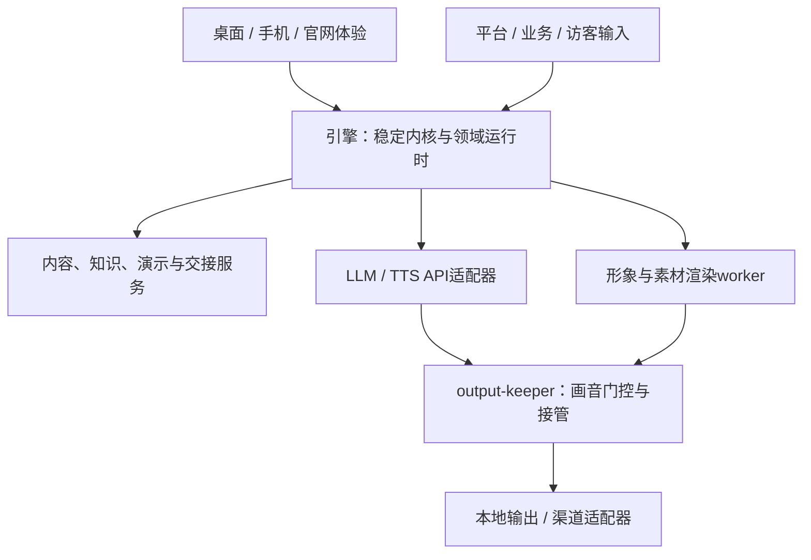

# 互动讲解与售前协作数字人系统 · V4.1 完整设计方案

> 日期：2026-10-22。产品方向：复杂产品的互动讲解、演示与售前协作，直播为重要入口之一。
> 适用读者：产品、设计、架构、开发、测试、运营及OpenCode编码代理。
> 本版不受旧代码/ABI/旧行号兼容约束，重新组织领域、架构和交互；保留统一稳定内核、按需扩展、低运行维护成本等已确认目标。
> 固定约束：LLM/TTS通过API；本地知识与RAG并可接第三方；Windows桌面与抖音为既定运行/渠道方向；写实本地运行以Rust + ONNX为目标，完整模型须单独认证；Lite可一键升级Standard/Pro。
> 文档状态：完整设计基线建议稿。产品定位与差异化商业假设待客户验证；未创建应用仓库、实测模型/硬件、取得账号许可或完成真实直播。所有性能/资源/费用数字为注明条件的预算或目标。

## 1. 设计决策与使用方式

本版由“直播数字人功能集合”重组为“产品资料→讲解与演示→问题处理→真人交接→内容改进”的业务产品。数字人负责呈现，知识负责依据，状态机负责推进，授权机制负责执行；不让一个LLM提示词同时承担全部职责。

本版独立可读，无需查阅V3.11或未定稿V4.0。正文给出当前唯一有效规则，不嵌入历次评审/改动原文。保留有效能力：2D/写实/3D、讲品/节目、RAG/第三方知识、真人音轨、手机、平台、五类扩展、市场客户端、MCP/A2A、团队/多会话、部署/升级、观测与安全。能力可选不等于删除设计。

“必须”用于不变量/必需行为；“建议/初值”可实测后调整并留ADR；“假设”不作为销售承诺；“待认证”不得在UI标Ready。设计状态、代码完成、契约Frozen、认证Passed是不同维度。

阅读：定位/商业看2–5；三档/旅程/UI看6–12；领域与运行看13–27；开放/部署/安全看28–34；数据/API/目录/任务/验收看35–40；来源与旧稿覆盖见附录。

## 2. 产品定位、目标客户与边界

### 2.1 定位

建议定位：**帮助企业把复杂产品资料变成可维护、可演示、可互动、可由真人接续的数字讲解能力。**

适合首先验证的客户：产品型号/配置较多、资料持续更新、解释成本较高、专业售前不足且有重复介绍需求的企业。首选一个能取得客户、真实资料和演示环境的细分行业，例如企业软件、IT设备或专业仪器；选择依据是获取客户和交付条件，不是笼统行业规模。

用户角色：内容负责人（产品/技术专家）、讲解者（销售/主播）、场控、客户/观众、管理员/集成者。采购者可能是销售、市场或业务负责人，不能把实际操作员与预算决策者混为一人。

### 2.2 价值主张

1. 减少重复资料准备和重复讲解，而不是宣称全面取代售前人员。
2. 产品变化时保持事实、话术、素材和演示的一致性。
3. 面对问题能选择相应讲解/演示路径，必要时明确转真人。
4. 真人接手得到可继续工作的上下文，而不是一整段难读聊天记录。
5. 同一资产可用于直播、现场/远程演示和一对一接待，按渠道分别认证。

### 2.3 边界

本产品不提供流量、保证转化或“合规无人直播”；不把通用自主智能体/插件市场作为采购理由；不做任意电脑控制。智能体不持有改价、转账、下单、退款、上下架、封禁、任意系统配置权限。需要真实业务写入时只提供明确授权、可审计的受限接口；交易类高风险默认不注册。

真人可以接管并自行发声；系统不能保证实时原话经过语义审核。医疗/法律/投资等高风险专业场景需独立审查，不以一个行业模板宣称可提供专业建议。

## 3. 竞争定位与差异化假设

官方资料已显示：D-ID有RAG、素材和发音词典；LiveAvatar允许自带LLM/TTS；Navattic与Storylane提供AI问答、演示和销售流程能力。因此“加知识库”“会展示”“接业务系统”“有数字人”均不足以构成独占优势。[S1–S4]

| 假设机会 | 产品化方案 | 要验证的客户证据 | 不能宣称 |
|---|---|---|---|
| 资料更新成本高且容易讲错版本 | 发布快照、影响分析、精准失效、批量复核 | 更新后检查/返工是否明显减少 | 其他厂商都没有版本管理 |
| 复杂产品需要讲明适用条件/限制 | 结构化比较、需求澄清、证据与演示联动 | 客户理解/人工补讲是否改善 | 永远无幻觉、自动选型必正确 |
| 人机交接断层 | 需求摘要、已演示/未确认项、证据、真人接续 | 真人是否减少重复询问 | CRM对接本身就是壁垒 |
| 现有工具部署/维护负担不匹配 | 本地工作台、API采购、可选云与自动诊断 | 总维护工时与运行成本 | 本地知识等于从不向API传数据 |
| 同一资料多处制作维护 | 一份产品包派生渠道化场景和演示 | 是否真实反复使用/更新 | 所有渠道可零配置直接发布 |

差异化是“特定客户下的整体效果”假设，不是根据官网未写某功能就断定市场空白。长期可积累资产为领域对象/演示模板、经授权事实与纠错样本、可复用接入器和交付方法。客户内容/数据归客户，不能以平台锁定或无法导出作为壁垒。

## 4. 应用场景与渠道策略

| 场景 | 目标 | 交互/输出 | 必需条件 |
|---|---|---|---|
| 公开产品直播 | 持续讲解、处理入选问题 | 多人弹幕调度，一路画音 | 平台用途、事件、输出分别获准 |
| 品牌节目/发布会 | 内容与视觉一致 | 段落/素材/真人主持 | 场控/素材授权、实时接管 |
| 销售陪同演示 | 回答标准问题、展示功能 | 真人主导、辅助查资料/点播 | 明确音轨ownership，演示环境安全 |
| 官网产品讲解 | 澄清需求、展示适用功能 | 每访客独立会话 | 网站认证/容量/网络、隐私与转人工 |
| 展厅/门店导购 | 有限领域介绍与查询 | 触摸/语音/大屏 | 输入/设备/ASR与现场权限认证 |
| 培训/渠道赋能 | 讲课件、演练标准问题 | 章节、问答、恢复点 | 课件/身份/进度授权 |
| 会后再了解 | 复看和继续提问 | 可分享回顾/互动内容 | 内容权限、期限、数据删除 |

复用的是产品资料、话术、演示与机制，不是同一UI和同一对话策略。直播没有可靠访客身份时不建立个体画像；官网一对一需要独立状态和容量，不能把广播一条视频当作多用户独立互动。会议/官网集成需各自能力验证，不由桌面出画成功推定。

多语言按资料/术语/音色/单位/币种与地区条件适配。翻译只产生草稿；当地价格、售后、条款仍有独立权威来源。

## 5. 商业价值、收费与验证计划

### 5.1 商业模型建议

基础软件/工作站或团队订阅 + 可选能力包/集成服务；API可用户自带凭据，也可明确报价的托管转售（分账与数据政策另行确定）。收费围绕资料维护、讲解复用、协作和管理能力，不单靠数字人播报分钟。

一次性部署/模板制作须与持续服务分开列示。人工资料清洗、演示定制、API接入、模型/肖像/音色制作的工时不能隐藏进低价订阅。若每客户持续依赖人工调提示词和手工更新，需重新评估产品化程度。

### 5.2 付费验证

建议3–5家同一细分领域客户，使用获准真实资料和真实问题测试。先记录原流程准备/更新/重复讲解/交接工时，再与产品对照。观察持续使用、愿意付费/续费、维护成本、投诉和错误，不以“演示看起来很像人”替代价值验证。

毛贡献 = 软件/服务收入 − API/云/带宽 − 直接维护/支持 − 交付摊销 − 其他直接费用。另看客户可证实节省与效果，不将仍需值守的人员工资全部算为节省。

停转条件：反复使用意愿低；资料/演示交付无法标准化；相对视频/聊天工具/人工流程没有改善；或者付费收入不足覆盖支持成本。调整定位不以已投入代码量作依据。

## 6. Lite / Standard / Pro与部署、模式

### 6.1 默认组合

| 维度 | Lite | Standard | Pro |
|---|---|---|---|
| 内核/契约/安全/升级 | 同一完整机制 | 同一完整机制 | 同一完整机制 |
| 内容准备 | 对象/资料/话术/基础素材、发布版本 | 批量、复杂演示/时间轴、影响分析 | 多项目/团队审核/资产管理 |
| 讲解与协作 | 基础连续讲解、问答、点播/接管 | 完整节目/演示、人机协作 | 多会话、角色/集中运营 |
| 知识 | 本地事实/词法；语义/第三方可装 | 混合检索/更多来源/评估 | 多空间、权限、集中发布 |
| 形象 | 2D默认，写实/3D可装 | 已认证写实默认组合 | 多形象/远程渲染可选 |
| 平台与管理 | 一个活动会话，合法连接器/手机可装 | 更完整渠道/手机组合 | 多平台/多会话/系统集成 |
| 自建云依赖 | Local无 | Local无 | Local无，集中能力可选 |

矩阵是预设，不是永久加装禁令；例如Lite+第三方知识/写实可在依赖和认证满足时启用。许可收费可单独设计，不修改契约/数据格式；升级前展示实际增量费用。未安装功能可发现但不伪报Ready。

### 6.2 四个维度正交

edition决定默认能力；deployment决定Local/Hybrid/Distributed位置；behavior决定Rehearsal/Assisted/AutoSupervised权限；delivery仅开发依赖/里程碑。不得写“R1=Lite永久能力”。影子是evaluation.shadow独立标志，不是第四行为模式。

Local用户已有API网络费用，不要求自建VM。Hybrid可用轻云控制/中继。Distributed按需要拆知识/会话/媒体，必须有跨节点身份/配额/存储和实时边界。手机管理、手机出画、手机本地执行分别认证。

## 7. UI/UE原则、角色与信息架构

### 7.1 原则

任务优先、渐进披露、状态一致、错误可修复、危险恢复需明确操作、日常低负担。UI只呈现用户需要的决策：能否开始、哪里需要核对、何时会说/显示、已执行与否、如何停止/恢复。epoch/lease/binding等放诊断高级页，不出现在普通开播路径。

视觉建议：桌面宽屏信息密度适中、内容区浅色为默认、直播台可暗色；状态不单靠红绿，使用图标+文字+原因。定义统一间距、字重、按钮层级与信息语义，避免给不同插件各画一套风格。

### 7.2 导航

| 一级入口 | 二级功能 | 主要用户 |
|---|---|---|
| 工作台 | 最近项目、继续准备、待核对、快捷演练 | 所有操作员 |
| 产品与资料 | 讲解对象、产品集合、事实、知识/素材、更新影响 | 内容负责人 |
| 场景与演示 | 场景包、话术、节目、演示步骤、试听/演练 | 销售/主播/场控 |
| 现场控制 | 当前会话、问题池、审批、音轨、真人接管 | 讲解者/场控 |
| 记录与改进 | 回顾、问题/坏案例、用量、质量评估 | 运营/负责人 |
| 扩展与集成 | 已装包、连接器、模型/Provider、可选市场 | 管理员/集成者 |
| 设置 | 设备、权限、部署/升级、备份/诊断 | 管理员 |

未安装功能默认不挤占常用导航，可从扩展中心发现。任务页面按当前项目切换，全局设置不打断未保存草稿。角色权限后端执行，隐藏按钮不是授权措施。

### 7.3 用户与权限

viewer只读；operator进行已获准点播/暂停/接管；approver批准内容但不配置密钥；content_editor编辑/提交内容；publisher发布产品/场景；workspace_admin管理成员/资源；local_admin管理本机凭据/信任/安装。小团队可一人多角色，Pro可分离并启用双人审批。

平台账号权限与工作站权限分开。紧急静音由明确授予的值守角色执行，不要求本机超级管理员。放宽自动权限/恢复音轨/更换外发范围须复核。

## 8. 首次使用、空状态和准备向导

### 8.1 首次进入

先选“试用示例”或“创建自己的产品讲解”。示例包有授权形象/资料/场景，不含真实凭据。提供API连通测试、费用口径和上传范围；没有凭据可浏览示例/已有录制，但必须标示非实时AI体验。

向导：目标场景→资料导入→关键事实核对→形象/声音→试听→输出私有演练→保存场景。默认值可用且可解释，高级配置折叠；步骤支持返回/保存进度。仅硬依赖阻断当前动作，非必要能力异常显示可降级方案。

### 8.2 前提和时间目标

凭据/网络/依赖就绪且使用示例包时，约10分钟首句演练为待测体验目标；平台准入、模型制作和企业资料发布不包含在此。真实用户测试记录成功率、失败步骤、求助与时间，不只统计完成者。

### 8.3 全局状态规范

空：解释用途+主要行动+示例，不展示空表格。加载：可预期进度/取消，长任务不锁页面。错误：已发生影响、当前安全状态、建议操作、诊断ID。离线：本地可做与依赖API不可做分别显示。权限不足：说明所需角色/申请方式，不误报系统故障。部分成功：列明已完成/未完成，不以“成功”隐藏失败。

保存/发布/开始三动作明确分开：自动保存草稿≠已发布≠已开播。状态更新基于服务器revision和ACK，过时数据标时间；断线操作默认不离线排队重放。

## 9. 内容工作台与差异审核体验

对象列表支持类型/产品线/版本/发布状态/过期/缺素材筛选。详情页主区为“概览、关键事实、讲解与演示、素材、问题、版本”；右侧展示待核对、来源和使用位置，避免让用户在多个中心来回找同一产品。

导入页面逐字段展示原文/抽取值/来源/置信建议/是否已核对。价格、版本、单位、限制条件可直接定位来源。AI提取置信度仅辅助，不代替发布审核；批量操作展示受影响对象和是否包含敏感字段。

版本对比区分事实变化、表达变化、素材变化、权限变化；影响面板列出哪些话术/演示/缓存需重审、哪些活动会话受影响。草稿编辑不影响当前发布快照，必要撤销即时阻断。

编辑保护：离开前保留草稿、撤销/重做、恢复历史草稿、并发编辑冲突diff。小团队默认轻审流程；需要双人/品牌审核时配置，不强迫所有小商家经历复杂工单。

## 10. 现场控制台与互动体验

### 10.1 布局

| 区域 | 内容 | 高频操作 |
|---|---|---|
| 顶部固定条 | 会话/模式/当前项目、实时/演练、连接/费用/值守 | 停自动、数字人静音、全静音、接管 |
| 左侧内容 | 当前对象/段落、必讲点、下一段、素材缩略图 | 播完再切、跳过、暂停节目 |
| 中央预览 | 真实本地输出、字幕、画音状态、音轨电平 | 预监听/安全预览 |
| 右侧问题/候选 | 待答、入选、待审批、依据/到期 | 选答、改写、批准、忽略、转真人 |
| 底部状态 | 队列秒数、当前句/下一句、降级与设备 | 查看原因、取消待播 |

显示区可折叠，固定安全按钮不被滚动隐藏。多会话管理页只看汇总；进入某场控制必须显式选中，P0目标会话醒目标识，防止静错场。

### 10.2 操作语义

“立即插播”只是优先级，不跳守门/审批/媒体水位；“播完本句再切”在安全边界执行；“暂停节目”不等于停止问答；“暂停自动”不一定停正在播放；“立即全静音”覆盖本地所有外发bus。按钮旁显示结果和影响，不让用户猜测。

批准卡显示最终朗读/屏幕文本、对象/素材缩略、依据和事实版本、TTL与是否需第二人。修改内容使原批准失效。高频安全模板可预先批准范围，避免每次感谢都点按钮；动态敏感回复保持严格核验。批量审批不得把多项不同风险合成一个含糊“全部同意”。

### 10.3 错误示例

“知识接口超时，本问题未播报，可转人工”；“图片含旧版参数，已阻止这段讲解”；“本地已静音，平台缓冲可能仍在播放”；“设备已断开，请选择并重新测音”；“命令已接收，等待设备执行”。不显示插件栈错误替代操作指引。

## 11. 官网、演示接待与真人交接体验

访客端以理解产品为目标：选择关注点/直接提问→展示相关讲解/步骤→追问→回顾/转真人。数字人大小可调整，内容/演示通常占主要画面；不能让大头像遮住参数表、软件界面或字幕。

提供文字输入、字幕、静音/停止、语音授权、结束和数据说明。麦克风默认关闭，用户授权后启用；“开始”前设备检查，不能页面一开就外放/监听。可提供建议问题和“我想看演示/比较型号/联系真人”，不强迫填写联系方式才看基础内容。

人机交接展示要共享的摘要字段，由用户确认数据范围和联系方式；真人未接入时说明等待/预约/改用文本，不伪称在线。转人工成功以对方/系统ACK为准；客户不同意留资仍可得到其有权查看的公开回顾。

交接包含目标/约束、已确认事实、已演示步骤、未解决问题、明确不确定项、用户同意的数据与下一步。自动推断必须标推断，不写成客户已确认。发送CRM/邮件/预约是写操作，需要相应授权，不默认外发。

## 12. 手机、可访问性与UE验收

手机优先状态/审批/静音/接管，复杂素材编辑和多窗口排期保留桌面；使用相同术语与状态。显示连接质量、数据时间、命令ACK；后台/锁屏断线不补执行旧审批。低频缩略图默认，视频预览按需关闭后释放资源。

键盘可完成主要流程，焦点清晰、弹窗正确返回焦点；按钮提供可读名称、字幕与文本替代，不依赖动画/颜色/声音传达状态。建议以WCAG 2.2 AA相关条款做目标验证，不宣称未经审计已达标；触控主按钮建议至少44×44 CSS px，字号/对比/缩放通过真实界面测试。[S10]

全局热键可配置且避开系统冲突；静音热键由keeper独立处理。动画尊重减少动态效果设置，不用闪烁告警。前端性能不占实时线程；预览限帧，不把每帧全分辨率视频传进管理WebView。

UE测试任务：新建对象→修一处事实→试听→演练→插问→恢复→真人接管→结束→找回未解决问题→升级后继续原场景。计成功率、时间、误操作、帮助和疲劳；不只评颜色和页面截图。

## 13. 产品领域模型与发布快照

### 13.1 核心对象

| 模型 | 含义 | 关键引用 |
|---|---|---|
| Workspace/Project | 权限与业务范围 | 成员、资料、Provider/渠道映射 |
| ProductObject | 商品/软件/设备/服务/课程等讲解对象 | facts、knowledge、rights、materials |
| FactSet | 带类型/条件/来源/有效期的权威事实 | 产品revision、authority、permission |
| TalkTrack | 讲解内容的display/speech版本 | 对象/证据、词典、素材、审批策略 |
| DemoPlan | 有限步骤/分支的演示计划 | sandbox、action、checkpoint、required materials |
| ScenePack | 任务场景的可复用配置 | 对象集合、节目、知识、声音/形象、预算、测试 |
| PublishedSnapshot | 发布的不可变引用集合 | 各内容/权限/策略/许可revision |
| Session/Participant | 一次运行及获准参与者 | behavior、渠道、资源、epoch、同意范围 |
| CueBundle | 一次批准的画音/动作执行对象 | speech/display/visual hash、snapshot、TTL |
| HandoffPackage | 真人可继续工作的交接 | confirmed/inferred/unknown、evidence、consent |
| ReviewCase | 人工修正/错误/未答样本 | 原来源、处理结果、待发布修订 |

固定ID与revision分开；已发布版本不可原地覆盖。跨项目复用需映射权限，不能复制凭据/旧批准/访客身份。snapshot是引用集合，不应每次复制整份模型和视频。客户可导出其有权拥有的资料、配置和使用记录，第三方模型权重/声线仍受许可限制。

### 13.2 产品结构

共性字段：id、kind、title、locale、revision、owner、status、data_classification、facts/knowledge/material refs、required_points、prohibited_claims、rights、valid_range。商品扩展SKU/规格/币种/价格/库存口径；软件扩展产品版本/功能/依赖/限制/演示步骤；设备扩展参数/兼容性/工况；课程扩展章节/目标/术语。

不从模型自由文本推导重要事实。结构化比较使用相同维度/单位/条件，缺值标unknown，不能用空值代表没有能力。适用性推荐记录用户确认条件、规则/依据、不确定项，必要时请专家判断，不输出无条件“最佳”。

### 13.3 发布流程

Draft→Validating→ReviewRequired→Published→Superseded/Revoked/Archived。草稿保存不影响活动版本；发布事务产生snapshot与依赖索引。缺少某非必需字段可发布受限用途，但对应回答/动作不可自动。LLM抽取、翻译、重写均为草稿，产品负责人核对后发布。

## 14. 更新影响分析、事实一致性与知识分层

产品更新按字段/对象/权限/素材生成依赖图：fact→talk tracks/demo steps/CueBundles/cache/index。可用关系表/倒排索引实现，不默认引入图数据库。UI展示受影响项、活动会话和建议处理；无法精准判断时保守扩大撤销范围。

重要变化先增加revocation_generation，使preplay/keeper拒绝旧许可，再异步清索引/缓存。草稿小改不立即撤销已发布内容；权利到期、价格/活动失效、权限撤销必须即时收紧，不等句边界。平台已缓冲内容不能撤回，记录实际本地停止边界。

知识分层：KB0结构化权威事实；KB1已发布说明/FAQ/条款；KB2嵌入语义索引；KB3第三方来源。字段权威来源明确，冲突不能一律最新胜/本地胜。已播叙述记忆不是新的权威事实，客户问题不自动写入产品知识。

快照绑定object/facts/docs/materials/rights/policy版本。缓存和审批引用相同发布身份；局部更新可让未受影响内容继续，但必须有依赖证明，不能只用“同一产品ID”推定仍有效。

## 15. 话术、发音和内容生产

话术支持风格/长度/受众/语言、多个候选、差异比对、手工编辑、试听、发布与使用位置。风格不能改事实、限制/否定/承诺。生成默认追加候选，不覆盖已批准稿；产品负责人确认后才能成为正式内容。

TalkTrack含speech_text/display_text、purpose、object_snapshot、fact/evidence refs、dictionary_revision、voice/model revision、estimated/actual_duration、valid_range、approval_policy。金额和单位使用最小币值/decimal，经读法转换后校验语义等价，例如1299元和一千二百九十九元。

词典按项目/产品/语言配置术语、型号、英文缩写、百分比、单位和公式。Provider支持SSML/音素时用其合法协议；否则用经试听文本替代，不假设一套SSML通用。展示和朗读内容可不同但都绑定批准对象。词典改动使相关音频候选重新生成/核验。

预合成是付费任务：显示预计字符/时长、成本、缓存命中和上限。只预生成有效且高复用内容；未来活动内容可以准备但在生效前禁止投放。语音库按许可/voice revision管理，主备不同声线不能一句中拼接。

## 16. 受控演示、讲解编排与选择路径

### 16.1 演示类型

静态素材/课件步骤、已批准视频片段、隔离沙箱内受控交互、真实环境只读查询四类。实际业务写入属于独立明确能力，不因为名为“演示”就降低风险。默认不对真实业务系统执行自由电脑控制。

DemoStep含id、target、preconditions、allowed_action、params_schema、expected_result、timeout、cost、evidence、visual refs、checkpoint、failure_policy。模型可以选择白名单step或建议追问，执行器重新检查条件/权限；不能自由生成shell/SQL/任意URL/浏览器脚本。

演示环境标示真实/沙箱/静态模拟。模拟结果不能当实际产品能力证明；失败明确显示，不能播放成功素材掩盖实际错误。需要演示运行证据时保存版本/环境/结果摘要，并与产品声明分开。

### 16.2 讲解计划

ShowPlan按目标组织卖点、场景、限制、演示、比较、FAQ和收尾；必讲点、可选变体、冷却、时长、插问规则和恢复点明确。基础Lite可用确定性顺序/规则完成，不依赖市场/多步规划。高级分支按已确认需求/获准事实选择，不让LLM无限扩展计划。

问题打断后保存已完成句/步骤/素材位置，恢复前核对snapshot/事实/环境。重复演示有上限；不能循环“再试一次”消耗API或对业务系统重复写入。若必要条件变化，跳过/转人工并解释未完成内容。

## 17. 互动调度、需求澄清与真人交接

### 17.1 多人直播和一对一分流

直播用有界问题池、去重/聚合/TTL/公平调度和语音债务；一对一保持访客作用域的意图/需求/已讲步骤/未解决项。两者共用内容/权限但有不同调度插件。会议模式真人持有主持权，数字人不自行抢音轨。

语音债务=当前剩余+待播时长。初值最多2条待播、20秒待播、回答20–40字/一般60字上限；按实际TTS时长校准。每分钟30秒互动预算、10秒每答只能容纳约3条，不能按模型QPS承诺直播响应能力。

P0静音/撤销 > 人工点播 > 关键节目 > 相关问题 > 合并感谢 > 寒暄。TTL初值问答15s/欢迎5s/感谢20s，公平限制单观众占比。金额/优惠/个体承诺不能相似复用；未入选不发起付费模型调用。普通插问句边界，风险撤销即时。

### 17.2 需求表示

记录confirmed（客户明确确认）、inferred（模型推断）、unknown（缺资料）、rejected（客户否定）。推断不可写成客户确认，更不能作为授权。问必要的少量问题，允许跳过，不让访客先填长表才能得到基础介绍。

### 17.3 交接

Handoff状态Draft→ConsentPending→Approved→Dispatching→Acknowledged/Failed/Expired。包含需求/约束、实际讲过/演示过的内容、已确认事实、未决问题和依据、明确不确定项、同意范围/有效期及目标角色。外部写入使用幂等键，部分失败有状态，重试受期限和授权。

真人未接入时可提供预约/保存草稿，不能假装已有人接待。人工修正进入ReviewCase，经内容负责人确认才转成知识/话术；CRM资料不默认进入公开知识。

## 18. 技术架构与进程边界



API音频箭头仅表示数据传递，必须有引擎签发的当前播放许可，Provider不能自行播放。UI不持媒体主时钟和密钥。内容、演示、交接“服务”可为同进程模块，不等于各建一台云主机。

| 进程 | 职责 | 故障边界 |
|---|---|---|
| engine | 核心机制、领域插件、知识/Provider、授权、状态/日志 | 失联后keeper租约静音；恢复只待机 |
| output-keeper | 音频设备/混音、已批准安全画面、最小合成/标识、租约/P0/ACK | 不加载模型/Provider/第三方解码器；自身崩溃仍会中断 |
| render-worker | 2D/ORT/3D、获准素材渲染、帧通道 | 普通崩溃不直接退出keeper；驱动/整机故障另验 |
| platform-bridge | 必要官方SDK/C++薄桥接 | 平台失联撤相应自动权限，不伪造事件 |
| control-server（可选） | 手机/团队/网站管理与中继 | 不成为Local P0前置；持久状态单独设计 |
| supervisor/update-helper | 限次重启、维护窗口替换 | 极小体量；不继承旧自动授权 |

复杂解析/解码可用短命受限worker，任务结束回收。Lite默认不为每个插件单独起进程；GPU/不可信原生不为省资源并入内核。云网页多人互动按独立会话配置资源，不等于本地广播免费扩成无限并发。

## 19. 稳定内核、契约与插件宿主

内核八类机制：能力登记/绑定、生命周期/健康、会话/epoch、有限队列/期限/令牌、权限/租约执行、配置/凭据引用、控制通信/媒体协商、审计/观测接口。产品事实/风格/节目/知识排序/技能选择/商业规则属于领域模块，不写死内核。

核心源contracts→kernel/SDK→hosts/领域共享库→具体插件→runtime装配→apps。kernel不得依赖插件、Tauri、平台SDK或ONNX；插件不得直接依赖另一插件实现，通过获准能力客户端通信；可以依赖必要共享算法库。

| 宿主 | 用途 | 限制 |
|---|---|---|
| inproc静态模块 | 审查可信规则/检索/编排等 | 无崩溃隔离；不热载未知原生DLL |
| subprocess | GPU、SDK、复杂解析/原生扩展 | 进程不是权限沙箱，需实际受限身份/ACL/资源约束 |
| remote | 知识/Provider/远程渲染/业务源 | TLS、身份、范围、期限/重连/费用认证 |
| wasm（认证后） | 受限变换/计算/技能 | 限内存/fuel/import，不等于任意原生能力 |

签名证明来源和完整性，不证明安全。Job Object约束资源/生命周期，不替代Windows AppContainer等权限边界。不可信原生不能受限时拒载或使用远程/WASM，不以企业签名自动放进内核。

Lifecycle：Absent→Installed→Validated→Ready→Active→Idle→Suspended，错误Failed、更新Draining。Ready需依赖/健康/资源满足，实际平台许可另判。主备绑定明确作用域和降级前提，缺guard拒生成外发，缺avatar.profile拒形象激活。CapabilityView统一UI/决策所见状态。

## 20. 会话、权限模式、状态与审批

生命周期Created→Preparing→Ready/ReadyDegraded→Running→Draining→Stopped，严重错误Faulted；行为Rehearsal/Assisted/AutoSupervised；媒体Standby/Buffering/Playing/Muted/DeviceLost/Failed。三者分开，shadow=true禁止真实输出句柄。

Prepare解析edition/deployment/scene依赖→版本/签名/资源→启动必要宿主→健康/用途权限→绑定快照→ready视图。RoomStarted不自动开启自动模式，重启/重连不恢复旧权限。自动值守租约由人主动确认，网络心跳不能证明值守；桌面有效值守存在时手机失联不误判无人。

Utterance：Selected→Retrieving/Generating→Guarded→AwaitingApproval/Approved→Synthesizing→Buffering→Committed→Playing→Completed；任意进入Cancelled/Expired/Blocked/Failed。模板跳生成不跳门控，完成以本地实际播放ACK，不代表观众已听完。

CueBundle批准绑定最终speech/display/visual hash、session/epoch、对象/事实/许可/策略revision、范围/角色与TTL。单人/双人以request+votes表示，唯一(request_id,actor_id)，同人重试不凑票；改变内容/权限则整请求失效。模型返回approved字段无效。

播放许可是短期、只允许指定bundle和输出通道的令牌；初值200ms续租、600ms截止，设备缓冲实测。新授权扩大先持久提交；P0静音、权限撤销先收紧后补审计，不能等卡死DB。P0鉴权后不因过时revision拒绝，幂等报告实际结果。

## 21. 智能体Harness、上下文、工具与记忆

每次模型调用按固定顺序装配：安全约束→人设/场景→任务/输出Schema→当前事件/状态→必要事实/证据→获准记忆→相关技能→已播历史→不可信工具返回。分段预算，前3不可裁；必要事实条件容纳不下时拒该路径，不截掉否定/优惠条件后继续回答。

上下文片段带来源、作用域、数据/指令标记、revision/TTL。评论/文档/工具/外部Agent无指令权。日志存片段ID/hash/预算/裁剪原因；合法保留payload可得才完整回放，删除后明确不可回放。

实时路径规则/模板优先，一次短生成或检索后生成，不强制每评论先额外模型分类。非实时可用封闭意图枚举+置信建议+依据，unknown合法；意图不构成权限/风险降级。

工具循环只用于批准的有限路径，初值最多2步，共享deadline/预算、并行仅无依赖只读；副作用/可见/物理动作不并行；写失败无幂等证据不重试。部分失败区分empty/timeout/unknown，不能全失败让模型凭印象补。超结果大小显式partial/拒绝，不能截坏JSON后当合法结果。

工作记忆只记录实际播完；场次叙述来自当前授权且完成内容；产品事实只经发布；长期访客记忆默认关闭，按同意/用途/范围/保留期读写/删除，不跨平台按昵称关联。会话结束可保留有权叙述，不保留播放许可/旧自动授权；已撤销设备身份不得恢复。

六层Harness为信息、工具、编排、记忆、评估、约束恢复，不新增常驻进程。失败有具名错误与CapabilityView状态，不用空上下文自由发挥兜底。

## 22. 本地知识、RAG与第三方知识服务

### 22.1 导入与索引

支持TXT/Markdown/结构化CSV/JSON；Excel、PDF/DOCX等按解析器认证。OCR可选，未装标需要OCR，不能空文本当成功。限制文件/页/压缩比/期限，复杂解析隔离，拒任意外链/路径穿越。导入job状态Uploaded/Parsed/Reviewed/Chunked/Indexed/Evaluated/Published；用户看原文/页码/表格位置/产品/权限。

SQLite FTS5默认unicode61不是中文分词器，使用已验证分词预处理/自定义tokenizer；短词、错别字、型号必须测。[S7] 300–600中文字块、50–100重叠为调试起点，按标题/条款/表头切，不任意截断表格条件。

### 22.2 查询

先服务端ACL/workspace/对象/时间→精确facts→词法+必要向量→RRF等排名融合→可选Rerank→3–5条证据→一次生成→实体/数字/条件/引用校验。向量维度/模型版本/metric/归一化/chunker共同标索引身份，不能混空间。小库优先验证低维护方案，大库容量单独基准，不以线扫承诺百万级低延迟。

local_only数据默认不上传Embedding/LLM；本地检索后把片段送API也属于外发，需字段级政策，不能宣传“本地库=不出本机”。禁止上传时使用本地规则/模板/人工，不偷偷部署本地LLM/TTS。

### 22.3 远端服务

capabilities/health/search必需，answer/sync/delete可选。类型retrieval_with_evidence、answer_with_evidence、answer_only；带证据答案是候选，可经核验直接用，不默认再调用LLM；answer_only不能支撑敏感自动承诺。

请求request/session/kb/query/filters/top_k/remaining_budget；结果status/provider/evidence/answer_draft/usage。evidence有scope/doc/revision/chunk/text/source_span/valid_range/authority/permission。状态complete/partial/empty/timeout/unavailable/unauthorized不同。客户端filters不是授权，服务端重映射知识空间。

路由local/remote/hybrid；remote只有明确同域镜像才回退本地，hybrid标未完成来源。删除先tombstone阻断所有检索/待播/缓存，再清物理副本；备份/第三方留存有实际期限，无法清除不宣称擦除完毕。

## 23. LLM/TTS Provider、词典与缓存

LLM/TTS均远端API，Embedding/Rerank/审核/ASR按需。接口含能力、地区/model revision、凭据引用、格式/流式、上下文/并发/速率、timeout/cancel/retry、价格单位/留存/上传政策。前端不存密钥。主备分别认证提示词/输出，不拼接两家生成段落或声线。

LLM SSE解析多行data、分片UTF-8、增量工具参数、错误与明确结束，不能按TCP chunk parse JSON。OpenAI兼容只代表协议候选，不保证tools/JSON/推理参数一致；严格Schema解析失败有限纠正，仍失败转人工。

TTS经批准文本→发音正规化/复检→编码音频流→解码PCM→输出分支和模型分支→同时间轴。首包可能不可直接播放，计入解码/样本/模型前瞻。取消迟到流丢弃，但服务端计费入账。401/403不盲重试，429遵守Retry-After和期限，5xx/断连有限退避+jitter，初值最多一次额外重试。

精确TTS缓存键包括最终朗读、Provider/model/voice、词典/语言/语速/情绪、格式/采样率、事实/知识/策略/权限/许可版本与TTL。敏感事实变化即时失效，LRU/文件hash/路径校验；跨项目不复用受限内容。

语义缓存只复用候选文本，不复制审批/事实引用或直接播音频。相似命中重新核验证据并签发新许可；价格/库存/活动/个体承诺/售后敏感内容禁语义缓存。随后若最终文本及全部精确键均相同，可独立通过精确音频缓存检查；这不是“相似句直接用旧音频”。同时测误命中率与命中率。

## 24. 媒体、视觉联动与真人音轨

PCM块含session/utterance/epoch/seq/sample_rate/channels/format/sample_start/count/EOS；帧含scope/seq/PTS/time_base/duration/size/pixel_format/buffer_ref。媒体以音频样本/硬件播放时钟映射为主，UTC只审计，内部deadline用单调时钟。16k模型与48k输出计数不可直接相等，重采样映射明确。

CueBundle将语音、字幕、物料和动作按on_commit/at_sample_offset/on_segment_start/on_complete排期，不按LLM/网络到达切图。required_visual未就绪阻止依赖句，optional仅选预授权替代；改价签/字幕/图像同样重审，不能只核声音。

起播缓冲200–500ms为初值，含模型lookahead；25fps/300ms约8帧，1秒约25帧，batch/inflight/ready-frame分别设限。少量迟帧重复上一帧，持续迟到取消/待机；padding不延长嘴动。数据面二进制/环形缓冲，不将帧Base64进控制总线。1080p RGB25fps原始约155.5MB/s，多次复制必须计量。

共享内存定义slot owner、len/seq/epoch、释放/覆盖、断连回收；GPU纹理跨进程另认证，不写未经测量零拷贝。keeper最小合成、标识与静音独立，第三方解码/模型在worker；全局GPU重置/整机OOM可能仍影响keeper，预置平台待机场景。

真人模式：人工输入驱动（完整生成门控）；真人原声直通（设备/身份/路由受控，不做LLM预审）；真人PCM驱动形象（无需ASR/LLM/TTS，但按模型lookahead延时同步）；人机接力（独占音轨）；语音对话（可选ASR/轮次）。麦克风默认不录制/不上传；ASR、字幕和云音频服务须另授权。

P0先keeper静音/清音频、字幕与未来视觉事件，撤销许可代际，再取消引擎/API/模型，迟到结果丢弃。数字人静音与全bus静音分开，后者含素材/BGM/人声；接管停数字人不误停已获准人声。新自动恢复显式确认，不因人声结束自动触发。

## 25. 形象、模型资产与完整准入

2D分层纹理+RMS/平滑/门限嘴型可作低资源形态，不宣传精确音素。存在感Idle/Presenting/Listening/Responding/Waiting/HumanControlled/Standby映射真实avatar.profile；没有ASR时Listening只表示等待输入。动作/姿态有支持范围、自然切换点和冷却，不每句同手势。

写实完整链路：PCM重采样/规范化→窗口/特征→音频编码器→条件与生成网络→后处理/贴合→底版合成。所有必要检测/裁剪/掩码/关键点可离线预计算但须在包中声明，不留隐藏Python服务。Python仅制作/导出，Windows干净环境运行不依赖Python。

模型包包括全部图/external weights、I/O name/shape/dtype/opset、window/hop/lookahead/padding/归一化、frame mapping、pre/postprocess版本、EP/precision/driver认证、hash/BOM/golden。形象包含素材/模型/个性checkpoint/ROI/底版fps/姿态切换/许可/voice。缺profile关键字段NotReady，不能猜参数。

G0来源/许可→G1原实现与Rust逐段对齐→G2目标机并发直播实时性→G3长播/取消/OOM/设备/恢复及安装。FP32基准后验证FP16，INT8需校准与质量报告；CPU回退未达实时不能自动接写实。TensorRT/DirectML各自设置/缓存/兼容矩阵，不混EP参数。[S6]

写实Gate失败只表示该实现不可发布；预授权2D降级不等于写实通过。3D/VRM独立骨骼/blendshape/材质/动作/引擎认证；无phoneme则需独立viseme方案和时延。远程数字人API可作替换实现但费用/时长/数据外发需明示，不锁死单个供应商。

## 26. 平台接入、输出与多渠道

平台用途/账号/类目允许范围、事件权限、画音入口是三项独立证据；SDK调试不等于实际自动互动许可。证据可为适用官方规则、控制台批准、审核/合同/明确答复，记录版本/范围；不足unknown，不能自证允许。不能假设每平台都提供逐账号专项书面许可。

抖音既定评估路线为官方互动工具/伴侣SDK桥接与keeper窗口+音频采集等获准输出，具体产物形态/上屏/事件按实际版本核实。[S5] 伴侣启动/退出、房间/账号变化、重复回调、旧事件、SDK断开和重连要测试。SDK只转事件，回调不等待LLM/大磁盘事务。

事件含platform/app/room/connector/session/event_id/type、时间、scope user和payload；大整数ID用字符串。gift保留delta/cumulative/unknown，不盲累加连击；未提供enter不称“刚进房间”，首次发言欢迎可独立规则。unknown事件不触发播报。去重/乱序/遗漏诚实处理，不宣称零丢失。

回调网关仅官方接入需要时启用：原始body验签→范围/重放/包体检查→持久inbox→按协议ACK→异步推送；AI不跑在回调请求内。工作站主动出站，重连只重新评估未过期事件，审计补录不补播。

窗口/音频/录制/平台推流分别验收。虚拟摄像头视频不代替音频；不默认开发驱动。默认设备变化静音重测，只一条实际收音路径，测试OBS/伴侣双收音/回声/最小化/缩放。快手/视频号/会议/官网各adapter单独认证，没有官方接口时Unavailable而非fake演示Passed。

## 27. 远程会话、手机与多会话资源

手机管理可在三档加装：可信HTTPS/WSS或原生认证通道，PWA不能扫指纹就信自签证书；Service Worker安全上下文/后台限制按浏览器验证。原生证书固定和用户信任管理是另一方案，不混同。

命令含身份/角色/session/epoch/seq/command_id/TTL/state_revision，鉴权、防重放与实际ACK；断网不缓存高风险命令重放。吊销设备即时断令牌/连接并取消相关未执行批准。中继两段TLS不等于E2EE；确需中继不可读采用经审核端到端方案，不自造密码协议。

Pro多会话每场独立授权/epoch/预算/对象/记忆/输出，GPU/连接池/只读快照可共享但中间状态不能串用。全局和场次配额同时准入，资源不足拒新场而不是拖垮已开播。每个网站访客的独立互动资源按实际并发计费，不能用“无限并发API”推定自身平台零成本。

云渲染/手机出画/手机本地执行是独立profile：网络/编解码/平台入口、Android温控/电量/内存、iOS后台与分发分别验证。P2手机遥控成功不证明P5手机画面可进入直播。Local云断线保留本地控制/有效缓存，API新内容可能不可用，不能称完整业务不受网络影响。

## 28. 开放平台、能力目录与扩展SDK

### 28.1 五类扩展

| 类型 | 作用 | 支持形态 |
|---|---|---|
| Connector | 平台/业务/知识/文件/设备接入 | 声明式HTTP/Webhook、SDK桥接、远端、通用协议 |
| Skill | 模型可请求的受控查询/计算/动作 | 声明式、可信原生、受限WASM、remote |
| Pack | 对象类型、场景、话术、知识、规则、形象/音色、演示、评测 | 数据+Schema+引用/BOM，无任意可执行脚本 |
| Provider | LLM/TTS/Embedding/Rerank/ASR/审核/渲染服务 | 已认证adapter与远端服务 |
| Panel | 管理界面/手机卡片 | 声明式表单/受审组件；第三方页面隔离 |

扩展共用同一manifest、信任、权限、生命周期、撤销和升级器。产品定位聚焦不妨碍开放新对象类型/渠道；扩展不能突破安全门控或直连keeper发声。

### 28.2 目录与Schema唯一来源

`schemas/catalog/source.json`指定唯一目录源，建议`capabilities.json`；文档表与语言类型生成，不手改多份。每项id@major、kind、interaction、required/conditional/optional、lifecycle状态、deps、supported_hosts、fallback、resource profile、suite refs。

| 能力 | 操作语义 | 条件 |
|---|---|---|
| content.objects@1 | 导入/校验/发布/差异/影响 | 资料工作流 |
| content.scenes@1 | 场景/话术/素材引用管理 | 场景准备 |
| presentation.run@1 | Show/Demo执行/检查点/恢复 | 连续讲解/演示 |
| collaboration.handoff@1 | 摘要/同意/转接/ACK | 真人交接 |
| platform.events@1 | 事件、权限、连接生命周期 | 对应渠道 |
| agent.decide@1 | Observation→Decision | 自动/辅助决策 |
| guard.check@1 | 四阶段/证据/范围/批准要求 | 生成外发必需 |
| knowledge.retrieve@1 | search/facts/可选answer | 依据问答 |
| memory.access@1 | read/write/forget/scopes | 按场景授权 |
| skill.invoke@1 | list/invoke/cancel | 技能白名单 |
| data.query@1、data.subscribe@1 | 来源范围查询/订阅 | 业务/外部数据 |
| llm.generate@1、tts.synthesize@1 | 有序生成/合成/取消/usage | 对应付费路径 |
| embedding.embed@1、rerank.rank@1 | 语义/排序 | 可选 |
| avatar.render@1、avatar.profile@1 | 音频/动作→帧及能力描述 | 数字人形象 |
| media.timeline@1、media.channel@1 | 时间/缓冲/通道协商 | 媒体基础 |
| output.deliver@1 | prepare/start/mute/stop/status/ACK | 对外输出 |
| control.manage@1 | 命令/状态/审批/ACK | 管理 |
| runtime.observe@1、storage.persist@1 | 观测/事务端口 | 核心 |
| device.sense@1、device.control@1 | 感知/白名单控制/联锁 | 可选设备 |
| market.catalog@1 | 来源/目录/包/撤销 | 可选市场客户端 |

本表是V4.1目标契约设计，不宣称代码已Frozen。协议边界清晰后才能生成消费者；完整Schema、错误/取消/背压/suite齐备才Frozen。不受旧名称兼容约束，但同一当前目录不得一名多义；未来发布后语义变更升主版本。

### 28.3 SDK

Plugin.describe/validate_config/start/health/suspend/resume/stop，CapabilityClient.invoke/stream/cancel，PluginContext提供有范围的配置/凭据引用/日志/时钟/预算/能力客户端。流有data/complete/error，EOF不算正常完成。Rust trait需object-safety方案（例如BoxFuture），不导出Rust ABI给任意动态库。

提供Rust模板、跨语言Protobuf桩、无凭据模拟宿主、异常夹具、CLI自检与发布检查。插件清单新增权限需显式授权；同能力不同宿主必须通过相同suite。扩展未Ready时UI显示缺依赖/未认证/资源不足，不让用户猜“安装成功为什么不能用”。

## 29. 连接器、技能、MCP/A2A与设备

### 29.1 通用业务接入

声明式HTTP/Webhook配置endpoint ID/域名、凭据引用、受控参数、字段映射、分页/速率、来源权威、TTL、数据分类、health和离线行为。服务端映射范围，用户/模型不能自由输入SQL/URL。数据库只读视图使用参数化查询与受限账户；MQTT、OBS WebSocket、串口/设备SDK按需adapter。

每条返回source_id/fetched_at/valid_until/authority(system_of_record/derived/external/unverified)/classification(public/internal/personal/restricted)/revision。业务事实同步到KB0必须按发布/自动信任规则明确核验，不能把任意API返回直接写权威表。分类决定上传目的地，个人/受限默认禁止外发。

网络执行检查允许域名、实际解析IP、重定向目标和端口，阻断非授权内网/metadata/回环；DNS变化、超大响应、解压比和分页循环有界。凭据按目的地注入，不在模型上下文中出现。连接器Schema不得通过模板表达式执行任意代码。

### 29.2 技能

清单含params/result Schema、model_description、side_effect、declared risk、permissions/data/network/credential/device scopes、timeout/rate/cost/idempotency、fixtures。模型描述受限并审核，工具描述是注入面。

有效风险=max(声明风险，按副作用/权限推导风险)。只读查询通常risk_0；事实解释/已授权通知risk_1；影响观众可见/业务写入risk_2需批准；交易/任意配置/物理高风险risk_3默认禁止，不让声明低风险覆盖。

调用：Schema→风险→授权/外发→预算→受限执行→结果Schema/大小/时效→不可信数据标记→若用于讲解绑定证据/守门→日志。工具返回“approved/readonly”无权授予许可。技能选择初值≤5相关条，不能把50个工具全塞上下文。通知、CRM写入等只在用户授权目标/字段范围内执行。

### 29.3 MCP与A2A

MCP tools映射技能逐项审核；resources映射数据源仍经ACL/来源核验；prompts不直接成为system prompt；sampling默认关闭，启用需本机管理权限/预算与逐次审计。接入保存工具名称/描述/Schema/来源版本快照，描述漂移重审，不能远端无提示增权。

A2A独立入站，不复用平台或管理通道；身份由本地配置/认证导出，不信请求自报。入站是外部请求，不是用户授权/值守；默认仅辅助任务队列，自动场景需显式批准。出站声明目标/目的/数据范围/期限，默认不发观众原文/秘密，不委派risk_2+及需秘密权限的动作；深度初值1。对端结果作为不可信结论，证据核验后才能使用。

协议版本、身份/认证和可用SDK必须按实际规范锁定后登记/认证；未验证返回Unavailable，不能只有接口占位就标互操作完成。无需为了互操作额外建一套权限和内核。

### 29.4 设备

感知/控制分开。摄像头/传感器/触摸/ASR默认按场景授权，视觉身份/情绪画像默认不做。执行设备动作枚举/范围/频率/联锁/本地覆盖必需；机械/门禁等物理高风险默认禁止。设备热插拔/错误不能阻塞P0，真实认证与模拟fixture分开。

## 30. 市场客户端、分发与UI扩展

公开市场为独立服务，本项目仅客户端/开放接口/适配。支持官方、企业目录/镜像、本地离线包；Local不依赖联网市场。目录可浏览，安装/启用/场景授权三个步骤清楚分开。

Market API：discovery、catalog/search、extension/version详情、包下载Range、签名元数据、revocations、可选授权/举报/遥测。响应request ID/限流/错误和支持版本明确；发现接口返回的新root不能自动成为信任根。预置信任根或管理员显式导入，按源/发布者命名空间解析依赖，防同名/依赖混淆。

包检查TLS→元数据签名/新鲜度/单调版本→manifest/package hash/signature→publisher/trust→撤销→兼容→风险重算→权限/费用展示→授权→暂存→维护窗口激活。可借鉴成熟签名元数据机制，具体加密/根轮换采用审核实现，不自造协议。

可信等级official/enterprise/verified/community/dev由信任策略派生；等级不等于权限沙箱。community默认不自动，dev仅显式开发环境；被撤销安全/肖像/声线/权限立即阻断。普通维护下架可按句边界/下一场，商业许可证短暂不可达可按有效离线令牌/明确宽限处理，安全撤销不能被商业宽限覆盖。

撤销缓存超过期限（例如72h起点）阻新安装/高风险新启用，现有合法低风险会话按政策运行；不强制云市场宕机导致本地全停。遥测默认关闭，不上传会话/知识/观众内容，设备标识可重置随机ID。

Panel注册导航、声明式表单、只读状态/命令权限和手机卡片。字段由Schema生成，遵守设计tokens/状态文案；不允许第三方JS在主WebView权限内执行。需要隔离页面时独立origin/CSP/消息白名单，只能调用审核命令。包不能改平台标识或隐藏停止按钮。

## 31. 部署、资源治理、云成本与维护

### 31.1 本地与云

Local：无需Redis/NATS/K8s/独立向量服务，SQLite/文件+嵌入式检索，核心/媒体/必要bridge进程。LLM/TTS API联网仍必要，断网仅合法缓存/真人/本地资料可用。Hybrid轻控制可单Rust HTTP/WSS进程+持久存储，1–2vCPU/1–2GB只作低频控制PoC预算，不含转码/大库/GPU，按申报负载实测。

Distributed：多节点写入使用关系存储，明确session ownership/fencing和路由，不能两节点同时授同场输出租约；必要broker/向量服务按负载选。默认不要求Kubernetes；可用系统服务/Docker Compose，扩规模才选集群。WindowsSDK/声卡/窗口输出仍留支持的边缘OS。

Serverless并非自动省钱：长连接时限、冷启动、请求/出口/状态存储计费需对比。更新目录可静态签名文件，不必常驻更新服务器；轻中继不保存模型、原始文档、向量和录制。

### 31.2 资源生命周期

未安装/未启用包无对应主动进程/端口/轮询/显存/云调用，但目录元数据有固定小成本。非实时任务懒启动，解析worker完成退出；直播中模型保温以保障首句，场次结束按TTL卸载；预览关停立即释放编码器/带宽。对象/知识索引后台限速，不抢媒体/控制。

资源按CPU/系统内存、GPU、网络/API、磁盘分别治理。GPU OOM先关预览/认证降载→取消句/待机→重启worker→预热体检；不在OOM时加载第二大模型。CPU/内存压力暂停索引/解析；API配额压力暂停后台Embedding。新会话先查峰值显存/吞吐/设备/API总额，拒新场优于拖垮现有场。

### 31.3 配额与维护起点

日志轮转例如7天/512MB、录制20GB上限且有磁盘安全余量、TTS缓存1GB LRU/TTL、审计/事实变更按业务期限，均为可配置初值。磁盘满先停录制/后台索引，关键写失败停止新授权但P0可用；不自动删除受保护证据。备份/压缩/上传在直播中限速。

统一安装/自检、依赖诊断、脱敏支持包、证书自动续期/告警、Provider错误分类、可重复备份恢复与版本回退降低维护。记录月度人工维护小时、每客户交付工时、故障恢复、升级步骤数和续费，不只记录云主机账单。

## 32. 一键升级、离线包与数据迁移

Lite直升Standard/Pro及逐级同一依赖图。计划页显示新增能力/下载/磁盘/驱动/模型条件、凭据/用途、运行成本增量与维护窗口。用户一次发起，自动检查/安装/迁移/验证，必要重启由helper完成，不要求手工重装；硬件/平台/素材前提不足标InstalledNotReady，不能伪报已可用。

流程Plan→Preflight→Downloaded/Verified→WaitingWindow→BackedUp→Migrated→HealthChecked→Committed/RolledBack。开播中只暂存，程序/模型不热替换；收紧权限即时生效，Provider仅句边界按明确配置切换。

releases/plugins/models/data分版本目录；journal持久步骤、幂等键、旧/新组合和backup ref，current manifest同盘原子替换。文件/DB不是一个事务，断电恢复验证完整组合。Tauri updater可更新签名应用，但依赖/模型/数据事务由本项目编排。[S9]

新业务写入前旧程序+一致快照可回退；之后须兼容读写、反向迁移或验证的增量重放，不用旧快照覆盖新事实/审计。导出新写入不等于无损回滚，不兼容时阻止自动回退并说明恢复方案。降档排空超出会话、停能力留数据，隐私删除单独执行。

本版可不兼容旧代码/旧协议，但不代表有权删除客户业务数据。旧库导入若需要，提供显式映射/校验/预览与一致备份，不为未提供旧库承诺自动迁移。Local→Hybrid/Distributed迁移需权限映射/文件哈希/证据ID/索引空间验证、密钥重新授权和维护窗口切换。

## 33. 安全不变量、威胁与合规边界

### 33.1 不变量唯一正本

| ID | 必须保持 |
|---|---|
| INV-01 | 无相应渠道/用途/行为许可不外发受限内容，unknown不当granted |
| INV-02 | AI/模板/缓存/预生成均执行input/evidence/output/preplay，不绕过guard |
| INV-03 | 审批绑定bundle hash、session/epoch、版本、角色/范围、TTL，不接受模型自授 |
| INV-04 | 旧epoch/过期/撤销结果不得再次提交/播放，重新连接不自动恢复 |
| INV-05 | 敏感事实依据当前有效发布源，图/字幕/素材同样绑定与失效 |
| INV-06 | 本地P0独立于engine/云/DB，鉴权后幂等先停，实际ACK不等于平台已静音 |
| INV-07 | 新授权扩大先持久化，撤销/静音先执行后审计，失败保持拒绝 |
| INV-08 | 值守由主动确认短租约，网络心跳不续人工值守 |
| INV-09 | 外部文本/文档/工具/Agent均不具有系统指令或授权权力 |
| INV-10 | 模型无高风险交易/配置/任意执行权限，动作白名单与实际执行器复核 |
| INV-11 | 所有队列/循环/结果/调用有界，deadline与预算并行约束 |
| INV-12 | 签名不等于安全，原生进程不等于沙箱，未知原生不进内核 |
| INV-13 | 凭据受控引用，UI/仓库/日志/支持包不含明文，生产限制完整转储 |
| INV-14 | local_only/个人数据按用途与目的地强制过滤，不以“本地库”掩盖API外发 |
| INV-15 | 访客长期记忆默认关，作用域/同意/保留/删除可验证，不跨平台昵称合并 |
| INV-16 | 真人原声不宣称经过LLM语义预审；设备/音轨/平台/标识/P0仍执行 |
| INV-17 | 每个音轨/输出ownership明确，全静音覆盖全部bus，无双重收音 |
| INV-18 | 必需视觉/模型帧就绪才commit，可选只用预授权替代，不展示其他对象 |
| INV-19 | 影子/试听私有sink隔离，不能误进入真实直播输出 |
| INV-20 | 实际完成以本地播放/动作ACK，生成/HTTP202不算完成 |
| INV-21 | 决策链完整性不等于防管理员篡改；删除payload不能被回放恢复 |
| INV-22 | 升级维护窗口+可恢复journal，回滚不静默丢新增数据 |
| INV-23 | 三档同核心；edition/deployment/behavior/delivery不硬编码等价 |
| INV-24 | 未启用不启动对应资源；市场/许可证暂不可达不自动切断合法本地会话 |
| INV-25 | 安全/肖像/声线/权限撤销优先即时，不被商业宽限覆盖 |
| INV-26 | kernel不依赖业务插件/SDK/Tauri，插件无直接实现依赖 |
| INV-27 | 能力生命周期、实现、认证、证据独立，不能用mock/文档检查冒充真实通过 |
| INV-28 | 已发布内容不可原地覆盖，需求/演示/交接确认与推断区分 |

### 33.2 威胁控制

注入/投毒：结构化上下文/Schema/权威来源/守门；错误外发：Bundle/审批/epoch/租约；IPC伪造：ACL/nonce/对端身份/帧限制；网络攻击：TLS/出站/IP/重定向控制；供应链：锁文件/哈希/签名/撤销/BOM；成本刷屏：准入后生成/有限队列/配额；误操作：目标会话、实际ACK、恢复确认；设备/物理：联锁/范围/本地覆盖。

四阶段语义检查不能证明生产零错误，引用存在也不证明结论被支持。敏感场景保留人工复核。管理员同机高权限、整机恶意软件、驱动/断电属于不能仅靠应用完全隔离的边界。

### 33.3 合规与标识

平台/类目/用途规则按当前官方条件核验，不能用历史报道替代现行要求。产品默认强制清晰数字人标识由keeper管理，场景/插件不可遮盖；这是产品自身安全策略，具体位置/文本另按平台要求适配。身份实名、内容用途、版权/肖像/声线/素材授权、隐私/留存分别记录，不宣传“合规保证”。

第三方平台协议/区域数据要求需实际核验。本版不作未查证法律结论；一对一网站隐私、会议录音、直播弹幕和内部培训有不同适用条件。

## 34. 可靠性、日志、备份和性能目标

### 34.1 故障和恢复

| 故障 | 处置 | 恢复条件 |
|---|---|---|
| engine失联 | keeper到租约截止静音/待机 | 重启Prepare，新权限，不续旧批准 |
| worker崩溃/OOM | keeper安全待机/静音，限次重启worker | 资源体检/预热/重新授权 |
| keeper崩溃 | 出画中断，supervisor恢复；平台待机场景人工/授权切换 | 设备/租约重建，不承诺无缝 |
| bridge失联/权限变 | 关相关自动互动、保留获准辅助路径 | 真实用途/事件/房间复核 |
| Provider超时/429 | 认证备份/有效缓存/转人工，有限重试 | 不拼接/重播、usage入账 |
| 知识/必需视觉失效 | 阻相关回答/句，澄清或人工 | 新证据/snapshot重新批准 |
| 设备断开 | 静音重测，不自动泄到默认设备 | 固定ID/路由/回声验证 |
| DB/磁盘写失败 | 停新授权、保P0；停录制/后台 | 一致恢复，不复活旧许可 |
| 远程控制/云断开 | 本地P0，外部能力按范围停用 | 命令不补重放，人工值守复核 |
| 升级中断 | journal恢复完整旧或新组合 | 不混Schema/插件/数据版本 |

### 34.2 日志和删除

决策包络事件→Observation/版本→Decision→Guard→Bundle/审批→合成/提交→实际ACK/取消→usage。包络可链hash，敏感payload独立受限存储/删除，保留合法tombstone；hash自身可识别个人时也按期限处理。无payload时标不可完整回放，不重抓已删内容。事务状态+快照+关联日志恢复，不强制所有业务靠事件溯源。

确定性回放使用录制输入/Provider返回验证编排；在线模型重调为新评估且收费/需外发许可，不要求逐字一致。shadow不写“已说”。无本地管理员防重写保证，需要独立证据级留存时可选远端checkpoint/签名认证，不强制云。

### 34.3 备份

SQLite单写owner、小事务/短读、限连接/受控checkpoint，WAL同机不能网络盘共享写；关键事务按WAL FULL等认证策略持久化，不称所有场景绝对最强。[S8] 备份用在线API/一致快照，不能只复制.db遗漏WAL；原文/事实/配置/许可清单/必要审计一起校验。恢复隔离预检后激活，旧批准/租约/已撤设备不恢复。

### 34.4 目标（全部待测）

| 指标 | 初始目标与口径 |
|---|---|
| 本地P0 | P95≤250ms，命令进入本地优先通道到目标bus静音；平台残余缓冲另记 |
| engine失联静音 | 租约600ms初值+认证设备缓冲，keeper本地独立执行 |
| 模板开口 | P95≤1.5s，选中到本地首段，不含人工批准等待 |
| 普通API开口 | P95≤3s目标，含guard/TTS/特征窗口；不足转可行路径，不降低核验 |
| 事件到开口 | 单独报含排队P50/P95/P99，不把各阶段P95相加 |
| 写实 | 指定目标档稳定25fps、音画偏差P95≤80ms，整机并发直播验证 |
| 素材联动 | 指定档位触发相对时间偏差及错误对象数单报，不能音画达标就推定素材达标 |
| 检索 | 热索引P95≤300ms起点，附语料/过滤/并发，远端单列 |
| 控制 | 满载本地P95≤50ms目标，P0不等常规队列 |
| 稳定性 | 2/8小时目标工作负载、发布候选24小时，RSS/VRAM/日志无持续无界增长 |

报告版本/硬件/模型/网络/冷热/样本/并发和失败。4核16GB集显只作为Lite候选验证条件，不对全部机器保证；写实以认证profile实测，用户现有显卡信息需实际设备确认后采样，不按型号名字保证帧率。

## 35. 数据模型、事务与存储规格

### 35.1 存储边界

默认一个本机SQLite业务库，一个文件型对象仓库，以及可重建索引。表的领域所有权由模块负责，数据库写入由一个storage owner串行调度；不能让每个插件自行开写连接。Lite不启动独立数据库、向量数据库或消息中间件。Standard/Pro仍可采用同样部署；远程存储是可选适配器，不能把共享SQLite文件当分布式数据库。

所有业务记录含workspace_id、created_at、updated_at、revision；会话记录另含session_id。id为不透明UUID/ULID，时间为UTC、展示按用户时区，金额为币种+最小货币单位整数，版本递增，不使用浮点金额。租约/超时使用进程内单调时钟；跨重启不恢复旧单调时间。敏感字段有分类、保留期和删除路径。

### 35.2 核心表

| 表/聚合 | 关键字段与约束 | 所有者 |
|---|---|---|
| workspaces / principals / role_bindings | workspace、主体、资源范围、角色、撤销时间；服务端计算权限 | identity |
| projects / product_objects | project、对象类型、业务key、状态、revision；同workspace业务key唯一 | content |
| fact_sets / fact_items | object、字段路径、类型化值、来源、有效区间、审核状态、authority；不覆盖历史 | content |
| documents / document_versions / chunks | 来源、内容hash、ACL标签、解析版本、删除标识；chunk关联确切版本 | knowledge |
| knowledge_indexes | embedding provider/model/dimension/normalization、语料水位、状态 | knowledge |
| talk_tracks / talk_track_versions | 正文AST、变量引用、事实依赖、发音表版本、审核人 | program |
| demo_plans / demo_plan_versions | 步骤、动作allowlist、前置条件、检查点、超时、失败分支 | presentation |
| scenes / scene_versions | 布局、素材、可选/必需cue、对象绑定、channel profile | program |
| published_snapshots | 不可变内容清单、依赖hash、策略版本、撤销状态；引用版本不可悬空 | content |
| sessions / session_participants | 场景、snapshot、mode、目标输出、owner、状态；匿名参与者有独立期限 | runtime |
| inbound_events | source、source_event_id、received_at、语义、可信度；来源+事件id唯一 | connector |
| decisions / utterances / cue_bundles | 输入引用、事实版本、最终文本hash、媒体/对象cue、状态、expires_at | runtime |
| approval_requests / approval_votes | bundle hash、所需角色、有效期；request+actor唯一，不信客户端actor字段 | policy |
| output_leases / delivery_receipts | 目标、epoch、bundle、到期、设备ACK/平台ACK证据类型 | media |
| handoffs / handoff_dispatches | 已确认/推断/未知需求、同意范围、接收目标、幂等key、ACK/失败 | collaboration |
| review_cases / proposed_changes | 原会话引用、脱敏问题、建议diff、审核；不直接写入已发布知识 | review |
| extension_installs / grants | package、digest、签名验证、host、权限、许可、撤销、激活状态 | extension |
| upgrade_jobs / migration_journal | 当前/目标清单、检查点、备份、数据schema、结果、恢复点 | updater |
| usage_ledger / budget_reservations | provider request、计价版本、预留/确认/释放金额、结算状态 | cost |
| audit_events / outbox | 主体、操作、资源、结果、payload引用、事件序号；敏感正文不直接全量落日志 | storage |

### 35.3 事务和一致性

内容发布事务一次写入snapshot、依赖图、发布审计及outbox；不可出现“页面已发布，运行时找不到版本”。外部HTTP、模型调用和媒体播放不放进数据库事务。outbox消费者按event_id去重，失败重试有上限与死信；不得宣称HTTP副作用与本地事务天然exactly-once。

预算先预留再调用、完成后确认，流取消也记录已发生费用；计费未返回标记待对账。批准在事务内验证角色、唯一主体、bundle hash、版本与过期时间，随后签发短期执行许可；执行前还检查撤销水位。P0先执行停止，再补审计，数据库故障不得阻挡停止。

远端CRM不支持幂等时，超时后显示“结果待确认”，不能盲目重发。删除沿原文→chunk→索引→缓存→会话引用实施，保留法律或合同要求的最小审计时明确告知范围；备份有独立保留期，恢复时重放删除/撤权水位。

## 36. 内外部协议与开放API

### 36.1 协议分层

| 通道 | 编码与约束 | 用途 |
|---|---|---|
| UI→engine | Tauri命令/事件；同一应用权限校验；大列表分页 | 本地操作与状态 |
| engine↔native host / keeper | 版本化Protobuf，4字节小端长度前缀；控制帧默认≤64KiB，超限拒绝 | 有界命令、状态、租约 |
| 媒体进程间 | 有界共享内存/句柄；独立格式、所有权、epoch、回收协议 | PCM/视频帧，不塞入控制帧 |
| Web/移动端 | HTTPS REST+WSS事件；短期token、origin检查、配对授权、限流 | 远程控制或会话 |
| 第三方集成 | OpenAPI 3.1+JSON Schema；Webhook签名、重放防护、幂等 | 内容、业务、交接 |

握手交换protocol_version、支持capability版本、build、最大帧、时钟/租约参数；不兼容直接拒绝并解释。JSON中的64位序号使用十进制字符串，二进制字段不隐式转数值。未知枚举按未知处理，不当作允许；敏感控制消息不提供任意反射执行。

公共请求头含request_id、idempotency_key（有副作用时）、期望revision；workspace/actor从认证主体推导，不能只凭请求体。并发修改返回409及可比较的新版本。错误包含code、safe_message、retryable、request_id和可选field_errors，不泄露令牌或原始数据库堆栈。

### 36.2 主要资源

| 路由示意 `/api/v1` | 行为与权限 |
|---|---|
| `/objects`、`/objects/{id}/facts` | 查询/草稿编辑；审核和发布分权 |
| `/documents/imports`、`/knowledge/search` | 异步导入与带ACL检索；搜索不等于允许广播 |
| `/talk-tracks`、`/demo-plans`、`/scenes` | 草稿、验证、预演、版本diff |
| `/snapshots`、`/snapshots/{id}/publish` | 生成与发布不可变清单；需要发布权限 |
| `/sessions`、`/sessions/{id}/commands` | Prepare/开始/暂停/接管/停止；动作分别授权 |
| `/sessions/{id}/events` | 可恢复事件订阅，游标与保留窗口明确；过期要求重新获取快照 |
| `/approvals/{id}/votes` | 对确定bundle投票；身份来自token，重复主体不增加票数 |
| `/handoffs`、`/handoffs/{id}/dispatch` | 显示同意范围后发送；独立目标和副作用授权 |
| `/extensions`、`/extension-grants` | 验证/安装/激活分开；新权限不得静默扩张 |
| `/upgrades/plan`、`/upgrades/{id}/apply` | 先生成可审查计划，确认后执行，直播期间阻止激活 |
| `/diagnostics/export`、`/usage` | 脱敏诊断包和分项费用；不默认导出知识正文 |

上述是目标协议，实施时生成完整OpenAPI及SDK，不能把此表当全部字段定义。API版本与产品版本独立；本次不承担旧代码兼容，但发布后的公共契约需有明确弃用周期。

### 36.3 执行包示例

```json
{
  "bundle_id": "b_example",
  "workspace_id": "w_example",
  "session_id": "s_example",
  "snapshot_id": "snap_example",
  "revision": 3,
  "text": "这款设备支持离线查看已授权资料，云端语音能力需要网络。",
  "text_sha256": "<computed-sha256>",
  "fact_refs": [{"object_id": "o_example", "fact_set_version": 7, "paths": ["offline.scope"]}],
  "media": {"tts_profile_id": "tts_main", "pronunciation_version": 2},
  "cues": [{"kind": "show_asset", "asset_id": "asset_offline_scope", "at_ms": 0, "required": true}],
  "target": {"channel": "rehearsal", "output_id": "preview_main"},
  "guard_policy_version": 4,
  "expires_at": "2026-10-22T12:00:30Z"
}
```

hash由实现按规范化结构计算，示例占位符不进入运行时。修改文本、素材、目标或事实版本均生成新hash并使旧批准失效；不用文本hash冒充完整bundle hash。预演包不能改一个target字段直接变成生产批准包。

## 37. 技术栈与代码目录

### 37.1 默认技术决策

| 层 | 默认选择 | 约束 |
|---|---|---|
| 桌面 | Tauri 2、React、TypeScript、Vite | UI不持有provider密钥；敏感IPC逐项授权，[S11] |
| 核心 | Rust、Tokio、Serde、Tracing | 领域核心不依赖UI、某个LLM或某平台SDK |
| 网络 | Reqwest、Axum、SSE/WSS | 仅启用所需特性，TLS/超时/取消/代理统一 |
| 数据 | SQLite、FTS5、对象文件仓库 | 向量索引经接口适配；选型按中文语料与硬件实测 |
| 写实推理 | Rust调用ONNX Runtime，必要时受控C/C++桥 | 精确锁定模型/ORT/EP/驱动认证组合 |
| 媒体 | Windows音频/图形接口与受控编码组件 | keeper独立；OBS/虚拟设备是具体适配器，非所有平台通用许可 |
| 测试/契约 | Rust测试、Vitest、Playwright、JSON Schema、Protobuf | 锁依赖、SBOM、许可证清单；版本实施时确认维护状态 |

这是选型基线，不虚构已经验证过的依赖版本。Rust工具链、Node、包管理器和原生工具链在首个工程任务中固定并写入锁文件；API和架构边界不能随某个SDK方便程度漂移。

### 37.2 建议仓库

```text
digital-host/
  AGENTS.md
  Cargo.toml
  Cargo.lock
  package.json
  pnpm-lock.yaml
  rust-toolchain.toml
  apps/
    desktop/                  # Tauri壳、主导航、权限化IPC
      src/pages/              # workbench/content/scenes/live/review/extensions/settings
      src/components/         # 状态、版本diff、费用、批准、空态
      src/features/           # 按领域组织交互，不按后端表机械生成
      src-tauri/
    web-session/              # 访客讲解/咨询入口，可选部署
    mobile-control/           # PWA控制台；不承诺浏览器证书固定
  crates/
    dh-contracts/             # ID、错误、事件、capability与版本类型
    dh-identity/              # 主体、角色、范围、撤销
    dh-content-core/          # 对象/事实/依赖/发布快照
    dh-program-core/          # 话术/场景/cue编排
    dh-presentation-core/     # 受控演示状态机
    dh-collaboration-core/    # 需求澄清、同意、交接与ACK
    dh-knowledge-core/        # 检索计划、ACL、引用、索引身份
    dh-agent-core/            # harness、上下文预算、模型/工具调度
    dh-policy-core/           # guard、风险、批准、执行许可
    dh-runtime-core/          # 会话/Utterance状态机、队列、抢占
    dh-media-contracts/       # 帧/音频格式、时基、共享内存协议
    dh-cost-core/            # 预留、计量、预算、对账
    dh-extension-core/       # catalog、manifest、host、权限与依赖
    dh-update-core/          # 安装图、事务日志、迁移、恢复
    dh-storage/              # 单写owner、事务、outbox、备份
    dh-observability/        # 指标、脱敏日志、诊断、回放
  services/
    engine/                  # 本地组合根；不把领域逻辑堆进main
    media-worker/            # TTS消费、动画/写实推理、渲染
    output-keeper/           # 输出设备、租约、P0；不依赖LLM
    native-plugin-host/      # 原生插件独立进程
    cloud-relay/             # 可选配对/转发；关闭时本地仍可启动
  adapters/
    providers/{llm,tts,embedding,rerank}/
    knowledge/{local,remote}/
    platforms/{douyin,kuaishou,wechat-channels}/
    outputs/{preview,obs,virtual-device,platform-sdk}/
    avatars/{sprite,three-d,onnx-realistic}/
    business/{http,webhook,crm}/
    devices/{mqtt,serial,read-only}/
  native/                    # C/C++桥及可复现构建，不藏运行期Python链路
  protocols/{protobuf,openapi,json-schema}/
  sdk/{rust,typescript,examples}/
  extensions/
    bundled/                 # 默认包、示例包及manifest
    fixtures/                # 无效签名/超权/崩溃/协议不兼容样例
  models/registry/            # 描述与hash；大模型权重按许可分发
  migrations/                # 各领域迁移，统一执行器
  configs/{defaults,profiles}/
  tests/{contract,integration,e2e,media,security,recovery,soak}/
  tools/{dev,packaging,certification,diagnostics}/
  docs/{architecture,adr,ui,api,operations,acceptance}/
```

未获准入的平台目录只含接口、模拟器和明确Unavailable说明，不能放伪实现并显示已支持。模型权重、密钥、真实客户库、日志与构建输出不入git。每个核心crate的公开接口和依赖方向由架构测试检查；adapter通过组合根注册，不让core倒向引用adapter。

## 38. 指导OpenCode实施的任务与交付规则

### 38.1 开工输入

将本文放入`docs/architecture/V4.1.md`，建立ADR、能力目录、风险/未决清单、验收矩阵；建立可运行的mock provider、mock平台和确定性媒体样例。用户未提供完整仓库及真实准入凭证，因此本文是实施规格，不代表现有代码已完成。

以下任务是依赖顺序和工作包，不是通过删减架构换取分期上线。所有档位从同一契约开发；外部受阻项保留能力状态与验收门，不伪造完成。

| 工作包 | 输入/交付 | 完成条件 |
|---|---|---|
| W01 工程与契约 | 工具链锁、目录、ID/错误/事件/schema、ADR、CI | 空工程可构建；契约生成及依赖方向检查通过 |
| W02 数据与身份 | migrations、单写owner、ACL、outbox、备份 | 隔离、撤权、崩溃恢复、并发修改可复现验证 |
| W03 内容与发布 | 对象/事实/文档/话术/场景、依赖图、snapshot | 修改能定位影响，撤销先阻断，旧版本可审查 |
| W04 媒体与停止 | keeper、worker、共享内存、时基、租约、P0 | 杀engine/worker、设备失败、过期包均按规则停止 |
| W05 provider与知识 | 流API、取消、预算、缓存、本地/远端RAG | ACL/中文检索/引用/断流/费用验证，不偷换答案来源 |
| W06 harness与策略 | 上下文、工具、四道guard、批准、调度 | 注入、双人批准、bundle变更、过期与抢占验收 |
| W07 演示与交接 | DemoPlan执行器、检查点、需求/同意/ACK | 模拟/真实边界清晰，外部失败不会显示成功 |
| W08 平台与形象 | 平台真实接口、输出证据、写实全链路 | 准入与硬件profile各自认证；失败不冒充可用 |
| W09 UI/UE | 页面、引导、预演、控制、复盘、无障碍 | 完成真实任务测试，状态/费用/权限一致 |
| W10 开放与扩展 | SDK、host、manifest、市场、MCP/A2A可选 | 最小权限、卸载、升级、恶意样例及崩溃隔离 |
| W11 部署与升级 | Lite/Standard/Pro清单、配对、直接升级 | 无新增不必要常驻服务；失败可恢复；数据不回丢 |
| W12 认证与交付 | 安装包、签名、SBOM、手册、测试报告 | 各承诺能力有环境、证据和限制；无未标识mock |

### 38.2 AGENTS.md必要规则

1. 先读取本文、ADR和对应验收项；发现冲突写明选项与影响，不能自行删除安全或扩展要求。
2. core不依赖UI/provider/platform adapter；持久事件和公共API先改schema再改实现。
3. 禁止以sleep、循环录播、假回调、随机结果、空实现、仅文本日志代替真实能力验收。
4. 演示数据显式标识；未配置凭证/许可/模型时返回具体Unavailable，不吞异常并显示成功。
5. 所有长任务可取消、队列有界、超时明确、费用可计量；P0不依赖数据库或云端。
6. 新扩展声明权限、风险、资源、许可证和卸载行为；不得直接读取主库、密钥或输出设备。
7. 每个工作包提交实现、相关测试、文档及未通过项；测试证据注明命令/环境/版本，不写“理论通过”。
8. 不为本次重构维持旧代码结构；若存在客户数据，单独制定导入/迁移与备份，不能推断用户允许删除。

### 38.3 可直接使用的开发启动指令

> 以docs/architecture/V4.1.md为产品及架构基线，先完成W01并建立可追踪任务清单。输出实际仓库现状、缺失外部条件和契约建议，然后实现可构建工程，不停留在方案。每个任务关联ACC验收项。核心能力采用同一内核和分离适配器，LLM/TTS使用API，默认本地SQLite与文件仓库，不引入必需云主机。优先验证不可后补的边界：ACL与发布快照、keeper/P0/租约、模型流取消与预算、插件权限和真实输出证据。完成后给出实际执行的检查、结果、未完成项及可复现步骤。未经实际验证不得标记平台、写实profile或商业指标达标。

构建脚本需最终提供统一`dev`、`check`、`test-contract`、`test-e2e`、`package`、`certify-profile`入口；名称可按仓库规范调整，文档与CI必须一致。Windows发布包在真实Windows环境验证，不能用Linux构建成功替代音视频与驱动验证。

## 39. 验收矩阵与交付证据

本文建立新的ACC编号，不沿用旧稿自称已通过的测试数量。所有条目初始为“待验证”；是否支持由实现证据决定。平台准入、模型许可、驱动认证与软件测试分别记录，不能相互替代。

| 编号 | 验收场景 | 必须观察到的结果 |
|---|---|---|
| ACC-UX-01 | 新用户首次配置到预演 | 普通入口完成资料导入、事实确认、试听和预演；时间、求助次数、错误单报 |
| ACC-UX-02 | 无密钥/断网/空资料 | 准确说明可用能力与下一步；不把离线素材预览标成AI回答 |
| ACC-UX-03 | 键盘和辅助技术 | 核心任务可键盘完成，焦点可见，状态有文本，错误可定位 |
| ACC-UX-04 | 操作员满载直播 | 当前/下一条/对象/费用/问题可辨；P0和接管可快速到达 |
| ACC-UX-05 | 访客体验 | 内容优先；不强迫开麦、注册或留资才能查看已公开内容 |
| ACC-UX-06 | 移动控制 | 过期/重发/断连显示真实ACK，危险动作不因界面重试重复执行 |
| ACC-CONT-01 | 事实更新与发布 | 显示影响范围与diff；运行引用确定snapshot |
| ACC-CONT-02 | 紧急撤销旧事实 | 旧包、缓存与未播放队列按撤销规则阻断；不等索引慢更新 |
| ACC-CONT-03 | 金额/单位/发音 | 数值有类型，金额无浮点误差，发音版本进入媒体缓存身份 |
| ACC-CONT-04 | 多产品对比 | 同维度/版本可追溯，缺失标未知，不补造竞品事实 |
| ACC-KB-01 | 中文本地检索 | 用真实中文问题评估召回/排序；FTS分词假设经验证 |
| ACC-KB-02 | 跨workspace/ACL | 检索前后过滤、缓存和引用校验均无法越权 |
| ACC-KB-03 | 外部知识API | answer-only、无引用、超时、空结果、拒绝访问分别呈现 |
| ACC-KB-04 | 语料/embedding变更 | 索引身份不同；可重建/切换，不混用维度或旧ACL |
| ACC-KB-05 | 删除/撤权 | chunk、索引、缓存和恢复路径执行删除/撤权水位 |
| ACC-AG-01 | 上下文与注入 | 数据/指令分离；资料和插件描述不能提升工具权限 |
| ACC-AG-02 | API断流/取消 | EOF不当成功；取消传播到provider/媒体，费用与残留任务可观察 |
| ACC-AG-03 | 限额与并发 | 预留避免并发超发；未知费用待对账，预算不足可解释 |
| ACC-AG-04 | 工具与记忆 | 有界调用；风险副作用需独立授权；私有记忆不跨参与者 |
| ACC-AG-05 | 精确与语义缓存 | 语义命中重新核验；只有最终精确媒体身份相同才复用音频 |
| ACC-PRES-01 | 受控演示 | 只执行allowlist动作；检查点失败走明确分支，不能假装演示成功 |
| ACC-PRES-02 | 内容/音频/素材同步 | 必需cue未就绪时按规则等待/降级；不讲A却显示B |
| ACC-PRES-03 | 个性化分支 | 基于已知需求选择已批准分支；推断有标记，不改真实系统数据 |
| ACC-HAND-01 | 真人接管 | 不丢上下文；已确认、推断、未知和用户同意范围分开 |
| ACC-HAND-02 | 外部发送超时 | 显示待确认/失败；无ACK不显示接收成功，不盲重试副作用 |
| ACC-HAND-03 | 复盘回写 | 新知识是待审核建议，聊天内容不自动成为发布事实 |
| ACC-MEDIA-01 | P0 | 在认证负载下计时；目标bus停止、字幕/未播cue失效，残余缓冲单报 |
| ACC-MEDIA-02 | kill engine/worker | keeper依据租约停止；重启不复用旧epoch/批准 |
| ACC-MEDIA-03 | 有界缓存与时基 | 队列不无限增长；丢帧/欠载可诊断，音频时钟与字幕对齐 |
| ACC-MEDIA-04 | 人声/AI分流 | 按已定义静音目标工作；全静音确实覆盖所有目标bus |
| ACC-MEDIA-05 | 写实全链路 | 目标模型全部本地运行；无隐藏Python/云推理依赖；模型和硬件认证可重现 |
| ACC-MEDIA-06 | GPU失效/OOM | 明确可用fallback或停止；CPU未经认证不自动冒充可用写实 |
| ACC-PLAT-01 | 抖音事件 | 用实际获准接口验证语义、去重、重连和可用事件，不靠模拟器判完成 |
| ACC-PLAT-02 | 输出链路 | 分别列本地、设备、平台证据；不把本地ACK当观众已看到 |
| ACC-PLAT-03 | 扩平台 | 新adapter接入共用领域内核；未获接口的平台明确Unavailable |
| ACC-SEC-01 | bundle批准 | 任一文本/素材/目标/事实版本变化使旧批准失效 |
| ACC-SEC-02 | 多人批准 | 同一主体重复投票不计多票；角色/期限/撤权在执行前再验证 |
| ACC-SEC-03 | shadow | 能调用受控测试模型但无生产输出、业务写入或真实设备权限 |
| ACC-SEC-04 | 本地/远程认证 | loopback不被视为天然可信；配对、origin、撤权与限流通过测试 |
| ACC-EXT-01 | 第三方原生插件 | 崩溃/卡死可隔离；签名不替代权限或沙箱说明 |
| ACC-EXT-02 | Connector安全 | URL/重定向/内网地址/凭证范围受控；声明式动作无任意执行 |
| ACC-EXT-03 | MCP/A2A | 工具变化重审；不可信远端信息不提升风险等级或扩散自主调用 |
| ACC-EXT-04 | 市场供应链 | hash/签名/依赖/过期/撤销/许可分别验证；市场离线不使本地合法包失效 |
| ACC-EXT-05 | 安装/卸载 | 权限新增可见；卸载释放资源，数据处置可解释，主程序不残留活动句柄 |
| ACC-DEP-01 | Lite离线启动 | 无必需云主机/数据库服务；网络API不可用时界限准确 |
| ACC-DEP-02 | 直升Standard/Pro | 同内核、无中间版本依赖；计划显示资源、费用、权限和外部条件 |
| ACC-DEP-03 | 升级失败/恢复 | 注入断电/下载失败/迁移失败；不损坏原可用安装，不恢复丢失新业务写入 |
| ACC-DEP-04 | 备份与恢复 | 一致备份可恢复；恢复不复活旧租约、撤权、删除数据或旧批准 |
| ACC-OBS-01 | 审计与回放 | 能解释采用事实、策略、费用和输出状态；脱敏、保留期和在线调用边界清楚 |
| ACC-OBS-02 | 压力与长稳 | 按34.4条件测试；RSS/VRAM/日志与请求队列无无界增长 |
| ACC-BIZ-01 | 真实任务收益 | 与现有流程同口径对照；人工维护/交接/内容更新成本有记录 |
| ACC-BIZ-02 | 商业假设 | 真实客户愿付费、复用、续用及支持成本有证据；演示好评不替代付费验证 |

测试报告至少记录：测试id、需求/不变量、commit、构建/模型/profile、机器、平台权限、输入、步骤、预期、实际、指标原始文件、失败原因、限制、执行时间及执行人。平台凭证或硬件缺失标Blocked，不计Pass；被模拟器覆盖标Simulated。修改与风险相关时重跑相应契约/集成/E2E，不机械全量重复。

覆盖关系：定位/场景→ACC-BIZ；UI/UE→ACC-UX；对象/发布→ACC-CONT；知识/模型→ACC-KB/AG；演示/协作→ACC-PRES/HAND；媒体/平台→ACC-MEDIA/PLAT；权限/开放→ACC-SEC/EXT；部署/升级→ACC-DEP；可靠性→ACC-OBS。每个工作包至少关联一组编号，不能只验收界面截图。

## 40. 运行经济性与商业验证

### 40.1 成本账本

优先减少不必要常驻资源、重复生成、无效长回答和人工排障；不通过删减核心扩展性压成本。写实GPU、平台准入和API调用是现实成本，不被“本地部署”消除。

| 成本 | 计量单位 | 主要控制手段 |
|---|---|---|
| LLM | 输入/输出token、缓存计费、失败请求、真实账单 | 短上下文、模型路由、模板、预算、去重；不把所有事件交模型 |
| TTS | 字符/时长/请求或套餐实际口径 | 已批准固定话术预合成、精确缓存、取消传播、短答 |
| embedding/rerank/OCR | 增量文档、chunk、候选集、页数 | hash去重、增量索引、有界候选，不每次全库重算 |
| 本地硬件 | 增量设备投入、功耗、折旧、并发能力 | 可选写实包、认证profile、空闲释放、共享资源准入 |
| 云资源 | 实例时长、请求、存储、WSS连接/流量、中继流量 | 默认0必需实例；控制和媒体分流，按需开启 |
| 维护 | 每客户每月人工分钟、故障恢复时间、升级次数 | 统一内核、诊断包、稳定清单、自动备份、有限认证组合 |
| 业务接入 | 初次实施、规则维护、平台改动适配 | 领域模板和声明式connector；计入服务成本，不伪装免费 |

月成本估算：

`C_month = C_LLM + C_TTS + C_KB + C_cloud + C_local_amortization + C_electricity + C_support + C_integration_amortization`

`C_per_effective_session = C_month / 有效完成的会话数`

有效会话按客户目标定义，例如用户完成产品比较并确认关键需求；不是播放分钟数或产生一句回答。另报每直播小时成本、每合格交接成本、每次产品变更维护分钟。供应商计价配置化并记录生效时间；无法取得结算时只显示估算。缓存命中率与费用减少分别报告，不假定相同。

### 40.2 必须做的敏感性分析

按低/中/高三种真实负载填写：事件量、需回答比例、平均输入/输出、语音时长、缓存比例、写实并发、云中继比例和人工维护分钟。使用供应商当期实际报价，改变单个变量观察成本；不在本文给虚假的固定“每小时几毛钱”。尤其验证长播TTS和多路写实是否成为主成本，而不是只优化LLM单价。

三种部署分别测：纯本地（API出网）、本地+轻云控制、分布式服务。若Hybrid没有明确业务收益，不因Pro档位强制上云；若多租户/高并发确需服务化，按实际SLO做容量设计，不把1–2GB PoC估算当生产承诺。

### 40.3 商业验证门

先选一个复杂产品垂直领域，使用3–5个真实客户验证以下假设：

1. 维护一套对象/事实/话术/演示版本，确实比多工具重复维护省时；记录变更前后分钟与错误率。
2. 互动演示提高理解或有效需求确认，且用户愿意继续使用；与原有视频/资料/真人流程对照。
3. 交接包减少销售重复问询和接手耗时；确认接收方真正使用，不能只统计点击“转人工”。
4. 本地方案的支持和运维成本可控；把安装、显卡、模型、平台升级的工时全计入。
5. 买方愿为软件持续付费，而非仅一次性定制；服务毛利、复用率与续用意愿分别验证。

若成本节省仅出现在演示环境、每客户都需重写核心、销售不使用交接包，或平台条件无法满足主要场景，应收缩细分场景或调整价值主张；不能继续用“通用数字人员工”掩盖问题。可分别销售讲解/演示工作台、直播互动包和企业协作包，但保持同一内容模型与内核，避免形成三套互不相通产品。

## 附录A：配置与安装契约示例

以下是开发目标配置示例，字段需与JSON Schema和UI同步生成；密钥使用系统凭证仓库引用，不能直接写明文到配置或前端状态。

```toml
schema_version = 1
locale = "zh-CN"

[deployment]
profile = "local"
cloud_relay_enabled = false

[storage]
kind = "sqlite"
object_store = "managed-local"

[providers.llm]
adapter = "openai-compatible"
credential_ref = "vault://providers/llm-main"
profile_ref = "llm-main"

[providers.tts]
adapter = "selected-vendor"
credential_ref = "vault://providers/tts-main"
profile_ref = "tts-main"

[knowledge]
mode = "local"
acl_required = true

[media]
keeper_required = true
lease_ms = 600
heartbeat_ms = 200
avatar_profile = "sprite-default"

[budget]
currency = "CNY"
session_limit_minor = 2000
require_reservation = true

[extensions]
third_party_native_host = "subprocess"
auto_grant_new_permissions = false
```

例中20元会话上限仅是演示值，不是推荐预算或预计运行费；provider adapter未安装或未配置时不可用。远端地址、TLS和许可配置通过对应schema补齐，不允许由名字猜测端点。系统维护可修订参数，但更改认证配置须重新验证性能/SLO。

安装manifest至少包括：package_id、package_version、publisher、digest、签名与信任根、min/max engine contract、能力版本、宿主类型、入口、依赖、权限、资源提示、模型/素材许可、数据目录与卸载策略、更新源和撤销信息。商业edition、许可证权益、包已安装、能力Ready四种状态独立显示；购买Pro不等于平台已批准或GPU已认证。

## 附录B：UI规格交付清单

| 页面 | 实施时必须补充的设计产物 | 易用性验收重点 |
|---|---|---|
| 工作台 | 首用/常用/故障三类布局、下一步规则、最近任务恢复 | 能知道当前能做什么及为何不能开始 |
| 产品与知识 | 对象列表/字段编辑/来源抽屉/影响diff/审核状态 | 少做重复录入，区分事实与建议 |
| 话术与场景 | 文本/变量/素材时间线/预演/发布检查 | 一次配置可复用，错误定位到对象和版本 |
| 演示设计 | 步骤编辑、前置条件、动作选择、失败分支、模拟标识 | 只暴露允许动作，无需用户写任意代码 |
| 直播与会话 | 空闲/准备/运行/接管/故障/停止全部状态 | 当前输出、下一条和停止语义清楚 |
| 需求与交接 | 事实/推断/未知、同意、接收目标、发送与ACK | 不把推测当事实，不把待发送当成功 |
| 复盘 | 问题到原证据、建议diff、费用、审核入口 | 从问题直接修正内容，而非只看仪表盘 |
| 扩展中心 | 已安装/可用/缺条件、权限/费用/许可、安装计划 | 用户理解装了什么、为什么要权限、是否真正可用 |
| 设置与诊断 | 普通/高级分层、连接测试、资源、导出范围 | 不让普通用户填写内部协议名；诊断不泄密 |

每页覆盖默认、空、加载、部分成功、错误、无权限、离线、过期、恢复九类状态，允许根据实际任务合并，但必须注明原因。设计交付包含组件状态、中文文案、键盘顺序、焦点恢复、确认层级、撤销路径、响应式布局和权限矩阵；不以高保真截图代替交互规格。

## 附录C：旧方案能力覆盖与本次重构边界

| 保留的能力领域 | V4.1落点 | 重构后的约束 |
|---|---|---|
| LLM/TTS API、流式与成本 | 21、23、40 | 不增加本地大模型必需依赖 |
| 本地知识/RAG与第三方知识API | 14、22、35 | ACL、来源与状态不因接入方式变化而丢失 |
| 数字人2D/3D/写实本地推理 | 24、25、34 | 写实完整链路认证，不只测单个ONNX模型 |
| 直播事件、调度、输出、真人接管 | 10、17、20、24、26 | 平台接口与权限实际验证；ACK分层 |
| 智能体、记忆、工具、安全 | 19–23、29、33 | 统一harness与权限，开放协议不等于任意执行 |
| 插件、连接器、市场与技能 | 28–30、36 | 单一能力目录、受控宿主与公共契约 |
| 多端、远控、设备与多场景 | 6、11、27、29 | 依场景授权，不把所有端做成同一直播界面 |
| Lite/Standard/Pro及升级 | 6、31、32 | 同内核直接扩展，新增包与运行依赖可见 |
| 日志、备份、回放、长稳 | 33–35、39 | 故障可定位，恢复不复活失效批准和权限 |
| 工程目录、任务与验收 | 35–39 | 有契约、有失败语义、有可复现证据 |
| 产品化与商业验证 | 2–5、13–17、40 | 复杂产品互动讲解与售前协作是待验证主定位 |

不保留旧稿历史评语、未经本次确认的仓库现状、虚构“已完成”结论或旧编号数量。代码可重新设计；已有用户数据、模型资产和第三方许可的处理需以实际资产与授权为准。

## 附录D：参考来源与事实边界

下列来源用于核对已公开能力和关键技术约束；厂商资料说明其自身公开承诺，不等于独立效果评测。资料核对日期：2026-10-22。价格、平台权限、服务区域及产品能力会变化，签约/接入前重新确认。

- **[S1] D-ID Agent API**：https://docs.d-id.com/reference/agent-create 。公开接口包含知识/资产等配置，用于避免把知识库数字人说成市场空白。
- **[S2] LiveAvatar**：https://www.liveavatar.com/ 。公开支持自选LLM/TTS等组合；开放模型接入本身不构成独家优势。
- **[S3] Navattic Agent Demos**：https://www.navattic.com/product/agent-demos 。公开涉及互动产品演示、引导和需求识别；说明“AI演示”已有竞品。
- **[S4] Storylane**：https://www.storylane.io/blog/interactive-demo-ai-agent-combo 。其公开文章讨论互动演示与AI agent协作；效果仍需独立验证。
- **[S5] 抖音开放平台直播互动工具文档**：https://partner.open-douyin.com/docs/resource/zh-CN/live-interactive-tools/development/tutorial/app-interaction-guide ；https://developer.open-douyin.com/docs/resource/zh-CN/live-interactive-tools/development/tutorial/live-tool-guide 。仅作为具体接口研究起点，不能据此推定账号已获全部事件、推流或商业使用权限。
- **[S6] ONNX Runtime CUDA EP**：https://onnxruntime.ai/docs/execution-providers/CUDA-ExecutionProvider.html 。执行提供器的依赖与兼容组合需要核对；支持GPU不等于整个数字人链路已认证。
- **[S7] SQLite FTS5**：https://www.sqlite.org/fts5.html 。默认tokenizer能力不能替代真实中文检索评估。
- **[S8] SQLite WAL**：https://www.sqlite.org/wal.html 。WAL共享内存及同机约束用于限制部署设计；备份另按所用SQLite binding的在线备份接口验证。
- **[S9] Tauri Updater**：https://v2.tauri.app/plugin/updater/ 。更新分发机制不替代本方案的包依赖、业务迁移、运行状态与数据恢复设计。
- **[S10] WCAG 2.2**：https://www.w3.org/TR/WCAG22/ 。AA作为设计和测试目标；本文没有宣称已获认证。
- **[S11] Tauri Capabilities**：https://v2.tauri.app/security/capabilities/ 。桌面权限边界用于约束UI与本地命令访问。

V4.1的可审查交付物应是：一套产品定位和场景假设、一套对象/发布/演示/协作模型、一套稳定内核与可选部署包、一套明确的UI任务流和开放契约，以及逐项有证据的实现。差异化是否成立，最终取决于客户的内容维护、理解效率、交接质量与总运行成本数据。
