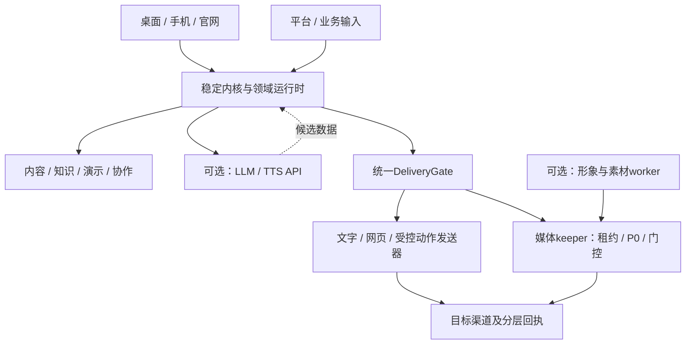
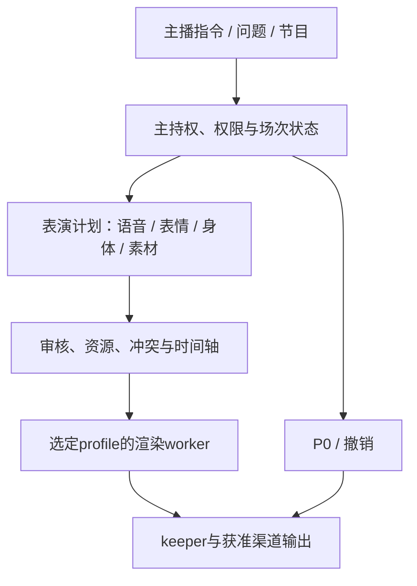

# 智能体赋能的数字人直播工作台 · V4.6 完整设计方案

**产品主线：帮主播准备得更快、直播时更从容、互动更有内容，并把每场经验变成下次可用的资产。**

> 版本：V4.6；日期：2026-10-23（UTC+8）。产品方向：真人主导、智能体辅助、数字人按授权呈现的直播创作与运营工作台；讲解、咨询与售前接续作为复用场景。
> 适用读者：产品、设计、架构、开发、测试、运营及OpenCode编码代理。
> 本版不受旧代码/ABI/旧行号兼容约束，重新组织领域、架构和交互；保留统一稳定内核、按需扩展、低运行维护成本等已确认目标。
> 固定约束：LLM/TTS通过API；本地知识与RAG并可接第三方；形象/语音按需；Windows桌面与抖音为既定运行/渠道方向；默认写实本地运行以Rust + ONNX为目标；可选C++/TensorRT/3D后端独立认证，不能伪称纯ONNX；完整模型和资产须认证；Lite可一键升级Standard/Pro。
> 文档状态：完整设计基线建议稿。产品定位与差异化商业假设待客户验证；未创建应用仓库、实测模型/硬件、取得账号许可或完成真实直播。所有性能/资源/费用数字为注明条件的预算或目标。

## 1. 产品决策、范围与阅读方式

### 1.1 当前产品身份

**智能体赋能的数字人直播工作台。** 为需要持续进行产品讲解、知识分享和品牌节目的主播/运营提供“备播—预演—协同直播—复盘—复用”的日常工具。智能体承担内容准备、候选应答、节目建议与复盘；数字人承担获准内容的可选表达；真人持有主持权和最终控制权。

用户购买的结果是少花准备时间、减少现场手忙脚乱、让内容与互动更连贯，以及下一场能沿用已有经验。内容治理、受控演示、可信交接是支撑日常工作的底座，不把复杂治理后台作为普通主播的首页。

### 1.2 固定约束

LLM/TTS使用API；本地知识/RAG可接第三方；Windows桌面优先，抖音为明确接入方向，快手/视频号等经adapter扩展。Lite/Standard/Pro同内核、可直接一键升级；以减少运行和维护成本为经济目标，不用削减可扩展性替代经济优化。写实本地链路以Rust+ONNX为目标并独立认证，不强制所有用户承担GPU成本。

完整保留文字/语音/2D/写实/3D、节目与演示、RAG、真人音轨、手机、平台、五类扩展、市场客户端、MCP/A2A、多会话、部署、升级、审计与安全。纯内容模式支持备播、提词、文字辅助和非直播复用；不以假音频/假形象满足状态机依赖，也不把其成功当作数字人直播已通过。

### 1.3 推荐实现决策

| 决策 | V4.6基线 |
|---|---|
| 产品身份 | 智能体赋能的数字人直播工作台，真人主导、可解释辅助 |
| 默认轻量包 | 2D/素材呈现；不冒充写实口型或自由全身动作 |
| 推荐写实路线 | 真人视频资产＋本地实时口型＋有范围的表情/动作素材＋统一表演调度；MuseTalk作为首选验证候选，不宣称已完成ONNX迁移 |
| 可控全身路线 | 3D骨骼人物/动作库＋面部驱动；Unreal/MetaHuman与Audio2Face作为可选原生后端参考 |
| 生成式肖像路线 | SoulX-FlashHead等作为独立候选；不从说话头能力推定任意全身舞蹈 |
| 智能体 | 共用Harness的备播/互动/场控/复盘任务，输出受限表演意图，不直接操作模型或设备 |
| 主播输入 | 按键/面板为确定入口；可选本地ASR/VAD/关键词检测＋指令确认，LLM/TTS仍为API |
| 输出与平台 | 形象后端、媒体输出、事件连接、用途权限独立绑定；抖音优先，快手/视频号/CSS独立adapter |
| 运行成本 | 未选包不启动，单路资源实测，默认无需云主机或完整Unreal安装 |

这些是架构与选型建议，不是对具体开源模型兼容、商业授权、硬件性能或平台准入的实测结论。工程核心可重构，公共契约以本版为基线。

### 1.4 承诺与设计状态

本方案独立可读，不依赖历次评审。完整能力范围、当前可交付证据、商业验证范围分别管理。未实测指标、平台权限、写实profile与付费意愿均不当成既成结果。LLM主动租约不能证明平台允许自动互动，数字人不以“无人连续直播”销售。

“必须”是契约/不变量；“初值/目标”需实测；“假设”需客户验证；“待认证”不得显示可用。代码可重新设计，客户数据、授权和许可仍需保护。

阅读：2–6定位/场景/用户价值/档位；7–12核心UI/UE；13–17内容/节目/互动；18–34内核、智能体、媒体、开放、部署与可靠性；35–39数据/协议/代码/任务/验收；40运行经济与使用粘性；附录A–L为配置、规格、证据、参考场景、表演/平台契约、装配参考源与适用验收示例。

### 1.5 完整设计与可执行装配

完整能力范围不按开发工作量删减；实际部署按任务、选择的包、人物profile、渠道、授权和环境解析。实现状态、发布组合、认证范围与商业试点独立。不会要求一套Lite安装通过所有人物/平台/设备测试，也不会通过把真实需求写成“不做”来隐藏缺口。

本版在既有表演/直播内核上明确四件事：商品讲解与平台商品身份、角色化任务UI、声明式安装/运行计划、按路径预算及适用验收。基础指令与可认证组合是执行边界，不是用分期代替扩展设计。所有实现状态仍为待实施/待验证；本交付是设计文档及内嵌可解析参考配置，不是已经运行的应用仓库或平台集成。

统一CapabilityStatus记录：design_scope(in_scope/out_of_scope)、implementation(absent/prototype/implemented)、installation、contract_stability、certification、external_permission、runtime_health、reason/evidence。Absent不能同时表示“永不支持”“没装”“缺权限”“未实测”。文档/销售/UI从相同状态生成承诺，不在每章重复一份“不做清单”。

## 2. 定位、用户与“愿意持续用”的价值

### 2.1 一句话定位

**给有真人值守的直播团队一个会备内容、帮接问题、懂节目进度、能协同数字人的直播助手工作台。** 数字人提供可辨识的表达角色，智能体帮助把场景和内容连接起来，主播决定何时呈现、何时接管。

“数字人直播”是本版的核心场景与外部表达；架构仍支持无形象备播/辅助。不把降低数字人耦合解释为放弃数字人，也不靠渲染质量一项证明整个产品价值。

### 2.2 首要用户

| 用户 | 高频任务与困难 | 首次价值 | 持续使用理由 |
|---|---|---|---|
| 主播/讲解者 | 备稿、解释重复问题、临场找资料、切段 | 一份能直接预演的节目单和可控助手 | 熟悉的风格、快捷动作、问题答案和节目节奏 |
| 运营/场控 | 素材、问题池、场景切换、异常处理 | 一个控制台掌握当前/下一条与接管 | 场次模板、少量有效建议、下场复用 |
| 内容负责人/专家 | 资料更新、术语/限制、未答问题 | 只核对关键事实，素材与话术一起更新 | 不重复纠错、未决问题有负责人 |
| 小团队负责人 | 人员不足、预算不明、流程不可复用 | 看清一次直播实际准备和运行成本 | 内容资产积累、团队接续和可测效率 |

首个验证群体选一个：有稳定产品资料、定期讲解直播、愿意真人值守的商家/品牌小团队，或有产品知识节目需求的专业讲解团队。先选能取得真实账号、资料和持续场次的一类，避免同时为全部行业做定制。不以夸大疗效、投资收益、伪造真人身份或无人自动带货作为目标需求。

### 2.3 两种用户体验一起设计

操作员喜欢用：首次不填长表，进入即看到当前任务；私有建议不抢话；随时接管；改一次术语/回答后续能复用；常用动作不必反复审批同一安全范围。

观众愿意看：回应与当前产品/节目相关；声音和字幕清楚；不重复欢迎刷屏；形象有稳定风格与适度表现；等待与失败有清楚解释。观众体验不是通过假弹幕、虚假热度或催促付费制造。

### 2.4 可验证价值

| 价值 | 测量 | 约束 |
|---|---|---|
| 更快备播 | 从已有资料到可预演节目单的实际人工分钟 | 计入核对、素材整理和反复修改 |
| 更从容控场 | 寻找资料/切换工具次数、误操作、有效辅助率 | 不把“接管少”当绝对好事 |
| 内容更连贯 | 重复/打断错误、断点恢复、节目完成质量 | 安静展示和真人主持不是故障 |
| 互动有用 | 合格问题处理、问题到本地输出/人工处理的时间 | 覆盖率与错误率、队列过期同时报告 |
| 越用越省事 | 下一场复用率、编辑量、准备时间变化 | 记录维护新资产的额外成本 |

不承诺流量、成交增长、平台审核通过或取代全部主播。成交/停留等结果在有获准真实数据时观察，不能由工具事件推算。

## 3. 竞争边界与可形成特色的组合

公开资料显示，数字人、RAG、模型替换和AI演示已有产品提供；销售内容治理也已有Highspot等产品覆盖。[S1–S4][S12] 不能宣称“加一个智能体就是独家优势”或“治理无人做”。

本产品待验证的组合优势是：**直播现场可用的协作体验＋可复用节目和知识＋可控数字人表达＋低负担本地运行。** 从客户现有直播工具、提词器、FAQ、素材文件夹和人工场控流程出发对比，而非只比较avatar厂商。

| 假设机会 | 产品化能力 | 证明方式 |
|---|---|---|
| 数字人会说但不懂当前节目 | LiveContext与节目检查点绑定，选入问题与当前对象一致 | 问题打断/恢复及错对象率 |
| AI回答多，主播处理更累 | 私有候选、少量排序建议、一键采纳/忽略、可关闭 | 提示负担、人工操作时间、采纳后质量 |
| 每场重新准备 | 节目系列、互动产品包、可审查的上场复用与变更摘要 | 下场备播分钟、修改量、复用真实性 |
| 内容死板或无意义重复 | 表达风格、节目单元、上下文短答、节奏预算 | 主播/观众可用性测试，非仅新鲜感 |
| 讲错版本或真人接不上 | 事实依赖与活动处置、带证据的任务接续 | 可控范围内错误与更正、接手效率 |
| 运行维护负担过大 | API采购、本地嵌入式存储、可选云/形象包 | 同等负载TCO、维护分钟、故障恢复 |

可积累资产为经授权直播素材、核对过的问答、节目模板、发音/表达偏好、领域规则和接入器。用户可导出和迁移；不靠锁定、不可取消、强提醒或虚假“成长值”形成粘性。既有治理能力也不能证明字段级活动控制不存在竞品，差异化以具体任务效果验证。

## 4. 直播主场景、复用场景与实际承诺

### 4.1 主场景

| 场景 | 真人分工 | 智能体/数字人任务 | 不承担的承诺 |
|---|---|---|---|
| 真人主讲＋数字人助播 | 主播讲重点，场控选择辅助 | 私有提词、标准段落/FAQ、展示素材、获准应答 | 数字人不自行抢话或代替所有临场判断 |
| 数字人呈现＋真人值守 | 人负责主持、授权、接管 | 播放节目与批准内容，按获准范围互动 | 不假定平台允许全AI互动，不宣传无人播 |
| 产品/知识直播 | 专家讲深度，助手处理重复问题 | 术语、比较、素材、受控演示、未答转专家 | 不编造参数或自动作出专业承诺 |
| 品牌节目/活动辅助 | 真人掌握流程和异常 | 开场/转场/内容卡/有限互动 | 不用伪造热度和紧迫感促进消费 |

默认落点为Assisted，先让真人主讲/场控实际省事。AutoSupervised仅在渠道规则、用途权限、风险策略、值守和依赖满足时可启用，不因订阅档位自动开放。

### 4.2 同资产复用

销售陪同演示、官网一对一、展厅、培训和会后跟进继续支持，但使用各自UI、参与者状态与容量。它们是同一产品包的复用出口，不与直播一起铺成多个独立产品。不得用官网聊天测试成功证明抖音互动可用。

### 4.3 三份清单

完整能力范围记录契约/依赖/测试；可交付清单记录实现/许可/环境/限制；商业验证记录客户、真实场次、任务/基线/费用与复用。直播接入条件尽早实测，未获能力在UI显示Unavailable。无事件接口时可由场控手动录入问题、按键点播和私有提词，但不能标成已实现自动弹幕互动。

直播广播无可靠个体身份时只做场次问题聚合；不跨平台用昵称合并观众。多语言依术语、声线、地区价格/条款独立审核。

## 5. 首次价值、复用循环与商业组合

### 5.1 使用循环

准备一场→私有预演→真人协同直播→只看重要复盘→采纳少量修订→复用到下一场。每一步都形成可见成果，不要求客户先搭建完整内容治理体系才能开第一次预演。

| 阶段 | 产品帮助 | 留下的可复用资产 |
|---|---|---|
| 首次 | 场景模板+少量关键事实+样例节目 | 第一份节目单、声音/形象与场景配置 |
| 备播 | 复用上场，显示变化和缺项 | 产品包、素材和讲解段落 |
| 直播 | 问题候选、下一步提示、点播/接管 | 实际采用内容与有证据的操作记录 |
| 复盘 | 三项重点：未答、重复/卡点、需更新 | 待审修订、FAQ、节目变体 |
| 下场 | 已采纳改善自动进入草稿，发布前复核 | 系列节目和个人/团队工作习惯 |

“成长”具体表现为词典更准确、常用问题更快、节目恢复更顺、备播更少重复劳动；不显示虚构模型等级。不未经授权训练模型，不将全部历史塞进prompt。

### 5.2 收费

工作站/团队订阅＋可选专业包＋透明API/托管消耗＋单列实施。按主播/团队日常工作价值收费，可按活跃并发、明确存储/产品包容量分档。不逐次收费纠错、发布、快照或必要转人工；基础安全、导出、停止与基本交接不可作为升级勒索。

形象包、专业节目/演示、团队交接、CRM/平台集成可增购。API可自带凭据；托管转售另明确计量、预算、结算与数据责任。写实制作、资料清洗、声线/肖像许可、平台适配与持续维护分别报价，不隐入低价无限包。

### 5.3 付费与使用验证

优先同一细分群体3–5家、有真实后续直播机会的用户；先记录原流程，观察完成一场之后是否主动复用到下一场。不能用首次新奇、登录天数、试用赠送分钟或演示好评代替持续使用和付费。验证定义、真实场次与90天决策见40章。

## 6. Lite / Standard / Pro、呈现与部署

### 6.1 同内核默认组合与唯一来源

默认档位由`configs/editions/*.toml`声明，继承、包版本/依赖和许可边界由同一解析器计算。安装器、UI默认组合、文档表、升级diff及测试选择均消费解析结果，不独立手填四份。附录K.1给出本设计随文参考源；下表由该参考TOML实际解析生成，应用仓库的完整生成器仍须实施。

| 项目 | Lite | Standard | Pro |
|---|---|---|---|
| 面向用户 | 个人/小团队单工作站 | 专业主播/运营 | 多项目/团队与集中协作 |
| 默认能力包 | foundation、content、program、manual-assist、ai-assist、review、sprite、local-rag | foundation、content、program、manual-assist、ai-assist、review、sprite、local-rag、advanced-program、controlled-demo、batch-content、integration-tools | foundation、content、program、manual-assist、ai-assist、review、sprite、local-rag、advanced-program、controlled-demo、batch-content、integration-tools、team、multi-project、multi-session、handoff-center |
| 默认活动会话许可上限 | 1 | 1 | 4 |
| 默认必需自建云 | 否 | 否 | 否 |

foundation含身份、策略/门控、停止、发布/撤销、存储/备份/升级与基础交接；manual-assist含提词/手动点播/人工标记；ai-assist提供可选API任务，安装包不等于有凭据就绪；review不自动开启付费复盘。sprite默认轻量，photoreal/rigged-3d/remote为可加装profile，不由档位强制选择。

表中会话数是可修改的默认商业组合示例，不是算力/吞吐承诺；Pro的4场也必须逐场资源准入。修改价格/许可时只更新声明源和审批，不改变内核契约。Lite可加装，直接升Pro按最终闭包解析，不要求先安装所有中间档位的全部运行服务。

Lite仍具备备播—协作—复盘—复用闭环。Default、Installed、Licensed、Ready、Active分开；无LLM/TTS凭据可走人工路径，有有效凭据后才启用相应AI任务，未启用无对应API调用。

### 6.2 五个独立维度

edition决定默认能力；deployment为Local/Hybrid/Distributed；presentation为ContentOnly/Voice/Avatar/HumanAssist；behavior为Rehearsal/Assisted/AutoSupervised；delivery记录实现/认证/交付范围。shadow为独立评估标志。

不需要语音时不启TTS/音频/形象；启用数字人直播时必须满足真实媒体与平台依赖。Pro不强制上云，Standard不强制写实；未启用包无主动进程、端口、轮询、显存和云调用。静态目录元数据有小量固定开销。

### 6.3 灵活性与低维护

保持模块/契约完整，通过组合根和包清单选择运行组件，不用每个功能一台服务。写实、市场、MCP/A2A、设备、多节点等保留完整设计与验收，不因验证范围自动删减，也不在无证据时写成已可交付。升级计划显示资源、依赖、权限、成本增量和NotReady原因。

### 6.4 InstallPlan与RunPlan

InstallPlan=档位默认包＋用户显式加装＋包依赖闭包＋版本/许可/平台条件；RunPlan=安装闭包＋本场feature selection＋presentation/behavior＋profile/输入方式/输出/平台/deployment＋设备与预算。缺少必要依赖拒绝该路径，不能悄悄安装远端服务或改自动权限。

RunPlan含必须/可选/禁止进程、模型/资源、凭据引用、网络目的地、能力绑定、认证套件、所需外部条件、降级和退出顺序。计划用规范化hash绑定输入版本；环境变化重算差异，扩大权限/费用显式确认。运行时自检实际进程/模型/端口/API调用是否与计划一致，发现多余后台任务产生具名告警并按规则停用。

模式只是约束而非全部决定因素：同为Avatar可选sprite、ONNX或3D；同为Assisted可纯面板或ASR；同为Local某平台仍可能需要获准公网回调。实际存在性矩阵从RunPlan生成，不能枚举三维后忽略后端/渠道差异。

## 7. 信息架构、角色与交互原则

### 7.1 普通操作员按工作走

主导航为“直播工作台、备播与节目、内容与素材、直播记录、扩展与设置”。团队交接和高级治理按权限在对应页面展开，管理细节不占普通开播路径。

| 页面 | 主要任务 | 默认可见 |
|---|---|---|
| 直播工作台 | 继续备播、预演、进入现场、看下场 | 最近系列、下一场、需处理的少量事项 |
| 备播与节目 | 产品/主题、节目单、提词、形象/声音、私有演练 | 当前场草稿、版本diff与缺项 |
| 内容与素材 | 产品事实、FAQ、素材、术语、使用位置 | 常用产品包、待核对项 |
| 直播记录 | 回看、问题处理、复盘、复用到下一场 | 本场重点、实际采用、成本和改进 |
| 扩展与设置 | 连接、设备、Provider、包、部署/升级 | 普通配置；高级诊断折叠 |

直播中进入专门控制布局；角色可有不同首页。主播默认“继续这一场”，内容负责人默认“待核对”，专家默认“待接手”。不让用户先选数据库、协议或智能体拓扑。

### 7.2 渐进披露与控制感

默认可用、少配置、能撤销的先做；保存、发布、上屏分别反馈。建议显示用途、依据、过期与动作；操作员可以忽略、暂停建议或改回手动，不被弹窗追着操作。高风险条件真实阻断，低优先提醒入任务箱。

固定停止/接管、当前对象、当前与下一条可见。密度可调，字体缩放，状态有文字/图标，暗色现场与浅色备播共享设计tokens。UI禁止伪成功：待设备ACK、已播放、平台可见与观众理解是不同状态。

### 7.3 角色

operator负责点播/暂停/接管；content_editor编辑；publisher发布；approver按策略审核；handoff_receiver接手指定任务；handoff_manager分派；workspace_admin管理成员/范围；local_admin管理本机凭据/信任。小团队一人可多角色，企业可分离。权限后端执行，隐藏按钮不算授权。

紧急静音无需管理员身份但必须授予值守角色；放宽自动范围、更改外发目标或恢复输出需对应确认。平台身份与本机角色独立。管理员配置权限不自动获得全部客户敏感正文。

## 8. 首次体验、备播与快速开场

### 8.1 两条入口

“体验一段示例”和“用自己的内容做一场”。示例有获准内容/形象/音频，可用预录素材展示但明确非实时AI；真实模型体验需有效凭据/网络并展示费用与外发范围。无平台事件权限可预演，不伪装已连接真实直播。

### 8.2 最少配置

选择任务模板→添加一个产品/主题→核对3–5项关键事实与不能说的内容（初始体验目标，字段随任务变化）→选声音/形象或纯辅助→看节目草稿→私有预演→检查输出/权限→开始协作。

不强制一次整理整个知识库，不要求同时配置LLM/TTS/Embedding/Rerank/ASR所有服务。手工结构化事实/FAQ可启动，文档导入渐进补充；没有依据的内容标待补，不靠模型“常识”自动填满卖点。

### 8.3 快速复用

“复用上次”复制草稿中的节目、布局和偏好，重新校验事实、价格、许可、对象、平台与预算；不复制旧批准、租约、观众身份或未经同意的联系方式。显示新增/变化/缺失三类清单，未变化内容避免重复输入；一键开始只对通过Prepare的范围成立。

### 8.4 空态与目标

凭据/网络/依赖就绪的示例包约10分钟完成首段预演为待测目标；不包括写实制作、平台审核和企业资料发布。目标同时看失败者、求助和质量，不只看最快用户。

空态给下一步和样例；长任务可取消；错误解释影响/当前安全状态/恢复入口；离线区分本地可做与API不可做；部分成功逐项显示；断线控制不离线重放旧命令。常用设置可保存但密钥只作凭据引用。

### 8.5 零LLM/TTS凭据的人工辅助路径

选择“人工辅助”→创建节目→使用模板/手工内容和有权素材→提词/手动点播→真人主持→结束→人工标记复盘→复用下场。不要求LLM/TTS/Embedding/ASR密钥，不在后台调用模型，不将失败API伪装成离线AI。

纯文字提词无需音频/形象；手动播放音视频需相应keeper/解码输出，预制人物片段只说明素材播放。未配置TTS不能任意输入一句新话就合成语音；未配置LLM不能自动回答新问题。真人音轨可在合法配置下直通，但人声直驱写实形象还需对应模型/性能认证。

断网降级先取消依赖API的新任务并标状态；已批准且仍有效缓存/本地素材可用，依赖实时价格/许可/平台连接的能力仍需其条件，不能笼统称断网完整业务。此路径证明工作台基础价值，不替代智能体/写实/平台真实认证。

### 8.6 演示剧场

Rehearsal+simulation=true使用示例节目和确定性事件fixture，UI固定“模拟数据/预演”标识，事件源不可伪装正式平台，默认只私有sink。分别提供离线脚本回答/授权录制模式和自带API体验；离线模式不能声称实时模型生成。

夹具至少覆盖评论、相似评论、礼物数量语义、旧事件、换产品、资料撤销、主播接管、API超时、输出丢失、模拟参与者退出。最后一项只模拟状态，不证明真实连麦实现。支持单步、倍速、重置、固定seed与证据导出；fixture数据不进真实留存/平台/成交指标。

销售可展示主协作循环与发布影响，不依赖抖音准入；但任何真实外发需退出预演、重新Prepare/授权，不能把“演示剧场”切一个target就当真实直播。演示、培训、工程测试与客户生产证据分开。

## 9. 备播、内容资产与发布体验

### 9.1 围绕“一场直播”组织

备播页显示主题/产品、目标受众、预计时长、必讲点、节目单、FAQ、素材、声音/形象、输出目标和预算。来自既有产品包，不重复录入每个场次。支持拖动段落、预计时长、缺素材提醒、选段预演、保存为系列模板；AI生成的是候选，不能覆盖已批准稿。

产品包承载带来源事实、讲解段落、素材、FAQ、术语、演示与禁用声明。字段按产品类型扩展，不把所有商家都放进复杂企业审批表。关键数值、价格/限制须核对，AI置信不能替代负责人确认。

### 9.2 发布前必要检查

草稿→字段/表达diff→受影响段落/素材/会话→处置→审核/发布。普通用户先看到“有2段需要更新、1张图待核对”，需要时展开来源和依赖图。影响分析是发布流程一部分，不强迫所有人阅读全图。

| 变化 | 页面行为 |
|---|---|
| 价格/权利/权限失效 | 阻断相关自动路径，提示必须处置 |
| 普通参数更新 | 提示受影响段，按规则重审/替代或保留仍有效旧版 |
| 表达/布局调整 | 对比候选，避免误报事实事故 |
| 无法识别图片中的参数 | 标可能影响，交人工检查，不能称全自动覆盖 |

活动会话通知提供取消待播、待核、跳过、已批准替代、转人工/准备更正；按14章执行，不允许“一键更新”把未审新稿灌进旧批准。外发PPT/截图等控制范围外资料只能提示与追踪，不能承诺远程收回。

### 9.3 资产整理的低负担

自动保存草稿、撤销/重做、并发diff、恢复历史；收藏和标签按需。旧素材归档不删除审计引用；个人偏好与权威事实分开。复盘建议最多优先展示3项初值，可展开全部，不把系统发现的问题全部变成必须完成的工单。

## 10. 直播控制台：看得懂、接得住、停得下

### 10.1 场控主布局（主播使用独立预设）

| 区域 | 信息 | 主操作 |
|---|---|---|
| 顶部固定安全条 | 当前场/模式/输出、连接、预算与值守 | 暂停自动、数字人静音、工作台全静音、真人接管 |
| 节目与提词 | 当前产品/段落、必讲点、下一段与恢复点 | 本句后切、跳过、选段、暂停节目 |
| 实际本地预览 | 当前画面/字幕/音轨、形象与素材 | 预监听、隐私预览、缩小/关闭预览 |
| 助手卡片 | 入选问题、建议回答/素材、依据、等待状态 | 采用、编辑、稍后、忽略、转专家 |
| 底部时间线 | 当前句/下一句、队列秒数、已取消/降级 | 取消待播、查看原因、恢复准备 |

默认右侧最多同时强调3张行动卡（初值），其余收进问题池。没有新任务不强行刷建议。主播使用10.6的独立任务预设，场控使用本布局；公共预览与私有提示独立sink，OBS捕获不能误带私有卡片或联系方式。

### 10.2 三种协作姿态

| 姿态 | 默认行为 | 主播感受 |
|---|---|---|
| 看提示 | 只显示候选和依据，不自动出声/切画 | 有助手，无额外抢话 |
| 我来点播 | 主播/场控选择获准段落或应答 | 几个动作完成现场协作 |
| 授权范围内辅助 | 仅许可允许时自动执行明确低风险范围 | 可解释、能暂停，敏感项仍转人工 |

姿态是现有behavior下的UI预设，不新增模糊权限模式；具体授权仍由Rehearsal/Assisted/AutoSupervised与策略决定。人工发声主导时暂停AI发声，VAD只作辅助，不把噪声检测当可靠主持授权。首选按键/明确主持状态，ASR/语音指令可选且需确认敏感动作。

### 10.3 动作语义

“立即插播”不跳guard/审批；“本句后切”按安全边界；“暂停节目”不等于停问答；“暂停自动”不必停止已播放；“工作台全静音”覆盖本系统本地目标bus，未受控外部音源另行提示。断线命令不自动重放；响应显示接收/待执行/设备ACK/失败。恢复需要确认原因已消除，不自动回到旧授权。

候选显示将说什么、将显示什么、依据、有效期与成本；编辑使旧批准失效。安全模板可作范围批准，金额/优惠/敏感承诺单独检查，避免靠“每句点审批”消耗主播注意力。

### 10.4 现场文案

“这条问题已过期，未生成语音”；“资料含旧参数，已暂停这段”；“实时演示失败，可展示标注的录制”；“本地已静音，平台缓冲仍可能播放”；“问题已交专家，尚未接手”。错误给可执行下一步，不把栈信息放给主播。

### 10.5 表演面板与指令回执

人物卡显示当前profile、底版/3D、动作能力、支持/已准备/当前允许三种状态。常用动作可收藏为按钮/热键：挥手、点头、返回待机、已注册舞蹈。无支持项灰显并解释，不将未知动作隐藏成“系统没反应”。不暴露模型张量、骨骼编号或协议字段给主播。

选中动作显示预览、预计时长、是否能说话/打断、许可和冲突；“跳舞”可能意味着先完成本句再开始，UI要显示待执行与可取消。普通停止动作与紧急停止全部表演分开，恢复不重放整段。说话/跳舞/人声主持状态清楚，不能同时显示互相冲突的绿点。

语音指令条显示“听到什么→识别为哪项→需要确认/已执行/失败”，原音频默认不保留；授权窗口醒目可关。使用按键/面板时不强制开麦。看见表情/动作不等于系统理解所有自然语言，建议可说指令与当前可用范围。

### 10.6 独立主播操作预设

主播模式是任务/交互布局，不是缩小场控视图。默认只保留：当前产品/对象和输出状态、一句提词、一张主要建议卡，以及“真人接管、下一段、工作台静音”三个大按钮。底部有紧急停止自动/表演的固定可达入口，非紧急详情进抽屉；必要异常与恢复入口不可被极简布局隐藏。

| 时刻 | 主播操作 | 系统反馈 |
|---|---|---|
| 开播前 | 看本场提词/产品和可用范围，私有预演/准备 | 缺API可切人工，缺平台则不能伪报已连接 |
| 正常讲解 | 按下一段或采用当前主要候选 | 主持状态、当前/下一条与真实ACK，避免双击重复 |
| 数字人说话时插话 | 接管或明确按键主持 | 停AI音轨/动作，保留获准真人，显示恢复点 |
| 紧急异常 | 工作台静音/停止自动表演 | 不等待抽屉/审批/LLM；说明外部未受控声音 |
| 恢复 | 看原因消除，确认恢复 | 新许可/当前快照，不补播旧队列 |
| 结束 | 结束本场、标记问题 | 输出停止与平台结束分开，跳转简洁复盘 |

场控模式保留五区域和动作/指令面板；内容模式、专家模式使用各自任务入口。视图选择只减少认知负担，不改变角色权限。鼠标/触屏/热键、放大字号、单手任务、误触和压力情境均需UE测试。

## 11. 观众体验、未答接续与非直播复用

### 11.1 观众听到的内容

问题回答优先相关、简洁、有依据；同类问题可合并为“关于接口兼容的问题”，不反复点名和重复欢迎。观众名称作为不可信数据清洗，不能朗读昵称中的广告/指令/攻击；对方首次发言不宣称刚进房间。不要由礼物/付费金额自动触发产品效果承诺或私下待遇。

数字人有稳定声音、表达风格与适度动作，身份标识清楚；不伪称真人正在操作、不假装看见未获输入、不编造在线人数/抢购库存/其他观众证言。未回答的问题不承诺“每条都答”，经人工选择形成后续专题或专家任务。

### 11.2 可信接续

保留直播问题主题、实际讲解/演示、未决事项与负责人。公开问题可匿名进入内容改进；需要个体联系时通过获准渠道和明确同意创建咨询记录，不能从昵称/弹幕擅自推联系方式。ConsultationCase关联多次获准会话，记录需求依据、任务和下一步，不替代完整CRM。

需求分confirmed/inferred/unknown/rejected，但另记录陈述者、来源、时间、作用范围和supersedes。客户确认需求不等于产品已满足，也不等于商家承诺；重要条件可必要复核。接收端手机摘要＋证据展开，传输ACK、已读、接手、采纳和解决分开。

### 11.3 官网/会议等

官网以内容为主，可文字、字幕、静音、建议问题与请求真人，麦克风默认关；不强制留资查看公开资料。会议真人掌握主持权。获准的回顾链接有权限和期限，断开后不追踪跨站身份。复用不绕过渠道身份、容量和数据规则。

## 12. 手机、无障碍与真实任务验收

手机优先状态、候选采用、静音、接管、任务接手；复杂素材编辑在桌面。低频缩略图默认，视频预览按需，不把远控成功当手机可出画/本地写实。显示状态时间、连接、目标场次与实际ACK；锁屏/重连不补执行旧批准。

主流程可键盘完成，焦点可见、弹窗返回正确位置；按钮有可读名称、字幕/文本替代，状态不只靠颜色/声音。WCAG 2.2 AA为测试目标而非认证声明，主触控按钮建议44×44 CSS px，按真实界面验证对比/缩放。[S10] 热键可配置，P0由keeper处理；小预览限帧，不让WebView占实时线程。

| 任务 | 检查重点 |
|---|---|
| 第一次做节目 | 不依赖长教程；发现下一步、核对关键内容、完成私有预演 |
| 直播接问 | 选到正确候选、看清依据、不会误上屏、知道当前/下一条 |
| 主播接管 | 控制可达、音轨正确、恢复点明确、无旧队列补播 |
| 下场复用 | 找到上场、看懂变化、不重复输入、旧授权不复活 |
| 复盘改进 | 能定位未答/卡点、修一条FAQ并进入下场草稿 |
| 手机接续 | 选对会话、命令真实反馈、能读懂摘要并接手 |

记录成功率、完成时间、求助、误操作、提醒负担、主观掌控感和疲劳。操作员体验与观众体验分别测试，真实场次与实验室预演分别报告。界面配色好评不代表愿意持续使用。

## 13. 产品领域模型与发布快照

### 13.1 核心对象

| 模型 | 含义 | 关键引用 |
|---|---|---|
| Workspace/Project | 权限与业务范围 | 成员、资料、Provider/渠道映射 |
| ProductObject | 商品/软件/设备/服务/课程等讲解对象 | facts、knowledge、rights、materials |
| FactSet | 带类型/条件/来源/有效期的权威事实 | 产品revision、authority、permission |
| TalkTrack | 讲解内容的display/speech版本 | 对象/证据、词典、素材、审批策略 |
| DemoPlan | 有限步骤/分支的演示计划 | sandbox、action、checkpoint、required materials |
| ScenePack | 任务场景的可复用配置 | 对象集合、节目、知识、声音/形象、预算、测试 |
| PublishedSnapshot | 发布的不可变引用集合 | 各内容/权限/策略/许可revision |
| Session/Participant | 一次运行及获准参与者 | behavior、渠道、资源、epoch、同意范围 |
| CueBundle | 一次批准的画音/动作执行对象 | speech/display/visual hash、snapshot、TTL |
| HandoffPackage | 真人可继续工作的交接 | confirmed/inferred/unknown/rejected、evidence、consent |
| PublicationChange / ImpactReport | 字段变更及可审查影响 | revision、graph_watermark、活动会话、未知范围 |
| SessionDispositionPlan | 受影响会话的处置 | epoch、快照、包、动作、批准、ACK |
| HandoffReceipt / Assignment | 接收、认领与反馈 | 传输/业务状态、接收主体、采纳证据 |
| InteractiveProductPack | 可讲解的产品资产聚合 | 对象/事实/段落/FAQ/素材/演示/权利，引用已有版本不复制凭据 |
| LiveSeries / LiveShow | 节目系列与一次节目实例 | 模板、节目单、snapshot、主持、场次和复用来源 |
| HostProfile | 主持/助播表达配置 | 身份标识、声线、风格、术语、动作与主持策略 |
| LiveContext | 有界实时工作快照 | 当前/下一段、产品、音轨、问题池、水位、预算、输出状态 |
| AgentTask / Suggestion | 有期限任务及候选 | 目的、输入版本、风险、成本、候选包、采纳/忽略、到期 |
| ConsultationCase | 经授权的持续咨询 | 多次会话、需求依据、未决任务、负责人、同意与有效期 |
| ImprovementProposal | 复盘改进候选 | 来源、具体diff、成本/影响、采纳、审核与下场草稿 |
| CharacterProfile / ModelArtifact | 人物与完整运行工件 | RuntimePolicy、能力/区域、绑定、模型/资产digest、认证 |
| ActionAsset / TransitionAsset | 动作及合法过渡 | 姿态/区域/时长/遮挡、说话/音乐兼容、许可 |
| PerformanceIntent / PerformancePlan | 可审查表演意图与轨道 | 口型/表情/身体/素材/音乐、冲突、计划hash、CueBundle |
| PresenterCommand | 主播控制请求 | 来源/ASR状态/intent、身份、确认、TTL/epoch、实际结果 |
| ChannelProfile / PlatformEvidence | 某渠道组合及准入证据 | product/app/room、事件/输出/用途许可、版本、期限 |
| LiveProductBinding / LiveProductSlot / PriceClaim | 产品与直播商品讲解身份 | SKU/平台范围、事实/价格条件、实际槽位状态 |
| MultiPartySession / FloorGrant / LayoutPlan | 多人输入/发言与画面 | 参与者、路由、主持/发言授权、实际后端能力 |
| InstallPlan / RunPlan / ReleaseManifest | 可审查装配与发布声明 | 输入hash、依赖/资源/进程/套件及证据 |
| ExpressionExperiment / Variant / Observation | 表达变体与观测 | 预设分配、指标/缺失/干扰、质量/费用 |
| ReviewCase | 人工修正/错误/未答样本 | 原来源、处理结果、待发布修订 |

固定ID与revision分开；已发布版本不可原地覆盖。跨项目复用需映射权限，不能复制凭据/旧批准/访客身份。snapshot是引用集合，不应每次复制整份模型和视频。客户可导出其有权拥有的资料、配置和使用记录，第三方模型权重/声线仍受许可限制。

### 13.2 产品结构

共性字段：id、kind、title、locale、revision、owner、status、data_classification、facts/knowledge/material refs、required_points、prohibited_claims、rights、valid_range。商品扩展SKU/规格/币种/价格/库存口径；软件扩展产品版本/功能/依赖/限制/演示步骤；设备扩展参数/兼容性/工况；课程扩展章节/目标/术语。

不从模型自由文本推导重要事实。结构化比较使用相同维度/单位/条件，缺值标unknown，不能用空值代表没有能力。适用性推荐记录用户确认条件、规则/依据、不确定项，必要时请专家判断，不输出无条件“最佳”。

### 13.3 发布流程

Draft→Validating→ReviewRequired→Published→Superseded/Revoked/Archived。草稿保存不影响活动版本；发布事务产生snapshot与依赖索引。缺少某非必需字段可发布受限用途，但对应回答/动作不可自动。LLM抽取、翻译、重写均为草稿，产品负责人核对后发布。

### 13.4 跨场次资产与身份

LiveSeries保存节目结构和明确偏好，不保存观众身份或生产授权。LiveShow绑定本场snapshot/计划；Session是一条实际运行上下文，同一个节目可有多次预演/真实运行，但每次新epoch。系列与场次不能共享可变临时队列。

ConsultationCase在获得合法身份关联和同意后连接多个Session，删除/撤权传播到摘要/索引/链接。Requirements项包含statement_id、classification、speaker_ref、source_span、observed_at、valid_scope、supersedes、evidence、product_fit_status；客户陈述、产品验证、商家承诺是不同字段。匿名问题可聚合成主题，不能在后台自动猜测个人。

HostProfile中的偏好不具有事实权威：用户喜欢“热情一点”不能改变价格、限制和身份标识；系统建议新偏好先让用户保存，不能悄悄将一次临时改写固化为长期风格。

### 13.5 商品讲解绑定与价格声明

LiveProductBinding连接内部ProductObject/FactSet与平台商品身份，包含platform/product_id、app/account/room scope、platform_item_id、sku_id/variant scope、object/snapshot、素材/段落、source/revision、valid_range和审核。LiveProductSlot是某场展示位置/排序及观测状态，不能用“1号位”代替稳定商品ID；绑定版本与槽位变化分别记录。

PriceClaim引用价格事实和条件：currency/minor_units、price_type(标价/活动/会员/券后/区间)、SKU、地区/人群、时间、优惠门槛、source/fetched_at/valid_until、authority。原文未给可用优惠时标未知，不能把最低价当所有观众成交价。不把价格快照复制到话术后失去来源依赖。

内部讲解选择、平台商品读取、平台讲解卡切换是三种能力。前者不要求交易权限；后两者按实际官方接口/用途分别认证。切换平台讲解卡是观众可见副作用，须risk/权限/批准/幂等/ACK；本版不由此引入改价、订单、支付或退款权限。

BindingState=Draft/Verified/Stale/Revoked；SlotState=Observed/Requested/Confirmed/Mismatch/Unknown。讲解与平台显示不一致时，按场景阻断依赖商品卡的段落或暂停自动并提示负责人；不能自动说“已经挂好”而无证据。无读取接口可人工核对绑定并注明manual/有效期，但不冒充实时监测。

价格/商品下架/授权失效进入14章字段依赖与撤销：取消相关待播、检查图片与字幕、提示活动会话；已经播出的只能更正不能撤回。平台实际店铺数据不会因内部编辑FactSet而自动改变。跨平台同款、规格不同和优惠条件不同时分别绑定，不以相似名称合并。

## 14. 字段级依赖、发布影响与活动会话处置

### 14.1 依赖模型

以对象字段路径+事实版本为源，连接话术AST节点、DemoStep、素材声明、证据chunk、CueBundle、缓存与活动会话。边记录source/target/version、关系类型、发现方式（显式绑定/抽取建议/人工核对）、可靠性和更新时间。关系表/倒排索引即可实现，不默认引入图数据库。

结构化变量优先显式绑定。图片/录屏/自由文本中的内嵌参数可能无法精确提取，必须支持素材事实声明和人工核对；不能称字段依赖天然覆盖所有视觉内容。动态外部值声明有效期、来源水位与再验证规则。依赖缺失/索引滞后时扩大检查/撤销范围，不乐观判无影响。

### 14.2 影响报告与发布事务

PublicationChange包含变更字段、来源、生效时间、风险和预期revision。ImpactReport包含graph_watermark、确定/可能影响、活动会话、已播范围、建议动作、未知项、计算时间及过期条件。用户审核报告后发布时校验revision与图水位；有新活动会话或变更则重新计算/增量复核。

发布事务写snapshot、依赖、撤销水位、outbox及审计。有效期到期、权限/权利撤销、被明确判错且必须停止的价格/活动等先收紧许可，再异步清索引/缓存。普通草稿编辑不撤销当前内容；新版本发布是否取代活动旧版由明确政策决定，不把“有新版本”和“旧版已非法/错误”混为一谈。

### 14.3 活动会话处置矩阵

| 变化/影响 | 尚未执行 | 正在执行 | 已经执行/播出 |
|---|---|---|---|
| 权限/权利撤销、已失效敏感承诺 | 立即阻断相关包和自动路径 | 立即收紧相关输出，安全画面/转人工，残余缓冲单报 | 记录范围；评估通知/更正；不能撤回已听见内容 |
| 重要参数被判错但未列即时撤销类 | 依政策阻断待核，提供已批准替代 | 按风险立即停止或在安全边界中断，负责人确认 | 生成更正候选与关联证据，不自动对外道歉或承诺 |
| 一般有效版本更新 | 标识旧版，安全点选新snapshot或原有效版结束 | 不热替换旧bundle；边界切换需重新核验/批准 | 记录使用版本，不把历史结果改写成新版本 |
| 表达/布局变化，事实未变 | 按依赖核验后重新生成或沿用 | 默认不打断 | 无需误报事实事故 |
| 已证明无关字段 | 继续 | 继续 | 无需处置 |
| 依赖或影响不确定 | 保守标待核/扩大阻断 | 按风险与场控选择安全处置 | 标未知范围，不能宣称零影响 |

一键动作是执行已经定义的计划，不是允许模型随意改话术。SessionDispositionPlan绑定会话/epoch、旧/新snapshot、目标包、动作、风险/批准和期限；执行前重查身份、状态与撤销水位。部分失败不回滚已生效撤销，未ACK保持待处置。转人工需真人可接或明确等待；“已通知负责人”不是“风险已解除”。

### 14.4 UI与时效

发布页显示受影响清单，控制台弹出不遮挡P0的紧急卡，任务箱保留未处置项；手机可确认简单动作。记录变更受理→许可收紧→控制台提示→负责人ACK→完成各时间。许可收紧不能等通知送达；离线客户端重新连接必须先同步水位才能恢复自动。已缓存设备输出受租约约束，平台缓冲另计。

### 14.5 知识层次

KB0结构化权威事实；KB1已发布说明/FAQ/条款；KB2语义索引；KB3第三方来源。每字段有authority、条件、有效期及冲突策略，不一律最新胜或本地胜。会话叙述不是权威事实，客户问题不自动进知识。局部沿用须有依赖证明；仅产品ID相同不足以复用缓存或批准。

### 14.6 标志性影响处置演示

在发布确认流程提供“查看本次影响”：字段旧/新值→确定/可能依赖资产→当前/待播/已播会话→处置及逐项回执，简洁列表为默认，可展开图。不是只有诊断工程师能看的拓扑页。

销售预演使用虚构价格/参数与模拟会话，明确不修改真实商店、不自动对外更正；生产使用真实授权对象。未识别素材或控制范围外PPT/截图显示未知/需人工通知，不制造无所不及的“涟漪”。展示动作有实际结果，不能用动画代替已阻断证据。

## 15. 话术、发音和内容生产

话术支持风格/长度/受众/语言、多个候选、差异比对、手工编辑、试听、发布与使用位置。风格不能改事实、限制/否定/承诺。生成默认追加候选，不覆盖已批准稿；产品负责人确认后才能成为正式内容。

TalkTrack含speech_text/display_text、purpose、object_snapshot、fact/evidence refs、dictionary_revision、voice/model revision、estimated/actual_duration、valid_range、approval_policy。金额和单位使用最小币值/decimal，经读法转换后校验语义等价，例如1299元和一千二百九十九元。

词典按项目/产品/语言配置术语、型号、英文缩写、百分比、单位和公式。Provider支持SSML/音素时用其合法协议；否则用经试听文本替代，不假设一套SSML通用。展示和朗读内容可不同但都绑定批准对象。词典改动使相关音频候选重新生成/核验。

预合成是付费任务：显示预计字符/时长、成本、缓存命中和上限。只预生成有效且高复用内容；未来活动内容可以准备但在生效前禁止投放。语音库按许可/voice revision管理，主备不同声线不能一句中拼接。

### 15.1 让数字人有稳定表达而不重复机械话术

表达模板包含brand/persona、面向受众、短答/深讲、术语读法、可用开场/转场/收尾、动作范围与禁用说法。默认提供“清楚专业、自然亲切、简短直接”三个可编辑风格样例，不以风格预设扩大事实权限。

候选变体基于同一事实AST产生，实体/数字/条件校验后进入审批与媒体准备。保存常用回答时展示“可复用范围/有效期/来源”，修正一处可以定位受影响FAQ和语音缓存。生成新颖表达不是理由；每次已批准缓存可直接使用时避免重新付费改写。

支持按段试听、读法局部修正、停顿/重音（Provider支持时）、声音一致性、display/speech差异、字幕换行及配图对齐。可用动作按profile声明，关键点做适度指向/点头；未支持动作不在UI提供“已启用”。不得用合成情绪声称真实感受、个人使用体验或真人背书。

### 15.2 内容冷启动

从一个产品包与10条以内常见问题起步是体验建议，不是硬限制。最先覆盖必讲事实、限制和实际高频问题；不要求首次就标注全部历史素材。系统显示知识覆盖与未核对项，允许安全受限预演。现场未答问题进入草稿/任务，人工核对后才新增FAQ。

文档批量抽取可产生字段和依赖建议，不能据此承诺零人工维护。衡量导入到可用的人工分钟；若清理成本超过直接写稿，提供手工简洁入口而不是强迫全量导入。

## 16. 受控演示、讲解编排与选择路径

### 16.1 演示类型

静态素材/课件步骤、已批准视频片段、隔离沙箱内受控交互、真实环境只读查询四类。实际业务写入属于独立明确能力，不因为名为“演示”就降低风险。默认不对真实业务系统执行自由电脑控制。

DemoStep含id、target、preconditions、allowed_action、params_schema、expected_result、timeout、cost、evidence、visual refs、checkpoint、failure_policy。模型可以选择白名单step或建议追问，执行器重新检查条件/权限；不能自由生成shell/SQL/任意URL/浏览器脚本。

演示环境标示真实/沙箱/静态模拟。模拟结果不能当实际产品能力证明；失败明确显示，不能播放成功素材掩盖实际错误。需要演示运行证据时保存版本/环境/结果摘要，并与产品声明分开。

### 16.2 讲解计划

ShowPlan按目标组织卖点、场景、限制、演示、比较、FAQ和收尾；必讲点、可选变体、冷却、时长、插问规则和恢复点明确。基础Lite可用确定性顺序/规则完成，不依赖市场/多步规划。高级分支按已确认需求/获准事实选择，不让LLM无限扩展计划。

问题打断后保存已完成句/步骤/素材位置，恢复前核对snapshot/事实/环境。重复演示有上限；不能循环“再试一次”消耗API或对业务系统重复写入。若必要条件变化，跳过/转人工并解释未完成内容。

### 16.3 解释性降级与恢复

DemoStep增加fallback_ref、fallback_kind、equivalence_scope、disclosure_template、resume_preconditions与max_attempts。降级必须预先列入获准计划，并保持对象/版本/条件一致；替代素材有其独立许可、来源与有效期。

| 失败 | 合法处置 | 对用户说明 |
|---|---|---|
| 沙箱不可达 | 有效录制/静态说明或转人工 | “实时演示环境暂不可用，下面为X版本录制结果” |
| 检查点未通过 | 停止本步，展示失败，有限重试或替代 | 说明未验证哪个结果，不播放成功动画冒充完成 |
| 替代素材版本不符 | 拒用替代，继续其他无关步骤或转人工 | 明确暂无匹配版本资料 |
| 用户中途追问 | 保存检查点，回答后重新验证恢复条件 | 不重放已执行副作用 |

真实执行结果与fallback展示状态分别记录：step_failed+fallback_presented不等于step_succeeded。降级转换也形成新的或预先完整绑定的执行包，不能保留旧批准随意换图/声音。用户可选择等待、查看替代或联系真人；不要因展示失败阻断所有无关公开资料。

### 16.4 面向直播的节目编排

节目不是把一份长稿循环播放。LiveShow由可独立恢复的单元构成：开场/主题介绍、产品要点、使用场景、素材/演示、问题窗口、比较/限制、回顾和收尾。每单元记录object refs、mandatory_points、时间范围、可插问位置、required/optional cue、恢复点、重复冷却与fallback。

| 情况 | 节目行为 | 权限限制 |
|---|---|---|
| 主播正常讲解 | 私有提词和下一段提示，数字人等待明确点播 | 不因“安静太久”自动抢话 |
| 已批准段落播完 | 继续既定计划或等待主持指令 | 只在允许模式内自动推进 |
| 出现相关高频问题 | 聚合、给插入窗口建议或获准短答 | 不无限中断必讲内容 |
| 主播决定换产品 | 提供本句后切/立即停并切，核对新对象 | 旧产品未播句/素材失效，重新准入 |
| 没有可用事件/暂无问题 | 按已定节目推进、展示或安静等待 | 不伪造问题、在线人数或欢迎事件 |
| 实际进度超时 | 建议跳过可选单元，保留必讲限制 | 主持选择；不得跳过关键否定条件 |

系列模板复制结构、风格和获准资产引用，本场发布后仍为不可变snapshot。现场可调整允许的顺序/跳段，但改变事实、素材、目标或执行范围会形成新bundle。临时节目修改保留操作原因，结束后可选择写回模板；默认不污染系列。

### 16.5 节奏建议与重复控制

规则优先用实际进度、有效问题池、语音债务、已讲要点、人工状态和冷却计算建议。平台未提供的在线/停留/成交不得凭模型猜测。建议“补讲接口条件/进入问答/缩短可选段”，不能保证因此涨流量。

记录语义主题与完成段落，设同主题/同欢迎冷却与最大重复。来自新观众的相同问题可在合适窗口再次简答，但不能以“防重复”为由漏掉重要问题。主播可固定节目不接节奏建议；系统尊重选择并暂停同类提醒。

## 17. 互动调度、需求澄清与真人交接

### 17.1 多人直播和一对一分流

直播用有界问题池、去重/聚合/TTL/公平调度和语音债务；一对一保持访客作用域的意图/需求/已讲步骤/未解决项。两者共用内容/权限但有不同调度插件。会议模式真人持有主持权，数字人不自行抢音轨。

语音债务=当前剩余+待播时长。初值最多2条待播、20秒待播、回答20–40字/一般60字上限；按实际TTS时长校准。每分钟30秒互动预算、10秒每答只能容纳约3条，不能按模型QPS承诺直播响应能力。

P0静音/撤销 > 人工点播 > 关键节目 > 相关问题 > 合并感谢 > 寒暄。TTL初值问答15s/欢迎5s/感谢20s，公平限制单观众占比。金额/优惠/个体承诺不能相似复用；未入选不发起付费模型调用。普通插问句边界，风险撤销即时。

### 17.2 需求表示

记录confirmed（客户明确确认）、inferred（模型推断）、unknown（缺资料）、rejected（客户否定）。推断不可写成客户确认，更不能作为授权。问必要的少量问题，允许跳过，不让访客先填长表才能得到基础介绍。

### 17.3 交接

Handoff状态Draft→ConsentPending→Approved→Dispatching→Acknowledged/Failed/Expired。包含需求/约束、实际讲过/演示过的内容、已确认事实、未决问题和依据、明确不确定项、同意范围/有效期及目标角色。外部写入使用幂等键，部分失败有状态，重试受期限和授权。

真人未接入时可提供预约/保存草稿，不能假装已有人接待。人工修正进入ReviewCase，经内容负责人确认才转成知识/话术；CRM资料不默认进入公开知识。

### 17.4 交接接收端与后续工作

接收端与发送端同等优先。提供手机可读摘要和按权限展开证据两层视图，目标是销售能快速理解“谁需要什么、已做什么、还差什么、下一步做什么”；30秒是待测任务目标，不是强行截断所有复杂需求。

| 区域 | 内容 | 操作 |
|---|---|---|
| 摘要 | 产品/版本、客户明确目标、当前困难、同意联系渠道 | 接手/转派/稍后处理；无权限不显示联系方式 |
| 需求 | confirmed/inferred/unknown/rejected分组，来源与时间 | 确认/更正/补充；修改有版本，推断不可一键变事实而无依据 |
| 已发生 | 实际展示/回答/失败/替代及相关证据 | 定位步骤、查看获准回顾 |
| 下一步 | 待确认条件、需专家问题、建议开场/动作 | 采纳/调整/拒绝，建议不自动执行外部副作用 |
| 反馈 | 有用/不准确/缺信息/不相关及理由 | 回到ReviewCase，不自动污染知识 |

交接业务状态独立于传输状态：Open→Assigned→Accepted→InProgress→Resolved/ClosedUnresolved，另可Rejected/Reassigned。delivery ACK只是目标系统收到；不等于真人已读、接手、采纳或问题解决。接手时检验角色和当前同意范围；无同意的联系方式不可因CRM目标已存在而自动外发。

使用assignment_id与revision做原子认领，避免两名销售重复联系。超时触发内部提醒或按规则升级，不能未经授权自动邮件/短信客户。私有链接短期授权，撤销后不能凭旧链接继续读；复制/导出后第三方无法远程撤回的边界须说明。

### 17.5 反馈与指标

事件区分package_created、dispatch_acknowledged、viewed、accepted、next_action_adopted、corrected、resolved。只有授权接收端实际回执/人工确认才记录对应事件；外部CRM无读回执时标unknown，不从HTTP 200推断已读。

采纳率=在观察窗内至少一项建议被明确采纳的交接数/同窗内已查看且有建议的交接数，同时报告全部合格交接中的已查看率、采纳覆盖率、未知数和样本量。开包不等于采纳；未采纳也可能合理，需收集原因。重复询问区分必要复核与无上下文重复，不能为了优化指标阻止销售核实重要条件。

### 17.6 直播问题的有用处理

问题池保存已获准来源事件、主题、当前对象相关性、去重键、时效/风险、处理状态和责任人；原评论不可信。处理为待筛选/候选准备/待人工/待播/已播/过期/未解决/已转任务，不能把模型生成完算已回答。

当前对象相关、事实充分、不会打断主持的短问题优先；复杂问题给主播私有提示或待专家。金额/优惠/售后承诺走独立验证，不因热门或送礼提高权限。公平约束避免少数观众长期占用，不能仅按礼物金额排序。

同类问题聚合后保留原始授权引用和数量口径；若来源未给人数，只报事件数。未入选不立即调用付费LLM；过期候选取消生成/合成并丢弃迟到结果，不在话题变化后补播。无真实接口时只接受手工录入，清楚标示来源。

### 17.7 主持协作与任务接续

“真人接管音轨”和“售前交接包发送”是两种动作：前者本地实时停止AI并交主持，后者在获得目标/同意后传递上下文。按钮不能混为一个“转人工”而暗中外发。

复杂问题可先建匿名专家任务：问题、产品版本、依据、已答内容、需确认条件；只有获授权才加入个人联系与咨询记录。专家的已核实回答可回到当前场候选或后续FAQ草稿，过期场次不自动补播。对方已读/认领/采纳需真实回执，不能把问题池清空当解决。

### 17.8 连麦与多人协作领域

MultiPartySession包含participant_id/role(host/cohost/guest/AI)、实际输入source、权限、同意、加入/离开、audio route、画面slot和主持权。节目主持控制权与当前发言权分开：主持可授权嘉宾发言，但嘉宾不能因此发控制指令。FloorGrant有owner、来源、scope、epoch与期限，不由VAD或模型自行授予。

输入路径需要区分本机主播、平台连麦、素材、人声直通和AI。音频仲裁配置mix/duck/exclusive，包含回声/双收音检测、失联静音和重新加入验证；不能只有一个“有人说话就停AI”的全局布尔值。布局计划声明各参与者槽位、比例、可见性和私有源隔离，变更按可见动作授权。

连麦后端需实际平台音轨/画面/控制能力；平台只给合成回流或不给嘉宾音频时，不承诺独立ASR/说话人隔离。默认无该输入则显示Unavailable，不开启伪监听。模拟参与者仅用于演示与契约测试。

连麦、PK、多机位、跨平台广播分别登记ScopeStatus，不能相互推定。设计纳入可扩展模型；当前未提供真实认证证据，一律未认证，不在文档里伪报已可交付。PK礼物/排名等业务另有官方规则，不从多人布局推出竞赛/交易能力。

## 18. 技术架构与进程边界



图中为逻辑授权关系；候选媒体经独立数据通道传递，必须有引擎签发的当前许可，Provider或worker不能自行决定播放。素材worker由引擎按需启动并持有受限任务授权。UI不持媒体主时钟和密钥。内容、演示、交接“服务”可为同进程模块，不等于各建一台云主机。

| 进程 | 职责 | 故障边界 |
|---|---|---|
| engine | 核心机制、领域插件、知识/Provider、DeliveryGate、授权、状态/日志 | 失联后keeper租约静音；恢复只待机 |
| output-keeper | 音频设备/混音、已批准安全画面、最小合成/标识、租约/P0/ACK | 不加载模型/Provider/第三方解码器；自身崩溃仍会中断 |
| media-worker（渲染职责） | 2D/ORT/3D、获准素材渲染、帧通道 | 普通崩溃不直接退出keeper；驱动/整机故障另验 |
| platform-bridge | 必要官方SDK/C++薄桥接 | 平台失联撤相应自动权限，不伪造事件 |
| control-server（可选） | 手机/团队/网站管理与中继 | 不成为Local P0前置；持久状态单独设计 |
| supervisor/update-helper | 限次重启、维护窗口替换 | 极小体量；不继承旧自动授权 |

复杂解析/解码可用短命受限worker，任务结束回收。Lite默认不为每个插件单独起进程；GPU/不可信原生不为省资源并入内核。云网页多人互动按独立会话配置资源，不等于本地广播免费扩成无限并发。

### 18.1 无形象/无语音运行路径

领域决策→统一DeliveryGate→渠道适配器是所有可见输出共用路径。DeliveryGate是policy/runtime内的逻辑边界，不新增常驻服务；验证批准包、ACL、snapshot、epoch、TTL、撤销及目标。音视频分支再通过独立keeper控制实时媒体；文字/网页/CRM使用各自授权发送器，不直接经音频设备。

ContentOnly不要求TTS/音频/形象进程；Voice不要求形象；Avatar按实际是否发声声明TTS/媒体依赖；HumanAssist由真人持音轨主导权，系统可仅提供卡片。选纯文字不等于绕过guard、审批或发布；文字已发出不可用“静音”撤回。

停止命令明确目标：停止自动生成与工具调度、取消待发送、停止媒体、撤销可撤回内容。紧急停止自动立即关闭相应生产外发门并阻止后续副作用，媒体P0仍由keeper执行；已经外部接收的消息/动作按真实撤回能力报告。每种呈现可独立进行端到端验收，不以假PCM/帧驱动共用状态机。

### 18.2 表演子系统装配

engine内加入performance-core与command-core领域模块，分别做意图/轨道/冲突与语音指令状态；不将动作知识写入kernel。media-worker按所选profile装配ONNX renderer、原生桥或远端流解码，不默认全部启动。

可选3D/native-render-worker仅在对应包启用时运行，产生帧/动画结果后经keeper授权输出；不能由Unreal/外部插件直接把任意内容送入生产sink而绕过门控。若外部渲染应用只能直接输出，必须建立等价可认证的输出门/安全待机与取消能力，否则该profile只可私有预演。

voice-input worker/模块只按选择启用ASR/VAD/必要处理。音频源和权限独立于TTS，主播PCM与数字人输出不能共享无标记输入。平台bridge只做协议薄层；网关按真实公网回调条件可选。



箭头描述任务关系，不表示每段独立云服务。表演动作无语音时不调用TTS；语音问答无身体动作时不加载舞蹈生成模型。单个活跃profile预热，切换模型需排空、资源检查和维护窗口/安全边界，不默认同时保温多个大模型。

## 19. 稳定内核、契约与插件宿主

内核八类机制：能力登记/绑定、生命周期/健康、会话/epoch、有限队列/期限/令牌、权限/租约执行、配置/凭据引用、控制通信/媒体协商、审计/观测接口。产品事实/风格/节目/知识排序/技能选择/商业规则属于领域模块，不写死内核。

依赖方向按类型分别约束：contracts被kernel/SDK/领域核心引用；hosts/adapter引用契约和SDK；runtime组合根装配kernel、领域模块及adapter，apps调用runtime。这里的runtime装配是engine组合根，不等于允许dh-runtime-core反向依赖具体adapter。kernel不得依赖插件、Tauri、平台SDK或ONNX；插件不得直接依赖另一插件实现，通过获准能力客户端通信；可以依赖必要共享算法库。

| 宿主 | 用途 | 限制 |
|---|---|---|
| inproc静态模块 | 审查可信规则/检索/编排等 | 无崩溃隔离；不热载未知原生DLL |
| subprocess | GPU、SDK、复杂解析/原生扩展 | 进程不是权限沙箱，需实际受限身份/ACL/资源约束 |
| remote | 知识/Provider/远程渲染/业务源 | TLS、身份、范围、期限/重连/费用认证 |
| wasm（认证后） | 受限变换/计算/技能 | 限内存/fuel/import，不等于任意原生能力 |

签名证明来源和完整性，不证明安全。Job Object约束资源/生命周期，不替代Windows AppContainer等权限边界。不可信原生不能受限时拒载或使用远程/WASM，不以企业签名自动放进内核。

Lifecycle：Absent→Installed→Validated→Ready→Active→Idle→Suspended，错误Failed、更新Draining。技术Ready需依赖/健康/资源满足；场景可执行还需用途/平台许可和认证，UI合成两者，不以技术Ready冒充已获准。主备绑定明确作用域和降级前提，缺guard拒生成外发，选形象但缺avatar.profile拒形象激活；ContentOnly/Voice不因此失败。CapabilityView统一UI/决策所见状态。

## 20. 会话、权限模式、状态与审批

生命周期Created→Preparing→Ready/ReadyDegraded→Running→Draining→Stopped，严重错误Faulted；行为Rehearsal/Assisted/AutoSupervised；媒体Standby/Buffering/Playing/Muted/DeviceLost/Failed。三者分开，shadow=true禁止真实输出句柄。

Prepare解析edition/deployment/presentation/scene依赖→版本/签名/资源→启动必要宿主→健康/用途权限→绑定快照→ready视图。RoomStarted不自动开启自动模式，重启/重连不恢复旧权限。自动值守租约由人主动确认，网络心跳不能证明值守；桌面有效值守存在时手机失联不误判无人。

Utterance：Selected→Retrieving/Generating→Guarded→AwaitingApproval/Approved→Synthesizing→Buffering→Committed→Playing→Completed；任意进入Cancelled/Expired/Blocked/Failed。模板跳生成不跳门控，完成以本地实际播放ACK，不代表观众已听完。

CueBundle批准绑定最终speech/display/visual hash、session/epoch、对象/事实/许可/策略revision、范围/角色与TTL。单人/双人以request+votes表示，唯一(request_id,actor_id)，同人重试不凑票；改变内容/权限则整请求失效。模型返回approved字段无效。

播放许可是短期、只允许指定bundle和输出通道的令牌；初值200ms续租、600ms截止，设备缓冲实测。新授权扩大先持久提交；P0静音、权限撤销先收紧后补审计，不能等卡死DB。P0鉴权后不因过时revision拒绝，幂等报告实际结果。

### 20.1 通用交付与媒体子状态

通用DeliveryUnit：Selected→Preparing→Guarded→AwaitingApproval/Approved→Ready→Committed→Delivering→Completed，另有Cancelled/Expired/Blocked/Failed/OutcomeUnknown。语音Utterance作为子管线执行Synthesizing/Buffering/Playing；ContentOnly不经过这些状态。完成ACK证据类型写入记录，不能把发送成功当用户理解或交接被采纳。

模型取消、事实撤销与会话停止同时使未提交输出失效；已提交外部副作用无法保证撤销。审批hash按实际呈现绑定文本/素材/演示/目标；从语音切到文字若改变批准范围，重新生成/批准，不因内容相似就继承许可。

主动播报由场景计划决定，支持quiet_until、用户触发、只展示、真人主导。安静等待不是故障，不用重复欢迎和无效寒暄填满时间；控制台显示“等待提问/真人主持”等清楚状态。

### 20.2 生成式画面的批准身份

CueBundle的visual hash区分：预制素材为确切资产/裁剪/播放计划hash；实时神经渲染为PerformancePlan、人物/模型工件、全部素材、输入音频/文本、参数范围、输出目标与策略的规范化hash。后者不是尚未生成的全部视频字节hash，不能宣称人工逐帧审核过未来画面。

批准后不更换角色/模型/表情范围/动作/目标。帧携带plan_id、artifact digest、session/epoch、PTS和序号，keeper只接当前获准通道；输出可按保留政策分块计算事后hash与证据。外部API不能提供所需身份/取消/边界时缩减其可用模式，不假装同级控制。

可信worker、工件完整性、区域/参数限幅、质量认证和采样监控是生成式视觉控制的一部分；标签/签名无法数学证明每个像素符合语义。严重画面异常可切安全画面/人工停止，未知风险明确记录。P0不等待逐帧审查或数据库写入。

动作没有朗读文本时，文本/知识检查可为不适用，但必须检查输入来源、动作/许可依据、计划范围与交付前状态；不能为了满足流程虚构一段TTS或RAG调用。

## 21. 智能体Harness、上下文、工具与记忆

每次模型调用按固定顺序装配：安全约束→人设/场景→任务/输出Schema→当前事件/状态→必要事实/证据→获准记忆→相关技能→已交付历史（注明证据类型）→不可信工具返回。分段预算，前3不可裁；必要事实条件容纳不下时拒该路径，不截掉否定/优惠条件后继续回答。

上下文片段带来源、作用域、数据/指令标记、revision/TTL。评论/文档/工具/外部Agent无指令权。日志存片段ID/hash/预算/裁剪原因；合法保留payload可得才完整回放，删除后明确不可回放。

实时路径规则/模板优先，一次短生成或检索后生成，不强制每评论先额外模型分类。非实时可用封闭意图枚举+置信建议+依据，unknown合法；意图不构成权限/风险降级。

工具循环只用于批准的有限路径，初值最多2步，共享deadline/预算、并行仅无依赖只读；副作用/可见/物理动作不并行；写失败无幂等证据不重试。部分失败区分empty/timeout/unknown，不能全失败让模型凭印象补。超结果大小显式partial/拒绝，不能截坏JSON后当合法结果。

工作记忆只记录有相应交付证据的完成内容，语音为实际播完，文字为目标ACK，不能推定用户已阅读；场次叙述来自当前授权且完成内容；产品事实只经发布；长期访客记忆默认关闭，按同意/用途/范围/保留期读写/删除，不跨平台按昵称关联。会话结束可保留有权叙述，不保留播放许可/旧自动授权；已撤销设备身份不得恢复。

六层Harness为信息、工具、编排、记忆、评估、约束恢复，不新增常驻进程。失败有具名错误与CapabilityView状态，不用空上下文自由发挥兜底。

### 21.1 任务化智能体，不强制常驻多Agent

一个harness承载角色化任务：备播助手、互动助手、场控助手、复盘助手。它们是任务类型和提示/策略profile，不默认四个独立进程或四轮模型互聊。内核授权/调度/费用共用，模型不能自行选其他Agent获取更高权限。

| 任务 | 触发与输入 | 产物 | 默认执行方式 |
|---|---|---|---|
| 备播 | 人发起/复用；产品包与目标 | 节目草稿/候选话术/缺项 | 非实时，可取消，发布前人工核对 |
| 互动 | 筛选后问题；LiveContext/证据 | 短答/依据/素材候选/转专家建议 | 实时短路径，按授权呈现 |
| 场控 | 实际进度/队列/主持状态 | 下一步/重复/超时建议 | 规则先行，按需模型解释，默认私有 |
| 复盘 | 人发起/结束后可选；真实运行记录 | 问题摘要/具体修订/下场草稿 | 低优先异步，有费用上限，不自动发布 |

### 21.2 统一任务契约

AgentTask包含workspace、session或series、purpose、input_refs/revisions、context_watermark、risk、deadline、budget_reservation、allowed_tools、output_schema、idempotency_key、cancel_token。TaskState为Created/Queued/Running/WaitingHuman/Completed/Cancelled/Expired/Failed，产物Suggestion另有Proposed/Accepted/Edited/Rejected/Expired，不能因用户采纳就绕过DeliveryUnit。

LiveContext以有界快照提供current_object/current_segment/checkpoint、presenter ownership、媒体状态、当前/下一条、有效问题主题、已讲要点、当前snapshot/撤销水位、时间/预算。每条候选绑定context_watermark；产品/主持/话题改变时重检，不能用过时回答抢入新段落。

实时任务全局/每场限并发，初始每场1个付费实时生成槽、1个低优先后台槽，按实测调优。正在播的媒体不能等后台复盘锁；新实时任务可取消未必要后台，已发生费用入账。单个模板/语义检索命中可不调用LLM；并行只用于独立只读步骤，不并行可见动作。

### 21.3 少量有效建议

Suggestion含purpose、候选文本/素材、why_now、证据、scope、cost_estimate、expires_at、可用动作。重复建议合并，按优先级更新；初始最多3张显著卡、同类建议30秒冷却和每分钟至多2条非紧急主动提示，均为待测可配置值。安全阻断不受普通建议冷却影响。

主播可忽略、静默某类、只看问答或关闭主动建议。采纳后记录动作和实际输出，拒绝后可选反馈理由，不弹问卷打断直播。建议曝光、采纳和有效完成分开；低拒绝率不能通过隐藏必要风险来优化。

### 21.4 有边界的“越用越懂”

分为四层：本场临时进度、产品事实/FAQ、主持明确保存的表达偏好、团队审核过的节目经验。只有明确采纳/审核才进入持久资产；跨场读取受权利、ACL、来源、有效期和预算约束。

一次改写可“仅本场/保存为偏好”；一次新问答可“转草稿FAQ”；一次节奏调整可“用于下场草稿”。不自动训练、不秘密分析观众画像、不把高互动推断成真实性。提供查看/修改/重置/导出偏好，删除后不从旧日志恢复。

## 22. 本地知识、RAG与第三方知识服务

### 22.1 导入与索引

支持TXT/Markdown/结构化CSV/JSON；Excel、PDF/DOCX等按解析器认证。OCR可选，未装标需要OCR，不能空文本当成功。限制文件/页/压缩比/期限，复杂解析隔离，拒任意外链/路径穿越。导入job状态Uploaded/Parsed/Reviewed/Chunked/Indexed/Evaluated/Published；用户看原文/页码/表格位置/产品/权限。

SQLite FTS5默认unicode61不是中文分词器，使用已验证分词预处理/自定义tokenizer；短词、错别字、型号必须测。[S7] 300–600中文字块、50–100重叠为调试起点，按标题/条款/表头切，不任意截断表格条件。

### 22.2 查询

先服务端ACL/workspace/对象/时间→精确facts→词法+必要向量→RRF等排名融合→可选Rerank→3–5条证据→一次生成→实体/数字/条件/引用校验。向量维度/模型版本/metric/归一化/chunker共同标索引身份，不能混空间。小库优先验证低维护方案，大库容量单独基准，不以线扫承诺百万级低延迟。

local_only数据默认不上传Embedding/LLM；本地检索后把片段送API也属于外发，需字段级政策，不能宣传“本地库=不出本机”。禁止上传时使用本地规则/模板/人工，不偷偷部署本地LLM/TTS。

### 22.3 远端服务

capabilities/health/search必需，answer/sync/delete可选。类型retrieval_with_evidence、answer_with_evidence、answer_only；带证据答案是候选，可经核验直接用，不默认再调用LLM；answer_only不能支撑敏感自动承诺。

请求request/session/kb/query/filters/top_k/remaining_budget；结果status/provider/evidence/answer_draft/usage。evidence有scope/doc/revision/chunk/text/source_span/valid_range/authority/permission。状态complete/partial/empty/timeout/unavailable/unauthorized不同。客户端filters不是授权，服务端重映射知识空间。

路由local/remote/hybrid；remote只有明确同域镜像才回退本地，hybrid标未完成来源。删除先tombstone阻断所有检索/待播/缓存，再清物理副本；备份/第三方留存有实际期限，无法清除不宣称擦除完毕。

## 23. LLM/TTS Provider、词典与缓存

LLM/TTS均远端API，Embedding/Rerank/审核/ASR按需。接口含能力、地区/model revision、凭据引用、格式/流式、上下文/并发/速率、timeout/cancel/retry、价格单位/留存/上传政策。前端不存密钥。主备分别认证提示词/输出，不拼接两家生成段落或声线。

LLM SSE解析多行data、分片UTF-8、增量工具参数、错误与明确结束，不能按TCP chunk parse JSON。OpenAI兼容只代表协议候选，不保证tools/JSON/推理参数一致；严格Schema解析失败有限纠正，仍失败转人工。

TTS经批准文本→发音正规化/复检→编码音频流→解码PCM→输出分支和模型分支→同时间轴。首包可能不可直接播放，计入解码/样本/模型前瞻。取消迟到流丢弃，但服务端计费入账。401/403不盲重试，429遵守Retry-After和期限，5xx/断连有限退避+jitter，初值最多一次额外重试。

精确TTS缓存键包括最终朗读、Provider/model/voice、词典/语言/语速/情绪、格式/采样率、事实/知识/策略/权限/许可版本与TTL。敏感事实变化即时失效，LRU/文件hash/路径校验；跨项目不复用受限内容。

语义缓存只复用候选文本，不复制审批/事实引用或直接播音频。相似命中重新核验证据并签发新许可；价格/库存/活动/个体承诺/售后敏感内容禁语义缓存。随后若最终文本及全部精确键均相同，可独立通过精确音频缓存检查；这不是“相似句直接用旧音频”。同时测误命中率与命中率。

## 24. 媒体、视觉联动与真人音轨

PCM块含session/utterance/epoch/seq/sample_rate/channels/format/sample_start/count/EOS；帧含scope/seq/PTS/time_base/duration/size/pixel_format/buffer_ref。媒体以音频样本/硬件播放时钟映射为主，UTC只审计，内部deadline用单调时钟。16k模型与48k输出计数不可直接相等，重采样映射明确。

CueBundle将语音、字幕、物料和动作按on_commit/at_sample_offset/on_segment_start/on_complete排期，不按LLM/网络到达切图。required_visual未就绪阻止依赖句，optional仅选预授权替代；改价签/字幕/图像同样重审，不能只核声音。

起播缓冲200–500ms为初值，含模型lookahead；25fps/300ms约8帧，1秒约25帧，batch/inflight/ready-frame分别设限。少量迟帧重复上一帧，持续迟到取消/待机；padding不延长嘴动。数据面二进制/环形缓冲，不将帧Base64进控制总线。1080p RGB25fps原始约155.5MB/s，多次复制必须计量。

共享内存定义slot owner、len/seq/epoch、释放/覆盖、断连回收；GPU纹理跨进程另认证，不写未经测量零拷贝。keeper最小合成、标识与静音独立，第三方解码/模型在worker；全局GPU重置/整机OOM可能仍影响keeper，预置平台待机场景。

真人模式：人工输入驱动（完整生成门控）；真人原声直通（设备/身份/路由受控，不做LLM预审）；真人PCM驱动形象（无需ASR/LLM/TTS，但按模型lookahead延时同步）；人机接力（独占音轨）；语音对话（可选ASR/轮次）。麦克风默认不录制/不上传；ASR、字幕和云音频服务须另授权。

P0先keeper静音/清音频、字幕与未来视觉事件，当前活动表演帧切预授权安全画面，撤销许可代际，再取消引擎/API/模型，迟到结果丢弃。数字人静音与全bus静音分开，后者含素材/BGM/人声；接管停数字人不误停已获准人声。新自动恢复显式确认，不因人声结束自动触发。

### 24.1 表演多轨与时钟

PerformancePlan统一组织speech、lip、expression、gaze/head、body、material、subtitle和music轨。可见/可听轨都绑定批准身份；LLM只建议intent和动作ID，不输出随意关键点/脚本。音频样本时钟为说话口型的主时钟，动作纯展示时使用场次单调时间并在开始时映射；不可直接混用UTC。

同一人物每个可变区域只有一个owner：嘴部默认由口型轨，眉眼由获准表情轨，身体由动作轨。若后端只能输出整帧，则不接受其他后端直接叠加面部系数；通过整体模式选择/预制素材切换。MuseTalk和LivePortrait不是默认串联组件，必须独立验证区域冲突和身份一致。

角色表演状态与会话/音轨分开：Standby/Presenting/Responding/ActionPlaying/Dancing/Listening/HumanControlled/Recovering。不存在输入监听时不能显示Listening；Dancing不自动意味着能同时任意说话、转头或做另一手势。

### 24.2 音频与动作组合政策

| 场景 | 默认轨道政策 | 切换条件 |
|---|---|---|
| 说话＋点头/轻手势 | 只允许profile认证兼容动作 | 口型与头姿、遮挡/面部ROI可用 |
| 大幅全身动作/舞蹈 | 默认独占body轨；依资产定义暂停说话或只播放匹配BGM | 不能把任意TTS强拼到不兼容舞蹈素材 |
| 人声直驱口型 | 人声PCM按模型前瞻延时后统一出画音 | 不绕过身份、设备、标识与音轨控制 |
| 真人接管 | 停AI语音/动作计划，使用预授权待机或明确中止姿态 | 人声不被AI停止操作误静音 |
| 必需视觉未准备好 | 阻止依赖内容commit，或使用预授权匹配替代 | 不先说后补别的产品图片 |

只有后端声明speech_while_dancing且通过完整资产/渲染测试，才可组合。BGM/舞蹈素材许可、生效期和混音电平分别验证；不默认有音乐商用权。异步生成动作不能阻塞keeper P0。

### 24.3 打断与回到稳定姿态

动作分正常退出点、安全中断点和紧急硬切。普通插问/换段可等允许边界，超过deadline则取消或明确拒绝；P0/权限撤销不得等舞蹈结束。keeper可切到认证安全画面，worker再恢复姿态，不强求实时生成一段平滑收尾。

中断记录action_id、checkpoint、body_state、audio sample位置和未执行轨；重新开始不从旧授权续播。重复上一帧只用于短暂迟帧，不能让冻结嘴脸长期配着新音频。硬切可靠性与平滑过渡质量分别验收。

### 24.4 Windows跨进程帧传输选择

传输后端独立于模型RuntimePolicy。NativeOnnx也可能在EP内使用CUDA，NativeInterop也不一定用CUDA IPC；不得只按Rust/C++分类决定数据面。先协商OS边界、GPU adapter LUID、格式、尺寸、句柄类型、同步和认证能力，再选transport。

| 路线 | 选择条件 | 必须验证 |
|---|---|---|
| D3D11共享纹理（Windows同机优先候选） | 同adapter、双方有适用D3D11设备/共享格式、受控NT句柄和同步 | BGRA等实际格式、权限、Keyed Mutex/超时、设备丢失/生产者退出、纹理池回收 |
| CUDA/VMM/外部内存互操作（可选） | 具体驱动/OS/显卡/API、内存/事件类型均支持，推理/合成路径收益实测 | 与D3D资源导入/导出及同步、生命周期、导出进程故障，不只验证cuda指针可读 |
| CPU共享内存环形缓冲（通用传输/认证降级） | 有界带宽/CPU拷贝与格式转换满足该profile预算 | 读回/上传时间、stride/像素格式、槽位/epoch、满载和断连 |

微软对适用D3D11共享场景推荐NT共享句柄与Keyed Mutex相关方式；资源与标志组合需按所选API验证。[S28] NVIDIA当前文档对IPC的Windows支持及性能代价有条件说明，必须按冻结工具链/驱动核验，不写“Windows绝对不支持”或“所有Windows可用”。[S29] CPU传输路径不代表CPU能够代替GPU实时推理写实模型。

推理输出若为CUDA tensor，仍需到可共享纹理的明确转换/互操作步骤；共享纹理不能消除前面的复制。Unreal实际使用D3D12或其他图形后端时增加匹配桥/拷贝路径，不能直接套D3D11共享例子。模型端、keeper端GPU不同时须认证跨adapter或选择CPU传输，不能假定零开销。

### 24.5 共享资源协议和P0独立性

控制面传resource_id、transport版本、adapter/format/size、受控句柄、owner、pool_epoch、slot/seq、ready/completed状态和超时。句柄按最小权限传递与验证，拒绝任意不可信进程声明的纹理。池限容量，生产者不能覆盖未释放slot；过时epoch帧即便句柄仍有效也不输出。

同步获取使用有界等待，媒体接收/渲染等待不占keeper P0控制路径；超时丢帧/安全画面，连续失败停该通道。生产者崩溃、Keyed Mutex异常、设备removed/reset、句柄泄漏与池重建分别测试。驱动/整机故障仍可能影响输出，外部平台待机场景另验，不能承诺应用层解决所有GPU hang。

### 24.6 拷贝与同步测量

分别测tensor→合成输入、合成→共享资源、跨进程等待、keeper合成/色彩转换、编码/宿主提交。记录CPU memcpy字节、H2D/D2H/D2D次数/字节、GPU时间戳、CPU单调时间、等待、RSS/VRAM峰值、丢帧与P50/P95/P99，附工具/驱动/负载与冷热条件。

“零拷贝”只可指明被证明没有额外复制的具体段（例如同adapter共享纹理交接），不推广为模型→平台全链零拷贝。GPU色彩转换、编码surface复制与CPU读回分别列示；CPU利用率低或FPS高不构成零拷贝证明。WSL2/Linux进程到Windows keeper是跨系统路径，默认不视作Windows共享句柄可直接贯通；单独认证传输/序列化开销，或将生产媒体链固定在Windows原生。

## 25. 数字人形象、表演与驱动子系统

### 25.1 能力目标和实现边界

目标包括写实人物、实时口型、自然表情、有限可控手势、舞蹈/全身动作、主播指令、主持协作；每项独立声明可用范围。外观像真人、实时选择动作、实时生成新动作是三个不同能力，不用一段演示替代完整承诺。

| Profile类别 | 输出 | 推荐用途 | 明确不保证 |
|---|---|---|---|
| sprite-lite | 2D帧/有限嘴型 | 低资源、预演、轻量助播 | 写实、精确音素或任意全身动作 |
| photoreal-video | 真人底版视频＋实时嘴部/有限表情 | 推荐写实讲解、应答、动作片段 | 从单张脸任意转身/拿物/跳新舞 |
| neural-portrait | 生成式肖像帧 | 表情/头动质量对照、独立高配包 | 任意全身动作、单卡所有档位实时 |
| rigged-3d | 骨骼人物＋表情/动作参数→渲染帧 | 手势、舞蹈、姿态和镜头控制 | 无资产制作就达到真人拍摄质感 |
| remote-avatar | 外部API流/帧 | 可选服务替换与专项配置 | 低费用、任意动作或数据不出机 |

### 25.2 推荐写实路线：真人资产＋实时口型＋动作库

先制作有权使用的人物素材：正面/小角度讲解、待机、眨眼/微笑、常用手势、进入/退出动作与舞蹈。统一服装、镜头、光照、背景、尺度、站位、帧率与色彩，保持可衔接姿态；不是随意下载片段凑库。

运行链路：获准TTS/人声PCM→规范化/重采样→音频特征/窗口→口型模型→按底版帧合成→时间戳/音轨同步→keeper→输出。面部检测/裁剪/掩码/关键点可离线预计算，但所有数据和版本须入包；禁止隐藏Python服务补关键步骤。

MuseTalk作为首选验证候选，其公开实现侧重音频驱动面部口型，不提供完整身体表演引擎。[S17] 资产质量、姿态、牙齿/嘴部细节、遮挡和贴合决定最终表现。输出大画面不意味着生成面部区域有同等分辨率，超分也须计入时延/显存及身份质量。

有限表情可由获准底版/表情片段选择实现，不能伪称可任意连续控制眉眼。需要独立表情参数的profile采用已认证的区域合成/重定向算法；LivePortrait仅作为这类算法参考，不默认与口型模型任意叠加。[S18]

### 25.3 可控全身路线：3D资产与原生渲染

人物需骨骼、面部blendshape/控制器、材质、头发、灯光、LOD和动作资产。3D动作通过状态机、动画混合/分层、必要IK与脚部接触约束执行；MetaHuman与Unreal动画系统可作资产/运行参考。[S21][S22]

Audio2Face可作面部后端参考，音频到面部动画/情绪相关参数仍需映射人物绑定，不能把它当成自动生成完整写实人体视频的模型。[S20] 说话时上身手势、下身待机需区域掩码/槽位与冲突规则；根运动、镜头和足底位置分别管理。

该路线是可选原生worker，不成为Lite/Standard必需依赖。Unreal/C++/TensorRT不伪称Rust纯ONNX运行；主内核仍Rust，不加载引擎或模型到keeper。优先用可复用动作库实现确定动作，生成式动作是另一个需认证后端，不作为基本手势的隐性条件。

### 25.4 生成式肖像与外部后端

SoulX-FlashHead可作为流式肖像候选，Lite/Pro及其硬件/算法条件分别认证，不能混用项目公布的性能。[S19] 参考实现中的PyTorch/自定义attention/缓存/解码依赖均需列BOM；无法完成目标导出与原生移植时，只能标ReferenceOnly/NotReady，不能用小ONNX算子通过代替整个模型通过。

外部avatar服务通过Provider适配输出带PTS的帧/流，列网络、首帧、取消、buffer、动作、身份、许可、留存与费用。远端流不能绕过本地门控；失联不能无限重播旧视频。全身扩散视频用于资产制作或独立测试时，明确离线/流式/实时的差异。

### 25.5 RuntimePolicy与认证

| 策略 | 允许 | 禁止/失败语义 |
|---|---|---|
| NativeOnnx（默认本地写实目标） | Rust＋ONNX Runtime与受控原生算子桥；完整本地链路 | 不运行Python/PyTorch服务；导出不全NotReady |
| NativeInterop（可选） | 独立C++/TensorRT/Unreal等明确后端 | 不宣传纯ONNX，不静默替换严格profile |
| Remote（可选） | 明示远端API/流、预算和上传政策 | 不称本地推理或零云费用 |
| ReferenceLab（研发工具） | 隔离Python参考、导出、对齐、资产制作 | 不进入生产Ready清单，不作为运行期旁路 |

RuntimePolicy是包/认证约束，不改变同一内核/领域契约。产品不降低默认无Python目标；NativeInterop/Remote由用户选择对应包和条件，不自动安装全套重型运行时。未通过默认路径可以换独立认证profile，不能篡改同一profile报告。

G0来源/肖像/声线/素材/代码与模型许可→G1参考与目标实现逐段/端到端对齐→G2目标机器并发直播→G3长播、取消、打断、设备、OOM、恢复、打包安装。G1不要求不同路线像素完全相同；同模型迁移按golden特征/帧误差、口型和身份验证，跨路线用独立质量协议。

模型包列全部图/external weights、shape/dtype/opset、window/hop/lookahead/padding/归一化、frame mapping、pre/postprocess、EP/precision/driver、hash/BOM/golden。FP32作参考后验证FP16，INT8须校准与报告；CPU未达目标不能当实时写实fallback。先验证参考质量，再冻结目标工件；没有工件digest不能发布profile。

### 25.6 动作资产与动作注册表

ActionAsset字段：id/revision/character_profile、kind、representation(video/skeletal/procedural/generated)、body_regions、entry_pose、exit_pose、duration、safe_interrupt_points、loop_policy、speech_compatibility、face_visibility/ROI、root_motion、audio/music refs、license/valid_range、resource profile、quality_suite。素材文件与元数据分别hash，动作库不可用名称猜测人物兼容。

| 动作 | 典型实现 | 默认限制 |
|---|---|---|
| 挥手/点头/比心 | 真人动作片段或骨骼动画 | 同角色/服装/站位、可打断、冷却 |
| 指向产品/画面 | 明确target与坐标映射的动作/IK | 无目标映射不执行“指那边” |
| 转身/拿物 | 特定素材或完整绑定/道具动作 | 不是所有profile有能力，未知拒绝 |
| 跳舞 | 有许可的整段素材/骨骼舞蹈 | body独占、BGM和说话兼容明确 |
| 眨眼/微笑/强调 | 底版/有限表情或绑定参数 | 口部owner优先，强度/频率限制 |

动作先注册为可用，再供模型选择。action.support不等于资源Ready，不等于获准执行。缺少requested_action返回UnsupportedAction，可建议已支持替代但不得偷偷用“点头”冒充“跳舞”。

### 25.7 表演规划与轨道仲裁

PerformancePlanner把“回答接口问题、微笑、指向参数表”解析为语音/表情/身体/素材轨计划，结合当前对象、主持、人物、可用动作、时间窗、冷却/预算。LLM产意图候选，确定性resolver选工件；计划改变可见行为时更新bundle hash与审批。

优先级：P0/撤销→真人接管→已提交必须完成的短安全边界→人工动作→已批准节目动作→自动装饰动作。嘴/头/上身/下身/根运动/道具各自占用；视频整帧后端不能假装支持分层身体混合。动作冲突选择拒绝/排队/安全边界中止，队列有界。

表情分语义建议、实际控制与人物能力三层。情绪风格可热情/平静，但不伪称真实心理状态或个人使用体验。随机眨眼等装饰在预授权范围、频率和固定参数内执行；不得随机生成事实或无限调用模型。

### 25.8 动作过渡、遮挡与身份稳定

真人视频以兼容入/出姿态与显式transition asset衔接；交叉淡化可能产生双脸/双手，不能认为天然平滑。3D用认证的blend time、骨骼掩码、root对齐、IK/脚锁；过渡成本入预算。未找到匹配过渡可拒绝、等安全点或切预授权中性场景，不临时生成无依据中间视频。

面部大侧转/手遮挡/离开画面时按profile掩码策略使用获准原片，不继续往错误ROI贴嘴；恢复时重新定位验证。此策略只适用于有可靠遮挡标注的素材，不能承诺任意遮挡自动修复。面孔身份、发型/衣服、牙齿、背景、手指、足底与光照分别检查。

舞蹈结束明确回到相容站姿/待机，再继续当前有效节目；不重播中断前过期问答。人物/服装切换是profile切换，排空旧帧并重新准备，不能把不同人物动作库混用。

### 25.9 主播语音、指令和协作

面板/按键是基础确定入口，语音可选。指定主播麦克风→回声抑制/必要降噪→VAD→ASR→唤醒或按键授权窗口→受限intent/参数→当前人物/主持/权限验证→候选确认→执行。sherpa-onnx可作流式ASR/VAD/关键词及Rust接入参考；只选择必要组件，不改LLM/TTS API约束。[S23]

| 指令类 | 示例 | 执行政策 |
|---|---|---|
| 停止/接管 | 停止说话、我来讲 | 按授权优先停止；语音不替代物理/热键P0 |
| 已支持表演 | 挥手、点头、播注册舞蹈 | 限范围短期授权；不清楚目标则确认 |
| 内容/节目 | 介绍接口、下一段、比较两个型号 | 绑定有效产品/知识/节目，仍走生成和guard |
| 外部副作用 | 停推流、联系客户、换账号 | 独立确认/权限，模糊ASR不能直接执行 |

主播声音、观众弹幕、连麦嘉宾、素材BGM都不是同一授权源。声纹可选且需同意，不能作为唯一身份凭证；指定通道/按键与角色为基线。语音“下一段”和普通话语中的引用需区分；低置信/歧义显示候选，不静默执行。

ASR partial只作界面预览，普通动作以final或经认证关键词路径触发；语音停止可有独立低延迟关键词路径，误触/漏触单报。全双工需验证扬声器回声、自声误识别、不同声音与插话，不能仅VAD触发就认定真人接管。主持权切换记录epoch，终止旧输出与工具任务，恢复明确确认。

### 25.10 参考项目如何使用

| 项目 | 借鉴/候选范围 | 不直接继承的假设 |
|---|---|---|
| OpenAvatarChat [S16] | Handler管线、可替换API组件、手动/双工打断 | Python框架不自动符合本产品原生部署/权限边界 |
| LiveTalking [S15] | 流式口型、缓冲、打断、素材动作、输出 | 素材动作不等于任意全身生成，不继承无人播宣传 |
| MuseTalk [S17] | 写实口型首选验证候选 | 不假定全链ONNX/1080p面部/所有动作可实时 |
| LivePortrait [S18] | 表情/姿态/区域控制参考 | 不直接等于全身动作，不盲叠口型模型 |
| SoulX-FlashHead [S19] | 生成式肖像对照后端 | 不混用Lite/Pro硬件结果 |
| Audio2Face/Unreal/MetaHuman [S20–S22] | 面部与骨骼/资产/动作过渡 | 不假定纯Rust或无引擎成本 |
| sherpa-onnx [S23] | 语音输入/关键词/VAD | 不默认启用本地LLM/TTS或声纹画像 |
| Open-LLM-VTuber [S24] | Live2D交互、表情映射、轮次体验 | 不作为写实和全身效果证明 |

项目只进入参考/候选清单，具体采用冻结commit、依赖和工件。宽松框架license不覆盖全部第三方模型/素材；原版Wav2Lip存在非商业限制，不默认作可商用生产模型。[S25]

### 25.11 基础指令集 CoreCommands@1

| 指令ID | 中文入口示例 | 依赖与验收 |
|---|---|---|
| stop_ai_output | 停止说话/停止表演 | 所有AI生产输出配置，确定面板/热键路径；语音为附加入口 |
| take_over | 我来讲/真人接管 | 已授权真人音轨/主持配置，不误静音人声 |
| next_segment | 下一段 | 有效节目/检查点，下一段不存在时明确结束或等待 |
| introduce_object | 介绍X产品 | 目标对象唯一、知识/话术/范围有效；歧义确认 |
| wave | 挥挥手 | profile支持且动作/过渡Ready；不支持具名拒绝 |
| nod | 点点头 | profile支持、区域/说话兼容，冲突检查 |
| dance | 播指定舞蹈 | 已注册有许可动作、音乐/语音兼容、退出/P0认证 |

七项定义统一语义、参数Schema和控制来源，不要求每种轻量形象都有全身动作。控制链路测试含正确拒绝；声称支持挥手/跳舞的profile必须另有实际动作正向验收，不能用拒绝通过冒充效果通过。

扩展指令通过同一目录注册，默认只读/私有建议或待确认；停平台直播、改账号、联系客户不混入基础低风险集。自然语言别名与ASR模型分别版本化，普通说话引用命令不执行，低置信/未知目标确认。

## 26. 逐平台接入、授权与音视频输出

### 26.1 四层分离

平台connector处理获准事件/身份/房间；output adapter处理画音/流；interaction policy处理用途/事件/自动行为许可；channel profile绑定三者与认证条件。能推流不代表能收评论，能收评论不代表能自动应答，SDK demo可运行不代表本产品账号已获准。

平台适配器不得依赖某个avatar，形象后端不得直接持平台token。账号/room切换撤销旧场授权并清过期事件，重新绑定。多平台共用广播画音不等于能将A平台观众昵称/消息合法转播到B平台，跨渠道披露独立确认。

### 26.2 接入矩阵（设计目标，全部按实际证据认证）

| 目标 | 事件路线 | 输出候选 | 初始缺条件行为 |
|---|---|---|---|
| 抖音 douyin | 官方互动工具/直播伴侣SDK、或实际获准服务端能力 [S5] | 实际获准SDK素材通道/伴侣采集/OBS衔接 | 未获事件权限仅手工录入；用途unknown禁止相应自动 |
| 快手 kuaishou | 官方直播开放/弹幕玩法等适用能力；先确认本产品用途符合 [S26] | 按账号/工具条件验证采集或获准推流 | 不把玩法文档当通用助播许可；未知标Blocked |
| 微信视频号 wechat-channels | 待核实现行官方/合作接口与用途，不承诺公开通用评论读取 | 官方直播工具的实际可用采集入口或获准方式 | 无事件则手工问题/提词；无输出证据不能标已支持 |
| 腾讯云直播 tencent-css | 本人业务CSS流状态；聊天由自建业务/获准IM另接 [S27] | 账号下合法推流地址/SDK与播放链路 | 无IM不称能收视频号/腾讯平台弹幕 |
| 其他腾讯产品 | 新product_id与独立规则 | 按具体产品接口设计 | 不以“腾讯直播”统称而误接CSS |

“快手玩法接口存在”和“适用于数字人产品”是不同事实；本版仅研究其绑定/消息/ACK机制，不改应用类别规避审核。视频号本次未取得可确认的通用实时评论接口证据，保留接口和明确Unavailable，不填造URL/权限。

### 26.3 抖音设计

优先研究官方互动工具与直播伴侣SDK，C++薄bridge只转换官方消息与必要素材协议，不在回调内跑模型。文档包含评论/礼物/点赞等事件，但字段、礼物列表、用途和版本以实际获准环境为准。[S5]

流程：账号/应用条件核验→启动握手→SDK能力/版本协商→房间绑定→事件标准化→有界队列→智能体候选→审批/渲染→keeper门控→实际输出入口→分层ACK。官方宿主断开需按SDK要求退出/回收bridge，由外部supervisor和keeper处理失联，不私自假装重连成功。

若选择App/云端路线，独立核验其JS API/服务端/域名/部署要求；不能把伴侣SDK文档应用到所有抖音产品。直播/事件任务结束后存量事件只审计，不过TTL补播。账号/room/app不匹配时拒绝。

### 26.4 快手设计

先确定“直播开放”“弹幕玩法”或合作接口中的适用产品与scope。官方玩法文档公开绑定、消息回查、接收/展示ACK等机制，可作connector可靠性参考。[S26] 本产品不能据此自动注册对局、收礼或宣称已取得全部评论权限。

获准后：服务端凭据管理→按官方流程绑定→验签/消息落inbox→协议ACK→本地长连接→去重/TTL→场次。平台接收/展示ACK按官方定义发送，不能把未显示/未执行消息伪报展示。具体data schema、token有效期、重试与限流从冻结接口版本生成，不复制别平台常量。

### 26.5 视频号与腾讯CSS分开

视频号adapter初始只暴露已证实能力；主播手工录入/点播明确标manual，禁止把个人号非官方代理抓取当正式开放能力。若官方/合作能力后续可用，补source evidence、scope、数据协议与测试再激活。

CSS是自建直播业务的传输/分发能力，不是视频号账号数据源。独立实现publish endpoint、凭据/过期、流状态与回调；需要聊天时接获准IM/业务消息，映射channel/app/room。CSS公开资料给出了以IM实现聊天/弹幕的组合路线。[S27] 带宽、转码、录制、IM/回调可能增加费用，关闭不用资源，不为对接腾讯强制引入云服务。

### 26.6 通用事件与可靠性

NormalizedEvent含schema_version、platform/product_id、app/connection、room/session、source_event_id、source/received time、user_ref(scope)、type、payload、count_semantics、permission_snapshot、raw_ref与replay标记。ID大整数用字符串；缺源ID用来源范围/序号+hash有限去重并标可靠性，不能承诺绝对去重。

gift/like数量按delta/cumulative/unknown处理，动态礼物目录按接口取，不从旧网页硬编码价目；不将礼物金额作为放宽应答权限理由。未提供enter不声称刚进房；昵称不可信，不能直接播昵称内命令。无可靠身份不跨场/平台建画像。

回调仅必要时部署：原body验签/重放/范围/限包→持久inbox→按协议ACK→异步派发。本地工作站主动出站；网关不运行模型/保存全部原始内容。云网关需要时才启用，单实例起步资源需实测，不承诺所有平台无云依赖。

### 26.7 输出与控制分层

preview/window、OBS、virtual-device、platform-sdk、RTMP/WebRTC发布为不同adapter。虚拟摄像头不代替音频；不默认自研驱动。无推流地址时不能“找一个RTMP接口”替代平台批准。WebRTC浏览器播放成功也不等于平台接入成功。

证据分本地帧/播放、设备/宿主接收、推流服务器接收、平台直播状态、获准观众端实看。每层有request/stream id、时间和版本；没有后层证据保持unknown。静音工作台、停OBS、停流、结束平台直播是不同授权命令，不用单一“停止成功”掩盖差异。

### 26.8 UI与认证包

连接向导按平台/产品→账号→许可/能力检测→输出与音轨→私有测试→真实验证，显示事件、画音、用途/自动三张状态卡。能力不齐可进入明确手动降级，不显示全部绿色。

每个认证包包含app/账号脱敏范围、用途/scope、SDK/API/宿主版本、事件样本、签名测试、输出实测、断线/换房间/过期/限流/撤权、隐私和限制。更新SDK或平台规则后按影响重认证；实际平台受阻时标Blocked，不把模拟器Passed计入支持清单。

## 27. 远程会话、手机与多会话资源

手机管理可在三档加装：可信HTTPS/WSS或原生认证通道，PWA不能扫指纹就信自签证书；Service Worker安全上下文/后台限制按浏览器验证。原生证书固定和用户信任管理是另一方案，不混同。

命令含身份/角色/session/epoch/seq/command_id/TTL/state_revision，鉴权、防重放与实际ACK；断网不缓存高风险命令重放。吊销设备即时断令牌/连接并取消相关未执行批准。中继两段TLS不等于E2EE；确需中继不可读采用经审核端到端方案，不自造密码协议。

Pro多会话每场独立授权/epoch/预算/对象/记忆/输出，GPU/连接池/只读快照可共享但中间状态不能串用。全局和场次配额同时准入，资源不足拒新场而不是拖垮已开播。每个网站访客的独立互动资源按实际并发计费，不能用“无限并发API”推定自身平台零成本。

云渲染/手机出画/手机本地执行是独立profile：网络/编解码/平台入口、Android温控/电量/内存、iOS后台与分发分别验证。P2手机遥控成功不证明P5手机画面可进入直播。Local云断线保留本地控制/有效缓存，API新内容可能不可用，不能称完整业务不受网络影响。

## 28. 开放平台、能力目录与扩展SDK

### 28.1 五类扩展

| 类型 | 作用 | 支持形态 |
|---|---|---|
| Connector | 平台/业务/知识/文件/设备接入 | 声明式HTTP/Webhook、SDK桥接、远端、通用协议 |
| Skill | 模型可请求的受控查询/计算/动作 | 声明式、可信原生、受限WASM、remote |
| Pack | 对象类型、场景、话术、知识、规则、形象/音色、演示、评测 | 数据+Schema+引用/BOM，无任意可执行脚本 |
| Provider | LLM/TTS/Embedding/Rerank/ASR/审核/渲染服务 | 已认证adapter与远端服务 |
| Panel | 管理界面/手机卡片 | 声明式表单/受审组件；第三方页面隔离 |

扩展共用同一manifest、信任、权限、生命周期、撤销和升级器。产品定位聚焦不妨碍开放新对象类型/渠道；扩展不能突破安全门控或直连keeper发声。

### 28.2 目录分组、成熟度与唯一来源

`schemas/catalog/source.json`只指定目录源（例如`capabilities.json`）及生成版本；实际目录是唯一可编辑能力清单。每项包含id/target_major、功能分组、contract_version/stability、operations、Schema/error、interaction/cancel/backpressure、deps/hosts、resource profile、权限、fallback和suite refs。SDK、OpenAPI、文档、UI能力视图与测试选择由它生成。

L0基础、L1领域、L2后端/设备、L3平台是发现/文档分组，**不是强制代码分层或稳定性保证**。例如performance.plan是领域逻辑，不因涉及表演就放进模型后端；delivery/guard是跨领域契约，不等于kernel必须实现全部业务。稳定性独立为Draft/Preview/Stable/Deprecated，生命周期与实现/认证状态另记。

下表是本版完整目标目录规格，未有代码证据时均不能自称Frozen。表中`@1`表示目标主版本命名，开发中的具体版本带preview标识；生产稳定SDK只引用已经Frozen的稳定版本及schema digest。预览SDK仍须生成并显式标识，不能靠手写消费者跳过契约测试。

| 分组 | 能力目标ID | 操作语义 | 条件 |
|---|---|---|---|
| L0 基础契约 | delivery.dispatch@1 | 统一输出门、目标化交付/取消/回执 | 任意生产外发 |
| L0 基础契约 | guard.check@1 | 四阶段/证据/范围/批准要求 | 生成外发必需 |
| L0 基础契约 | media.timeline@1、media.channel@1 | 时间/缓冲/通道协商 | 媒体基础 |
| L0 基础契约 | output.deliver@1 | prepare/start/mute/stop/status/ACK | 对外输出 |
| L0 基础契约 | control.manage@1 | 命令/状态/审批/ACK | 管理 |
| L0 基础契约 | runtime.observe@1、storage.persist@1 | 观测/事务端口 | 核心 |
| L0 基础契约 | runtime.lifecycle@1 | 注册/健康/激活/排空/停用 | 公共宿主契约 |
| L0 基础契约 | runtime.events@1 | 有界事件/序号/来源/订阅/取消 | 统一控制契约 |
| L0 基础契约 | identity.scope@1 | 主体/作用域/撤销水位 | 授权基础 |
| L0 基础契约 | runtime.tasks@1 | deadline/取消/预算引用/结果 | 长任务基础 |
| L1 业务领域 | content.objects@1 | 导入/校验/发布/差异/影响 | 资料工作流 |
| L1 业务领域 | content.impact@1 | 分析/预检/会话处置计划/执行结果 | 发布与事实变化 |
| L1 业务领域 | content.scenes@1 | 场景/话术/素材引用管理 | 场景准备 |
| L1 业务领域 | live.program@1 | 系列/场次/节目草稿/复用/检查点 | 直播节目 |
| L1 业务领域 | live.assist@1 | LiveContext、候选/采纳/静默/主持权 | 真人协同 |
| L1 业务领域 | live.review@1 | 复盘/改进提案/下场草稿 | 经授权运行记录 |
| L1 业务领域 | presentation.run@1 | Show/Demo执行/检查点/恢复 | 连续讲解/演示 |
| L1 业务领域 | collaboration.handoff@1 | 摘要/同意/转接/ACK/认领/反馈 | 真人交接 |
| L1 业务领域 | agent.decide@1 | Observation→Decision | 自动/辅助决策 |
| L1 业务领域 | knowledge.retrieve@1 | search/facts/可选answer | 依据问答 |
| L1 业务领域 | memory.access@1 | read/write/forget/scopes | 按场景授权 |
| L1 业务领域 | skill.invoke@1 | list/invoke/cancel | 技能白名单 |
| L1 业务领域 | data.query@1、data.subscribe@1 | 来源范围查询/订阅 | 业务/外部数据 |
| L1 业务领域 | performance.plan@1 | intent解析/轨道编排/冲突/计划验证 | 获准表演 |
| L1 业务领域 | presenter.command@1 | 来源/识别/确认/执行/取消 | 受控主播指令 |
| L1 业务领域 | market.catalog@1 | 来源/目录/包/撤销 | 可选市场客户端 |
| L1 业务领域 | commerce.binding@1 | 内部商品/SKU/价格依据绑定/失效 | 不含交易与店铺改价 |
| L1 业务领域 | collaboration.participants@1 | 参与者/发言权/音轨/布局 | 实际多人后端 |
| L1 业务领域 | evaluation.variants@1 | 变体/分配/观察/质量/费用 | 有来源与观察口径 |
| L1 业务领域 | demo.scenarios@1 | 固定fixture/预演/复现/导出 | 模拟来源隔离 |
| L2 后端/设备 | llm.generate@1、tts.synthesize@1 | 有序生成/合成/取消/usage | 对应付费路径 |
| L2 后端/设备 | embedding.embed@1、rerank.rank@1 | 语义/排序 | 可选 |
| L2 后端/设备 | avatar.render@1、avatar.profile@1 | 音频/动作→帧及能力描述 | 数字人形象 |
| L2 后端/设备 | motion.catalog@1、motion.execute@1 | 注册动作/姿态/过渡/排期/中断/回执 | 人物支持的身体/表情范围 |
| L2 后端/设备 | speech.recognize@1、audio.detect@1 | ASR final/partial、VAD/关键词 | 可选主播输入 |
| L2 后端/设备 | device.sense@1、device.control@1 | 感知/白名单控制/联锁 | 可选设备 |
| L3 平台接入 | platform.events@1 | 事件、权限、连接生命周期 | 对应渠道 |
| L3 平台接入 | platform.channel@1 | 产品、事件/输出/许可组合与证据 | 平台接入 |
| L3 平台接入 | commerce.presentation@1 | 获准商品卡状态/切讲解请求/ACK | 需要实际平台读/写权限 |

应用仓库的生成器尚待实施，本交付不声称已有真实catalog代码或已发布SDK。目录拆项、加操作不意味着新增常驻服务；未被RunPlan选择的后端不启动。版本升级必须区分文档变化、兼容新增与语义破坏，后者升主版本并给迁移/弃用策略。

### 28.3 SDK

Plugin.describe/validate_config/start/health/suspend/resume/stop，CapabilityClient.invoke/stream/cancel，PluginContext提供有范围的配置/凭据引用/日志/时钟/预算/能力客户端。流有data/complete/error，EOF不算正常完成。Rust trait需object-safety方案（例如BoxFuture），不导出Rust ABI给任意动态库。

提供Rust模板、跨语言Protobuf桩、无凭据模拟宿主、异常夹具、CLI自检与发布检查。插件清单新增权限需显式授权；同能力不同宿主必须通过相同suite。扩展未Ready时UI显示缺依赖/未认证/资源不足，不让用户猜“安装成功为什么不能用”。

### 28.4 按完整接入路径冻结

冻结对象是可用的契约闭包：请求/响应、错误、身份、生命周期、取消、事件、成本/数据范围与关联类型齐备；不能只冻结一个invoke入口却让必需依赖仍任意变动。冻结不等于其所有adapter已通过平台/硬件认证。

| 冻结集合 | 必需闭包 | 通过证据 |
|---|---|---|
| B-core | contracts公共类型/错误/ID、identity.scope、runtime.lifecycle/events/tasks、guard.check、delivery.dispatch、runtime.observe、storage.persist、control.manage、content.objects、live.program及最小调用类型 | 一个可信扩展完成注册→读获准内容→生成候选→批准/交付→取消/停止→审计，不私读主库 |
| B-media（选择媒体时） | B-core＋media.timeline/channel、output.deliver、avatar.profile/render、所选performance.plan/motion最小操作与数据面协议 | 一个真实profile从prepare到帧/PCM/动作、取消/P0/恢复完整运行 |
| B-channel（选择平台时） | B-core及所需B-media＋platform.channel/events、NormalizedEvent/ACK/用途/绑定Schema；控制商品卡时另含commerce.presentation | 一个获准渠道接事件→调度→输出→回执→断连撤权，不用模拟器冒充 |

B-core先固定公共基础；B-media/B-channel跟对应接入闭环一起冻结，不要求所有可选模型/平台同时成熟。这是契约成熟机制，不删功能/不降低实现范围。ReleaseManifest声明承诺的闭包、稳定版本与适用认证，未知外部条件标Blocked；未冻结预览实现可用于开发/隔离试用，但不得宣传稳定第三方兼容。

冻结条件：Schema/错误/超时/取消/背压/权限、正反测试、至少一个生产目标实现和独立消费者、版本/安全审查、schema digest。没有真实外部条件时可完成内部契约测试，平台/模型证据仍Blocked。冻结后修改依赖/生成物由CI检测；每次变更不需要重新冻结全部无关契约。

## 29. 连接器、技能、MCP/A2A与设备

### 29.1 通用业务接入

声明式HTTP/Webhook配置endpoint ID/域名、凭据引用、受控参数、字段映射、分页/速率、来源权威、TTL、数据分类、health和离线行为。服务端映射范围，用户/模型不能自由输入SQL/URL。数据库只读视图使用参数化查询与受限账户；MQTT、OBS WebSocket、串口/设备SDK按需adapter。

每条返回source_id/fetched_at/valid_until/authority(system_of_record/derived/external/unverified)/classification(public/internal/personal/restricted)/revision。业务事实同步到KB0必须按发布/自动信任规则明确核验，不能把任意API返回直接写权威表。分类决定上传目的地，个人/受限默认禁止外发。

网络执行检查允许域名、实际解析IP、重定向目标和端口，阻断非授权内网/metadata/回环；DNS变化、超大响应、解压比和分页循环有界。凭据按目的地注入，不在模型上下文中出现。连接器Schema不得通过模板表达式执行任意代码。

### 29.2 技能

清单含params/result Schema、model_description、side_effect、declared risk、permissions/data/network/credential/device scopes、timeout/rate/cost/idempotency、fixtures。模型描述受限并审核，工具描述是注入面。

有效风险=max(声明风险，按副作用/权限推导风险)。只读查询通常risk_0；事实解释/已授权通知risk_1；影响观众可见/业务写入risk_2需批准；交易/任意配置/物理高风险risk_3默认禁止，不让声明低风险覆盖。

调用：Schema→风险→授权/外发→预算→受限执行→结果Schema/大小/时效→不可信数据标记→若用于讲解绑定证据/守门→日志。工具返回“approved/readonly”无权授予许可。技能选择初值≤5相关条，不能把50个工具全塞上下文。通知、CRM写入等只在用户授权目标/字段范围内执行。

### 29.3 MCP与A2A

MCP tools映射技能逐项审核；resources映射数据源仍经ACL/来源核验；prompts不直接成为system prompt；sampling默认关闭，启用需本机管理权限/预算与逐次审计。接入保存工具名称/描述/Schema/来源版本快照，描述漂移重审，不能远端无提示增权。

A2A独立入站，不复用平台或管理通道；身份由本地配置/认证导出，不信请求自报。入站是外部请求，不是用户授权/值守；默认仅辅助任务队列，自动场景需显式批准。出站声明目标/目的/数据范围/期限，默认不发观众原文/秘密，不委派risk_2+及需秘密权限的动作；深度初值1。对端结果作为不可信结论，证据核验后才能使用。

协议版本、身份/认证和可用SDK必须按实际规范锁定后登记/认证；未验证返回Unavailable，不能只有接口占位就标互操作完成。无需为了互操作额外建一套权限和内核。

默认MCP出站暴露/调用集仅选择审核过的只读技能；需要写操作的扩展保持完整设计，但需独立启用、权限/确认与认证，不能经MCP名义绕过原技能政策。只读仍受ACL、出站目的地、敏感字段、费用和速率限制；sampling默认关。

### 29.3.1 Wasm Component Model宿主评估

Skill的受限计算可用WIT world定义imports/exports，采用成熟Component Model运行时及版本化接口，不自造跨语言ABI。[S31] 目录/manifest仍决定允许导入，宿主逐项授予实现；声明一个world并不自动取得文件、网络、凭据或设备权限。

使用运行时现成fuel/epoch中断、内存/表/实例限制，宿主网络/阻塞调用另设deadline与取消；不认为Component Model自动解决资源耗尽。[S30] Panel仍走声明式组件/隔离页面，不将Wasm当成自动安全的任意DOM/原生UI执行器。只启用被选择的宿主，默认直播不附带Wasm常驻服务。

### 29.4 设备

感知/控制分开。摄像头/传感器/触摸/ASR默认按场景授权，视觉身份/情绪画像默认不做。执行设备动作枚举/范围/频率/联锁/本地覆盖必需；机械/门禁等物理高风险默认禁止。设备热插拔/错误不能阻塞P0，真实认证与模拟fixture分开。

## 30. 市场客户端、分发与UI扩展

公开市场为独立服务，本项目仅客户端/开放接口/适配。支持官方、企业目录/镜像、本地离线包；Local不依赖联网市场。目录可浏览，安装/启用/场景授权三个步骤清楚分开。

Market API：discovery、catalog/search、extension/version详情、包下载Range、签名元数据、revocations、可选授权/举报/遥测。响应request ID/限流/错误和支持版本明确；发现接口返回的新root不能自动成为信任根。预置信任根或管理员显式导入，按源/发布者命名空间解析依赖，防同名/依赖混淆。

包检查TLS→元数据签名/新鲜度/单调版本→manifest/package hash/signature→publisher/trust→撤销→兼容→风险重算→权限/费用展示→授权→暂存→维护窗口激活。可借鉴成熟签名元数据机制，具体加密/根轮换采用审核实现，不自造协议。

可信等级official/enterprise/verified/community/dev由信任策略派生；等级不等于权限沙箱。community默认不自动，dev仅显式开发环境；被撤销安全/肖像/声线/权限立即阻断。普通维护下架可按句边界/下一场，商业许可证短暂不可达可按有效离线令牌/明确宽限处理，安全撤销不能被商业宽限覆盖。

撤销缓存超过期限（例如72h起点）阻新安装/高风险新启用，现有合法低风险会话按政策运行；不强制云市场宕机导致本地全停。遥测默认关闭，不上传会话/知识/观众内容，设备标识可重置随机ID。

Panel注册导航、声明式表单、只读状态/命令权限和手机卡片。字段由Schema生成，遵守设计tokens/状态文案；不允许第三方JS在主WebView权限内执行。需要隔离页面时独立origin/CSP/消息白名单，只能调用审核命令。包不能改平台标识或隐藏停止按钮。

## 31. 部署、资源治理、云成本与维护

### 31.1 本地与云

Local：无需Redis/NATS/K8s/独立向量服务，SQLite/文件+嵌入式检索，核心/媒体/必要bridge进程。LLM/TTS API联网仍必要，断网仅合法缓存/真人/本地资料可用。Hybrid轻控制可单Rust HTTP/WSS进程+持久存储，1–2vCPU/1–2GB只作低频控制PoC预算，不含转码/大库/GPU，按申报负载实测。

Distributed：多节点写入使用关系存储，明确session ownership/fencing和路由，不能两节点同时授同场输出租约；必要broker/向量服务按负载选。默认不要求Kubernetes；可用系统服务/Docker Compose，扩规模才选集群。WindowsSDK/声卡/窗口输出仍留支持的边缘OS。

Serverless并非自动省钱：长连接时限、冷启动、请求/出口/状态存储计费需对比。更新目录可静态签名文件，不必常驻更新服务器；轻中继不保存模型、原始文档、向量和录制。

### 31.2 资源生命周期

未安装/未启用包无对应主动进程/端口/轮询/显存/云调用，但目录元数据有固定小成本。非实时任务懒启动，解析worker完成退出；直播中模型保温以保障首句，场次结束按TTL卸载；预览关停立即释放编码器/带宽。对象/知识索引后台限速，不抢媒体/控制。

资源按CPU/系统内存、GPU、网络/API、磁盘分别治理。GPU OOM先关预览/认证降载→取消句/待机→重启worker→预热体检；不在OOM时加载第二大模型。CPU/内存压力暂停索引/解析；API配额压力暂停后台Embedding。新会话先查峰值显存/吞吐/设备/API总额，拒新场优于拖垮现有场。

### 31.3 配额与维护起点

日志轮转例如7天/512MB、录制20GB上限且有磁盘安全余量、TTS缓存1GB LRU/TTL、审计/事实变更按业务期限，均为可配置初值。磁盘满先停录制/后台索引，关键写失败停止新授权但P0可用；不自动删除受保护证据。备份/压缩/上传在直播中限速。

统一安装/自检、依赖诊断、脱敏支持包、证书自动续期/告警、Provider错误分类、可重复备份恢复与版本回退降低维护。记录月度人工维护小时、每客户交付工时、故障恢复、升级步骤数和续费，不只记录云主机账单。

## 32. 一键升级、离线包与数据迁移

Lite直升Standard/Pro及逐级同一依赖图。计划页显示新增能力/下载/磁盘/驱动/模型条件、凭据/用途、运行成本增量与维护窗口。用户一次发起，自动检查/安装/迁移/验证，必要重启由helper完成，不要求手工重装；硬件/平台/素材前提不足标InstalledNotReady，不能伪报已可用。

流程Plan→Preflight→Downloaded/Verified→WaitingWindow→BackedUp→Migrated→HealthChecked→Committed/RolledBack。开播中只暂存，程序/模型不热替换；收紧权限即时生效，Provider仅句边界按明确配置切换。

releases/plugins/models/data分版本目录；journal持久步骤、幂等键、旧/新组合和backup ref，current manifest同盘原子替换。文件/DB不是一个事务，断电恢复验证完整组合。Tauri updater可更新签名应用，但依赖/模型/数据事务由本项目编排。[S9]

新业务写入前旧程序+一致快照可回退；之后须兼容读写、反向迁移或验证的增量重放，不用旧快照覆盖新事实/审计。导出新写入不等于无损回滚，不兼容时阻止自动回退并说明恢复方案。降档排空超出会话、停能力留数据，隐私删除单独执行。

本版可不兼容旧代码/旧协议，但不代表有权删除客户业务数据。旧库导入若需要，提供显式映射/校验/预览与一致备份，不为未提供旧库承诺自动迁移。Local→Hybrid/Distributed迁移需权限映射/文件哈希/证据ID/索引空间验证、密钥重新授权和维护窗口切换。

## 33. 安全不变量、威胁与合规边界

### 33.1 不变量唯一正本

| ID | 必须保持 |
|---|---|
| INV-01 | 无相应渠道/用途/行为许可不外发受限内容，unknown不当granted |
| INV-02 | AI/模板/缓存/预生成均执行input/evidence/output及交付前门控（媒体preplay/其他pre-dispatch），不绕过guard |
| INV-03 | 审批绑定bundle hash、session/epoch、版本、角色/范围、TTL，不接受模型自授 |
| INV-04 | 旧epoch/过期/撤销结果不得再次提交/播放，重新连接不自动恢复 |
| INV-05 | 敏感事实依据当前有效发布源，图/字幕/素材同样绑定与失效 |
| INV-06 | 本地P0独立于engine/云/DB，鉴权后幂等先停，实际ACK不等于平台已静音 |
| INV-07 | 新授权扩大先持久化，撤销/静音先执行后审计，失败保持拒绝 |
| INV-08 | 值守由主动确认短租约，网络心跳不续人工值守 |
| INV-09 | 外部文本/文档/工具/Agent均不具有系统指令或授权权力 |
| INV-10 | 模型无高风险交易/配置/任意执行权限，动作白名单与实际执行器复核 |
| INV-11 | 所有队列/循环/结果/调用有界，deadline与预算并行约束 |
| INV-12 | 签名不等于安全，原生进程不等于沙箱，未知原生不进内核 |
| INV-13 | 凭据受控引用，UI/仓库/日志/支持包不含明文，生产限制完整转储 |
| INV-14 | local_only/个人数据按用途与目的地强制过滤，不以“本地库”掩盖API外发 |
| INV-15 | 访客长期记忆默认关，作用域/同意/保留/删除可验证，不跨平台昵称合并 |
| INV-16 | 真人原声不宣称经过LLM语义预审；设备/音轨/平台/标识/P0仍执行 |
| INV-17 | 每个音轨/输出ownership明确，全静音覆盖全部bus，无双重收音 |
| INV-18 | 必需视觉/模型帧就绪才commit，可选只用预授权替代，不展示其他对象 |
| INV-19 | 影子/试听私有sink隔离，不能误进入真实直播输出 |
| INV-20 | 实际完成以对应目标的播放/发送/动作ACK证据，生成/HTTP202不算完成；不推定用户已读 |
| INV-21 | 决策链完整性不等于防管理员篡改；删除payload不能被回放恢复 |
| INV-22 | 升级维护窗口+可恢复journal，回滚不静默丢新增数据 |
| INV-23 | 三档同核心；edition/deployment/presentation/behavior/delivery不硬编码等价 |
| INV-24 | 未启用不启动对应资源；市场/许可证暂不可达不自动切断合法本地会话 |
| INV-25 | 安全/肖像/声线/权限撤销优先即时，不被商业宽限覆盖 |
| INV-26 | kernel不依赖业务插件/SDK/Tauri，插件无直接实现依赖 |
| INV-27 | 能力生命周期、实现、认证、证据独立，不能用mock/文档检查冒充真实通过 |
| INV-28 | 已发布内容不可原地覆盖，需求/演示/交接确认与推断区分 |
| INV-29 | 任意生产输出走DeliveryGate；纯文字不依赖假音频，也不绕过授权 |
| INV-30 | 影响分析未知不可当无影响；处置部分失败不解除已有撤销 |
| INV-31 | 失败后替代展示不冒充实时步骤成功，不静默替换批准对象 |
| INV-32 | 传输ACK、已读、接手、采纳与解决分别取证，未知保持未知 |
| INV-33 | 呈现/部署可选；订阅升级不隐含写实、云或平台已获准 |
| INV-34 | 停止/撤销对未交付与已交付结果分别报告，不宣称撤回外部已执行动作 |
| INV-35 | 角色化智能体共用授权/预算；context过时重检，不因建议采纳绕过输出门 |
| INV-36 | 系列复用不复制旧批准/租约/观众身份；偏好和复盘不自动成为权威事实 |
| INV-37 | 私有提词/联系方式与公共画面隔离，场景切换不可误捕获 |
| INV-38 | 无授权数据不伪造热度/个体画像/效果；无意义播报时长不是优化目标 |
| INV-39 | 主持权显式切换；VAD/网络心跳/模型建议不能授予自动外发权限 |
| INV-40 | 复盘/生成有单独预算且可取消，未启用辅助不产生对应付费后台任务 |
| INV-41 | 动作只来自认证人物目录；支持/资源Ready/获准执行独立，未知动作拒绝 |
| INV-42 | 同一区域单owner；整帧后端不假装可任意叠加表情或分层身体 |
| INV-43 | 普通动作等安全边界，P0/撤销不等舞蹈结束；回退不重播过期问题 |
| INV-44 | RuntimePolicy真实；NativeInterop不伪称纯ONNX，ReferenceLab不进入生产Ready |
| INV-45 | 主播指令绑定受控声音/按键源，ASR partial/弹幕/回声不能授予动作权限 |
| INV-46 | 生成视觉按不可变计划/工件批准，不能宣称预先审核了未来所有像素 |
| INV-47 | 视频号与腾讯CSS独立；能推流、能收事件、允许自动三项不混淆 |
| INV-48 | 动作/音乐/人物/声线独立许可；框架开源不替代模型或素材授权 |
| INV-49 | 商品绑定、平台观测与控制分离；无ACK不称已切卡，不由内部事实编辑改店铺数据 |
| INV-50 | 模拟来源不可变成生产平台证据，零API路径不虚称动态AI回答 |
| INV-51 | RunPlan与适用套件由统一声明解析，Blocked不伪装NotApplicable或Pass |
| INV-52 | 功能分组不等于稳定性；冻结完整调用闭包，预览SDK不冒充稳定兼容 |
| INV-53 | 音频参与者来源/发言权/控制权分离，无嘉宾输入不伪称可识别嘉宾 |
| INV-54 | 预算含排队/缓冲/外部等待，重试共享总deadline，不能跳核验赶时间 |

### 33.2 威胁控制

注入/投毒：结构化上下文/Schema/权威来源/守门；错误外发：Bundle/审批/epoch/租约；IPC伪造：ACL/nonce/对端身份/帧限制；网络攻击：TLS/出站/IP/重定向控制；供应链：锁文件/哈希/签名/撤销/BOM；成本刷屏：准入后生成/有限队列/配额；误操作：目标会话、实际ACK、恢复确认；设备/物理：联锁/范围/本地覆盖。

四阶段语义检查不能证明生产零错误，引用存在也不证明结论被支持。敏感场景保留人工复核。管理员同机高权限、整机恶意软件、驱动/断电属于不能仅靠应用完全隔离的边界。

### 33.3 合规与标识

平台/类目/用途规则按当前官方条件核验，不能用历史报道替代现行要求。《直播电商监督管理办法》第37条对相关AI人物图像/视频规定标识与持续提示，适用范围依实际活动确认。[S14] 此要求不等同于自动互动许可，值守租约也不能替代平台规则。产品默认强制清晰数字人标识由keeper管理，场景/插件不可遮盖；这是产品自身安全策略，具体位置/文本另按平台要求适配。身份实名、内容用途、版权/肖像/声线/素材授权、隐私/留存分别记录，不宣传“合规保证”。

第三方平台协议/区域数据要求需实际核验。本版不作未查证法律结论；一对一网站隐私、会议录音、直播弹幕和内部培训有不同适用条件。

## 34. 可靠性、日志、备份和性能目标

### 34.1 故障和恢复

| 故障 | 处置 | 恢复条件 |
|---|---|---|
| engine失联 | keeper到租约截止静音/待机 | 重启Prepare，新权限，不续旧批准 |
| worker崩溃/OOM | keeper安全待机/静音，限次重启worker | 资源体检/预热/重新授权 |
| keeper崩溃 | 出画中断，supervisor恢复；平台待机场景人工/授权切换 | 设备/租约重建，不承诺无缝 |
| bridge失联/权限变 | 关相关自动互动、保留获准辅助路径 | 真实用途/事件/房间复核 |
| Provider超时/429 | 认证备份/有效缓存/转人工，有限重试 | 不拼接/重播、usage入账 |
| 知识/必需视觉失效 | 阻相关回答/句，澄清或人工 | 新证据/snapshot重新批准 |
| 设备断开 | 静音重测，不自动泄到默认设备 | 固定ID/路由/回声验证 |
| DB/磁盘写失败 | 停新授权、保P0；停录制/后台 | 一致恢复，不复活旧许可 |
| 远程控制/云断开 | 本地P0，外部能力按范围停用 | 命令不补重放，人工值守复核 |
| 升级中断 | journal恢复完整旧或新组合 | 不混Schema/插件/数据版本 |

### 34.2 日志和删除

决策包络事件→Observation/版本→Decision→Guard→Bundle/审批→合成/提交→实际ACK/取消→usage。包络可链hash，敏感payload独立受限存储/删除，保留合法tombstone；hash自身可识别个人时也按期限处理。无payload时标不可完整回放，不重抓已删内容。事务状态+快照+关联日志恢复，不强制所有业务靠事件溯源。

确定性回放使用录制输入/Provider返回验证编排；在线模型重调为新评估且收费/需外发许可，不要求逐字一致。shadow不写“已说”。无本地管理员防重写保证，需要独立证据级留存时可选远端checkpoint/签名认证，不强制云。

### 34.3 备份

SQLite单写owner、小事务/短读、限连接/受控checkpoint，WAL同机不能网络盘共享写；关键事务按WAL FULL等认证策略持久化，不称所有场景绝对最强。[S8] 备份用在线API/一致快照，不能只复制.db遗漏WAL；原文/事实/配置/许可清单/必要审计一起校验。恢复隔离预检后激活，旧批准/租约/已撤设备不恢复。

### 34.4 目标（全部待测）

媒体指标仅适用于启用媒体的profile；纯内容模式另测文字交付、演示和停止自动路径，不通过启动无用媒体来满足指标。

| 指标 | 初始目标与口径 |
|---|---|
| 本地P0 | P95≤250ms，命令进入本地优先通道到目标bus静音；平台残余缓冲另记 |
| engine失联静音 | 租约600ms初值+认证设备缓冲，keeper本地独立执行 |
| 模板开口 | P95≤1.5s，选中到本地首段，不含人工批准等待 |
| 普通API开口 | P95≤3s目标，含guard/TTS/特征窗口；不足转可行路径，不降低核验 |
| 事件到开口 | 单独报含排队P50/P95/P99，不把各阶段P95相加 |
| 写实 | 指定目标档稳定25fps、音画偏差P95≤80ms，整机并发直播验证 |
| 素材联动 | 指定档位触发相对时间偏差及错误对象数单报，不能音画达标就推定素材达标 |
| 检索 | 热索引P95≤300ms起点，附语料/过滤/并发，远端单列 |
| 控制 | 满载本地P95≤50ms目标，P0不等常规队列 |
| 稳定性 | 2/8小时目标工作负载、发布候选24小时，RSS/VRAM/日志无持续无界增长 |

报告版本/硬件/模型/网络/冷热/样本/并发和失败。4核16GB集显只作为Lite候选验证条件，不对全部机器保证；写实以认证profile实测，用户现有显卡信息需实际设备确认后采样，不按型号名字保证帧率。

### 34.5 表现质量与实时性认证

| 套件 | 场景 | 验收证据 |
|---|---|---|
| 口型 | 中文/数字/型号/停顿/快慢语速/长句、TTS与人声 | 音画偏差分布、口型人工盲评、迟帧/欠载、首帧/首音；评估工具与阈值先固定 |
| 身份/画面 | 正面/认证侧角、露齿、眨眼、手遮脸/离画、灯光/服装、背景 | 双脸/双嘴/抖动/贴合/肤色/牙齿、身份漂移；参考素材与生成单独看 |
| 动作/舞蹈 | 挥手/指向/比心、入舞/出舞、连续切换、回待机 | 姿态连续、手指/脚滑/root漂移、错误对象/动作、接管恢复 |
| 表情组合 | 说话＋允许微笑/头动、冲突表情与身体动作 | 区域owner不冲突、无过强/重复表情，unsupported明确拒绝 |
| 指令 | 普通讲话/引用/歧义、噪声/回声/连麦、partial/final、停止/恢复 | 意图/参数准确、误触/漏触、确认次数、final到ACK时间；正常语音误触必须单报 |
| 全链 | API+RAG+渲染+编码+OBS/宿主并发，2/8/24小时场次 | RSS/显存峰值、P50/P95/P99、错误/取消/恢复与实际输出视频 |

初始实时目标沿用34.4的指定profile25fps和音画偏差P95≤80ms；这是待测目标，不由开源README帧率推定。短动作从已准备且授权的人工命令进入本地调度到首个目标帧P95≤500ms可作起点，含ASR和完整回答的端到端另算，不能混口径；P0继续使用原有独立目标。

先定义身份、口型、自然度、过渡的评分表、盲评样本/人员、重大缺陷与发布门槛，保存配对片段。SSIM/单个lip-sync分数不能替代身份/全身质量；若大部分底版未变化，高像素相似也不证明嘴型正确。失败项、样本与尾延迟必须报告，不只挑最好片段。

以用户此前提供的24GB显存作为候选预算，实际GPU型号/驱动/空闲显存重新采样；不凭型号名称保证性能。每次只准入一个已认证profile的必要模型，资源预算含特征编码、合成、增强、预览、编码/传输和系统余量；外部AI服务并发占用计入测试。UI无交互/未播放不代表GPU自动归零，明确Idle卸载政策。

### 34.6 事前预算 Envelope（设计约束，非实测承诺）

预算必须按固定硬件/分辨率/模型/资源余量和关键路径定义。下列是工程启动初值，实施时在`schemas/budgets`或其指向的profile源锁定，经基准调整留ADR；不从Lite/Pro档位推定算力。不可满足时拒绝宣称该配置Ready，允许显式选另一已认证profile，不偷偷降画质或扩大预算。

| 单路候选profile | 场景起点 | 本应用GPU峰值上限初值 | 本应用RSS上限初值 | 起播前置 |
|---|---|---|---|---|
| sprite-lite | 720p/25fps轻量层 | 512MiB（不要求独显） | 2GiB | 必需素材已解码/音轨配置有效 |
| photoreal-video | 720p/25fps输出，面部按模型实际尺寸 | 12GiB | 8GiB | 完整模型/底版/ROI已预热且质检通过 |
| rigged-3d | 720p/25fps、指定人物LOD/灯光 | 16GiB | 12GiB | 引擎/人物/面部/动作与编码已准备 |

这些是准入上限而非模型必能装下的测量值；某3D人物超过16GiB可另定义更高配认证，不把它硬塞进此profile。预算包括worker、keeper、相关GPU/音视频缓冲和预览/编码，但不包含系统其他应用；总可用量还必须留系统余量。24GiB显存候选保留至少4GiB初始余量，并以实际空闲/外部工作负载限制准入。集显共享内存按实际系统预算另测，不用512MiB解释为可硬性预留的独显容量。

### 34.7 分路径时延与剩余deadline

| 路径与计时起点 | 阶段预算初值 | 总deadline初值 | 未满足 |
|---|---|---|---|
| 按键触发已准备动作，命令受理起 | 排队40＋解析/绑定30＋权限/冲突/提交50＋过渡/首目标帧300＋输出80ms | 500ms | 不继续无限等动作；提示/取消或安全退出 |
| 语音动作，从人声结束起 | 端点等待250＋ASR final250＋意图/对象50＋策略50＋动作/输出400ms | 1000ms | 提示确认/超时；若需LLM解析不适用此快速档 |
| 缓存讲解，从人工选择起 | 队列100＋事实/权限核验150＋缓存/解码200＋缓冲/模型前瞻700＋首帧/首音提交350ms | 1500ms | 不越过核验，以不可用或合法替代反馈 |
| 动态短答，从问题被选中起 | 排队100＋检索250＋LLM800＋输出核验150＋TTS可播放首段700＋模型/缓冲700＋输出300ms | 3000ms | 放弃过期自动回复/转私有待处理，不无界重试 |
| 冷启动/人物加载 | 下载、加载、编译、预热单独job和进度，期限由工件设 | 不纳入热开口指标 | 未准备好不能假装Running |

阶段是初始关键路径分配，不是承诺各阶段P95相加等于总P95。流式重叠和模型前瞻由实际时间线确认；总时延用同一次请求起止直接测，阶段另作诊断。人工确认等待、平台下行缓冲、观众端时延单报；语音从人声开始的总体验还含用户说话时长，不能通过只报final后延迟掩盖等待。

每任务带deadline_at/remaining_budget，调用前检查剩余时间/预留费用，重试共享原总期限，不能每段重置3秒。必需guard/许可/事实失败不通过跳检赶时限。API波动可能超过初值，需反馈和有效路径，不把目标写成服务商SLA。

### 34.8 开发期回归与发布认证

CI分层：每提交跑相关schema/纯逻辑/取消/P0模拟测试；影响模型/图形/音频/桥接/预算时，在固定受控GPU runner跑所选profile加载→首帧/首音→取消/P0→释放冒烟；定时/发布候选跑完整负载、质量/恢复和长稳。无需每次文案提交下载所有模型。

预算和基准有版本/硬件/驱动/采样/冷热/阈值，比较同一受控环境；噪声与回归分开，有明确复测次数而非无限重跑到绿。无GPU/账号的runner标Blocked或NotApplicable并说明，不能假装通过；发布所承诺profile的必需证据Blocked则阻相应发布/Ready，不用下调目标掩盖。

certify-profile输出结构化结果、原始指标、工件digest、适用条件、suite列表和未通过项，RunPlan/ReleaseManifest消费该结果。发现资源持续超界先拒新任务/停后台/按认证规则降级或安全停止，不让一个可选包拖垮P0和其他场次。

## 35. 数据模型、事务与存储规格

### 35.1 存储边界

默认一个本机SQLite业务库，一个文件型对象仓库，以及可重建索引。表的领域所有权由模块负责，数据库写入由一个storage owner串行调度；不能让每个插件自行开写连接。Lite不启动独立数据库、向量数据库或消息中间件。Standard/Pro仍可采用同样部署；远程存储是可选适配器，不能把共享SQLite文件当分布式数据库。

所有业务记录含workspace_id、created_at、updated_at、revision；会话记录另含session_id。id为不透明UUID/ULID，时间为UTC、展示按用户时区，金额为币种+最小货币单位整数，版本递增，不使用浮点金额。租约/超时使用进程内单调时钟；跨重启不恢复旧单调时间。敏感字段有分类、保留期和删除路径。

### 35.2 核心表

| 表/聚合 | 关键字段与约束 | 所有者 |
|---|---|---|
| workspaces / principals / role_bindings | workspace、主体、资源范围、角色、撤销时间；服务端计算权限 | identity |
| projects / product_objects | project、对象类型、业务key、状态、revision；同workspace业务key唯一 | content |
| fact_sets / fact_items | object、字段路径、类型化值、来源、有效区间、审核状态、authority；不覆盖历史 | content |
| documents / document_versions / chunks | 来源、内容hash、ACL标签、解析版本、删除标识；chunk关联确切版本 | knowledge |
| knowledge_indexes | embedding provider/model/dimension/normalization、语料水位、状态 | knowledge |
| talk_tracks / talk_track_versions | 正文AST、变量引用、事实依赖、发音表版本、审核人 | program |
| demo_plans / demo_plan_versions | 步骤、动作allowlist、前置条件、检查点、超时、失败分支 | presentation |
| scenes / scene_versions | 布局、素材、可选/必需cue、对象绑定、channel profile | program |
| product_packs / pack_versions | 既有对象/段落/素材/FAQ引用、权利及有效期 | content |
| live_series / live_shows / show_segments | 系列/模板、场次草稿/发布版本、单元/顺序/恢复点、来源 | live |
| host_profiles / saved_preferences | 身份、表达/声线/动作、用户保存的偏好及作用域 | live |
| agent_tasks / suggestions / suggestion_events | context水位、预算、取消、候选、曝光/采纳/忽略及实际结果 | agent/live |
| consultation_cases / requirement_statements | 获准关联、多场需求依据、陈述者/时间/范围、supersedes、任务 | collaboration |
| improvement_proposals | 原场证据、具体diff、采纳/审核、成本与下场草稿 | review |
| character_profiles / model_artifacts / profile_certifications | RuntimePolicy、能力、digest/BOM、硬件/模型/质量报告 | performance |
| action_assets / transition_assets / action_compatibilities | 人物/姿态/区域/遮挡/时长/许可/组合与退出 | performance |
| performance_plans / performance_tracks / action_executions | intent、轨道、hash、资源/审批、checkpoint、回执/中断 | performance/runtime |
| presenter_commands / command_confirmations | 源、识别状态、认证主体、intent、TTL/epoch、确认/结果 | command |
| channel_profiles / platform_evidence / platform_bindings | product/app/room、事件/输出/许可、版本/期限、脱敏证据 | connector |
| live_product_bindings / live_product_slots / price_claims | 平台商品/SKU/内部对象/事实、来源/期限、观测/请求/确认与失效 | commerce |
| multiparty_sessions / participants / floor_grants / layout_plans | 主持/嘉宾/AI、实际输入路由、发言权、布局/加入退出与同意 | collaboration/live |
| expression_experiments / variants / assignments / observations | 变量/分配单位/窗口/指标版本、质量/费用、未知/干扰因素 | evaluation |
| resolved_install_plans / resolved_run_plans / suite_selections | 解析输入hash、包/资源/权限/进程/适用测试、实际偏差 | runtime/update |
| published_snapshots | 不可变内容清单、依赖hash、策略版本、撤销状态；引用版本不可悬空 | content |
| publication_changes / impact_reports | 字段diff、图水位、风险、确定/可能影响、过期条件、审核 | content |
| session_disposition_plans / disposition_results | session/epoch、动作、目标包、执行许可、逐项ACK/失败 | runtime |
| sessions / session_participants | 场景、snapshot、mode、presentation、目标输出、owner、状态；匿名参与者有独立期限 | runtime |
| inbound_events | source、source_event_id、received_at、语义、可信度；来源+事件id唯一 | connector |
| decisions / utterances / cue_bundles | 输入引用、事实版本、最终文本hash、媒体/对象cue、状态、expires_at | runtime |
| approval_requests / approval_votes | bundle hash、所需角色、有效期；request+actor唯一，不信客户端actor字段 | policy |
| output_leases / delivery_receipts | 目标、epoch、bundle、到期、设备ACK/平台ACK证据类型 | media |
| handoffs / handoff_dispatches | 已确认/推断/未知需求、同意范围、接收目标、幂等key、ACK/失败 | collaboration |
| handoff_assignments / feedback_events | 认领revision/接收主体、业务状态、查看/采纳/修正证据、未知回执 | collaboration |
| review_cases / proposed_changes | 原会话引用、脱敏问题、建议diff、审核；不直接写入已发布知识 | review |
| extension_installs / grants | package、digest、签名验证、host、权限、许可、撤销、激活状态 | extension |
| upgrade_jobs / migration_journal | 当前/目标清单、检查点、备份、数据schema、结果、恢复点 | updater |
| usage_ledger / budget_reservations | provider request、计价版本、预留/确认/释放金额、结算状态 | cost |
| audit_events / outbox | 主体、操作、资源、结果、payload引用、事件序号；敏感正文不直接全量落日志 | storage |

### 35.3 事务和一致性

内容发布事务一次写入snapshot、依赖图、发布审计及outbox；不可出现“页面已发布，运行时找不到版本”。外部HTTP、模型调用和媒体播放不放进数据库事务。outbox消费者按event_id去重，失败重试有上限与死信；不得宣称HTTP副作用与本地事务天然exactly-once。

预算先预留再调用、完成后确认，流取消也记录已发生费用；计费未返回标记待对账。批准在事务内验证角色、唯一主体、bundle hash、版本与过期时间，随后签发短期执行许可；执行前还检查撤销水位。P0先执行停止，再补审计，数据库故障不得阻挡停止。

远端CRM不支持幂等时，超时后显示“结果待确认”，不能盲目重发。删除沿原文→chunk→索引→缓存→会话引用实施，保留法律或合同要求的最小审计时明确告知范围；备份有独立保留期，恢复时重放删除/撤权水位。

## 36. 内外部协议与开放API

### 36.1 协议分层

| 通道 | 编码与约束 | 用途 |
|---|---|---|
| UI→engine | Tauri命令/事件；同一应用权限校验；大列表分页 | 本地操作与状态 |
| engine↔native host / keeper | 版本化Protobuf，4字节小端长度前缀；控制帧默认≤64KiB，超限拒绝 | 有界命令、状态、租约 |
| 媒体进程间 | 有界共享内存/句柄；独立格式、所有权、epoch、回收协议 | PCM/视频帧，不塞入控制帧 |
| Web/移动端 | HTTPS REST+WSS事件；短期token、origin检查、配对授权、限流 | 远程控制或会话 |
| 第三方集成 | OpenAPI 3.1+JSON Schema；Webhook签名、重放防护、幂等 | 内容、业务、交接 |

握手交换protocol_version、支持capability版本、build、最大帧、时钟/租约参数；不兼容直接拒绝并解释。JSON中的64位序号使用十进制字符串，二进制字段不隐式转数值。未知枚举按未知处理，不当作允许；敏感控制消息不提供任意反射执行。

公共请求头含request_id、idempotency_key（有副作用时）、期望revision；workspace/actor从认证主体推导，不能只凭请求体。并发修改返回409及可比较的新版本。错误包含code、safe_message、retryable、request_id和可选field_errors，不泄露令牌或原始数据库堆栈。

### 36.2 主要资源

| 路由示意 `/api/v1` | 行为与权限 |
|---|---|
| `/live-series`、`/live-shows`、`/live-shows/{id}/reuse` | 创建系列/节目；复用产生草稿，重查事实/权利，不复制授权 |
| `/sessions/{id}/assist-context`、`/sessions/{id}/suggestions` | 有界上下文/候选；读取按角色，采用不直接等于外发 |
| `/suggestions/{id}/accept`、`/sessions/{id}/assist-preferences` | 采用/编辑/忽略与静默；if-match/TTL，偏好不扩大权限 |
| `/sessions/{id}/review`、`/improvement-proposals` | 异步复盘、具体diff、采纳到草稿；单独预算和授权 |
| `/consultation-cases`、`/consultation-cases/{id}/tasks` | 同意下跨会话接续，需求依据/任务，不隐式全量CRM同步 |
| `/character-profiles`、`/character-profiles/{id}/capabilities` | 运行策略、模型/动作范围/认证与缺项；支持不等于Ready |
| `/action-assets`、`/transition-assets` | 元数据/兼容性/许可与私有预演，不暴露任意脚本 |
| `/sessions/{id}/performance-plans` | 验证/准备/执行/取消，多轨计划受批准与上下文绑定 |
| `/sessions/{id}/presenter-commands` | 按键/语音命令、确认与回执，主体来自受控源 |
| `/channel-profiles`、`/platform-bindings` | 区分平台产品，检测事件/输出/用途/账号证据 |
| `/live-product-bindings`、`/sessions/{id}/product-slots` | 内部绑定/事实引用/人工或平台观测；不等于操作平台商品 |
| `/sessions/{id}/product-presentation-commands` | 获准商品卡切换/状态查询，幂等/实际ACK，不含改价/订单 |
| `/sessions/{id}/participants`、`/sessions/{id}/floor-grants` | 参与者/音轨/发言权/布局，依实际后端和权限 |
| `/assembly/plans`、`/assembly/plans/{id}/validate` | 安装/运行闭包、资源/权限/认证/验收清单；输入变化重算 |
| `/expression-experiments`、`/expression-experiments/{id}/observations` | 变体/预设分配/可得指标，观察不冒充因果实验 |
| `/objects`、`/objects/{id}/facts` | 查询/草稿编辑；审核和发布分权 |
| `/documents/imports`、`/knowledge/search` | 异步导入与带ACL检索；搜索不等于允许广播 |
| `/talk-tracks`、`/demo-plans`、`/scenes` | 草稿、验证、预演、版本diff |
| `/publication-changes/{id}/impact`、`/disposition-plans` | 计算可审查报告；绑定水位/版本的处置计划及逐项结果 |
| `/snapshots`、`/snapshots/{id}/publish` | 生成与发布不可变清单；需要发布权限 |
| `/sessions`、`/sessions/{id}/commands` | Prepare/开始/暂停/接管/停止；动作分别授权 |
| `/sessions/{id}/events` | 可恢复事件订阅，游标与保留窗口明确；过期要求重新获取快照 |
| `/approvals/{id}/votes` | 对确定bundle投票；身份来自token，重复主体不增加票数 |
| `/handoffs`、`/handoffs/{id}/dispatch` | 显示同意范围后发送；独立目标和副作用授权 |
| `/handoffs/{id}/claim`、`/handoffs/{id}/feedback` | CAS认领、权限化接收端与明确采纳/修正回执 |
| `/extensions`、`/extension-grants` | 验证/安装/激活分开；新权限不得静默扩张 |
| `/upgrades/plan`、`/upgrades/{id}/apply` | 先生成可审查计划，确认后执行，直播期间阻止激活 |
| `/diagnostics/export`、`/usage` | 脱敏诊断包和分项费用；不默认导出知识正文 |

上述是目标协议，实施时生成完整OpenAPI及SDK，不能把此表当全部字段定义。API版本与产品版本独立；本次不承担旧代码兼容，但发布后的公共契约需有明确弃用周期。

### 36.3 执行包示例

```json
{
  "bundle_id": "b_example",
  "workspace_id": "w_example",
  "session_id": "s_example",
  "snapshot_id": "snap_example",
  "revision": 3,
  "text": "这款设备支持离线查看已授权资料，云端语音能力需要网络。",
  "text_sha256": "<computed-sha256>",
  "fact_refs": [{"object_id": "o_example", "fact_set_version": 7, "paths": ["offline.scope"]}],
  "media": {"tts_profile_id": "tts_main", "pronunciation_version": 2},
  "cues": [{"kind": "show_asset", "asset_id": "asset_offline_scope", "at_ms": 0, "required": true}],
  "target": {"channel": "rehearsal", "output_id": "preview_main"},
  "guard_policy_version": 4,
  "expires_at": "2026-10-22T12:00:30Z"
}
```

hash由实现按规范化结构计算，示例占位符不进入运行时。修改文本、素材、目标或事实版本均生成新hash并使旧批准失效；不用文本hash冒充完整bundle hash。预演包不能改一个target字段直接变成生产批准包。

## 37. 技术栈与代码目录

### 37.1 默认技术决策

| 层 | 默认选择 | 约束 |
|---|---|---|
| 桌面 | Tauri 2、React、TypeScript、Vite | UI不持有provider密钥；敏感IPC逐项授权，[S11] |
| 核心 | Rust、Tokio、Serde、Tracing | 领域核心不依赖UI、某个LLM或某平台SDK |
| 网络 | Reqwest、Axum、SSE/WSS | 仅启用所需特性，TLS/超时/取消/代理统一 |
| 数据 | SQLite、FTS5、对象文件仓库 | 向量索引经接口适配；选型按中文语料与硬件实测 |
| 形象后端 | 默认NativeOnnx；可选NativeInterop/Remote | 严格区分ONNX、C++/TensorRT/引擎与远端profile，不伪报兼容 |
| 媒体 | Windows音频/图形接口与受控编码组件 | keeper独立；OBS/虚拟设备是具体适配器，非所有平台通用许可 |
| 测试/契约 | Rust测试、Vitest、Playwright、JSON Schema、Protobuf | 锁依赖、SBOM、许可证清单；版本实施时确认维护状态 |

这是选型基线，不虚构已经验证过的依赖版本。Rust工具链、Node、包管理器和原生工具链在首个工程任务中固定并写入锁文件；API和架构边界不能随某个SDK方便程度漂移。

### 37.2 建议仓库

```text
digital-host/
  AGENTS.md
  Cargo.toml
  Cargo.lock
  package.json
  pnpm-lock.yaml
  rust-toolchain.toml
  apps/
    desktop/                  # Tauri壳、主导航、权限化IPC
      src/pages/              # workbench/prepare/content/live/review/extensions/settings
      src/components/         # 状态、版本diff、费用、批准、空态
      src/features/           # 按领域组织交互，不按后端表机械生成
      src-tauri/
    web-session/              # 访客讲解/咨询入口，可选部署
    mobile-control/           # PWA控制台；不承诺浏览器证书固定
  crates/
    dh-contracts/             # ID、错误、事件、capability与版本类型
    dh-kernel/                # 最小登记/生命周期/授权/队列等机制，无业务SDK依赖
    dh-live-core/             # 系列/场次/LiveContext/主持权/建议频控
    dh-review-core/           # 复盘/改进候选/下场复用，不自动发布
    dh-identity/              # 主体、角色、范围、撤销
    dh-content-core/          # 对象/事实/依赖/发布快照/影响报告
    dh-commerce-core/         # 商品绑定/价格依据/讲解状态，不含交易
    dh-evaluation-core/       # 变体/观察和指标版本，可按合并规则为内部模块
    dh-program-core/          # 话术/场景/cue编排
    dh-presentation-core/     # 受控演示状态机
    dh-collaboration-core/    # 咨询记录/需求证据、交接/认领/采纳与反馈
    dh-knowledge-core/        # 检索计划、ACL、引用、索引身份
    dh-agent-core/            # harness、上下文预算、模型/工具调度
    dh-policy-core/           # guard、风险、批准、执行许可
    dh-runtime-core/          # 会话/DeliveryUnit及Utterance、队列、抢占
    dh-media-contracts/       # 帧/音频/动画参数、时基、共享内存协议
    dh-performance-core/     # 意图/多轨/姿态/动作冲突/过渡/质量策略
    dh-command-core/         # 主播输入源、intent/确认/TTL/主持权映射
    dh-cost-core/            # 预留、计量、预算、对账
    dh-extension-core/       # catalog、manifest、host、权限与依赖
    dh-update-core/          # 安装图、事务日志、迁移、恢复
    dh-storage/              # 单写owner、事务、outbox、备份
    dh-observability/        # 指标、脱敏日志、诊断、回放
  services/
    engine/                  # 本地组合根；不把领域逻辑堆进main
    media-worker/            # 选定profile的帧/音频/模型管线
    native-render-worker/    # 可选C++/TensorRT/3D桥；默认无进程
    voice-input-worker/      # 可选ASR/VAD/回声处理；按需宿主
    output-keeper/           # 输出设备、租约、P0；不依赖LLM
    native-plugin-host/      # 原生插件独立进程
    cloud-relay/             # 可选配对/转发；关闭时本地仍可启动
  adapters/
    providers/{llm,tts,asr,embedding,rerank}/
    knowledge/{local,remote}/
    platforms/{douyin,kuaishou,wechat-channels,tencent-css}/
    outputs/{preview,obs,virtual-device,platform-sdk,rtmp,webrtc-publish}/
    avatars/{sprite,photoreal-onnx,neural-portrait,rigged-3d,remote}/
    motions/{video-clips,skeletal,procedural}/
    speech/{sherpa-onnx,remote-asr,audio-front-end}/
    business/{http,webhook,crm}/
    commerce/{manual,platform-catalog,presentation-control}/
    devices/{mqtt,serial,read-only}/
  native/                    # C/C++桥；不藏运行期Python
    audio2face-bridge/        # 可选SDK版本/模型与许可锁定
    unreal-bridge/           # 可选控制、动画映射、输出与停止
  research/reference-lab/   # Python/参考实现，仅研发工具不进生产包
  assets/registry/           # 人物/动作/过渡/音乐元数据和许可，权重/大文件外置
  schemas/catalog/           # 唯一capability目录源及生成配置
  protocols/{protobuf,openapi,json-schema}/
  sdk/{rust,typescript,examples}/
  extensions/
    bundled/                 # 默认包、示例包及manifest
    fixtures/                # 无效签名/超权/崩溃/协议不兼容样例
  demo/scenarios/            # 固定模拟事件、示例节目、离线响应与证据
  models/registry/            # 描述与hash；大模型权重按许可分发
  migrations/                # 各领域迁移，统一执行器
  configs/{defaults,profiles}/
  configs/editions/          # 默认商业组合唯一声明源
  schemas/{packs,suites,budgets}/ # 包/适用验收/预算的独立源与索引
  tools/assembly/            # InstallPlan/RunPlan/文档与测试清单生成
  tests/{contract,integration,e2e,assembly,commerce,roles,demo,media,performance-visual,commands,platforms,security,recovery,soak}/
  tools/{dev,packaging,certification,diagnostics}/
  docs/{architecture,adr,ui,api,operations,acceptance,business-validation}/
```

未获准入的平台目录只含接口、模拟器和明确Unavailable说明，不能放伪实现并显示已支持。模型权重、密钥、真实客户库、日志与构建输出不入git。每个核心crate的公开接口和依赖方向由架构测试检查；adapter通过组合根注册，不让core倒向引用adapter。

### 37.3 crate边界与合并规则

目录是逻辑职责清单，不规定每项必须独立crate/进程。合并依据：同一聚合及高频内聚逻辑、需要暴露的接口是否稳定、循环依赖风险、独立编译/测试/复用收益。共享数据库事务本身不是必须合并的理由，多领域事务可由组合层协调。

可评估live+review、command+performance作为同crate内部模块；也可将commerce/evaluation先置于相关领域模块，保持端口与类型边界。不要因都在现场运行就混合ASR驱动、业务事实、策略授权和设备输出。kernel/contracts/keeper隔离、可信与不可信宿主边界不能为省crate随意合并。

ADR记录合并/拆分依据、依赖图和事务owner；架构测试约束模块方向与公开端口，不只数Cargo.toml。crate数不直接决定RSS或云费用；实际进程/模型按RunPlan验证。未使用crate不产生独立服务，必要二进制仍按风险隔离。

## 38. 指导OpenCode实施的任务与交付规则

### 38.1 开工输入

将本文放入`docs/architecture/V4.6.md`，建立ADR、能力目录、风险/未决清单、验收矩阵；建立可运行的mock provider、mock平台和确定性媒体样例。用户未提供完整仓库及真实准入凭证，因此本文是实施规格，不代表现有代码已完成。

以下任务是依赖顺序和工作包，不是通过删减架构换取分期上线。所有档位从同一契约开发；外部受阻项保留能力状态与验收门，不伪造完成。

| 工作包 | 输入/交付 | 完成条件 |
|---|---|---|
| W01 工程与契约 | 工具链锁、目录、ID/错误/事件/schema、ADR、CI | 空工程可构建；契约生成及依赖方向检查通过 |
| W02 数据与身份 | migrations、单写owner、ACL、outbox、备份 | 隔离、撤权、崩溃恢复、并发修改可复现验证 |
| W03 内容与节目 | 产品包、系列/场次/段落、事实/文档、字段依赖、snapshot/影响处置 | 发布前报告可复核，活动会话处置有ACK，撤销先阻断 |
| W04 媒体与停止 | keeper、worker、共享内存、时基、租约、P0 | 杀engine/worker、设备失败、过期包均按规则停止 |
| W05 provider与知识 | 流API、取消、预算、缓存、本地/远端RAG | ACL/中文检索/引用/断流/费用验证，不偷换答案来源 |
| W06 harness与直播任务 | 有界LiveContext、任务/建议、四道guard、批准/主持调度 | 建议频控/取消、过时context、注入、批准、过期与抢占验收 |
| W07 演示与接续 | DemoPlan检查点/解释性降级、咨询记录/需求依据/同意、接收端与反馈 | 降级不冒充成功，认领不重复，传输与采纳分离 |
| W08 平台与形象 | 平台真实接口、输出证据、写实全链路 | 准入与硬件profile各自认证；失败不冒充可用 |
| W09 UI/UE与直播循环 | 首页/备播/预演/私有建议/控制/复盘/复用 | 完成首场和下场任务；私有不误上屏，状态/费用/权限一致 |
| W10 开放与扩展 | SDK、host、manifest、市场、MCP/A2A可选 | 最小权限、卸载、升级、恶意样例及崩溃隔离 |
| W11 部署与升级 | Lite/Standard/Pro清单、配对、直接升级 | 无新增不必要常驻服务；失败可恢复；数据不回丢 |
| W08A 表演与资产 | Character/Action/Transition、轨道、口型/表情、姿态与中断 | 同角色衔接、精确能力、冲突/遮挡、失败退出和质量证据 |
| W08B 主播指令 | 输入前端、ASR/VAD、有限intent/确认、主持权 | 自声/素材/弹幕不越权，误识别可纠正，停止有确定入口 |
| W08C 逐平台 | channel/permission/event/output证据及网关 | 抖音/快手/视频号/CSS独立结果；Blocked不当Pass |
| W09A 主播/人工/演示 | 独立主播预设、零API、固定fixture与模拟标识 | 真实任务UE、零API、模拟与生产隔离 |
| W03A 商品绑定 | 商品/SKU/事实/价格、槽位观测/控制、过期 | 绑定与实际讲解一致，权限/ACK/失效完整 |
| W11A 装配与预算 | 单源档位/包、RunPlan、进程/模型/资源及适用suite | 解析/实际一致，预算与Blocked/NA可审查 |
| W12 认证与交付 | 安装包、签名、SBOM、手册、测试报告 | 各承诺能力有环境、证据和限制；无未标识mock |

工作包W08是总体集成，W08A/B/C及W03A/W09A/W11A是可追踪子包，不以完成一个子包代表全体通过。ReferenceLab运行只建立参考证据；NativeOnnx/NativeInterop分别出生产包与报告。

### 38.2 AGENTS.md必要规则

1. 先读取本文、ADR和对应验收项；发现冲突写明选项与影响，不能自行删除安全或扩展要求。
2. core不依赖UI/provider/platform adapter；持久事件和公共API先改schema再改实现。
3. 禁止以sleep、循环录播、假回调、随机结果、空实现、仅文本日志代替实时能力验收。获准预制动作/舞蹈是合法素材后端，必须如实标资产播放，不冒充实时生成或任意指令能力。
4. 演示剧场固定脚本/模拟来源与生产证据隔离；零LLM/TTS路径不可暗调API。演示数据显式标识；未配置凭证/许可/模型时返回具体Unavailable，不吞异常并显示成功。
5. 所有长任务可取消、队列有界、超时明确、费用可计量；P0不依赖数据库或云端。
6. 新扩展声明权限、风险、资源、许可证和卸载行为；不得直接读取主库、密钥或输出设备。
7. 每个工作包提交实现、相关测试、文档及未通过项；测试证据注明命令/环境/版本，不写“理论通过”。
8. 档位/包/RunPlan/测试选择与文档生成保持单源；功能分组不等于成熟度；Blocked不可伪报NA。
9. 不为本次重构维持旧代码结构；若存在客户数据，单独制定导入/迁移与备份，不能推断用户允许删除。

### 38.3 可直接使用的开发启动指令

> 以docs/architecture/V4.6.md为产品及架构基线，先完成W01并建立可追踪任务清单。输出实际仓库现状、缺失外部条件和契约建议，然后实现可构建工程，不停留在方案。每个任务关联ACC验收项。核心能力采用同一内核和分离适配器，LLM/TTS使用API，默认本地SQLite与文件仓库，不引入必需云主机。围绕备播—协同直播—复盘—下场复用实现LiveSeries/LiveShow、LiveContext、角色化AgentTask、限频Suggestion和经审核的改进提案，不以多个常驻Agent互聊替代任务调度。同时实现ContentOnly/Voice/Avatar/HumanAssist依赖裁剪与统一DeliveryGate，不以假音频驱动纯文字。加入商品绑定/PriceClaim/槽位观测与获准控制、独立主播预设、零API人工和模拟演示路径。声明式解析InstallPlan/RunPlan/适用suite，按完整契约闭包冻结，预算含排队/前瞻/重试。补齐CharacterProfile/ActionAsset/TransitionAsset/PerformancePlan、受限主播指令和逐平台channel矩阵。默认NativeOnnx完整认证，C++/TensorRT/Unreal作独立可选profile，不把Python参考当生产或把动作片段当自由全身生成。优先验证不可后补的边界：ACL与发布快照、keeper/P0/租约、模型流取消与预算、插件权限和真实输出证据。完成后给出实际执行的检查、结果、未完成项及可复现步骤。未经实际验证不得标记平台、写实profile或商业指标达标。

构建脚本需最终提供统一`dev`、`check`、`test-contract`、`test-e2e`、`package`、`certify-profile`入口；名称可按仓库规范调整，文档与CI必须一致。Windows发布包在真实Windows环境验证，不能用Linux构建成功替代音视频与驱动验证。

## 39. 验收矩阵与交付证据

本版保留此前所有稳定ACC编号，追加商品、角色、装配、预算和接入适用项，不沿用更早旧稿自称已通过的测试数量。所有条目初始为“待验证”；是否支持由实现证据决定。平台准入、模型许可、驱动认证与软件测试分别记录，不能相互替代。

| 编号 | 验收场景 | 必须观察到的结果 |
|---|---|---|
| ACC-UX-01 | 新用户首次配置到预演 | 普通入口完成资料导入、事实确认、试听和预演；时间、求助次数、错误单报 |
| ACC-UX-02 | 无密钥/断网/空资料 | 准确说明可用能力与下一步；不把离线素材预览标成AI回答 |
| ACC-UX-03 | 键盘和辅助技术 | 核心任务可键盘完成，焦点可见，状态有文本，错误可定位 |
| ACC-UX-04 | 操作员满载直播 | 当前/下一条/对象/费用/问题可辨；P0和接管可快速到达 |
| ACC-UX-05 | 访客体验 | 内容优先；不强迫开麦、注册或留资才能查看已公开内容 |
| ACC-UX-06 | 移动控制 | 过期/重发/断连显示真实ACK，危险动作不因界面重试重复执行 |
| ACC-CONT-01 | 事实更新与发布 | 显示影响范围与diff；运行引用确定snapshot |
| ACC-CONT-02 | 紧急撤销旧事实 | 旧包、缓存与未播放队列按撤销规则阻断；不等索引慢更新 |
| ACC-CONT-03 | 金额/单位/发音 | 数值有类型，金额无浮点误差，发音版本进入媒体缓存身份 |
| ACC-CONT-04 | 多产品对比 | 同维度/版本可追溯，缺失标未知，不补造竞品事实 |
| ACC-KB-01 | 中文本地检索 | 用真实中文问题评估召回/排序；FTS分词假设经验证 |
| ACC-KB-02 | 跨workspace/ACL | 检索前后过滤、缓存和引用校验均无法越权 |
| ACC-KB-03 | 外部知识API | answer-only、无引用、超时、空结果、拒绝访问分别呈现 |
| ACC-KB-04 | 语料/embedding变更 | 索引身份不同；可重建/切换，不混用维度或旧ACL |
| ACC-KB-05 | 删除/撤权 | chunk、索引、缓存和恢复路径执行删除/撤权水位 |
| ACC-AG-01 | 上下文与注入 | 数据/指令分离；资料和插件描述不能提升工具权限 |
| ACC-AG-02 | API断流/取消 | EOF不当成功；取消传播到provider/媒体，费用与残留任务可观察 |
| ACC-AG-03 | 限额与并发 | 预留避免并发超发；未知费用待对账，预算不足可解释 |
| ACC-AG-04 | 工具与记忆 | 有界调用；风险副作用需独立授权；私有记忆不跨参与者 |
| ACC-AG-05 | 精确与语义缓存 | 语义命中重新核验；只有最终精确媒体身份相同才复用音频 |
| ACC-PRES-01 | 受控演示 | 只执行allowlist动作；检查点失败走明确分支，不能假装演示成功 |
| ACC-PRES-02 | 内容/音频/素材同步 | 必需cue未就绪时按规则等待/降级；不讲A却显示B |
| ACC-PRES-03 | 个性化分支 | 基于已知需求选择已批准分支；推断有标记，不改真实系统数据 |
| ACC-HAND-01 | 真人接管 | 不丢上下文；已确认、推断、未知和用户同意范围分开 |
| ACC-HAND-02 | 外部发送超时 | 显示待确认/失败；无ACK不显示接收成功，不盲重试副作用 |
| ACC-HAND-03 | 复盘回写 | 新知识是待审核建议，聊天内容不自动成为发布事实 |
| ACC-MEDIA-01 | P0 | 在认证负载下计时；目标bus停止、字幕/未播cue失效，残余缓冲单报 |
| ACC-MEDIA-02 | kill engine/worker | keeper依据租约停止；重启不复用旧epoch/批准 |
| ACC-MEDIA-03 | 有界缓存与时基 | 队列不无限增长；丢帧/欠载可诊断，音频时钟与字幕对齐 |
| ACC-MEDIA-04 | 人声/AI分流 | 按已定义静音目标工作；全静音确实覆盖所有目标bus |
| ACC-MEDIA-05 | 写实全链路 | 选定本地profile目标模型全部本地；NativeOnnx无隐藏Python/云推理，其他后端如实标策略；完整认证可重现 |
| ACC-MEDIA-06 | GPU失效/OOM | 明确可用fallback或停止；CPU未经认证不自动冒充可用写实 |
| ACC-PLAT-01 | 抖音事件 | 用实际获准接口验证语义、去重、重连和可用事件，不靠模拟器判完成 |
| ACC-PLAT-02 | 输出链路 | 分别列本地、设备、平台证据；不把本地ACK当观众已看到 |
| ACC-PLAT-03 | 扩平台 | 新adapter接入共用领域内核；未获接口的平台明确Unavailable |
| ACC-SEC-01 | bundle批准 | 任一文本/素材/目标/事实版本变化使旧批准失效 |
| ACC-SEC-02 | 多人批准 | 同一主体重复投票不计多票；角色/期限/撤权在执行前再验证 |
| ACC-SEC-03 | shadow | 能调用受控测试模型但无生产输出、业务写入或真实设备权限 |
| ACC-SEC-04 | 本地/远程认证 | loopback不被视为天然可信；配对、origin、撤权与限流通过测试 |
| ACC-EXT-01 | 第三方原生插件 | 崩溃/卡死可隔离；签名不替代权限或沙箱说明 |
| ACC-EXT-02 | Connector安全 | URL/重定向/内网地址/凭证范围受控；声明式动作无任意执行 |
| ACC-EXT-03 | MCP/A2A | 工具变化重审；不可信远端信息不提升风险等级或扩散自主调用 |
| ACC-EXT-04 | 市场供应链 | hash/签名/依赖/过期/撤销/许可分别验证；市场离线不使本地合法包失效 |
| ACC-EXT-05 | 安装/卸载 | 权限新增可见；卸载释放资源，数据处置可解释，主程序不残留活动句柄 |
| ACC-DEP-01 | Lite离线启动 | 无必需云主机/数据库服务；网络API不可用时界限准确 |
| ACC-DEP-02 | 直升Standard/Pro | 同内核、无中间版本依赖；计划显示资源、费用、权限和外部条件 |
| ACC-DEP-03 | 升级失败/恢复 | 注入断电/下载失败/迁移失败；不损坏原可用安装，不恢复丢失新业务写入 |
| ACC-DEP-04 | 备份与恢复 | 一致备份可恢复；恢复不复活旧租约、撤权、删除数据或旧批准 |
| ACC-OBS-01 | 审计与回放 | 能解释采用事实、策略、费用和输出状态；脱敏、保留期和在线调用边界清楚 |
| ACC-OBS-02 | 压力与长稳 | 按34.4条件测试；RSS/VRAM/日志与请求队列无无界增长 |
| ACC-BIZ-01 | 真实任务收益 | 与现有流程同口径对照；人工维护/交接/内容更新成本有记录 |
| ACC-BIZ-02 | 商业假设 | 真实客户愿付费、复用、续用及支持成本有证据；演示好评不替代付费验证 |
| ACC-UX-07 | 发布决策任务 | 用户能找出字段变化、受影响会话及合适动作；不依赖查看技术图或日志 |
| ACC-UX-08 | 接收端快速阅读 | 手机完成理解摘要、认领、定位证据与下一步；30秒目标按真实复杂度实测 |
| ACC-CONT-05 | 非结构化依赖 | 图片/录屏未识别字段标未知；无可靠依赖不误报无影响 |
| ACC-CONT-06 | 影响报告竞态 | 预览后新增会话/变更时，发布重查水位；不依旧报告错误放行 |
| ACC-CONT-07 | 活动会话处置 | 一般更新、即时撤销、已播更正各走正确路径；部分失败不撤回收紧 |
| ACC-PRES-04 | 解释性降级 | 实时失败可切获准匹配替代，明确标注；fallback展示不记执行成功 |
| ACC-HAND-04 | 原子认领 | 两名销售同时认领仅一人成功，转派/撤权后范围正确 |
| ACC-HAND-05 | 回执与采纳 | HTTP ACK、已读、接手、采纳、解决独立；未知不冒充已读/成功 |
| ACC-HAND-06 | 同意与接收权限 | 撤销链接/联系方式范围后拒绝新读取，第三方复制边界清晰 |
| ACC-MODE-01 | ContentOnly | 无TTS/音频/GPU/形象依赖仍可发布、演示、文字问答和交接 |
| ACC-MODE-02 | Voice/HumanAssist | Voice无需avatar；真人主持不自动抢音轨，按需发声 |
| ACC-MODE-03 | 非媒体门控 | 文字/网页执行guard、撤销、TTL和目标权限；紧急停自动阻止未发内容 |
| ACC-MODE-04 | 呈现切换 | 内容/目标/范围变化按规则重批，不继承不匹配的媒体批准 |
| ACC-DEP-05 | 档位与依赖 | Standard可无写实，Pro可无云；未启用包无进程/轮询/显存/付费调用 |
| ACC-BIZ-03 | 计价与核算 | 发布/快照/转人工不逐次惩罚计费；容量定义及费用估算/结算透明 |
| ACC-BIZ-04 | 基线与决策 | 真实基线、采购证据等级、90天起点与有期限例外均可审查 |
| ACC-LIVE-01 | 首场备播 | 少量真实资料能形成可审查节目、预演和缺项；无长配置强迫完成 |
| ACC-LIVE-02 | 下场复用 | 保留节目/偏好，显示变更，旧租约/批准/访客身份不复制 |
| ACC-LIVE-03 | 主持权 | 真人主讲不被AI抢话；显式点播/接管、VAD辅助与权限分离 |
| ACC-LIVE-04 | 节目中断恢复 | 插问/换产品后恢复正确段落，旧对象候选和素材不能补播 |
| ACC-LIVE-05 | 私有公有隔离 | OBS/平台输出无私有提示/联系信息；窗口/场景切换仍正确 |
| ACC-LIVE-06 | 相关问题处理 | 去重/聚合/公平/TTL工作；事件缺失不用假欢迎或假自动互动 |
| ACC-LIVE-07 | 安静与重复 | 没问题可按节目/等待；不强行填话，同主题冷却可解释 |
| ACC-LIVE-08 | 形象与表达 | 风格/读法/字幕/动作按profile，身份清楚，事实条件不被改写 |
| ACC-AG-06 | 角色任务化 | 共用harness、授权/预算；不依赖多个常驻Agent互聊 |
| ACC-AG-07 | 建议频控 | 默认少量卡片，合并/冷却/静默可用，安全阻断不受普通冷却 |
| ACC-AG-08 | context与取消 | 相关版本变更重检/取消，迟到输出丢弃，费用仍记录 |
| ACC-AG-09 | 经验持久化 | 本场/偏好/产品事实/团队经验分开，未经采纳审核不自动回写 |
| ACC-REUSE-01 | 复盘到下场 | 真运行证据生成具体diff，采纳进入草稿、发布前核验 |
| ACC-REUSE-02 | 后台成本 | 复盘可关/取消/限额，低优先不阻塞实时，不启用不付费调用 |
| ACC-REUSE-03 | 咨询连续性 | 同意下跨会话，陈述者/时间/范围/取代关系正确，无昵称擅自关联 |
| ACC-REUSE-04 | 可迁移资产 | 资产/偏好可看可改可导出，删除后不从日志恢复 |
| ACC-UE-01 | 现场任务测试 | 完成备播、接问、切段、接管、停止；时间/求助/误操作/负担实测 |
| ACC-UE-02 | 真实持续使用 | 两场真实任务和成熟窗口留存有口径，不用演练/点击伪造复用 |
| ACC-DATA-01 | 指标证据 | 平台数据无权/缺失显示不可用；工具ACK不冒充观众看到/购买 |
| ACC-DATA-02 | 埋点隐私 | 原文/身份/音频默认不进使用遥测，按同意和保留期处理 |
| ACC-OPS-01 | 场控适配 | 获准OBS动作白名单、认证与ACK，私有窗口不被捕获；实际版本认证 |
| ACC-OPS-02 | 模式与平台 | Assisted/AutoSupervised独立校验，不因人工心跳或购买档位假定平台允许 |
| ACC-PERF-01 | 真实能力描述 | 每profile正确区分口型、表情、片段身体、骨骼动作/生成与说话兼容，不虚报 |
| ACC-PERF-02 | 完整写实链路 | 参考到目标的音频特征/模型/合成对齐，所有依赖齐备，严格profile无Python旁路 |
| ACC-PERF-03 | 动作兼容/冲突 | 同角色、姿态、区域、root、目标/道具、资源与许可校验，未知动作具名拒绝 |
| ACC-PERF-04 | 手势与指向 | 只执行注册动作，指向有目标映射，实际结果与计划/对象一致 |
| ACC-PERF-05 | 表情口型组合 | 嘴部owner正确，不重复控制，区域不支持拒组合；无双嘴/明显贴合错误 |
| ACC-PERF-06 | 舞蹈及退出 | 音乐/动作授权、body独占/语音兼容，正常退出/安全中断/P0分别有效 |
| ACC-PERF-07 | 遮挡与侧脸 | 在声明角度/遮挡范围正确处理，超范围明确停止/替代，不在错ROI贴嘴 |
| ACC-PERF-08 | 人物连续性 | 讲解→动作→待机保持身份/服装/背景，无法平滑时明确采用安全场景 |
| ACC-PERF-09 | 原生/远端后端 | NativeInterop不伪称ONNX，外部帧仍门控；无法安全输出仅预演 |
| ACC-PERF-10 | 生成画面批准 | plan/工件/参数/目标hash绑定，禁止批准后换模型；不虚称逐帧预审 |
| ACC-PERF-11 | 性能质量全链 | 真实负载下帧率、音画/动作延迟、显存、长稳及盲评有完整样本 |
| ACC-PERF-12 | 取消与恢复 | P0不等动作/舞蹈结束，旧帧/许可不回流，恢复不补播过期任务 |
| ACC-CMD-01 | 主播来源 | 指定麦克风/按键与角色绑定，观众/连麦/素材声音不自动授控制权 |
| ACC-CMD-02 | partial/歧义 | partial不触发普通动作；歧义/低置信显示确认，不靠模型猜测执行 |
| ACC-CMD-03 | 回声和误触 | 自声、BGM、噪声、普通讲话引用指令分别测，误触/漏触与延迟单报 |
| ACC-CMD-04 | 指令到执行 | intent/schema→人物能力→冲突→批准→准备→ACK；重复确认不重复动作 |
| ACC-CMD-05 | 停止及接管 | 语音停止为附加路径，热键/面板P0独立，主持切换撤旧任务 |
| ACC-CMD-06 | 高风险/外部动作 | 停流/联系客户/改账号需独立授权确认，ASR不能绕过 |
| ACC-CHANNEL-01 | 抖音真接入 | 适用SDK/账号/用途、事件/输出各自认证；宿主断开正确退出/恢复 |
| ACC-CHANNEL-02 | 快手范围 | 实际scope/应用类别与接口相符，不用玩法文档伪证通用权限 |
| ACC-CHANNEL-03 | 视频号缺条件 | 无可确认通用事件证据显示不可用/手动，不借第三方抓取冒充官方 |
| ACC-CHANNEL-04 | 腾讯产品分离 | CSS与视频号独立，CSS聊天另接IM/业务，推流ACK不冒充评论/用户已看 |
| ACC-CHANNEL-05 | 统一事件 | 来源ID、乱序、重复、数量delta/cumulative、TTL与换房间隔离正确 |
| ACC-CHANNEL-06 | 矩阵与降级 | UI分开事件/输出/用途状态；无事件可手动但不标自动弹幕支持 |
| ACC-CHANNEL-07 | 输出层次 | 本地/设备/流/平台/观众证据分离；缺证保持unknown |
| ACC-CHANNEL-08 | 多平台披露 | 不将A平台个人信息/消息默认播到B平台；逐目标授权/标识 |
| ACC-ASSET-01 | 权利/BOM | 代码/模型/人物/声线/动作/音乐分别验证；框架许可不替代子资产 |
| ACC-ASSET-02 | 生产工件 | 固定commit/artifact digest/依赖和报告，ReferenceOnly/Blocked不能上生产Ready |
| ACC-COM-01 | 商品身份与绑定 | 稳定商品/SKU身份与内部对象版本绑定，商品位排序变化不串产品 |
| ACC-COM-02 | 价格条件与失效 | 人群/券/地区/时间条件完整，过期触发受影响话术/图/缓存/会话处置 |
| ACC-COM-03 | 平台讲解卡控制 | 读取/切卡独立权限、幂等/ACK和Unknown，内部编辑不改平台店铺 |
| ACC-COM-04 | 显示不匹配 | 当前讲解与槽位不符时阻断依赖路径或待人工，manual不冒充实时监测 |
| ACC-ROLE-01 | 独立主播预设 | 当前卡/提词/三主按钮与紧急入口完成任务，非缩小场控UI，权限不变 |
| ACC-ROLE-02 | 压力/恢复 | 单手/热键/缩放/误触/断线下停止可达，原因清楚，恢复不补旧任务 |
| ACC-ZERO-01 | 零LLM/TTS凭据 | 建场→模板/提词→手动点播→结束→人工标记复盘，零对应API调用 |
| ACC-ZERO-02 | 断网边界 | 只用仍有效本地资料/素材，动态事实/API/平台依赖如实不可用 |
| ACC-DEMO-01 | 演示剧场 | 固定脚本单步/重置可复现，持续模拟标识，不取得生产sink |
| ACC-DEMO-02 | 模拟证据隔离 | 模拟平台/脚本回答不进真实留存/认证；转生产重新Prepare/授权 |
| ACC-ASM-01 | 档位单源 | 继承/加装/依赖从声明解析，UI/文档/升级diff一致，循环/冲突拒绝 |
| ACC-ASM-02 | 运行存在性 | 进程/模型/端口/API目的地与RunPlan相符，多余后台调用可发现/停止 |
| ACC-ASM-03 | 适用验收 | 必需闭包完整，Blocked/NotApplicable/NotSelected可审查，宣称能力不能排除 |
| ACC-CONTRACT-01 | 分组与稳定性 | L0–L3与成熟度/生命周期/认证独立，预览SDK显式标版本 |
| ACC-CONTRACT-02 | 接入闭包冻结 | 注册/身份/错误/取消/媒体等必需契约齐备，真实消费者端到端验证 |
| ACC-BUDGET-01 | 预算准入 | 目标profile及设备余量/并发可满足预算，否则拒对应新任务/Ready |
| ACC-BUDGET-02 | 端到端期限 | 排队/ASR/LLM/TTS/缓冲计入适用路径，重试不重置总期限 |
| ACC-GPU-01 | 共享纹理协议 | 设备/格式/句柄/同步、超时/崩溃/回收/旧epoch测试，P0不等GPU接收锁 |
| ACC-GPU-02 | 拷贝实测 | 各段复制字节/等待/时延及资源有证据，零拷贝只描述已测范围 |
| ACC-GPU-03 | WSL/降级路径 | 跨OS不冒充Windows句柄直通，CPU传输不冒充CPU实时推理 |
| ACC-MULTI-01 | 参与者仲裁 | 主持/嘉宾/AI输入、发言权/控制权、混音/布局和离开恢复正确 |
| ACC-MULTI-02 | 后端缺能力 | 无真实嘉宾音轨不能声称独立识别，模拟退出仅记模拟覆盖 |
| ACC-LANG-01 | 术语/字幕多语言 | 选定语言的术语/型号/单位/字幕/读法与批准事实一致，未支持语言明确 |
| ACC-EXP-01 | 变体观察 | 分配前定义变量/指标/样本，广播不伪称个体随机，缺数据/干扰因素可见 |
| ACC-EXP-02 | 改进发布 | 观察不冒充因果，胜出候选仍入草稿审核，质量事故不从分母移除 |
| ACC-WASM-01 | 组件与资源边界 | WIT/import授予、fuel/epoch/内存/宿主调用限制分别验证，Panel不自动获DOM权限 |
| ACC-MCP-01 | 默认只读 | 默认只读工具仍执行ACL/外发/预算；新增写工具需独立启用和授权 |

测试报告至少记录：测试id、需求/不变量、commit、构建/模型/profile、机器、平台权限、输入、步骤、预期、实际、指标原始文件、失败原因、限制、执行时间及执行人。平台凭证或硬件缺失标Blocked，不计Pass；被模拟器覆盖标Simulated。修改与风险相关时重跑相应契约/集成/E2E，不机械全量重复。

覆盖关系：定位/场景→ACC-BIZ；商品→ACC-COM；角色/人工/演示→ACC-ROLE/ZERO/DEMO；装配/契约→ACC-ASM/CONTRACT；预算/图形→ACC-BUDGET/GPU；多人/语言/实验→ACC-MULTI/LANG/EXP；宿主互操作→ACC-WASM/MCP；表演→ACC-PERF/ASSET；主播指令→ACC-CMD；逐平台→ACC-CHANNEL；直播协作→ACC-LIVE/OPS；跨场复用→ACC-REUSE；体验与数据→ACC-UE/DATA；呈现独立性→ACC-MODE；UI/UE→ACC-UX；对象/发布→ACC-CONT；知识/模型→ACC-KB/AG；演示/协作→ACC-PRES/HAND；媒体/平台→ACC-MEDIA/PLAT；权限/开放→ACC-SEC/EXT；部署/升级→ACC-DEP；可靠性→ACC-OBS。每个工作包至少关联一组编号，不能只验收界面截图。

### 39.1 适用验收集与发布门

每项ACC在`schemas/suites`记录id、category、applies_if、prerequisites、evidence_kind、blocking_claims、fixtures、owner和结果Schema。RunPlan/ReleaseManifest解析所选路径的测试闭包，必需基础测试始终包含。原有ACC语义保留，新增条件不能用来逃避已宣称支持的能力。

| 结果 | 含义 | 能否满足对应承诺 |
|---|---|---|
| Pass | 实际条件下执行并有有效证据 | 仅对该版本/环境/范围成立 |
| Fail | 已执行未满足 | 否 |
| Blocked | 应执行但缺凭据/硬件/许可等前提 | 否，不能自动排除 |
| NotApplicable | 明确条件为假且不在承诺中 | 不算通过，不影响无关路径 |
| NotSelected | 整个可选包/承诺未选择 | 不纳入本组合，但仍在完整能力范围 |
| Simulated | 夹具/模拟来源覆盖 | 只证明模拟/契约任务，不满足真实环境证据 |

手动纯文字路径不需模型口型认证，但仍需权限/草稿/发布、取消/停止自动、数据与范围相应测试；若播放视频/人声则媒体相关套件适用。选择写实或宣称舞蹈就必须有该profile/动作正向测试，不能以“UnsupportedAction正确”代替。真实平台声明需真实平台证据，模拟Pass不可升级。

ReleaseManifest列出产品版本、安装包、承诺能力、支持组合、稳定契约/预览状态、工件/预算digest、适用套件/结果及限制。某可选平台Blocked可发布不含其可用声明的基础应用，但必须在UI/清单明确不可用；不能整体声称全平台通过。

ACC-BIZ/持续使用等商业证据与工程发布门分开，不要求CI证明续费，也不让工程Pass证明商业成立。每次变更重跑受影响闭包；新后端增补同契约suite和后端特有质量项，不复制改写一套标准。测试选择算法与排除理由可审查、不可由被测插件自报删减。

## 40. 运行经济、用户粘性与商业验证

### 40.1 成本账本

降低常驻服务、重复生成和人工维护，不通过压缩完整架构假装省成本。数字人展示可选，不代表数字人直播测试可以省略。按真实使用分别核算客户TCO与本公司直接交付成本。

| 成本 | 口径 | 控制 |
|---|---|---|
| LLM | token/缓存/失败/实际账单 | 筛选后生成、短上下文、模板、路由、取消、预算 |
| TTS | 服务商字符/时长/请求、失败和迟到流 | 固定内容合法精确复用、按需发声，不靠无意义短答省掉必要解释 |
| 知识/复盘 | embedding/rerank/OCR/解析、非实时生成 | 增量、去重、有界候选、复盘单独预算 |
| 本地设备 | 增量投入、功耗、占用与折旧 | 可选profile、认证组合、空闲释放、准入 |
| 云 | 实例/连接/存储/出口/中继 | 默认无必需云实例，控制和媒体分离 |
| 维护/集成 | 资料更新、平台变化、升级/恢复、每客户工时 | 模板/connector、诊断/备份、交付与持续维护单列 |

`C_month = C_LLM + C_TTS + C_KB_and_review + C_cloud + C_local_amortization + C_electricity + C_support + C_integration_amortization`

自带GPU/API仍计入客户TCO；客户成本与本公司成本不能简单重复相加。研发认证、一次性交付、每月支持分别统计。TTS是否第一大可变成本需测，不从“直播一小时”推定“生成一小时新语音”。

### 40.2 单场与使用价值

每直播小时成本、每有效协作场成本、每合格问题处理成本、每产品变更工时、下一场准备工时分别记录。分母为0显示N/A。备播/失败/值守成本不能被排除，API估算与结算区分。有效协作场在试点前定义：真实获准使用、完成至少一项明确辅助任务（节目点播/问题处理/素材协同等）且有执行证据与用户价值反馈；发生质量事故须单报，不以时长或点击代替有效性。

软件定价、服务消耗和客户价值是三套口径。每次发布/纠错/必要转人工不逐次惩罚计费，主机/GPU增配也不是客户收益。

### 40.3 粘性假设与衡量

希望形成“下场还想用，因为资料、节目和习惯已经准备好”的正向复用，而非强提醒、锁数据或增加无意义播报。

| 层次 | 指标与定义 | 防止误判 |
|---|---|---|
| 首次激活 | 完成产品/节目核对＋私有预演；另记真实直播首次有效协作 | 预演激活不等于真实平台成功或PMF |
| 场次复用 | 下场沿用有效产品包/节目且完成实际辅助 | 点击“复制”而未用不计有效复用 |
| 持续使用 | 激活后28天仍有有效使用的用户/成熟观察窗内全部激活用户 | 新近用户不进未成熟分母；报告无直播机会/流失/未知 |
| 机会内复用 | 有预先记录后续直播机会的用户，在接下来最多3次机会内再次有效使用 | 同时报全部激活留存；不事后剔除失败者美化 |
| 资产收益 | 已采纳FAQ/术语/节目在后续实际使用的比例与节省工时 | 数量增加不是收益，过期/错误资产扣除 |
| 有效辅助 | 建议被采纳且完成明确任务，附质量/人工修正 | 采纳率不单独优化，忽略也可能正确 |
| 可控负担 | 每小时非紧急提示、人工操作分钟、误上屏/误切、主观掌控感 | 不以减少安全告警提升满意度 |

不将DAU、连续签到、合成分钟、主播接管次数越少越好设为北极星。主指标建议为“每个活跃工作站每周有效协作场次”，同时报告全部工作站分布、留存、事故、成本和满意度，避免只靠高频少数用户拉高均值。非周播客户按其自然周期看，不强迫每天打开。

### 40.4 观众体验与数据边界

观众视角看相关问题处理、重复话术、画音字幕、打断和理解。停留/互动/成交只有平台实际提供、账号获准、口径明确时统计；缺失标Unavailable，不抓取或推测补齐。匿名聚合足够时不建个人画像。公开观众停留不等于购买意愿。

想比较不同表达/节目时，一次改变少量变量，匹配产品、场次长度、时段和流量来源；小样本先做描述性观察，不把相关性包装成算法带来GMV提升。不能通过情绪操纵、虚构热度或逼迫留资提高表面留存。

### 40.5 基线、任务与敏感性

先记录约两周既有备播/控场/问答/复盘流程，覆盖真实场次与资料变化；不足则延长或注明样本不足。对照同类型任务与人员，计入核对、维护和系统排障。控制台易用性与真实直播许可分别验证。

至少测连续讲解、间歇问答、真人主讲三类负载，以及ContentOnly/Voice/Avatar profile。输入说话占比、TTS新生成比例、API价格、知识增量、建议率、复盘次数、GPU并发、云中继及人工维护。字符/时长/套餐按供应商真实计费配置，不给虚假的每小时固定低价。

分别评估纯本地+API、轻云控制、分布式的同等任务成本；不因Pro强制云主机，不把1–2GB控制PoC当生产承诺。资料变更控制覆盖率、后台维护时间和提示负担必须一起测，防止治理成本吞掉节省。

### 40.6 90天商业决策

优先同一细分群体3–5家有真实资料、账号/渠道和连续场次的客户。预先约定任务、目标价、费用上限与观察窗口。90天从可实际使用、条件就绪且付费决策人参与计算；采购/场次不足可有期限延长，有负责人和补证据任务。

| 结果 | 判断/动作 |
|---|---|
| 首次好评、下场不用 | 查冷启动、现场负担、可靠性与价值，不能继续堆功能 |
| 持续复用且愿付费 | 扩同类客户，模板化交付，验证支持成本 |
| 只使用私有提词/备播 | 承认实际价值所在；单独验证数字人上屏是否有额外收益，不用辅助成功冒充主场景验证 |
| 数字人上屏有用但智能建议少用 | 优化建议任务与提示负担，不强制每场调用Agent |
| 资料治理/接续有效 | 可组成管理增购，但保留主播主工作流 |
| 平台不可接或支持成本失控 | 调整该渠道/profile，暂停相关承诺；不伪造自动互动成功 |

证据强度：付费/续费/扩容、付费试点、预算与采购动作、持续真实使用、口头意愿/演示好评。用真实收益与毛贡献决定继续、调整组合、限期补证据或停止假设，不以已写代码量或固定客户数代替判断。

### 40.7 健康的资产积累

经授权事实/术语/FAQ、节目系列、模板、connector与审核过的纠错经验可积累。用户可查看、导出、清除偏好和迁移内容，第三方权利边界明确。提醒/摘要由用户选择频率，可关闭；本设计不自动创建任何真实定时推送。复用率与运行成本改善需实际测，不给“越用AI必然越懂”的承诺。

### 40.8 表演能力的增量价值与成本

同一节目/资料比较轻量形象、真人视频口型、3D后端：备播工时、素材制作/维护、实际运行费用、质量、主播掌控、观众反馈分别测。若某动作增加新鲜感但带来明显延迟/误操作，不能只以点击或礼物相关性判有效。

动作库、人物制作、原生引擎、GPU硬件、授权音乐、远端avatar与网络分项展示。写实/3D是选定配置的前提，非订阅升级的必选税；提供低成本profile不伪称同等画质。主体未许可的动作、平台事件不可作为销售增购承诺。

### 40.9 节目变体观察与实验

ExpressionExperiment包含假设、对象/事实snapshot、唯一主要变量、variants、分配单位(session/series或获准单人会话)、时间窗、指标版本、样本/排除规则、质量/预算护栏与停止条件。Variant引用已批准话术/节目，不允许改变关键事实、价格条件或合法承诺作“实验”。Assignment在曝光前确定并记录，不能根据效果事后换组。

Observation含真实来源/权限、曝光/采用/交付/质量/成本与缺失；默认以问题处理质量、重复、理解反馈、人工工时为主，无授权平台数据不补GMV。广播一条画音不能假装对不同观众同时随机两个版本；按场次比较须控制时段、流量/产品/主播等干扰，样本不足仅作描述性观察。

Report标descriptive或符合预设设计的experiment，不因名称A/B自动得出因果结论。多重尝试、提前停止、异常排除可追溯；安全事故不从分母偷偷删除。胜出候选进入草稿/审核，不自动全量上播或训练模型。

发布依赖/处置、可信接续与计划级批准分别建立ADR、固定回归样例和业务任务测试，后续调整保持语义证据；它们是可靠性和产品特色候选，不在未验证竞争/付费前宣称独家壁垒。

## 附录A：配置与安装契约示例

以下是本机场景运行配置示例，区别于附录K的档位定义、pack清单与预算源；不能将此文件当档位唯一来源。字段需与JSON Schema和UI同步生成；密钥使用系统凭证仓库引用，不能直接写明文到配置或前端状态。

```toml
schema_version = 1
locale = "zh-CN"
edition_ref = "lite" # 默认能力源；非本地运行配置副本

[deployment]
profile = "local"
cloud_relay_enabled = false

[storage]
kind = "sqlite"
object_store = "managed-local"

[providers.llm]
adapter = "openai-compatible"
credential_ref = "vault://providers/llm-main"
profile_ref = "llm-main"

[providers.tts]
adapter = "selected-vendor"
credential_ref = "vault://providers/tts-main"
profile_ref = "tts-main"

[knowledge]
mode = "local"
acl_required = true

[media]
keeper_policy = "required_for_media"
presentation = "content-only"
lease_ms = 600
heartbeat_ms = 200
avatar_profile = "sprite-default" # 仅选择Avatar时加载；此示例不启动形象

[budget]
currency = "CNY"
session_limit_minor = 2000
require_reservation = true

[live_assist]
stance = "private-suggestions"
max_prominent_cards = 3
proactive_advice_per_minute = 2
nonurgent_cooldown_ms = 30000
review_enabled = false

[performance]
runtime_policy = "NativeOnnx"
allow_native_interop = false
allow_remote_avatar = false
voice_commands_enabled = false
require_action_catalog = true

[extensions]
third_party_native_host = "subprocess"
auto_grant_new_permissions = false
```

示例是ContentOnly私有备播/辅助预设，不代表数字人直播profile；live_assist.stance只限制建议外显，不授予自动权限。数字人上屏需按场景选择Avatar并通过媒体与平台Prepare。示例选ContentOnly，providers字段仅预配置，未启用Voice/Avatar时不因缺少TTS密钥阻断；keeper_policy控制媒体分支，DeliveryGate始终启用。performance配置是策略而非激活命令，ContentOnly不加载对应模型/动作库。NativeInterop包需明确选择，不由失败自动开启。例中20元会话上限仅是演示值，不是推荐预算或预计运行费；provider adapter未安装或未配置时不可用。远端地址、TLS和许可配置通过对应schema补齐，不允许由名字猜测端点。系统维护可修订参数，但更改认证配置须重新验证性能/SLO。

安装manifest至少包括：package_id、package_version、publisher、digest、签名与信任根、min/max engine contract、能力版本、宿主类型、入口、依赖、权限、资源提示、模型/素材许可、数据目录与卸载策略、更新源和撤销信息。商业edition、许可证权益、包已安装、能力Ready四种状态独立显示；购买Pro不等于平台已批准或GPU已认证。

## 附录B：UI规格交付清单

| 页面 | 实施时必须补充的设计产物 | 易用性验收重点 |
|---|---|---|
| 直播工作台 | 首用/继续备播/待接任务/下一场/故障布局 | 用户能迅速继续当前任务，不先进入治理后台 |
| 产品与知识 | 对象/来源、发布diff、确定/可能影响、活动会话处置 | 字段变化能直接进入可审查动作，区分事实与建议 |
| 备播与节目 | 系列/场次、段落、时长/素材、变量、试听/预演、变更摘要 | 第一次容易做，下场能少改，授权不复活 |
| 演示设计 | 步骤/检查点、动作选择、解释性降级、替代匹配、恢复条件 | 只暴露允许动作，失败和替代状态不混淆 |
| 直播与会话 | 独立主播/场控任务流、当前卡/提词、三主控及紧急入口、异常/恢复 | 单手可用、认知负担实测、停止语义清楚 |
| 商品讲解 | 内部绑定、SKU/价格条件、实际槽位/切卡回执与不匹配 | 不把人工核对当实时、不用序号代替商品ID |
| 零API/演示 | 人工闭环、固定fixture/脚本回答、模拟标识/隔离 | 零API调用、不能误入生产、证据不混用 |
| 人物与表演 | profile/策略、支持/Ready/获准、动作预览/说话兼容/回待机 | 不支持动作明确，舞蹈不抢主持，费用/硬件条件可见 |
| 语音指令 | 输入源/授权窗口、partial/final、候选确认、结果 | 不监听无关来源，误识别可取消，有确定P0 |
| 平台连接 | product/账号、事件/输出/用途三卡、版本与测试 | 不把CSS当视频号，不把模拟器当真实接入 |
| 需求与交接 | 四类需求、同意、接收目标、认领/转派、摘要/证据、采纳反馈 | 不把推测当事实，不把传输ACK当已读或采纳 |
| 复盘 | 三项重点、运行证据、具体diff、费用、下场草稿 | 能用少量操作改善下一场，不制造无效工单 |
| 扩展中心 | 已安装/可用/缺条件、权限/费用/许可、安装计划 | 用户理解装了什么、为什么要权限、是否真正可用 |
| 设置与诊断 | 普通/高级分层、连接测试、资源、导出范围 | 不让普通用户填写内部协议名；诊断不泄密 |

每页覆盖默认、空、加载、部分成功、错误、无权限、离线、过期、恢复九类状态，允许根据实际任务合并，但必须注明原因。设计交付包含组件状态、中文文案、键盘顺序、焦点恢复、确认层级、撤销路径、响应式布局和权限矩阵；不以高保真截图代替交互规格。

## 附录C：完整能力覆盖与本次重构边界

| 保留的能力领域 | V4.6落点 | 重构后的约束 |
|---|---|---|
| LLM/TTS API、流式与成本 | 21、23、40 | 不增加本地大模型必需依赖 |
| 本地知识/RAG与第三方知识API | 14、22、35 | ACL、来源与状态不因接入方式变化而丢失 |
| 数字人/表演/驱动 | 24、25、34、附录I | 口型/表情/手势/舞蹈/指令分别声明和认证，不只测单个模型 |
| 直播平台与接管 | 10、17、20、24、26、附录J | 抖音/快手/视频号/CSS独立、真实接口/用途认证，ACK分层 |
| 智能体、记忆、工具、安全 | 19–23、29、33 | 统一harness与权限，开放协议不等于任意执行 |
| 插件、连接器、市场与技能 | 28–30、36 | 单一能力目录、受控宿主与公共契约 |
| 多端、远控、设备与多场景 | 6、11、27、29 | 依场景授权，不把所有端做成同一直播界面 |
| Lite/Standard/Pro及升级 | 6、31、32 | 同内核直接扩展，新增包与运行依赖可见 |
| 日志、备份、回放、长稳 | 33–35、39 | 故障可定位，恢复不复活失效批准和权限 |
| 工程目录、任务与验收 | 35–39 | 有契约、有失败语义、有可复现证据 |
| 产品化与持续使用 | 1–12、13–17、21、40、附录G/H | 数字人直播协作为主线，治理/接续支撑日常价值 |

不保留旧稿历史评语、未经本次确认的仓库现状、虚构“已完成”结论或旧编号数量。代码可重新设计；已有用户数据、模型资产和第三方许可的处理需以实际资产与授权为准。

## 附录D：参考来源与事实边界

下列来源用于核对已公开能力和关键技术约束；厂商资料说明其自身公开承诺，不等于独立效果评测。基础来源沿用此前核对；此前版本核查内容治理、直播标识与OBS；V4.5/V4.6于2026-10-23补充表演、平台、GPU共享和组件宿主资料。本文不声称完成市场全量调研。价格、平台权限、服务区域及产品能力会变化，签约/接入前重新确认。

- **[S1] D-ID Agent API**：https://docs.d-id.com/reference/agent-create 。公开接口包含知识/资产等配置，用于避免把知识库数字人说成市场空白。
- **[S2] LiveAvatar**：https://www.liveavatar.com/ 。公开支持自选LLM/TTS等组合；开放模型接入本身不构成独家优势。
- **[S3] Navattic Agent Demos**：https://www.navattic.com/product/agent-demos 。公开涉及互动产品演示、引导和需求识别；说明“AI演示”已有竞品。
- **[S4] Storylane**：https://www.storylane.io/blog/interactive-demo-ai-agent-combo 。其公开文章讨论互动演示与AI agent协作；效果仍需独立验证。
- **[S5] 抖音开放平台直播互动工具文档**：https://partner.open-douyin.com/docs/resource/zh-CN/live-interactive-tools/development/tutorial/app-interaction-guide ；https://developer.open-douyin.com/docs/resource/zh-CN/live-interactive-tools/development/tutorial/live-tool-guide 。仅作为具体接口研究起点，不能据此推定账号已获全部事件、推流或商业使用权限。
- **[S6] ONNX Runtime CUDA EP**：https://onnxruntime.ai/docs/execution-providers/CUDA-ExecutionProvider.html 。执行提供器的依赖与兼容组合需要核对；支持GPU不等于整个数字人链路已认证。
- **[S7] SQLite FTS5**：https://www.sqlite.org/fts5.html 。默认tokenizer能力不能替代真实中文检索评估。
- **[S8] SQLite WAL**：https://www.sqlite.org/wal.html 。WAL共享内存及同机约束用于限制部署设计；备份另按所用SQLite binding的在线备份接口验证。
- **[S9] Tauri Updater**：https://v2.tauri.app/plugin/updater/ 。更新分发机制不替代本方案的包依赖、业务迁移、运行状态与数据恢复设计。
- **[S10] WCAG 2.2**：https://www.w3.org/TR/WCAG22/ 。AA作为设计和测试目标；本文没有宣称已获认证。
- **[S11] Tauri Capabilities**：https://v2.tauri.app/security/capabilities/ 。桌面权限边界用于约束UI与本地命令访问。
- **[S12] Highspot销售内容治理**：https://www.highspot.com/product/sales-content-management-system/ 。公开内容治理、审批与过期内容处理，不能把治理整体宣称为市场空白。
- **[S13] OBS官方WebSocket项目**：https://github.com/obsproject/obs-websocket 。提供OBS远程控制能力；本方案只映射获准动作，具体版本与平台输出独立验证，不把控制OBS当平台准入。
- **[S14] 市场监管总局《直播电商监督管理办法》**：https://www.samr.gov.cn/zw/zfxxgk/fdzdgknr/fgs/art/2026/art_ce66ea61fcec4583b5dbd677f470088b.html 。自2026-02-01施行，第37条规定相关AI人物图像/视频标识及持续提示；不由此推导所有自动直播合法或非法。平台规则仍分别核验。
- **[S15] LiveTalking**：https://github.com/lipku/LiveTalking 。流式口型/打断、视频动作与输出参考；不继承其应用宣传作为平台许可。
- **[S16] OpenAvatarChat**：https://github.com/HumanAIGC-Engineering/OpenAvatarChat 。模块化ASR/LLM/TTS/Avatar、API配置与交互/打断参考；仓库代码/版本须冻结。
- **[S17] MuseTalk**：https://github.com/TMElyralab/MuseTalk 。音频驱动面部口型；README性能和面部区域条件不能代表全身完整链路。
- **[S18] LivePortrait**：https://github.com/KlingAIResearch/LivePortrait 。肖像表情/姿态/重定向参考，不代表全身舞蹈与默认ONNX兼容。
- **[S19] SoulX-FlashHead**：https://github.com/Soul-AILab/SoulX-FlashHead 。流式肖像候选；Lite/Pro及依赖、硬件和工件分别验证。
- **[S20] NVIDIA Audio2Face-3D SDK**：https://github.com/NVIDIA/Audio2Face-3D-SDK 。C++/CUDA/TensorRT面部/音频情绪相关实现；模型与SDK许可独立核对，不当作通用ONNX播放器。
- **[S21] Unreal Animation Montage**：https://dev.epicgames.com/documentation/en-us/unreal-engine/animation-montage-in-unreal-engine 。片段/槽位/分层与过渡参考；具体引擎/插件/资产需版本锁定。
- **[S22] MetaHuman**：https://dev.epicgames.com/documentation/en-us/metahuman/metahuman-documentation 。人物绑定、动画与制作框架参考；画质与运行资源不能仅凭名称保证。
- **[S23] sherpa-onnx**：https://github.com/k2-fsa/sherpa-onnx 。本地ASR/VAD/关键词、Rust接口参考；按需选组件与模型许可。
- **[S24] Open-LLM-VTuber**：https://github.com/Open-LLM-VTuber/Open-LLM-VTuber 。语音打断、Live2D表情/交互体验参考；示例模型资产不由主仓库license自动覆盖。
- **[S25] Wav2Lip**：https://github.com/Rudrabha/Wav2Lip 。原版公开仓库的非商业使用限制需遵守；不默认作为商用生产依赖。
- **[S26] 快手官方玩法接口资料**：https://open.kuaishou.com/miniPlayDocs/technologyrelated/Affiliatedability/expand/bullet-JieKouZongLan.html ；https://open.kuaishou.com/miniPlayDocs/technologyrelated/Affiliatedability/basicability/localdevelopment.html 。用于绑定/事件/ACK研究，不能推定本产品取得适用scope。
- **[S27] 腾讯CSS与聊天集成**：https://cloud.tencent.com/document/product/267 ；https://cloud.tencent.com/document/product/267/81804 。CSS传输与IM聊天分层，不等于微信视频号评论API。
- **[S28] Microsoft D3D11共享资源**：https://learn.microsoft.com/en-us/windows/win32/api/d3d11/ne-d3d11-d3d11_resource_misc_flag 。共享标志、NT句柄/同步的技术起点，具体格式与故障需认证。
- **[S29] NVIDIA CUDA Driver API内存管理**：https://docs.nvidia.com/cuda/cuda-driver-api/group__CUDA__MEM.html 。IPC/共享内存支持受系统、设备、内存类型和版本限制；Windows路径性能与互操作必须实测。
- **[S30] Wasmtime配置/执行限制**：https://docs.wasmtime.dev/api/wasmtime/struct.Config.html 。fuel/epoch/资源限制分开，宿主调用还需独立控制；实施固定稳定版本，不自动跟随在线开发版文档。
- **[S31] Wasm Component Model WIT worlds**：https://component-model.bytecodealliance.org/design/worlds.html 。接口导入/导出与宿主契约，不能替代权限策略和UI隔离。


V4.6的可审查交付物是：日常直播协作循环、可验证的写实/表情/动作/指令后端、逐平台接入矩阵、可积累的资产、稳定内核与可选部署、清晰UI和开放契约，以及逐项证据。差异化是否成立，取决于真实场次的准备/控场/互动质量、下场复用、付费和总运行成本，而不是架构名词或首次新奇。

## 附录E：两场直播的端到端参考脚本

样例为虚构产品资料与获准示例素材，不是真实品牌参数或效果承诺。目标是验证主播愿不愿意继续使用，而非把全部架构功能巡检一遍。

### E.1 第一场：主播主讲、数字人助播

| 步骤 | 用户任务 | 系统行为/证据 |
|---|---|---|
| 1 选模板 | 选择产品讲解，加入一个产品 | 核对关键事实、限制与来源，未核对不自动发布 |
| 2 做节目 | 生成/编辑开场、要点、比较、问答、收尾 | 显示段落、预计时长、素材与待补项，候选不覆盖正式稿 |
| 3 听看预演 | 选择轻量形象/声音，试听专有术语 | 私有sink；无密钥可看明确标注录制，不假装实时 |
| 4 准备上场 | 选择实际获准输出，检查收音/标识/许可 | Prepare结果逐项明确，演练通过不代表平台已获准 |
| 5 真人主持 | 主播开始讲，助手显示下一段提示 | 无抢话、私有提词不被OBS/平台捕获 |
| 6 接问 | 正式接口事件或明确手工录入问题 | 筛选后生成有依据短答，显示来源；无权限不假装自动收弹幕 |
| 7 点播/接管 | 采用一条回答，随后真人接管 | 重新检查context/许可，音轨切换、待播取消有ACK |
| 8 更新异常 | 一项旧事实被撤销 | 受影响段阻断，未相关节目继续；已经播出不能声称撤回 |
| 9 结束复盘 | 看三项重点，修一个FAQ/术语 | 真实采用/未答/错误与成本清楚；修订进草稿待审 |

### E.2 第二场：复用证明价值

从上场创建新LiveShow，显示变更与缺项，保留节目/风格而不复制授权。测准备工时、修改量、已采纳FAQ实际使用、主播操作负担，以及是否愿继续。记录“不复用”的具体原因：素材不匹配、参数变动太多、建议无用、费用、性能、平台条件或操作复杂。

若第二场只完成私有提词，记录辅助价值，但数字人呈现与平台输出验证仍未完成。若第一次直播失败，不将该用户从留存分母静默删除。

### E.3 独立故障与复用检查

杀engine/worker、切换对象时旧候选到达、OBS捕获错误窗口、API断流、GPU OOM、价格撤销、手机断连、复盘取消/超预算、下场旧批准复活均按对应ACC测试。控制范围外的截图/消息不可强制撤回；真实账号/平台/模型/硬件缺失标Blocked。

受控演示和售前接续另做专用脚本，不能要求首轮主播同时完成所有企业治理与CRM操作。商业验证与工程覆盖矩阵分开管理。

## 附录F：新增契约的实施字段与开发映射

### F.1 发布与处置契约

| 类型 | 最小字段 | 校验 |
|---|---|---|
| PublicationChange | id/workspace/object/base_revision/field_diffs/effective_at/risk/author_ref | 字段类型、来源、权限、并发版本；author来自认证 |
| ImpactReport | id/change_id/base_snapshot/graph_watermark/session_cutoff_seq/items/unknowns/generated_at/expires_at | 报告不是执行授权；水位变化复核 |
| ImpactItem | target_type/id/revision/field_paths/certainty/reason/session_refs/recommended_actions | certainty明确exact/possible/unknown；无依赖证明不得标unaffected |
| SessionDispositionPlan | id/report_id/session/epoch/expected_revision/actions/approval_ref/deadline | 每个动作重查目标、权限、快照及期限 |
| DispositionResult | plan/action_id/status/ack_kind/occurred_at/error/remaining_risk | pending/acknowledged/failed/unknown分开；幂等重试不重复副作用 |

影响计算可异步，发布授权必须有明确的事务一致性：短事务校验对象版本与依赖水位，原子提交新snapshot、撤销及outbox。session_cutoff_seq仅描述报告观察范围，不等于禁止后来的会话；新会话准入与pre-dispatch/preplay统一检查最新撤销水位。强一致所需范围无法满足时拒绝受影响自动输出，不全局锁住所有无关会话。

预设建议由确定性风险规则生成，模型可解释建议但不能降低规则等级。动作包括cancel_pending、hold_for_review、skip_step、switch_at_safe_boundary、request_human、prepare_correction；每项有独立授权与结果。switch必须指向已校验替代包，不接受任意新文本作为动作参数。

### F.2 交接契约与权限

| 类型 | 最小字段 | 校验 |
|---|---|---|
| HandoffPackage | id/revision/session/object_snapshots/requirements/evidence/demonstrated/unresolved/consent_ref/recipient_scope/expires_at | 需求四分法；证据与访问权限不因复制摘要而放宽 |
| HandoffAssignment | id/package_id/assignee/status/revision/accepted_at/due_at | CAS认领、目标成员有效性、转派审计 |
| HandoffFeedback | id/package_revision/actor/action_item_id/kind/reason/evidence_ref/occurred_at | 类型枚举，服务端身份；采纳不得由模型自报 |
| DeliveryReceipt | delivery_id/target/status/ack_kind/source/time/idempotency_key | ACK类型可为transport/system/human，不能相互升级 |

新增handoff_receiver角色，默认只读本人/团队被明确分派且仍获授权的交接；handoff_manager可在指定团队分派、查看时限与汇总，不自动获得全部原始聊天。客户联系方式需单独字段权限。workspace_admin的配置权限不自动代表可查看所有访客敏感正文；授权与审计策略显式配置。

### F.3 统一交付门与进程依赖

DeliveryGate的最小输入为bundle_ref、target、session/epoch、snapshot、scope、deadline与执行凭据；输出为有目标范围的短期许可或具名拒绝。媒体keeper消费媒体许可；非媒体发送器消费自己的目标许可，不能互换。远端adapter须检查过期并有界排队，失联后不继续发送旧队列。对不支持此协议的第三方，仅由受控本地发送器代理调用，无法保证撤回的边界明确列出。

| 任务组合 | 必需 | 条件依赖 | 不应因未选择而加载 |
|---|---|---|---|
| 静态资料/规则交互 | 内容/身份/策略/存储/目标适配 | 发布资料与权限 | LLM、TTS、avatar、GPU、音频设备 |
| 纯文字RAG问答 | 上述+知识+LLM API（生成型） | 外发政策/预算；answer API按接口能力替代 | TTS、avatar、媒体keeper |
| 语音讲解 | 通用门控+TTS/合法缓存+音频keeper | 输入语音需ASR/麦克风授权 | avatar/写实GPU |
| 数字人讲解 | 通用门控+渲染+媒体keeper | 发声需TTS，写实需完整认证profile | 未选形象和未用云服务 |
| 真人辅助 | 内容/策略/控制；按需媒体 | 真人音轨进入系统时需音轨ownership/keeper | 自动发声和持续生成 |

不把“完整架构”理解成所有组件每次都运行。各适配器是否需要单独进程由风险与宿主约束决定，领域模块默认可同进程，边界不等于微服务数量。

### F.4 开发任务与验收映射

| 任务 | 主要代码位置 | 验收 |
|---|---|---|
| 字段依赖/报告水位/发布前置 | dh-content-core、dh-storage、content页面 | ACC-CONT-01/02/05/06、ACC-UX-07 |
| 活动处置/通知/逐项ACK | dh-runtime-core、dh-policy-core、现场控制 | ACC-CONT-07、ACC-MEDIA-01/02 |
| 通用DeliveryUnit/模式裁剪 | dh-contracts、dh-runtime-core、组合根/发送器 | ACC-MODE-01至04、ACC-DEP-05 |
| 检查点与解释性降级 | dh-presentation-core、演示编辑/访客页 | ACC-PRES-01至04 |
| 接收端/认领/反馈 | dh-collaboration-core、手机/桌面、CRM adapter | ACC-HAND-01至06、ACC-UX-08 |
| 核算与验证记录 | dh-cost-core、review页面、business-validation文档 | ACC-BIZ-01至04 |

SDK示例至少包含：无形象文字交付、字段影响报告、受控演示降级、最小交接接收器四个端到端样例。例子也走真实授权与状态机，不能直接操作主库或绕过门控。每次发布从同一Schema生成OpenAPI、类型、表单和契约测试，防止文档、SDK与UI各用一套字段名。

## 附录G：直播功能特性、任务契约与边界

### G.1 不是通用聊天窗的六项核心体验

| 特性 | 用户触发 | 可见结果 | 取消/失败与验收 |
|---|---|---|---|
| 做一场节目 | 选模板、产品、时长，生成草稿 | 可编辑段落与素材，说明缺项 | 可取消；缺依据不造稿；ACC-LIVE-01 |
| 复用上一场 | 在工作台点“用于下一场” | 新场草稿＋事实/素材变化摘要 | 不复制授权/身份；ACC-LIVE-02 |
| 助手帮接问题 | 选定问题或获准筛选 | 相关短答＋依据＋采用/编辑 | TTL/context过期不补播；ACC-LIVE-04/06 |
| 主播放心点播 | 按键/面板选择段落/素材 | 本句后切或明确停止切换 | 私有公有隔离，真实ACK；ACC-LIVE-03/05 |
| 复盘只改有用项 | 结束后查看重点 | 有证据的具体diff与下场草稿 | 成本上限、可关闭，不自动发布；ACC-REUSE-01/02 |
| 让专家接着解决 | 选未解决问题/客户同意 | 任务/咨询记录和接收端 | 无人接手显示等待；ACC-REUSE-03及HAND组 |

提供上述任务的可交互页面与完整状态，比堆一个“智能体广场”更优先。开放扩展仍在架构中，默认入口只显示与当前任务相关的能力。

### G.2 LiveShow契约示例

```json
{
  "id": "show_example_02",
  "workspace_id": "workspace_example",
  "series_id": "series_product_demo",
  "revision": 1,
  "status": "Draft",
  "source_show_id": "show_example_01",
  "product_pack_refs": [
    {"id": "pack_example", "revision": 4}
  ],
  "host_profile_ref": {"id": "host_professional", "revision": 2},
  "presentation": "Avatar",
  "behavior": "Assisted",
  "assist_stance": "private-suggestions",
  "planned_duration_ms": 1800000,
  "segments": [
    {
      "id": "seg_intro",
      "kind": "approved-talk",
      "talk_track_ref": {"id": "talk_intro", "revision": 3},
      "object_id": "product_example",
      "interrupt_policy": "sentence-boundary",
      "required_cues": [],
      "resume_checkpoint": "segment-start"
    },
    {
      "id": "seg_questions",
      "kind": "question-window",
      "allowed_object_ids": ["product_example"],
      "window_budget_ms": 120000,
      "on_empty": "wait-for-presenter"
    }
  ]
}
```

示例描述计划，不授予实际播放。不存在凭据/平台、缺素材或未认证形象时Prepare不得通过对应路径。30分钟是虚构计划示例，不能作为有效直播门槛或强制填满时长。Draft发布需产生snapshot，Session再绑定相应依赖及本场许可。

### G.3 候选与接受契约

| 字段 | 语义 |
|---|---|
| suggestion_id / task_id / purpose | 候选身份、任务、类型；不可用普通字符串当权限 |
| context_watermark / guard_refs | 观察水位及实际依赖的对象/快照/主持/段落字段 |
| candidate_bundle_ref | 最终或待完善的可审查执行对象；未完备不能批准 |
| why_now / evidence_refs | 何时有用、引用依据；外部原文不成系统指令 |
| risk / allowed_actions / deadline | 实际风险、可用动作及期限；模型不能降级 |
| exposure / user_decision / delivery_ref | 曝光、采纳/编辑/忽略及实际交付结果分开 |

Accept请求包含suggestion_id、expected_revision、目标会话、期望动作和idempotency_key，主体来自认证。服务端验证候选仍有效→权限/事实/主持状态→变更后的bundle→审批需求→媒体/目标准备→DeliveryGate。重复点击返回原动作结果，不重复播一句。

LiveContext更新区分影响执行的版本与普通观察变化：对象、许可、事实/素材、主持权和相关段落变化使受影响候选失效；无关点赞或进度采样不机械取消全部候选。guard_refs记录精确依赖；不能安全判定时保守重检。取消任务不会抹去已经计费的provider usage，也不会撤销已接收的外部动作。

### G.4 直播任务调度伪代码

```text
接收事件 → 校验来源/权限/范围 → 去重与期限检查
  → 更新有界场次状态与问题池
  → 先处理停止/撤销/真人主持指令
  → 对可服务问题/节目节点执行规则和精确缓存
  → 必要时申请预算/实时槽位，发起有期限AgentTask
  → 校验候选schema、事实、对象、上下文和风险
  → 私有提示，或在明确获准范围申请执行
  → 最终bundle审批/媒体准备/DeliveryGate → 目标适配器
  → 记录对应ACK与未解决项
场次结束 → 停止授权/排空队列 → 用户可选复盘
  → ImprovementProposal → 人采纳/审核 → 下场草稿
```

这是目标算法说明，不是已经编译或通过性能验证的代码。引擎无需每条评论调用一个Agent，也不等待多个角色互相投票；安全审核与商业角色协作不是模型辩论。

### G.5 OBS与现场工具集成

通过获准的OBS WebSocket能力按白名单实现场景/素材可见性、状态查询等必要操作。[S13] 使用认证连接、明确实例、实际状态ACK、超时与恢复，不允许LLM直接发任意OBS请求或更换捕获窗口。节目scene与OBS scene有显式映射；未映射不能模糊匹配名称。

停止AI、静音工作台全部bus、停止OBS推流、结束平台直播是四个不同动作。前两项由本系统执行并说明目标；后两项必须有明确授权/适配器支持和真实ACK，不能用keeper静音冒充全平台停播。外部独立麦克风/桌面声音如未通过工作台bus，必须单独检查，UI不能承诺一键静音未受控来源。

捕获采用明确公共输出窗口/纹理和音频路由；私有助手卡、审核依据、客户联系方式不叠到该sink。最小化、多显示器、DPI、窗口重建、OBS断连、双收音、热切场景均需真实环境验证。可检查时主动提示捕获风险；无法读取外部捕获配置时写明未验证，不能称自动保证无泄漏。

### G.6 提升吸引力而不制造额外负担

形象风格/声线/字幕/配色形成可保存品牌组合；动作只用profile实际支持的范围。用户可以固定一种稳定表达，不被迫每场挑新形象。节目单元可复用为专题/问答栏目，素材不足时使用清楚简洁的版式，不用随机装饰遮挡产品。

“推荐下一个主题”基于真实未答和产品资料，给来源与成本，不声称预测爆款。录播片段、素材截图/字幕导出可作为有权素材的可选包，涉及模型生成、编码、版权、存储另列依赖/成本；不默认云端长录和一键公开发布。

提示静默与主动建议关闭不关闭安全门。紧急阻断显示必要状态，但不反复用弹窗轰炸；一个事件归并到一个可追踪问题。通过用户能迅速找到、理解、采取动作来建立信任，而不是靠不断“提醒我很聪明”。

## 附录H：使用指标、体验规格与OpenCode补充任务

### H.1 产品事件字典

| 事件 | 触发证据 | 不代表什么 |
|---|---|---|
| preparation_started / draft_ready | 实际任务/草稿写入 | 不代表已核对或可开播 |
| rehearsal_completed | 私有演练流程完成及结果 | 不代表真实平台许可 |
| live_session_started | 实际运行及输出证据类型 | 不自动代表观众看到 |
| suggestion_exposed | 客户端实际呈现；无回执标unknown | 不代表用户看懂或采纳 |
| suggestion_accepted / rejected | 认证用户明确动作 | 不代表交付完成或建议有效 |
| assistance_delivered | 目标播放/发送/动作ACK | 不代表观众理解、购买 |
| assistance_rated_useful | 用户明确反馈，标采集方式 | 不代表所有未反馈都无用 |
| show_reused / reused_assistance_delivered | 复用草稿与后场实际使用分别取证 | 不用复制点击冒充有效复用 |
| improvement_proposed / adopted / published | 提案/采纳/审核发布三个事件 | 采纳不等于已成为正式事实 |
| budget_exceeded / task_cancelled / private_leak_detected | 实际预算、取消、异常证据 | 不隐入普通成功率 |

最小字段为event_id、schema_version、workspace/session/series匿名引用、服务端时间/序号、客户端时间（如有）、功能/版本、evidence_kind、outcome和consent_scope。主体从服务端映射；外部观众身份、聊天正文、录音、联系方式默认不进产品使用遥测。内容审计与使用统计分库存储/访问策略可以独立，但默认本地不必起两套数据库服务。

遥测默认本地，外传需明确选择目的/范围/期限；诊断包脱敏可预览。原始反馈缺失标unknown，不能推断所有用户满意。事件去重、乱序、离线与保留窗口有测试；真实生产动作禁止为了补埋点而重放。

### H.2 看板只服务改进

默认给用户看本场任务、未答、实际采用、费用和三项改进；负责人可展开准备/复用/质量和团队范围。不开一个充满空图的运营大屏。每个指标显示时间窗、样本、缺失/估算、可用来源；平台指标不可得就隐藏对应结果并说明，不能填零误导。

留存按成熟cohort统计，记录激活、观察到期、下一场机会来源与缺失；用户不排期也可以使用，不能要求提供直播日历换取功能。适用机会内复用为补充指标，必须与全体留存并列；分母选择写入指标版本，不能在看到结果后更换。

### H.3 UI状态和文案补充

| 组件 | 必须覆盖 |
|---|---|
| 下一场卡 | 无计划、继续草稿、需更新、可预演、缺权限、准备中、启动失败 |
| 助手候选卡 | 准备中、可采用、需补依据、待审批、过期、已取消、交付中、已交付/结果未知 |
| 采纳按钮 | 正在提交防重复，显示真实结果；编辑后旧批准失效 |
| 主持/助播状态 | 真人主持、私有建议、点播中、等待、静音、接管、断连，不只显示绿点 |
| 复用摘要 | 原版本/新版本、缺资产、需核对、保留偏好、不会复制的授权/身份 |
| 复盘提案 | 来源、具体diff、影响、费用、仅本场/保存偏好/转FAQ草稿，拒绝可选理由 |

快捷命令可配置为播放当前获准段、取消待播、暂停自动、真人接管、静音；危险恢复不与停止共用容易误触的相邻热键。语音控制如启用，私有确认敏感动作；不监听所有系统声音来判断主播意图。

### H.4 工程补充映射

| 工作包 | 代码与协议 | 完成证据 |
|---|---|---|
| W03节目/复用 | dh-live-core、dh-content-core、LiveShow/Series schema、备播页面 | 首场与下场真实任务、字段diff、授权不复制 |
| W06角色任务/候选 | dh-agent-core、dh-live-core、AgentTask/Suggestion、bounded scheduler | 时效、预算、频控、私有采纳、过时对象、取消测试 |
| W07问题接续 | dh-collaboration-core、ConsultationCase/statement/task | 匿名主题与同意关联分离，需求时效/依据正确 |
| W08现场适配 | keeper/worker、OBS/output/platform adapters | 私有公有隔离、音轨/捕获/切段、实际平台证据 |
| W09/12体验 | 工作台/备播/现场/复盘、UE测试与认证 | 完成任务、少求助、受控提示负担，非静态截图 |
| W11/12运营与成本 | dh-review-core、dh-cost-core、指标schema/诊断 | 非实时低优先、本地默认、成熟cohort与真实账单 |

SDK新增样例为：一场节目草稿到私有预演、一个真实候选到获准输出、一次过期候选取消、一个FAQ提案进入下场草稿。沿用已有无形象、影响分析、演示降级和交接样例，不能以新产品主线删除原契约覆盖。

### H.5 OpenCode执行补充指令

> 产品身份以智能体赋能的数字人直播工作台为准。优先完成能真实使用的备播—协作—复盘—下场复用循环，保持统一内核与可选包。角色化任务默认共用harness，不为表现“多智能体”增加常驻进程或模型互聊。实现LiveSeries/LiveShow、LiveContext、AgentTask/Suggestion、ImprovementProposal及其状态/权限/预算。私有建议与公共输出隔离，显式主持权优先，建议采纳不跳过门控。保留完整媒体/模型/平台准入、RAG、开放协议、市场、部署、升级和故障规格；未获准或未认证返回具体不可用，不假装实现。交付代码、schema、任务测试、真实环境证据和限制；不得把Mock、私有预演、文档检查当成真实直播或持续使用验证。验证主线与全部工程验收矩阵分别维护。

## 附录I：表演工件、协议与实现规格

### I.1 领域分工

| 模块 | 输入 | 输出/所有权 | 禁止 |
|---|---|---|---|
| performance-core | 语义意图、人物目录、LiveContext、策略 | 计划/冲突/动作生命周期 | 直接加载平台SDK或操纵keeper设备 |
| command-core | 受控来源、ASR结果/按键、角色 | 结构化命令/确认/期限 | 根据昵称或声学猜测授予管理员权限 |
| renderer adapter | 获准计划、音频、工件、时钟 | 帧或动画参数；与本后端绑定 | 自行扩展动作/外发目标 |
| media-worker | 后端帧/参数、音频缓冲、取消 | 有界数据面与输出身份 | 使用进程崩溃代替正常取消 |
| keeper | 有效许可、带身份帧/PCM、P0 | 授权输出/安全画面/实际ACK | 加载第三方模型/任意解码器或等LLM决定停止 |
| platform/output adapter | 标准事件或获准输出/命令 | 官方协议转换、分层回执 | 伪造平台已批准、观众已看到 |

骨骼参数后端先接原生渲染器形成帧再交keeper；参数不是所有输出端通用格式。若3D引擎在自身窗口渲染，捕获的是受控公共窗口，生产可见必须经过认证门控；无法保证时仅私有预演。

### I.2 CharacterProfile契约示例

```json
{
  "profile_id": "character_video_example",
  "revision": 1,
  "status": "Draft",
  "kind": "photoreal-video",
  "runtime_policy": "NativeOnnx",
  "renderer_ref": "renderer_candidate_musetalk",
  "artifact_manifest_ref": "artifact_manifest_unverified_example",
  "capabilities": {
    "lip_sync": true,
    "expression_control": "clip-selection",
    "body_control": "registered-video-clips",
    "free_body_generation": false,
    "speech_while_dancing": false,
    "supported_action_ids": ["wave_example", "dance_example"]
  },
  "output": {"pixel_format": "BGRA8", "fps_num": 25, "fps_den": 1},
  "model_audio": {"sample_rate": 16000, "channels": 1},
  "delivery_audio": {"sample_rate": 48000, "channels": 1},
  "qualification_ref": null
}
```

这是设计样例，非可直接激活配置；Draft、未验证artifact与空qualification必须阻止生产Ready。capabilities描述设计支持，不替代工件测试。输出尺寸、音频前瞻、资源峰值、ROI、字典/声线兼容与权利清单必须在真实工件manifest中补齐，不能从此示例猜测模型参数。

每个profile必须声明输出representation(frames/rig-parameters)、支持区域、控制格式、音频窗口/时间基、取消/安全待机、允许组合/过渡和“不支持”的具体原因。缺少必需字段时失败，不能用默认0把lookahead或延迟风险掩盖。

### I.3 动作和过渡契约

ActionAsset采用带类型的representation：video-clip需视频工件、PTS、face visibility、entry/exit姿态和嘴部处理政策；skeletal需skeleton signature、clip、root/foot/slot/mask；procedural需已审核算法与参数范围；generated需模型/约束/质量认证和资源预算。

所有类别都有character_scope、allowed_params Schema、许可、duration/loop/max_repeat、speech_policy、interrupt_points、required_transition、fallback与suite。若固定视频不支持强度，不接受intensity参数；不能让模型把固定片段假装成任意连续控制。

TransitionAsset绑定from_pose/to_pose、人物/服装/相机profile、blend或视频工件、时长、safe_abort和资源；有向关系，不假定A→B也支持B→A。缺边可回已认证中性姿态，但仍需可用路径和期限；不能无限等待过渡。

### I.4 表演计划示例

```json
{
  "plan_id": "performance_example",
  "revision": 1,
  "session_id": "session_example",
  "epoch": "12",
  "profile_ref": {"id": "character_video_example", "revision": 1},
  "snapshot_id": "snapshot_example",
  "tracks": [
    {
      "track_id": "speech_main",
      "kind": "speech",
      "utterance_ref": "utterance_approved_example"
    },
    {
      "track_id": "body_wave",
      "kind": "body",
      "action_ref": {"id": "wave_example", "revision": 1},
      "start": {"anchor": "on_complete", "ref_id": "utterance_approved_example"},
      "speech_policy": "exclusive",
      "on_conflict": "wait-safe-boundary",
      "interrupt_policy": "safe-point-or-emergency-cut"
    }
  ],
  "output_id": "preview_example",
  "expires_at": "2026-10-23T12:00:30Z"
}
```

示例表示一句话完成后做独占身体动作；不表示边说边挥手。真实执行需已认证profile、过渡、资源与CueBundle批准；预览目标不自动变生产目标。时间是样例，到期计划应拒绝，不以固定字符串当长期许可。

### I.5 状态机、错误与取消

PerformancePlan：Draft→Validated→AwaitingApproval→Approved→Preparing→Ready→Committed→Executing→Completed；另有Blocked/Cancelled/Expired/Failed/OutcomeUnknown。静态低风险范围批准可跳等待，但不能跳验证。每条track有独立结果；舞蹈失败不能因为语音完成就将整计划标成功。

ActionExecution：Queued→Preparing→TransitionIn→Playing→TransitionOut→Completed；中断状态InterruptRequested→SafeExit/HardCut→Stopped。P0硬切绕过平滑退出但保持审计；接管完成不等于后端已释放显存，资源回收另有状态和时限。

标准错误至少包括UnsupportedAction、ProfileNotReady、RuntimePolicyMismatch、NoCompatibleTransition、TrackConflict、TargetMappingMissing、AssetExpired、PermissionDenied、AmbiguousCommand、ContextChanged、BudgetExceeded、PrepareTimeout、RendererLost、OutputOutcomeUnknown。错误有可解释文案、retryable和request_id，不能一律返回“请重试”。

cancel是幂等命令，包含session/epoch/plan/track范围和原因。已发第三方动作结果不明时标unknown并查询；不因为取消超时重复执行。进程被杀由keeper租约处理，重启不继续旧表演。

### I.6 控制面与数据面

Protobuf控制帧承载profile/工件身份、plan/track、命令序号、取消、资源与ACK，沿用36章长度限制。视频/PCM走有界共享内存/认证GPU句柄，动画参数也有最大blendshape/bone数量、名称映射版本、单位和范围，拒NaN/Inf/越界/未知骨骼。

骨骼坐标系、左右手、轴向、角度/弧度、scale、root、时基必须显式，不用模型自由文本猜测。ARKit等命名集合需明确映射/缺项，不能因为同为52个系数就推定绑定相同。不可用映射返回具名错误。

数据通道带plan/track/profile digest、seq/epoch和时间。keeper校验通道与许可身份不等于语义审查所有像素；可信worker/工件验证与视觉质量套件共同构成边界。未信任扩展不能只附一个正确profile_id就获得公共输出句柄。

### I.7 模型/素材落地与认证报告

1. 获取有权使用的模型、人物、声音、动作、音乐和依赖，冻结commit/artifact digest，保存许可范围和来源。
2. 在隔离ReferenceLab建立原始效果/性能基线，检查中文口型、侧角、表情、动作和长播；参考失败不继续假定迁移会修好。
3. 根据RuntimePolicy导出或接入，逐段检查音频特征、窗口、网络、后处理和合成；不只导出一个UNet就算完成。
4. 目标Windows干净环境运行，验证无隐藏Python/下载/云调用；原生后端列真实动态库/引擎/驱动依赖。
5. 与TTS API、RAG、编码、OBS/宿主同机认证，包含缓存冷热、模型预热/卸载、打断、P0、OOM与退出。
6. 安装清单、质量报告、性能报告、SBOM和限制同时生成；未通过条目标Blocked/Failed，不能合并成模糊“基本支持”。

质量报告覆盖指定形象/服装/分辨率/角度/动作，列不可支持情况与替代。迁移成功不等于质量更好；依赖或模型变化必须重跑受影响套件。对用户的效果预览使用本profile真实输出，不能用另一个昂贵后端的宣传视频代表低配效果。

### I.8 产品操作与费用

人物选择页分“可用/需条件/仅研究”，展示本机/远端、动作范围、预览、下载/显存/费用、许可与质量限制。高级设置才显示EP/模型参数。默认推荐一个可运行profile，不让用户同时安装全部模型。

“听懂我”的开关先选择声音源、按键/唤醒窗口、允许指令与隐私；默认不录音、不声纹建库。动作收藏可导出，但指向目标/人物映射重校验。升级Pro不自动开启语音监听、远端avatar或平台自动权限。

生成式肖像与3D高配后端按资源/许可独立核算，不给“开源所以免费运行”的误导。复用素材可降低推理负担，但人物制作、舞蹈/音乐和更新维护成本必须计入。

## 附录J：逐平台交付清单、测试场景与开发任务

### J.1 ChannelProfile最小规格

| 字段组 | 必需内容 |
|---|---|
| 身份 | profile id/revision、platform、具体product_id、app id引用、账号/room范围 |
| 事件 | adapter/version、实际事件列表、字段/数量语义、dedupe/TTL、连接方式 |
| 输出 | adapter/version、视频/音频能力、分辨率/帧率/格式、入口、实际收音路径 |
| 权限 | 用途、scope、自动范围、身份/类目、批准/规则证据、期限与复核时间 |
| 认证 | 测试环境/报告、事件/输出/用途分别状态、已知限制 |
| 运行 | callback/bridge配置、凭据引用、预算、失败/重连/待机、维护条件 |

UI的Connected仅表示通信；EventReady、OutputReady、PurposeAllowed与AutoAllowed分别计算。对应凭据/许可撤销时立即取消相应新授权与未执行包。平台没有明示的权限字段不由模型填写true，采用证据策略且unknown限制执行。

### J.2 平台实施卡

| 平台 | 交付前必须取得/确认 | 真实测试 | 缺失时明确输出 |
|---|---|---|---|
| 抖音 | 适用互动工具/伴侣路线、账号与应用范围、SDK/宿主版本、事件和出画条件 | 评论/礼物/点赞实际样本、房间变化、宿主退出、输出音轨/标识 | 手动点播/提词或阻断自动；不得称已获全AI直播许可 |
| 快手 | 适用产品类别、scope、绑定与消息协议、回查/ACK规则、输出入口 | 绑定/解绑、验签/重发/回查、正确ACK、实际出画 | 未准入标Blocked；玩法接口仅参考不能挪用 |
| 微信视频号 | 具体官方/合作产品与事件/输出证据，不能只写“腾讯” | 实际账号与工具，真实消息来源、输出和断线 | 无事件来源为manual；未知入口不承诺已支持 |
| 腾讯CSS | 自有业务账号、域名/推拉流与凭据、回调；聊天另有IM/业务权限 | 推/断流/过期、IM消息、流/聊天room映射、费用 | 无IM不生成观众弹幕；CSS推流不代表视频号可接 |

平台资料更新日期/SDK版本是交付记录，不在通用设计里硬编码永远有效。文档URL可访问也不等于当前账号可用；记录控制台/真实行为等适用证据，不要求不存在的“万能授权书”。

### J.3 统一状态与恢复

连接状态Disconnected→Authenticating→Binding→Connected→Degraded/Reconnecting→Closed/Revoked，业务执行仍需场次Prepare与许可。断连后可播放仍有效已授权内容与真人接管的范围由渠道策略决定，禁止新自动事件驱动；恢复后清旧事件/队列、重查账号/room/权限，不能只重建socket续旧授权。

callback raw body验签后才解析并限包，日志不含token/完整个人数据；inbox持久失败不得假ACK。官方要求ACK的消息按其语义回执，重传去重后不重复动作。过期事件只审计，不补播。断连未知是否发出动作时先查结果；无幂等或查证能力保持unknown。

### J.4 输出实验矩阵

| 场景 | 必须确认 |
|---|---|
| 窗口采集/最小化/缩放/多屏 | 没有黑帧、错窗口、私有卡片泄漏；未知捕获配置明确未验证 |
| 音轨/虚拟设备/OBS＋伴侣 | 没有双收音/回声；视频虚拟摄像头不冒充音频输入 |
| 模型/动作切换 | 旧profile帧排空，无人物串帧；必需许可和资源重新准备 |
| stop/mute/end-live | 本地静音、OBS停流、平台结束分别测试和回执，标出不受控来源 |
| 断网/服务商断流 | 时间基、积压、过期、费用和安全待机；不无限缓存媒体 |
| SDK/账号/房间变化 | bridge退出/重建、身份隔离，旧观众事件不进入新场 |
| 多平台广播 | 每目标状态/权限独立，不默认跨平台披露个人事件 |

### J.5 开发任务和证据链

| 工作包 | 代码位置 | 证据 |
|---|---|---|
| W08A表演 | dh-performance-core、avatars/motions、media/native worker、人物/动作UI | I章工件/计划、ACC-PERF与ASSET、真实效果及资源报告 |
| W08B指令 | dh-command-core、speech adapters、输入worker、语音指令UI | ACC-CMD、误触/漏触/回声/歧义/停止及实际ACK |
| W08C平台 | platforms、outputs、platform-bridge、channel配置UI | ACC-CHANNEL、脱敏身份/许可/样本/回执/限制 |
| W04/W06联调 | keeper、runtime、policy、agent、协议schema | 计划不绕门、取消/epoch、轨冲突、输入来源与预算 |
| W11/W12打包 | updater、profiles、manifest、certification tools | 默认小包、可选后端依赖、离线安装/恢复、RuntimePolicy真实 |

新增脚本接口建议`certify-character`、`certify-action-pack`、`test-presenter-commands`、`certify-channel`，与既有check/test/package入口统一命名和CI。脚本通过只代表其实际环境与范围；硬件、账号、凭据、素材未提供时允许Blocked，但不可静默跳过后全绿。

### J.6 可直接追加给OpenCode的指令

> 以V4.6为独立完整基线，保持备播—协同直播—复盘—复用及完整开放架构。完善performance/command领域模块、人物/动作/过渡元数据、多轨计划、状态、协议、数据库和UI。优先验证推荐真人资产＋实时口型＋注册动作方案；NativeOnnx需完整原生链路，ReferenceLab不进生产，C++/TensorRT/Unreal/Remote独立可选包。实现主播语音受控来源、partial/final、确认与确定P0，不让ASR或LLM自授权限。抖音、快手、视频号、腾讯CSS用独立channel矩阵，事件/画音/用途证据分层。提交源码、工件清单、实际运行/质量/性能/恢复证据和未决项。不得用离线生成、预录舞蹈、普通WebRTC播放、模型README帧率或模拟器通过，冒充任意实时动作、目标机端到端效果或真实平台准入。

## 附录K：装配声明、单一来源与解析规则

### K.1 默认档位参考源

以下TOML是6.1参考表的唯一输入；随文合并展示，应用仓库可按editions/lite.toml、standard.toml、pro.toml分文件加载，语义保持一致，不能再手填另一份默认包表。这里是可解析设计参考，不是已验证的商业许可、真实模型容量或现有应用配置。

```toml
schema_version = 1
source_id = "edition-presets-v1"

[editions.lite]
audience = "个人/小团队单工作站"
packs = ["foundation", "content", "program", "manual-assist", "ai-assist", "review", "sprite", "local-rag"]
active_sessions = 1
cloud_required = false

[editions.standard]
audience = "专业主播/运营"
inherits = "lite"
packs = ["advanced-program", "controlled-demo", "batch-content", "integration-tools"]
active_sessions = 1
cloud_required = false

[editions.pro]
audience = "多项目/团队与集中协作"
inherits = "standard"
packs = ["team", "multi-project", "multi-session", "handoff-center"]
active_sessions = 4
cloud_required = false
```

### K.2 声明源分工

| 源 | 唯一负责 | 生成消费者 |
|---|---|---|
| configs/editions/*.toml | 默认包/继承、商业上限、默认选择 | 档位表、许可展示和升级起点 |
| schemas/packs指向的pack manifest | 实际包版本、依赖/冲突、工件、能力、条件激活/资源/宿主 | InstallPlan、下载与依赖检查 |
| schemas/catalog指定的能力源 | 契约分组/成熟度、操作/Schema、权限、版本、suite引用 | SDK/OpenAPI、目录/表单和绑定校验 |
| profiles及schemas/budgets指向的预算 | 模型/后端/时序/资源、完整认证profile | RunPlan、准入与性能报告 |
| schemas/suites指定的测试源 | ACC条件、前提、证据、发布阻断范围 | SuiteSelection与CI/发布清单 |
| 本机/场景配置（附录A） | 用户选择、设备/凭据引用、预算、输出 | 装配输入，不定义默认档位真相 |
| 运行/认证证据库 | 实际可用、报告、期限/撤销、限制 | Ready/发布声明，不修改契约或许可 |

source.json是索引/生成设置，不再存一份全部业务内容。生成器记录inputs digests/generator_version/schema digest；CI从源重建比对生成物，发现手工漂移拒绝提交。生成文件标generated/read-only，修改通过源与评审，不从UI写回生成表。

### K.3 pack条件依赖参考

| 包 | 设计提供 | 激活条件/资源边界 |
|---|---|---|
| foundation | 身份、策略、内容发布基础、停止/升级/存储 | 所有部署基础，无模型服务 |
| content / program | 产品/FAQ/素材、节目/系列 | 同进程领域模块，文件/SQLite |
| manual-assist | 提词、手动选择、人工标记 | 纯文字无GPU/音频；播放媒体另选输出/keeper |
| ai-assist / review | 角色任务、可选付费复盘 | 只有对应任务和凭据/预算就绪才调API，不因安装自动后台运行 |
| sprite | 轻量人物 | Avatar选择时才加载，媒体输出条件满足 |
| local-rag | 本地索引/检索 | 按资料/查询激活；语义模型/远端embedding为明确可选依赖 |
| advanced-program / controlled-demo | 分支/时间轴、检查点演示 | 指定场景启用，沙箱/素材各自依赖 |
| batch-content / integration-tools | 批量准备、业务接入 | 异步限速；连接器只启当前场需要的目的地 |
| team / multi-project / multi-session / handoff-center | 团队/项目/并发/交接管理 | 配额、ACL、实际会话准入；不天然需要云实例 |
| 可加装profile/channel/voice/commerce包 | 写实/3D/平台/语音输入/商品控制 | 独立清单、许可、策略、预算与认证，不暗含在档位升级中启用 |

依赖的“已安装”与“当前任务必须Active”分开。ai-assist安装后缺LLM不阻断manual-assist；选择动态AI回答则必须满足LLM/知识/预算。选择Voice不装avatar，选择Avatar不自动装语音识别；多会话许可不绕过GPU/设备准入。

### K.4 装配算法

```text
输入 = edition + explicit_packs + scene_features + presentation + behavior
       + profile + input_mode + output/channel + deployment + environment
解析edition继承与包闭包 → 检查循环/版本/冲突/来源/许可
  → 生成InstallPlan（不自行授予新权限/购买硬件）
按scene_features求条件激活图 → 检查类型/契约稳定闭包与绑定
  → 检查主体/输出/平台许可、凭据、工件、预算/设备余量
  → 生成RunPlan：进程/模型/网络/资源/退出顺序/允许与禁止项
  → 根据ReleaseClaim与applies_if计算SuiteSelection
  → 显示缺项/费用/权限diff，必要确认后Prepare
  → 实际运行检查偏差，审计、撤销/取消与停止独立
```

输入禁止将未知能力用false/空数组吞掉；缺必需条件返回具名原因。降级给用户选择与差异，不能把Avatar请求改成静态截图后仍称原目标成功。费用/权限扩大先确认并持久化，收紧立即执行。

预算和环境可能在Plan后变化，开始及新增会话/大任务前重新准入；相同input hash不是永久保证。平台撤权、工件撤销、敏感事实失效直接收紧许可，不等下次完整计划计算。

### K.5 进程存在性参考矩阵

| 实际任务组合 | 必需运行部分 | 条件部分 | 不应出现 |
|---|---|---|---|
| Lite/Local/ContentOnly/Assisted/人工提词 | desktop＋engine内所需模块 | 无 | TTS/LLM调用、ASR/模型worker、音频keeper、云中继 |
| 任意档/Local/HumanAssist/手动音视频点播 | engine＋媒体解码worker＋keeper＋选定output | 平台SDK bridge/OBS按所选目标 | 未选avatar/ASR/复盘付费任务 |
| 任意档/Avatar/sprite/Assisted/面板 | engine＋轻量media-worker＋keeper＋output | 所选TTS或有效缓存；平台事件/bridge | 写实/3D/ASR模型同时保温 |
| 任意档/Avatar/photoreal-video/Assisted/语音指令 | engine＋完整ONNX media-worker＋keeper＋output | ASR/VAD宿主、平台bridge；GPU transport按认证 | Unreal/远端avatar和未选模型 |
| 任意档/Avatar/rigged-3d/NativeInterop | engine＋指定native-render-worker＋keeper＋output | 面部后端、所选输入/渠道；不必再起重复同职责worker | 同时运行未选写实视频后端 |
| Pro多场/Local | 必要共享引擎/宿主＋每场隔离状态与许可/输出 | GPU上下文/只读工件可共享，峰值同时准入 | 因Pro默认启动云集群或全部渠道 |
| Hybrid/某渠道要求公网回调 | 上述所选本地组件＋最小网关/认证存储 | 受控中继/队列，按官方需要 | 云模型/全量录制默认常驻 |
| 演示剧场/零API/私有媒体 | engine＋fixture播放器＋私有预演所需worker/keeper | 选择自带API体验才有对应调用 | 生产平台句柄/生产指标/秘密数据 |

表是典型解析结果，不替代RunPlan。voice-input可为可信模块或受限worker，名字不同不能漏计其CPU/内存/监听；ASR安装未启用则不得录音。desktop/headless差异明确，进程被合并仍需可观察模块/模型存在性与隔离约束。

### K.6 三种变化的可审查diff

Lite→Pro：显示默认包/许可上限增量；本场仍单路sprite则不启动3D/额外场次/云。manual→AI-assisted：新增Provider目的地/预算/凭据/上传政策与适用模型测试；用户明确启用。photoreal→rigged-3d：显示NativeInterop、引擎/工件/显存/动作/输入映射、认证与维护窗口，不能保留旧profile批准。

安装计划、运行计划和发布声明可导出脱敏摘要，支持排障与客户评审。导出不包含密钥、观众原文或完整个人标识；证据引用失效/删除后不反向恢复敏感payload。

## 附录L：适用验收、任务闭环与发布实例

### L.1 测试条件示例

```json
{
  "suite_id": "ACC-PERF-06",
  "category": "engineering-profile",
  "applies_if": {
    "any": [
      {"feature_selected": "performance.dance"},
      {"release_claims": "dance-for-selected-character"}
    ]
  },
  "prerequisites": ["character-qualified", "dance-assets-licensed", "output-ready"],
  "evidence_kind": "actual-profile-output",
  "blocking_claims": ["dance-for-selected-character"],
  "on_missing_prerequisite": "Blocked",
  "simulation_satisfies": false
}
```

这是目标SuiteSelection DSL示例，完整操作符白名单与类型由Schema确定，不能执行任意表达式。测试选择以实际选择和发布声明并集校验：用户选舞蹈或销售声明舞蹈，就必须有对应正向测试，不能故意删一个flag规避。上例使用any表达并集，解析器还须独立检查发布声明的完整覆盖。

“UnsupportedAction正确返回”是控制契约负向测试，任何profile都可适用；“舞蹈真实可用”是指定人物/动作/输出的正向测试。二者分开，避免拒绝实现被算成表演通过。

### L.2 发布实例

| 交付组合 | 必需证据 | 可不适用/未选 | 不能推导 |
|---|---|---|---|
| 人工纯提词工作台 | 身份/内容/节目/草稿/复用、零API、停止自动、UE/备份/升级 | 未选模型/媒体/平台真实事件 | 智能回答、写实或抖音自动互动已实现 |
| 轻量数字人＋抖音获准事件/输出 | 基础闭包、实际轻量profile/媒体/P0、账号/用途/事件/输出 | 未选3D/舞蹈/其他平台 | 全平台支持或任意全身动作 |
| 写实讲解＋注册舞蹈 | 本人物完整链路、动作/过渡/许可、冲突/中断、资源/质量、所选渠道 | 未选3D/远端 | 新舞蹈随时实时生成、所有服装/角度可用 |
| Pro团队＋单场本地 | 团队ACL/审核/交接、实际单场profile与本地部署 | 未选云/集群、未宣称并发性能 | 许可4场就能任意4场同时写实 |
| 演示剧场 | fixture/私有输出/模拟标识/重复运行/隔离 | 实际平台账号事件 | 模拟通过满足真实平台或留存指标 |

发布应用可以保留未Ready扩展入口，但UI显示其缺项/未认证。客户合同和营销导出的是ReleaseManifest可用范围，不把整个设计目录列成已可用清单。

### L.3 端到端任务：商品讲解一致性

1. 操作员把产品A的指定SKU绑定平台商品ID，人工核对或使用已获准读取接口，记录来源/时间。
2. 开场显示当前讲解对象、SKU/价格条件与实际槽位状态。无读取能力显示manual/unknown，不伪绿。
3. 主播按下一段或语音“介绍A”，生成/选择有效话术，关联素材与价格依据，按相应guard/批准输出。
4. 场控请求切换讲解卡：单独权限与确认，实际ACK成功再显示确认；超时保持结果待确认，不盲重试。
5. 价格/优惠到期或绑定发现错误：14章撤销/影响处置取消相关待播，检查已播范围，产生更正候选；不修改店铺价格。
6. 结束复盘：标记错配/人工纠正/耗时，改进进入下场草稿。原声明、平台观测与实际播放证据分别保留。

这条任务同时证明产品价值和架构一致性，不要求操作员理解依赖图/epoch。没有实际商品接口时只验证内部绑定/手工操作，平台控制仍Blocked。

### L.4 主播与场控配合验证

主播用简洁预设，场控用详细布局同时操作；基于服务端revision/ACK协作，不让一端改视图改变另一端授权。分别测试下一段与切商品同时发生、真人接管时舞蹈尚在执行、手机延迟命令、参与者离开、连接失效。冲突的结果清楚且可恢复，不能两个端各显示成功却输出不同产品。

零API完整任务使用模板/手工文字与合法素材，网络审计确认无LLM/TTS调用；结束人工标记复盘，不暗中生成AI摘要。演示剧场固定fixture可走同交互状态机，但simulate origin与私有目标不可清除，案例不进入真实观众指标。

### L.5 ADR与工程任务更新

| ADR/任务 | 决策内容 | 对应证据 |
|---|---|---|
| ADR-assembly-source | 档位/pack/catalog/profile/suite单源与生成物 | ACC-ASM，参考TOML/解析diff |
| ADR-contract-cohorts | 功能分组/成熟度、B-core/media/channel闭包 | ACC-CONTRACT，独立消费者与错误/取消测试 |
| ADR-gpu-transport | D3D共享/CUDA互操作/CPU、OS边界与测量 | ACC-GPU，拷贝/等待/故障报告 |
| ADR-content-impact | 字段/资产/活动会话与控制范围 | ACC-CONT，发布竞态/撤销和真实处置 |
| ADR-handoff-evidence | 陈述/确认/推断、认领/采纳与时效 | ACC-HAND/REUSE，接收端任务 |
| ADR-generative-approval | 计划/工件批准与未来像素边界 | ACC-PERF-10，换工件/取消/输出身份 |
| W03A/W09A | 商品绑定、主播模式、零API、模拟演示 | ACC-COM/ROLE/ZERO/DEMO |
| W11A/W12 | RunPlan、预算、适用套件、固定硬件回归与发布声明 | ACC-ASM/BUDGET，未过项不伪报 |

ADR命名是建议的实施标识，创建文档不等于功能完成。新增多语言与变体观察有独立套件：已选择语言的术语/字幕/数字/单位实际测试；没有跨境客户不推定全部语言Ready。实验报告要有分配和缺失/干扰说明，不能按主播主观挑胜出片段自动推广。

### L.6 OpenCode开发启动补充

> 以V4.6为完整基线，不按开发工作量删除表演/开放/多平台架构。实现LiveProductBinding/Slot/PriceClaim、独立主播任务UI、零LLM/TTS凭据人工闭环、固定fixture演示剧场，以及多人输入/主持/布局的可扩展模型。默认商业组合、包、能力成熟度、profile预算、适用ACC由独立声明源解析为InstallPlan/RunPlan/ReleaseManifest，不能手填多份真相。按完整调用闭包冻结契约；预览SDK明确标识。性能按路径计入排队/前瞻/重试，GPU传输实测且WSL边界单列。保留既有口型/表情/动作/舞蹈/语音/平台/RAG/升级与安全要求，测试选择不削弱已宣称能力。提交真实代码、源/生成物diff、任务和预算报告、适用/Blocked/Fail证据；不把模拟或正确拒绝动作当成真实效果通过。
