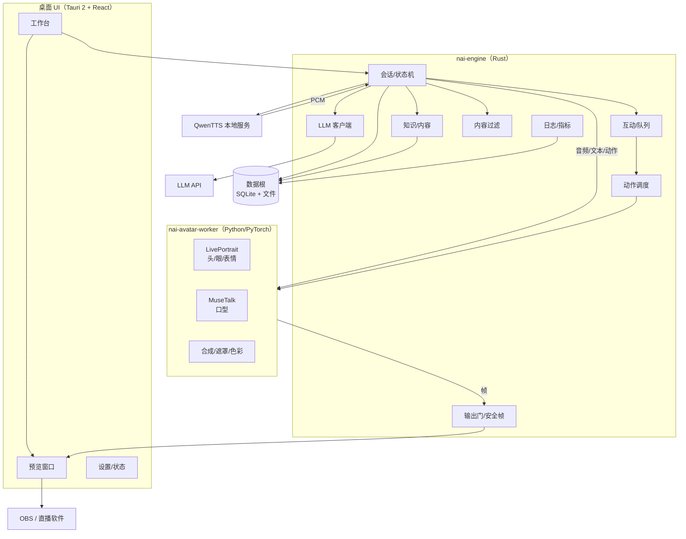

# 智能体赋能的本地数字人直播工作台 · V5.3 完整设计方案（简化版）

| 项目 | 内容 |
|---|---|
| 版本 | V5.3 |
| 日期 | 2026-11-03（UTC+8） |
| 状态 | 新基线建议稿；不向前兼容 V4.x/V5.2 |
| 目标机型 | Windows 11 + RTX 5090 Laptop 24GB + 32GB RAM |
| 核心模型 | QwenTTS（本地服务）+ MuseTalk 1.5（口型）+ LivePortrait（头眼/表情） |
| 输出 | 本机窗口 + OBS 窗口捕获；可选本地录制 |
| 产品形态 | 单人、单机、单直播间、单形象的本地直播工作台 |
| 文档关系 | V4.8/V5.2 归档为历史设计；本版不继承其 ACC/INV/任务编号 |

---

## 0. 结论与设计立场

V5.3 是一次**断代式简化**，不是 V5.2 的增补。

V5.2 的工程基础（Rust 内核、契约、存储、媒体、安全、验收）很强，但它把“完整产品愿景、当前主组合、历史能力”混在一起，导致 164 项 ACC 全 pending、387KB 设计、428 份报告、190 个 ADR，而真正的“能播出的数字人”尚未闭环。

V5.3 的选择是：

1. **先做一条能播的纵向链路**：QwenTTS → MuseTalk/LivePortrait → 本机窗口/OBS；
2. **只保留单人操作员**：不做多工作区、多用户、多角色、审批流、预算账本、审计哈希链；
3. **只保留必要护栏**：内容过滤、动作白名单、停止/静音/接管、本机绑定、凭据保护；
4. **接受工程现实**：MuseTalk/LivePortrait 是 PyTorch 优先，V5.3 允许独立 Python 模型 worker，不再强求 Rust+ONNX；
5. **验收从 164 项降到约 45 项**：每项都有可执行证据，不再用“设计条目”代替“可播证明”。

**一句话目标：一个人、一台 5090 笔记本、一个本地 QwenTTS、一个 MuseTalk+LivePortrait 形象，能连续讲解、回答、被接管、被停止，并通过 OBS 稳定输出。**

---

## 1. 版本目标、范围与非目标

### 1.1 目标

| 编号 | 目标 | 验收方式 |
|---|---|---|
| G1 | 本地 QwenTTS 可合成、可缓存、可取消 | 首音/长句/失败/取消记录 |
| G2 | MuseTalk 让静态肖像或真人底版“对口型说话” | 10 分钟连续说话录像 |
| G3 | LivePortrait 提供待机/倾听/表情/头眼动作 | 待机循环与动作片段 |
| G4 | 两模型组合后不出现双嘴、明显接缝、音画漂移 | 30 分钟 OBS 录像 + 人工盲评 |
| G5 | 单人操作：开始、静音、接管、停止 | 热键/面板实测 |
| G6 | 本机窗口 + OBS 捕获 + 本地录制 | OBS 实际录像 |
| G7 | 连续讲解 + 问答 + 可选弹幕 | 2 小时 / 8 小时长稳 |
| G8 | 资源可控、失败有明确降级 | VRAM/RAM/掉帧/恢复记录 |

### 1.2 非目标（V5.3 明确不做）

- 多工作区、多用户、多角色、团队协作；
- 逐句审批、审批投票、预算账本、费用对账、审计哈希链；
- 官方抖音/快手/视频号连接器、自动开播、自动发券、commerce；
- MCP/A2A、Marketplace、扩展 SDK、移动端、远程控制；
- 3D 全身、自由手势生成、舞蹈、多人连麦；
- 云端数字人渲染、云端 TTS；
- 多形象同时驻留、多直播间并发；
- ASR/VAD（作为可选后续，不阻塞主线）；
- 旧 V4.8/V5.2 数据、ACC、INV、任务编号的兼容与迁移。

### 1.3 与 V5.2 的关系

- V5.3 是**新执行基线**；V5.2/V4.8 归档为历史设计。
- 不继承 164 项 ACC、62 条 INV、15 个 V48 work item。
- 旧用户资产（人物图、参考音频、知识文档）可“手动导入”，但不保证旧数据库/旧许可结构可直接使用。
- 旧 OpenSpec/ADR 保留为历史，不参与 V5.3 发布门。

### 1.4 十条关键简化决策

| # | 决策 | 替代 V5.2 的什么 |
|---|---|---|
| D1 | 单数据根、单 `config.json`、单 SQLite 库 | 多 workspace/多租户 |
| D2 | 单操作员，无审批/角色/预算/审计链 | CueBundle/审批/账本/outbox |
| D3 | 三进程核心：desktop、engine、avatar-worker | 9 类进程/多宿主 |
| D4 | Rust engine + Python 模型 worker | 强制 Rust+ONNX 全链 |
| D5 | JSON/bincode 控制 IPC + 共享内存媒体 | Protobuf/OpenAPI 全量契约 |
| D6 | 约 45 项验收（47 条明细），按 M1–M4 推进 | 164 项 ACC |
| D7 | 只做“讲解 + 问答 + 手动动作 + 可选弹幕” | commerce/MCP/A2A/3D/多平台 |
| D8 | 停止/静音/接管作为最高优先级 | 多角色审批/P0 治理体系 |
| D9 | QwenTTS/MuseTalk/LivePortrait 均为可替换本地服务 | 统一 ONNX Runtime 绑定 |
| D10 | 文档只保留“当前方案 + 运行手册 + 验收看板” | 709 个 Markdown/428 报告 |

### 1.5 成功标准

V5.3 完成的最低标准：

1. 目标机上双击启动，5 分钟内进入“待机形象 + 可说话”状态；
2. 30 分钟连续讲解/问答/接管/停止，OBS 录像可回放；
3. 无 P0 故障（停止失效、旧帧续播、音画严重错位、双嘴/双脸）；
4. QwenTTS、MuseTalk、LivePortrait 的真实资源/延迟有记录；
5. 模型/素材/声音许可清单可审查；
6. 验收看板至少有 M1–M3 的 `passed` 项，而不是全部 pending。

### 1.6 从 cyber-xiaoya-live 借鉴什么

**借鉴：**

- 单体/少量进程的交付方式：先跑通一条直播链路，再扩能力；
- 本地词表/优先级/动作队列/冷却：不做每件事都过 LLM；
- 停止/静音/接管/打断作为最高优先级；
- 喂流/输出/看门狗/安全帧：事故驱动出来的韧性；
- 单配置 + 运行状态 + 日志：运维简单；
- 真实直播/OBS 证据优先于文档条目。

**不借鉴：**

- 云端渲染依赖（V5.3 要本地模型）；
- 无正式验收/无持久化（V5.3 保留最小验收与 SQLite）；
- 进程级单例/无测试（V5.3 保留 worker 隔离与关键测试）；
- 无许可/无模型闭包（V5.3 把许可作为发布门）。

---

## 2. 产品范围与用户流程

### 2.1 用户

- 单人主播/讲解者；
- 一台 Windows 笔记本；
- 已有或愿意配置本地 QwenTTS；
- 有一个合法授权的真人肖像/短视频；
- 使用 OBS 或类似直播软件输出。

### 2.2 主流程

```text
打开工作台
  → 检查引擎/模型/Qwen/OBS
  → 选择形象（内置示例 / 导入肖像 / 导入短视频）
  → 试听声音
  → 输入主题或资料（可选）
  → 预览：待机 / 说一句
  → 打开输出窗口
  → OBS 捕获窗口 + 音频
  → 开始讲解 / 回答 / 接管 / 静音 / 停止
  → 结束，生成本场记录
```

### 2.3 功能清单

#### 必须有（V5.3 主线）

- 本地 QwenTTS 合成、试听、缓存；
- MuseTalk 口型；
- LivePortrait 待机/倾听/基础表情；
- 一个当前形象；
- 文字聊天/问答；
- 主题/资料驱动的连续讲解；
- 本机预览窗口；
- OBS 窗口捕获；
- 开始/暂停/静音/接管/停止；
- 本地会话记录/转写；
- 内容过滤、动作白名单；
- 配置页、状态页、日志。

#### 可选（不阻塞主线）

- 通用弹幕 HTTP 入口（第三方采集器）；
- 简单礼物感谢；
- 简单动作按钮；
- 本地录制（OBS 或内置）；
- 知识文档导入/FTS 检索；
- 虚拟摄像头；
- ASR/VAD；
- LivePortrait 叠加模式（Mode B）。

#### 明确不做

见 §1.2。

---

## 3. 总体架构

### 3.1 逻辑架构



### 3.2 进程拓扑

| 进程 | 职责 | 故障边界 |
|---|---|---|
| `nai-desktop` | Tauri/React UI、预览、设置、热键 | 崩溃只影响 UI；engine 可继续待机 |
| `nai-engine` | 会话、LLM、知识、互动、动作、过滤、输出门、日志 | 崩溃时 worker 停止输出；launcher 重启 |
| `nai-avatar-worker` | LivePortrait + MuseTalk + 合成；共享内存出帧 | 崩溃时 engine 切安全帧/降级 |
| `qwen-tts` | 本地 TTS 服务（用户已有） | 不可达时文字模式/停止，不伪造音频 |
| `OBS` | 外部直播软件 | 崩溃时本机预览仍可看，直播中断 |

**V5.3 只有 3 个自研进程 + 1 个外部 TTS + 1 个外部 OBS。** 启动器/快捷方式只是拉起脚本，不是常驻进程；不设独立 keeper、platform-bridge、control-server、supervisor、native-host。engine 内部用轻量输出门保证停止/静音。

### 3.3 技术栈

| 层 | 选择 | 说明 |
|---|---|---|
| 桌面 | Tauri 2 + React 19 + TypeScript + Vite | 沿用现有工作台 |
| 引擎 | Rust + Tokio + Serde + Tracing | 单进程组合根 |
| 模型 worker | Python 3.11 + PyTorch + CUDA | MuseTalk/LivePortrait 官方生态；独立进程 |
| 数据 | SQLite WAL + 文件对象 | 单库、单数据根 |
| 控制 IPC | 命名管道 + 长度前缀 JSON | 简单、可调试 |
| 媒体 IPC | Windows 共享内存环形缓冲 | 帧/PCM 不走 JSON |
| 本地 HTTP | Axum/axum-server，绑定 `127.0.0.1` | UI 与可选弹幕入口 |
| 输出 | 无边框窗口 + OBS 窗口捕获 | 不做虚拟摄像头主线 |
| 日志 | tracing + JSONL 文件 | 本场时间线 + 错误 |

### 3.4 与 V5.2 的架构差异

| 维度 | V5.2 | V5.3 |
|---|---|---|
| 进程 | 9 类 | 3 个自研 + 2 个外部 |
| 契约 | Protobuf/OpenAPI/JSON Schema 全量 | JSON 控制 + 共享内存 |
| 渲染 | 强制 NativeOnnx 目标 | 允许 Python worker，ONNX 后续可选 |
| 治理 | 审批/租约/epoch/账本/outbox | 单操作员 + 停止/静音/接管 |
| 数据 | 多 workspace/多表治理 | 单数据根 + 少量表 |
| 平台 | 多平台 connector 设计 | OBS/手动，不做官方连接器 |
| 验收 | 164 ACC/62 INV | 约 45 ACC/8 护栏 |

---

## 4. 本地模型与媒体管线

### 4.1 三模型职责边界

| 模型 | 输入 | 输出 | 职责 | 不负责 |
|---|---|---|---|---|
| QwenTTS | 文本、声线、语言、语速 | PCM/WAV | 把文本变成声音 | 口型、表情、动作 |
| MuseTalk | 人脸底图/帧 + 音频特征 | 口型同步的人脸帧 | 嘴部区域同步 | 头姿、眼神、全身 |
| LivePortrait | 源肖像 + 驱动视频/动作 | 头眼/表情动画帧 | 待机、倾听、表情、头动 | 音频口型、全身动作 |
| 合成器 | 两模型输出 | 最终帧 | 遮罩、对齐、色彩、时序 | 生成新内容 |

**关键约束：**

- 同一时刻嘴部只有一个 owner：**说话时 MuseTalk 拥有嘴部**；
- LivePortrait 不可以在说话时同时驱动嘴部，否则会双嘴/抖动；
- 说话时头眼可以冻结、低频更新，或用 Mode B 叠加；
- 不做全身、不做手指、不做任意舞蹈。

### 4.2 三种组合模式

#### Mode A：分时组合（V5.3 默认）

```text
待机/倾听：LivePortrait 驱动头眼/表情，循环播放
说话：暂停 LivePortrait，MuseTalk 用当前帧/源图生成口型
切换：150–300ms 遮罩/淡入淡出，嘴部 owner 切换
```

优点：GPU 峰值低、实现简单、稳定；缺点：说话时头动较少。

#### Mode B：叠加组合（可选，实测后启用）

```text
LivePortrait 以 10–25fps 生成头眼/表情底帧
MuseTalk 对每帧生成嘴部
合成器把嘴部 ROI 贴回 LivePortrait 帧
```

约束：

- 两边必须共用同一人脸框/关键点/裁剪；
- 嘴部 mask 羽化 + 色彩匹配 + 时序平滑；
- 嘴部 owner 仍是 MuseTalk；
- 对齐失败/接缝明显时自动回 Mode A；
- 只有 Mode B 通过 30 分钟录像与人工盲评，才允许作为默认。

#### Mode C：降级

- 只有 MuseTalk + 静态肖像；
- 或只有内置 2D + QwenTTS；
- 或纯文字模式。

**降级必须在 UI 明确显示，不允许静默切换。**

### 4.3 音频管线

```text
文本
 → LLM/脚本分句
 → QwenTTS 合成（句级）
 → PCM 规范化（i16 / mono）
 ├─ 播放分支：重采样到设备采样率（通常 48k）→ 音频队列 → WASAPI
 └─ 口型分支：重采样到 16k → MuseTalk 音频特征
```

规则：

- **音频时钟是主时钟**；帧选择按已播放样本位置，不按墙钟；
- 句级合成 + 预取 1–2 句；首句优先短句；
- Qwen 若只返回完整 WAV：按句请求、句间预取；若支持流式 PCM：增量消费；
- 取消：清空待播队列 + 标记 session epoch；worker 丢弃旧 epoch 音频；
- Qwen 不支持服务端取消时，明确记录“客户端已丢弃，服务端可能仍在推理”；
- 禁止把 16k 特征时钟和 48k 播放时钟混用。

### 4.4 视频管线

```text
源肖像/短视频
 → 人脸检测/关键点/裁剪（统一 ROI）
 → LivePortrait（待机/表情）
 → MuseTalk（说话口型）
 → 合成（遮罩/色彩/时序）
 → BGRA 帧
 → 共享内存环形缓冲（3–4 槽）
 → engine 输出门
 → 预览窗口 / OBS
```

规则：

- 输出画布默认 1280×720 @ 25fps；MVP 可先 960×540；
- MuseTalk 人脸 ROI 按官方 256×256（或实测最佳），**720p 是画布，不是生成脸分辨率**；
- LivePortrait 源图建议 512–1024 短边；驱动视频固定机位、正面/小角度；
- 帧携带 `seq/epoch/pts/source_sample`；
- 迟到帧丢弃；连续迟到 >200ms 显示安全帧；
- 停止/静音后不得继续显示旧嘴型配新音频。

### 4.5 合成细节

| 问题 | 处理 |
|---|---|
| 双嘴 | 说话时 LivePortrait 嘴部区域冻结/遮罩；MuseTalk 唯一 owner |
| 接缝 | 嘴部 mask 羽化 8–16px；Lab/直方图色彩匹配；时序平滑 |
| 抖动 | 人脸框平滑；关键点低通；帧间光流/位移限制 |
| 身份漂移 | 固定源图/底版；每帧与参考帧做相似度检查；异常回安全帧 |
| 侧脸/遮挡 | 超出认证角度/手遮嘴时拒绝口型或切静默展示 |
| 牙齿/表情 | 仅使用模型支持范围；不做夸张表情承诺 |

### 4.6 模型加载、预热与缓存

- worker 启动时只加载当前形象的 MuseTalk + LivePortrait；
- 预热：跑 2–3 帧空转，测量首帧；
- 模型常驻；空闲 10 分钟可卸载 LivePortrait（可配置），保留 MuseTalk；
- 换形象/换模型必须排空当前队列，重新预热；
- 不允许多个模型副本同时驻留；
- 模型/权重/依赖/许可必须有哈希与清单。

### 4.7 质量与失败分支

| 实验结果 | 处置 |
|---|---|
| Mode B 质量好、资源够 | 允许作为可选模式 |
| Mode B 接缝/双嘴明显 | 回 Mode A |
| LivePortrait 资源不足 | 降 LivePortrait 帧率/分辨率，或只待机用 |
| MuseTalk 资源不足 | 降画布/ROI/帧率，或回内置 2D |
| 两者都不够 | 纯文字模式，明确提示 |
| Qwen 不可用 | 文字模式/停止，不伪造音频 |

---

## 5. 进程、IPC 与数据面

### 5.1 进程职责

#### `nai-engine`（Rust）

- 会话状态机：`idle → preparing → ready → live → stopped/faulted`；
- LLM 调用、分句、知识检索、互动队列；
- QwenTTS 适配：健康、合成、取消、缓存；
- 动作调度：手动/关键词/待机动作；
- 内容过滤、动作白名单；
- 输出门：帧选择、安全帧、静音、停止；
- HTTP API、日志、指标、会话记录；
- 管理 worker 生命周期（启动/心跳/重启/停止）。

#### `nai-avatar-worker`（Python）

- 加载 MuseTalk/LivePortrait；
- 接收 `load_character`、`speak`、`idle`、`action`、`stop`；
- 输出帧到共享内存；
- 上报健康、帧序号、耗时、VRAM；
- 不自行决定播放、不直接打开音频设备。

#### `nai-desktop`

- 预览、聊天、控制、设置；
- 不加载模型、不持有密钥明文；
- 通过本地 HTTP/WS 与 engine 通信。

### 5.2 控制 IPC（engine ↔ worker）

- 传输：Windows 命名管道 `\\.\pipe\nai-avatar-v53`；
- 编码：4 字节小端长度 + JSON；
- 版本：`protocol_version: 1`；
- 消息：

```json
{"type":"load_character","character_id":"default","source":"...","driving_idle":"...","mode":"time_sliced"}
{"type":"speak","epoch":3,"seq":1,"text":"...","audio_pcm_ref":"shm:audio/3/1","sample_rate":16000}
{"type":"idle","epoch":3}
{"type":"action","epoch":3,"action":"nod"}
{"type":"stop","epoch":4}
{"type":"stats"}
```

- 响应：

```json
{"type":"ready","models":["musetalk","liveportrait"],"vram_mb":12345}
{"type":"frame","epoch":3,"seq":42,"pts_ms":1680,"shm":"frame/3/42","w":1280,"h":720}
{"type":"error","code":"MODEL_OOM","message":"..."}
```

### 5.3 媒体 IPC

- 帧：共享内存环形缓冲，3–4 槽；
- 格式：BGRA8、1280×720、stride 5120；
- 每槽头：`epoch/seq/pts_ms/source_sample/state`；
- PCM：独立共享内存环形缓冲；
- 规则：
  - 生产者不能覆盖未释放槽；
  - 消费者取最新可用帧；
  - 旧 epoch 帧直接丢弃；
  - 不把帧/PCM 放进 JSON/Base64。

### 5.4 生命周期与心跳

```text
engine 启动
 → 启动 worker（或连接已有）
 → worker ready
 → 加载角色
 → 预热
 → ready
 → live
```

- engine 每 1s 检查 worker 心跳；
- worker 3s 无响应：engine 切安全帧，尝试重启（最多 2 次/场）；
- 重启失败：降级到内置 2D 或停止；
- 进程退出：launcher/engine 负责杀掉子进程，避免残留 GPU 占用。

### 5.5 安全边界

- worker 只接受本地命名管道，不监听公网；
- worker 不执行任意脚本/命令，只接受白名单消息；
- 模型/权重路径必须在数据根内，拒绝 `..`/绝对路径/符号链接逃逸；
- worker 以当前用户运行，不要求管理员；
- engine 对 worker 输出做格式/尺寸/epoch 校验；
- 任何不确定状态 → 安全帧/静音，不输出。

---

## 6. 功能设计

### 6.1 直播会话

状态：

```text
idle → preparing → ready → live → paused → live
                  ↘ stopped
                  ↘ faulted
```

操作：

- **开始**：检查 Qwen/worker/OBS/形象/许可 → 预热 → live；
- **暂停**：停止新生成，当前句可播完或立即静音（可配置）；
- **静音**：立即停数字人音频，画面切待机；
- **接管**：停 AI 语音/动作，切真人麦克风（直通 OBS），保留上下文；
- **停止**：取消 LLM/TTS/worker 任务，清队列，静音，安全帧，结束会话。

规则：

- 停止/静音永远最高优先级；
- 接管不删除已有转写/内容；
- 恢复 AI 需操作员再次点击，不自动恢复；
- 不自动开播平台，只输出本机窗口/OBS。

### 6.2 形象与声音

**形象：**

- 内置示例形象（可立即用）；
- 导入单张肖像（PNG/JPG，≤20MB，正面/小角度）；
- 导入短视频（MP4，≤120s，用于 LivePortrait 驱动/底版）；
- 一个当前形象；不做多版本管理；
- 导入时勾选“我有权使用该肖像”；
- 显示模型状态：`ready/missing/oom/unsupported`；
- 预览：待机、说一句、点头、微笑。

**声音：**

- QwenTTS 声线列表/自定义参考音频；
- 试听；
- 语速/音量；
- 显示“本地 Qwen / 不可达 / 模型未知”；
- 声音许可确认。

### 6.3 讲解/内容

- 用户输入主题/大纲/资料；
- LLM 生成讲解段落（可编辑）；
- 按段落合成/播放；
- 连续讲解：段落队列，播完自动下一段；
- 暂停/继续/跳过；
- 可选知识文档导入（TXT/MD），FTS 检索后注入 LLM；
- 无资料时明确“自由生成”，不冒充事实；
- 价格/参数/承诺类内容需用户自己核对。

### 6.4 对话/问答

- UI 文字提问；
- 可选弹幕事件；
- 队列：去重、过期、上限；
- LLM 回答：人设 + 知识片段 + 当前节目上下文；
- 回答分句 → TTS → 口型；
- 回答后回到讲解检查点（可选）；
- 失败：文字提示/跳过，不伪造语音。

### 6.5 弹幕/礼物（可选）

V5.3 **不内置任何平台连接器**。只提供通用入口：

```http
POST http://127.0.0.1:8780/api/events
Content-Type: application/json

{"kind":"danmaku","nick":"观众","text":"你好"}
{"kind":"gift","nick":"观众","gift":"小心心","count":1}
```

来源由用户自己的采集器负责，合规风险由用户承担。

处理：

- 内容过滤 → 队列 → 复读/回答；
- 礼物：简单模板感谢（可关）；
- 不刷屏：同人/同文本合并、每分钟上限；
- 不接平台官方事件，不伪造“已连接平台”。

### 6.6 动作

**动作来源：**

1. 手动按钮/热键；
2. 关键词匹配（本地词表，零成本）；
3. 待机随机动作（可关）；
4. 可选 LLM 动作编译（默认关闭）。

**动作白名单（示例）：**

`idle`、`listen`、`nod`、`shake`、`smile`、`wink`、`look_left`、`look_right`、`wave`、`think`。

规则：

- 只执行 LivePortrait 驱动片段/内置动作；
- 不支持的动作明确拒绝；
- 动作优先级：停止/接管 > 手动 > 关键词 > 待机；
- 同动作冷却、队列上限；
- 动作不阻塞停止；
- 不做全身/舞蹈/任意手势。

### 6.7 输出、OBS 与录制

- 本机无边框预览窗口（可置顶、可隐藏）；
- OBS 窗口捕获视频；
- 音频输出到系统默认设备，OBS 捕获桌面音频；可选独立音频设备（后续）；
- 本地录制：
  - 首选 OBS 录制；
  - 可选内置录制（后续）；
- 不内置虚拟摄像头（后续可选）；
- UI 明确区分：预览窗口 ≠ 平台已开播；OBS 进程 ≠ 已捕获；OBS 有画面 ≠ 平台已推流。

### 6.8 复盘

- 本场时间线：开始/停止、用户话、AI 话、动作、错误；
- 转写文本；
- 指标：首音、首帧、帧率、掉帧、AV 偏差、资源峰值；
- 导出 JSON/Markdown；
- 不做复杂知识发布/审批，只做“下场可复用”的简单草稿。

### 6.9 设置与热键

- LLM：base_url/model/key（存系统凭据）；
- QwenTTS：endpoint/voice/语言/超时；
- 形象：源图/驱动视频/模式 A/B/C；
- 输出：分辨率/帧率/窗口置顶/OBS 提示；
- 过滤：红线词/屏蔽词/动作黑名单；
- 热键：停止/静音/接管/开始；
- 日志级别/保留天数；
- 模型路径/重新探测。

### 6.10 简化治理

V5.3 的治理 = **单人操作员 + 运行时护栏**，不是多角色审批。

| 机制 | V5.3 做法 |
|---|---|
| 身份 | 本机 OS 用户；无登录/角色 |
| 权限 | 能打开工作台即可操作；无审批 |
| 停止 | 热键/按钮立即生效，最高优先级 |
| 静音 | 只停数字人音频；真人麦克风不受影响 |
| 接管 | 停 AI，切真人音轨 |
| 内容 | 输入/输出过滤 + 红线 + 动作白名单 |
| 审计 | 本地会话日志；保留 7 天；无哈希链 |
| 预算 | 不做账本；只显示 API/本地资源估算 |
| 许可 | 用户勾选/记录，不做在线核验 |
| 平台 | 不做官方连接器；OBS/手动 |

---

## 7. 数据模型与配置

### 7.1 单数据根

默认：

```text
%LOCALAPPDATA%\nai-v53\
  config.json
  nai.db
  assets\
    characters\
    voices\
    knowledge\
    models\
  recordings\
  logs\
  cache\
```

- 不设 workspace 目录；
- 不设多用户目录；
- 所有路径相对数据根解析；
- 拒绝 `..`/绝对路径/符号链接逃逸；
- 用户可在设置中改数据根（迁移只做“复制+校验”，不做旧库兼容）。

### 7.2 SQLite 表（最小集）

| 表 | 字段 | 说明 |
|---|---|---|
| `settings` | key, value_json, updated_at | 非敏感设置 |
| `characters` | id, name, source_image, driving_idle, license_note, created_at | 单当前形象 |
| `voices` | id, name, ref_audio, params_json, created_at | Qwen 声线 |
| `knowledge_docs` | id, title, path, text, updated_at | 可选知识 |
| `sessions` | id, started_at, ended_at, mode, config_json, metrics_json | 场次 |
| `messages` | id, session_id, role, text, audio_path, started_at, duration_ms, source | 转写/语音 |
| `actions` | id, session_id, action, source, at | 动作 |
| `events` | id, session_id, kind, payload_json, at | 弹幕/礼物/错误 |
| `recordings` | id, session_id, path, duration_ms, size | 录制 |

- FTS5 可选：`knowledge_fts`；
- 不建 workspace/principal/role/approval/budget/audit/outbox 表；
- 所有时间 UTC，展示本地时区；金额不使用（V5.3 不做账本）。

### 7.3 配置示例

```json
{
  "app": {
    "data_root": "E:/nai-data",
    "language": "zh-CN",
    "log_retention_days": 7
  },
  "server": {
    "host": "127.0.0.1",
    "port": 8780
  },
  "llm": {
    "base_url": "https://api.deepseek.com",
    "model": "deepseek-chat",
    "api_key_ref": "keyring:nai/llm",
    "temperature": 0.7,
    "max_tokens": 512
  },
  "tts": {
    "engine": "qwen",
    "endpoint": "http://127.0.0.1:8000",
    "voice": "default",
    "timeout_ms": 30000,
    "prefetch_sentences": 2
  },
  "avatar": {
    "engine": "musetalk+liveportrait",
    "character": "default",
    "mode": "time_sliced",
    "source_image": "assets/characters/default/source.png",
    "driving_idle": "assets/characters/default/idle.mp4",
    "output": {"width": 1280, "height": 720, "fps": 25}
  },
  "output": {
    "window": true,
    "always_on_top": true,
    "obs_capture_hint": true,
    "virtual_camera": false
  },
  "filters": {
    "redline": ["政治", "色情", "赌博", "毒品", "枪支", "自杀"],
    "blocked_actions": ["dance", "undress"],
    "max_danmaku_per_minute": 20
  },
  "hotkeys": {
    "stop": "Ctrl+Shift+S",
    "mute": "Ctrl+Shift+M",
    "takeover": "Ctrl+Shift+T"
  }
}
```

### 7.4 迁移与备份

- V5.3 不兼容旧 V4.8/V5.2 数据库；
- 旧用户资产通过“导入”进入新数据根：
  - 肖像/视频复制 + 哈希；
  - 参考音频复制 + 哈希；
  - 知识文档复制 + 文本提取；
- 备份：关闭应用后复制数据根；或提供“导出 zip”；
- 恢复：新机解压 + 校验哈希；
- 不做复杂 journal/outbox/跨版本迁移。

---

## 8. API

### 8.1 本地 HTTP（`127.0.0.1:8780`）

| 方法 | 路径 | 说明 |
|---|---|---|
| GET | `/api/status` | 引擎/worker/Qwen/OBS/会话状态 |
| POST | `/api/session/start` | 开始 |
| POST | `/api/session/stop` | 停止 |
| POST | `/api/session/pause` | 暂停 |
| POST | `/api/session/resume` | 继续 |
| POST | `/api/session/mute` | 静音数字人 |
| POST | `/api/session/takeover` | 真人接管 |
| POST | `/api/chat` | 文字问答 |
| POST | `/api/say` | 直接说一句 |
| POST | `/api/narrate/start` | 开始讲解（主题/脚本） |
| POST | `/api/narrate/stop` | 停止讲解 |
| POST | `/api/action` | 手动动作 |
| POST | `/api/events` | 弹幕/礼物通用入口 |
| GET | `/api/characters` | 形象列表/当前 |
| POST | `/api/characters/import` | 导入肖像/视频 |
| POST | `/api/characters/select` | 选择当前形象 |
| POST | `/api/tts/preview` | 试听 |
| GET | `/api/config` | 脱敏配置 |
| POST | `/api/config` | 更新配置 |
| GET | `/api/session/report` | 本场记录 |
| POST | `/api/worker/restart` | 重启 worker |

### 8.2 事件入口

```json
{"kind":"danmaku","nick":"观众","text":"你好"}
{"kind":"gift","nick":"观众","gift":"小心心","count":1}
```

- 永远返回 200 + `{queued, reason}`；
- 过滤/限流在 engine；
- 不提供平台鉴权/cookie/签名；
- 不把外部事件当系统指令。

### 8.3 错误码

| 码 | 含义 |
|---|---|
| `ENGINE_NOT_READY` | 引擎未就绪 |
| `QWEN_UNAVAILABLE` | Qwen 不可达 |
| `MODEL_MISSING` | 模型/权重缺失 |
| `MODEL_OOM` | 显存不足 |
| `WORKER_LOST` | worker 失联 |
| `AUDIO_DEVICE_LOST` | 音频设备丢失 |
| `INVALID_REQUEST` | 参数错误 |
| `UNSUPPORTED_ACTION` | 动作不在白名单 |
| `LICENSE_NOT_CONFIRMED` | 形象/声音许可未确认 |
| `SESSION_NOT_LIVE` | 会话未开始 |

### 8.4 音频/视频数据面

- 控制面只传引用/序号/时间戳；
- 帧/PCM 走共享内存；
- 不允许把 Base64 帧放进 HTTP/IPC；
- 所有媒体引用带 `epoch/seq`，旧 epoch 拒绝。

---

## 9. UI

### 9.1 主界面

```text
┌─────────────────────────────────────────────────────┐
│ 状态：引擎 ●  Qwen ●  Worker ●  OBS ○   [停止][静音][接管] │
├──────────────────────────┬──────────────────────────┤
│                          │  当前节目/讲解            │
│      形象预览/输出窗口     │  - 下一段                │
│      （16:9）             │  - 进度                  │
│                          │  问答/弹幕                │
│                          │  - 观众问题               │
│                          │  - 回答状态               │
├──────────────────────────┴──────────────────────────┤
│ [输入聊天] [发送] [说一句] [动作▾] [开始/暂停讲解]        │
└─────────────────────────────────────────────────────┘
```

### 9.2 设置页

- 模型：Qwen 端点/声线；形象源图/驱动视频；
- 输出：分辨率/帧率/窗口/OBS 提示；
- LLM：base_url/model/key；
- 过滤：红线/屏蔽词/动作黑名单；
- 热键；
- 日志/数据根/备份；
- 许可确认。

### 9.3 状态与错误

每个依赖显示三层：

1. **进程/服务存在**（engine/worker/Qwen/OBS）；
2. **连接/能力**（端口、模型加载、设备）；
3. **实际信号**（帧、音频、OBS 捕获）。

规则：

- 未知显示“未知”，不显示“已连接”；
- 失败给出原因 + 修复按钮；
- 降级显示当前模式（Mode A/B/C、文字模式）；
- 停止/静音/接管始终可见、可键盘到达。

### 9.4 空态与引导

- 无形象：显示内置示例 + “导入肖像”；
- 无 Qwen：显示“仅文字模式” + 配置入口；
- 无模型：显示缺失清单 + 下载/路径；
- 无 OBS：显示“仅本机预览” + OBS 指南；
- 首次使用：3 步（选形象 → 试听 → 预览）。

---

## 10. 安全与合规（简化）

### 10.1 单操作员模型

- 本机 OS 用户即操作员；
- 无登录、角色、审批、投票；
- 能打开工作台 = 可操作；
- 不做“模型自批准”；
- 不把外部文本当指令。

### 10.2 停止/静音/接管

| 操作 | 行为 | 优先级 |
|---|---|---|
| 停止 | 取消 LLM/TTS/worker，清队列，静音，安全帧，结束 | 最高 |
| 静音 | 只停数字人音频；画面待机 | 高 |
| 接管 | 停 AI，切真人麦克风；保留上下文 | 高 |
| 暂停 | 停新生成，当前句可播完 | 中 |

- 停止不等待动作/句子结束；
- 停止后旧帧/旧音频不得续播；
- 恢复需显式点击；
- 紧急热键不依赖 UI 焦点。

### 10.3 内容过滤

- 输入：红线正则、屏蔽词、提示词注入；
- 输出：同样过滤；命中则丢弃/替换并记录；
- 动作：白名单；红线动作直接拒绝；
- 不对抗平台审核做“绕过”；只做“避免触发”。

### 10.4 凭据

- LLM key 存 Windows 凭据管理器/系统 keyring；
- Qwen 本地服务默认无 key；
- 不在 UI/日志/报告输出明文；
- 配置文件脱敏展示；
- 支持一键清除凭据。

### 10.5 许可

- 形象：用户勾选“有权使用”；
- 声音：用户勾选“有权克隆/使用”；
- 音乐/素材：用户负责；
- 记录许可文本/时间/来源；
- 不把“勾选”当作法律证明；
- 模型/权重许可单独核查（见附录 A）。

### 10.6 日志与保留

- 本地 JSONL + SQLite 事件；
- 默认保留 7 天；
- 不默认保存原始音频/视频；
- 诊断包导出脱敏；
- 不做审计哈希链/不可抵赖。

---

## 11. 性能与资源

### 11.1 目标（初始目标，需实测）

| 指标 | 目标 |
|---|---|
| 输出画布 | 1280×720 @ 25fps（MVP 可 960×540） |
| 首音（问题/段落确认到本地首音） | ≤ 2.5s P95（目标） |
| 首帧（开始说话到第一帧口型） | ≤ 1.0s P95（目标） |
| 稳态帧率 | ≥ 24fps，30 分钟掉帧 <5% |
| 音画偏差 | ≤ 100ms（目标 80ms） |
| 停止到静音 | ≤ 200ms（目标） |
| 连续运行 | 2h/8h；24h 候选 |

### 11.2 资源预算（待实测）

| 项 | 估计 | 说明 |
|---|---|---|
| QwenTTS | 4–8GB VRAM | 取决于模型/量化；必须实测 |
| MuseTalk | 3–6GB VRAM | 含 Whisper/VAE/UNet |
| LivePortrait | 2–4GB VRAM | 含检测/重定向 |
| 应用/系统 | 2–4GB VRAM | UI/编码/桌面 |
| 合计 | ≤ 20GB，留 4GB | 超过则降级 |
| RAM | ≤ 24GB，留 8GB | 32GB 机器 |
| 磁盘 | 20–30GB | 模型/权重/缓存 |

### 11.3 降级顺序

1. 降 LivePortrait 帧率/分辨率；
2. 关 Mode B，回 Mode A；
3. 关 LivePortrait，回 MuseTalk-only；
4. 回内置 2D；
5. 纯文字；
6. 停止。

每一步都要在 UI 显示，不静默。

### 11.4 测量方法

- 首音：从用户确认/段落开始到音频设备首样本；
- 首帧：从音频开始到第一帧 MuseTalk 口型；
- 帧率：输出窗口/共享内存帧计数；
- 掉帧：期望帧数 - 实际帧数；
- AV 偏差：音频样本位置 vs 帧 PTS；
- 资源：`nvidia-smi` + 进程 RSS；
- 记录设备/驱动/模型/参数/冷热/样本数。

---

## 12. 部署与安装

### 12.1 环境

- Windows 11；
- NVIDIA 5090 Laptop 24GB / 32GB RAM；
- 驱动支持 CUDA 12.x；
- Python 3.11（worker 自带 venv）；
- ffmpeg；
- OBS（用户安装）；
- QwenTTS 本地服务（用户已有/单独部署）。

### 12.2 安装包内容

- `nai-desktop.exe`
- `nai-engine.exe`
- `nai-avatar-worker`（Python venv + 依赖 + 启动脚本）
- 模型下载器/校验器（不打包未授权权重）
- 默认示例形象/驱动片段
- 配置模板、日志目录、运行手册

### 12.3 启动顺序

```text
nai-launcher / 双击快捷方式
 → 启动 engine
 → 启动 worker
 → 检查 Qwen
 → 打开 desktop
 → 用户选择形象/试听
 → 预览
 → 打开输出窗口
 → 用户 OBS 捕获
```

### 12.4 Qwen/OBS

- Qwen：用户配置 endpoint；启动时只探测，不自动重启/安装；
- OBS：检测进程/窗口/捕获/音频/信号分层；缺失显示“仅本机预览”；
- 不自动开播平台；
- 不把 OBS 进程存在当作已捕获。

### 12.5 目录与端口

| 项 | 值 |
|---|---|
| HTTP | `127.0.0.1:8780` |
| Worker pipe | `\\.\pipe\nai-avatar-v53` |
| 数据根 | `%LOCALAPPDATA%\nai-v53` 或用户指定 |
| 日志 | `<data>/logs` |
| 录制 | `<data>/recordings` |
| 模型 | `<data>/assets/models` |

### 12.6 升级/卸载

- V5.3 不兼容旧数据；
- 升级：备份数据根 → 替换程序 → 校验配置 → 启动；
- 卸载：删除程序；数据根保留/可选删除；
- 模型/权重按许可单独处理；
- 不做旧版本迁移向导。

---

## 13. 可靠性与故障

### 13.1 故障矩阵

| 故障 | 行为 | 恢复 |
|---|---|---|
| Qwen 超时/不可达 | 当前句失败，提示；可继续文字 | 修复后重试 |
| Qwen 取消无效 | 客户端丢弃旧音频；记录服务端可能仍在跑 | 停/重开 |
| worker 崩溃 | 安全帧；重启 worker（≤2 次/场） | 重新加载/预热 |
| worker OOM | 降级 Mode A/内置 2D；提示 | 释放显存/重启 |
| 帧迟到 >200ms | 显示安全帧；丢弃旧帧 | 恢复后继续 |
| 音频设备丢失 | 静音；提示；不自动切默认设备 | 重选设备 |
| engine 崩溃 | worker 停止；launcher 重启 | 新会话 |
| OBS 崩溃 | 本机预览继续；直播中断 | 重启 OBS |
| 停止失效 | 热键/进程终止兜底 | 记录为 P0 缺陷 |
| 旧帧续播 | 按 epoch 拒绝；安全帧 | 记录为 P0 缺陷 |

### 13.2 看门狗

- worker 心跳 1s；
- Qwen 健康 30s；
- 输出帧 200ms；
- 音频队列 500ms；
- 主线程卡顿 >1s 记录；
- 停止命令独立线程/通道，不排队。

### 13.3 恢复

- 崩溃后只恢复待机，不自动恢复直播；
- 不恢复旧许可/旧音频/旧帧；
- 新会话重新预热；
- 用户显式点击开始。

### 13.4 数据保护

- SQLite WAL；
- 关闭前 checkpoint；
- 备份复制数据根；
- 不承诺断电零损坏；
- 关键配置/形象/声音有哈希。

---

## 14. 验收（约 45 项 / 47 条明细）

### 14.1 原则

- 每项必须有可执行步骤 + 证据；
- 证据类型：录像、截图、指标 JSON、日志、OBS 文件；
- 不允许“设计已写”= 通过；
- 不允许“模拟”= 真实；
- 未测 = `pending`/`blocked`，不是 `pass`；
- 每阶段只跑适用项，不机械全量。

### 14.2 验收清单

#### A. 安装与启动

| ID | 场景 | 通过标准 |
|---|---|---|
| ACC-SETUP-01 | 全新安装 | 双击启动，5 分钟内进入待机 |
| ACC-SETUP-02 | 依赖缺失 | 明确显示 Qwen/模型/OBS/ffmpeg 缺项与修复 |
| ACC-SETUP-03 | 数据根/权限 | 可在用户目录创建/读写；拒绝逃逸路径 |
| ACC-SETUP-04 | 卸载/重装 | 程序可卸载；数据根可选保留；重装可启动 |

#### B. QwenTTS

| ID | 场景 | 通过标准 |
|---|---|---|
| ACC-TTS-01 | 短句合成 | 中文短句可播，采样率/声道正确 |
| ACC-TTS-02 | 长句/数字/型号 | 不吞字、不乱读；记录实际文本/音频 |
| ACC-TTS-03 | 取消/超时 | 停止后不再播旧音频；服务端行为记录 |
| ACC-TTS-04 | 并发/预取 | 预取不串句；队列有界；失败可恢复 |
| ACC-TTS-05 | 缓存 | 同文本/声线/参数命中；不同参数不复用 |

#### C. MuseTalk

| ID | 场景 | 通过标准 |
|---|---|---|
| ACC-MUSE-01 | 静态肖像说话 | 10 分钟连续，无明显双嘴/漂移 |
| ACC-MUSE-02 | 数字/口型 | 中文数字/唇齿音可辨；人工盲评 |
| ACC-MUSE-03 | 长句/停顿 | 停顿不张嘴；长句不漂 |
| ACC-MUSE-04 | 侧脸/遮挡 | 超范围拒绝或切静默；不贴错 ROI |
| ACC-MUSE-05 | 资源/首帧 | VRAM/首帧/帧率记录 |

#### D. LivePortrait

| ID | 场景 | 通过标准 |
|---|---|---|
| ACC-LP-01 | 待机循环 | 无跳变/双脸/明显重复 |
| ACC-LP-02 | 倾听/表情 | 点头/微笑/眨眼可触发 |
| ACC-LP-03 | 驱动视频 | 合法短视频可驱动；身份稳定 |
| ACC-LP-04 | 资源/质量 | VRAM/帧率/画质记录 |

#### E. 合成管线

| ID | 场景 | 通过标准 |
|---|---|---|
| ACC-PIPE-01 | Mode A 切换 | 待机→说话→待机无跳变/双嘴 |
| ACC-PIPE-02 | 音画同步 | 30 分钟 AV 偏差 ≤100ms |
| ACC-PIPE-03 | 帧率/掉帧 | ≥24fps；掉帧 <5% |
| ACC-PIPE-04 | 安全帧 | 停止/失联/迟到显示安全帧 |
| ACC-PIPE-05 | Mode B（可选） | 无接缝/双嘴；不达标则禁用 |

#### F. 直播功能

| ID | 场景 | 通过标准 |
|---|---|---|
| ACC-LIVE-01 | 连续讲解 | 30 分钟主题讲解，段落衔接自然 |
| ACC-LIVE-02 | 问答 | 提问→回答→回讲解；不串段 |
| ACC-LIVE-03 | 弹幕入口 | 通用 HTTP 事件可入队；过滤生效 |
| ACC-LIVE-04 | 动作 | 手动/关键词动作可执行；白名单拒绝 |
| ACC-LIVE-05 | 接管/恢复 | 真人接管不丢上下文；恢复不补旧任务 |
| ACC-LIVE-06 | 停止 | 立即静音/安全帧/结束；无旧帧续播 |

#### G. 输出/录制

| ID | 场景 | 通过标准 |
|---|---|---|
| ACC-OUT-01 | 本机窗口 | 1280×720@25fps 预览正常 |
| ACC-OUT-02 | OBS 捕获 | OBS 实际录像含画面+音频 |
| ACC-OUT-03 | 音频路由 | OBS 音频与画面同步；无双音 |
| ACC-OUT-04 | 录制回放 | 30 分钟文件可回放；时长/大小正确 |

#### H. 可靠性

| ID | 场景 | 通过标准 |
|---|---|---|
| ACC-REL-01 | Qwen 断连 | 提示/文字模式；不伪造语音 |
| ACC-REL-02 | worker 崩溃 | 安全帧；重启/降级 |
| ACC-REL-03 | 设备丢失 | 静音；不自动切默认设备 |
| ACC-REL-04 | 热键停止 | UI 卡顿时仍能停 |
| ACC-REL-05 | 旧 epoch | 旧帧/旧音频不续播 |

#### I. 资源/长稳

| ID | 场景 | 通过标准 |
|---|---|---|
| ACC-RES-01 | 30 分钟资源 | VRAM/RAM/温度/掉帧记录 |
| ACC-RES-02 | 2 小时 | 无持续增长；无 OOM |
| ACC-RES-03 | 8 小时 | 无泄漏/降级可控；失败有记录 |
| ACC-RES-04 | 24 小时（候选） | 仅发布候选执行；允许合理静默 |

#### J. 体验/安全

| ID | 场景 | 通过标准 |
|---|---|---|
| ACC-UX-01 | 首次使用 | 3 步内完成形象/试听/预览 |
| ACC-UX-02 | 状态可读 | 依赖/降级/错误清楚；未知不冒充可用 |
| ACC-UX-03 | 键盘/热键 | 停止/静音/接管可键盘完成 |
| ACC-UX-04 | 内容过滤 | 红线/屏蔽词/动作黑名单生效 |
| ACC-UX-05 | 许可确认 | 形象/声音未确认时拒绝开始 |

### 14.3 阶段门

| 阶段 | 必须通过 | 退出条件 |
|---|---|---|
| M1 口型样片 | SETUP-01/02、TTS-01/02、MUSE-01/02 | 10 分钟静态肖像口型录像 |
| M2 待机+说话 | LP-01/02/04、PIPE-01/03/04 | 30 分钟 Mode A 录像 |
| M3 直播闭环 | LIVE-01/02/05/06、OUT-01/02/04 | 30 分钟 OBS 录像 + 接管/停止 |
| M4 长稳 | RES-01/02、REL-01..05 | 2 小时/8 小时记录 |
| 候选发布 | 全部适用项 + 许可清单 | ReleaseManifest |

### 14.4 证据模板

每次验收记录：

```text
run_id:
commit/build:
device/driver/OS:
models/weights/hash:
character/voice/license:
mode: A/B/C
input/sample:
expected:
actual:
metrics: first_audio_ms, first_frame_ms, fps, dropped, av_sync_ms, vram_mb, ram_mb, temp
evidence: video path / json path / log path
result: pass/fail/blocked
reviewer:
notes:
```

---

## 15. 开发计划

### 15.1 阶段

| 阶段 | 时间 | 交付 |
|---|---|---|
| P0 骨架 | 第 1 周 | 新数据根/config/SQLite/HTTP/UI 骨架；Qwen 探测；fake worker |
| P1 口型 | 第 2–3 周 | MuseTalk 静态肖像；预览；停止；10 分钟录像 |
| P2 待机+说话 | 第 4–5 周 | LivePortrait 待机；Mode A；音频时钟；30 分钟 |
| P3 直播功能 | 第 6–7 周 | 讲解/问答/弹幕/动作/UI；2 小时 |
| P4 打包长稳 | 第 8 周 | 安装包；OBS 指南；8 小时；验收报告 |
| P5 可选 | 后续 | Mode B、ASR、虚拟摄像头、24h |

### 15.2 任务拆分

**P0：**

- 清理旧 V5.2 基线，建立 V5.3 数据根/配置；
- Rust engine 骨架 + HTTP + 会话状态机；
- Tauri UI 主界面/设置/状态；
- Qwen 健康/合成/试听；
- worker 协议 + fake worker（返回测试帧）；
- 日志/指标/错误码。

**P1：**

- MuseTalk worker 集成；
- 肖像导入/人脸检测/裁剪；
- 音频 16k 特征 + 48k 播放；
- 共享内存帧；
- 预览窗口；
- 停止/安全帧；
- 10 分钟口型录像。

**P2：**

- LivePortrait 集成；
- 待机驱动/动作片段；
- Mode A 切换/遮罩；
- 音频时钟主时钟；
- 30 分钟录像；
- 资源测量/降级。

**P3：**

- 讲解/脚本/段落；
- 问答/知识；
- 弹幕 HTTP/礼物；
- 动作白名单/冷却；
- 接管/恢复；
- UI 完善。

**P4：**

- 安装包/venv/模型下载器；
- OBS 指南/检测；
- 2h/8h；
- 验收看板/ReleaseManifest；
- 文档/运行手册。

### 15.3 资源与角色

- 1 名 Rust/后端；
- 1 名模型/音视频；
- 1 名前端；
- 1 名测试/验收（可兼）；
- 目标 8 周达到 M4；若模型集成受阻，先交付 M1/M2。

### 15.4 风险

| 风险 | 影响 | 缓解 |
|---|---|---|
| MuseTalk/LivePortrait 许可 | 不能商用/分发 | 附录 A 先核查；不通过则换模型/仅私有 |
| 5090 资源不足 | 帧率/延迟不达标 | Mode A/C、降分辨率、关 LivePortrait |
| 双模型接缝 | 画面不可用 | Mode A 分时；不强行 Mode B |
| Qwen 非流式 | 首音慢 | 句级预取；短句优先；缓存 |
| Python worker 打包 | 安装复杂 | 自带 venv/固定依赖；launcher 检查 |
| Windows 音频/时钟 | AV 不同步 | WASAPI 主时钟；样本级映射 |
| OBS 捕获 | 黑屏/无音频 | 分层检测；指南；窗口捕获 |
| 长稳/散热 | 降频/掉帧 | 2h/8h 实测；性能模式；降级 |
| 内容/肖像/声音权利 | 法律风险 | 用户确认 + 记录；不提供未授权素材 |

---

## 16. 与 V5.2 的删减对照

| V5.2 | V5.3 | 原因 |
|---|---|---|
| 164 ACC / 62 INV | 约 45 ACC / 8 护栏 | 先形成可执行闭环 |
| 多 workspace/principal/role | 单数据根/单用户 | 单人本机产品 |
| 审批/投票/预算/账本/outbox | 单操作员 + 停止/静音/接管 | 降低操作与实现成本 |
| CueBundle/审批 hash/短期许可 | session epoch + 帧序号 + 输出门 | 保留正确性，去掉治理 |
| 9 类进程 | 3 个自研 + Qwen + OBS | 降低部署/调试成本 |
| Protobuf/OpenAPI/JSON Schema 全量 | JSON 控制 + 共享内存 | 减少契约维护 |
| Rust+ONNX 强制 | Rust engine + Python worker | 匹配 MuseTalk/LivePortrait 生态 |
| commerce/MCP/A2A/Marketplace/移动端 | 移除 | 远离当前主链 |
| 3D/全身/舞蹈/多人 | 移除 | 当前不做 |
| 多平台官方 connector | OBS/手动 + 通用事件入口 | 无真实授权，不伪造 |
| 内容发布/事实版本/影响报告 | 简单知识/草稿/当前 | 降低内容治理 |
| 多形象/多版本 | 单当前形象 | 降低状态复杂度 |
| 24h 发布门/90 天商业 | 先 30min/2h/8h | 先证明可用 |
| 709 文档/190 ADR/428 报告 | 当前方案+运行手册+验收看板 | 降低认知负担 |

---

## 17. 附录

### 附录 A：模型与许可证核查清单

> 以下为**必须核查项**，不是结论。未核查通过前不得分发/商用。

| 项 | 需要确认 |
|---|---|
| MuseTalk 代码许可 | 是否允许商用/分发/修改；是否要求开源 |
| MuseTalk 权重许可 | 是否允许商用；是否可再分发 |
| MuseTalk 依赖 | Whisper/VAE/UNet/face detection 等各自许可 |
| LivePortrait 代码许可 | 是否允许商用/分发 |
| LivePortrait 权重/依赖 | InsightFace 等模型是否非商用；驱动视频/素材权利 |
| QwenTTS 代码/权重 | 模型许可、声线许可、商用条件 |
| 参考音频/声音克隆 | 说话人同意/授权；是否允许克隆 |
| 肖像/视频 | 人物授权、拍摄/使用范围 |
| 音乐/BGM | 商用/直播授权 |
| ffmpeg/CUDA/PyTorch | 分发与再分发条件 |
| 输出/录播 | 平台/当地法律要求 |

### 附录 B：运行手册（摘要）

1. 启动 QwenTTS，确认 endpoint；
2. 双击 nai 启动器；
3. 选择形象 → 勾选许可 → 预览；
4. 试听声音；
5. 输入主题/资料；
6. 打开输出窗口；
7. OBS 窗口捕获 + 桌面音频；
8. 开始讲解/问答；
9. 需要时接管/静音/停止；
10. 结束导出本场记录。

### 附录 C：术语

| 术语 | 说明 |
|---|---|
| Mode A | LivePortrait 待机、MuseTalk 说话的分时组合 |
| Mode B | LivePortrait 头眼 + MuseTalk 嘴部叠加 |
| Mode C | 只 MuseTalk / 内置 2D / 文字降级 |
| 安全帧 | 停止/失联/异常时显示的预授权待机画面 |
| 音频主时钟 | 以已播放音频样本驱动帧选择 |
| epoch | 一次会话/一次停止代次；旧 epoch 媒体拒绝 |
| ROI | 人脸/嘴部感兴趣区域 |

### 附录 D：参考资料

- MuseTalk 官方仓库与论文（以实际锁定 commit/权重为准）；
- LivePortrait 官方仓库与论文（以实际锁定 commit/权重为准）；
- QwenTTS 官方仓库/模型卡（以用户实际部署为准）；
- Windows WASAPI / OBS 窗口捕获文档；
- 本项目 `docs/reports/` 中 V5.2 的媒体/形象/OBS 局部验证（仅历史参考，不构成 V5.3 通过）。

---

## 18. 最终判断

V5.3 的核心不是“再加一个模型”，而是**把项目从“完整设计平台”收敛为“单机可播产品”**。

- 用 QwenTTS 解决“会说”；
- 用 MuseTalk 解决“对口型”；
- 用 LivePortrait 解决“待机/头眼/表情”；
- 用 Mode A 解决“两个模型怎么不打架”；
- 用单操作员 + 停止/静音/接管解决“怎么控制”；
- 用约 45 项验收解决“怎么证明能播”。

如果 V5.3 只能交付一件事，那就是：**在目标机上，用真实 Qwen 声音、真实肖像、真实 MuseTalk/LivePortrait 画面，完成 30 分钟可回放的直播录像，并且能随时停下、静音、接管。**

其余能力，等这条链路通过后再加。
