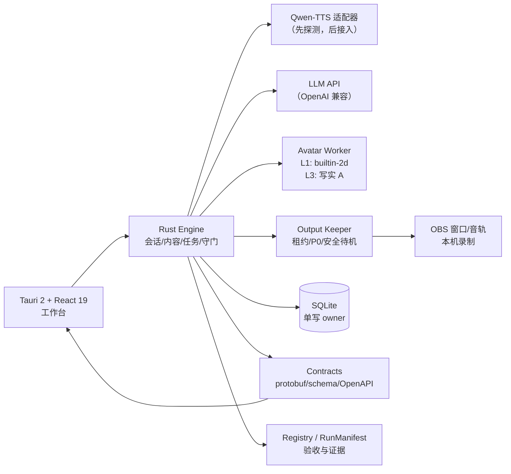

# nai 数字人项目 V5.2 设计方案问题诊断报告

| 项目 | 内容 |
|---|---|
| 诊断对象 | `docs/digital-host-agent-design-V5.2.md` 及当前仓库实现状态 |
| 诊断日期 | 2026-11-03 |
| 仓库快照 | `931d98c`（`main`，工作树状态以实际 `git status` 为准） |
| 诊断性质 | 设计审视 + 代码/验收/文档一致性诊断；不是安全审计，不是功能认证 |
| 证据范围 | 设计文档、`tests/registry.yaml`、`openspec/`、`docs/adr/`、`docs/reports/`、Rust/TS 源码与 CI 配置 |
| 重要限制 | 本次未在目标 5090 笔记本上执行真实直播；未调用真实 Qwen、真实平台、真实 MuseTalk；所有“未验证”结论均以仓库现有证据为准 |

---

## 0. 结论摘要

**一句话结论：V5.2 是一份覆盖面极广、约束极细的设计，但 nai 当前处于“规格与局部原型很丰富、可播出的纵向价值链尚未闭环”的状态。项目最大的风险不是某个技术点做不出来，而是基线漂移、范围失控、验收停滞和文档治理成本过高，导致工程投入无法收敛为可验证的产品。**

本次诊断提炼出 5 个 P0 级问题：

1. **双基线并存**：设计已到 V5.2，但 `tests/registry.yaml`、`openspec/config.yaml`、`docs/design.md`、`README.md` 仍以 V4.8 为执行基线；V5.2 的新 ACC、C52/C50/CGPU 任务尚未进入注册表。
2. **纵向价值链未闭环**：公共输出后端仍是 `builtin-2d`；没有生产写实渲染器；没有真实平台连接器；Qwen 当前不可达；没有一条“真实形象 + 真实语音 + 真实 OBS 录制 + 真人接管”的 30 分钟端到端证据。
3. **文档/代码/验收三源漂移**：同一事实在 V5.2、ADR、README、OpenSpec、registry、代码中给出不同答案（React/Vue、600/200ms vs 500ms、默认源文件是否存在、Qwen 是否可用等）。
4. **范围与验收规模失控**：387KB/3834 行设计、42 章 + 附录、62 条不变量、164 项 ACC、190 个 ADR、428 份报告、271 个归档变更、709 个 Markdown 文档、374KB `AGENTS.md`、552KB 开发计划；而 164 项 ACC **全部 pending**。
5. **关键外部事实未冻结**：Qwen 的模型身份/版本/流式/取消/资源未知且当前不可达；MuseTalk 仅完成 wheel 与 GPU 算子验证，权重、依赖、许可、真实推理均未完成；平台权限、真实用户、真实观众体验均未验证。

**建议的主方向：停止继续扩张规格，先用一个受控的纵向切片把“能播、能停、能接管、能复盘”跑通，再按证据逐级扩展。** 具体见第 8 章。

---

## 1. 诊断方法与边界

### 1.1 方法

本次诊断采用四类交叉核对：

1. **设计自检**：V5.2 的承诺、约束、初值、目标、待测项是否可区分、可验证、可执行。
2. **设计—实现对照**：V5.2 的模块、进程、数据、接口、验收，与当前 crate、app、schema、registry、CI 的实际状态对照。
3. **文档—验收对照**：V5.2 新增 ACC/C52/C50/CGPU 与 `tests/registry.yaml` 的 164 项、62 条 INV 是否接通。
4. **报告—证据对照**：`docs/reports/` 中的 428 份报告是否形成可累积证据，还是局部原型/前置证据的重复记录。

### 1.2 不在本次范围

- 不执行真实 GPU 推理、真实 Qwen、真实抖音/快手/视频号接入；
- 不做完整安全审计、许可证法律意见、观众端体验评测；
- 不判断具体模型/商业路线最终成败；
- 不修改任何代码、注册表、ADR 或主规格；
- 不把本次报告当作任何能力的通过证据。

### 1.3 证据标记

本报告使用以下标记：

- **[事实]**：仓库中可直接核对的文本/代码/计数；
- **[推断]**：由事实推出的风险判断；
- **[建议]**：可执行的重构动作；
- **[待验证]**：需要目标机、真实服务或真实用户才能确认。

---

## 2. 现状画像（用数据说话）

### 2.1 规模指标

| 维度 | 实测值 | 含义 |
|---|---:|---|
| V5.2 设计文档 | 3,834 行 / 387KB | 42 章 + 附录 A–O，单文件承载完整产品/架构/验收/商业 |
| `docs/` | 16MB / 709 个 Markdown | 含 V3.2–V5.2 多代设计、专题、报告、ADR |
| `docs/adr/` | 190 个 ADR | 决策量大，检索与冲突成本高 |
| `docs/reports/` | 428 份报告 | 局部验证丰富，但摘要/索引/结论收敛不足 |
| `docs/development-plan.md` | 4,150 行 / 552KB | 开发计划本身已成为一个“巨型文档系统” |
| `AGENTS.md` | 3,394 行 / 374KB | 代理上下文负担极高 |
| OpenSpec 归档 | 271 个 | 变更治理历史庞大 |
| OpenSpec 活跃变更 | 9 个 | 当前并行推进范围仍广 |
| Rust 代码 | 167,064 行 | 内核/存储/媒体/契约已具规模 |
| TypeScript/TSX | 1,520 行 | 桌面 UI 体量相对克制 |
| `#[test]` / `#[tokio::test]` | 1,882 处 | 测试数量可观，但分布/层级/真实环境覆盖未知 |
| `unwrap/expect/panic!` | 6,545 处 | 不等于缺陷，但在安全/媒体关键路径需分级审查 |
| Workspace 成员 | 31 个（含 `xtask`） | 另有 `apps/workbench-desktop` 独立 workspace |
| 可执行 app | 8 个 | engine/keeper/public-output-keeper/render-worker/audition-worker/human-mic-worker/workbench-engine/workbench-desktop |
| 验收注册表 | 164 ACC / 62 INV / 15 work item | **164 项全部 pending** |
| 有 evidence 的 ACC | 13 项 | 其中 23 条 evidence 为 `passed`，但多数是 `prerequisite` 且 `complete=false` |
| 基线 | `docs/digital-host-agent-design-V4.8.md` | 不是 V5.2 |

### 2.2 当前真实能力（按证据）

| 能力 | 当前状态 | 证据 |
|---|---|---|
| Windows 桌面工作台 | 可用原型 | Tauri 2 + React 19 + TS；私有预览/草稿/发布基础 |
| 内置 2D 形象 | 可用 | `plugins/avatar-2d`；公共输出 `PUBLIC_BACKEND = "builtin-2d"` |
| 自定义照片/视频导入 | 私有草稿/预览 | 视频导入为 `avatar_video_draft`；`realistic_drive` 恒为 `model_missing` |
| 写实口型 | **未实现** | 最新报告明确“当前没有生产写实渲染器”；`CharacterRuntimeState::PublicActive` 无生产赋值 |
| Qwen TTS | 历史可用，当前不可达 | `docs/v52-primary-composition.md`：`127.0.0.1:8000` 未发现监听且只读请求超时 |
| LLM API | 历史真实成功，当前未复测 | `docs/v52-implementation-review-and-plan.md` |
| 公共输出 | 内置 2D 窗口 | `CharacterWorkbench.public_output()` 固定 `builtin-2d`，`playback_permit=false` |
| OBS | 检测分层已有，实际信号未验 | 进程/场景/来源/音轨/信号分开；未启动真实 OBS 录像 |
| 平台连接（抖音等） | **未实现** | `plugins/platform-unavailable`；无真实 connector |
| ASR/VAD | 未实现 | 设计为可选；无生产接线 |
| 3D/生成手势 | 未实现 | 仅设计/研究候选 |
| 验收 | 164 项 pending | `tests/registry.yaml` |
| 真实用户/观众 | 未验证 | 68 份报告重复声明“164 项验收仍全部 pending” |

### 2.3 已经做得好的地方

必须承认，nai 不是“空文档项目”：

- Rust workspace、契约生成、SQLite owner、凭据、IPC、媒体租约、预算账本、知识链路、守门评估等都有真实代码与测试；
- 1,882 个测试、CI 双平台、schema 漂移检查、OpenSpec 校验、Windows 原生 engine/host 测试，工程纪律明显高于一般原型；
- 安全不变量、P0、租约、epoch、审批、未知结果等设计，长期看是有价值的资产；
- 媒体核心、字符协议、帧/样本时钟、OBS 分层检测等局部工作已经比较深入。

问题不在于“没有工程”，而在于**工程投入没有形成一条可发布的主价值链**，以及**规格增长速度超过了验证速度**。

---

## 3. 问题总览（按严重度）

### 3.1 P0：阻断“可发布/可验证”的问题

| ID | 问题 | 关键证据 | 影响 |
|---|---|---|---|
| P0-01 | **双基线并存，V5.2 未成为执行基线** | registry baseline=`V4.8`；`openspec/config.yaml` 目标=`V4.8`；`docs/design.md` 当前=`V4.8`；ADR 0190 明确“仓库执行基线迁移未完成” | 设计越新，执行越旧；团队无法判断“以哪份为准” |
| P0-02 | **纵向价值链未闭环** | 公共后端 `builtin-2d`；无生产写实渲染器；无平台 connector；Qwen 当前不可达；最新报告仍称 164 项 pending | 无法证明“数字人直播”这一核心产品成立 |
| P0-03 | **关键外部事实未冻结** | Qwen 型号/版本/流式/取消/资源未知；MuseTalk 仅 wheel/算子；平台权限未知；许可证闭包未完成 | 设计中的预算、延迟、能力承诺缺少事实基础 |
| P0-04 | **文档—代码—验收三源漂移** | V5.2 说 React 3/Vue 3；实际 React 19；V5.2 说 600/200ms；实际存在 500ms；V5.2 说默认源文件已存在；实际 `schemas/defaults/runtime.json`、`schemas/profiles/primary.json`、`scripts/build_docs.py` 不存在 | 任何“单源”声明都不可信；实现者会做出互相冲突的选择 |
| P0-05 | **范围与验收规模失控** | 387KB 设计 + 62 INV + 164 ACC + 190 ADR + 428 报告 + 374KB AGENTS；164 项全 pending | 认知负担、执行成本和维护成本超过团队带宽 |

### 3.2 P1：严重削弱交付质量的问题

| ID | 问题 | 关键证据 | 影响 |
|---|---|---|---|
| P1-01 | **验收注册表不可演进** | `schemas/tests/registry.schema.json` 把 baseline、15 个 V48 work item、62 条 INV、164 条 ACC 写死；V5.2 新 ACC 无位置 | V5.2 只能停留在文档，无法进入执行/证据链 |
| P1-02 | **架构复杂度与产品阶段不匹配** | 31 个 workspace crate、8+ 个 app、9 类设计进程、D3D11/CUDA/ONNX/3D/MCP/A2A/Marketplace 全量保留 | 维护、调试、打包、测试成本高；核心链路反而被稀释 |
| P1-03 | **性能/可靠性指标未实测且互相冲突** | 600/200ms 租约 vs 既有 500ms；3s 回答、250ms P0、80ms AVSync、25fps 均为目标；无目标机完整采样 | 预算/准入/验收无法形成硬约束，容易“按文档达标” |
| P1-04 | **安全/权限模型复杂，缺少端到端证明** | 62 条 INV 分散在 kernel/runtime/media/host；报告多为单点定向测试；无完整攻击面/绕过测试 | 不变量数量增加，但“是否真的不可绕过”未被证明 |
| P1-05 | **测试/CI 与验收不匹配** | CI 主要跑 `workbench`/`portable` 闭包；Windows 原生/真实 GPU/真实平台不在每次 CI；164 ACC 未自动映射 | 测试多，但“发布证据”仍靠人工报告拼接 |
| P1-06 | **产品体验与真实用户验证缺失** | 无真实 30 分钟 OBS 录像；无真实公屏；无两名独立评审；无真实客户 28 天观察 | 无法判断“愿意持续用”的核心价值假设 |
| P1-07 | **平台/合规不确定性高** | 抖音/快手/视频号/CSS 均无真实官方接入证据；第三方抓取被明确禁止 | 商业化路径可能被平台权限卡死 |
| P1-08 | **模型/资产许可闭包缺失** | MuseTalk 权重/依赖/许可未齐；Qwen 模型/声线许可未知；人物/动作/音乐权利未逐项绑定 | 写实路线可能“能跑但不能发” |
| P1-09 | **数据迁移/升级/备份未闭环** | 个人策略 2→3 迁移 SQL 已做但“未接生产迁移”；备份/恢复/崩溃恢复仍局部 | 用户数据/旧工作区升级风险 |
| P1-10 | **可观测性/运维未成型** | 有报告/诊断脚本，但无统一 metrics/SLO/alerting/dashboard；run_id 体系未贯穿全链 | 线上问题定位仍靠人工读报告/日志 |

### 3.3 P2：持续改进项

| ID | 问题 | 说明 |
|---|---|---|
| P2-01 | 版本动物园 | V3.2/V3.4/V3.5/V3.6/V3.7–V3.11/V4.1–V4.9/V5.1/V5.2，多套命名（D##/W##/RF##/C52/C50/CGPU）并存 |
| P2-02 | AGENTS/开发计划膨胀 | 374KB + 552KB，代理与人类都难以完整阅读 |
| P2-03 | 命名/术语不一致 | `dh-*` 设计命名 vs `nai-*` 实际命名；`React 3`/`Vue 3`/`React 19` 并存 |
| P2-04 | 文档重复/陈旧 | README 仍写 V4.8；V5.2 顶部增补与正文多处重复 |
| P2-05 | 代码质量风险 | 6,545 处 `unwrap/expect/panic!`；关键路径需分级审查 |
| P2-06 | 前端/桌面测试覆盖 | UI 测试 5–7 项；最新报告多次注明“未打开实际桌面窗口点击” |
| P2-07 | 依赖/工具链/许可证 | Rust 1.96、Node/Pnpm、protoc、ONNX Runtime、CUDA 等版本矩阵未统一冻结 |
| P2-08 | 商业假设未验证 | 90 天计划、付费/续用/PMF 均未有真实客户证据 |

---

## 4. 深度剖析：根因

### 4.1 “完整设计”与“当前主组合”双轨

V5.2 同时承载三种东西：

1. **完整产品愿景**（全平台、全呈现、commerce、MCP/A2A、Marketplace、3D、多人协作）；
2. **当前主组合**（5090 笔记本、Qwen、A 路线写实、OBS）；
3. **历史能力保留**（V4.8/V4.3/V3.11 的 ACC、INV、任务、报告）。

三者没有被一个“可执行裁剪机制”统一。文档说“完整能力不删”，但又说“当前只运行主组合”。结果是：**设计面无限大，执行面无限小，二者之间缺少可审计的裁剪/映射表**。

### 4.2 设计先行，缺少“纵向切片”约束

当前证据显示，团队在多个横向能力上都有局部原型（照片探测、视频头解析、许可绑定、私有预览、WASAPI 时钟、MuseTalk 探针、OBS 分层），但缺少一条从用户点击到观众看到/听到的完整切片。

对比 cyber-xiaoya-live 的经验：它先做到“1 小时从零跑起来 + 弹幕驱动动作 + 本机 TTS + 舞台页”，再逐步增加礼物、编排、贵宾、统计。nai 的顺序相反：先把安全/契约/预算/媒体/平台/扩展全部设计完整，再试图拼装主链。

**没有纵向切片，局部证据无法合成产品证据。**

### 4.3 验收注册表成为“墓碑”

`tests/registry.yaml` 的设计初衷是“唯一验收来源”，但当前状态是：

- 164 项全部 `pending`；
- 只有 13 项有 evidence，且 evidence 多为 `prerequisite`；
- schema 把 baseline/15 个 work item/62 INV/164 ACC 写死；
- V5.2 新增 ACC、C52/C50/CGPU 无法进入；
- 68 份报告重复声明“164 项验收仍全部 pending”。

结果：注册表不是“驱动开发的看板”，而是“记录未完成的墓碑”。它无法回答“现在到底能发布什么”。

### 4.4 安全不变量膨胀，边际收益递减

62 条 INV 覆盖权限、租约、审批、事实、媒体、重启、凭据、记忆、平台、扩展等。方向正确，但当前问题是：

- 不变量之间关系复杂，缺少一张“可执行状态机/攻击面矩阵”；
- 测试多为单点定向（某个函数/某个故障），缺少跨模块绕过测试；
- 不变量数量增加，但没有相应减少“设计自由度”；
- 报告用大量文字解释“不是什么”，实际实现仍可能绕过。

**建议：把 62 条 INV 收敛为 10–15 条“可测试的系统级不变量”，其余降为设计说明或模块约束。**

### 4.5 外部依赖未冻结就写入设计

V5.2 对 Qwen/MuseTalk/平台都写了大量“待测/未知”，这是诚实的；但计划、预算、验收仍按这些依赖可用展开。典型表现：

- Qwen 当前不可达，但仍作为主组合默认 TTS；
- MuseTalk 仅 wheel/算子，但 A 路线已写入主交付顺序；
- 平台 connector 未实现，但平台矩阵、commerce、直播开播流程已设计到较细；
- `docs/v52-implementation-review-and-plan.md` 已指出这些缺口，但任务表仍按“先写契约再验证”推进。

**未知本身不是问题；问题是未知没有被阻塞在发布门前，而是被允许进入预算/承诺/验收。**

### 4.6 变更治理成本高于变更本身

当前每个小改动倾向于产生：

- 一个 ADR；
- 一个 OpenSpec change；
- 一份 `docs/reports/` 报告；
- 一次 development-plan 更新；
- 一组定向测试；
- 有时还要更新 schema/registry。

这对高风险/跨域变更是合理的；但对局部实现（例如一个时钟边界、一个 OBS 字段）也如此，治理成本会超过变更价值。428 份报告、190 个 ADR、271 个归档变更就是结果。

### 4.7 缺少删除/收敛机制

文档、ADR、报告、版本、crate、进程、配置项都只增不减。没有：

- 文档生命周期（active/superseded/archived）；
- ADR 合并/废止规则；
- 报告索引/摘要/去重；
- crate/进程合并/退役标准；
- 旧版本设计清理。

**“完整保留”在知识管理上是优点，在产品执行上是负担。**

### 4.8 真实用户/平台反馈缺位

项目有大量“设计中的用户”“计划中的客户”“未来的平台”，但缺少：

- 一名真实主播连续使用两场的记录；
- 一名真实观众/运营的盲评；
- 一个真实平台账号的获准接口；
- 一次真实 OBS 30 分钟录像；
- 一次真实付费/续用证据。

没有这些，产品价值、动作自然度、延迟可接受度、平台合规都无法从文档中推出。

### 4.9 “文档作为交付物”替代“产品作为交付物”

16MB 文档、387KB 设计、428 份报告，说明团队在“解释系统”上投入巨大。这本身不是错，但当文档增长快于可运行产品时，会出现：

- 设计越细，实现越难对齐；
- 报告越多，真相越难找；
- 代理/新人越难在上下文中工作；
- 验收越难从报告中自动提取。

### 4.10 工程指标与产品指标混淆

当前大量指标是工程指标（测试数、schema 数、报告数、ACC 数、ADR 数），缺少产品指标（首次可用时间、30 分钟可用率、观众听感、主播操作负担、复用率、付费意愿）。

工程指标可以证明“系统复杂”，不能证明“产品可用”。

---

## 5. 设计文档本身的问题（逐项）

### 5.1 结构与可读性

- 42 章 + 附录 A–O，单文件 3834 行；虽然给了阅读入口，但关键信息分散在产品/架构/验收/附录之间。
- 同一主题多次出现（例如媒体时钟、P0、租约、Qwen、MuseTalk、平台权限），增加维护与冲突概率。
- “完整设计”与“当前主组合”混排，读者需要不断判断“这段是目标还是现状”。
- 附录 M/N/O 与正文的规范性关系不够清晰，容易出现“正文说必须、附录说示例”的歧义。

### 5.2 规范词与可验证性

V5.2 已声明区分“必须/初值/目标/假设/待认证”，这是优点。但实际文本中：

- 大量“必须/不得”无法直接映射到测试；
- 大量“初值/目标”被后续计划当作硬约束；
- 同一数值在不同章节重复，且未全部由单一源生成；
- 部分“未知”没有对应的阻塞规则（例如 Qwen 未知时哪些任务必须 Blocked）。

### 5.3 数字与事实冲突

| 项目 | V5.2 设计 | 仓库实际 | 风险 |
|---|---|---|---|
| UI 框架 | §37.1 写 “React 3”（不存在）；§42.2 写 Vue 3 | React 19.2 | 实施者可能误迁移 |
| 输出租约 | 600ms 截止 / 200ms 续租 | 既有多处 500ms；ADR 0190 明确不自动覆盖 | 时钟/故障语义冲突 |
| Qwen | 默认现有本地服务 | 当前 `127.0.0.1:8000` 不可达 | 主组合不可运行 |
| MuseTalk | A 路线首选候选 | 仅 wheel/算子验证，无权重/推理 | 写实路线未验证 |
| 默认源 | §42.9 称 `schemas/defaults/runtime.json`、`profiles/primary.json`、`suites/registry.json`、`scripts/build_docs.py` 已存在 | 实际不存在 | “单源”声明不成立 |
| 平台 | 矩阵/流程已设计 | 无真实 connector | 商业化路径未验证 |
| 公共输出 | 写实/2D 可选 | 实际固定 `builtin-2d` | 用户看不到写实效果 |
| 验收 | V5.2 新增多项 | registry 仍 164 项 V4.8 | 新目标无执行入口 |

### 5.4 “单源”宣称未落地

V5.2 §42.9 的核心承诺是“模块文档源 + 默认源 + 生成全文 + CI `--check`”。但当前：

- 没有 `schemas/defaults/runtime.json`；
- 没有 `schemas/profiles/primary.json`；
- 没有 `schemas/suites/registry.json`；
- 没有 `scripts/build_docs.py`；
- 没有生成全文与 `--check`；
- 没有 `docs/product.md`、`docs/domains/`、`docs/runbook.md` 的实际拆分。

这意味着“单源”目前是**设计承诺**，不是可执行机制。继续在文档里引用它，会制造虚假确定性。

### 5.5 验收章节与注册表脱节

§39 列出了 164+ 项 ACC 场景，并说明“新增 ACC 保留编号”。但：

- `schemas/tests/registry.schema.json` 把 baseline 写死为 V4.8；
- 把 work_items 限制为 15 个 `V48-##`；
- 把 invariants 限制为 62 条；
- 把 acceptance 限制为 164 条；
- 新增 `ACC-PRIMARY-*`、`ACC-CGPU-*`、`ACC-ACT-*` 等没有 schema 位置；
- 没有迁移脚本/映射表/CI 检查；
- 13 项已有 evidence 的 ACC 仍全部 `pending`，说明 evidence 到 status 的升级规则也未落地。

### 5.6 产品模式冲突未裁决

V5.2 顶部增补与 §42 强调“个人模式、默认无预算、取消逐句审批、首页简化”；但：

- ADR 0191 仍是 `Proposed`；
- `v52-personal-live-workbench` 仍是活动 OpenSpec；
- 现有审批/预算/发布主规格仍适用团队/受控模式；
- 旧数据/旧审批/旧预算不能被静默改写；
- “个人模式”与“安全不变量/审批/租约”的适用边界未完全裁决。

这不是说方向错，而是说**设计已经按个人模式讲故事，运行时仍按受控模式守门**，两者之间缺少明确的迁移与降级规则。

### 5.7 “不访问应用仓库”的代价

V5.2 文档状态明确写“本次未访问应用仓库”。这解释了为什么会出现：

- UI 框架矛盾；
- 默认源文件不存在；
- 租约数字与现有代码不一致；
- 新 ACC 与 registry 脱节；
- 现有实现状态被低估或高估。

设计可以不依赖仓库，但**实施规格必须与仓库核对**；否则每一条“必须”都可能变成返工。

### 5.8 “不删功能”导致的范围刚性

V5.2 反复强调“完整能力不因开发工作量删减”“不把真实需求写成不做”。这在愿景上是合理的，但在执行上导致：

- 每个能力都保留设计、ACC、任务、报告；
- 当前主组合与完整能力之间没有“删除/延期/降级”的可审计清单；
- 团队无法用“砍范围”换取“按期交付”；
- 读者无法判断哪些能力是“现在必须”，哪些是“未来可选”。

### 5.9 文档生命周期缺失

当前存在：

- 11 个主设计版本（V3.2–V5.2，含 V3.5-OpenCode、V3.10/V3.11 中文命名等）；
- 190 个 ADR；
- 428 份报告；
- 271 个归档 OpenSpec change；
- 多种任务编号体系（D/W/RF/V48/C50/C52/CGPU/W01/W09A/W12）。

没有统一的“当前有效/已被取代/仅历史”索引。新人/代理无法快速判断哪份是真相。

### 5.10 代理上下文负担

`AGENTS.md` 374KB、开发计划 552KB、设计 387KB，合计超过 1.3MB。即使只读关键章节，也容易超出上下文窗口；这会导致：

- 代理只读局部，做出与全局冲突的修改；
- 重复诊断/重复报告；
- “按文档执行”变成“按最近读到的片段执行”。

---

## 6. 代码与实现层问题

### 6.1 公共输出仍为内置 2D

最新报告与代码一致显示：

- `CharacterWorkbench::PUBLIC_BACKEND = "builtin-2d"`；
- `public_output().playback_permit()` 恒为 `false`；
- 生产源码不含 `CharacterRuntimeState::PublicActive` / `PublicStandby` 赋值；
- 自定义形象只能私有预览；
- 视频导入草稿 `realistic_drive = model_missing`。

**结论：当前产品还不能把“用户自己的写实形象”送到公共输出。** 这是 V5.2 主组合的核心承诺，也是最大缺口。

### 6.2 Qwen 适配器不是“流式 TTS”

`adapters/llm-openai/src/tts.rs` 的实际行为：

- 请求 `response_format: "wav"`、`stream: false`；
- 用 `bytes_stream()` 分块读取，但**汇集为完整 WAV 后再解码**；
- 取消主要是客户端 `select!` 丢弃结果；
- 本地服务请求绕过代理；
- 没有证明服务端真正停止推理；
- 当前服务不可达，模型/版本/采样/并发未知。

这与 V5.2 中“真正增量 PCM / 首可播音频 / 服务端取消”的要求存在差距。设计已标注“未知”，但计划仍把 Qwen 作为默认主路径。

### 6.3 写实渲染链路缺失

- `crates/nai-media-core` 有 7,588 行，包含预览宿主、许可门、工作台、时钟、帧槽等；
- 但生产 renderer、MuseTalk 权重、ONNX 导出、D3D11 共享纹理、GPU 帧传输均未接入公共输出；
- `apps/render-worker` 仅 484 行；
- `plugins/avatar-2d` 仅 675 行；
- 研究脚本很多（`scripts/measure-musetalk-*`），但没有生产路径。

### 6.4 平台连接器缺失

- 只有 `plugins/platform-unavailable`（118 行）；
- 没有抖音/快手/视频号/CSS 的真实官方 connector；
- 设计中的平台矩阵、事件去重、commerce、开播流程均无真实运行证据；
- 这也意味着“直播”仍停留在本机窗口/OBS 层，不是平台级产品。

### 6.5 UI 与设计不一致

- 实际：React 19 + Tauri 2；
- V5.2 §37.1 写 “React 3”（不存在的版本）；
- V5.2 §42.2 写 Vue 3；
- ADR 0190 已裁决保留 React；
- 但 V5.2 正文未统一修正。

### 6.6 复杂度与可维护性

- 31 个 workspace crate，8+ 个 app；
- `adapters/storage-sqlite` 24,005 行、`nai-kernel` 14,048 行、`nai-storage` 11,122 行；
- 6,545 处 `unwrap/expect/panic!`；
- 设计层还有 9 类进程（desktop/engine/keeper/media-worker/voice-input/platform-bridge/control-server/supervisor/native-host）；
- 对于“单机、单主播、单形象”的当前阶段，这个复杂度明显超前。

### 6.7 验收状态不可执行

- 164 项全部 `pending`；
- 13 项有 evidence，但 evidence 多为 `prerequisite`；
- 没有自动把 `evidence.result=passed` 升级为 ACC `tested` 的规则/工具；
- 没有 suite selection / applies_if / RunPlan / ReleaseManifest 的实际实现；
- CI 只覆盖 `workbench`/`portable` 闭包，不覆盖 164 项。

### 6.8 可观测性缺口

- 有大量报告和诊断脚本（`.nai-diagnostics`、`ci-diagnose.mjs`、`graphify` 等）；
- 但没有统一的指标端点、SLO 看板、告警、run_id 全链追踪；
- 线上/目标机问题仍靠人工读报告和日志；
- 对“30 分钟/2h/8h/24h”长稳，没有自动化采集与回归。

### 6.9 数据/迁移风险

- `schemas/storage` 有 foundation-v1/v2、personal-policy-v2-to-v3、product-draft-v2 等迁移；
- 报告明确“未接生产迁移”；
- 个人模式涉及预算/审批/偏好/工作区，迁移失败会影响用户数据；
- 备份/恢复/崩溃恢复虽有局部原型，但未形成生产闭环。

### 6.10 文档/代码生成未闭环

- 契约生成（protobuf/schema/TS/C++）已有；
- 但设计文档、默认值表、验收表、能力矩阵没有从单一源生成；
- `--check` 漂移检查只覆盖契约，不覆盖文档/数值/验收；
- 结果：文档可以“合法地”与代码不一致。

---

## 7. 与 cyber-xiaoya-live 的对照

| 维度 | cyber-xiaoya-live | nai | 启示 |
|---|---|---|---|
| 交付形态 | 1 小时可跑通的单体系统 | 数月规格 + 大量局部原型 | 先要“能跑”，再要“完整” |
| 架构 | FastAPI 单体 + Engine 单例 + 本机 TTS/LLM | 31 crate + 8 app + 多进程 + 多契约 | 复杂度要与阶段匹配 |
| 纵向链路 | Vidu + 本机 TTS + 弹幕 + 舞台页 | 内核/存储/媒体/契约很强，但主链未闭环 | 纵向切片优先于横向完备 |
| 验收 | 无正式注册表，但有真实直播/OBS/弹幕证据 | 164 ACC 全 pending | 证据 > 条目数 |
| 文档 | 387 行 README + 一份技术方案 | 16MB/709 文档/190 ADR/428 报告 | 文档要收敛，不能替代产品 |
| 安全 | 正则过滤 + 红线 + 黑名单 + 审核规避 | 62 INV + 审批/租约/epoch/媒体门 | 安全要分层，但要可测试 |
| 成本 | Vidu 按秒 + API token + 本机 TTS | 本机 Qwen + API LLM + 未来多模型 | 先算清一台机器的账 |
| 失败处理 | 断线重连/看门狗/喂流权/缓存清理 | 有故障模型与局部测试 | 把“事故驱动”的韧性保留下来 |
| 迭代方式 | 真实直播反馈驱动 | 规格/报告驱动 | 需要真实用户/平台反馈 |

**需要强调**：nai 的工程基础和长期架构能力明显强于 cyber-xiaoya-live。问题不是“要变成后者”，而是“不要把后者的轻量交付能力丢掉”。

### 7.1 可直接借鉴的 6 条

1. **先做一条能播的纵向链路**：真实形象/声音/输出/停止/接管，再谈平台/3D/扩展。
2. **一个可运行主链路 > 十个局部原型**：把“私有预览通过”升级为“公共输出可播”。
3. **看门狗与降级**：断线、TTS 慢、设备丢失、队列积压都要有自动恢复/安全待机。
4. **配置/状态/日志单源**：页面、日志、健康检查读同一状态，不靠报告描述。
5. **文档收敛**：README + 一份当前技术方案 + 一份验收看板，历史归档。
6. **验收看板驱动开发**：每个迭代只允许“已测试/有证据”的条目进入发布候选。

### 7.2 不应照搬的 3 条

1. 单体 FastAPI + 全局单例：nai 的 Rust 内核/契约/隔离更适合长期。
2. 无正式验收注册表：nai 的 ACC/INV 方向正确，只是需要可演进。
3. 依赖第三方采集器/平台灰产：nai 明确要求官方授权，方向正确。

---

## 8. 重构建议

### 8.1 立即执行（0–2 周，P0）

#### A. 冻结“当前真相”，停止双基线

1. 写一份 **ADR：V5.2 采纳范围与迁移**，逐章标注：
   - `Adopt`（立即进入执行基线）；
   - `Defer`（保留设计，不进入发布闭包）；
   - `Reject`（与当前产品方向冲突，删除/归档）；
   - `Unknown`（需实测后决定）。
2. 在迁移完成前，**明确 V4.8 仍是唯一执行基线**；V5.2 只是设计输入。
3. 统一 README/design.md/openspec/config.yaml/registry 的基线表述。

#### B. 建立“一页纸当前能力矩阵”

生成一个 `docs/current-capability.md`（或 JSON）：
- 能力、状态（absent/prototype/implemented/blocked/unknown）、证据路径、最后验证日期、限制；
- 只列当前发布闭包，不列完整愿景；
- 由代码/registry/report 生成，禁止手写两份。

#### C. 选一条纵向切片，限时跑通

建议切片：**Windows + 现有 Qwen + builtin 2D + OBS 本机录制 + 真人接管 + 停止**。

退出条件：
- 一条命令启动 engine/keeper/UI/Qwen 检查；
- 30 分钟连续讲解/静音/接管/恢复；
- OBS 实际录像可回放；
- P0/停止/设备丢失有明确行为；
- 记录首音、帧率、CPU/RAM/VRAM、失败；
- 不要求写实、不要求平台、不要求 ASR。

#### D. 冻结 Qwen 事实

- 端点、模型 ID、版本、采样率、声道、流式/非流式、取消、并发、峰值；
- 当前不可达就标 `Blocked`，用 fake TTS 继续工程；
- 不要把“历史曾成功”当作“当前可用”。

#### E. 修掉三处硬矛盾

1. React/Vue：以 ADR 0190 + 实际代码为准，统一 React。
2. 租约：600/200ms 与 500ms 先做“作用域清单”，不要全局替换。
3. 默认源：V5.2 声称的文件不存在，要么创建，要么删掉声明。

#### F. 文档减重

- 归档 V3.x/V4.1–V4.7/V4.9/V5.1（保留索引与关键决策）；
- 保留 V4.8 执行基线 + V5.2 增量；
- `AGENTS.md` 拆成“必须规则 + 按需参考”；
- 开发计划拆成“当前迭代 + 历史归档”；
- 设定文档上限：当前设计 ≤ 100KB、AGENTS ≤ 50KB、活跃 ADR ≤ 50。

### 8.2 1–2 个月（P1）

#### A. 验收注册表 v3

- 移除 schema 对 V4.8/15/62/164 的硬编码；
- 引入 `baseline_version`、`capability_id`、`applies_if`、`suite`、`evidence_kind`、`review_state`；
- 建立 V4.8→V5.2 ACC 映射表（新增/拆分/合并/Defer）；
- 明确 evidence→status 升级规则；
- CI 增加 registry schema/映射/证据检查。

#### B. 能力阶梯（L0–L4）

| 级别 | 能力 | 退出条件 |
|---|---|---|
| L0 | 纯内容/提词/文字辅助 | 无 TTS/形象也能发布/停止 |
| L1 | builtin 2D + Qwen + 手动动作 + OBS 本机 | 30 分钟端到端、可停止/接管 |
| L2 | 自定义 2D + 许可/撤权 + 公共输出 | 导入→预览→公共→撤权停播 |
| L3 | 写实 A（真人视频 + 口型） | 真实样片→30 分钟→2h；许可闭包 |
| L4 | 3D/生成手势/多平台/ASR | 仅在 L3 稳定后按需 |

**规则：未完成 L(n) 的退出条件，不启动 L(n+1) 的主线。**

#### C. 写实 A 路线限时验证

- 冻结模型/权重/依赖/许可证；
- 用合法真人视频 + 真实 Qwen 音频，产出一段可播放样片；
- 记录首帧/首音/帧率/显存/失败；
- 明确“参考实验”与“生产 NativeOnnx”边界；
- 不达标就记录失败，不无限扩大实验。

#### D. 平台可行性

- 只做“官方授权是否可得”的判定；
- 不可得就明确“手动模式”，不要做模拟 connector；
- 不要用虚拟摄像头/第三方抓取冒充平台接入。

#### E. 测试金字塔

- 单元：纯函数/状态机/边界；
- 契约：protobuf/schema/OpenAPI/TS/C++ 一致性；
- 集成：engine↔keeper↔worker↔Qwen fake；
- E2E：30 分钟主链；
- Soak：2h/8h/24h；
- 故障注入：断网/设备丢失/Qwen 超时/取消/重启；
- 建立 fake Qwen、fake platform、fake OBS。

#### F. 可观测性

- 全链 `run_id`/`session_id`/`epoch`；
- 指标：首音、首帧、帧率、AV 偏差、队列深度、取消、错误、资源；
- 一个本地 dashboard + 一份机器可读结果；
- 报告从结果生成，不手写。

### 8.3 3–6 个月（P2）

- 只在 L1/L2 稳定后推进 L3/L4；
- 合并/退役不必要的 crate/进程；
- 统一文档生成（schema/code → docs）；
- 建立 ADR 生命周期（Proposed/Accepted/Superseded/Deprecated）；
- 建立“删除优先”治理；
- 商业验证：真实客户、真实场次、真实付费/续用；
- 评估是否保留完整平台/3D/MCP/A2A 设计，或转入“研究档案”。

### 8.4 治理规则（建议写入 ADR/AGENTS）

1. **一次变更 = 一个纵向切片 + 一份证据 + 一个 registry 增量**；没有证据的变更不进入发布候选。
2. **没有端到端证据，不新增能力**；新增设计必须标注“当前不进入发布闭包”。
3. **每个数字必须有来源**：硬约束/初值/目标/示例/外部事实/历史，六选一。
4. **每个“未知”必须有阻塞规则**：未知时哪些任务 Blocked、哪些可继续。
5. **文档只减不增**：新增文档必须合并/归档一份旧文档。
6. **报告必须可机读**：至少包含 run_id、commit、环境、结果、证据路径。
7. **发布只看 ReleaseManifest**：设计文档/报告/CI 绿都不能替代发布清单。
8. **每两周清理一次**：过期 ADR/报告/版本/任务，进入归档索引。

---

## 9. 重构后的目标蓝图

### 9.1 最小可运行架构（当前阶段）



**原则**：先让 L1 这条线跑通；L3 的 renderer 通过同一 `Avatar Worker` 接口替换；平台连接器作为独立 adapter，不进入 L1。

### 9.2 发布门（建议）

```text
L0/L1:
  - 一条命令启动
  - 30 分钟 OBS 录像
  - 停止/接管/设备丢失
  - Qwen 真实或明确 Blocked
  - 资源峰值记录

L2:
  - 自定义 2D 导入→预览→公共→撤权停播
  - 许可/撤销/epoch 测试

L3:
  - 真实写实样片
  - 30 分钟→2h
  - 许可闭包
  - NativeOnnx 或明确命名的 NativeInterop
  - 两名评审盲评

平台:
  - 官方授权证据
  - 真实事件/真实开播/真实观众
  - 否则只声明手动模式
```

### 9.3 建议保留/删除/延期

| 能力 | 建议 | 理由 |
|---|---|---|
| builtin 2D + Qwen + OBS | 保留为主线 | 最快形成纵向闭环 |
| 自定义 2D | 保留为 L2 | 已有基础 |
| 写实 A | 保留为 L3，限时 | 核心差异化，但依赖未冻结 |
| 3D/生成手势 | Defer | 成本高、当前无证据 |
| 多平台 connector | Defer/按官方授权 | 无真实权限 |
| ASR/VAD | Defer | 按键/面板已够 L1 |
| Commerce/MCP/A2A/Marketplace | 设计保留，执行 Defer | 远离当前主链 |
| 62 条 INV | 收敛为 10–15 条系统级 | 降低验证负担 |
| 190 ADR/428 报告 | 建索引/归档/合并 | 降低检索成本 |
| V3.x–V5.1 设计 | 归档 | 保留历史，不参与执行 |

---

## 10. 风险登记册

| 风险 | 概率 | 影响 | 早期信号 | 缓解 |
|---|---|---|---|---|
| 基线长期漂移 | 高 | 高 | 设计/注册表/README 继续分叉 | ADR 冻结 + 单一入口 |
| 范围继续膨胀 | 高 | 高 | 新章/新 ACC/新 ADR 增长快于证据 | 能力阶梯 + 删除优先 |
| Qwen 不可用/不流式 | 中高 | 高 | 端点不可达、WAV 聚合 | 先探测/Blocked/fake TTS |
| MuseTalk 许可/性能不达标 | 中 | 高 | 权重/依赖/许可不全 | 限时实验 + 明确失败分支 |
| 平台权限不可得 | 中高 | 高 | 无官方账号/接口 | 手动模式 + 不伪造 |
| 安全不变量被绕过 | 中 | 高 | 单点测试多、端到端少 | 攻击面矩阵 + 跨模块测试 |
| 文档/上下文过载 | 高 | 中高 | 新人/代理只读局部 | 文档减重 + 索引 |
| 关键人依赖 | 中 | 高 | 决策/报告集中 | ADR/交接/自动化 |
| 用户不买单 | 中 | 高 | 无真实客户/续用 | 90 天试点 + 付费验证 |
| 数据迁移失败 | 中 | 中高 | 迁移未接生产 | 备份/恢复/故障测试 |
| 构建/工具链漂移 | 中 | 中 | Rust/Node/protoc/ORT 版本 | 锁文件 + CI 固定 |

---

## 11. 诊断闭环标准

当以下条件满足时，可认为本次诊断提出的问题已基本闭环：

1. **单一基线**：V4.8 或 V5.2 只有一个执行基线，并在 README/design/registry/OpenSpec 中一致。
2. **一条主链**：目标机上一条命令跑通 L1，30 分钟 OBS 录像可回放，停止/接管/设备丢失有证据。
3. **一个看板**：当前能力矩阵由代码/registry/报告生成，能回答“现在能发布什么”。
4. **一个注册表**：V5.2 新 ACC 已进入 schema/映射/CI，且不再全部 pending；至少有 L1 相关项为 `tested`。
5. **一个外部事实**：Qwen 端点/模型/流式/取消/资源有实测记录；不可用则明确 Blocked。
6. **一个写实判定**：MuseTalk 样片成功或失败有明确记录、许可证闭包结论、是否进入 L3 的 ADR。
7. **一个平台结论**：官方授权可得/不可得，有证据；不可得则只声明手动模式。
8. **文档减重**：当前设计 ≤100KB、AGENTS ≤50KB、活跃 ADR ≤50、报告有索引。
9. **真实用户**：至少一名真实主播完成两场任务，记录操作负担/等待/复用。
10. **无 P0 矛盾**：React/Vue、600/200vs500、默认源文件、Qwen 可用性等不再互相矛盾。

---

## 12. 附录

### 12.1 关键证据索引

| 证据 | 路径 | 关键事实 |
|---|---|---|
| V5.2 设计 | `docs/digital-host-agent-design-V5.2.md` | 3834 行/387KB；42 章+附录；自述“未访问应用仓库” |
| 执行基线 | `tests/registry.yaml` | 164 ACC 全 pending；62 INV；15 V48 work item；baseline=V4.8 |
| 注册表 Schema | `schemas/tests/registry.schema.json` | 硬编码 V4.8/15/62/164 |
| 设计入口 | `docs/design.md` | 当前 V4.8；V4.3 历史 |
| OpenSpec 配置 | `openspec/config.yaml` | 唯一目标 V4.8；React |
| ADR 0190 | `docs/adr/0190-v52-primary-composition.md` | V5.2 主组合；迁移未完成；保留 React；600/200 不覆盖 500 |
| ADR 0191 | `docs/adr/0191-*.md` | 个人模式 Proposed，未实现 |
| V5.2 实施审视 | `docs/v52-implementation-review-and-plan.md` | Qwen 不可达、MuseTalk 未推理、164 pending、默认源未落地 |
| 主组合映射 | `docs/v52-primary-composition.md` | 设备/Qwen/形象/输出/验收映射；历史证据不等于通过 |
| 物理边界 | `docs/architecture/v48-boundaries-and-command-inventory.md` | 多命令未实现；不得添加空成功别名 |
| TTS 适配器 | `adapters/llm-openai/src/tts.rs` | 请求 WAV、`stream:false`、汇集聚合、客户端取消 |
| 公共输出 | `crates/nai-media-core/src/character_workbench.rs` | `PUBLIC_BACKEND="builtin-2d"`、`playback_permit=false` |
| 形象报告 | `docs/reports/2026-11-02-character-*.md` | 私有预览/许可/工作台；公共输出仍 builtin-2d |
| 视频导入 | `docs/reports/2026-11-02-avatar-video-import.md` | `realistic_drive=model_missing`；无生产写实渲染器 |
| OBS | `docs/reports/2026-11-02-obs-destinations.md` | 目的地分层；实际未启动 OBS 录像 |
| CI | `.github/workflows/foundation.yml` | schema/workbench/contracts/Windows host/desktop/OpenSpec/secrets |
| UI | `apps/workbench-desktop/package.json` | React 19.2.0、Tauri 2、Vite 7 |

### 12.2 关键矛盾速查

| # | 主题 | 设计/文档 | 实际 | 处置建议 |
|---|---|---|---|---|
| 1 | 基线 | V5.2 | registry/OpenSpec/design=V4.8 | ADR 冻结 + 迁移 |
| 2 | UI | React 3/Vue 3 | React 19 | 统一 React |
| 3 | 租约 | 600/200ms | 既有 500ms | 作用域清单 + 独立 ADR |
| 4 | 默认源 | 已存在 | 不存在 | 创建或删声明 |
| 5 | Qwen | 默认可用 | 当前不可达 | 探测 + Blocked |
| 6 | MuseTalk | A 路线候选 | 无权重/推理 | 限时实验 |
| 7 | 平台 | 矩阵/流程 | 无 connector | 官方授权判定 |
| 8 | 公共输出 | 写实可选 | builtin-2d | L2/L3 阶梯 |
| 9 | 验收 | V5.2 新 ACC | 164 V4.8 pending | registry v3 |
| 10 | 个人模式 | 默认无预算/免逐句审批 | 审批/预算仍生效 | ADR 0191 裁决 |
| 11 | 单源文档 | 生成器/--check | 无生成器 | 先建最小生成链 |
| 12 | 完整能力 | 不删功能 | 当前主组合很小 | 明确 Defer/Reject |

### 12.3 建议的下一步（按优先级）

1. 写 ADR：V5.2 采纳范围与迁移（Adopt/Defer/Reject/Unknown）。
2. 写 `docs/current-capability.md`：一页纸当前真相。
3. 选 L1 纵向切片，限时 2 周跑通。
4. 冻结 Qwen 事实（端点/模型/流式/取消/资源）。
5. 修 React/Vue、600/200vs500、默认源三处矛盾。
6. 设计 registry v3（可演进 schema + 映射 + CI）。
7. 文档减重：归档旧版本，拆 AGENTS/开发计划。
8. 建立 L0–L4 能力阶梯与发布门。
9. 限时验证 MuseTalk A 路线，记录成功/失败。
10. 平台官方授权判定，不可得则声明手动模式。

---

## 13. 最终判断

**V5.2 的问题不是“设计不够”，而是“设计太多、验证太少、基线太乱、范围太大”。**

nai 已经具备很多项目梦寐以求的工程基础：Rust 内核、契约、存储、安全模型、测试、CI、报告体系。现在最需要的不是再增加一章设计、一个不变量、一份报告，而是：

- **砍范围**：把当前发布闭包压缩到一条可播的 L1；
- **统一基线**：让设计、注册表、代码、文档说同一件事；
- **冻结事实**：Qwen/MuseTalk/平台先测再写；
- **让验收动起来**：从 164 项全 pending，变成“每迭代有 tested 项”；
- **用证据替代叙事**：一份 30 分钟录像、一份真实资源报告，胜过十份设计说明。

如果继续按当前方式推进，项目仍会产出大量高质量文档和局部原型，但“可发布、可付费、可复用”的数字人直播产品会继续推迟。相反，如果按本报告第 8 章的纵向切片 + 能力阶梯 + registry v3 执行，nai 的工程基础会真正转化为产品优势。

---

*本报告为静态诊断，不构成任何能力的认证、许可或发布批准。所有“未验证”结论需在目标机、真实服务、真实平台和真实用户条件下复核。*
