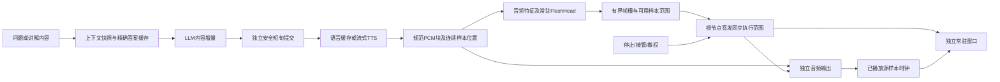

# nai 文本、语音与视频流式及缓存整体优化方案

日期：2026-11-07。状态：设计提案，未实施项保持未开始。

2026-11-08执行覆盖：按用户选定的单TTS方案实现短语义句、一句预取、句边界优先插播及废弃预取后旁白归位；任务见[归档](../openspec/changes/archive/2026-11-08-v561-one-ahead-narration/tasks.md)，主规格见[单句预取](../openspec/specs/narration-lookahead/spec.md)。CosyVoice应用EOS已接通；真实两句2次合成/121920样本通过，确认下一句生成与当前句播放重叠。当前仍是45秒/20秒源音频上限的语音验证组合，未完成无限场次、LLM增量/公屏自动问答、缓存身份或FlashHead/OBS。旧Qwen相关表格仅历史，不重新执行。

当前部署覆盖说明（ADR0195）：用户已移除Qwen，改用Fun-CosyVoice3-0.5B；停止Qwen专属安装与0.6B/1.7B对照任务，以下Qwen基线文字保留作此前设计背景。当前执行任务以[CosyVoice任务](../openspec/changes/v561-cosyvoice-streaming/tasks.md)为准。模型流式、跨请求隔离/单飞和Rust独立进程本机边收边播已实测，见[播放报告](reports/2026-11-07-cosyvoice-rust-stream-playback.md)；独立V561语音控制页的试听/停止与统一取消已实测，见[控制报告](reports/2026-11-07-v561-voice-desktop-control.md)。完整直播桌面、生产应用EOS、缓存身份与联合音画仍未完成。

WSL实测补充：当前1.7B服务不支持真正流式，stream=true被忽略，短句首数据13.5573秒后收到完整WAV；non_streaming_mode=false不能开启真实流式。部署证据与分层改造顺序见[探测报告](reports/2026-11-07-qwen-wsl-streaming-probe.md)。

执行增量：[OpenSpec](../openspec/changes/v561-streaming-cache-pipeline/proposal.md)。本方案遵守ADR0193/0194及V5.6.1单引擎基线，不切换基线、不恢复旧工作区/审批/预算，不授予34项ACC通过。当前1.7B配置不自动修改；0.6B仅为优先对照候选。

## 1. 目标与当前差距

目标是缩短首次**业务音画**等待，并让无缓存的持续生成跟得上播放。提示音、等待动画、缓存问候语不计作业务首响；大缓冲不计作实时算力改善。

| 环节 | 当前事实 | 待补齐 |
|---|---|---|
| 文本 | OpenAI兼容适配器请求stream=false，收完整正文；无本地答案缓存 | 增量内容解析、安全提交、连接复用、精确缓存 |
| TTS | 本地Qwen返回整段WAV；已有按端点/模型/音色/语言/文本区分的LRU | 新任务入口接缓存、字节配额、真正增量PCM、服务/模型实测 |
| 分句 | 分句和两槽预取机制已有 | 绑定新任务上下文并装配实际LLM/TTS/视频流水线 |
| 视频 | FlashHead分块、音频历史上下文、推理/传输重叠、有界共享槽已隔离实测 | 模型/形象常驻、预热、生产者认证、持续吞吐达标 |
| 输出 | 独立音频签名短租约和音频时钟选帧已隔离实测 | 增量PCM、常驻设备与独立常驻窗口、生产守门、桌面入口 |
| 缓存 | TTS缓存模块未接新任务主入口；编译缓存保存在E盘 | 分层缓存、版本失效、取消、容量、命中/未命中分别验收 |

2026-11-07真实四步/768非编译轮：6.4秒同源语音、160帧全部窗口提交、迟到/空画面0；后三块分别2.6935/2.7595/2.728秒，对应每块1.6秒语音。48帧预缓冲约1.92秒，不能证明长时实时。窗口进程首提交4314ms不含模型加载/首块，不能当全链首画面。详见[原始报告](reports/2026-11-07-v561-real-window-independent-audio.md)。

## 2. 核心决策

1. Rust负责上下文、分句提交、缓存策略、队列/背压、取消和媒体权限；LLM保持API；Qwen保持本地API；FlashHead保持独立Python/PyTorch worker。React/Tauri保持控制界面。
2. 先做“LLM增量→完整可独立朗读的短句→TTS增量PCM→视频块→同步播放”。双向逐字TTS输入是后续能力，不作为首包优化前提。
3. 内容缓存与播放权限分离。可以复用合格内容，不复用epoch、设备时钟、IPC回执、租约或播放许可。
4. 一次会话只加载一个TTS型号和一个视觉引擎；0.6B/1.7B顺序测试，不同时常驻做热备，不覆盖现有环境。切换默认须有实际质量/联合性能证据及相应决策记录。
5. 不新增Redis、消息中间件、云网关或常驻向量库。优先使用现有服务；必要时独立验证流式服务候选，不装进现有Qwen/FlashHead环境。
6. M0未通过，只推进瓶颈整改、测量及必要输出安全，不扩展业务功能。若无缓存持续吞吐仍不达标，实时未缓存回答保持not_ready，不能用缓存命中样本替代。

## 3. 端到端结构与任务边界

每个计划固定`session_id / epoch / utterance_id / segment_id / facts_hash / character_hash / voice_identity / policy_version`，子作业再带chunk序号、源样本范围与期限。数据标识不是授权，可信根负责签发和复检。

当前只有一个输出所有者。**预取任务不得调用begin抢占正在播的任务**：未播内容作为无输出权限的准备作业，最多两个待准备单元；到激活边界重新核对事实/许可，签发新任务权限。当前任务、已准备内容、缓存项分别管理，不能混成一个可续播队列。

插问在完整句边界保存检查点并切换；真人接管立即取消旧输出树。中断句记录为未完成，显式恢复时在新上下文中决定衔接，不直接续接旧PCM、旧帧或旧latent。

## 4. 文本生成：增量输出与安全提交

- 复用受限reqwest客户端及连接池，保持单请求期限、取消、禁止自动重试/重定向；凭据不进入缓存键或日志。
- 独立解析SSE：处理跨网络块UTF-8、事件边界、心跳、usage、结束标记和中途断开。只消费可见回答内容，不把reasoning、工具参数、角色事件或原始JSON片段交给TTS。
- 当前整对象JSON响应不能直接按token朗读。设计独立可提交的语句对象/增量文本契约，根节点在每个语句完整后校验；尾部尚未完成的总对象不能给已播放内容补授权。
- 先按句号、问号、完整分句提交；首句建议约8–20个中文字符，后续优先按该音色实测/估计语音时长分组，目标2–4秒。字符阈值只是资源上限，不能假定固定字数等于固定时长；长型号和完整语义单元不能拆时保留原子片段并计入等待。保护数字、小数、单位、型号、否定、引号及括号；时间阈值只触发检查，不能强行朗读不完整语义。
- 业务规格/承诺与当前可信资料逐项校对；无法独立判断的片段等待完整答案，或返回明确未知说明，不增加人工审批流程。
- 语句一旦提交便不可修改。记录已提交/未提交前缀；中断后不自动重放已播内容。供应商不提供流式时明确使用整句模式，不能重复请求伪装流式。
- 有界：未提交文本初始上限4KiB，候选短句队列2个，总回答沿已核准的token/字节上限；达到界限时背压或终止，不静默丢词。

## 5. 语音：0.6B实测、真正流式与连续PCM

### 5.1 模型与服务选择

优先比较`Qwen3-TTS-12Hz-0.6B-CustomVoice`与当前1.7B，同硬件、同音色/文本/精度、同负载。记录实际加载权重/版本、首可解码PCM、总耗时、RTF、显存、数字/型号读音及听感，不根据请求model字符串认定已切模型，不假定加速比例或能力完全一致。

模型支持流式、Python封装支持增量、HTTP/WS真正逐块发送、nai逐块消费是四项分别验证的能力。不得先生成完整WAV再拆包就宣称推理流式；不得把收到HTTP头当语音首包。

优先补现有服务的增量输出。若SDK实际不提供可用增量解码，隔离验证vLLM-Omni等候选的原始PCM输出；不引入其完整栈作为默认依赖。官方文档的`non_streaming_mode`不是HTTP流式开关；实际服务版本、部署参数及首包证据才决定能力。[服务接口依据](https://docs.vllm.ai/projects/vllm-omni/en/stable/serving/speech_api/)

### 5.2 PCM块与输出端改造

规范主音频采用当前24kHz、单声道PCM16。网络块可能切断样本字节，解析器保留最多一个未配对字节；消费真实完整样本，不以网络包大小推算时间。流式块起始建议80–200ms，最终以服务能力/首包/吞吐实测选择。

现有音频子进程要求读完整PCM及EOF后才能准备，不能用于真正流式。需改为：

1. `PrepareStream(format, scope, ring_capacity)`准备静音设备与有界环。
2. `ChunkMeta(epoch, seq, start_sample, sample_count, hash)`走Protobuf控制面；PCM原始字节走独立媒体面。
3. 验证当前块、复制到已准入的环后回执；消费确认后释放空间，满时向上游背压。
4. `End(total_samples, final_hash)`验证总量与终止。结束前可以消费已验证块；缓存只有终止完整且校验通过才可发布。
5. `Renew`除短租约外，还绑定`play_until_source_sample`：不能超过当前音频已就绪范围和视频可用范围。停止/撤权只需原子关门，不等待网络、缓存或GPU。

音频设备按显式设备ID常驻，不能每句打开一次WASAPI；丢失则静音提示，不自动转到扬声器/默认设备。现有实验性固定cue段上限不能直接放大为生产流式时间线，需有界循环映射并回收已消费区间。

缺料时设备即使提交保命静音，**源语音样本位置也不能前进**；记录underrun和实际静音区间，画面进入安全待机。不能用补静音、漏播或变速把速度差计为成功。

## 6. 视频：常驻预热、块级生成与共享GPU

- 会话前加载一次模型、VAE、wav2vec2和当前形象条件，预热完成才报模型ready。预热不向公共输出提交，不在每次提问重新启动Python或重复编码参考图。
- 形象准备结果按原图hash、构图/尺寸、模型/VAE版本和精度区分；音频历史及motion latent只按上游支持的方式管理，切任务必须正确重置，不跨身份/说话上下文复用任意隐状态。
- 保持用户认可的768/四步画质。33/49帧块仅按模型时序步长验证后比较，分别权衡首块等待和稳态吞吐；不假设可以逐帧推理，不恢复已被拒绝的两步、锐化或低画质替代。
- 推理、GPU→CPU完成确认、传输和播放分开计时。保留一块推理在途、一块有界待传；在启动下一块前预留其真实tensor/像素内存，不能只统计共享槽。
- 先去掉重复形象编码、重复重采样、无效全局同步与无用任务计算。保留真实数据就绪确认；不能把异步CUDA启动当帧已准备。GPU跨进程零拷贝不是第一优先级，现有只读复制可测且安全后再评估。
- Windows编译路径必须明确校验实际Triton/PyTorch/算子和权重环境；eager、已包装、真实编译成功、编译稳态分别记录。不重复已无收益的相同FFN/TensorRT开关实验，不外推单层微基准。

Qwen与FlashHead在同一物理GPU，WSL与Windows不会形成独立算力。初始调度策略：当前业务首个TTS包优先；视频当前块按播放期限调度；未来句TTS/缓存预生成只有存在资源余量才运行。默认TTS在途1、视频推理在途1、未来准备单元最多2。先实测交错小任务与并发，不假定两者同时跑一定更快。该调度不能抢占已经执行的CUDA kernel，P0静音必须独立。

## 7. 分层缓存及其边界

| 层 | 内容及键的必要维度 | 初始策略（均可配置） |
|---|---|---|
| 精确答案 | 保守规范化问题、事实快照、对话上下文摘要、提示/策略/模型部署版本、语言 | 内存8MiB/200项，TTL5分钟；动态价格、库存、日期、个人内容默认不缓存；不先做语义近似命中 |
| 语音PCM | 最终朗读文本、规范化版本、端点/实际模型版本、音色/参考音频hash、语言、风格/语速、格式 | L1内存32MiB，L2磁盘512MiB；完整校验后发布，公开固定讲解默认可持久化，观众个性化回答默认仅内存 |
| 音频特征 | PCM hash、特征提取器版本、采样率、左侧音频上下文hash、参数 | 内存128MiB起，磁盘默认关闭；上下文不同不可仅按当前音频块命中 |
| 形象准备 | 人物源图/构图/许可资产引用、模型/VAE/精度/分辨率 | 只保留当前形象；记录实际额外RAM/VRAM，切形象回收，无无限人物tensor缓存 |
| 完整音画片段 | 最终PCM hash、文本/事实版本、形象、模型、种子/采样参数、FPS、入口状态/转场约束 | 压缩文件、磁盘2GiB/最多64段、TTL7天起；只预解码当前及下一段 |
| 编译产物 | Python/PyTorch/CUDA/算子/编译配置及模型图版本 | 隔离E盘目录，受版本清单约束；不视为业务音频/视频缓存 |

缓存必须同时按项数、字节和过期时间限额。缓存项不含epoch和租约，命中后创建新执行上下文；manifest只描述来源，不授予使用权。缓存键中不放Key；个人信息、推理思维链不落缓存日志。

实际服务部署指纹不能可靠识别时，只允许当前计划内复用或按miss处理，不猜测长期可复用。答案缓存依赖事实版本；纯PCM在最终文本完全相同且新上下文的事实/许可复检通过时可以复用，避免无关资料变化强制重新合成。

当前TtsCache接新入口是优先快赢：用实际部署指纹补齐键、加字节配额和取消复检，并实测命中时供应商调用为0。避免Vec反复整段复制，只有测出开销才改为有界不可变共享数据。

完整视频缓存只能用于同源语音和合法边界。受前一块姿态/latent影响的片段，需入口状态hash匹配，或经验证的待机转场后播放；不能把相同一句音频的任意视频块拼入当前姿态。音画、字幕、文本对应同一内容版本；改PCM/转场即形成新派生资产。

### 发布、失效与清理

- 先临时写入，校验内容hash/完整EOS，再原子发布；半文件、失败、取消结果不作为ready项。
- 查询、发布、播放时分别复检事实和肖像/声音/素材许可；撤权立即使输出任务失效，缓存TTL不能延长授权。
- 同键同作用域生成实行single-flight；新epoch不加入旧任务输出树。避免同一句预取和人工请求各调用一次供应商。
- 删除采用先失效、后回收；在用条目暂缓物理删除。损坏按miss或cache-only失败处理，不默默播放；缓存索引可重建，不创建预算/审批/outbox。
- 开发缓存默认解析到项目E盘target-windows下独立pipeline-cache目录；产品cache_root从单数据根配置读取，本机仍选择E盘，不写C盘。不得将绝对机器路径写死到Rust。清理必须核对实际缓存根，不能触及数据库、Key、源素材或权重。

## 8. 队列、背压和自适应缓冲

| 队列/资源 | 初始上限 | 满/缺料策略 |
|---|---|---|
| 待提交文本 | 4KiB | 暂停读取或有界终止，不朗读截断语义 |
| 待准备完整语句 | 2个，并同时按预估语音时长限额 | 先停未来讲解准备，实时问题不排成长队 |
| TTS生成 | 1个在途 | 优先当前句，不为同GPU未来句无界并发 |
| 已就绪PCM | 4秒，工作水位约0.5–1秒起 | 缺料记录underrun；满时背压服务读取/作业调度 |
| 视频 | 推理1、待传1 | 满时不启动下一推理，传输不占控制线程 |
| 共享帧槽 | 3–4槽 | 消费确认后复用，禁止覆盖未释放槽 |
| 待播像素 | 按时间及总字节限制，初始上限256MiB | 优先减预取，不能不断加深缓存 |

768 BGRA单帧2.25MiB，25fps约56.25MiB/s。原始RGB/float tensor、共享槽、调度副本、模型激活需分开计入预算；不缓存整场未压缩视频。

初始视听预缓冲取**已验证模型输出块 + 实测抖动余量**，再逐步降低；不能直接承诺100ms视频首块，因为当前模型一次输出0.96/1.6秒。水位按秒计算并与字节配额共同约束，低水位先停止未来任务，允许有限增加缓冲但必须显示增加的首播等待。达到上限仍持续缺料，应判吞吐不达标，不能进一步堆积。

## 9. 主时钟、同步与取消

音频设备是唯一播放主时钟。规范PCM24k与视觉特征16k通过累计有理数映射对齐，保留余数，避免逐块四舍五入累积漂移。PTS来自源样本位置；网络包到达、模型完成时间和墙钟不推进画面。

来源样本区间、帧就绪区间、允许播放区间分离。音频不能播放到视觉尚未就绪的区间；画面仅消费签名且当前任务的设备观察，过期、未知状态或旧epoch显示经许可的安全待机/安全帧。默认直播保持音画同步；“只听语音”是明确试听模式，不作为直播性能通过。

停止/静音/真人接管先原子撤权，取消整个任务树，再异步回收资源。HTTP断开只是取消客户端等待，服务端可能仍计算，需分别记录cancel_requested/client_closed/server_ack/compute_unknown。GPU结果迟到、缓存命中、已预取PCM均须再次复检；恢复需新任务，不复活旧时钟、许可或latent。

## 10. 指标与性能门

统一trace_id贯穿各阶段，使用单调时钟；跨进程测往返及观察期限，不直接相减未经校准的wall-clock时间。JSONL只写有界脱敏统计，不能让日志锁阻塞P0。

| 时间点 | 统计含义 |
|---|---|
| t0 | 问题/讲解请求被可信根受理，含后续排队时间 |
| t1/t2 | LLM发出请求/首个可见正文增量（不含心跳、reasoning） |
| t3 | 首个独立安全语句提交 |
| t4/t5 | TTS请求/首个可解码完整PCM块（非HTTP头） |
| t6 | 首批满足当前样本区间的真实视频帧就绪 |
| t7 | 设备时钟确认源语音开始前进 |
| t8 | 对应源帧成功提交窗口API |

分别记录模型加载/预热、缓存查找/解码、GPU排队/执行、传输/背压、模型取消后的浪费计算、队列水位、音频underrun、迟到/合并帧、温度/显存/RAM和错误。缺测或未接线用null/not_connected，不填0，不将不同轮次时间拼成端到端结果。物理听感/显示偏差另外用OBS及人工验收。

设语音长度A、TTS生成耗时T、视频生成耗时V：`RTF_T=T/A`，`RTF_V=V/A`。理想独立资源流水线吞吐受最慢阶段约束；同一GPU还受争用影响，不能按理想max直接计算实际提速。缓存命中率H下，未命中计算需求可估为`(1-H)*RTF`，该估计只用于容量规划，无缓存验收仍必须通过。

以下是**设计目标，不是当前实测结果**：

| 场景 | 目标 |
|---|---|
| 热态可见文本首增量 | p95 ≤800ms，单独记录供应商/网络等待 |
| 热态TTS首可解码PCM | p95 ≤500ms |
| 无缓存空闲问答首次同步业务输出 | p95 ≤3秒；受实际视频首块约束，未达到如实判失败 |
| 句边界插问首次同步业务输出 | 从受理计、含边界等待p95 ≤5秒 |
| 已准备完整音画缓存命中 | 热态首次业务输出p95 ≤500ms，仍需当前许可 |
| 持续计算 | 同时负载下TTS/视频各自RTF应有余量，目标p95 ≤0.85；持续≥1直接No-Go |
| 同步/停止 | 工程目标AV偏差p95 ≤80ms、软件静音/安全画面≤200ms；物理完成另测，不能放宽原基线 |
| 资源 | 明确低于24GiB显存能力和32GiB RAM限制；沿用≥87°C/RAM逼近28GiB保护，记录精确环境及采样遗漏 |

## 11. 分阶段执行与可交付包

不再按一个字段/函数拆主线，每次交付可验证的纵向包；实现检查不授予整项ACC。

| 卡 | 完整交付内容 | 完成标准/依赖 |
|---|---|---|
| SC-01 基线与快赢 | 分阶段测量、实际服务能力、现有TTS缓存/连接池接新入口、容量和失效 | 命中不再调用服务；未命中/冷启动/取消均留证。完整链未接处明确标缺，不伪造端到端 |
| SC-02 流式契约 | 新流协议、状态、分块样本/完整性、配置及诊断Schema | 先schema生成Rust/TS/Python，相关C++产物同步；旧协议拒绝，不写兼容层；故障互通覆盖 |
| SC-03 流式语音纵向包 | LLM SSE→独立语句→真实流式TTS→常驻音频块环；顺序比较0.6B/1.7B | 真实首块早于整段生成完成；数字/单位/中断不误读；原生边收边播、停止/断流可验证 |
| SC-04 常驻视觉与算力整改 | Windows环境冻结、形象预处理复用、已验证编译路径、共享GPU调度 | 未缓存新音频连续生成达到吞吐门；两步/低画质/大缓存不作替代；不达标出具No-Go并停止业务扩展 |
| SC-05 同步流式音画纵向包 | 生产帧身份/素材许可、独立常驻窗口、连续时钟、允许播放范围、原生接管 | 依赖SC-02/03/04及原变更0.30/0.71安全缺口；新问题可实播，失联/卡死不能续播旧内容 |
| SC-06 分层复用 | 精确答案、特征、完整合法音画片段与转场缓存 | 错版本/错姿态/撤权/损坏全部miss或阻止；不重复生成、不播放半文件；新许可新epoch执行 |
| SC-07 故障与联合验收 | 冷/热/命中/无缓存、GPU争用、取消、设备丢失、OBS | M0 10分钟、M1 30分钟，随后原基线2小时及发布长稳；无缓存独立通过，全部失败留档 |
| SC-08 桌面交付 | 自动预热/能力识别、清晰状态、常用控制、安装组合 | M0及输出安全通过后才启用实时功能；不暴露脚本路径/预算审批/协议开关；真实操作员验收 |

SC-01是下一张可执行卡。SC-03可以在同一个纵向包中实现文本/TTS/音频，不能完成解析器就对外宣称流式闭环。SC-04可在隔离性能轨验证，但不绕过M0和质量门。正式输出依赖未补齐时，所有测试入口继续明确标为诊断。

## 12. 测试矩阵和架构完成标准

测试分别覆盖：冷启动；热态且全部内容缓存关闭的新问题；只命中文本/语音/完整音画；内容/声音/形象版本变化；缓存损坏/磁盘满/清理崩溃；重复请求；SSE断字/半JSON/中途EOF；PCM奇数字节/乱序/缺块/错误总量；音频缺料；旧epoch和伪造时钟；停止/接管同时命中缓存；GPU OOM/服务卡死；设备丢失；OBS源捕获和应用音轨。

0.6B/1.7B采用相同中文短句、长句、数字/型号/英文缩写样本，先少量功能验证，再在控温条件下足量测p50/p95；同时保留监听评价。LLM少量真实验证按既有授权，批量付费测试另核范围，不恢复产品预算/审批面板。

每项卡必须具备：

- 职责单一，kernel不依赖Tauri/网络/具体模型，适配器不直接互相调用，app根只装配和协调。
- 有界内存、磁盘、并发、队列和期限；停止不等待GPU/网络/日志/数据库锁。
- 缓存可重建，许可与事实复检不绕过；重启不自动恢复输出，无假成功或旧格式迁移层。
- 常用操作默认完成，服务能力自动识别，失败给清楚原因；维护参数放高级设置。
- CodeGraph影响候选回到源码确认，运行相关组件/取消/IPC/状态测试；只有发布组合执行完整门槛。
- 各卡记录实现/实测/未实现/外部阻塞，更新计划与报告；模型/设备/OBS证据不能由mock替代。

## 13. 参考与证据适用范围

- [Qwen3-TTS官方仓库](https://github.com/QwenLM/Qwen3-TTS)：0.6B/1.7B模型与流式能力；不等同当前部署服务已支持增量输出。
- [vLLM-Omni稳定版语音API](https://docs.vllm.ai/projects/vllm-omni/en/stable/serving/speech_api/)：服务层可选接口路线；实际使用前冻结具体版本及部署组合，不能照搬其硬件性能数字。
- [SoulX-FlashHead官方仓库](https://github.com/Soul-AILab/SoulX-FlashHead)：单引擎流式模型路线；上游性能不能替代本机验证。
- [真实音画联测](reports/2026-11-07-v561-real-window-independent-audio.md)、[签名时钟桥接](reports/2026-11-07-v561-signed-audio-clock-bridge.md)、[独立音频执行](reports/2026-11-06-v561-independent-audio-execution.md)：当前本机实际证据。

本轮仅制定方案/规格，不安装服务、不下载模型、不调用LLM/TTS、不改动既有模型配置或安装版。
