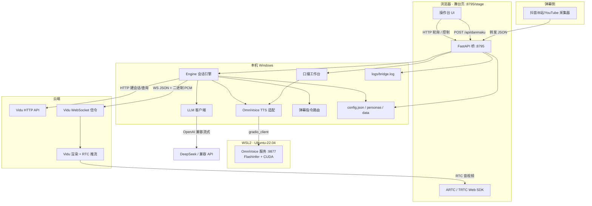
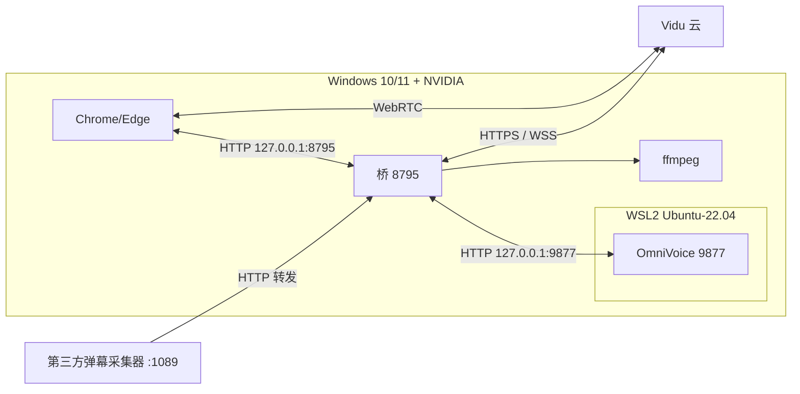
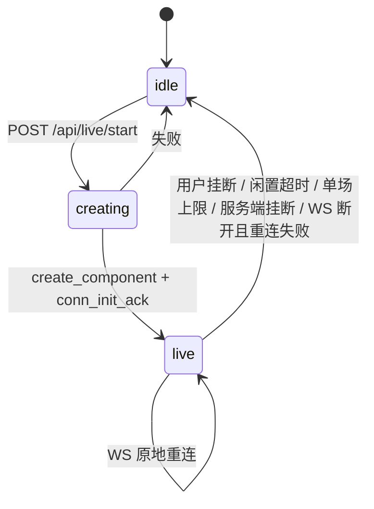
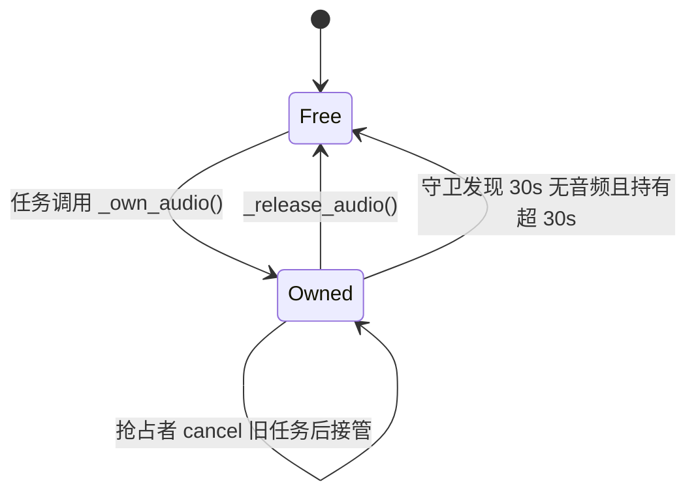
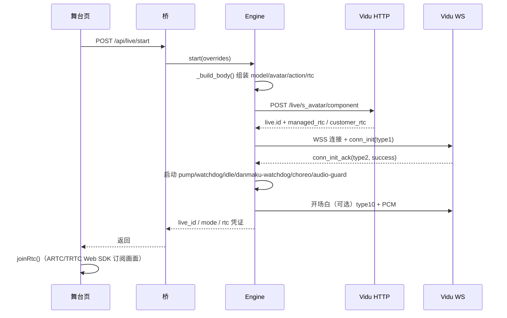
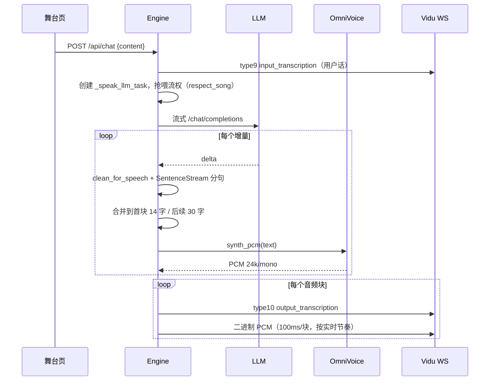
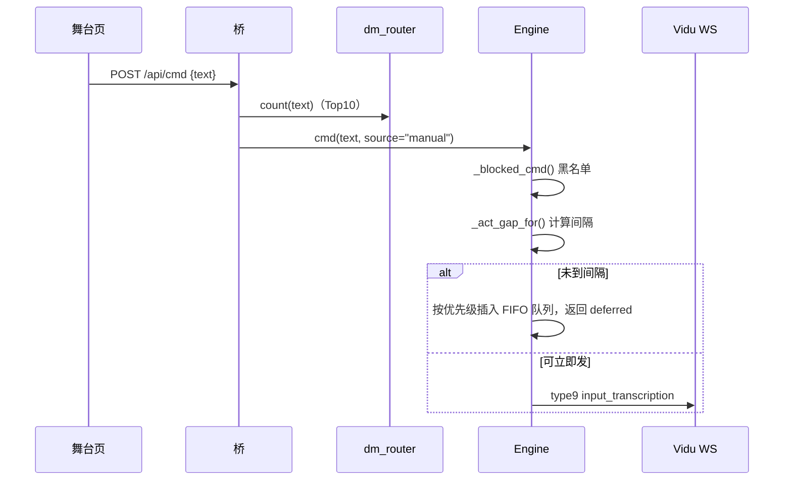
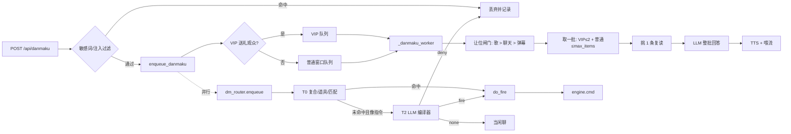
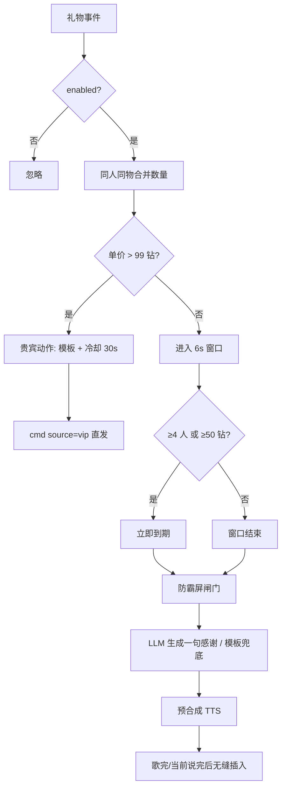
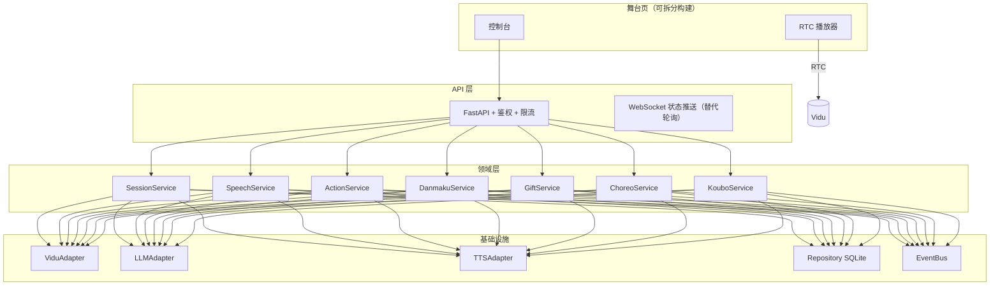

# 赛博小雅直播版（cyber-xiaoya-live）技术方案

| 项目 | 内容 |
|---|---|
| 文档版本 | v1.0 |
| 编写日期 | 2026-11-03 |
| 文档性质 | 基于现有代码的现状技术方案 + 演进建议 |
| 分析对象 | `cyber-xiaoya-live`（赛博小雅直播版 · Vidu 组件版数字人） |
| 主要依据 | `README.md`、`src/**`、`stage/index.html`、`tools/**`、`config.example.json`、Git 提交历史 |

---

## 1. 文档说明

### 1.1 目的

本文档对 `cyber-xiaoya-live` 的现有实现进行系统性梳理，形成一份可指导开发、部署、运维和后续演进的技术方案，重点回答：

1. 这套系统由哪些组件构成，各自边界是什么；
2. 一条弹幕、一句话、一个动作如何从输入端走到数字人画面；
3. 为什么这样设计，关键取舍和硬约束是什么；
4. 当前实现存在哪些问题与风险；
5. 后续如何在不破坏现有直播能力的前提下演进。

### 1.2 读者

- 项目开发者：理解模块边界、修改代码、定位线上问题；
- 部署使用者：按方案准备环境、配置、启动和排障；
- 二次开发者：评估接入新 TTS、新平台、新 RTC、新前端或云端化的成本；
- 技术评审者：评估稳定性、合规性、成本与可维护性。

### 1.3 分析范围

- **纳入**：桥服务、会话引擎、Vidu 接入、LLM/TTS 管线、弹幕与动作路由、礼物/会员/编排、点播/口播、舞台页、配置、工具链、部署脚本。
- **不纳入**：Vidu 云端渲染内部实现、OmniVoice 模型推理内部实现、第三方弹幕采集器内部实现、作者私有的人设/音色/形象/动作库内容。

### 1.4 术语

| 术语 | 含义 |
|---|---|
| 组件版 / S2 | Vidu 的 `s_avatar/component` 数字人会话模式：平台只负责把文字/音频渲染成口型、表情、动作并推流 |
| 桥（bridge） | 本机 FastAPI 服务，默认 `127.0.0.1:8795`，统管会话、LLM、TTS、弹幕、点播、舞台页 |
| 舞台页 | 浏览器中的主播操作台 `http://127.0.0.1:8795/stage` |
| 喂流权 | 同一时刻只允许一个任务向 Vidu WebSocket 发送 PCM 的全局所有权 |
| T0 / T2 | 弹幕指令漏斗的两级：T0 本地零成本匹配，T2 调用 LLM 编译 |
| 编排 | 多组固定动作随机轮播，由桥侧调度，不占用语音通道 |
| 贵宾 | 单个礼物单价超过阈值的观众，本场获得最高动作优先级 |
| 口播 | 长文切分 → 分段 TTS → 顺序喂流的独立工作台 |

---

## 2. 项目定位与背景

### 2.1 一句话定位

**一个本地优先、低成本、可深度定制的 AI 数字人直播控制系统**：Vidu 只做“变成画面”，LLM 思考、TTS 发声、弹幕处理、动作调度、点播、录播全部在本机完成。

### 2.2 设计取舍

| 取舍 | 选择 | 原因 |
|---|---|---|
| 渲染位置 | 云端 Vidu | 本地显卡不足以实时渲染高质量数字人 |
| 思考/发声位置 | 本机 | 避免云端 ASR/LLM/TTS 套餐费用，音色和人设可控 |
| 音色方案 | OmniVoice（WSL2 + CUDA） | 支持音色克隆与直播中热切 |
| 通信方式 | 本机 HTTP + WebSocket | 无公网依赖，舞台页只连本机 |
| 状态存储 | JSON 文件 + 进程内存 | 单主播、单实例场景下足够简单 |
| 前端形态 | 单文件 HTML + 原生 JS | 零构建、零依赖、可直接改 |
| 部署形态 | Windows 桌面 + WSL2 | 作者目标用户是个人主播，非云原生团队 |

### 2.3 能力边界（明确不包含）

仓库**不包含**：人物形象、克隆音色、人设正文、动作库内容、歌库、任何 API Key/Cookie、OmniVoice 权重、第三方弹幕采集器。这些都属于“使用者自己的内容”。

---

## 3. 需求分析

### 3.1 业务需求

1. 主播在浏览器里一键开播，数字人出现在画面中；
2. 观众弹幕能驱动数字人“说话”和“做动作”；
3. 主播能打字聊天、手动发动作、点播歌曲、切换音色/人设/参考图；
4. 礼物、会员、贵宾有差异化反馈；
5. 一场直播能自动录播并落盘；
6. 全链路成本可解释：Vidu 按秒计费，LLM 按 token，TTS 用本机 GPU。

### 3.2 功能需求

| 编号 | 功能 | 现状 |
|---|---|---|
| F1 | 创建/挂断 Vidu 组件版会话 | 已实现 |
| F2 | WebRTC 观看端接入（托管 ARTC / 自备 ARTC/TRTC） | 已实现 |
| F3 | 打字对话：LLM 流式 → 分句 → TTS → PCM 喂流 | 已实现 |
| F4 | 动作直发：type9 指令，不经 LLM/TTS | 已实现 |
| F5 | 弹幕接入、复读、回答、批量合并 | 已实现 |
| F6 | 弹幕 → 动作自动路由（T0/T2/确认/自动） | 已实现 |
| F7 | 动作优先级、节流、FIFO 队列、固定编排 | 已实现 |
| F8 | 礼物合并感谢、99 钻贵宾动作、专属会员欢迎 | 已实现 |
| F9 | 点播音视频、逐行歌词字幕 | 已实现 |
| F10 | 口播工作台：切分、分段合成、多 take、连播 | 已实现 |
| F11 | 参考图：换装/商品/背景 | 已实现 |
| F12 | 服务端录播与自动下载 | 已实现 |
| F13 | 本场统计：token/积分/钻石/记忆轮数 | 已实现 |
| F14 | 多套人设切换、音色热切 | 已实现 |
| F15 | 断线重连、多级看门狗、自动恢复 | 已实现 |
| F16 | 多平台弹幕接入 | 通过外部采集器 + `/api/danmaku` 约定支持 |

### 3.3 非功能需求

| 维度 | 目标 | 现有保障 |
|---|---|---|
| 首字延迟 | LLM 首句 + 一次 TTS，尽量 2~5 秒内开口 | 流式 LLM、增量分句、首块 14 字即合成、TTS 预取 |
| 连续语音 | 句间不出现明显空档 | 短句合并（首块 14 字/后续 30 字）、边放边合成下一块 |
| 稳定性 | 单场可持续运行，异常可自愈 | WS 重连、喂流权守卫、弹幕看门狗、TTS 显存看门狗、缓存清理 |
| 成本 | 仅 Vidu 渲染费 + LLM token | 本机 TTS、本地动作匹配、T2 每拍最多 1 次 |
| 隐私 | 密钥/人设/音色不出本机 | 密钥只存本进程、配置脱敏、舞台页不拿明文 |
| 合规 | 不触发平台审核强制挂断 | 多层敏感词/注入过滤、红线、玩具包装 |
| 可配置 | 大部分参数无需改代码 | `config.json` 深合并、部分热读、设置面板 |
| 可运维 | 出问题能定位 | `logs/bridge.log`、`/api/health`、`/api/live/status`、取证日志 |

### 3.4 关键约束

1. **Windows 为主**：启动脚本是 PowerShell/CMD，TTS 依赖 WSL2 + NVIDIA GPU；
2. **单实例**：`bridge.py` 中 `engine = Engine()` 是进程级单例，一套配置只服务一个直播间；
3. **Vidu 协议约束**：音频必须是 `s16le / 24kHz / mono`，上行按实时节奏喂；
4. **平台审核约束**：TTS 念出敏感内容可能触发 `audit_violation` 强制挂断整场；
5. **动作不可撤回**：协议没有“停止动作”信号，已开始的动作只能等演完。

---

## 4. 总体架构

### 4.1 逻辑架构



### 4.2 部署拓扑



### 4.3 组件职责

| 组件 | 关键文件 | 职责 | 对外接口 |
|---|---|---|---|
| 启动器 | `src/main.py` | 读配置、起 uvicorn、开浏览器 | CLI |
| 桥服务 | `src/bridge.py` | REST API、生命周期、后台巡检、静态页 | HTTP :8795 |
| 会话引擎 | `src/engine.py` | 会话状态、说话管线、动作调度、弹幕/礼物/会员/编排 | 被桥调用 |
| Vidu HTTP 客户端 | `src/vidu/client.py` | 建会话、查询、录播、资产、动作库、上传 | HTTPS |
| Vidu WS 信令 | `src/vidu/signaling.py` | 信封、conn_init、type9/10/7/11、心跳、断线取证 | WSS |
| LLM 客户端 | `src/llm.py` | OpenAI 兼容流式、分句、重试/降级、用量统计 | HTTPS |
| TTS 适配 | `src/tts/omnivoice.py` | 音色扫描、gradio 调用、缓存清理、健康指标 | HTTP |
| 音频工具 | `src/tts/audio.py` | ffmpeg 解码、PCM 切片、静音、WAV 封装 | 本地 |
| 弹幕指令路由 | `src/dm_router.py` | T0/T2 漏斗、确认条、红线、冷却、Top10 | 被引擎/桥调用 |
| 口播工作台 | `src/koubo.py` | 长文切分、分段 TTS、take 管理、连播 | HTTP 子路由 |
| 人设库 | `src/personas.py` | 多套人设 CRUD、当前人设解析 | 被 LLM/桥调用 |
| 鉴权签发 | `src/rtc_tokens.py` | ARTC/TRTC 观看端 token | 被引擎调用 |
| 日志 | `src/logging_setup.py` | stdout tee 到 `logs/bridge.log` | 本地 |
| 舞台页 | `stage/index.html` | 单页操作台、RTC 接入、轮询状态 | 浏览器 |
| 配置 | `src/config.py` | 读/写/深合并/脱敏/原子写 | 本地 |

### 4.4 关键设计原则

1. **本地优先**：除 Vidu 渲染和 LLM 外，其余全部本机；舞台页只绑 `127.0.0.1`。
2. **单一喂流者**：`_own_audio()` + `_audio_gate` 保证任意时刻只有一个任务向 Vidu 发 PCM。
3. **显式优先级**：语音侧 `歌曲 > 打字聊天 > 弹幕`；动作侧 `贵宾 > 手动 > 编排 > 弹幕`。
4. **失败不炸主链路**：字幕、日志、清理、统计等旁路一律“失败即忽略”；关键路径有护栏 `_ws_ok()` / `_out_text()`。
5. **配置热更新**：`config.json` 深合并保存；部分参数按 mtime 或 1 秒 TTL 热读。
6. **用看门狗对抗长跑退化**：WS、音频所有权、弹幕 worker、TTS 显存、gradio 缓存都有独立巡检。
7. **内容安全优先于表达自由**：多层过滤宁可少说，也不触发平台审核强制断播。

### 4.5 状态机

**会话状态**（`Engine.phase`）：



**音频所有权**（概念）：



---

## 5. 核心业务流程

### 5.1 开播建链



关键点：

- 建会话失败若命中“动作库无权限”，会**去掉 action 段重试一次**并提示换库（`engine.py:321` 附近）；
- `conn_init` 在 `NOT_READY` 时重试但不重连 WS；`LIVE_ENDED` 等错误直接抛；
- 启动失败路径会关闭本次创建的 WS，避免遗留连接（issue #2 修复）。

### 5.2 文字对话（打字聊天）



详细机制：

- `LLMClient.stream()` 支持同一模型重试 2 次，再按 `fallback_models` 换模型；已吐过字不重试；
- 弹幕短回复显式 `thinking: disabled`，避免思维链吃掉 `max_tokens` 返回空内容；
- `SentenceStream`：强停顿 `。！？!?；;` 立即切；弱停顿 `，,、` 在 ≥10 字时切；缓冲 >45 字强制回退到最近标点；
- `merge_for_tts()`：首块 `merge_first_chars=14`，后续 `merge_min_chars=30`，减少 GPU 调用次数；
- 预取：第 N 块播放时并行合成第 N+1 块（`_safe_say_text` / `_speak_danmaku_batch`）。

### 5.3 动作直发



动作调度规则：

| 来源 | 优先级 | 间隔 | 是否进特效/字幕 |
|---|---|---|---|
| `vip`（99 钻贵宾） | 3 | 直发，并让编排暂停 4.5s | 是 |
| `manual`（手点/直发） | 2 | 默认 0s（同动作 2s），可配置口播保护 | 是 |
| `choreo`（固定编排） | 1 | 默认无最小间隔，按步间/组间 | 不进观众特效 |
| `auto/t0/t2/confirm`（弹幕） | 0 | 不同动作 2s / 同动作 8s / 唱歌 6s | 是（fire 时） |

队列 `act_queue_max` 默认 3，满时丢优先级最低/最旧；同一动作不重复排队。

### 5.4 弹幕播放与指令

弹幕进入系统后有两条**并行**路径：

1. **播放通道**（`engine._danmaku_worker`）：复读 + LLM 回答；
2. **指令通道**（`dm_router`）：判断是否是动作请求，走 T0/T2/确认/直发。



关键策略：

- **批量合并**：窗口默认最多 8 条，只复读 1 条（优先提问句），一次回答覆盖多条；
- **积压 ≥4 条**时跳过复读，直接回答；
- **冷场**：默认 30 秒无活动由 `_idle_chat_loop` 主动找话题，且不写入对话历史；
- **让位**：歌曲播放时弹幕一律等待；打字聊天时弹幕让位但有 20s 封顶，防止 `_chat_busy` 泄漏焊死；
- **看门狗**：`_dan_watchdog_loop` 检测“有弹幕但 worker 不在”并重新拉起。

### 5.5 礼物 / 贵宾 / 会员



- 防霸屏：两次感谢至少 25s（紧急 10s），每分钟最多 2 句，最多点 4 个名字；
- 会员欢迎：名单内观众进场，一场一次，歌中排队，不打断歌曲；
- 统计：礼物钻石、次数、VIP 列表、token 用量、记忆轮数写入 `/api/live/status`。

### 5.6 点播与口播

**点播**：`audio/` 目录 + `tts.song_dirs` / `tts.song_files`，任意格式经 ffmpeg 转 PCM。歌词通过 `lyrics-cache/<歌名>.lrc.json` 提供逐行时间轴，字幕只在本机页面显示，不推送 Vidu（避免云端字幕不可靠）。

**口播工作台**（`src/koubo.py`）：

1. 长文按标点/长度切分，保护 URL、邮箱、版本号、时间、英文；
2. 每段可单独 TTS，保留多个 take 并选择；
3. 一键批量合成（只补缺失）；
4. 连播时预解码下一段，切换不等解码；
5. 可让 LLM 为每段生成动作指令。

### 5.7 断线自愈与录播

- **WS 半死判定**：下行 >75s 无包 **且** 推流速率 <0.55x 实时，才判定断流（避免纯 TTS 期间误判）；
- **原地重连**：同一 `live_id` 重建 WS，20s 内最多一次、单场最多 6 次；
- **喂流权守卫**：持有者 30s 不出音频且持有 >30s → 取消并 `type7` 中断；
- **TTS 看门狗**：连续 3 次合成失败 / 最近 3 次都 >4s / 显存 ≥阈值 → 在空闲时重启 WSL OmniVoice，冷却 15 分钟；
- **录播**：开播带 `managed_rtc.enable_recording=true`，结束后轮询 `/recording`，最长 30 分钟，下载到 `rtc.record_dir` 或 `recordings/`。

---

## 6. 模块详细设计

### 6.1 桥服务（`src/bridge.py`）

**职责**：HTTP API、进程级单例、后台巡检、静态页、配置读写。

关键设计：

- `app = FastAPI(...)`，挂载 `koubo.router`；
- `engine = Engine()` 进程级单例；
- `engine.on_action_fire = dm_router.note_manual`：动作**真正发出**时才登记特效/日志；
- `@app.on_event("startup")` 启动弹幕路由、TTS 缓存清理、TTS 健康巡检、积分轮询；
- 统一异常处理 `@app.exception_handler(Exception)`；
- 所有密钥只在本进程，配置读取用 `config.public()` 脱敏后下发布局。

**后台循环**：

| 循环 | 频率 | 作用 |
|---|---|---|
| `_credits_loop` | 30~60s | 轮询 Vidu 积分，计算本场消耗 |
| `_tts_health_loop` | 45s 后每 60s | 显存/耗时/失败率巡检，必要时重启 OmniVoice |
| `_tts_cache_gc_loop` | 启动 + 每 30 分钟 | 清理 `%TEMP%\gradio` 超过 2 小时的缓存 |
| `dm_router` 内部循环 | 4s / 600s / 30s | 弹幕 inbox、动作词表刷新、统计落盘 |

### 6.2 会话引擎（`src/engine.py`）

**职责**：系统最核心、最大的模块（约 3088 行），承担：

- 会话生命周期：`start / finalize / stop / _pump / _watchdog / _ws_reconnect`；
- 音频喂流：`_own_audio / _release_audio / _feed_pcm / _cancel_speak / _barge_in`；
- 说话管线：`_speak_llm / _safe_say_text / say_text / say_file / say_pcm`；
- 动作调度：`cmd / _act_send / _act_drain / _act_gap_for`；
- 弹幕：`enqueue_danmaku / _danmaku_worker / _speak_danmaku_batch / _idle_chat_loop`；
- 礼物/贵宾/会员：`enqueue_gift / _gift_worker / _gift_say / welcome_patron`；
- 编排：`_choreo_load / _choreo_loop / _choreo_pause`；
- 参考图：`prompt_op / prompt_state`；
- 状态：`status()` 返回页面所需全部实时数据。

**状态字段（节选）**：

| 字段 | 类型 | 含义 |
|---|---|---|
| `phase` | `idle/creating/live` | 会话阶段 |
| `mode` | `managed/customer` | RTC 模式 |
| `sig` | `ComponentSignaling` | 当前 WS |
| `_audio_owner` | `asyncio.Task` | 喂流权持有者 |
| `_song_playing` | bool | 歌曲播放中 |
| `_chat_busy` | bool | 打字聊天回复中 |
| `_act_q` | deque | 动作 FIFO 队列 |
| `_dan_buf` / `_dan_vipq` | deque/list | 普通/VIP 弹幕队列 |
| `_gift_buf` | list | 礼物窗口 |
| `_choreo_*` | 多种 | 编排状态 |
| `_vip_users` | dict | 本场贵宾 |
| `_patron_welcomed` | set | 本场已欢迎会员 |

### 6.3 Vidu 接入层

#### HTTP 客户端（`src/vidu/client.py`）

- 全异步 `httpx.AsyncClient`，`certifi` 信任库；
- 鉴权头 `Authorization: Token vda_xxx`；
- 端点：建会话、直播状态、录播、会话列表、积分、三步式上传、形象资产、动作库；
- 三步式上传：创建上传会话拿 `put_url` → 直传对象存储（不带鉴权）→ `finish` 换 `ssupload:` 短链。

#### WebSocket 信令（`src/vidu/signaling.py`）

协议信封：

```json
{"type": 9, "live_id": "...", "conn_id": "...", "seq_id": 1, "payload": {"text_msg": {...}}}
```

| type | 方向 | 含义 |
|---|---|---|
| 1 | 上行 | `conn_init`，首帧必须是它 |
| 2 | 下行 | `conn_init_ack`，`success=true` 才就绪 |
| 5 | 上行 | `call_hangup` |
| 6 | 下行 | `force_hangup`，随后服务端关 WS |
| 7 | 上行 | `audio_interrupted` |
| 9 | 上行 | `input_transcription`（用户话/动作指令） |
| 10 | 上行 | `output_transcription`（字幕） |
| 11 | 上行 | `prompt_operation`（参考图切换/清除） |
| 12 | 下行 | `prompt_operation_ack` |
| 14 | 下行 | `prompt_operation` 错误 |
| -1 | 内部 | 本端合成的“WS 已关闭”事件 |

关键实现：

- `connect()` 设置 `ping_interval=10, ping_timeout=20`，由 websockets 库自动回 pong；
- `_pump()` 无论正常/异常退出都给上层补 `type=-1`，避免引擎误以为会话还活着；
- `conn_init()` 对 `NOT_READY` 重试（默认 15 次 × 2s），其他错误直接抛；
- `send_audio()` 发送裸 PCM 二进制帧，调用方按实时节奏喂；
- `close_info` 记录“谁关的、close_code、reason”，用于断线取证。

### 6.4 LLM 层（`src/llm.py`）

- OpenAI 兼容 `/chat/completions` 流式；
- key 解析顺序：`llm.key_file` → `DEEPSEEK_API_KEY`；
- 人设优先级：`personas/<id>.json` 的 `system_prompt` > `llm.system_prompt`；
- 历史：`deque(maxlen=48)`，按 `history_turns` 截断；
- 重试：同模型 2 次 → `fallback_models` → 抛错；仅对 429/5xx/超时/连接错误重试；
- 用量：`stream_options.include_usage` 累计 prompt/completion/total/calls；
- 清理：`strip_think()` 去思维链，`clean_for_speech()` 去 Markdown 噪音；
- 分句：`SentenceStream` + `merge_for_tts` + `split_for_tts`。

**已知边界**：

- 弹幕和聊天共用同一个 `LLMClient` 实例与 history；`dm_router` 的 T2 和礼物感谢是**独立无状态调用**，不写主 history；
- `record=False` 用于系统自发调用（空闲搭话），避免污染上下文。

### 6.5 TTS 层（`src/tts/omnivoice.py`）

- 通过 `gradio_client` 调用 OmniVoice，不能直接 HTTP（缺 `session_hash` 会 500）；
- 地址候选顺序：`http://127.0.0.1:9877` → `tts.omnivoice_base` → 语音桥 `bridge-config.json`；
- 音色目录约定：
  - `design.json` → 参数设计音色（性别/年龄/音调/方言）；
  - `ref_audio.* + ref_text.txt + omnivoice.txt` → 克隆音色；
  - 仅 `ref_audio.*` 的 Qwen3 预设在当前桥中跳过；
- 全局 `threading.Lock` 串行化 gradio 调用，async 侧用 `executor` 避免阻塞事件循环；
- 合成产物用后即删，并有 `sweep_client_cache()` 按年龄兜底清理；
- 记录最近 12 次合成耗时，`slow_recent()` 供看门狗判断。

### 6.6 音频喂流与并发控制（核心难点）

**格式**：`s16le / 24kHz / mono`，48 字节 = 1 毫秒；默认 100ms 一块（4800 字节）。

**喂流算法**：

1. `chunk_pcm()` 按 `chunk_ms` 切片；
2. 每块发送前检查 `evt` / `_ws_ok()`；
3. `send_audio()` 带 3s 超时，防止 WS 背压永久挂住；
4. 按 `t0 + played_ms` 计算应睡时间，实现实时节奏；
5. 落后 >300ms 记录“喂流落后”，50~300ms 统计“迟到块”。

**并发控制**：

- `_own_audio(preempt, respect_song, wait_only)` 是唯一入口；
- `preempt=True`：抢占并 cancel 旧持有者，等待其真正退出，必要时发 `type7` 并等 0.25s，避免叠音；
- `respect_song=True`：歌曲优先，聊天排队；
- `wait_only=True`：弹幕最低优先级，只等不抢；
- 守卫 `_audio_guard_loop`：持有者 30s 不出音频且持有 >30s → 收回并 `type7`；
- 所有任务必须在 `finally` 中 `_release_audio()`。

**优先级总结**：

| 场景 | 语音优先级 | 说明 |
|---|---|---|
| 歌曲 | 最高 | 弹幕/聊天/礼物感谢都排队，不打断 |
| 打字聊天 | 高于弹幕 | 可抢占弹幕，但歌在播时排队 |
| 弹幕 | 最低 | 只等不抢 |
| 礼物感谢 | 等待型 | 预合成，等当前说完/歌完再插入 |
| 会员欢迎 | 抢占语音 | 歌中排队，不打断歌曲 |

### 6.7 弹幕处理（`engine` 侧）

**入口**：`POST /api/danmaku`

```json
{
  "nick": "观众名",
  "content": "弹幕内容",
  "platform": "bilibili",
  "text": "念出来的文本",
  "kind": "gift",
  "gift_item": "礼物名",
  "gift_num": 1,
  "gift_value": 10
}
```

**过滤层次**：

1. **结构性攻击拦截**（代码级常开）：XSS 标签、PHP、`javascript:`、事件属性、提示词注入、`system prompt`/`jailbreak` 等；
2. **`danmaku.drop_words`**：命中即丢弃；
3. **`danmaku.speech_block_words`**：说话侧过滤，复读命中整条不念，回答命中替换为“那个”；
4. **`dm_router` 红线**：脱衣/泳装/色情/政治/赌博/毒品/枪支/自杀等；
5. **动作黑名单**：`tools/dm-filter.json` 的 `block_commands`。

**队列策略**：

- 普通弹幕进 `_dan_buf`（默认最多 8 条，满丢最旧并计数）；
- VIP 送礼观众进 `_dan_vipq`（最多 5 条），走更短间隔；
- 每拍取 VIP ≤2 + 普通 ≤`max_items`；
- 只复读 1 条（优先提问），LLM 针对整批回答；
- 积压 ≥4 条跳过复读；
- 冷场第一条有 1.2s 收集窗。

### 6.8 弹幕指令路由（`src/dm_router.py`）

**漏斗顺序**：

```text
黑名单 → 红线 → 复合指令 → 道具玩具包装 → T0 匹配 → 预筛 → T2 编译器
```

| 阶段 | 说明 | 成本 |
|---|---|---|
| 复合指令 | 一句含 ≥2 个动作，按连接词/请求壳/相邻性判定后整句直发 | 零 |
| 道具包装 | `拿出AK47` → `拿出一把迷你玩具AK47`，真实暴力语境不包装 | 零 |
| T0 | 归一化（去称呼/请求壳/量词/语气词）+ 别名表 + 子串匹配 | 零 |
| 预筛 | 命中动词/名词线索才进 T2 | 零 |
| T2 | 独立 LLM 调用，纯 JSON，槽位白名单 + 红线二次拦截 | 1 次/拍 |

**模式**：

- `off`：纯手点，自动路由关闭；
- `confirm`：T0 直发，T2 结果进确认条；
- `auto`：T2 结果也直发。

**防刷屏/防误触**：

- 全局冷却 `cooldown_s`（仅自动源）；
- 同动作递增窗口 `same_action_windows`，默认 `[12, 60, 180]` 秒；
- 手动源（`manual/confirm/vip/choreo`）完全豁免冷却与窗口；
- 确认条：信任学习（确认 ≥2 次自动执行）、刚做过 90s 不重复问、同文本合并、新建议 6s 限速；
- Top10：按天分桶写入 `tools/dm-stats.json`，保留近 3 天。

### 6.9 动作调度与固定编排

**动作调度**：

- 唯一出口 `_act_send()`，发送 `type9` 并记录时刻；
- `_act_gap_for()` 按来源和动作是否相同计算间隔；
- `_act_drain()` 按优先级降序 FIFO 补发，分片睡眠以便歌曲结束立刻续上；
- 队列满丢最不重要，同动作不重复排队；
- `act_interrupt()` 只清动作队列，不打断音频（停话用「🔇 打断」）。

**固定编排**：

- 配置 `data/choreo.json`：`enabled / step_gap_s / group_gap_s / step_order / groups[]`；
- `_choreo_loop()` 随机挑组 → 组内随机/按序 → 发动作 → 等组间间隔；
- 只走动作通道，不占语音 → 放歌时也能跑；
- 贵宾动作触发时 `_choreo_pause(4.5)`；
- 可由 `POST /api/choreo/start|stop|run_once` 控制。

### 6.10 礼物 / 会员 / 统计

- 礼物窗口：默认 6s；≥4 人或 ≥50 钻立即发；同人同物合并数量；
- 防霸屏：最小间隔 25s（紧急 10s）、每分钟最多 2 句、最多点 4 个名字；
- 感谢文案：LLM 无状态生成（温度 0.9，`max_tokens=160`，`thinking disabled`），失败用模板兜底；
- 数字转中文，避免 TTS 念成英文；
- 贵宾：按**单个礼物单价**判断（连击不算），>99 钻触发模板动作，30s 冷却；
- 会员：`data/patrons.json` 名单，进场欢迎一场一次，歌中排队；
- 统计：token、Vidu 积分、钻石、记忆轮数，由 `/api/live/status` 返回，页面可拖动。

### 6.11 点播 / 口播 / 参考图

- **点播**：`audio/` + `tts.song_dirs` + `tts.song_files`，`/api/tts/files` 列表，`/api/say/file` 播放；
- **歌词**：`lyrics-cache/<歌名>.lrc.json`，播放时按进度更新本机字幕；
- **口播**：独立路由 `/api/koubo/*`，状态存 `koubo/project.json`，音频存 `koubo/audio/`；
- **参考图**：`refs/` 目录 + `/api/prompt`，服务端成功可能无回执、失败回 type14；上一张未清时新图常静默不生效，建议先 remove 再等 15~20s。

### 6.12 舞台页（`stage/index.html`）

- 单文件 HTML（约 3683 行），原生 JS，无构建；
- 轮询 `/api/live/status?since=N` 获取增量字幕与状态；
- RTC：ARTC 用 `aliyun-rtc-sdk`，TRTC 动态加载 `trtc.js`；观看端只订阅不推流；
- 面板：快捷指令、点播歌单、参考图、口播、设置、音色、统计、特效开关；
- 输入脱敏：页面日志会把 `uid/channel_id/app_id/avatar_id` 等替换为 `***`；
- 连线即开始计费，页面提供「挂断」和「打断」。

### 6.13 配置与人设

- `config.json` 是唯一主配置，`config.example.json` 是模板；
- `config.py` 提供 `load / reload / save_conf / deep_merge / patch / public`；
- 保存采用**原子写 + .bak**；
- `public()` 对 `api_key/app_key/secret_key` 做掩码，`api_keys` 只回数量；
- 人设：`personas/<id>.json`，`llm.persona` 指向当前人设；
- 部分配置热读：弹幕 1 秒 TTL，过滤词表按 mtime，编排按 mtime；其余需 `POST /api/settings/reload` 或重启。

### 6.14 可观测性与看门狗

| 机制 | 位置 | 触发条件 | 动作 |
|---|---|---|---|
| WS 半死检测 | `_pump/_ws_stalled` | 75s 无收包 + 推流 <0.55x | 原地重连，失败则结束 |
| 喂流权守卫 | `_audio_guard_loop` | 持有 >30s 且 30s 无音频 | cancel + type7 |
| 弹幕看门狗 | `_dan_watchdog_loop` | 有积压但 worker 不在 | 重新拉起 worker |
| TTS 健康 | `bridge._tts_health_loop` | 连续失败/连续慢/显存高 | 空闲时重启 OmniVoice |
| 缓存清理 | `_tts_cache_gc_loop` | 每 30 分钟 | 删 2 小时前 gradio 缓存 |
| 事件循环卡顿 | `_watchdog` | 心跳延迟 >1.2s | 记录“事件循环卡顿” |
| 闲置/单场上限 | `_watchdog` | 默认 300s / 1800s | 自动挂断 |

**关键观测点**：

- `GET /api/health`：build、phase、audio_owner、feed_lag_n、ws.stats、close_info；
- `GET /api/live/status`：字幕、说话状态、TTS 健康、礼物、录播、统计、动作队列、编排、弹幕队列、最近手点；
- `logs/bridge.log`：完整 stdout（含堆栈）；
- `logs/manual-actions/<live_id>.log`：本场手动动作记录。

---

## 7. 接口与协议

### 7.1 REST API 一览

| 分组 | 方法 | 路径 | 说明 |
|---|---|---|---|
| 页面 | GET | `/` | 重定向到 `/stage` |
| 页面 | GET | `/stage` | 舞台页 |
| 健康 | GET | `/api/health` | 进程/会话/断流取证 |
| 会话 | POST | `/api/live/start` | 建会话（可带覆盖参数） |
| 会话 | GET | `/api/live/status?since=N` | 状态 + 增量字幕 + 指令流水 |
| 会话 | POST | `/api/live/stop` | 挂断 |
| 会话 | POST | `/api/interrupt` | 打断播报（type7） |
| 录播 | GET/POST | `/api/record` | 查询/开关服务端录播 |
| 录播 | POST | `/api/record/fetch` | 手动拉取录播 |
| 对话 | POST | `/api/chat` | 打字聊天 |
| 对话 | POST | `/api/llm/reset` | 清空记忆 |
| 动作 | POST | `/api/cmd` | 直发动作（type9） |
| 动作 | POST | `/api/cmd/clear` | 清空动作队列 |
| 动作 | POST | `/api/cmd/stop` | 停止动作 |
| 动作 | POST | `/api/act/interrupt` | 中断当前动作 |
| 弹幕 | POST | `/api/danmaku` | 弹幕/礼物接入 |
| 弹幕路由 | POST | `/api/dmcmd/toggle` | 开关/模式 |
| 弹幕路由 | GET | `/api/dmcmd/state` | Top10/待确认 |
| 弹幕路由 | POST | `/api/dmcmd/confirm` | 确认待发 |
| 弹幕路由 | POST | `/api/dmcmd/dismiss` | 忽略待发 |
| 开口 | POST | `/api/say` | 直接 TTS 开口 |
| 开口 | POST | `/api/say/file` | 播放点播文件 |
| 音频 | GET | `/api/tts/files` | 点播文件列表 |
| 音频 | POST | `/api/tts/upload` | 上传音频 |
| 音频 | POST | `/api/tts/import-folder` | 导入本地目录 |
| 音频 | POST | `/api/tts/delete` | 删除音频 |
| 音色 | GET | `/api/tts/voices` | 音色列表 |
| 音色 | POST | `/api/tts/voice` | 热切音色 |
| 音色 | POST | `/api/tts/preview` | 试听（返回 WAV） |
| 设置 | GET/POST | `/api/settings` | 读/深合并写 |
| 设置 | POST | `/api/settings/reload` | 强制重读 |
| 人设 | GET | `/api/personas` | 人设列表 |
| 人设 | POST | `/api/personas/select` | 切换 |
| 人设 | POST | `/api/personas/save` | 保存 |
| 人设 | DELETE | `/api/personas/{pid}` | 删除 |
| 会员 | GET | `/api/patrons` | 名单 |
| 会员 | POST | `/api/patrons/save` | 保存 |
| 会员 | POST | `/api/patron/join` | 进场事件 |
| 会员 | POST | `/api/patron/welcome` | 欢迎 |
| 编排 | GET | `/api/choreo` | 读取 |
| 编排 | POST | `/api/choreo/save` | 保存 |
| 编排 | POST | `/api/choreo/start` | 启动 |
| 编排 | POST | `/api/choreo/stop` | 停止 |
| 编排 | POST | `/api/choreo/run_once` | 试跑一组 |
| 动作库 | GET/POST | `/api/actions/libs` | 列表/新建 |
| 动作库 | DELETE | `/api/actions/libs/{id}` | 删除 |
| 动作库 | GET/POST | `/api/actions/libs/{id}/actions` | 动作列表/新增 |
| 动作库 | DELETE | `/api/actions/libs/{id}/actions/{aid}` | 删除动作 |
| 参考图 | GET/POST | `/api/prompt` | 状态/切换/清除 |
| 参考图 | GET | `/api/refs` | 参考图列表 |
| 形象 | GET | `/api/avatars` | 形象列表 |
| 形象 | POST | `/api/avatars/upload` | 上传 |
| 形象 | POST | `/api/avatars/use` | 使用 |
| 形象 | POST | `/api/avatars/delete` | 删除 |
| 密钥 | GET/POST | `/api/vidu/keys` | 多 key 管理 |
| 积分 | GET | `/api/credits` | 余额 |
| 口播 | GET | `/api/koubo/state` | 状态 |
| 口播 | POST | `/api/koubo/split` | 切分 |
| 口播 | POST | `/api/koubo/seg` | 改段 |
| 口播 | POST | `/api/koubo/merge` | 合并 |
| 口播 | POST | `/api/koubo/seg/split` | 段内切分 |
| 口播 | POST | `/api/koubo/tts` | 单段合成 |
| 口播 | POST | `/api/koubo/tts_all` | 批量合成 |
| 口播 | POST | `/api/koubo/select` | 选 take |
| 口播 | POST | `/api/koubo/action` | 生成动作 |
| 口播 | POST | `/api/koubo/play` | 播放单段 |
| 口播 | POST | `/api/koubo/play_all` | 连播 |
| 口播 | POST | `/api/koubo/stop` | 停止 |
| 口播 | GET | `/api/koubo/audio/{name}` | 试听 |

### 7.2 弹幕接入契约

任何采集器只要按以下格式 `POST http://127.0.0.1:8795/api/danmaku` 即可接入：

```json
{
  "nick": "观众名",
  "content": "弹幕内容",
  "platform": "bilibili",
  "text": "念出来的文本"
}
```

礼物事件额外字段：

```json
{
  "kind": "gift",
  "gift_item": "小心心",
  "gift_num": 10,
  "gift_value": 10
}
```

约定：

- 桥永远返回 HTTP 200，用 `queued/reason` 表达是否入队；
- 采集器可无脑转发，过滤和限流在桥侧；
- 第三方采集工具的合规风险由使用者承担。

### 7.3 Vidu WS 关键约束

- 首帧必须 `conn_init`；
- `conn_init_ack.success=true` 前，上行音频/打断/prompt 会被丢弃；
- `NOT_READY` 重发 `conn_init`，**不要重连 WS**；
- 服务端约 5s ping，15s 未回 pong 断开；普通数据帧不续期；
- 音频帧必须是裸 PCM，不能包 JSON；
- 参考图操作成功可能无 ack，失败回 type14；**不去重，不要重发**。

### 7.4 RTC Token 签发

- ARTC：默认 HMAC-SHA256 authInfo Base64（新版应用），兼容 `concat_json` / `raw`；
- TRTC：TLS 2.0 UserSig（hmac-sha256 + zlib + base64 变体）；
- 签名密钥只在服务端，绝不下发浏览器；
- 观看端只拿 `token/user_id/channel_id/app_id`。

### 7.5 错误约定

- 业务错误抛 `RuntimeError`，桥转 `HTTPException(409/502)`；
- 配置/参数错误返回 400/404；
- 未处理异常统一 500；
- 桥侧对弹幕永远 200，用字段表达结果，便于采集器重试策略简单化。

---

## 8. 数据与配置

### 8.1 文件存储

| 路径 | 内容 | 是否入库 |
|---|---|---|
| `config.json` | 主配置（密钥） | 否 |
| `config.example.json` | 配置模板 | 是 |
| `personas/*.json` | 人设库 | 是（示例） |
| `data/choreo.json` | 固定编排 | 是（示例） |
| `data/patrons.json` | 会员名单 | 是（空示例） |
| `tools/dm-filter.json` | 过滤词表 | 是 |
| `tools/dm-aliases.json` | 动作别名 | 是 |
| `tools/dm-stats.json` | Top10/信任计数 | 否 |
| `audio/` | 点播音频 | 否 |
| `lyrics-cache/` | 歌词时间轴 | 否 |
| `refs/` | 参考图 | 否 |
| `koubo/project.json` | 口播工程 | 否 |
| `koubo/audio/` | 口播音频 | 否 |
| `recordings/` | 录播文件 | 否 |
| `logs/` | 日志 | 否 |
| `stage/index.html` | 舞台页 | 是 |

### 8.2 配置分组

`config.example.json` 已覆盖大部分，但**代码实际使用而模板未列出的键**需要补齐：

| 分组 | 关键字段 | 说明 |
|---|---|---|
| `vidu` | `api_key`, `api_keys`, `host`, `ws_path`, `create_path`, `avatar_id`, `action.library_id` | Vidu 接入 |
| `rtc` | `mode`, `managed_provider`, `managed_recording`, `record_dir`, `artc.*`, `trtc.*`, `customer_provider` | 观看端 |
| `llm` | `provider`, `model`, `base_url`, `key_file`, `system_prompt`, `history_turns`, `max_tokens`, `temperature`, `thinking`, `fallback_models`, `persona` | 思考 |
| `tts` | `omnivoice_base`, `omnivoice_timeout_sec`, `voices_dir`, `voice`, `files_dir`, `song_dirs`, `song_files`, `merge_min_chars`, `merge_first_chars`, `chunk_ms`, `health.*` | 发声 |
| `session` | `greeting`, `idle_timeout_seconds`, `max_duration_seconds`, `idle_chat_seconds`, `send_output_per_sentence` | 会话行为 |
| `danmaku` | `drop_words`, `speech_block_words`, `read_interval_ms`, `vip_min_interval_ms`, `answer_max_sentences`, `batch.*` | 弹幕播放 |
| `danmaku_cmd` | `enabled`, `mode`, `cooldown_s`, `read_interval_s`, `same_action_windows` | 弹幕指令 |
| `action` | `enabled`, `library_id`, `action_gap_s`, `same_action_gap_s`, `song_action_gap_s`, `act_queue_max`, `manual_*`, `choreo_*` | 动作调度 |
| `gift_batch` | `enabled`, `window_s`, `flush_people`, `flush_diamond`, `max_names`, `min_interval_s`, `urgent_min_interval_s`, `max_per_minute`, `max_items` | 礼物 |
| `gift_vip` | `enabled`, `threshold_diamond`, `cooldown_s`, `template` | 贵宾 |
| `patrons` | `enabled`, `once_per_session`, `forward_joins` | 会员 |
| `stats` | `enabled`, `diamond_to_yinlang`, `diamond_to_token`, `credits_poll_s` | 统计 |

### 8.3 热更新策略

| 配置 | 生效方式 |
|---|---|
| `danmaku` | 1 秒 TTL 缓存，页面改完最迟 1 秒生效 |
| `tools/dm-filter.json` | 按 mtime 热读，下一次判定生效 |
| `data/choreo.json` | 按 mtime 热读 |
| 其他 `config.json` | 需 `POST /api/settings/reload` 或重启桥 |
| 部分模块（如 `_act_cfg`） | `appconf.load()` 进程内缓存，需 reload |

### 8.4 人设文件

设计结构：

```json
{
  "id": "xiaoya",
  "name": "小雅",
  "tagline": "...",
  "voice": "...",
  "avatar_note": "...",
  "system_prompt": "...",
  "updated": "..."
}
```

> ⚠ 现状问题：仓库示例 `personas/xiaoya.json` / `personas/xiaoxi.json` 使用的是 `prompt` 字段，而 `personas.py` 读取的是 `system_prompt`，会导致示例人设**不被加载**。详见 §14.2。

---

## 9. 部署与运行

### 9.1 环境要求

| 项 | 要求 |
|---|---|
| OS | Windows 10/11 |
| GPU | NVIDIA ≥8GB 显存（推荐 16GB） |
| Python | 3.12 + uv |
| WSL2 | Ubuntu-22.04 + NVIDIA 驱动（TTS） |
| ffmpeg | 必须在 PATH 或已知路径 |
| 浏览器 | Chrome/Edge（ARTC/TRTC Web SDK） |
| 云服务 | Vidu API Key、LLM API Key |
| 可选 | OBS/推流软件、弹幕采集器、歌库 |

### 9.2 安装步骤

```powershell
# 1) Python 与 uv
winget install --id Python.Python.3.12
pip install uv

# 2) 依赖
uv venv .venv --python 3.12
uv pip install -r requirements.txt

# 3) ffmpeg
ffmpeg -version

# 4) 配置
copy config.example.json config.json
# 填 vidu.api_key / avatar.avatar_id / llm.key_file / tts.voices_dir 等

# 5) OmniVoice（WSL2，见 tools/omnivoice/README.md）
# 注意：demo_flashinfer.py 与 start_server.sh 在本仓库 tools/omnivoice/，需拷到上游目录
```

### 9.3 启动方式

```powershell
# 只起桥 + 舞台页
.venv\Scripts\python.exe -m src.main

# 一键脚本：桥 + TTS + 弹幕 + 打开舞台页
双击 启动-组件版全链路.cmd
```

打开 `http://127.0.0.1:8795/stage`，点「开始连线」，等待 5~15 秒。

### 9.4 端口与网络

| 端口 | 服务 | 说明 |
|---|---|---|
| 8795 | 桥/舞台页 | 只绑 `127.0.0.1` |
| 9877 | OmniVoice | WSL2 → Windows |
| 1089 | 抖音采集器（可选） | 第三方 |
| 8765 | 作者另一语音桥（可选） | 与 OmniVoice 共享缓存目录 |

WSL2 网络注意：

- 镜像网络模式：直接用 `127.0.0.1:9877`；
- NAT 模式：用 `wsl hostname -I` 拿 IP，填 `tts.omnivoice_base`；
- WSL2 重启后 IP 可能变化，启动脚本会优先探测 `127.0.0.1`，失败回退配置值。

### 9.5 运维操作

| 操作 | 方式 |
|---|---|
| 改了配置不生效 | `POST /api/settings/reload` 或重启桥 |
| 改了代码不生效 | 重启桥（`-Restart`） |
| TTS 没声音 | `curl http://127.0.0.1:9877/` 看 200；WSL2 重启后重新拉起 |
| 画面卡/延迟大 | 看 GPU 占用、`tts_health`、`feed_lag_n` |
| 录播没下来 | 点「↻ 拉取录播」；服务端封盘可能需数分钟到数十分钟 |
| 断流排查 | `/api/health` 看 `ws.close_info`、`audio_owner`、`feed_lag_n` |
| 冷场排查 | `tools/live_cold_audit.py` |
| 弹幕误拦排查 | `tools/block_audit.py`、`tools/replay_danmaku.py` |

### 9.6 从开发到生产

当前项目定位是**单主播本机生产**，不是多租户云服务。若要多人/多直播间：

1. 将 `Engine` 从进程单例改为按 `live_id` 的多实例；
2. 配置按实例隔离（`VIDU_CONF` 环境变量已支持单进程多配置的基础）；
3. 引入持久化（SQLite/Postgres）保存会话、统计、动作库；
4. 将 TTS 作为独立服务池，按 GPU 队列调度；
5. 舞台页增加鉴权、CSRF、审计日志；
6. 用反向代理 + TLS 暴露到内网/公网，并限制来源。

---

## 10. 安全、合规与风控

### 10.1 凭据安全

- `config.json` 已在 `.gitignore`，禁止提交；
- `config.public()` 对密钥做掩码，`api_keys` 只回数量；
- 密钥只在本进程，不下发浏览器；
- `tools/*` 中保留的 `<项目目录>` / `<语音桥目录>` 占位符是脱敏结果，部署时需替换。

**剩余风险**：

- `config.json` 明文存储；建议使用系统凭据管理器或环境变量；
- `key_file` 指向的外部文本文件同样明文；
- 日志可能打印异常上下文，需确认不包含密钥（当前 `_log_exc` 打完整堆栈，需人工审计）。

### 10.2 内容安全（多层）

| 层 | 位置 | 作用 |
|---|---|---|
| 结构注入拦截 | `engine._DAN_BLOCK_RES` | XSS、PHP、事件属性、提示词注入 |
| 弹幕丢弃词 | `danmaku.drop_words` | 政治/危险动作等 |
| 说话黑名单 | `danmaku.speech_block_words` | 抽烟等不想念的词 |
| 动作红线 | `dm_router.REDLINE_RES` | 脱衣/泳装/色情/政治/赌博/毒品/枪支/自杀 |
| 动作黑名单 | `tools/dm-filter.json` | 站起来等安全风险动作 |
| 道具包装 | `dm_router._prop_rewrite` | 武器 → 迷你玩具 |
| T2 二次拦截 | `dm_router._t2` | 模型产物再过红线/玩具包装 |
| 字幕/台词过滤 | `_speech_clean` | 回答句子命中替换为“那个” |

### 10.3 平台审核风险

Vidu 音频审核触发 `audit_violation` 会**强制挂断整场**。因此系统采取“宁可少说”的策略：

- 弹幕先过滤再复读/喂 LLM；
- 只答不念模式（`answer_only`）仍要过滤，因为 LLM 可能复述原话；
- 红线命中整条丢弃，不做“改写后尝试”。

### 10.4 第三方合规

- 弹幕采集器是独立项目，平台合规风险由使用者承担；
- 本项目只提供 `/api/danmaku` 接口，不内置任何平台签名/cookie 逻辑；
- 录音/录播需遵守平台和当地法律。

### 10.5 许可证

- 代码：AGPL-3.0；
- 素材与品牌：见 `NOTICE`，不在 AGPL 授权范围内；
- 二次分发/商用需遵守 AGPL 与 NOTICE。

### 10.6 威胁模型（简表）

| 威胁 | 可能性 | 影响 | 现有缓解 | 建议 |
|---|---|---|---|---|
| 本机恶意网页调用 8795 | 中 | 控制数字人/读取状态 | 仅绑 127.0.0.1 | 增加 Origin 校验/本地 token |
| 弹幕提示词注入 | 高 | 数字人说错话/审核挂断 | 正则拦截 + 过滤词 | 增加 LLM 输出审核 |
| 密钥泄露 | 中 | 费用损失 | 不下发浏览器、掩码 | 凭据管理器/加密 |
| 第三方采集器投毒 | 中 | 恶意弹幕/礼物 | 桥侧过滤 | 采集器侧也过滤 |
| 配置误改 | 高 | 直播异常 | .bak + 深合并 | 配置 schema 校验 |
| 长跑资源泄漏 | 高 | 越跑越卡 | 缓存清理/看门狗 | 增加内存/句柄监控 |

---

## 11. 性能与成本

### 11.1 延迟预算（典型值，基于代码注释中的实测）

| 环节 | 典型耗时 | 说明 |
|---|---|---|
| LLM 首 token | 0.5~2s | DeepSeek 流式，抖动时可能更久 |
| 首句凑齐 | 0.3~1s | 强标点即切，首块 14 字 |
| TTS 单块 | 1.3~3.5s | OmniVoice 热态约 1.3s，冷态更久 |
| PCM 喂流 | 音频时长 | 48B/ms，100ms/块 |
| 动作渲染 | 2~5s/条 | Vidu 侧动画时长 |

**首字延迟 ≈ LLM 首句时间 + 一次 TTS**。预取和短句合并主要改善“句间空档”，不改变首字延迟。

### 11.2 GPU / 内存

- OmniVoice 稳定占用约 11GB（作者实测），8GB 是底线；
- 显存涨到 15.7/16.3GB 时可能偶发 9~35s 停顿，看门狗会重启；
- gradio 客户端缓存不清理会长到 5989 文件/1GB，已有按年龄清理；
- 事件循环卡顿会直接导致心跳发不出 → 断流，需避免同步磁盘 IO/大计算。

### 11.3 成本模型

| 成本项 | 计费方式 | 优化手段 |
|---|---|---|
| Vidu 渲染 | 1 积分/秒 | 测完及时挂断；闲置/单场上限自动断 |
| LLM | token | 弹幕批量回答、T2 每拍最多 1 次、短回复、`thinking disabled` |
| TTS | 本机 GPU 电费 | 短句合并减少 GPU 调用、预取、缓存清理 |
| RTC | 视 provider | 托管模式省自建成本 |
| 录播 | 存储/流量 | 仅需要时开启 |

### 11.4 容量与瓶颈

- **单实例单直播间**：`Engine` 全局单例；
- **TTS 串行**：全局锁，无法并行合成多路；
- **LLM 并发**：主聊天 1 路 + 弹幕 1 路 + T2 1 路/拍 + 礼物 1 路，天然有限；
- **WS 背压**：单块发送 3s 超时，喂流落后会记录但不阻塞；
- **磁盘 IO**：配置每条弹幕读磁盘已改为 1s TTL，仍需注意日志写入。

---

## 12. 可观测性与运维

### 12.1 日志

- `logging_setup.attach()` 把 stdout tee 到 `logs/bridge.log`；
- 日志含时间戳、模块前缀（`[live]/[tts]/[danmaku]/[dmcmd]/[gift]/[choreo]/[audio]/[feed]`）；
- `_log_exc()` 打完整堆栈；
- 手动动作单独落 `logs/manual-actions/<live_id>.log`。

### 12.2 指标（当前以状态字段为主）

| 指标 | 来源 | 用途 |
|---|---|---|
| `feed_lag_n` | `/api/health` | 本场喂流落后次数 |
| `audio_owner` | `/api/health` | 喂流权是否被占 |
| `ws.audio_seconds` / `idle_*` | `sig.stats()` | 推流速率/收包间隔 |
| `tts_health` | `/api/live/status` | 显存/慢合成/重启次数 |
| `stats.tokens` | `/api/live/status` | token 用量 |
| `stats.credits` | `/api/live/status` | Vidu 积分消耗 |
| `dan.worker_alive/buf/vip` | `/api/live/status` | 弹幕积压 |
| `acts.queued` | `/api/live/status` | 动作积压 |
| `choreo.*` | `/api/live/status` | 编排状态 |
| `record.state` | `/api/live/status` | 录播进度 |

### 12.3 建议补充

- 结构化日志（JSON）与日志级别；
- Prometheus 指标端点；
- 会话级 trace_id，把 LLM/TTS/WS 的耗时串起来；
- 前端错误上报；
- 磁盘/内存/句柄监控。

### 12.4 常见故障 Runbook

| 症状 | 优先检查 | 处理 |
|---|---|---|
| 连不上 Vidu / 401 | `vidu.api_key`、余额 <45 积分 | 换 key/充值 |
| 没有声音 | 9877 是否 200、`tts_health` | 重启 OmniVoice |
| 画面卡/延迟大 | GPU 占用、`feed_lag_n` | 降低 `graph-buckets`、减少并发 |
| 突然不说话 | `/api/health` 的 `audio_owner`、`close_info` | 看喂流权/断线 |
| 弹幕不播 | `dan.worker_alive`、让位闸门 | 看是否在放歌/聊天 |
| 动作卡在同一动作 | `acts.queued`、Vidu 动作时长 | 降低发送频率/清队列 |
| 录播没文件 | `/api/record` 状态 | 手动拉取/等封盘 |
| 换了人设没生效 | 文件是否有 `system_prompt` | 修正字段/重启 |

---

## 13. 测试与验收

### 13.1 现有工具

| 工具 | 类型 | 作用 |
|---|---|---|
| `tools/selfcheck.py` | 离线 | 配置、token 签名、分句、PCM 数学、请求体、页面语法 |
| `tools/e2e.py` | 端到端（花钱） | 建会话 → conn_init → 文字驱动 → 查转写 → 挂断看计费 |
| `tools/stage_verify.py` | UI | 无头浏览器截图，可注入 JS 点击 |
| `tools/stage_shot.py` | UI | 舞台页截图 |
| `tools/live_cold_audit.py` | 只读 | 冷场体检 |
| `tools/block_audit.py` | 只读 | 黑名单体检 |
| `tools/replay_danmaku.py` | 回放 | 旧版 vs 新版漏斗 A/B、礼物合并、动作节流 |
| `tools/test_danmaku_priority.py` | 单元 | 弹幕优先级 |
| `tools/test_filter_funnel.py` | 单元 | 过滤漏斗 |
| `tools/verify_action_scheduler.py` | 单元 | 动作调度 |
| `tools/llm_client_verify.py` / `llm_latency_test.py` | 诊断 | LLM 连通性/延迟 |
| `tools/test_dm_t0.py` | 诊断 | T0 匹配 |
| `tools/query_lives.py` / `gift_line_probe.py` / `test_rnd_pick.mjs` | 诊断 | 会话/礼物/随机 |

### 13.2 验收清单（建议）

**开播链路**

- [ ] `python -m src.main` 能起桥，`/stage` 可打开
- [ ] `POST /api/live/start` 返回 `live_id`，舞台页能出画面
- [ ] `conn_init_ack.success=true`
- [ ] 挂断后 Vidu 侧计费停止

**语音链路**

- [ ] 打字聊天能开口，字幕同步
- [ ] 连续多句无明显空档
- [ ] 打断按钮能在 ≤100ms 停止喂流
- [ ] 歌在播时聊天排队，不叠音

**弹幕链路**

- [ ] `/api/danmaku` 能入队并播报
- [ ] 敏感词/注入被丢弃
- [ ] 歌在播时弹幕排队
- [ ] 积压时跳过复读

**动作链路**

- [ ] 手点动作无冷却
- [ ] 同动作自动触发有窗口
- [ ] 队列满不丢关键动作
- [ ] 贵宾动作直发并暂停编排

**稳定性**

- [ ] WS 断流能自动重连
- [ ] TTS 慢/失败能自愈
- [ ] 闲置/单场上限自动挂断
- [ ] 长跑 2 小时无内存/磁盘异常

### 13.3 测试缺口

- 没有 `pytest` 测试套件，工具多为脚本；
- 没有 Vidu/LLM/TTS 的 mock/fake，端到端必须花钱；
- 没有前端自动化测试；
- 没有性能基准；
- 没有配置 schema 校验测试；
- 没有 CI。

**建议**：引入 `pytest` + `pytest-asyncio`，为 `llm.SentenceStream`、`dm_router`、`audio`、`config`、`personas` 写纯函数测试；用 `respx`/`httpx.MockTransport` 模拟 Vidu/LLM；用 fake TTS 返回固定 PCM；CI 只跑离线测试。

---

## 14. 现状评估

### 14.1 优势

1. **架构清晰**：Vidu 只渲染，其余本机，边界明确；
2. **成本可控**：本机 TTS + 本地 T0 + 弹幕批量，避免云端套餐；
3. **工程细节扎实**：断线重连、喂流权、看门狗、缓存清理、取证日志都来自真实事故；
4. **内容安全多层**：注入拦截、红线、黑名单、玩具包装、说话过滤；
5. **配置灵活**：大量参数可调，部分热更新；
6. **零构建前端**：单文件，改起来直接；
7. **文档与工具丰富**：README、OmniVoice 安装说明、自检/回放/A-B 工具。

### 14.2 问题清单（按严重度）

| 级别 | 问题 | 证据 | 影响 | 建议 |
|---|---|---|---|---|
| P0 | 示例人设字段不匹配 | `personas/xiaoya.json` 用 `prompt`，`personas.py:50` 要求 `system_prompt` | 示例人设不被加载，用户以为切换成功但仍是默认 | 统一字段或做兼容读取 |
| P0 | 一键脚本/路径占位符未替换 | `start-component-stack.ps1` 中 `<项目目录>` / `<弹幕采集目录>`，`omnivoice.py:107` `<语音桥目录>` | 开箱即用失败，新手卡住 | 提供初始化脚本/环境变量/文档显著提示 |
| P1 | 配置模板不完整 | `config.example.json` 缺 `tts.voices_dir`、`tts.omnivoice_base`、`session`、`danmaku_cmd` 等；含未使用 `answer_gap_ms`/`answer_max_wait_ms` | 用户按模板填不全，行为与 README 不一致 | 用 pydantic schema 生成/校验模板 |
| P1 | README 与代码不一致 | README 提 `tts.engine`、`tts.output`，代码未使用 | 误导部署 | 修正文档或实现字段 |
| P1 | `engine.py` 过大 | 3088 行，职责过多 | 难维护/难测试/冲突多 | 按域拆分：会话、音频、弹幕、动作、礼物、编排 |
| P1 | 进程级单例 | `bridge.py:55 engine = Engine()` | 无法多直播间 | 引入 `EngineRegistry` |
| P1 | 无鉴权 | 桥只绑 127.0.0.1，但本机任意网页可请求 | CSRF/本地恶意页 | Origin 校验 + 本地 token |
| P2 | 无正式测试/CI | 只有脚本 | 回归风险 | pytest + mock + CI |
| P2 | 无配置 schema | 手写 `dict.get` | 拼写错误静默回退 | pydantic 模型 + 启动校验 |
| P2 | 异常捕获过宽 | 大量 `except Exception` | 掩盖真实 bug | 收窄 + 结构化日志 |
| P2 | 状态只在内存 | 重启丢会话/统计 | 无法恢复/审计 | SQLite 持久化 |
| P2 | 前端单文件 3683 行 | `stage/index.html` | 难维护 | 拆分组件/构建（可选） |
| P2 | 无 lockfile | `requirements.txt` 只有下限 | 环境不可复现 | `uv lock` / pin |
| P3 | 时间/魔法数字多 | 2s/6s/8s/25s 等散落 | 调参困难 | 集中配置 + 文档 |
| P3 | 日志非结构化 | 纯文本 | 难检索/告警 | JSON 日志 |
| P3 | 无指标端点 | 只有状态 JSON | 难监控 | Prometheus |
| P3 | TTS 无适配接口 | 直接依赖 OmniVoice | 换引擎需改代码 | `TTSEngine` 协议 + 工厂 |

### 14.3 技术债分级

- **立即修（P0）**：示例人设字段、占位符路径；
- **近期修（P1）**：配置模板/schema、文档一致性、拆分 Engine、鉴权；
- **中期（P2）**：测试/CI、持久化、异常收窄、前端拆分；
- **长期（P3）**：结构化日志、指标、TTS 抽象、多实例/云化。

---

## 15. 演进路线

### 15.1 目标架构（建议）



### 15.2 分阶段计划

**Phase 0：稳定化（1~2 周）**

- 修复人设字段、占位符路径、配置模板；
- 统一 `tts.engine` / `tts.output` 文档与代码；
- 增加配置启动校验（缺 key/路径时明确报错）；
- 为 `SentenceStream`、`dm_router`、`audio`、`config` 写离线测试；
- 增加 `uv lock`。

**Phase 1：可维护性（2~4 周）**

- 拆分 `engine.py` 为 `session/speech/action/danmaku/gift/choreo`；
- 引入 `EngineRegistry`，支持多实例；
- 引入 pydantic 配置模型与热更新机制；
- 引入 `TTSEngine` 协议，支持 OmniVoice/Edge-TTS/GPT-SoVITS；
- 前端拆分为模块（可选 Vite，或保持单文件但分文件加载）。

**Phase 2：可观测与测试（2~4 周）**

- 结构化日志 + trace_id；
- Prometheus 指标 + 健康检查；
- pytest + mock Vidu/LLM/TTS + CI；
- 前端错误上报；
- 压测：弹幕洪峰、长跑、断网恢复。

**Phase 3：能力扩展（持续）**

- 多直播间/多实例；
- 云端部署（TTS 服务池、对象存储、数据库）；
- 更多 RTC provider（Agora）；
- 多平台弹幕统一接入；
- WebSocket 状态推送替代轮询；
- 鉴权/多用户/权限。

---

## 16. 附录

### 16.1 关键文件索引

| 文件 | 说明 |
|---|---|
| `README.md` | 项目说明、从零部署、FAQ |
| `config.example.json` | 配置模板 |
| `src/main.py` | 启动器 |
| `src/bridge.py` | FastAPI 桥 |
| `src/engine.py` | 会话引擎（核心） |
| `src/llm.py` | LLM 客户端与分句 |
| `src/dm_router.py` | 弹幕指令路由 |
| `src/koubo.py` | 口播工作台 |
| `src/personas.py` | 人设库 |
| `src/config.py` | 配置读写 |
| `src/rtc_tokens.py` | RTC token 签发 |
| `src/logging_setup.py` | 日志 tee |
| `src/tts/omnivoice.py` | OmniVoice 适配 |
| `src/tts/audio.py` | 音频工具 |
| `src/vidu/client.py` | Vidu HTTP |
| `src/vidu/signaling.py` | Vidu WS |
| `stage/index.html` | 舞台页 |
| `tools/omnivoice/README.md` | OmniVoice 安装 |
| `tools/selfcheck.py` | 离线自检 |
| `tools/e2e.py` | 端到端 |
| `tools/replay_danmaku.py` | 弹幕回放 A/B |
| `data/choreo.json` | 编排配置 |
| `data/patrons.json` | 会员名单 |
| `tools/dm-filter.json` | 过滤词表 |
| `tools/dm-aliases.json` | 动作别名 |

### 16.2 关键参数速查

| 参数 | 默认 | 位置 |
|---|---|---|
| 桥端口 | 8795 | `bridge.port` |
| OmniVoice | `127.0.0.1:9877` | `tts.omnivoice_base` |
| PCM | 24kHz/s16le/mono | `audio.py` |
| 喂流块 | 100ms | `tts.chunk_ms` |
| 首块合并 | 14 字 | `tts.merge_first_chars` |
| 后续合并 | 30 字 | `tts.merge_min_chars` |
| 弹幕播放间隔 | 20s | `danmaku.read_interval_ms` |
| VIP 弹幕间隔 | 5s | `danmaku.vip_min_interval_ms` |
| 弹幕批量上限 | 8 | `danmaku.batch.max_items` |
| 弹幕指令间隔 | 4s | `danmaku_cmd.read_interval_s` |
| 同动作窗口 | 12/60/180s | `danmaku_cmd.same_action_windows` |
| 不同动作间隔 | 2s | `action.action_gap_s` |
| 同动作间隔 | 8s | `action.same_action_gap_s` |
| 唱歌窗口间隔 | 6s | `action.song_action_gap_s` |
| 动作队列 | 3 | `action.act_queue_max` |
| 礼物窗口 | 6s | `gift_batch.window_s` |
| 礼物最小间隔 | 25s | `gift_batch.min_interval_s` |
| 贵宾阈值 | 99 钻 | `gift_vip.threshold_diamond` |
| 闲置挂断 | 300s | `session.idle_timeout_seconds` |
| 单场上限 | 1800s | `session.max_duration_seconds` |
| 冷场搭话 | 30s | `session.idle_chat_seconds` |
| 历史轮数 | 15 | `llm.history_turns` |

### 16.3 术语表

| 术语 | 说明 |
|---|---|
| type9 | `input_transcription`，把文字（用户话/动作）发给 Vidu |
| type10 | `output_transcription`，把字幕发给 Vidu |
| type7 | `audio_interrupted`，打断当前音频 |
| type11 | `prompt_operation`，参考图切换/清除 |
| 喂流 | 按实时节奏向 Vidu WS 发送 PCM |
| 让位 | 低优先级任务等待高优先级任务结束 |
| 预取 | 播放当前音频时并行合成下一块 |
| 首块 | 第一段送给 TTS 的文本，阈值更低以加快开口 |
| T0 | 本地零成本指令匹配 |
| T2 | LLM 指令编译器 |
| 信任学习 | 同一指令确认 ≥2 次后自动执行 |

---

## 17. 结论

`cyber-xiaoya-live` 是一套围绕“**云端渲染 + 本机智能**”构建的个人数字人直播系统。其核心价值在于：

1. **成本结构**：只付 Vidu 渲染和 LLM token，TTS 与逻辑在本机；
2. **控制力**：人设、音色、动作库、弹幕策略、礼物策略全在自己手里；
3. **工程韧性**：大量真实事故打磨出的断线重连、喂流权、看门狗、过滤层；
4. **可扩展性**：模块边界清楚，接入新 TTS/新平台/新 RTC 的改动面可控。

当前主要短板是**单实例、配置/文档一致性、缺少正式测试与结构化可观测**。建议按 §15 的 Phase 0~3 推进：先修 P0 问题并补离线测试，再拆分引擎与配置模型，最后做多实例/云端化与监控体系。

对于个人主播，现有方案已经足够落地；对于团队化/商业化使用，需要在鉴权、持久化、多实例、可观测和合规审计上补齐工程能力。
