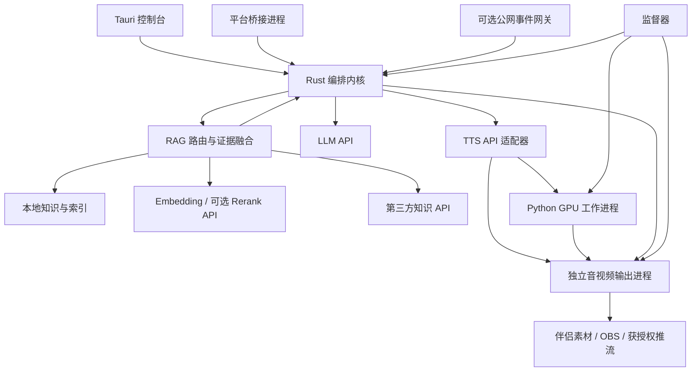
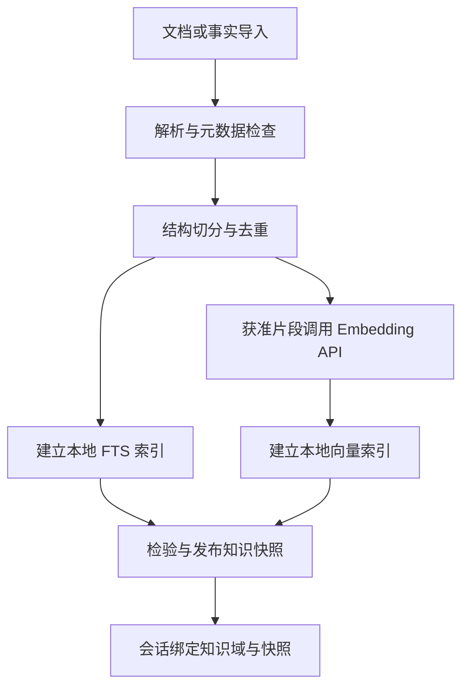

# 多平台直播数字人智能互动系统设计方案

> V2.1 · 2026-10-06 · 基于 V2.0 整合 API 模型与完整 RAG 设计  
> 首发抖音，预留快手、微信视频号；Windows 桌面优先。  
> 推荐架构：Rust 编排内核 + Tauri 2 控制台 + LLM/TTS API + 本地知识库与 RAG（可接第三方 API）+ 本地数字人推理 + 独立音视频输出进程。  
> 本文为设计与验收方案，不代表接口申请已获批、平台允许当前业务或性能已经实测。来源核查日期为 2026-10-06。

## 一、评审结论与关键修正

原方案方向基本合理：界面与引擎分离、统一适配器、事件聚合、音频主时钟、凭据保护和模型预热均应保留。但还不能直接作为产品开发的完整基线。

| 原设计 | 问题及影响 | V2.1 决策 |
|---|---|---|
| 平台主要抽象为 EventSource | 接入平台还涉及授权、房间生命周期、输出、能力限制和运营规则 | 平台连接器、事件适配器、输出适配器、规则配置分别建模 |
| 仅评估抖音直播玩法 | 遗漏直播伴侣互动工具路径，可能错过更适合桌面产品的官方接入方式 | 优先并行验证两类官方产品路径，依据实际权限选型 |
| 官方评论事件对应弹幕 | 玩法接口有关键词限制，不能假定全量自由弹幕 | 能力必须标注覆盖范围；无权限时禁用对应功能 |
| Python 是备用，ONNX 内置是目标主路径 | 提前投入模型导出和重写，扩大首版风险；进程内 GPU 故障牵连引擎 | Python/PyTorch 首版主路径，ONNX/TensorRT 后续按收益迁移 |
| Wav2Lip256 默认商用降级 | 原始 Wav2Lip 有非商用限制；分支名称不能证明授权 | 未完成来源与许可审核的模型不进入商用包 |
| 全流式、首包立即播报 | 审核可能尚未完成，口型模型可能需要未来音频窗口 | 已审核语句分块合成，音视频共同缓冲后提交播放 |
| 礼物最高优先级 | 频繁感谢打断问答，造成体验和公平性问题 | 只有人工安全控制立即抢占，礼物默认句间调度并限预算 |
| 各模块任何故障都不断流 | 单引擎、输出进程或整机故障无法靠内部任务保证 | 明确故障域；独立输出进程保住推理与业务故障下的画面 |
| Windows 服务承担引擎 | 服务会话与交互桌面、设备访问、SDK 生命周期可能不兼容 | 首版当前登录用户启动；服务仅作为可选监督器 |
| 无事件或断连后主动讲解 | 事件源断开不等于平台允许自动直播 | 断连默认人工/静默待机，仅在已批准规则下允许脚本填充 |
| 全量长期留日志 | 数据最小化、存储增长及删除策略不足 | 决策审计完整，观众原文与身份按授权和必要性限期保存 |

核心产品定位：有人工监督、可实时接管的数字人直播助手。是否开放自动回复、自动讲解，由具体平台、账号、直播类目与获批能力共同决定。存在接管按钮不能证明自动互动获得许可。

### V2.1 已确定的技术边界

1. **大语言模型和 TTS 均通过 API 调用**，不安装、不加载本地 LLM/TTS 权重，不在 API 故障时自动启动本地模型。API 可直连厂商、第三方聚合服务或自有远端网关。
2. **本地知识库和 RAG 是必做能力**：本地保存文档、结构化事实、分块、元数据及检索索引，提供知识管理、混合检索、证据引用和评估。
3. **第三方知识/RAG 可通过 API 接入**：支持本地、远端、混合三种模式，统一证据契约；默认本地检索，远端是否参与由知识域与数据策略决定。
4. Embedding 默认通过 API 生成，本地完成向量检索；Rerank 默认关闭，启用时使用 API。本地无 GPU 文本模型，GPU 主要服务数字人口型、画面和编码。
5. 无网络时仍可查询已建立的本地索引、使用有效缓存语音或人工接管；不能保证新的生成式回复和新语音合成。首次向量建库及新查询向量通常需要 Embedding API，故提供 FTS-only 降级。

本地存储不等于数据完全不离开本机：Embedding 会上传待索引片段；LLM 会收到必要检索证据；远端 RAG 会收到请求中允许的查询/上下文。文档级配置哪些用途允许外发，并在发送前落实过滤。

## 二、目标、边界与版本分工

### 2.1 首版范围

- 单工作站、单直播会话、单出镜形象、单主音色。
- 在获得权限的事件范围内支持弹幕问答、礼物感谢、首次发言欢迎、关注感谢。
- 人设、话术、排期脚本、语音词典与规则可配置；必做本地知识库、RAG 与第三方知识 API 适配。
- LLM、TTS、Embedding API 支持供应商配置、凭据引用、主备与预算；可选 Rerank API。
- 支持人工审核回复、手动插播、真人接管、数字人紧急静音。
- 本地录制验收；正式直播输出使用已验证的直播伴侣或 OBS 路径。
- 抖音首发，快手与视频号提供连接器契约和能力占位；不把尚未验证的平台写成已支持。

### 2.2 后续范围

第二阶段接入第二个平台，验证扩展性；之后再考虑多房间、多 GPU、远程控制与连麦 ASR。多平台同播不是增加推流地址即可完成：不同房间要独立调度、知识上下文、权限和音视频会话，不能把 A 房间观众问答直接播给 B 房间。

### 2.3 非目标

首版不做 3D 全身生成、动作大模型、自动商品上架/改价、交易决策、无限上下文记忆、自研虚拟设备驱动、无人值守运行承诺或强制全 Rust 推理；不部署本地 LLM/TTS/Embedding/Rerank 模型。

## 三、平台事实、权限与接入路线

### 3.1 已核实事实与未确认边界

| 平台/路径 | 官方资料能支持的结论 | 仍须确认 |
|---|---|---|
| 抖音直播玩法 | 评论能力描述针对包含特殊指令的评论；依赖玩法挂载 [S1] | 自研数字人业务是否能申请、实际关键词与礼物覆盖 |
| 抖音直播伴侣互动工具 | 指南提供开放互动事件和音视频素材通道 [S2] | 当前招募、数字人用途准入、权限覆盖、SDK 和伴侣版本 |
| 抖音 App + 伴侣互动工具 | 文档列出评论、礼物、点赞、关注等按能力申请的数据 [S3] | 自由文本完整性、采样、进场消息及业务授权 |
| 快手弹幕玩法 | 官方文档有房间绑定、回调和关键词评论限制 [S4] | 数字人场景资格、额外权限、全量弹幕路径 |
| 微信视频号 | 本次未获得足以确认通用自由弹幕 API 和当前数字人直播准入的官方依据 | 账号/类目规则、获批方案、事件与输出通道 |

不得把视频号商家、订单或商品 API 等同于直播弹幕 API；也不得把腾讯营销数字人产品的宣传等同于普通开发者获得视频号数字人直播权限。

### 3.2 抖音建议路线

第一候选：直播伴侣互动工具连接器。若产品准入与数字人用途获准，评估用官方 SDK 收事件、推音视频素材；此路径可能减少虚拟摄像头与音频线配置。该判断是工程推断，必须完成实际 SDK 联调。

第二候选：直播玩法连接器。仅在玩法形式符合产品和官方批准范围时使用。获得关键词评论权限时，产品可提供明确的提问格式，不宣称能回答任意弹幕。

第三候选：经平台认可、有明确合同及数据授权的服务商连接器。需保留数据来源、权限范围、版本、撤销与维护约定。

模拟器与手动注入用于开发、演示和人工辅助；不能代替真实事件接入验收。非官方抓取不作为本方案正式实现基线。

### 3.3 能力声明与准入检查

每个连接器提供能力快照，区分：`unknown / unsupported / requires_permission / available`。至少包含：

```json
{
  "platform": "douyin",
  "connector": "douyin_mate_tool",
  "connector_version": "0.1.0",
  "comment": {"status": "requires_permission", "coverage": "unknown"},
  "gift": {"status": "requires_permission", "coverage": "allowlist"},
  "enter": {"status": "unknown"},
  "follow": {"status": "requires_permission"},
  "output": {"status": "requires_permission", "mode": "mate_material"},
  "policy": {"status": "pending_verification", "auto_reply_allowed": false},
  "evidence_ref": "local-policy-record",
  "verified_at": null
}
```

实际快照随账号权限生成，不能硬编码上述示例为已授权。开播前检查授权有效性、房间绑定、输出、音色/形象许可、规则状态和设备健康。关键权限未知时仅允许本地演练/人工模式。

## 四、总体架构与故障域



### 4.1 进程职责

| 组件 | 职责 | 故障行为 |
|---|---|---|
| Tauri 控制台 | 配置、预览、审核、操作、状态 | 关闭不终止会话；监督状态丢失后的行为按规则处理 |
| Rust 编排内核 | 会话、队列、策略、生成请求、审核、取消、审计 | 输出租约过期后数字人静音，进入待机 |
| 平台桥接进程 | SDK/协议、授权、生命周期与原始事件转换 | 标记事件不可用，不伪造成功接入 |
| Python 工作进程 | 特征、口型、合成贴回、模型预热 | 输出进程继续画面，禁播没有可用口型的语音 |
| 音视频输出进程 | 唯一播放权、主时钟、待机、混音、输出 | 自身崩溃可能造成中断，监督器重启；外部直播软件备用场景可辅助 |
| 监督器 | 拉起进程、退避重启、持久故障告警 | 整机/驱动/网络断电无法由软件保证不中断 |
| 可选公网网关 | 官方回调验签、持久接收、转发到桌面 | 不在回调中调用 AI；故障影响事件而非本地视频输出 |

输出进程预加载低资源待机素材，使用可过期的播放租约，故障后保持静音画面。不得在失去编排控制后无限续播过时商品话术。

### 4.2 Windows 与 WSL 部署

正式输出、直播伴侣桥接、虚拟设备、Tauri 优先 Windows 原生当前用户会话。GPU 推理优先验证 Windows Python；若依赖在 WSL2 更容易运行，可仅将模型工作进程放在 WSL2，通过已鉴权 RPC 和受控数据通道连接。

WSL 路径存在跨边界复制、网络、启动和设备可见性成本，不能假定 Windows 与 WSL 的共享内存、GPU 缓冲或摄像头可直接互用。正式打包前确定唯一主路径，WSL 适合作为研发与可选推理部署。

## 五、模块划分与插件机制

首版采用模块化单体编排与少量隔离进程，不引入 Kubernetes、复杂微服务或通用消息中间件。

```text
digital-host/
  crates/
    dh-contracts/       事件、会话、能力、媒体描述、错误
    dh-kernel/          生命周期、装配、播放请求、取消
    dh-platform/        平台连接器注册与授权状态
    dh-scheduler/       聚合、公平调度、期限、预算
    dh-dialog/          人设、API 生成、事实绑定和审核
    dh-knowledge/       导入、分块、元数据、快照和本地索引
    dh-rag/             检索路由、混合检索、融合与证据预算
    dh-ai-client/       LLM / Embedding / Rerank API、限流与计费
    dh-voice/           TTS、词典、缓存、音频规范
    dh-media/           独立输出进程、时钟、待机和音频混合
    dh-api/             管理、审核和实时状态
    dh-store/           SQLite、审计、版本和资产索引
    dh-supervisor/      进程监控与恢复
  connectors/
    douyin-mate/        官方 SDK 桥接，必要时 C++ 独立程序
    douyin-play/        官方玩法路径
    simulator/         可复现事件回放
  workers/python/      PyTorch 推理主实现
  protocols/           Protobuf / JSON Schema
  ui/                  Tauri 2 + TypeScript + React
  assets/              自有授权形象、模型元数据
```

### 5.1 稳定契约

- 内部业务用 Rust trait；第三方连接器使用版本化 RPC/消息协议，不以 Rust 动态库 ABI 作为长期接口。
- 契约包含 `connect / capabilities / subscribe / heartbeat / disconnect`，输出另有 `prepare / start / status / stop`。
- 所有流必须表达正常结束、错误、超时、取消和序列号，不能只定义“下一个事件”。
- 模型与 TTS 声明实际支持：整句、分块、增量输入、取消、音色和采样率；不强迫每个实现提供完整双向流式能力。
- Rust 类型生成 UI 类型；跨进程数据以 Protobuf/Schema 为准，测试兼容性。

### 5.2 插件清单

包含 `id、version、protocol_version、kind、capabilities、permissions、entrypoint、config_schema、healthcheck、license_ref`。插件权限按需授予网络目标、资产读取与凭据引用；用户安装的是可信可执行程序，不能把“插件化”视为自动拥有安全沙箱。

替换一个平台原则上新增连接器与规则配置；替换 TTS、LLM 或口型模型只实现对应契约；同一平台不同接入产品可有多个连接器。

## 六、统一事件、会话与可靠接入

### 6.1 事件信封

```json
{
  "schema_version": 1,
  "platform": "douyin",
  "connector_id": "douyin_mate_tool",
  "account_ref": "account-01",
  "room_id": "room-example",
  "session_id": "session-example",
  "event_id": "provider-message-id",
  "event_type": "comment",
  "occurred_at_ms": 0,
  "received_at_ms": 0,
  "is_replay": false,
  "is_test": false,
  "user": {"scoped_id": "platform-app-scoped-id", "display_name": "观众"},
  "payload": {"text": "请问这个产品适合什么场景？"},
  "trace_id": "trace-example"
}
```

占位时间戳必须由适配器转换为实际毫秒时间。平台消息 ID、直播间 ID 统一字符串，避免 JavaScript 大整数丢精度。用户 ID 与平台及应用作用域绑定，不通过昵称拼接跨平台身份。

事件类型包括 comment、gift、like、follow、unfollow、enter、fansclub、room_started、room_ended、connection_lost、permission_changed；未知类型保留并不触发播报。`enter` 没有权限时用单独的 `first_comment` 策略，话术称“欢迎来聊天”，不宣称实时掌握进场。

### 6.2 礼物语义

保留平台消息 ID、礼物 ID、数量、价值单位及数量语义 `delta / cumulative / unknown`；只有平台提供时才保存连击标识。不能统一把不同平台数量当增量相加，不能推算未知礼物价值。聚合和感谢幂等按具体接口样本验证。

### 6.3 官方回调网关

适用于公网回调路径；本地 SDK 路径不必部署。

1. 原始请求体验签，按平台实际算法实现，不用自选签名算法替代协议。
2. 限制包体、校验房间与应用、时间戳及重放；合理处理平台延迟重试。
3. 持久写入 inbox 后尽快按协议 ACK，初始内部目标 P95 <100ms；AI 不在回调路径运行。
4. 桌面主动建立 TLS 长连接接收授权房间数据，避免开放工作站公网端口。
5. 按平台+应用+房间+消息类型+消息 ID 去重；无消息 ID 时使用明确标注的启发式去重。
6. 支持重连游标，但仅回放尚未过期的互动；审计可补录，语音不会重播。

抖音玩法文档明确为 HTTP 回调，存在限流与失败熔断；仅部分消息支持失败回查 [S5]。因此不得假定全部弹幕可恢复或事件传输恰好一次。快手资料也明确存在乱序 [S4]。系统按至少一次/可能遗漏的来源设计幂等，而不是承诺零丢失。

## 七、会话状态、人工监督与调度

### 7.1 状态分层

会话：`Stopped → Preparing → Ready → Running → Stopping → Stopped`，异常为 `Faulted`。运行模式：`Manual / Assisted / AutoPermitted / Standby`；播放状态：`Idle / Buffering / Speaking / Cancelling`。平台在线、输出在线与模型健康是分别显示的状态，避免用单个“直播中”掩盖断连。

默认 `Assisted`：候选回复经人工批准后播放。`AutoPermitted` 仅由权限和规则允许时启用；人工审核能够完成技术演练，但并不自动解决平台准入。

### 7.2 队列与公平调度

| 级别 | 来源 | 默认行为 |
|---|---|---|
| P0 | 紧急静音、真人接管、房间结束、权限撤销 | 立即抢占并撤销所有未播内容 |
| P1 | 人工批准插播、必要纠错 | 立即或句间插入，由人工选择 |
| P2 | 相关弹幕问答 | 按相关性、等待时长、用户公平性调度 |
| P3 | 礼物/关注感谢 | 2–5 秒窗口聚合，默认不截断问答 |
| P4 | 首发言欢迎 | 合并，限制昵称数和播报时长 |
| P5 | 经批准的脚本 | 空闲时讲解，互动到来句间让出 |

优先级可配置，但 P0 不可覆盖。给礼物感谢、问答、脚本分别设置每分钟语音秒数预算；给低优先级任务等待加权，避免长期饥饿。预算可初设问答 65%、感谢欢迎 20%、脚本 15%，作为策略起点而非固定运营标准。

去重窗口与排队 TTL 分离。TTL 可初设问答 15 秒、欢迎 5 秒、感谢 20 秒；过期不播报，但礼物审计不丢弃。LLM、TTS、媒体缓冲均有界；高峰减少主动讲解并聚合同类问题。

一个声音一次只能播放一条回复。假设每次回复含间隔需 8 秒，可服务约 7.5 次/分钟；收到 100 条/分钟仍不能逐条回答。容量由播报占用决定，不能只看 GPU fps。

### 7.3 脚本与恢复

脚本按主题段落维护：内容版本、商品版本、有效期、已讲进度、可恢复句边界。被互动打断后重新检验话术有效性，不盲目续播旧价格。长时间无事件不视为自动播报授权。

## 八、API 大模型、本地知识库与 RAG

### 8.1 服务边界和默认选型

| 能力 | V2.1 默认实现 | 是否占用本地 GPU |
|---|---|---|
| LLM 生成 | 远端流式 API，主备供应商 | 否 |
| TTS 合成 | 远端流式或整句 API，合规音色与缓存 | 否 |
| Embedding | 远端 API，批量建立本地索引/生成查询向量 | 否 |
| 文档存储、分块、全文检索 | 本地文件 + SQLite FTS5，CPU 后台任务 | 否 |
| 向量检索 | 本地 CPU 索引，首版精确检索可满足小库起步 | 否 |
| Rerank | 默认关闭；必要时远端 API | 否 |
| 第三方知识/RAG | 独立 HTTP API 连接器 | 否 |
| 数字人口型与视频 | 本地 Python/PyTorch 工作进程 | 是 |

LLM 与 TTS 是强制 API 边界；本地 CPU 仍需执行文档解析、音频解码、重采样、索引和编排。架构不保证整个应用零资源占用。

### 8.2 知识分类与数据模型

本地至少支持两个逻辑知识域：

- **结构化事实**：商品/SKU、价格、活动生效期、库存刷新时间、适用范围、保修退换、服务条款、发布批准状态。支持 CSV/XLSX/JSON 导入和人工维护；静态导入库存不得冒充实时库存。
- **文档知识**：说明书、FAQ、品牌介绍、操作指南、讲解资料、场景知识。文档检索不能替代结构化价格等敏感事实。

首版文本格式：TXT、Markdown、HTML（去脚本）、可提取文本的 PDF、DOCX；扫描 PDF/图片识别单独标记 `needs_ocr`，OCR 默认通过 API 可选开启，不假定每个 PDF 都能正确提取表格。复杂版式保留页码和原件供核对。

知识库 `kb_id`；文档 `document_id + revision`；块 `chunk_id + content_hash`；索引快照 `snapshot_id`。元数据至少包含来源、知识域、产品/主题、语言、有效期、owner_scope、allowed_sessions、审核状态、权威级别、外发策略和删除标记。

外发策略分为 `local_only / embedding_allowed / llm_context_allowed / remote_rag_allowed` 等独立权限。`local_only` 文档只允许本地 FTS/展示与人工处理，不能为其调用云 Embedding 或把其片段注入云 LLM。

### 8.3 入库与发布流水线



1. 文件隔离处理，检查格式、大小、路径、压缩炸弹与文本编码；解析任务独立低优先级运行，不堵塞直播链路。
2. 按标题、段落、问答和表格语义切分。初始可测 300–600 中文字/块、50–100 字重叠，最终按模型 tokenizer 和检索集校准。商品事实/关键表格行避免跨块拆散。
3. 内容哈希去重；仅对新增/变更且允许外发的块调用 Embedding。批量任务可暂停、恢复、退避，单块失败显示原因。
4. 索引包含 model_id、model_version（可取得时）、dimension、distance_metric、normalization、chunker_version。查询与文档必须使用匹配的模型/预处理；维度相同不能证明语义空间兼容。
5. Embedding 中途失败允许发布显式标记的 FTS-only 快照；禁止把不完整向量索引显示为“全部就绪”。
6. 新快照后台构建，校验后原子发布；进行中的任务持有快照引用，删除/撤销有即时过滤表，不能因旧快照仍在使用继续披露已撤销文档。
7. 删除文档同步清理全文、向量和查询缓存，音频/回复缓存按证据依赖失效；若同步到第三方，记录远端删除结果与重试。

切换 Embedding 模型必须重建对应索引，并保留旧快照直到新索引可用；不在正在直播时逐块混用两个模型。

### 8.4 本地 RAG 检索流程

事件选中 → 绑定房间知识域 → 规范化查询 → 权限/主题/产品/有效期过滤 → FTS 与向量检索 → 去重融合 → 可选 API 重排 → 证据筛选 → API LLM 生成 → 事实/引用审核 → 人工模式处理 → TTS API。

- 查询包含当前产品、正在讲解主题与必要短期上下文；例如“多少钱”先绑定当前 SKU，再查结构化事实。SKU 不明确就澄清，不跨产品猜测。
- FTS 候选召回与查询 Embedding 可并行；候选 top-k 初设各 20、融合后最多 8、最终证据 3–5 块，均为待评估参数。
- 不直接平均 FTS、向量和远端异构分数。采用 Reciprocal Rank Fusion 等按排名融合，再按产品、来源、权限和有效期复核；Rerank 只在预算与外发权限允许时调用。
- 权限和有效期在候选生成前过滤，并在生成/播放前复核，不能只在最后截断 top-k 时过滤。
- 证据预算初设最多 2,000 tokens，按 API 模型实际上下文额度和 tokenizer 调整；只发需要的片段，不上传整个知识库或完整观众历史。
- Embedding 不可用时使用有效查询向量缓存，否则 FTS-only；缓存键包含查询、知识域、索引版本和模型，结果缓存还包含权限、事实版本和有效期。
- 检索无结果、证据冲突或覆盖不足时返回澄清/转人工/固定不确定话术。相似度不是答案正确概率，不能直接称为“置信度 95%”。

本地索引实现第一版可采用 SQLite 元数据/FTS + 持久向量文件、CPU 精确相似度检索，接口允许后续替换 ANN。不要预设新向量扩展可在 Rust/Windows 安装包中稳定运行，选定具体实现后验证分发与许可。

容量示例：10,000 块 × 1,024 维 × float32 约 39MiB 原始向量，另计文本、索引、缓存和结构开销；这是计算示例，Embedding 维度由实际 API 决定。更大库按查询 P95 与内存评估 ANN，不强制首版引入独立向量数据库。

### 8.5 第三方知识/RAG API 与路由

| 模式 | 行为 | 默认降级 |
|---|---|---|
| local | 本地 FTS + 向量 + 结构化事实 | FTS-only、澄清或人工 |
| remote | 已指定远端知识服务检索 | 只有显式配置同知识域镜像才降级本地，否则澄清 |
| hybrid | 本地与获准远端并行，统一证据融合 | 保留完成且有效的证据，标注来源缺失 |

默认 `local`。会话明确允许访问哪些 kb_id、远端集合与主题；本地知识不会自动全量同步到第三方。远端 timeout 不能被当作“该信息不存在”，缺少必需的权威证据时不生成确定答案。

第三方适配器区分三类能力：

1. **检索 API**：返回片段、来源、文档/块标识、版本和有效期，优先采用，可接自建知识服务或商业知识平台。
2. **RAG 问答 API**：返回答案及可追溯证据；将答案视为候选草稿，仍执行事实与内容审核。不再默认调用 LLM 重写，避免双重费用及改变事实。
3. **仅答案 API**：无法满足价格/功效等事实溯源要求；默认仅供人工参考，不能标为等价可信 RAG。

协议抽象包括 `capabilities、health、search、answer（可选）、sync/delete（可选）`；供应商字段和认证由适配器转换，不假设不同平台原生协议一致。

统一检索请求示例：

```json
{
  "request_id": "req-example",
  "session_id": "session-example",
  "kb_ids": ["kb-product-01"],
  "query": "这款产品的保修期限是多少？",
  "filters": {"product_id": "sku-01", "status": "published"},
  "top_k": 5,
  "deadline_ms": 700
}
```

统一结果片段：

```json
{
  "status": "complete",
  "provider": "remote-kb-example",
  "evidence": [{
    "evidence_id": "ev-001",
    "document_id": "doc-001",
    "revision": "rev-02",
    "chunk_id": "chunk-005",
    "text": "经核实的保修条款片段",
    "source_ref": "provider:doc-001",
    "rank": 1,
    "valid_until": null
  }]
}
```

示例是内部契约，不对应某一供应商真实接口。通过本地映射约束远端集合与权限，不能只信任调用方传入 filters；证据 URL 是来源标识，默认不自动抓取任意 URL。

### 8.6 权威来源、冲突与事实校验

知识域配置明确权威来源，例如价格使用已发布结构化报价，保修条款使用指定版本合同，产品说明使用审核手册。冲突时按该字段的来源策略与有效期处理，而非一律“本地胜出”或“最新更新时间胜出”。未能判定冲突就转人工。

每次生成使用内部 evidence_id 和 fact_id；模型可输出 `answer_text、used_evidence_ids、product_id、needs_clarification`。运行时验证引用确实来自本次检索、版本有效，数字/单位/优惠条件与事实一致。观众端使用自然口语，出处显示在控制台，不强制读出文档 ID。

引用存在不代表答案被证据支持；准确性用测试集与人工审核评估。事实更新后在实际播放前复检，过期回复、缓存音频和远端答案一并失效。

### 8.7 LLM API 与内容审核

API 客户端管理 endpoint、协议、model、凭据引用、流式能力、超时、限流、主备、费用和数据策略。兼容标准接口与专有协议；供应商价格/能力须在接入时验证，不硬编码当前产品套餐。

欢迎、感谢用审核模板；普通问答攒齐语义段后审核，再交 TTS。敏感事实整段审核，人工批准等待单列。外部问题、昵称、文档和远端候选答案均作为不可信数据，不允许覆盖系统提示或触发任意工具。

房间仅保留当前主题和有限对话历史。记录提示词版本、知识快照、事实/证据来源、LLM provider/model、审核结果和最终实际播放内容；被取消但未播的回复不写入已完成对话。

### 8.8 API 稳定性、限流与数据边界

- 各供应商独立连接池和 token/请求配额；前台生成优先于后台建库，Embedding 索引任务限速且可暂停。
- 识别 401/403、429、超时和 5xx：凭据错误不盲目重试，限流遵循 Retry-After 和任务期限，瞬时错误有限退避；不增加本地模型兜底。
- 只在尚未播放的语句边界切换 LLM/TTS；API 取消可能仍产生计费，记录本地取消与服务端状态。
- 为 LLM、TTS、Embedding、Rerank、远端 RAG 分别设预算和用量；缓存/模板减少重复调用，预算超限后按规则限流、缓存、澄清或人工。
- 只发送该用途获准的数据；向云 LLM 发送的片段意味着其已离开本机，第三方留存和训练使用策略在配置时核对。
- 完整断网：本地检索/工作台仍可用，播报仅限已审核且仍有效的缓存音频或人工接管；新答案不能依靠本地 RAG自动完成云端生成和配音。

## 九、TTS API、专业词典与缓存

TTS 仅通过远端 API 提供，主备均为 API 服务。本地只执行解码、重采样、缓存与播放，不部署 CosyVoice、GPT-SoVITS 等合成模型。API 支持整句或流式由能力声明决定；备用音色必须已授权和试听验证。

链路：审核文本 → 发音规范化 → TTS → 流式解码/重采样 → 模型音频与输出音频分支 → 音视频共同排期。

1. 区分展示文本和朗读文本，数字、单位、英文缩写、型号、公式按场景规范化；例如 NVLink 的读法、促销价与百分比可用词典配置。
2. 支持 SSML/音素的厂商用原生能力；不支持时采用经过试听的文本替代。不能用同一份 SSML 假定所有厂商兼容。
3. 规范缓存键：文本、音色版本、厂商/模型、词典版本、语速、情感、采样率、格式与审核规则版本。价格/优惠音频有业务失效时间，不能永久缓存。
4. 云 TTS 主备音色无法保证同声，切换需在语句边界明确处理；未授权声线不能自动替代。
5. 模型分支按模型要求单声道采样；输出分支可用 48kHz。模型特征窗口与输出 PCM 小块不是同一概念。
6. TTS 首包可能是编码音频，需计入解码、有效样本积累和实际可播延迟。
7. 克隆音色保留授权范围、用途、期限、撤销和资产删除流程。

## 十、数字人模型、形象与许可

### 10.1 推荐路径

首版采用 MuseTalk 候选 + Python/PyTorch 常驻工作进程。先验证实际形象的中文口型、侧脸、表情、牙齿、遮挡、眼镜、头部动作与持续延迟，之后才确定主模型。

MuseTalk 项目公开声明代码为 MIT、其训练模型允许商用，同时要求分别遵守依赖许可，测试素材限研究用途 [S6]。这支持其作为候选，但不能把样例人像或任意下载依赖自动视为可商用。

Wav2Lip 原仓库声明研究/个人/非商用限制 [S7]。Wav2Lip256 分支必须查清代码、训练数据和具体 checkpoint 的授权，未确认则不作为商业降级。可靠首版降级为同一已授权模型降低推理负载、静默待机或人工接管；也可采购独立获授权的替代服务。

LiveTalking 可用于研究架构；其仓库同时有水印/标识声明 [S8]。直接复用前核对所用提交的 LICENSE、附加声明、模型及依赖，不能仅靠自行改名解除限制。

### 10.2 形象资产规范

`manifest.json` 至少记录 asset_id、版本、原素材哈希、形象授权、模型与 checkpoint 哈希、预处理版本、裁剪尺寸、底版 fps、时长、掩膜、姿态与音色绑定。

制作多个可循环待机片段、说话底版和姿态兼容切换点；模板欢迎不要无限重复单段视频。底版主索引由输出媒体时间驱动，音频、特征与嘴部帧共用同一时间映射。不同姿态的人脸不能靠普通淡入淡出保证自然切换。

输出 1080p 不等于人脸模型原生生成 1080p；人脸区域清晰度单独验收。LatentSync 可另行作为离线评估工具，但不是制作底版的必选项；延迟、画质与具体权重许可另行验证。

### 10.3 ONNX/TensorRT 后续优化

先剖析耗时与复制量；按瓶颈迁移子模型，不以“纯 Rust”作为验收项。比较形状覆盖、输出误差、视听效果、真实帧截止期、内存、冷启动与稳定性。FP16/INT8 后不能要求逐位相等，应规定容差和人工质量门槛。

ONNX Runtime 的设备 tensor、I/O binding 可减少传输 [S9]；进程内运行本身并不等于零拷贝。进程内 GPU provider 故障仍可能拖垮宿主，优先保持模型运行时进程隔离。

## 十一、实时媒体契约、时钟与打断

### 11.1 媒体描述

音频携带 session_id、utterance_id、generation_epoch、seq、sample_rate、channels、sample_count、sample_start、format。视频携带相同会话标识、帧序号、PTS、time_base、duration、分辨率、像素格式与底版索引。

音频内容按样本计数排时：相对时间 = sample_start / sample_rate；输出进程依据连续媒体主时钟安排开始时刻，不能把网络到达时间作为播放时间。UTC 用于审计，单调时钟用于内部超时和耗时；跨主机时钟偏移单独处理。

### 11.2 流式的真实限制

音频帧很小不意味着特征可同样低延迟生成。记录模型需要的历史/未来上下文、最小窗口、chunk overlap、特征时间映射与边界误差。在 M0 测量首个可输出嘴部帧的音频需求。

只有当已审核音频与对应首批视频帧达到播放水位，才共同提交。缓冲可从 200–500ms 测起，允许按模型前瞻扩大；目标通过实测确定，不硬承诺原文的 100–200ms。

输出持续固定节奏，推理可变批量。少量视频迟到可重复最近帧；持续赶不上截止期则停止当前数字人语音并切待机，避免一直有声音但嘴不动。保持音频样本连续并补静音，视频时戳不回退；长期音频路由时钟漂移采用受控重采样/延迟调整。

### 11.3 数据面

控制面用 gRPC 或命名管道；首版可用帧流做原型，正式版本根据瓶颈切共享内存环形缓冲。1080p RGB、25fps 原始数据约 156MB/s，若多次序列化/复制会产生明显成本。

共享内存定义槽位所有权、序号、长度、epoch 和断连释放，避免消费者使用已覆盖帧。GPU 纹理跨进程、Windows/WSL 边界共享需单独实现，不能写作默认零拷贝。

### 11.4 全链路取消

1. P0 命令递增 `generation_epoch`，输出进程先收到取消，停止数字人音轨并清空待播队列。
2. 内核取消 LLM/TTS 请求，通知推理工作进程停止旧任务。
3. 所有迟到文本、音频和视频按 epoch 丢弃；新任务不复用旧 utterance_id。
4. 无法中断已提交 GPU kernel 时允许其完成，但输出结果不得播放。
5. 短淡出以减少爆音，数字人待机或真人音轨接管。
6. 缓存和审计只能记录取消，不把未播放回复作为已完成对话写入上下文。

取消通道与常规队列隔离，P0 不能被满队列阻塞。本地数字人音轨停止目标 P95 ≤250ms，观众端已被平台缓存的内容无法即时撤回。

## 十二、输出路径与真人接管

| 输出方式 | 用途与前提 | 首版建议 |
|---|---|---|
| 官方伴侣音视频素材 | 已获准的互动工具通过 SDK 输出 [S2] | 若申请成功优先联调 |
| OBS/直播软件采集 | 必须验证当前软件输入方式、布局与权限 | 标准可控路径，先本地录制验收 |
| 虚拟摄像头 + 虚拟音频设备 | 分开配置视频与声音，安装包和路由复杂 | 作为兼容路径，不自研驱动 |
| 平台 RTMP/RTMPS | 账号拥有正式推流权限与有效地址 | 后续按平台能力启用 |

虚拟摄像头输出视频，音频需独立路由；OBS 官方说明及项目论坛可用于配置参考 [S10]。向“本地 RTMP”推流并不意味着任何直播伴侣都能直接采集，必须验证收流端。

输出适配器声明横/竖屏、分辨率、fps、编码/裸帧、采样率、声道、色彩范围与认证方式；SDK 裸帧路径不一定需要 NVENC，RTMP/录制路径再使用编码。UI 预览低负载，关闭预览应不改变正式输出。

真人麦克风与 TTS 使用独立音轨，切换时静音数字人、清旧任务，再开启人工路由；设置耳返与回声测试。Tauri 关闭后仍有全局热键/托盘或输出端静音按钮可接管。

“暂停自动互动”“真人接管”“数字人紧急静音”“结束输出”“结束平台直播”是不同操作；明确每个按钮影响范围，不能把停止本地视频等同于平台关播。

## 十三、可靠性、降级与恢复

| 故障 | 处理 | 自动恢复限制 |
|---|---|---|
| LLM 超时 | 尚未播放时用审核模板，或转人工 | 限次重试，不拼接已播内容 |
| TTS 超时 | 语句边界切获授权备用 API/缓存 | 缓存业务事实必须有效；不加载本地 TTS |
| Embedding/Rerank 故障 | 查询向量缓存/FTS-only；跳过可选重排 | 建库失败展示索引完整性，后台恢复 |
| 第三方 RAG 故障 | 显式同域镜像/有效本地证据，或澄清人工 | 无来源不能伪装完整证据 |
| 推理迟到 | 短期丢迟到帧；持续故障取消数字人语音 | 降负载/重启后预热通过才恢复 |
| GPU OOM | 降低口型负载/关闭预览增强；必要时重启工作进程 | 不临时再加载第二模型加剧 OOM |
| 事件断连 | 停止依赖实时事件的自动互动，告警待机 | 重连后不补播过期事件 |
| 内核退出 | 输出租约到期静音待机 | 内核重启后人工确认或按批准规则恢复 |
| 输出进程退出 | 监督器退避重启，外部软件切备用场景 | 明确可能短时中断 |
| 授权撤销/房间结束 | 立即停止相关会话及任务 | 不自动绕过或重新开播 |
| 整机/驱动/上行故障 | 告警及备用设备/线路运营流程 | 不承诺软件不中断 |

熔断包含 Closed/Open/HalfOpen，增加恢复迟滞和稳定窗口；禁止在模型之间频繁抖动。活跃直播时不自动更新内核、模型或 SDK。

## 十四、持久化、配置与安全

SQLite WAL 存配置、会话、规则版本、知识索引、任务状态和审计；音视频资产与缓存用文件及校验清单存储。高频逐帧数据不写数据库。采用迁移与备份恢复，实时路径不等待大日志写盘。

建议表：platform_accounts、connector_capabilities、live_sessions、event_receipts、interaction_jobs、utterances、approval_records、knowledge_bases、knowledge_documents、knowledge_chunks、index_snapshots、embedding_jobs、retrieval_runs、evidence_refs、remote_kb_bindings、ai_usage_records、knowledge_items、product_facts、avatars、voice_profiles、rulesets、config_versions、audit_records。

回复状态：received、selected、generating、review_pending、approved、synthesizing、buffering、playing、completed、cancelled、expired、failed；至少记录 selected_event、证据版本、模型/提示词/规则版本、播放起止及丢弃原因。

全局、平台、账号、房间/会话分层配置。先校验与预演再应用；话术规则可热更新，音色/模型/输出更改在安全边界执行，设备与 CUDA 环境变更需停止会话。配置带 revision 并支持冲突提示、回滚。

本地 HTTP 即使监听 127.0.0.1 也要鉴权、Origin 校验和限制跨域；WebSocket 同样校验，防止恶意网页驱动本地开播。API Key 与平台 token 存系统凭据库，配置只引用 credential_ref；日志脱敏。远程管理默认关闭，开启需 TLS、认证与权限控制。

形象导入限制格式、大小、路径和解压目标；推理/转码进程限制资源与网络范围。观众信息最小化保存，公开导出脱敏；保留周期由业务与平台要求决定，不在本文凭空规定法定天数。

## 十五、桌面控制台与 API

页面：开播检查、直播工作台、回复审批、平台账号、形象音色、知识商品、脚本规则、API 服务、监控审计、系统设置。

知识中心包括导入/解析状态、文档预览、分块编辑、结构化事实、审核发布、索引进度、快照回滚、会话绑定及删除。RAG 调试页显示 FTS/向量/远端候选、融合顺序、证据版本、来源冲突、拒答原因、API 外发内容与耗时；支持在发布前输入测试问题。API 页面管理 LLM/TTS/Embedding/Rerank/远端知识服务连接、主备、超时、预算和权限；一键测试使用合成样例，不隐式发送真实文档。

工作台同屏显示房间/权限状态、预览、待回复、正在播放、人工审批和一键接管。模型 fps、正式输出 fps、事件新鲜度与观众延迟分别显示；禁止“绿色连接”代表所有能力可用。

| 接口组 | 示例 |
|---|---|
| 平台 | `GET /v1/platforms`、`/accounts/{id}/capabilities`、`POST /accounts/{id}/connect` |
| 会话 | `POST /v1/sessions`、`/sessions/{id}/prepare`、`/start`、`/stop` |
| 模式 | `POST /sessions/{id}/mode`、`/takeover`、`/emergency-mute` |
| 回复 | `GET /sessions/{id}/jobs`、`POST /jobs/{id}/approve`、`/reject`、`/cancel` |
| 插播 | `POST /sessions/{id}/utterances`，携带幂等键 |
| 调试 | `POST /v1/test/events`，生产会话默认拒绝测试事件 |
| 配置 | `GET /v1/config`、`POST /config/validate`、`PUT /config` 带 revision |
| 资产 | 形象预处理任务、音色试听、许可状态、知识导入版本 |
| 状态 | `/healthz`、`/readyz`、`WS /v1/streams/status` |
| 知识库 | `GET/POST /v1/knowledge-bases`、`POST /knowledge-bases/{id}/documents`、文档版本/删除 |
| 索引 | `POST /knowledge-bases/{id}/index-jobs`、查询/暂停任务、发布/回滚快照 |
| RAG | `POST /v1/rag/search`、`/rag/evaluate`、`GET /rag/runs/{id}` |
| 第三方知识 | `GET/POST /v1/knowledge-connectors`、`POST /knowledge-connectors/{id}/test` |
| API 与用量 | `GET /v1/ai-providers`、`POST /ai-providers/{id}/test`、`GET /ai-usage` |

关键控制命令支持命令 ID、幂等与确认；“请求已接收”与“已经停止数字人音轨”分开返回。

## 十六、配置基线示例

```toml
schema_version = 3

[session]
platform = "douyin"
connector = "douyin_mate_tool"
mode = "assisted"
require_verified_policy = true

[scheduler]
comment_ttl_ms = 15000
welcome_ttl_ms = 5000
gift_merge_window_ms = 3000
max_pending_jobs = 100
max_ready_utterances = 2
gift_interrupt = "sentence_boundary"

[dialog]
max_reply_chars = 60
facts_required = true
approval_before_tts = true
first_sentence_timeout_ms = 4000

[llm]
mode = "api"
primary = "llm_primary"
fallback = ["llm_secondary"]
credential_ref = "credential:llm-primary"
local_inference_enabled = false

[knowledge]
backend = "local"
metadata_store = "sqlite"
fulltext = "fts5"
vector_index = "cpu_exact"
default_external_policy = "local_only"
index_in_background = true

[rag]
mode = "local" # local | remote | hybrid
knowledge_bases = ["kb-product-01"]
fts_top_k = 20
vector_top_k = 20
final_top_k = 5
max_context_tokens = 2000
retrieval_deadline_ms = 700
fallback = "fts_only"
require_evidence = true

[embedding]
mode = "api"
provider = "embedding_primary"
model = "<selected-embedding-model>"
credential_ref = "credential:embedding-primary"
query_timeout_ms = 500
index_max_concurrency = 1
local_inference_enabled = false

[rerank]
enabled = false
mode = "api"
provider = "rerank_primary"
timeout_ms = 300

[remote_knowledge]
enabled = false
connector = "http_search"
endpoint = "https://knowledge.example.com"
credential_ref = "credential:remote-knowledge"
timeout_ms = 700
allow_document_sync = false

[tts]
mode = "api"
local_inference_enabled = false
primary = "cloud_primary"
fallback = ["cloud_secondary", "valid_cache"]
credential_ref = "credential:tts-primary"
voice_ref = "voice:authorized-host-01"
lexicon_ref = "lexicon:default-v1"

[avatar]
asset_ref = "avatar:authorized-host-01"
worker = "python_pytorch"
model_ref = "model:musetalk-reviewed"
allow_unreviewed_model = false

[media]
fps = 25
width = 1080
height = 1920
output_sample_rate = 48000
startup_buffer_ms = 300
max_buffer_ms = 1000
cancel_target_ms = 250
lease_timeout_ms = 1500

[output]
adapter = "local_recording"
live_output_requires_preflight = true

[api]
bind = "127.0.0.1"
auth_required = true
remote_enabled = false
```

均为初始配置，M0 联调后调整。`douyin_mate_tool` 占位不代表已获批准；初始输出为本地录制，正式适配器必须显式选择并完成检查。

## 十七、性能指标与验收方法

### 17.1 延迟口径

分别记录平台发生时间、接收、入队、选中、首句审核通过、人工批准、可播音频/首视频帧、输出开始、观众端观察。首 token、TTS 首包、模型平均 fps 不等于开口延迟。

内部技术延迟目标：任务选中至本地输出开口 P95 ≤3 秒；有效模板缓存 P95 ≤1.5 秒。人工等待单列；接收至开口包含排队和聚合，观众端还含平台传输延迟，不能全部承诺 ≤3 秒。

总开口延迟 = 接入 + 排队 + RAG 检索/证据处理 + 生成/审核 + 人工等待 + TTS 可播积累 + 模型前瞻/首帧 + 输出缓冲；流式阶段部分重叠，最终看真实时间线。每一项实测 P50/P95/P99，不以各阶段均值相加替代整链路分位数。

### 17.2 验收目标

| 项目 | 初始门槛/方法 |
|---|---|
| 实时视频 | 固定 25fps 输出，推理在真实链路持续有至少 20% 吞吐余量；同时观察 deadline miss |
| 音画同步 | 录制中文样本评估，初始绝对偏差 P95 ≤80ms，并检查分块边界与长时漂移 |
| 打断 | 本地数字人音轨停止 P95 ≤250ms，旧 epoch 在压力测试下零播放 |
| 稳定性 | 先 2 小时，再 24 小时，再 72 小时；无非预期退出、持续内存增长或累计漂移 |
| 降级 | 主动杀工作进程/内核、注入超时，验证待机与静音及恢复规则 |
| 去重 | 重复/乱序礼物回放不导致重复感谢或数量翻倍 |
| 内容 | 商品事实错误为阻断项；验证昵称注入、过期优惠、跨句违规、提示词注入 |
| 本地 RAG | 建立不少于 100 个覆盖事实/歧义/无答案/冲突的代表问题；初始可答问题 Recall@5 ≥90%，敏感事实错误和越权检索为阻断项 |
| 混合 RAG | 远端慢/错/缺引用不造成事实编造；按真实第三方 API 验证协议转换与超时 |
| 资源边界 | 启动、开播、故障降级均不加载本地 LLM/TTS/Embedding/Rerank 权重；建库不影响固定输出节奏 |
| 输出 | 本地录制及真实获授权平台分别验证；真实平台验收不能由模拟器替代 |
| 平台扩展 | 第二连接器使用同一调度、知识、媒体和 UI 契约，允许新增权限/审核逻辑 |

记录形象、checkpoint、驱动、CUDA/PyTorch、OS、采样率、batch、输出分辨率、预览与编码开关；不开预览测出的 fps 不替代完整配置验收。

### 17.3 硬件与资源建议

先盘点实际 GPU 型号、显存和软件环境，避免仅按“5090”等名称推断配置。已有工作站优先实测，不建议在模型与并发确定前采购。

V2.1 固定采用 API LLM + API TTS + API Embedding + 本地 CPU RAG + 本地口型，将 GPU 预算留给口型、画面合成和编码。单独记录模型常驻、峰值激活、底版缓存、预览、编码及余量，测 OOM 恢复。32GB 系统内存能否满足大量底版缓存同样要测。

V2.1 不提供全本地生成/语音模式，断网按缓存或人工接管处理。数字人备用模型冷加载期间待机，不能预设显存足够双口型模型常驻。文档解析与索引任务限制 CPU 并发、内存和队列，优先在非直播时段运行。

网络按实际编码码率与稳定上行测试留余量；传输连通、云 API 延迟、抖动和平台端缓冲分别测量。每日成本记录输入/输出 token、TTS 字符/时长、Embedding token、Rerank 请求、第三方知识检索、网关费用、授权费用、人工监督成本。

### 17.4 RAG 延迟与质量专项

初始检索总预算 700ms（含查询向量 API 与融合），可选 Rerank 额外预算 300ms；本地 CPU 纯检索目标 P95 ≤100ms，均需按库规模、网络与 API 实测。超预算不延长已过期任务：FTS 结果充分时可降级，否则澄清或转人工。调用方 deadline_ms 是预算而非供应商响应保证。

测试集按可回答/不可回答、产品指代、缩写/同义词、表格、数值、过期优惠、冲突条款、远端故障、权限撤销分组；分别评估 Recall@k、证据支持率、拒答正确性和人工修改率。检索命中率与最终答案准确率分别报告，禁止用总体命中率掩盖价格错误。

## 十八、实施计划与交付门槛

周期为小团队参考估算，不包括平台审批等待，不把未知权限包装成确定排期。

| 阶段 | 参考时间 | 交付与继续条件 |
|---|---|---|
| M0 双验证 | 1–2 周 | 申请/验证平台路径；自有形象与声线授权；实际模型前瞻、延迟、帧率、显存测试；输出与接管验证；LLM/TTS/Embedding API 首包、超时与费用；本地样例入库 |
| M1 本地链路 | 2 周 | 手动事件→RAG→LLM API→审核文本→TTS API→数字人→录制；独立输出与全链路取消 |
| M2 调度知识 | 1–2 周 | 有界队列、期限、去重、礼物语义、本地知识入库/混合检索、事实绑定、第三方知识 API、审核、脚本恢复 |
| M3 平台与桌面 | 2–3 周 | 已获批抖音连接器、权限检查、工作台、审批、人工接管、打包 |
| M4 稳定性 | 1–2 周 | 故障注入、24/72 小时运行、音画同步、凭据/回滚/备份 |
| M5 受控试播 | 按批准条件 | 人工监督、有限时长，观察真实互动质量与端到端延迟 |
| M6 第二平台 | 单独评估 | 用获授权的第二平台证明契约可复用；未知平台继续标为未支持 |
| M7 性能优化 | 按证据立项 | 共享内存/GPU 数据面、ONNX/TensorRT 迁移与收益对比 |

M0 不强制完成 ONNX 导出；这是原方案最应前移风险识别、后移实现投入的地方。若平台无法授权核心互动，产品缩减为人工数字人辅助/本地演示，明确不能验收为完整自动互动直播。

必要测试以平台连接器契约、取消/epoch、礼物幂等、媒体时钟、事实有效期、故障降级为重点；UI 样式不需要复制实现的机械单测。

## 十九、开发前需要关闭的事项

1. 直播定位：讲解、娱乐、知识问答还是带货；决定知识结构与规则，不同定位不要默认套用电商限制。
2. 抖音申请主体、账号与计划接入产品：互动工具或直播玩法；确认数字人用途获准。
3. 真正必需的评论覆盖、礼物覆盖、关注/进场与输出权限；用真实测试结果更新能力表。
4. 数字人形象与音色授权、商用模型 BOM、依赖许可、SDK 和素材版本。
5. 工作站实测与软件栈兼容；确定 Windows 原生或 WSL 模型工作进程路径。
6. 回复人工审核、自动模式、脚本播报、断连待机的账号级运营规则与审批依据。
7. LLM/TTS/Embedding 与可选 Rerank/第三方知识 API 的供应商、费用、音色、数据处理边界和限流延迟；确认 Embedding 模型与索引匹配。
8. 首批知识格式、数量、主题、权威事实来源、外发权限与第三方知识 API 文档。默认本地知识 + API Embedding，远端知识仅配置后启用。

以上不阻塞模拟器与本地链路开发；但未闭合平台权限、许可与输出链路时，不把产品标记为可正式上线。

## 二十、资料与核查边界

V2.1 基于已完成的 V2.0 与用户明确的 API/RAG 要求整合。平台及模型事实沿用 V2.0 在 2026-10-06 的资料核查，本次未新增平台准入结论；API/RAG 架构、接口、指标和配置均为本项目设计，非供应商能力承诺。下列为 V2.0 检索到的第一方资料；开放能力、平台规则和仓库许可仍应在申请/打包时按实际版本核对。文档的公开存在不等于申请必获批。

- **[S1] 抖音开放平台：直播间评论互动能力**  
  https://developer.open-douyin.com/docs/resource/zh-CN/interaction/jierushuoming/hudongshuju/pinglunshuju/
- **[S2] 抖音开放平台：互动工具开发者指南（仅直播伴侣）**  
  https://partner.open-douyin.com/docs/resource/zh-CN/live-interactive-tools/development/tutorial/live-tool-guide
- **[S3] 抖音开放平台：互动工具开发者指南（抖音 App + 直播伴侣）**  
  https://partner.open-douyin.com/docs/resource/zh-CN/live-interactive-tools/development/tutorial/app-interaction-guide
- **[S4] 快手开放平台：玩法技术基础能力**  
  https://open.kuaishou.com/miniPlayDocs/technologyrelated/Affiliatedability/basicability/localdevelopment.html
- **[S5] 抖音开放平台：数据开放说明**  
  https://developer.open-douyin.com/docs/resource/zh-CN/interaction/develop/server/live-room-scope/data-open/data-open-desc
- **[S6] MuseTalk 官方项目：模型、使用说明和许可声明**  
  https://github.com/TMElyralab/MuseTalk
- **[S7] Wav2Lip 官方项目：非商用限制**  
  https://github.com/Rudrabha/Wav2Lip/blob/master/README.md
- **[S8] LiveTalking 作者项目：说明与许可资料**  
  https://github.com/lipku/LiveTalking
- **[S9] ONNX Runtime：Device tensors / CUDA Execution Provider**  
  https://onnxruntime.ai/docs/performance/device-tensor.html  
  https://onnxruntime.ai/docs/execution-providers/CUDA-ExecutionProvider.html
- **[S10] OBS：Virtual Camera Guide / 音频路由讨论**  
  https://obsproject.com/kb/virtual-camera-guide  
  https://obsproject.com/forum/threads/audio-output-with-the-virtual-camera.155140/

本次没有核实到抖音、视频号对该账号、该类目数字人自动直播的当前完整准入规则；原方案引用的历史倡议不能替代现行确认。也未完成任何硬件基准、平台鉴权或真实直播验收。本文所有性能数值均是初始验收目标或明确标注的计算示例。
