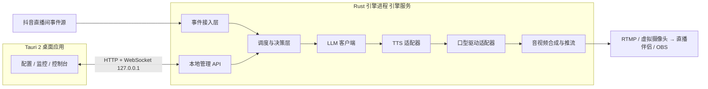

# 抖音直播数字人智能互动系统：设计方案

> 版本：v1.0（2026-10-06） 架构：Rust 引擎 + Tauri 2 桌面 + 方案 B（真人形象克隆，本地口型驱动）
> 
> 说明：文中凡标注"目标值"的数字是设计目标，不是实测结果；凡标注"待验证"的条目，需在对应里程碑中实测或向官方确认后再定。

---

## 1. 项目目标与边界

**目标**：在一台本地 Windows 工作站上，实现抖音直播间的数字人智能互动：

| 场景 | 期望行为 |
| --- | --- |
| 观众进入直播间 | 语音欢迎（合并播报） |
| 观众发送文字弹幕 | 结合知识库和人设智能回复 |
| 观众送礼 | 语音感谢，礼物优先级最高 |
| 无事件时 | 按脚本主动讲解 / 播放待机画面 |

**非目标（v1 不做）**：观众连麦语音对话（需 ASR 和连麦能力）、多机位、3D 全身数字人、多直播间并发。

**设计原则**：轻量、统一、可降级、不断流。直播永远优先于一切功能，任何模块故障都不能导致画面中断。

---

## 2. 合规前提（先于技术）

据公开报道，抖音曾发布《数字人行业倡议》，其中提到数字人直播须由真人驱动并进行实时互动，不允许完全由 AI 驱动互动，同时要求实名注册并标识虚拟人；录播、话术重复、形象"撞脸"等都有被判违规的风险。该文件发布于 2023 年，**现行规则待验证，以抖音最新公告为准**。

对设计的约束：

1. 数字人账号完成实名注册，直播中显著标识为虚拟人。
2. 回复内容实时生成并保持多样性，禁止长时间重复固定话术。
3. 设置"真人接管"能力：一键静音数字人、切换为人工发言或待机，桌面端必须有紧急停止按钮。
4. 商品、价格、优惠等敏感信息只能来自知识库，不允许模型自由发挥。
5. 全量留存互动日志（事件、回复、时间戳），便于审计和申诉。

---

## 3. 总体架构



**核心决策：引擎与界面分离。** 引擎是独立后台进程（可开机自启、可作为 Windows 服务运行），Tauri 只是控制台。界面崩溃或关闭不影响直播。

### 3.1 数据流（一次弹幕回复）

```
弹幕事件 → 标准化 → 过滤/去重/限频 → 入优先级队列
  → 取出 → LLM 流式生成 → 按句切分 → TTS 流式合成音频块
  → 口型驱动逐批出帧 → 以音频时钟对齐 → 编码推流
```

整条链路**全流式**：LLM 出一句即送 TTS，TTS 出一块音频即送口型驱动，不等整段完成。

---

## 4. 技术选型

| 层 | 选型 | 说明 |
| --- | --- | --- |
| 引擎语言 | Rust（tokio 异步运行时） | 无 GC、长时间运行稳定、编译器可拦截一类并发错误，适合 AI 辅助编码后人工评审 |
| 桌面 | Tauri 2 + TypeScript + React/Vue + Tailwind + 组件库 | 体积小，前端生态成熟，AI 生成质量高 |
| 类型共享 | `serde` + `schemars` + `ts-rs`/`tauri-specta` | Rust 结构体自动生成 TS 类型与 JSON Schema，配置表单自动生成 |
| 本地通信 | axum（HTTP + WebSocket） | UI 与引擎解耦，同时支持局域网网页远程管理 |
| 推理运行时 | `ort`（ONNX Runtime，CUDA / TensorRT 执行器） | 进程内推理，零拷贝；兜底为独立 Python 推理服务（gRPC） |
| 口型驱动（主） | **MuseTalk 1.5** | 画质与实时性的平衡点 |
| 口型驱动（降级） | **Wav2Lip256** | 轻量稳定，显卡压力小 |
| 口型驱动（离线） | **LatentSync** | 仅用于制作底版与预录素材，不用于实时 |
| TTS | 云端流式 TTS 优先；本地备选 CosyVoice / GPT-SoVITS | 首包延迟低；音色克隆按需 |
| LLM | 云端 API，流式输出 | 引擎内抽象为统一 trait，可替换厂商 |
| 音视频 | FFmpeg（NVENC 硬编码），Rust 侧用绑定或子进程管理 | 不自造轮子 |
| 配置 | TOML + JSON Schema | 分层、热更新、可回滚 |
| 可观测性 | `tracing` + 指标（Prometheus 格式） | 日志、延迟、GPU 占用统一展示在桌面端 |

**参考工程**：开源项目 LiveTalking 已实现流式数字人所需的多项工程能力（模型预热、打断、动作编排、多并发、RTMP/WebRTC/虚拟摄像头输出）。其公开的实测数据为：wav2lip256 在 RTX 3060 约 60fps，MuseTalk 在 3080Ti 约 42fps、4090 约 72fps，并要求推理帧率与最终推流帧率均不低于 25 才算实时。我们**借鉴其思路自行重写**；若直接使用其代码，需遵守其许可条款（该项目要求基于它发布到抖音等平台的视频带水印标识，去除需授权）。

---

## 5. 引擎模块设计

### 5.1 工程结构（Cargo workspace）

```
dh-engine/
├─ crates/
│  ├─ dh-core/        # 公共类型、事件、配置、错误、trait 定义
│  ├─ dh-ingest/      # 事件接入适配器（官方 API / 手动注入 / 模拟器）
│  ├─ dh-dialog/      # 事件过滤、优先级队列、模板、LLM 调用、安全过滤
│  ├─ dh-tts/         # TTS 适配器（云端流式 / 本地 / 缓存）
│  ├─ dh-lipsync/     # 口型驱动适配器（ONNX 内置 / Python gRPC 备用）
│  ├─ dh-media/       # 音频时钟、帧合成、待机视频、编码推流
│  ├─ dh-api/         # 本地管理 API（axum）
│  └─ dh-app/         # 引擎入口、装配、看门狗
├─ python-sidecar/    # 可选：尚未导出 ONNX 的模型推理服务（gRPC）
├─ ui/                # Tauri 2 桌面
└─ assets/            # 形象底版、模板、模型
```

### 5.2 核心抽象（trait）

```rust
// 事件源：官方 API、手动注入、测试模拟器都实现它
trait EventSource { async fn next_event(&mut self) -> LiveEvent; }

// 合成：流式输入文本，流式输出音频块
trait Synthesizer {
    fn stream(&self, text: TextStream, voice: VoiceId) -> AudioChunkStream;
}

// 口型驱动：音频块 + 形象 → 视频帧
trait LipSyncer {
    fn warmup(&mut self, avatar: &Avatar);
    fn stream(&mut self, audio: AudioChunkStream, avatar: &Avatar) -> FrameStream;
}
```

每个 trait 至少有两个实现：**主实现**与**降级/备用实现**。运行时按健康检查自动切换（见第 11 节）。

### 5.3 事件模型

```rust
enum LiveEvent {
    Enter   { user: UserRef },
    Comment { user: UserRef, text: String },
    Gift    { user: UserRef, gift: GiftRef, count: u32 },
    Like    { user: UserRef, count: u32 },
    Follow  { user: UserRef },
}
```

---

## 6. 事件接入层

### 6.1 官方开放能力（首选，但需确认覆盖范围）

抖音开放平台的"直播玩法"能力可推送直播间评论、点赞、礼物数据：开发者需完成入驻认证、创建直播玩法、通过提案评估后申请能力；数据推送需先调用启动任务接口，且仅对**主播挂载了该玩法**的直播间生效；接收推送需要可用域名（需备案），或使用抖音云服务免备案。

**待验证（向官方确认）**：

1. 是否能获取**全部自由文本弹幕**（文档对评论能力的描述偏向"包含特殊指令的评论"）。
2. 是否提供**观众进场**事件（目前检索到的文档只列出评论、点赞、礼物）。
3. 是否存在费用、保证金或进阶能力协议（规范中提到进阶能力可能需额外协议、资质或保证金）。
4. 当前推送方式（HTTP 回调还是长连接）及限流策略。

### 6.2 适配器策略

| 适配器 | 用途 | 状态 |
| --- | --- | --- |
| `OfficialPlayAdapter` | 对接直播玩法推送 | 主路径，待官方能力确认 |
| `ManualInjectAdapter` | 桌面端手动输入弹幕/事件 | v1 必做，便于测试与人工接管 |
| `SimulatorAdapter` | 脚本化生成压测事件 | v1 必做 |
| 第三方/非官方抓取 | 不纳入方案 | 协议易变、有封号风险，不建议用于正式运营 |

> **兜底**：如果官方能力无法提供进场事件，则"欢迎"功能降级为基于弹幕首发言用户的欢迎，或按定时节奏做通用欢迎播报。

---

## 7. 调度与决策层

### 7.1 优先级

| 优先级 | 事件 | 处理 |
| --- | --- | --- |
| P0 | 人工指令、紧急停止 | 立即打断 |
| P1 | 礼物感谢 | 大额礼物单独播报，小额合并 |
| P2 | 弹幕提问（命中知识库或有明确问句） | LLM 回复 |
| P3 | 进场欢迎 | 合并为"欢迎 A、B、C 等朋友" |
| P4 | 点赞/关注引导、定时主动讲解 | 空闲时填充 |

### 7.2 防刷屏与防积压

1. **去重**：相同用户短时间内相同内容只处理一次。
2. **采样**：弹幕高峰期按相关性（问句、含关键词、老用户）挑选，不逐条回复。
3. **合并**：进场和小额礼物按时间窗口（目标值 3\~5 秒）聚合。
4. **过期丢弃**：队列中事件超过有效期（目标值 15 秒）未被处理则丢弃，避免回复错位。
5. **限频**：同类播报设置最小间隔，防止数字人一直在说同一类话。
6. **有界队列**：所有 channel 有界，带背压，满则丢低优先级。

### 7.3 LLM 回复策略

- **人设提示词**：角色、语气、禁忌，由桌面端配置。
- **知识库检索**：商品、活动、FAQ 通过检索注入上下文（v1 可用关键词加简单向量检索，轻量实现）。
- **约束输出**：限制长度（口语化 1\~2 句，目标值 ≤60 字），禁止编造价格、功效与承诺。
- **多样化**：温度与句式模板随机化，避免重复。
- **模板直出**：欢迎、感谢类事件优先使用模板加变量，不走 LLM，降低延迟和成本；可定期用 LLM 扩充模板池。

### 7.4 安全过滤

- 输入侧：敏感词、广告导流、辱骂、政治话题识别，命中则不回复或使用固定话术。
- 输出侧：对 LLM 结果做违禁词、绝对化用语（广告法）检查，不合格则重试或使用兜底话术。
- 所有过滤规则可在桌面端维护，热更新。

---

## 8. 语音合成（TTS）

1. **主路径**：云端流式 TTS，按句送入，首包返回即开始播放。
2. **本地备选**：CosyVoice / GPT-SoVITS 等开源方案，用于音色克隆或离线需求，但会占用显存，需与口型驱动共享 GPU 预算（待验证）。
3. **缓存**：欢迎语、感谢语、常见 FAQ 的音频预生成并缓存（按"文本+音色"哈希），命中时延迟接近零。
4. **音频规范**：统一采样率与声道，内部以 PCM 块传递，每块固定时长（目标值 20\~40ms 的整数倍，需与口型模型特征窗口对齐）。
5. **多音色**：音色 ID 与形象绑定，在桌面端试听与选择。

---

## 9. 口型驱动（方案 B 核心）

### 9.1 模型分工

| 角色 | 模型 | 用途 |
| --- | --- | --- |
| 主力 | MuseTalk 1.5 | 实时直播口型 |
| 降级 | Wav2Lip256 | 显卡压力大、帧率不足、主模型异常时自动切换 |
| 离线 | LatentSync | 制作形象底版、预录素材 |

### 9.2 管线（以 MuseTalk 为例）

```
音频块 → 音频特征提取（mel / Whisper 类特征） → 与形象预处理缓存对齐
  → 潜空间推理（VAE 编码缓存 + UNet 单步 + VAE 解码）
  → 嘴部区域融合贴回底版 → 输出视频帧
```

### 9.3 形象（Avatar）预处理（离线一次，运行时复用）

1. 录制或收集真人底版视频（正脸、光线稳定、头部动作自然、首尾可循环）。
2. 逐帧人脸检测、关键点、裁剪、对齐，缓存**VAE 潜变量**与融合掩膜。
3. 生成"待机循环"与"说话底版循环"，二者切换点平滑衔接。
4. 打包为 `.avatar` 目录（元数据 + 缓存），运行时直接加载，避免重复计算。

### 9.4 性能与显存策略

- **常驻与预热**：启动时加载模型并跑空推理，避免首次推理卡顿。
- **批处理**：按小批量（目标值 4\~8 帧）推理，在延迟与吞吐间折中，需实测调参。
- **推理帧率目标**：≥ 25fps 持续，且留 20% 以上余量（因为推流编码、预览同时占用 GPU）。
- **显存预算**：口型模型 + 本地 TTS（若启用）+ 编码 + 预览，需在目标显卡上实测，不通过则关闭本地 TTS 或降级模型。

### 9.5 ONNX 迁移路径与备用实现

1. 阶段一：Python 推理服务（gRPC）跑通 MuseTalk / Wav2Lip，作为**备用实现**。
2. 阶段二：Wav2Lip256 导出 ONNX，在 Rust 内通过 `ort` 进程内运行，验证全链路。
3. 阶段三：MuseTalk 拆分子模型（编码器、UNet、解码器、特征提取）导出 ONNX，用 TensorRT 加速，**逐项对比 PyTorch 原版输出**确认数值一致。
4. 预处理（人脸检测对齐、特征提取、融合）用 Rust 重写，同样做一致性测试。

> **关键风险**：新模型导出 ONNX 的工作量和数值一致性是整个方案最大的技术不确定性（待验证），因此保留 Python 备用实现，不承诺纯 Rust 一步到位。

---

## 10. 音视频同步与推流

1. **时钟基准**：以音频播放时钟为主时钟，视频帧按时间戳对齐，避免口型漂移。
2. **帧缓冲**：设置小型抖动缓冲（目标值 100\~200ms），吸收推理波动。
3. **状态与画面**：
   - `Idle`：循环播放待机视频
   - `Speaking`：口型驱动帧
   - `Transition`：待机与说话切换时做淡入淡出或同位姿对齐
4. **输出**：
   - RTMP 推流（或推至本地，由直播伴侣/OBS 采集）
   - 虚拟摄像头 + 虚拟声卡，便于被直播伴侣识别为摄像头和麦克风
5. **编码**：NVENC 硬件编码，1080p 25\~30fps，码率按上行带宽配置。
6. **音频路由**：TTS 输出走虚拟声卡，避免被麦克风回收形成回声；确认直播伴侣中麦克风源指向虚拟声卡。
7. **打断**：P0 事件到达时，清空 TTS 与口型驱动的未播放缓冲，平滑回到待机。

---

## 11. 状态机与降级链

### 11.1 主状态机

```
Stopped → Warming → Idle ⇄ Speaking
                      ↓       ↓
                  Degraded / Standby（待机兜底）
```

### 11.2 降级链（从上到下逐级退化）

| 故障/指标 | 降级动作 |
| --- | --- |
| MuseTalk 推理帧率持续 \< 25fps | 切换 Wav2Lip256 |
| 本地口型推理崩溃 | 重启推理，期间播放待机画面，**推流不中断** |
| 云端 TTS 失败/超时 | 切换备用 TTS 厂商，再失败用缓存音频，再失败则静默待机 |
| LLM 超时 | 使用模板化回复或跳过非关键弹幕 |
| 事件源断连 | 自动重连，期间进入定时主动讲解模式 |
| 推流中断 | 自动重连，并在桌面端告警 |
| 连续异常 | 进入 `Standby` 并提醒人工接管 |

### 11.3 看门狗

独立任务监控各模块心跳、帧率、队列长度、显存；异常时按降级链处理并记录原因。

---

## 12. 桌面应用（Tauri 2）

### 12.1 职责

只做"配置、控制、监控"，**不承载直播逻辑**。通过本地 HTTP/WebSocket 与引擎通信。

### 12.2 页面模块

| 模块 | 功能 |
| --- | --- |
| 直播控制台 | 开始/停止、暂停播报、一键待机、紧急停止、手动插播与手动输入弹幕 |
| 形象管理 | 导入底版、预处理进度、预览、切换形象 |
| 声音管理 | 音色选择、试听、语速音调 |
| 互动规则 | 欢迎/感谢模板、触发条件、限频、合并窗口、优先级 |
| 话术与知识库 | 人设提示词、商品/FAQ 导入、敏感词与违禁词 |
| 模型与服务 | LLM、TTS、事件源的 Key 与参数，连通性测试 |
| 实时监控 | 端到端延迟、各环节耗时、推理 fps、GPU/显存、队列长度、推流码率与掉帧 |
| 日志与审计 | 实时日志、互动记录查询与导出 |
| 系统设置 | 开机自启、更新策略、备份与恢复 |

### 12.3 工程要点

1. **类型统一**：Rust 结构体生成 TypeScript 类型与 JSON Schema，配置表单由 Schema 自动渲染与校验。
2. **预览**：使用低分辨率低帧率预览流（如 MJPEG 或 WebRTC），避免抢占 GPU/CPU。
3. **凭据**：API Key、推流密钥存系统凭据库，不写入明文配置。
4. **更新**：使用 Tauri 更新插件，但更新引擎需手动确认或在非直播时段执行。
5. **WebView2**：Windows 需确保运行时存在，安装包处理好。
6. **版本核对**：Tauri 2 的插件与权限配置细节以官方文档为准（待验证）。

---

## 13. 本地管理 API（引擎对外接口）

| 类别 | 接口（示例） |
| --- | --- |
| 控制 | `POST /v1/live/start`、`/stop`、`/pause`、`/standby`、`/emergency-stop` |
| 插播 | `POST /v1/speak`（文本或预置话术 ID，P0/P1 优先级） |
| 事件注入 | `POST /v1/events`（手动弹幕/测试事件） |
| 配置 | `GET/PUT /v1/config`（校验 → 热应用 → 失败回滚） |
| 形象/声音 | `GET/POST /v1/avatars`、`/v1/voices`、`/v1/avatars/{id}/preprocess` |
| 监控 | `GET /v1/status`；`WS /v1/stream/metrics`、`/v1/stream/logs`、`/v1/stream/events` |
| 健康 | `GET /healthz`、`/readyz` |

安全：默认仅监听 `127.0.0.1`；开启局域网访问时需令牌认证。

---

## 14. 配置示例（TOML）

```toml
[live]
platform = "douyin"
standby_video = "assets/avatars/host01/idle.mp4"

[ingest]
source = "official_play"       # official_play | manual | simulator
merge_window_ms = 4000
event_ttl_ms = 15000

[dialog]
persona_file = "persona/host01.md"
max_reply_chars = 60
rate_limit_per_type_ms = { enter = 8000, gift = 2000, comment = 3000 }

[llm]
provider = "cloud"
model = "<按所选厂商填写>"
temperature = 0.8
timeout_ms = 4000

[tts]
primary = "cloud_stream"
fallback = ["cloud_backup", "cache_only"]
voice = "host01_voice"

[lipsync]
primary = "musetalk_1_5"
fallback = "wav2lip256"
target_fps = 25
batch_frames = 4
warmup = true

[output]
mode = "virtual_camera"        # rtmp | virtual_camera
resolution = "1920x1080"
fps = 25
video_encoder = "nvenc"
bitrate_kbps = 6000
```

---

## 15. 性能预算（目标值，待实测）

端到端目标：事件到数字人开口 ≤ 3 秒（模板类事件 ≤ 1.5 秒）。

| 环节 | 目标耗时 | 优化手段 |
| --- | --- | --- |
| 事件接入与过滤 | \< 50ms | 内存队列、异步 |
| LLM 首句 | 500\~1200ms | 流式、短回复、就近区域 |
| TTS 首包 | 200\~500ms | 流式 TTS、缓存 |
| 口型驱动首批帧 | 100\~300ms | 预热、批处理、TensorRT |
| 缓冲与编码 | 100\~300ms | NVENC、小缓冲 |

资源目标：推理 fps ≥ 25 且保留余量；24 小时连续运行无显存持续增长、延迟无漂移。

---

## 16. 硬件配置

| 档位 | 配置 | 说明 |
| --- | --- | --- |
| 最低可用 | 8 核 CPU、32GB 内存、RTX 3060 12GB、NVMe SSD | 主要用 Wav2Lip256；MuseTalk 偏紧 |
| **推荐** | 8~~12 核 CPU、32~~64GB 内存、RTX 4070 / 3090 / 4090、NVMe 1TB | MuseTalk 稳定运行并留余量 |
| 网络 | 有线、上行稳定 ≥ 20Mbps，建议备用线路 | 1080p 推流 |
| 其他 | UPS、良好散热、备用机 | 长时间无人值守 |

> LiveTalking 的公开说明建议 musetalk 使用 3080Ti 及以上显卡，我们的方案在引擎内同时做编码和预览，建议留足显存与算力余量。

---

## 17. 可观测性与运维

1. `tracing` 结构化日志，按模块分级，滚动归档。
2. 指标：端到端延迟分位数、各环节耗时、推理 fps、队列长度、丢弃数量、降级次数、推流掉帧。
3. 告警：桌面端弹窗、可选 webhook（企业微信/飞书/邮件）。
4. 审计：所有事件与回复落盘，保留周期可配置，敏感信息脱敏。
5. 崩溃恢复：引擎崩溃自动重启，恢复到 Standby 并告警，必要时人工确认再恢复播报。
6. 备份：配置、模板、形象与知识库一键导出导入。

---

## 18. 安全与隐私

1. 本地 API 默认仅回环地址；远程访问需令牌与（建议）局域网白名单。
2. 凭据存放系统凭据库；日志中不输出密钥。
3. 观众昵称、内容等属于用户数据，日志留存需脱敏并设保留期。
4. 形象与音色克隆需取得本人授权，保留授权记录。
5. 开源模型与权重的许可需逐项核对（部分权重可能限制商用，待验证）。

---

## 19. 实施路线图

| 阶段 | 周期（估） | 交付与验收 |
| --- | --- | --- |
| **M0 验证** | 第 1 周 | Python 跑通 MuseTalk、Wav2Lip；导出 ONNX 并在 Rust `ort` 中加载；记录延迟、显存、输出一致性；向抖音官方确认事件能力 |
| **M1 流水线** | 第 2\~3 周 | 本地文本触发 → LLM → TTS → 口型 → 推流，打通端到端；测首帧延迟 |
| **M2 调度与事件** | 第 4 周 | 优先级队列、合并、限频、过滤；接入官方事件源或手动/模拟器 |
| **M3 桌面端** | 第 5\~6 周 | Tauri 控制台、配置热更新、监控与日志、紧急停止 |
| **M4 稳定性** | 第 7\~8 周 | 降级链、看门狗、24h/72h 压测、显存泄漏与延迟漂移排查 |
| **M5 试运行** | 第 9 周起 | 小流量真实直播间灰度，观察合规与体验，迭代话术与模板 |

---

## 20. 风险清单与待验证事项

| 风险 | 等级 | 应对 |
| --- | --- | --- |
| 官方事件能力不含自由弹幕或进场事件 | 高 | M0 提前确认；备选：手动注入加定时欢迎，或评估合规的第三方方案 |
| 平台对数字人直播的合规规则 | 高 | 实名注册与标识、实时互动、真人接管、内容多样化 |
| MuseTalk 导出 ONNX 工作量与数值一致性 | 高 | 保留 Python 备用实现；先 Wav2Lip 验证架构 |
| 显存/算力不足导致掉帧 | 中 | 降级链；关闭本地 TTS；调批大小与分辨率 |
| 口型与音频不同步 | 中 | 音频主时钟、时间戳对齐、抖动缓冲 |
| 形象底版质量差导致观感生硬 | 中 | 规范录制要求，用 LatentSync 离线精修 |
| 开源模型/代码许可限制商用 | 中 | 逐项核对 LICENSE；必要时更换模型 |
| 云服务不稳定 | 中 | 多厂商备用、缓存、模板化 |
| Rust 生态 crate 成熟度（FFmpeg 绑定、虚拟摄像头等） | 中 | M0 即验证 Windows 编译与运行；必要时以子进程调用 FFmpeg |

---

## 21. 待确认清单（立即行动项）

1. 向抖音开放平台确认：自由文本弹幕、进场事件、费用/保证金、推送方式与限流。
2. 确认数字人账号的实名注册与标识流程。
3. 选定目标显卡，并在其上完成 M0 的模型延迟与显存实测。
4. 选定云端 LLM 与 TTS 厂商（各至少一个主用、一个备用）。
5. 核对所选开源模型和权重的商用许可。
6. 录制或采集形象底版，规范光线、背景与头部动作。