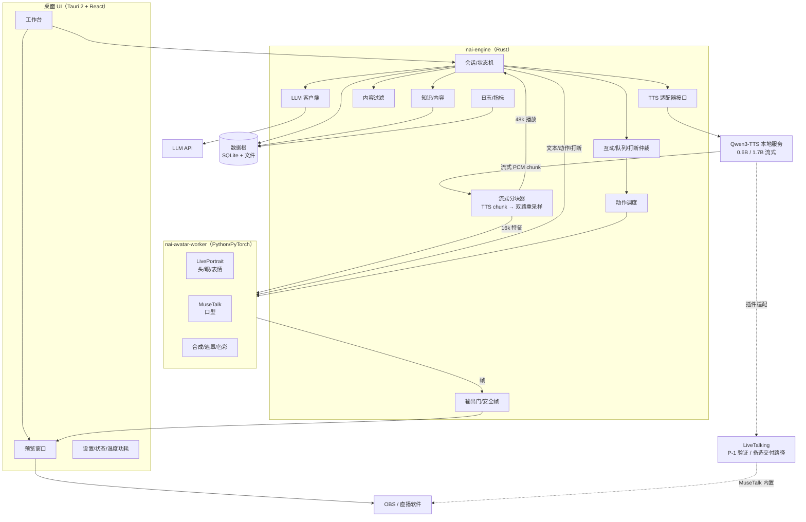

# 智能体赋能的本地数字人直播工作台 · V5.4 完整设计方案

| 项目 | 内容 |
|---|---|
| 版本 | V5.4 |
| 日期 | 2026-11-03（UTC+8） |
| 状态 | 在 V5.3 基线上的优化版；继承 V5.3 全部简化决策，仅升级模型选型与媒体管线 |
| 目标机型 | Windows 11 + RTX 5090 Laptop 24GB（Blackwell, sm_120）+ 32GB RAM |
| 核心模型 | **Qwen3-TTS（本地流式服务，0.6B/1.7B）** + MuseTalk 1.5（口型）+ LivePortrait（头眼/表情） |
| 快速验证路径 | **LiveTalking**（P-1 阶段用于端到端验证，备选交付路径） |
| 输出 | 本机窗口 + OBS 窗口捕获；可选本地录制；可选 RTMP 直推（经 LiveTalking/第三方） |
| 产品形态 | 单人、单机、单直播间、单形象的本地直播工作台 |
| 文档关系 | V5.3 归档；V4.8/V5.2 保持归档；本版沿用 V5.3 的 ACC 编号并新增 ACC-INT 组 |

---

## 0. 结论与设计立场

V5.4 不是断代，是 V5.3 的**定向升级**。V5.3 的骨架（三进程、Mode A/B/C、音频主时钟、epoch 防旧帧、停止/静音/接管最高优先级、约 45 项验收）全部保留，本轮只解决 V5.3 留下的四个开口：

1. **TTS 从抽象变具体**：V5.3 写"QwenTTS（本地服务）"，未锁定型号，并把"Qwen 非流式 → 首音慢"列为风险。V5.4 锁定 **Qwen3-TTS**（2026 年 1 月开源，Apache-2.0）：0.6B（约 4GB VRAM）与 1.7B（约 8GB VRAM）两档，原生流式，**首包延迟约 97ms**，3 秒参考音频克隆音色，支持中、英、日等 10 种语言。该风险项关闭。
2. **音频管线上流式**：V5.3 是"句级合成 + 预取 1–2 句"；V5.4 升级为**流式分块管道**——TTS 边产出 PCM 边喂播放与唇形，首音目标从 2.5s 收紧到 1.2s。
3. **增加快速验证路径**：V5.3 从零自研，M1（10 分钟口型样片）排在第 3 周。V5.4 新增 **P-1（第 0 周）**：用开源的 LiveTalking（Apache-2.0，原生集成 MuseTalk，TTS 引擎插件化，自带 WebRTC/RTMP 推流与打断机制）先验证"Qwen3-TTS → MuseTalk"端到端效果与资源占用，再决定自研主线的参数目标。LiveTalking 同时作为自研失败时的**备选交付路径**。
4. **补齐直播互动能力**：新增**软打断（barge-in）**——高优先级弹幕可打断当前讲解；以及笔记本特有的**散热/功耗管理**（锁帧、限功耗、温度墙记录）。

**一句话目标：一个人、一台 5090 笔记本、一个本地 Qwen3-TTS、一个 MuseTalk+LivePortrait 形象，首音 1.2 秒内开口、弹幕可打断、能连续讲解、被接管、被停止，并通过 OBS 稳定输出。**

---

## 1. 版本目标、范围与非目标

### 1.1 目标

| 编号 | 目标 | 验收方式 | 相对 V5.3 变化 |
|---|---|---|---|
| G1 | 本地 Qwen3-TTS 流式合成、可缓存、可取消、可测首包 | 首包/首音/长句/失败/取消记录 | **升级：要求流式与首包指标** |
| G2 | MuseTalk 让静态肖像或真人底版"对口型说话" | 10 分钟连续说话录像 | 不变 |
| G3 | LivePortrait 提供待机/倾听/表情/头眼动作 | 待机循环与动作片段 | 不变 |
| G4 | 两模型组合后不出现双嘴、明显接缝、音画漂移 | 30 分钟 OBS 录像 + 人工盲评 | 不变 |
| G5 | 单人操作：开始、静音、接管、停止、**打断** | 热键/面板实测 | **新增打断** |
| G6 | 本机窗口 + OBS 捕获 + 本地录制 | OBS 实际录像 | 不变 |
| G7 | 连续讲解 + 问答 + 可选弹幕 + **弹幕打断当前讲解** | 2 小时 / 8 小时长稳 | **升级** |
| G8 | 资源可控、失败有明确降级、**温度/功耗可观测** | VRAM/RAM/温度/功耗/掉帧/恢复记录 | **升级** |
| G9 | **P-1 快速验证**：LiveTalking 跑通 Qwen3-TTS→MuseTalk 端到端 | 第 1 周内 10 分钟口型录像 + 资源基线 | **新增** |

### 1.2 非目标（V5.4 明确不做，沿用 V5.3）

- 多工作区、多用户、多角色、团队协作；
- 逐句审批、审批投票、预算账本、费用对账、审计哈希链；
- 官方抖音/快手/视频号连接器、自动开播、自动发券、commerce；
- MCP/A2A、Marketplace、扩展 SDK、移动端、远程控制；
- 3D 全身、自由手势生成、舞蹈、多人连麦；
- 云端数字人渲染、云端 TTS；
- 多形象同时驻留、多直播间并发；
- ASR/VAD（作为可选后续，不阻塞主线）；
- 端到端生成全身动作的 AR 扩散视频模型（Causal Forcing++ 等，仅技术观察，不进主线）；
- 旧 V4.8/V5.2 数据、ACC、INV、任务编号的兼容与迁移。

### 1.3 与 V5.3 的关系

- V5.4 继承 V5.3 的全部十条简化决策（D1–D10），新增 D11–D14（见 §1.4）；
- 继承 V5.3 的 ACC 编号体系，修改 ACC-TTS 组、ACC-RES 组，新增 ACC-INT 组与阶段门 M0；
- 数据根从 `nai-v53` 改为 `nai-v54`（结构不变，直接复制迁移）。

### 1.4 关键决策（D1–D10 沿用 V5.3，以下为新增）

| # | 决策 | 解决 V5.3 的什么问题 |
|---|---|---|
| D11 | 锁定 Qwen3-TTS（0.6B/1.7B 两档可切换），原生流式分块消费 | "Qwen 非流式 → 首音慢"风险关闭；首音 2.5s→1.2s |
| D12 | 双路径：P-1 用 LiveTalking 快速验证 + 自研三进程为主线 | M1 从第 3 周提前到第 1 周；自研受阻时有备选交付 |
| D13 | 新增软打断（barge-in）与打断优先级 | V5.3 弹幕只能排队，互动感弱于 Vidu S1 类实时交互 |
| D14 | 显存三档配置 + 锁 25fps + 限功耗的散热策略 | 笔记本长播降频是实测风险，提前制度化 |

### 1.5 成功标准

V5.4 完成的最低标准：

1. 目标机上双击启动，5 分钟内进入"待机形象 + 可说话"状态；
2. 30 分钟连续讲解/问答/**打断**/接管/停止，OBS 录像可回放；
3. 无 P0 故障（停止失效、旧帧续播、音画严重错位、双嘴/双脸）；
4. Qwen3-TTS 首包/首音、MuseTalk、LivePortrait 的真实资源/延迟有记录；
5. P-1 的 LiveTalking 验证产出资源基线，且与自研目标的差距有结论；
6. 模型/素材/声音许可清单可审查（附录 A 给出已核查结论）；
7. 验收看板至少有 M0–M3 的 `passed` 项，而不是全部 pending。

### 1.6 从 cyber-xiaoya-live 借鉴什么

沿用 V5.3 §1.6，不重复。**新增一条借鉴自 LiveTalking**：TTS 引擎插件化（一个 `TTSAdapter` 接口，Qwen3-TTS 是首个实现，GPT-SoVITS/CosyVoice 可后续插入），避免引擎与某个 TTS 硬绑定。

---

## 2. 产品范围与用户流程

### 2.1 用户

沿用 V5.3：单人主播/讲解者；一台 Windows 笔记本；已有或愿意部署本地 Qwen3-TTS（V5.4 提供一键部署脚本）；有一个合法授权的真人肖像/短视频；使用 OBS 输出。

### 2.2 主流程

```text
打开工作台
  → 检查引擎/模型/Qwen3-TTS/OBS
  → 选择形象（内置示例 / 导入肖像 / 导入短视频）
  → 试听声音（3 秒参考音频克隆，可选）
  → 输入主题或资料（可选）
  → 预览：待机 / 说一句
  → 打开输出窗口
  → OBS 捕获窗口 + 音频
  → 开始讲解 / 回答 / 弹幕打断 / 接管 / 静音 / 停止
  → 结束，生成本场记录
```

### 2.3 功能清单

#### 必须有（V5.4 主线）

- 本地 Qwen3-TTS **流式**合成、试听、缓存、**3 秒参考音频克隆**；
- MuseTalk 口型；
- LivePortrait 待机/倾听/基础表情；
- 一个当前形象；
- 文字聊天/问答；
- 主题/资料驱动的连续讲解；
- **软打断：高优弹幕/手动按钮打断当前讲解**；
- 本机预览窗口；
- OBS 窗口捕获；
- 开始/暂停/静音/接管/停止；
- 本地会话记录/转写；
- 内容过滤、动作白名单；
- 配置页、状态页（含温度/功耗）、日志。

#### 可选（不阻塞主线）

- 通用弹幕 HTTP 入口（第三方采集器）；
- 简单礼物感谢；
- 简单动作按钮；
- 本地录制（OBS 或内置）；
- 知识文档导入/FTS 检索；
- OBS 虚拟摄像头（直接使用 OBS 自带功能，不自研）；
- ASR/VAD；
- LivePortrait 叠加模式（Mode B）；
- RTMP 直推（经 LiveTalking 备选路径或第三方）。

#### 明确不做

见 §1.2。

---

## 3. 总体架构

### 3.1 逻辑架构



### 3.2 进程拓扑

| 进程 | 职责 | 故障边界 |
|---|---|---|
| `nai-desktop` | Tauri/React UI、预览、设置、热键 | 崩溃只影响 UI；engine 可继续待机 |
| `nai-engine` | 会话、LLM、知识、互动/**打断仲裁**、动作、过滤、TTS 适配、**流式分块**、输出门、日志 | 崩溃时 worker 停止输出；launcher 重启 |
| `nai-avatar-worker` | LivePortrait + MuseTalk + 合成；共享内存出帧 | 崩溃时 engine 切安全帧/降级 |
| `qwen3-tts` | 本地 TTS 服务（0.6B/1.7B，自带部署脚本） | 不可达时文字模式/停止，不伪造音频 |
| `OBS` | 外部直播软件 | 崩溃时本机预览仍可看，直播中断 |
| `livetalking` | **仅 P-1 阶段**：端到端验证与资源基线 | 与主线隔离，不进发布包 |

**V5.4 主线仍是 3 个自研进程 + 1 个外部 TTS + 1 个外部 OBS。** LiveTalking 是开发期工具与备选路径，不增加发布产物复杂度。

### 3.3 技术栈

| 层 | 选择 | 说明 |
|---|---|---|
| 桌面 | Tauri 2 + React 19 + TypeScript + Vite | 沿用 |
| 引擎 | Rust + Tokio + Serde + Tracing | 单进程组合根 |
| 模型 worker | **Python 3.11 + PyTorch ≥2.7 + CUDA ≥12.8** | **Blackwell（sm_120）硬性要求**；MuseTalk/LivePortrait 旧依赖需锁定已知可用组合（见 §12.1） |
| TTS | Qwen3-TTS（transformers/vLLM 部署） | 0.6B 默认，1.7B 高配；vLLM 部署需验证 sm_120 兼容，不行则 transformers 推理 |
| 数据 | SQLite WAL + 文件对象 | 单库、单数据根 |
| 控制 IPC | 命名管道 + 长度前缀 JSON | 简单、可调试 |
| 媒体 IPC | Windows 共享内存环形缓冲 | 帧/PCM 不走 JSON |
| 本地 HTTP | Axum/axum-server，绑定 `127.0.0.1` | UI 与可选弹幕入口 |
| 输出 | 无边框窗口 + OBS 窗口捕获 | 不做自研虚拟摄像头 |
| 日志 | tracing + JSONL 文件 | 本场时间线 + 错误 |

### 3.4 与 V5.3 的架构差异

| 维度 | V5.3 | V5.4 |
|---|---|---|
| TTS | 抽象"QwenTTS"，句级合成+预取 | 锁定 Qwen3-TTS，原生流式分块 |
| 打断 | 无（弹幕排队） | barge-in 仲裁器，三档优先级 |
| 验证路径 | 仅自研主线 | LiveTalking P-1 双路径 |
| GPU 适配 | "CUDA 12.x" | CUDA 12.8+/PyTorch 2.7+（sm_120 硬性） |
| 资源观测 | VRAM/RAM | VRAM/RAM/**温度/功耗/降频事件** |
| 数据根 | `nai-v53` | `nai-v54`（结构不变） |

---

## 4. 本地模型与媒体管线

### 4.1 三模型职责边界（含 Qwen3-TTS 具体化）

| 模型 | 输入 | 输出 | 职责 | 不负责 |
|---|---|---|---|---|
| **Qwen3-TTS** | 文本流、声线/参考音频、语言、语速 | **流式 PCM**（首包约 97ms） | 把文本变成声音；3 秒克隆音色 | 口型、表情、动作 |
| MuseTalk | 人脸底图/帧 + 16k 音频特征 | 口型同步的人脸帧 | 嘴部区域同步 | 头姿、眼神、全身 |
| LivePortrait | 源肖像 + 驱动视频/动作 | 头眼/表情动画帧 | 待机、倾听、表情、头动 | 音频口型、全身动作 |
| 合成器 | 两模型输出 | 最终帧 | 遮罩、对齐、色彩、时序 | 生成新内容 |

**Qwen3-TTS 部署档位：**

| 档位 | 模型 | 显存（估） | 适用 |
|---|---|---|---|
| 标配（默认） | Qwen3-TTS 0.6B | ~4GB | 日常直播；为 MuseTalk+LivePortrait 让出显存 |
| 高配 | Qwen3-TTS 1.7B | ~8GB | 音质优先；需按 §11.2 满配预算核验 |

**关键约束（沿用 V5.3）：**

- 同一时刻嘴部只有一个 owner：**说话时 MuseTalk 拥有嘴部**；
- LivePortrait 不可以在说话时同时驱动嘴部，否则会双嘴/抖动；
- 说话时头眼可以冻结、低频更新，或用 Mode B 叠加；
- 不做全身、不做手指、不做任意舞蹈。

### 4.2 三种组合模式（沿用 V5.3，结论不变）

#### Mode A：分时组合（V5.4 默认）

```text
待机/倾听：LivePortrait 驱动头眼/表情，循环播放
说话：暂停 LivePortrait，MuseTalk 用当前帧/源图生成口型
切换：150–300ms 遮罩/淡入淡出，嘴部 owner 切换
```

优点：GPU 峰值低、实现简单、稳定；缺点：说话时头动较少。

#### Mode B：叠加组合（可选，实测后启用）

```text
LivePortrait 以 10–25fps 生成头眼/表情底帧
MuseTalk 对每帧生成嘴部
合成器把嘴部 ROI 贴回 LivePortrait 帧
```

约束（沿用 V5.3）：共用同一人脸框/关键点/裁剪；嘴部 mask 羽化 + 色彩匹配 + 时序平滑；嘴部 owner 仍是 MuseTalk；对齐失败/接缝明显时自动回 Mode A；只有 Mode B 通过 30 分钟录像与人工盲评，才允许作为默认。

#### Mode C：降级

- 只有 MuseTalk + 静态肖像；
- 或只有内置 2D + Qwen3-TTS；
- 或纯文字模式。

**降级必须在 UI 明确显示，不允许静默切换。**

### 4.3 音频管线（V5.4 重写：流式分块）

```text
文本流（LLM 边生成边出句）
 → 分句器（标点/长度双触发，首句优先短句）
 → Qwen3-TTS 流式合成（chunk ≈ 200–400ms PCM）
 → 分块器（chunk 序号/epoch/样本偏移打标）
 ├─ 播放分支：重采样到 48k → 音频队列 → WASAPI
 └─ 口型分支：重采样到 16k → MuseTalk 音频特征（与播放并行，不等整句）
```

规则：

- **音频时钟是主时钟**；帧选择按已播放样本位置，不按墙钟（沿用 V5.3）；
- **流式优先**：Qwen3-TTS 原生流式，chunk 到达即消费；首包目标 ≤150ms（官方约 97ms，留网络/调度余量）；
- 句级预取保留为**兜底**（服务降级到非流式时退回 V5.3 行为）；
- 取消/打断：清空待播队列 + 标记 session epoch；worker 丢弃旧 epoch 音频与帧；
- TTS 输出采样率以实际模型为准（Qwen3-TTS 以模型卡为准，管线内统一重采样，不假设 24k/48k）；
- 服务端取消不可用时，明确记录"客户端已丢弃，服务端可能仍在推理"（沿用 V5.3）；
- 禁止把 16k 特征时钟和 48k 播放时钟混用（沿用 V5.3）。

### 4.4 打断（barge-in）设计（V5.4 新增）

**触发源（优先级从高到低）：**

1. 停止/静音/接管（最高，V5.3 已有）；
2. 操作员手动打断按钮/热键；
3. 高优弹幕（白名单观众、关键词命中、礼物联动）——默认关闭，设置中开启。

**行为（两档，可配置）：**

| 档位 | 行为 | 适用 |
|---|---|---|
| 软打断（默认） | 当前句播完，丢弃后续队列，立即回答新问题 | 大多数直播 |
| 硬打断 | 200ms 内淡出当前音频，清队列，立刻切新回答 | 高互动场景 |

**约束：**

- 打断走 epoch 机制：新回答分配新 epoch，旧 epoch 音频/帧一律丢弃（复用 V5.3 的防旧帧设计）；
- 打断不删除已发生转写；讲解被打断后记录"讲解检查点"，回答完可选择回到检查点续讲；
- 打断频率限制（默认每分钟 ≤2 次弹幕打断），防弹幕刷爆；
- 打断事件进本场时间线，供复盘。

### 4.5 视频管线

```text
源肖像/短视频
 → 人脸检测/关键点/裁剪（统一 ROI）
 → LivePortrait（待机/表情）
 → MuseTalk（说话口型）
 → 合成（遮罩/色彩/时序）
 → BGRA 帧
 → 共享内存环形缓冲（3–4 槽）
 → engine 输出门
 → 预览窗口 / OBS
```

规则（沿用 V5.3，两处微调）：

- 输出画布默认 1280×720 @ 25fps；MVP 可先 960×540；
- MuseTalk 人脸 ROI 按官方 256×256（或实测最佳），**720p 是画布，不是生成脸分辨率**；
- LivePortrait 源图建议 512–1024 短边；驱动视频固定机位、正面/小角度；
- 帧携带 `seq/epoch/pts/source_sample`；
- 迟到帧丢弃；连续迟到 >200ms 显示安全帧；
- **打断后立即停止旧 epoch 口型，画面切倾听/待机帧**（新增，配合 §4.4）；
- 停止/静音后不得继续显示旧嘴型配新音频。

### 4.6 合成细节（沿用 V5.3）

| 问题 | 处理 |
|---|---|
| 双嘴 | 说话时 LivePortrait 嘴部区域冻结/遮罩；MuseTalk 唯一 owner |
| 接缝 | 嘴部 mask 羽化 8–16px；Lab/直方图色彩匹配；时序平滑 |
| 抖动 | 人脸框平滑；关键点低通；帧间光流/位移限制 |
| 身份漂移 | 固定源图/底版；每帧与参考帧做相似度检查；异常回安全帧 |
| 侧脸/遮挡 | 超出认证角度/手遮嘴时拒绝口型或切静默展示 |
| 牙齿/表情 | 仅使用模型支持范围；不做夸张表情承诺 |

### 4.7 模型加载、预热与缓存

- worker 启动时只加载当前形象的 MuseTalk + LivePortrait；
- 预热：跑 2–3 帧空转，测量首帧；
- **Qwen3-TTS 独立服务常驻**（不随 worker 启停），预热：启动后合成一句短文本测首包；
- 模型常驻；空闲 10 分钟可卸载 LivePortrait（可配置），保留 MuseTalk 与 TTS；
- 换形象/换模型必须排空当前队列，重新预热；
- 不允许多个模型副本同时驻留；
- 模型/权重/依赖/许可必须有哈希与清单（附录 A 已给出核查结论）。

### 4.8 质量与失败分支

| 实验结果 | 处置 |
|---|---|
| Mode B 质量好、资源够 | 允许作为可选模式 |
| Mode B 接缝/双嘴明显 | 回 Mode A |
| LivePortrait 资源不足 | 降 LivePortrait 帧率/分辨率，或只待机用 |
| MuseTalk 资源不足 | 降画布/ROI/帧率，或回内置 2D |
| 两者都不够 | 纯文字模式，明确提示 |
| Qwen3-TTS 不可用 | 文字模式/停止，不伪造音频 |
| **TTS 流式断流**（chunk 间隔 >800ms） | 按句重试一次；仍失败则降级句级模式并提示（新增） |
| **显存顶满（可用 <1.5GB）** | 自动切 0.6B TTS → 关 LivePortrait → Mode C，逐步降级且 UI 明示（新增） |

---

## 5. 进程、IPC 与数据面

### 5.1 进程职责

#### `nai-engine`（Rust）

- 会话状态机：`idle → preparing → ready → live → stopped/faulted`；
- LLM 调用、分句、知识检索、互动队列、**打断仲裁**；
- **TTS 适配器接口（TTSAdapter）**：Qwen3-TTS 为首个实现；健康、合成、流式消费、取消、缓存；
- **流式分块器**：chunk 打标（epoch/seq/样本偏移）、双路重采样（48k 播放 / 16k 特征）；
- 动作调度：手动/关键词/待机动作；
- 内容过滤、动作白名单；
- 输出门：帧选择、安全帧、静音、停止；
- HTTP API、日志、指标（含温度/功耗采集）、会话记录；
- 管理 worker 生命周期（启动/心跳/重启/停止）。

#### `nai-avatar-worker`（Python）

- 加载 MuseTalk/LivePortrait；
- 接收 `load_character`、`speak`（含流式 chunk 引用）、`idle`、`action`、`interrupt`、`stop`；
- 输出帧到共享内存；
- 上报健康、帧序号、耗时、VRAM；
- 不自行决定播放、不直接打开音频设备。

#### `nai-desktop`

- 预览、聊天、控制、设置、**温度/功耗状态条**；
- 不加载模型、不持有密钥明文；
- 通过本地 HTTP/WS 与 engine 通信。

### 5.2 控制 IPC（engine ↔ worker）

- 传输：Windows 命名管道 `\\.\pipe\nai-avatar-v54`；
- 编码：4 字节小端长度 + JSON；
- 版本：`protocol_version: 2`（V5.3 的 v1 不兼容：speak 改为流式）；
- 消息：

```json
{"type":"load_character","character_id":"default","source":"...","driving_idle":"...","mode":"time_sliced"}
{"type":"speak_begin","epoch":3,"seq":1,"text":"...","sample_rate":16000,"stream":true}
{"type":"speak_chunk","epoch":3,"seq":1,"chunk":0,"audio_pcm_ref":"shm:audio/3/1/0","samples":9600}
{"type":"speak_chunk","epoch":3,"seq":1,"chunk":1,"audio_pcm_ref":"shm:audio/3/1/1","samples":9600}
{"type":"speak_end","epoch":3,"seq":1,"total_samples":38400}
{"type":"interrupt","epoch":4,"mode":"soft"}
{"type":"idle","epoch":4}
{"type":"action","epoch":4,"action":"nod"}
{"type":"stop","epoch":5}
{"type":"stats"}
```

- 响应：

```json
{"type":"ready","models":["musetalk","liveportrait"],"vram_mb":12345}
{"type":"frame","epoch":3,"seq":42,"pts_ms":1680,"shm":"frame/3/42","w":1280,"h":720}
{"type":"error","code":"MODEL_OOM","message":"..."}
```

### 5.3 媒体 IPC

- 帧：共享内存环形缓冲，3–4 槽；
- 格式：BGRA8、1280×720、stride 5120；
- 每槽头：`epoch/seq/pts_ms/source_sample/state`；
- PCM：独立共享内存环形缓冲，**chunk 粒度**（约 200–400ms/槽）；
- 规则（沿用 V5.3）：
  - 生产者不能覆盖未释放槽；
  - 消费者取最新可用帧；
  - 旧 epoch 帧/PCM 直接丢弃；
  - 不把帧/PCM 放进 JSON/Base64。

### 5.4 生命周期与心跳（沿用 V5.3）

```text
engine 启动
 → 启动 worker（或连接已有）
 → worker ready
 → 加载角色
 → 预热（worker 空转 + TTS 首包探测）
 → ready
 → live
```

- engine 每 1s 检查 worker 心跳；每 30s 探测 TTS 服务健康；
- worker 3s 无响应：engine 切安全帧，尝试重启（最多 2 次/场）；
- 重启失败：降级到内置 2D 或停止；
- 进程退出：launcher/engine 负责杀掉子进程，避免残留 GPU 占用。

### 5.5 安全边界（沿用 V5.3）

- worker 只接受本地命名管道，不监听公网；
- worker 不执行任意脚本/命令，只接受白名单消息；
- 模型/权重路径必须在数据根内，拒绝 `..`/绝对路径/符号链接逃逸；
- worker 以当前用户运行，不要求管理员；
- engine 对 worker 输出做格式/尺寸/epoch 校验；
- 任何不确定状态 → 安全帧/静音，不输出。

---

## 6. 功能设计

### 6.1 直播会话

状态：

```text
idle → preparing → ready → live → paused → live
                  ↘ stopped
                  ↘ faulted
```

操作：

- **开始**：检查 Qwen3-TTS/worker/OBS/形象/许可 → 预热 → live；
- **暂停**：停止新生成，当前句可播完或立即静音（可配置）；
- **静音**：立即停数字人音频，画面切待机；
- **打断**（新增）：见 §4.4，软/硬两档；
- **接管**：停 AI 语音/动作，切真人麦克风（直通 OBS），保留上下文；
- **停止**：取消 LLM/TTS/worker 任务，清队列，静音，安全帧，结束会话。

规则（沿用 V5.3）：

- 停止/静音永远最高优先级；
- 接管不删除已有转写/内容；
- 恢复 AI 需操作员再次点击，不自动恢复；
- 不自动开播平台，只输出本机窗口/OBS。

### 6.2 形象与声音

**形象：** 沿用 V5.3（内置示例 / 导入肖像 ≤20MB / 导入短视频 ≤120s / 单当前形象 / 许可勾选 / 状态显示 / 预览四动作）。

**声音（升级）：**

- Qwen3-TTS 声线列表 + **3 秒参考音频克隆**（导入 WAV/MP3，自动裁剪/响度归一）；
- 试听（含首包延迟显示）；
- 语速/音量/语言；
- 模型档位选择：0.6B（默认）/ 1.7B，切换需重启 TTS 服务并重新预热；
- 显示"本地 Qwen3-TTS / 不可达 / 模型未知 / 档位"；
- 声音许可确认（克隆他人音色需额外声明，见 §10.5）。

### 6.3 讲解/内容（沿用 V5.3）

- 用户输入主题/大纲/资料；
- LLM 流式生成讲解段落（可编辑），**边生成边分句边送 TTS**（配合流式管线）；
- 按段落合成/播放；连续讲解：段落队列，播完自动下一段；
- 暂停/继续/跳过；
- 可选知识文档导入（TXT/MD），FTS 检索后注入 LLM；
- 无资料时明确"自由生成"，不冒充事实；
- 价格/参数/承诺类内容需用户自己核对。

### 6.4 对话/问答（沿用 V5.3 + 打断）

- UI 文字提问；可选弹幕事件；
- 队列：去重、过期、上限；
- **高优问题可打断当前讲解**（§4.4，默认关闭弹幕打断，手动打断常开）；
- LLM 回答：人设 + 知识片段 + 当前节目上下文；
- 回答分句 → TTS → 口型；
- 回答后回到讲解检查点（可选）；
- 失败：文字提示/跳过，不伪造语音。

### 6.5 弹幕/礼物（可选，沿用 V5.3）

V5.4 **不内置任何平台连接器**。只提供通用入口：

```http
POST http://127.0.0.1:8780/api/events
Content-Type: application/json

{"kind":"danmaku","nick":"观众","text":"你好","priority":"normal"}
{"kind":"danmaku","nick":"房管","text":"能讲讲价格吗","priority":"high"}
{"kind":"gift","nick":"观众","gift":"小心心","count":1}
```

来源由用户自己的采集器负责，合规风险由用户承担。

处理：

- 内容过滤 → 队列 → 复读/回答；
- `priority:high` 且打断开关开启时进入打断仲裁（§4.4）；
- 礼物：简单模板感谢（可关）；
- 不刷屏：同人/同文本合并、每分钟上限、打断频率限制；
- 不接平台官方事件，不伪造"已连接平台"。

### 6.6 动作（沿用 V5.3）

**动作来源：** 手动按钮/热键；关键词匹配（本地词表，零成本）；待机随机动作（可关）；可选 LLM 动作编译（默认关闭）。

**动作白名单（示例）：** `idle`、`listen`、`nod`、`shake`、`smile`、`wink`、`look_left`、`look_right`、`wave`、`think`。

规则（沿用 V5.3）：只执行 LivePortrait 驱动片段/内置动作；不支持的动作明确拒绝；动作优先级：停止/接管/**打断** > 手动 > 关键词 > 待机；同动作冷却、队列上限；动作不阻塞停止；不做全身/舞蹈/任意手势。

### 6.7 输出、OBS 与录制

- 本机无边框预览窗口（可置顶、可隐藏）；
- OBS 窗口捕获视频；
- 音频输出到系统默认设备，OBS 捕获桌面音频；可选独立音频设备（后续）；
- 本地录制：首选 OBS 录制；可选内置录制（后续）；
- **虚拟摄像头：直接使用 OBS 自带虚拟摄像机，不自研**（V5.3 列为后续可选，V5.4 明确路径）；
- **RTMP 直推（可选）：经 P-1 的 LiveTalking 路径或 OBS 推流，工作台自身不内置推流协议栈**（新增明确）；
- UI 明确区分：预览窗口 ≠ 平台已开播；OBS 进程 ≠ 已捕获；OBS 有画面 ≠ 平台已推流。

### 6.8 复盘（沿用 V5.3 + 新指标）

- 本场时间线：开始/停止/**打断**/用户话、AI 话、动作、错误；
- 转写文本；
- 指标：**TTS 首包、首音**、首帧、帧率、掉帧、AV 偏差、**温度/功耗峰值**、资源峰值；
- 导出 JSON/Markdown；
- 不做复杂知识发布/审批，只做"下场可复用"的简单草稿。

### 6.9 设置与热键

- LLM：base_url/model/key（存系统凭据）；
- **Qwen3-TTS：endpoint/档位（0.6B/1.7B）/声线/参考音频/语言/超时/流式开关**；
- 形象：源图/驱动视频/模式 A/B/C；
- 输出：分辨率/帧率/窗口置顶/OBS 提示；
- **打断：开关/软硬档/弹幕打断白名单/频率限制**（新增）；
- 过滤：红线词/屏蔽词/动作黑名单；
- 热键：停止/静音/接管/**打断**/开始；
- **性能：锁帧（默认 25fps）/功耗上限提示/温度告警阈值**（新增）；
- 日志级别/保留天数；
- 模型路径/重新探测。

### 6.10 简化治理（沿用 V5.3）

V5.4 的治理 = **单人操作员 + 运行时护栏**，不是多角色审批。

| 机制 | V5.4 做法 |
|---|---|
| 身份 | 本机 OS 用户；无登录/角色 |
| 权限 | 能打开工作台即可操作；无审批 |
| 停止 | 热键/按钮立即生效，最高优先级 |
| 静音 | 只停数字人音频；真人麦克风不受影响 |
| 接管 | 停 AI，切真人音轨 |
| 打断 | 软/硬两档；弹幕打断默认关闭 |
| 内容 | 输入/输出过滤 + 红线 + 动作白名单 |
| 审计 | 本地会话日志；保留 7 天；无哈希链 |
| 预算 | 不做账本；只显示 API/本地资源估算 |
| 许可 | 用户勾选/记录 + 附录 A 已核查清单 |
| 平台 | 不做官方连接器；OBS/手动 |

---

## 7. 数据模型与配置

### 7.1 单数据根

默认：

```text
%LOCALAPPDATA%\nai-v54\
  config.json
  nai.db
  assets\
    characters\
    voices\
    knowledge\
    models\
  recordings\
  logs\
  cache\
```

沿用 V5.3 全部规则（单数据根、相对路径、拒绝逃逸、可复制迁移）。V5.3 → V5.4 迁移：复制数据根目录改名 + 配置项补默认值（TTS 档位、打断开关、性能项），不做数据库结构变更（见 §7.2 新增列均有默认值）。

### 7.2 SQLite 表（最小集，沿用 + 微调）

| 表 | 字段 | 说明 | 变化 |
|---|---|---|---|
| `settings` | key, value_json, updated_at | 非敏感设置 | 不变 |
| `characters` | id, name, source_image, driving_idle, license_note, created_at | 单当前形象 | 不变 |
| `voices` | id, name, ref_audio, params_json, created_at | Qwen3-TTS 声线/克隆参考 | params_json 增加 `model_size` |
| `knowledge_docs` | id, title, path, text, updated_at | 可选知识 | 不变 |
| `sessions` | id, started_at, ended_at, mode, config_json, metrics_json | 场次 | metrics_json 增加温度/功耗/首包 |
| `messages` | id, session_id, role, text, audio_path, started_at, duration_ms, source | 转写/语音 | 不变 |
| `actions` | id, session_id, action, source, at | 动作 | 不变 |
| `events` | id, session_id, kind, payload_json, at | 弹幕/礼物/错误/**打断** | kind 增加 `interrupt` |
| `recordings` | id, session_id, path, duration_ms, size | 录制 | 不变 |

- FTS5 可选：`knowledge_fts`；
- 不建 workspace/principal/role/approval/budget/audit/outbox 表；
- 所有时间 UTC，展示本地时区；金额不使用。

### 7.3 配置示例（V5.4）

```json
{
  "app": {
    "data_root": "E:/nai-data",
    "language": "zh-CN",
    "log_retention_days": 7
  },
  "server": {
    "host": "127.0.0.1",
    "port": 8780
  },
  "llm": {
    "base_url": "https://api.deepseek.com",
    "model": "deepseek-chat",
    "api_key_ref": "keyring:nai/llm",
    "temperature": 0.7,
    "max_tokens": 512,
    "stream": true
  },
  "tts": {
    "engine": "qwen3-tts",
    "model_size": "0.6B",
    "endpoint": "http://127.0.0.1:8000",
    "voice": "default",
    "ref_audio": "assets/voices/default/ref.wav",
    "stream": true,
    "chunk_ms": 300,
    "timeout_ms": 30000,
    "prefetch_sentences": 2
  },
  "avatar": {
    "engine": "musetalk+liveportrait",
    "character": "default",
    "mode": "time_sliced",
    "source_image": "assets/characters/default/source.png",
    "driving_idle": "assets/characters/default/idle.mp4",
    "output": {"width": 1280, "height": 720, "fps": 25}
  },
  "interrupt": {
    "enabled": true,
    "mode": "soft",
    "danmaku_interrupt": false,
    "danmaku_whitelist": [],
    "max_per_minute": 2
  },
  "performance": {
    "lock_fps": 25,
    "power_limit_hint_w": 140,
    "temp_alert_c": 87,
    "auto_degrade_vram_free_mb": 1536
  },
  "output": {
    "window": true,
    "always_on_top": true,
    "obs_capture_hint": true,
    "virtual_camera": "obs_builtin"
  },
  "filters": {
    "redline": ["政治", "色情", "赌博", "毒品", "枪支", "自杀"],
    "blocked_actions": ["dance", "undress"],
    "max_danmaku_per_minute": 20
  },
  "hotkeys": {
    "stop": "Ctrl+Shift+S",
    "mute": "Ctrl+Shift+M",
    "takeover": "Ctrl+Shift+T",
    "interrupt": "Ctrl+Shift+I"
  }
}
```

### 7.4 迁移与备份（沿用 V5.3）

- V5.4 不兼容旧 V4.8/V5.2 数据库；V5.3 数据根复制改名即可（§7.1）；
- 旧用户资产通过"导入"进入新数据根（肖像/视频/参考音频复制 + 哈希；知识文档复制 + 文本提取）；
- 备份：关闭应用后复制数据根；或提供"导出 zip"；
- 恢复：新机解压 + 校验哈希；
- 不做复杂 journal/outbox/跨版本迁移。

---

## 8. API

### 8.1 本地 HTTP（`127.0.0.1:8780`）

| 方法 | 路径 | 说明 | 变化 |
|---|---|---|---|
| GET | `/api/status` | 引擎/worker/Qwen3-TTS/OBS/会话/**温度/功耗**状态 | 升级 |
| POST | `/api/session/start` | 开始 | 不变 |
| POST | `/api/session/stop` | 停止 | 不变 |
| POST | `/api/session/pause` | 暂停 | 不变 |
| POST | `/api/session/resume` | 继续 | 不变 |
| POST | `/api/session/mute` | 静音数字人 | 不变 |
| POST | `/api/session/takeover` | 真人接管 | 不变 |
| POST | `/api/session/interrupt` | **手动打断（soft/hard）** | **新增** |
| POST | `/api/chat` | 文字问答 | 不变 |
| POST | `/api/say` | 直接说一句 | 不变 |
| POST | `/api/narrate/start` | 开始讲解（主题/脚本） | 不变 |
| POST | `/api/narrate/stop` | 停止讲解 | 不变 |
| POST | `/api/action` | 手动动作 | 不变 |
| POST | `/api/events` | 弹幕/礼物通用入口（含 priority） | 升级 |
| GET | `/api/characters` | 形象列表/当前 | 不变 |
| POST | `/api/characters/import` | 导入肖像/视频 | 不变 |
| POST | `/api/characters/select` | 选择当前形象 | 不变 |
| POST | `/api/tts/preview` | 试听（返回首包/首音耗时） | 升级 |
| POST | `/api/tts/clone` | **3 秒参考音频克隆声线** | **新增** |
| POST | `/api/tts/model_size` | **切换 0.6B/1.7B（重启 TTS 服务）** | **新增** |
| GET | `/api/config` | 脱敏配置 | 不变 |
| POST | `/api/config` | 更新配置 | 不变 |
| GET | `/api/session/report` | 本场记录 | 不变 |
| POST | `/api/worker/restart` | 重启 worker | 不变 |

### 8.2 事件入口

```json
{"kind":"danmaku","nick":"观众","text":"你好","priority":"normal"}
{"kind":"gift","nick":"观众","gift":"小心心","count":1}
```

- 永远返回 200 + `{queued, reason}`；
- 过滤/限流/打断仲裁在 engine；
- 不提供平台鉴权/cookie/签名；
- 不把外部事件当系统指令。

### 8.3 错误码

| 码 | 含义 | 变化 |
|---|---|---|
| `ENGINE_NOT_READY` | 引擎未就绪 | 不变 |
| `QWEN_UNAVAILABLE` | Qwen3-TTS 不可达 | 不变 |
| `TTS_STREAM_STALLED` | **TTS 流式断流（chunk 超时）** | **新增** |
| `MODEL_MISSING` | 模型/权重缺失 | 不变 |
| `MODEL_OOM` | 显存不足 | 不变 |
| `GPU_THERMAL_THROTTLE` | **温度墙降频（提示降级）** | **新增** |
| `WORKER_LOST` | worker 失联 | 不变 |
| `AUDIO_DEVICE_LOST` | 音频设备丢失 | 不变 |
| `INVALID_REQUEST` | 参数错误 | 不变 |
| `UNSUPPORTED_ACTION` | 动作不在白名单 | 不变 |
| `LICENSE_NOT_CONFIRMED` | 形象/声音许可未确认 | 不变 |
| `SESSION_NOT_LIVE` | 会话未开始 | 不变 |

### 8.4 音频/视频数据面（沿用 V5.3）

- 控制面只传引用/序号/时间戳；
- 帧/PCM 走共享内存（PCM 按 chunk 槽位，见 §5.3）；
- 不允许把 Base64 帧放进 HTTP/IPC；
- 所有媒体引用带 `epoch/seq`，旧 epoch 拒绝。

---

## 9. UI

### 9.1 主界面

```text
┌─────────────────────────────────────────────────────────┐
│ 状态：引擎 ●  TTS(0.6B) ●  Worker ●  OBS ○  72°C 118W      │
│ [停止][静音][接管][打断]                                    │
├──────────────────────────┬──────────────────────────────┤
│                          │  当前节目/讲解                 │
│      形象预览/输出窗口      │  - 下一段 / 进度              │
│      （16:9）             │  问答/弹幕                    │
│                          │  - 观众问题（高优可打断标记）    │
│                          │  - 回答状态                    │
├──────────────────────────┴──────────────────────────────┤
│ [输入聊天] [发送] [说一句] [动作▾] [开始/暂停讲解]           │
└─────────────────────────────────────────────────────────┘
```

### 9.2 设置页

- 模型：Qwen3-TTS 端点/**档位（0.6B/1.7B）**/声线/参考音频克隆/流式开关；形象源图/驱动视频；
- 输出：分辨率/帧率/窗口/OBS 提示；
- LLM：base_url/model/key；
- **打断：开关/软硬档/弹幕打断白名单/频率限制**；
- 过滤：红线/屏蔽词/动作黑名单；
- 热键（含打断）；
- **性能：锁帧/功耗提示/温度告警**；
- 日志/数据根/备份；
- 许可确认。

### 9.3 状态与错误（沿用 V5.3 三层模型 + 扩展）

每个依赖显示三层：进程/服务存在 → 连接/能力 → 实际信号。**新增第四层：持续健康**——温度、功耗、降频事件、TTS 流式稳定性（chunk 间隔 P95）。

规则（沿用 V5.3）：未知显示"未知"，不显示"已连接"；失败给出原因 + 修复按钮；降级显示当前模式（Mode A/B/C、文字模式、TTS 档位）；停止/静音/接管/**打断**始终可见、可键盘到达。

### 9.4 空态与引导

- 无形象：显示内置示例 + "导入肖像"；
- 无 TTS：显示"仅文字模式" + **一键部署 Qwen3-TTS 0.6B 脚本入口**；
- 无声线：引导"录制/导入 3 秒参考音频"；
- 无模型：显示缺失清单 + 下载/路径；
- 无 OBS：显示"仅本机预览" + OBS 指南；
- 首次使用：3 步（选形象 → 试听 → 预览）。

---

## 10. 安全与合规（简化）

### 10.1 单操作员模型（沿用 V5.3）

- 本机 OS 用户即操作员；无登录、角色、审批、投票；
- 能打开工作台 = 可操作；
- 不做"模型自批准"；不把外部文本当指令。

### 10.2 停止/静音/接管/打断

| 操作 | 行为 | 优先级 |
|---|---|---|
| 停止 | 取消 LLM/TTS/worker，清队列，静音，安全帧，结束 | 最高 |
| 静音 | 只停数字人音频；画面待机 | 高 |
| 接管 | 停 AI，切真人麦克风；保留上下文 | 高 |
| 打断 | 软：当前句播完清后续；硬：200ms 淡出立即切 | 中高 |
| 暂停 | 停新生成，当前句可播完 | 中 |

- 停止不等待动作/句子结束；
- 停止后旧帧/旧音频不得续播；
- 恢复需显式点击；
- 紧急热键不依赖 UI 焦点。

### 10.3 内容过滤（沿用 V5.3）

- 输入：红线正则、屏蔽词、提示词注入；
- 输出：同样过滤；命中则丢弃/替换并记录；
- 动作：白名单；红线动作直接拒绝；
- 不对抗平台审核做"绕过"；只做"避免触发"。

### 10.4 凭据（沿用 V5.3）

- LLM key 存 Windows 凭据管理器/系统 keyring；
- Qwen3-TTS 本地服务默认无 key；
- 不在 UI/日志/报告输出明文；配置文件脱敏展示；支持一键清除凭据。

### 10.5 许可（升级：从"待核查"到"已核查结论"）

- 形象：用户勾选"有权使用"；
- 声音：用户勾选"有权克隆/使用"；**克隆他人音色必须单独声明授权关系**（新增）；
- 音乐/素材：用户负责；
- 记录许可文本/时间/来源；
- 不把"勾选"当作法律证明；
- 模型/权重许可：**附录 A 已给出核查结论**——Qwen3-TTS（Apache-2.0）、MuseTalk（MIT）、LivePortrait（MIT）代码与权重可商用；**唯一红线：LivePortrait 默认依赖 InsightFace buffalo_l 检测模型（非商用许可），发布前必须替换为可商用人脸检测方案（见附录 A 处置项）**。

### 10.6 日志与保留（沿用 V5.3）

- 本地 JSONL + SQLite 事件；默认保留 7 天；
- 不默认保存原始音频/视频；
- 诊断包导出脱敏；
- 不做审计哈希链/不可抵赖。

---

## 11. 性能与资源

### 11.1 目标（V5.4 收紧版）

| 指标 | V5.3 目标 | V5.4 目标 | 依据 |
|---|---|---|---|
| 输出画布 | 1280×720 @ 25fps | 不变（MVP 可 960×540） | — |
| **TTS 首包**（请求到首个 PCM chunk） | 未测 | **≤150ms P95** | Qwen3-TTS 官方约 97ms + 调度余量 |
| 首音（问题确认到本地首音） | ≤2.5s P95 | **≤1.2s P95** | LLM 首 token ~300–600ms + TTS 首包 + 分块管线 |
| 首帧（开始说话到第一帧口型） | ≤1.0s P95 | **≤0.8s P95** | 流式特征与播放并行 |
| **打断响应**（打断到旧音频静音） | — | **软≤句尾；硬≤300ms** | 新增 |
| 稳态帧率 | ≥24fps，30 分钟掉帧 <5% | 不变 | — |
| 音画偏差 | ≤100ms（目标 80ms） | 不变 | — |
| 停止到静音 | ≤200ms | 不变 | — |
| 连续运行 | 2h/8h；24h 候选 | 不变；**8h 须无降频导致的持续掉帧**（新增） | 笔记本散热 |

### 11.2 资源预算（V5.4 三档）

| 档位 | 组成 | VRAM 估算 | 适用 |
|---|---|---|---|
| 满配 | Qwen3-TTS 1.7B（~8GB）+ MuseTalk（3–6GB）+ LivePortrait（2–4GB）+ 应用/系统（2–4GB） | **17–22GB** | 音质优先；需实测后启用 |
| **均衡（默认）** | Qwen3-TTS 0.6B（~4GB）+ MuseTalk（3–6GB）+ LivePortrait（2–4GB）+ 应用/系统（2–4GB） | **11–18GB** | 日常直播，余量充足 |
| 省配 | Qwen3-TTS 0.6B（~4GB）+ MuseTalk（3–6GB）+ 应用/系统（2–4GB），关 LivePortrait（Mode C） | **9–14GB** | 高温/长播场景 |

- RAM：≤24GB，留 8GB（32GB 机器）；
- 磁盘：20–30GB（模型/权重/缓存；Qwen3-TTS 两档权重另计 2–5GB）；
- **自动降级触发**：可用 VRAM <1.5GB 时按 §4.8 顺序降级并 UI 明示。

### 11.3 散热与功耗管理（V5.4 新增，笔记本特有）

| 措施 | 配置 | 目的 |
|---|---|---|
| 锁定渲染帧率 | 默认 25fps（对齐输出，不跑 30/60） | 降低持续功耗与温度 |
| 功耗上限提示 | 建议 130–150W（机型 TGP 允许范围内） | 减少温度墙触发 |
| 温度告警 | GPU ≥87°C 提示，≥92°C 建议降级 Mode C | 防止降频导致掉帧/音画漂移 |
| 散热建议 | 垫高机身/散热支架；性能模式 | 长播稳定性 |
| 降频观测 | 记录 `nvidia-smi` 温度/功耗/时钟，降频事件进时间线 | 验收与复盘证据 |

### 11.4 降级顺序（沿用 V5.3，两处更新）

1. 降 LivePortrait 帧率/分辨率；
2. 关 Mode B，回 Mode A；
3. **TTS 从 1.7B 切 0.6B**（新增，原位降级）；
4. 关 LivePortrait，回 MuseTalk-only；
5. 回内置 2D；
6. 纯文字；
7. 停止。

每一步都要在 UI 显示，不静默。

### 11.5 测量方法（沿用 V5.3 + 新增）

- **TTS 首包**：TTS 请求发出到首个 PCM chunk 到达 engine；
- 首音：从用户确认/段落开始到音频设备首样本；
- 首帧：从音频开始到第一帧 MuseTalk 口型；
- 打断响应：打断请求到旧音频 RMS 低于阈值；
- 帧率：输出窗口/共享内存帧计数；掉帧：期望帧数 - 实际帧数；
- AV 偏差：音频样本位置 vs 帧 PTS；
- 资源：`nvidia-smi`（含**温度/功耗/时钟**）+ 进程 RSS；
- 记录设备/驱动/模型档位/参数/冷热/样本数。

---

## 12. 部署与安装

### 12.1 环境（V5.4 明确 Blackwell 约束）

- Windows 11；
- NVIDIA 5090 Laptop 24GB（**Blackwell, sm_120**）/ 32GB RAM；
- **驱动 + CUDA ≥12.8；PyTorch ≥2.7（或支持 sm_120 的 nightly）——MuseTalk（2024 项目）等旧依赖默认 wheel 可能不含 sm_120 kernel，必须锁定"已知可用"组合并写入安装器**；
- Python 3.11（worker 自带 venv）；
- ffmpeg；
- OBS（用户安装）；
- Qwen3-TTS 本地服务（**V5.4 提供一键部署脚本**：0.6B 默认，transformers 推理起步；vLLM 部署需先在 sm_120 上验证）。

### 12.2 安装包内容

- `nai-desktop.exe`
- `nai-engine.exe`
- `nai-avatar-worker`（Python venv + 依赖 + 启动脚本）
- `qwen3-tts 部署脚本`（0.6B 默认 + 1.7B 可选下载）
- 模型下载器/校验器（不打包未授权权重；**不含 InsightFace buffalo_l，替换方案见附录 A**）
- 默认示例形象/驱动片段
- 配置模板、日志目录、运行手册

### 12.3 启动顺序（沿用 V5.3）

```text
nai-launcher / 双击快捷方式
 → 启动 engine
 → 启动 worker
 → 检查/拉起 Qwen3-TTS
 → 打开 desktop
 → 用户选择形象/试听
 → 预览
 → 打开输出窗口
 → 用户 OBS 捕获
```

### 12.4 TTS/OBS

- TTS：支持"自动拉起本机服务"与"连接已有 endpoint"两种模式；启动时探测档位与流式能力；
- OBS：检测进程/窗口/捕获/音频/信号分层；缺失显示"仅本机预览"；
- 不自动开播平台；不把 OBS 进程存在当作已捕获。

### 12.5 目录与端口

| 项 | 值 |
|---|---|
| HTTP | `127.0.0.1:8780` |
| Worker pipe | `\\.\pipe\nai-avatar-v54` |
| Qwen3-TTS 默认 | `127.0.0.1:8000` |
| 数据根 | `%LOCALAPPDATA%\nai-v54` 或用户指定 |
| 日志 | `<data>/logs` |
| 录制 | `<data>/recordings` |
| 模型 | `<data>/assets/models` |

### 12.6 升级/卸载（沿用 V5.3）

- V5.4 不兼容旧 V4.8/V5.2 数据；V5.3 数据根复制改名 + 配置补默认值即可；
- 升级：备份数据根 → 替换程序 → 校验配置 → 启动；
- 卸载：删除程序；数据根保留/可选删除；
- 模型/权重按许可单独处理；不做旧版本迁移向导。

---

## 13. 可靠性与故障

### 13.1 故障矩阵（沿用 V5.3 + 新增）

| 故障 | 行为 | 恢复 |
|---|---|---|
| TTS 超时/不可达 | 当前句失败，提示；可继续文字 | 修复后重试 |
| **TTS 流式断流**（chunk 间隔 >800ms） | 按句重试一次；仍失败降级句级模式 | 重启 TTS 服务 |
| TTS 取消无效 | 客户端丢弃旧音频；记录服务端可能仍在跑 | 停/重开 |
| **打断后旧音频残留** | epoch 拒绝；记录为 P0 | — |
| worker 崩溃 | 安全帧；重启 worker（≤2 次/场） | 重新加载/预热 |
| worker OOM | 降级 Mode A/内置 2D；提示 | 释放显存/重启 |
| **温度墙降频** | 提示；建议锁帧/降档/Mode C | 散热/降档后恢复 |
| 帧迟到 >200ms | 显示安全帧；丢弃旧帧 | 恢复后继续 |
| 音频设备丢失 | 静音；提示；不自动切默认设备 | 重选设备 |
| engine 崩溃 | worker 停止；launcher 重启 | 新会话 |
| OBS 崩溃 | 本机预览继续；直播中断 | 重启 OBS |
| 停止失效 | 热键/进程终止兜底 | 记录为 P0 缺陷 |
| 旧帧续播 | 按 epoch 拒绝；安全帧 | 记录为 P0 缺陷 |

### 13.2 看门狗（沿用 V5.3 + 新增）

- worker 心跳 1s；TTS 健康 30s；**TTS chunk 间隔 800ms**；
- 输出帧 200ms；音频队列 500ms；
- **温度/功耗采样 5s**；
- 主线程卡顿 >1s 记录；
- 停止命令独立线程/通道，不排队。

### 13.3 恢复（沿用 V5.3）

- 崩溃后只恢复待机，不自动恢复直播；
- 不恢复旧许可/旧音频/旧帧；
- 新会话重新预热；用户显式点击开始。

### 13.4 数据保护（沿用 V5.3）

- SQLite WAL；关闭前 checkpoint；
- 备份复制数据根；不承诺断电零损坏；
- 关键配置/形象/声音有哈希。

---

## 14. 验收（沿用 V5.3 编号体系，更新后约 50 项 / 53 条明细）

### 14.1 原则（沿用 V5.3）

- 每项必须有可执行步骤 + 证据；
- 证据类型：录像、截图、指标 JSON、日志、OBS 文件；
- 不允许"设计已写"= 通过；不允许"模拟"= 真实；
- 未测 = `pending`/`blocked`，不是 `pass`；
- 每阶段只跑适用项，不机械全量。

### 14.2 验收清单

#### A. 安装与启动

| ID | 场景 | 通过标准 |
|---|---|---|
| ACC-SETUP-01 | 全新安装 | 双击启动，5 分钟内进入待机 |
| ACC-SETUP-02 | 依赖缺失 | 明确显示 TTS/模型/OBS/ffmpeg 缺项与修复 |
| ACC-SETUP-03 | 数据根/权限 | 可在用户目录创建/读写；拒绝逃逸路径 |
| ACC-SETUP-04 | 卸载/重装 | 程序可卸载；数据根可选保留；重装可启动 |
| ACC-SETUP-05 | **Blackwell 环境** | sm_120 上 PyTorch/CUDA 组合可推理；安装器锁定版本 |

#### B. Qwen3-TTS（更新组）

| ID | 场景 | 通过标准 |
|---|---|---|
| ACC-TTS-01 | 短句流式合成 | 中文短句可播；**首包 ≤150ms P95**；采样率/声道正确 |
| ACC-TTS-02 | 长句/数字/型号 | 不吞字、不乱读；记录实际文本/音频 |
| ACC-TTS-03 | 取消/超时 | 停止后不再播旧音频；服务端行为记录 |
| ACC-TTS-04 | 流式稳定性 | **chunk 间隔 P95 ≤400ms；断流可重试/降级句级** |
| ACC-TTS-05 | 缓存 | 同文本/声线/参数命中；不同参数不复用 |
| ACC-TTS-06 | **3 秒克隆** | 3 秒参考音频生成声线；相似度人工盲评合格 |
| ACC-TTS-07 | **档位切换** | 0.6B/1.7B 切换后预热成功；VRAM 变化记录 |

#### C. MuseTalk

| ID | 场景 | 通过标准 |
|---|---|---|
| ACC-MUSE-01 | 静态肖像说话 | 10 分钟连续，无明显双嘴/漂移 |
| ACC-MUSE-02 | 数字/口型 | 中文数字/唇齿音可辨；人工盲评 |
| ACC-MUSE-03 | 长句/停顿 | 停顿不张嘴；长句不漂 |
| ACC-MUSE-04 | 侧脸/遮挡 | 超范围拒绝或切静默；不贴错 ROI |
| ACC-MUSE-05 | 资源/首帧 | VRAM/首帧/帧率记录 |

#### D. LivePortrait

| ID | 场景 | 通过标准 |
|---|---|---|
| ACC-LP-01 | 待机循环 | 无跳变/双脸/明显重复 |
| ACC-LP-02 | 倾听/表情 | 点头/微笑/眨眼可触发 |
| ACC-LP-03 | 驱动视频 | 合法短视频可驱动；身份稳定 |
| ACC-LP-04 | 资源/质量 | VRAM/帧率/画质记录 |

#### E. 合成管线

| ID | 场景 | 通过标准 |
|---|---|---|
| ACC-PIPE-01 | Mode A 切换 | 待机→说话→待机无跳变/双嘴 |
| ACC-PIPE-02 | 音画同步 | 30 分钟 AV 偏差 ≤100ms |
| ACC-PIPE-03 | 帧率/掉帧 | ≥24fps；掉帧 <5% |
| ACC-PIPE-04 | 安全帧 | 停止/失联/迟到显示安全帧 |
| ACC-PIPE-05 | Mode B（可选） | 无接缝/双嘴；不达标则禁用 |

#### F. 直播功能

| ID | 场景 | 通过标准 |
|---|---|---|
| ACC-LIVE-01 | 连续讲解 | 30 分钟主题讲解，段落衔接自然 |
| ACC-LIVE-02 | 问答 | 提问→回答→回讲解；不串段 |
| ACC-LIVE-03 | 弹幕入口 | 通用 HTTP 事件可入队；过滤生效 |
| ACC-LIVE-04 | 动作 | 手动/关键词动作可执行；白名单拒绝 |
| ACC-LIVE-05 | 接管/恢复 | 真人接管不丢上下文；恢复不补旧任务 |
| ACC-LIVE-06 | 停止 | 立即静音/安全帧/结束；无旧帧续播 |

#### F2. 打断（新增组）

| ID | 场景 | 通过标准 |
|---|---|---|
| ACC-INT-01 | 软打断 | 当前句播完即切新回答；无旧 epoch 音频/帧残留 |
| ACC-INT-02 | 硬打断 | ≤300ms 旧音频静音；画面切倾听帧 |
| ACC-INT-03 | 弹幕打断 | 白名单/频率限制生效；默认关闭可验证 |
| ACC-INT-04 | 打断后续讲 | 回答完可回讲解检查点；时间线记录完整 |

#### G. 输出/录制

| ID | 场景 | 通过标准 |
|---|---|---|
| ACC-OUT-01 | 本机窗口 | 1280×720@25fps 预览正常 |
| ACC-OUT-02 | OBS 捕获 | OBS 实际录像含画面+音频 |
| ACC-OUT-03 | 音频路由 | OBS 音频与画面同步；无双音 |
| ACC-OUT-04 | 录制回放 | 30 分钟文件可回放；时长/大小正确 |

#### H. 可靠性

| ID | 场景 | 通过标准 |
|---|---|---|
| ACC-REL-01 | TTS 断连 | 提示/文字模式；不伪造语音 |
| ACC-REL-02 | worker 崩溃 | 安全帧；重启/降级 |
| ACC-REL-03 | 设备丢失 | 静音；不自动切默认设备 |
| ACC-REL-04 | 热键停止 | UI 卡顿时仍能停 |
| ACC-REL-05 | 旧 epoch | 旧帧/旧音频不续播 |
| ACC-REL-06 | **TTS 断流** | 按句重试→降级句级；UI 明示 |

#### I. 资源/长稳（更新组）

| ID | 场景 | 通过标准 |
|---|---|---|
| ACC-RES-01 | 30 分钟资源 | VRAM/RAM/**温度/功耗**/掉帧记录 |
| ACC-RES-02 | 2 小时 | 无持续增长；无 OOM；**无持续降频掉帧** |
| ACC-RES-03 | 8 小时 | 无泄漏/降级可控；失败有记录；温度曲线可复盘 |
| ACC-RES-04 | 24 小时（候选） | 仅发布候选执行；允许合理静默 |

#### J. 体验/安全

| ID | 场景 | 通过标准 |
|---|---|---|
| ACC-UX-01 | 首次使用 | 3 步内完成形象/试听/预览 |
| ACC-UX-02 | 状态可读 | 依赖/降级/错误清楚；未知不冒充可用 |
| ACC-UX-03 | 键盘/热键 | 停止/静音/接管/**打断**可键盘完成 |
| ACC-UX-04 | 内容过滤 | 红线/屏蔽词/动作黑名单生效 |
| ACC-UX-05 | 许可确认 | 形象/声音未确认时拒绝开始 |

### 14.3 阶段门（更新：新增 M0）

| 阶段 | 必须通过 | 退出条件 |
|---|---|---|
| **M0 快速验证（LiveTalking）** | LiveTalking + Qwen3-TTS 插件跑通 | **第 1 周内 10 分钟口型录像 + VRAM/延迟基线 + 继续/调整结论** |
| M1 口型样片（自研主线） | SETUP-01/02/05、TTS-01/02/04、MUSE-01/02 | 10 分钟静态肖像口型录像（含首包/首音数据） |
| M2 待机+说话 | LP-01/02/04、PIPE-01/03/04 | 30 分钟 Mode A 录像 |
| M3 直播闭环 | LIVE-01..06、**INT-01..04**、OUT-01/02/04 | 30 分钟 OBS 录像 + 打断/接管/停止 |
| M4 长稳 | RES-01/02、REL-01..06 | 2 小时/8 小时记录（含温度曲线） |
| 候选发布 | 全部适用项 + 许可清单 | ReleaseManifest |

### 14.4 证据模板（更新）

```text
run_id:
commit/build:
device/driver/OS:
models/weights/hash:          # 含 TTS 档位（0.6B/1.7B）
character/voice/license:
mode: A/B/C
input/sample:
expected:
actual:
metrics: tts_first_chunk_ms, first_audio_ms, first_frame_ms,
         interrupt_mute_ms, fps, dropped, av_sync_ms,
         vram_mb, ram_mb, gpu_temp_c, power_w, throttle_events
evidence: video path / json path / log path
result: pass/fail/blocked
reviewer:
notes:
```

---

## 15. 开发计划

### 15.1 阶段（V5.4：新增 P-1，主线不变）

| 阶段 | 时间 | 交付 |
|---|---|---|
| **P-1 快速验证（新增）** | **第 0–1 周** | **LiveTalking + Qwen3-TTS 插件：10 分钟口型录像、VRAM/首包/延迟基线、Blackwell 依赖组合结论；产出 M0 报告，据此校准自研目标** |
| P0 骨架 | 第 1–2 周 | 新数据根/config/SQLite/HTTP/UI 骨架；TTS 探测；fake worker（与 P-1 并行启动） |
| P1 口型 | 第 2–3 周 | MuseTalk 静态肖像；流式音频管线；预览；停止；10 分钟录像 |
| P2 待机+说话 | 第 4–5 周 | LivePortrait 待机；Mode A；音频时钟；30 分钟 |
| P3 直播功能 | 第 6–7 周 | 讲解/问答/弹幕/**打断**/动作/UI；2 小时 |
| P4 打包长稳 | 第 8 周 | 安装包（含 TTS 一键部署）；OBS 指南；8 小时；验收报告 |
| P5 可选 | 后续 | Mode B、ASR、24h、TTS 1.7B 满配核验、RTMP 直推评估 |

### 15.2 任务拆分

**P-1（新增）：**

- 部署 Qwen3-TTS 0.6B（transformers），测首包/流式稳定性；
- LiveTalking 部署 + 编写 Qwen3-TTS TTS 插件（按其插件接口）；
- 跑通"文本 → Qwen3-TTS → MuseTalk → 窗口/推流"；
- 记录 VRAM/首包/首音/帧率/温度基线；
- 验证 Blackwell（sm_120）依赖组合，输出锁定清单；
- 产出 M0 报告：自研目标校准（首音/帧率/显存档位）。

**P0：** 沿用 V5.3（数据根/配置；engine 骨架 + HTTP + 会话状态机；UI 主界面/设置/状态；TTS 健康/合成/试听；worker 协议 + fake worker；日志/指标/错误码）。**协议直接按 v2（流式）设计，不留 v1 兼容负担。**

**P1：** MuseTalk worker 集成；肖像导入/人脸检测/裁剪（**用附录 A 的可商用检测方案**）；**流式分块器：48k 播放 + 16k 特征双路**；共享内存帧/PCM chunk；预览窗口；停止/安全帧；10 分钟口型录像。

**P2：** LivePortrait 集成；待机驱动/动作片段；Mode A 切换/遮罩；音频时钟主时钟；30 分钟录像；资源测量/降级。

**P3：** 讲解/脚本/段落（LLM 流式分句）；问答/知识；弹幕 HTTP/礼物；**打断仲裁（软/硬/弹幕白名单）**；动作白名单/冷却；接管/恢复；UI 完善（温度/功耗状态条）。

**P4：** 安装包/venv/模型下载器（含 TTS 一键部署）；OBS 指南/检测；2h/8h（含温度曲线）；验收看板/ReleaseManifest；文档/运行手册。

### 15.3 资源与角色（沿用 V5.3）

- 1 名 Rust/后端；1 名模型/音视频；1 名前端；1 名测试/验收（可兼）；
- 目标 8 周达到 M4（P-1 与 P0 并行，不延长总周期）；若模型集成受阻，先交付 M1/M2，**并评估以 LiveTalking 路径交付的可行性**。

### 15.4 风险（更新）

| 风险 | 影响 | 缓解 |
|---|---|---|
| ~~Qwen 非流式~~ | ~~首音慢~~ | **已关闭：Qwen3-TTS 原生流式，首包约 97ms** |
| **Qwen3-TTS 在 sm_120 的推理兼容** | TTS 部署受阻 | P-1 先验证 transformers 路径；vLLM 备选；不行则锁定 CPU offload 兜底并降预期 |
| MuseTalk/LivePortrait 许可 | 不能商用/分发 | **已核查：MIT（见附录 A）；InsightFace buffalo_l 非商用为唯一红线，发布前替换检测器** |
| 5090 资源不足 | 帧率/延迟不达标 | 三档配置（§11.2）；Mode A/C；TTS 0.6B 兜底 |
| 双模型接缝 | 画面不可用 | Mode A 分时；不强行 Mode B |
| Python worker 打包 | 安装复杂 | 自带 venv/固定依赖；launcher 检查；P-1 先锁定依赖组合 |
| Windows 音频/时钟 | AV 不同步 | WASAPI 主时钟；样本级映射 |
| OBS 捕获 | 黑屏/无音频 | 分层检测；指南；窗口捕获 |
| 长稳/散热 | 降频/掉帧 | §11.3 锁帧/限功耗/温度告警；2h/8h 实测含温度曲线 |
| 打断引入旧帧/旧音残留 | 音画错乱 | epoch 机制复用；ACC-INT 专项验收 |
| 内容/肖像/声音权利 | 法律风险 | 用户确认 + 记录；克隆音色单独声明；不提供未授权素材 |

---

## 16. V5.3 → V5.4 变更对照

| V5.3 | V5.4 | 原因 |
|---|---|---|
| 抽象"QwenTTS（用户已有）" | 锁定 Qwen3-TTS（0.6B/1.7B）+ 一键部署脚本 | 消除选型不确定性；官方流式/97ms 首包/3 秒克隆 |
| 句级合成 + 预取 1–2 句 | 流式分块管道（chunk → 双路重采样 → 播放/特征并行） | 首音 2.5s→1.2s；口型跟随更快 |
| 无打断（弹幕排队） | barge-in 软/硬打断 + 弹幕白名单 + 频率限制 | 直播互动核心能力；对齐实时交互体验 |
| 仅自研主线，M1 在第 3 周 | P-1 LiveTalking 快速验证，M0 在第 1 周 | 提前暴露 TTS/口型/显存风险；自研目标有基线 |
| "CUDA 12.x" | CUDA 12.8+ / PyTorch 2.7+（sm_120 硬性）+ 锁定依赖组合 | 5090 Laptop 实际部署前置条件 |
| VRAM 单一预算（≤20GB） | 三档配置（满配/均衡/省配）+ 自动降级触发线 | 24GB 显存的可预期调度 |
| 资源观测 VRAM/RAM | + 温度/功耗/降频事件 + 锁帧/限功耗策略 | 笔记本长播降频是实测风险 |
| 首音 ≤2.5s / 首帧 ≤1.0s | 首音 ≤1.2s / 首帧 ≤0.8s / 首包 ≤150ms / 打断 ≤300ms（硬） | 流式管线带来的指标收紧 |
| 许可附录 A 全"待核查" | 已核查结论 + 唯一红线（InsightFace buffalo_l）+ 处置项 | 发布门可操作 |
| 虚拟摄像头"后续可选" | 明确用 OBS 自带虚拟摄像机，不自研 | 减少范围蔓延 |
| 验收约 45 项 / M1–M4 | 约 50 项 / M0–M4（新增 ACC-INT 组、TTS 流式项、RES 温度项） | 覆盖新能力与风险 |

---

## 17. 附录

### 附录 A：模型与许可证核查清单（V5.4 已核查版）

> 以下结论基于 2026-11 公开仓库信息；发布前按锁定 commit 复核一次。

| 项 | 结论 | 处置 |
|---|---|---|
| Qwen3-TTS 代码/权重 | **Apache-2.0**，可商用/修改/再分发 | 可用；保留 NOTICE |
| MuseTalk 代码 | **MIT**，可商用 | 可用 |
| MuseTalk 权重 | 随仓库 MIT 发布 | 可用；记录哈希 |
| MuseTalk 依赖：Whisper | MIT | 可用 |
| MuseTalk 依赖：VAE（sd-vae-ft） | CreativeML OpenRAIL-M（含使用限制） | 可用；遵守使用政策 |
| LivePortrait 代码/权重 | **MIT** | 可用 |
| **LivePortrait 依赖：InsightFace buffalo_l 检测模型** | **非商用（红线）** | **发布前必须替换：改用可商用检测/关键点方案（如随 LivePortrait 可分离的替代检测器），或获取授权；安装器不得打包 buffalo_l** |
| 参考音频/声音克隆 | 说话人同意/授权 | 用户勾选 + 克隆他人音色单独声明（§10.5） |
| 肖像/视频 | 人物授权、使用范围 | 用户勾选 + 记录 |
| 音乐/BGM | 商用/直播授权 | 用户负责 |
| ffmpeg/CUDA/PyTorch | LGPL/GPL（ffmpeg 构建选项）/BSD 类 | 按官方分发条款；ffmpeg 用 LGPL 兼容构建 |
| LiveTalking（P-1 工具） | Apache-2.0 | 仅开发期/备选路径；若随产品分发需保留 NOTICE |
| 输出/录播 | 平台/当地法律要求 | 用户负责 |

### 附录 B：运行手册（摘要）

1. 启动 Qwen3-TTS（或一键部署脚本拉起 0.6B），确认 endpoint 与流式；
2. 双击 nai 启动器；
3. 选择形象 → 勾选许可 → 预览；
4. 试听声音（或导入 3 秒参考音频克隆）；
5. 输入主题/资料；
6. 打开输出窗口；
7. OBS 窗口捕获 + 桌面音频（虚拟摄像头用 OBS 自带）；
8. 开始讲解/问答；需要时打断/接管/静音/停止；
9. 结束导出本场记录（含温度/功耗曲线）。

### 附录 C：术语（V5.4 增补）

| 术语 | 说明 |
|---|---|
| Mode A | LivePortrait 待机、MuseTalk 说话的分时组合 |
| Mode B | LivePortrait 头眼 + MuseTalk 嘴部叠加 |
| Mode C | 只 MuseTalk / 内置 2D / 文字降级 |
| 安全帧 | 停止/失联/异常时显示的预授权待机画面 |
| 音频主时钟 | 以已播放音频样本驱动帧选择 |
| epoch | 一次会话/一次停止代次；旧 epoch 媒体拒绝 |
| ROI | 人脸/嘴部感兴趣区域 |
| **流式分块** | TTS PCM 按 200–400ms chunk 产出即消费，不等整句 |
| **barge-in（打断）** | 高优事件中断当前讲解并切新回答；软/硬两档 |
| **TTS 档位** | Qwen3-TTS 0.6B（标配）/ 1.7B（高配） |
| **M0** | P-1 阶段以 LiveTalking 完成的端到端快速验证门 |
| **sm_120** | RTX 50 系 Blackwell 计算架构；需 CUDA 12.8+/PyTorch 2.7+ |

### 附录 D：参考资料

- Qwen3-TTS 官方仓库与模型卡（以实际锁定 commit/权重为准；0.6B/1.7B 两档）；
- MuseTalk 官方仓库与论文（以实际锁定 commit/权重为准）；
- LivePortrait 官方仓库与论文（以实际锁定 commit/权重为准；注意检测器许可）；
- LiveTalking 仓库（P-1 验证与 TTS 插件接口）；
- Windows WASAPI / OBS 窗口捕获文档；
- 本项目 `docs/reports/` 中 V5.2/V5.3 的媒体/形象/OBS 局部验证（仅历史参考，不构成 V5.4 通过）。

### 附录 E：与 Vidu S1 的能力映射（定位说明）

| 能力 | Vidu S1（云端商业） | V5.4 本地栈 | 结论 |
|---|---|---|---|
| 语音驱动数字人（唇形） | 端到端生成 | Qwen3-TTS + MuseTalk | 可替代，唇形区质量可用 |
| 表情/头部动作 | 端到端生成 | LivePortrait（Mode A/B） | 可替代头肩范围 |
| 全身动作/场景生成 | 支持 | **不支持** | 主要差距；直播头肩构图下影响小 |
| 实时交互延迟 | 实时 | 首音 ≤1.2s + 可打断 | 同量级可用 |
| 长时稳定性 | 宣称数小时不漂移 | 驱动式方案**天然无漂移**（非生成） | 本地栈占优 |
| 无限时长 | 支持 | 支持（8h 验收，24h 候选） | 对等 |
| 画质 | 540P 25FPS | 720P 25FPS（画布） | 对等略优 |
| 成本 | 按秒计费 | 零边际成本（本地） | 本地栈占优 |
| 音色复刻 | 支持（审核 1–3 天） | 3 秒克隆，即时 | 本地栈更灵活 |

---

## 18. 最终判断

V5.4 的判断与 V5.3 一致：**先把一条链路做到能播**。本轮升级让这条链路更接近"实时交互"的目标体验：

- 用 **Qwen3-TTS 的原生流式**（首包约 97ms）关闭 V5.3 最大的 TTS 不确定性；
- 用**流式分块管道 + 打断**把互动延迟压到 1 秒级，这是对齐 Vidu S1 类体验的关键一步；
- 用 **LiveTalking P-1 快速验证**把口型样片从第 3 周提前到第 1 周，给自研主线一个真实基线和一条退路；
- 用**三档显存 + 散热功耗制度化**让 24GB 笔记本长播从"看运气"变成"可预期"。

如果 V5.4 只能交付一件事，那就是：**在目标机上，用真实 Qwen3-TTS 声音、真实肖像、真实 MuseTalk/LivePortrait 画面，完成 30 分钟可打断、可接管、可随时停止的直播录像，首音不超过 1.2 秒。**

其余能力，等这条链路通过后再加。
