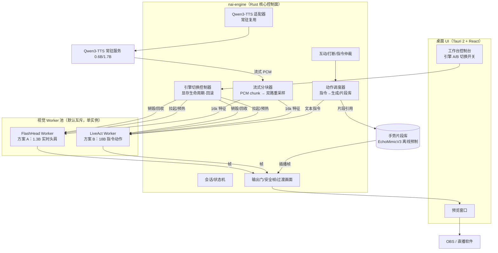

# 智能体赋能的本地数字人直播工作台 · V5.5 双引擎热切换完整设计方案

| 项目 | 内容 |
|---|---|
| 版本 | V5.5 |
| 日期 | 2026-11-03（UTC+8） |
| 状态 | 在 V5.4 基线上的架构扩展版；引入双引擎热切换（Engine Switcher）与动态显存生命周期管理；**修正第三方评审的引擎选型错误** |
| 目标机型 | Windows 11 + RTX 5090 Laptop 24GB（Blackwell, sm_120）+ 32GB RAM |
| 核心模型 | Qwen3-TTS（本地流式服务，0.6B/1.7B，常驻复用）+ 双引擎互斥 Worker 池：<br>• **方案 A（极速互动版）：SoulX-FlashHead 1.3B**（Lite 96FPS / Pro 高画质，实时头肩，无限时长）<br>• **方案 B（高拟真动作版）：SoulX-LiveAct 18B**（文本指令手势/全身，恒定显存；本地准实时或云端双卡实时） |
| 离线内容工具 | EchoMimicV3（Apache-2.0，手势/动作片段预制，非在线引擎） |
| 快速验证路径 | LiveTalking（P-1 阶段）+ FlashHead 官方 Demo |
| 输出 | 本机窗口 + OBS 窗口捕获；可选本地录制；可选 RTMP 直推 |
| 产品形态 | 单人、单机、单直播间、双引擎按需热切换的本地直播工作台 |
| 文档关系 | 继承 V5.4 全部机制（流式 TTS、打断、epoch、安全帧、验收体系）；V5.3/V4.x 保持归档 |

---

## 0. 结论与设计立场

V5.5 在 V5.4 基础上做两件事：**换引擎、加切换**。

1. **为什么换掉 MuseTalk + LivePortrait**：2026 年的 SoulX-FlashHead（1.3B）以单模型端到端实现了 V5.4 用两个模型拼接的效果——实时头肩、精准唇形、自然微表情，且原生支持流式无限时长与抗漂移训练。V5.4 中最复杂的"双模型组合（Mode A/B/C）、嘴部 owner 仲裁、双嘴/接缝风险"随之整体消失。
2. **为什么需要方案 B**：直播互动中"收到指令做动作"（弹幕刷"比心"就比心）是确定的用户需求。SoulX-LiveAct 是当前唯一支持**文本指令实时控制手势/表情/全身动作**的开源流式模型。它在单卡 5090 上约 6–10FPS，不能满血实时，因此以"热切换 + 准实时/云端"双形态纳入。
3. **双引擎热切换与显存生命周期**：同一时刻仅一个视觉 Worker 驻留显存（默认互斥），切换时旧 Worker 彻底销毁、显存即时归还、新 Worker 拉起预热；Qwen3-TTS 作为常驻服务跨引擎复用，切换时音频链路不中断。
4. **直播连续性优先**：切换不是重启直播——音频照播、画面切预录过渡片段，新引擎 ready 后淡入。任何切换失败自动回滚到上一可用引擎或安全帧。

**一句话目标：一个人、一台 5090 笔记本、常驻 Qwen3-TTS、两套可热切换的视觉引擎（FlashHead 极速互动 / LiveAct 高拟真动作），8 小时不断播，指令响应毫秒级，切换不黑屏。**

---

## 1. 版本目标、范围与非目标

### 1.1 目标

| 编号 | 目标 | 验收方式 |
|---|---|---|
| G1 | 本地 Qwen3-TTS 流式合成、首包 ≤150ms、3 秒克隆，**跨引擎切换常驻不中断** | 首包/首音记录 + 切换前后对比 |
| G2-A | 方案 A（FlashHead）运行：实时头肩、唇形精准、无限时长 | 30 分钟连续口播录像（Lite/Pro 各一） |
| G2-B | 方案 B（LiveAct）运行：文本指令手势（比心/捂脸/大笑）、全身/半身 | 指令→动作延迟录像 + 10 分钟拟真录像 |
| G3 | 双引擎热切换：一键切换，显存即时释放与重分配，**切换耗时按引擎分级达标** | 切换前后 nvidia-smi 日志 + 耗时记录 |
| G4 | 切换前后无双嘴、无崩溃、无管道死锁、**直播不黑屏** | 30 分钟连续切换压测录像 |
| G5 | 单人操作：开始、静音、接管、停止、打断、**切引擎** | 热键/面板实测 |
| G6 | 本机窗口 + OBS 捕获 + 本地录制 | OBS 实际录像回放 |
| G7 | 连续讲解 + 问答 + 弹幕打断 + **指令动作** | 2 小时 / 8 小时长稳测试 |
| G8 | 资源可控、失败有明确降级、温度/功耗可观测 | 显存/RAM/温度/功耗日志 |
| G9 | 手势片段库（EchoMimicV3 离线预制）可按指令插播 | 片段触发延迟 ≤300ms 实测 |

### 1.2 非目标（V5.5 明确不做）

- 多工作区、多用户、多角色团队协作；
- **方案 A 与方案 B 同时并发渲染**（默认强制互斥；可选热备模式见 §11.4，默认关闭）；
- 官方抖音/快手/视频号连接器、自动开播、commerce；
- 3D 骨骼数字人路线（Warudo/VRM，作为已知备选记录在案，不进主线）；
- 任意舞蹈/精确动作编排（音频驱动 + 指令手势为能力边界）；
- 云端 LiveAct 的自动化部署（V5.5 只定义接入协议，云端运维手动）。

### 1.3 对第三方评审建议的处理记录

| 评审建议 | 处理 | 理由 |
|---|---|---|
| 双引擎热切换 + 显存生命周期管理 | **采纳** | 24GB 显存的正确管理哲学 |
| schemes 注册表配置 | **采纳并扩展** | 增加热备、超时、回滚字段 |
| TTS 常驻复用 | **采纳** | 切换不断音 |
| **方案 B 用 EchoMimic V2** | **拒绝，改为 SoulX-LiveAct** | EchoMimic V2 是离线非实时扩散模型（数秒视频需几十秒生成），无法用于直播互动；LiveAct 是 2026 年唯一的文本指令实时可控流式数字人模型 |
| 方案 A 保留 MuseTalk+LivePortrait | **升级为 SoulX-FlashHead** | 单模型端到端，消除双嘴/接缝复杂度，原生无限时长，Apache-2.0 |
| 切换耗时 3–8 秒 | **修正为分级指标**（1.3B ≤10s；18B ≤90s）+ 过渡画面 | 18B 权重加载物理上不可能 8 秒完成 |
| 强制互斥 | **默认互斥 + 可选热备**（默认关） | FlashHead Lite 仅 6.4GB，24GB 显存有探索秒切的空间 |
| EchoMimic 弃用 | **改为 EchoMimicV3 离线片段工具** | Apache-2.0、文本指定动作，适合预制手势库 |

---

## 2. 产品范围与用户流程

### 2.1 主流程

```text
打开工作台
  → 检查引擎/模型/Qwen3-TTS/OBS
  → 选择方案（A 极速互动 / B 高拟真动作）
  → 选择形象（参考图）与声线（3 秒克隆可选）
  → 输入主题或资料（可选）
  → 预览：待机 / 说一句 / 做一个动作
  → 打开输出窗口 → OBS 捕获
  → 直播中：讲解 / 问答 / 弹幕打断 / 指令动作 / [热切换引擎]
  → 接管 / 静音 / 停止
  → 结束，生成本场记录（含切换时间线）
```

### 2.2 功能清单

**必须有（V5.5 主线）：**

- 本地 Qwen3-TTS 流式合成、试听、缓存、3 秒克隆（常驻服务）；
- **方案 A：SoulX-FlashHead 实时头肩（Lite/Pro 两档）**；
- **方案 B：SoulX-LiveAct 文本指令动作（本地准实时 / 云端实时双形态）**；
- **双引擎热切换（含过渡画面、显存生命周期、失败回滚）**；
- 指令动作三路触发：操作员按钮/热键、弹幕关键词、LLM 动作标签；
- 手势片段库插播（EchoMimicV3 预制，方案 A 下的动作能力补充）；
- 文字问答、连续讲解、软打断（barge-in）；
- 本机预览、OBS 捕获、本地录制；
- 开始/暂停/静音/接管/停止；
- 内容过滤、动作白名单；
- 配置页、状态页（温度/功耗/当前引擎/显存）、日志。

**可选（不阻塞主线）：** 通用弹幕 HTTP 入口；礼物感谢；知识文档 FTS；OBS 虚拟摄像头；ASR/VAD；云端 LiveAct 接入。

**明确不做：** 见 §1.2。

---

## 3. 总体架构

### 3.1 逻辑架构



### 3.2 进程拓扑与显存策略

| 进程 | 职责 | 显存策略 |
|---|---|---|
| `nai-desktop` | Tauri/React UI、切换开关、状态 | 0 VRAM |
| `nai-engine` | 会话、LLM、互动/打断/指令仲裁、TTS 适配、流式分块、**切换控制器**、输出门 | < 500 MB |
| `qwen3-tts` | 本地 TTS 常驻服务（0.6B/1.7B） | ~4GB / ~8GB **常驻，不随引擎切换释放** |
| `nai-avatar-worker`（动态单实例） | 按当前方案加载 FlashHead（A：6.4–8GB）或 LiveAct（B：FP4 约 12–16GB） | **随切换销毁与重建** |
| OBS | 外部直播软件 | 独立外部进程 |

### 3.3 技术栈（相对 V5.4 的变化）

- 视觉引擎 1：**SoulX-FlashHead 1.3B**（Lite/Pro，PyTorch，官方推理代码，Apache-2.0）；
- 视觉引擎 2：**SoulX-LiveAct 18B**（FP4/FP8 量化 + SageAttention + T5 CPU offload；许可见附录 A 风险标注）；
- 离线工具：**EchoMimicV3**（Apache-2.0，16GB 可跑，手势片段预制）；
- 其余沿用 V5.4：Rust engine、Tauri 2、共享内存媒体 IPC、SQLite WAL、CUDA ≥12.8 / PyTorch ≥2.7（sm_120）。

---

## 4. 双引擎能力对照与媒体管线

### 4.1 引擎能力对照

| 维度 | 方案 A：SoulX-FlashHead | 方案 B：SoulX-LiveAct |
|---|---|---|
| 参数量 | 1.3B | 18B（14B 视频 + 4B 音频模块） |
| 画面范围 | 头肩（talking head） | 头肩/半身/**全身 + 手部** |
| 指令动作 | ❌（动作由音频驱动）+ **手势片段库插播补齐** | ✅ 文本指令：比心/捂脸/大笑/头部姿态/表情 |
| 实时性（5090 24G 单卡） | Lite 96FPS（6.4GB）/ Pro 16.8FPS（~8GB） | 6–10FPS（FP4+offload）→ **本地准实时（插帧）或云端双卡 20FPS** |
| 长时稳定机制 | Oracle 双向蒸馏（GT 锚点抗漂移）+ TACC 8s 音频上下文 | Neighbor Forcing + ConvKV Memory（显存恒定） |
| 无限时长 | ✅ | ✅ |
| 端到端延迟 | <1s | 0.94s（云端双卡）/ 本地更高 |
| 适用场景 | 高频弹幕互动、问答、8h 长播主力 | 演艺互动、手势感谢、全身入镜时段 |
| 许可 | Apache-2.0（代码/权重/数据集） | HF 模型卡 Apache-2.0，GitHub 无 LICENSE 文件（附录 A 风险项） |

### 4.2 媒体管线（V5.5 简化版）

V5.4 的"双模型组合（MuseTalk 口型 + LivePortrait 待机，Mode A/B/C、嘴部 owner 仲裁）"**整体删除**。两个新引擎均为单模型端到端：音频特征进、视频帧出，天然无双嘴/接缝问题。

```text
文本流 → 分句 → Qwen3-TTS 流式 PCM（chunk 200–400ms）
 → 分块器（epoch/seq 打标）
 ├─ 48k → 播放队列 → WASAPI（音频主时钟）
 └─ 16k → 当前激活引擎 Worker → BGRA 帧 → 共享内存 → 输出门 → 预览/OBS
```

- 音频主时钟、epoch 防旧帧、迟到帧丢弃、安全帧等机制**完整沿用 V5.4 §4.3–4.5**；
- 输出画布：方案 A 默认 720×1280（竖屏头肩）或 1280×720；方案 B 512×512 或 720×416 原生，合成到 1280×720 画布（全身时人脸占比小的提示保留）；
- 插帧（仅方案 B 本地模式）：RIFE 类实时插帧 6–10FPS → 24–25FPS，**快速手势瞬间可能出残影，为已知妥协项**，默认开启、可关。

### 4.3 指令动作链路（双通道）

```text
指令源（按钮/弹幕/LLM 标签）
 → 动作调度器（白名单/冷却/优先级）
 ├─ 通道 1（方案 B 激活时）：文本指令 → LiveAct prompt 注入 → 实时生成动作
 └─ 通道 2（方案 A 激活时）：查片段库 → 取「动作_变体N」→ 输出门淡入插播（≤300ms）
      → 播完自动切回实时流
```

- **两通道对上层统一**：指令层不知道当前用哪个引擎，调度器按激活引擎自动路由；
- 片段库：EchoMimicV3 离线预制，每个动作 3–5 变体（比心/挥手/鼓掌/点赞/鞠躬），存数据根 `assets/clips/`，带元数据（时长/出点/循环性）；
- 优先级沿用 V5.4：停止/接管/打断 > 手动 > 弹幕 > LLM 标签 > 待机。

### 4.4 降级链（V5.5 版）

1. 方案 B 本地 → 降分辨率（512×512）/ 开插帧 / 关文本指令（纯音频驱动）；
2. 方案 B → 切方案 A（Pro → Lite）；
3. 方案 A Lite + 片段库兜底；
4. 静态形象 + TTS 音频 + 字幕；
5. 纯文字；
6. 停止。

每步 UI 明示，不静默（沿用 V5.4 原则）。

---

## 5. 引擎热切换与显存生命周期

### 5.1 切换流程（Switch Pipeline）

```text
操作员点击切换（A → B）
 1. 挂起：软暂停会话，停发新 TTS 请求；
    已合成音频继续播放（音频不断）；
 2. 过渡画面：输出门切入预录过渡片段/安全帧（不黑屏）；
 3. 排空（drain）：向旧 Worker 发 drain，等待在途帧消费完（≤500ms 超时强杀）；
 4. 销毁：旧 Worker 进程退出，OS 回收显存；
    校验 nvidia-smi 显存回落至基线（TTS 常驻占用）；
 5. 拉起：启动新 Worker，加载目标引擎权重
    （A 档 ≤10s；B 档 ≤90s；UI 显示进度与预计耗时）；
 6. 预热：空转 2–3 帧，测首帧，上报 ready（含实际 VRAM）；
 7. 恢复：epoch 递增，输出门淡入新引擎画面，恢复互动；
 8. 失败回滚：任一步失败 → 回到过渡画面 → 尝试拉起原引擎 →
    仍失败则降级链（§4.4），全程不黑屏、不静默。
```

### 5.2 切换约束

- **互斥原则（默认）**：同一时刻仅一个视觉 Worker；切换期间显存峰值 = TTS 常驻 + 新引擎峰值，必须 ≤ 22GB（留 2GB 余量）；
- **热备模式（可选，默认关）**：仅当"当前引擎为 FlashHead Lite（6.4GB）+ TTS 0.6B（4GB）"时允许——备用引擎（LiveAct FP4 ≤13GB）低功耗驻留，切换变为秒切（<2s，仅切输出门）；开启前须通过显存预算校验（§11.2）；
- **切换频率限制**：冷切换每分钟 ≤1 次（防观众观感破碎）；热备秒切不限；
- 切换事件（发起/完成/失败/耗时/显存曲线）全部入本场时间线；
- 切换中到达的指令动作排队，切换完成后按 epoch 重新路由（不丢失、不错发）。

### 5.3 控制 IPC 扩展（protocol v3）

沿用 V5.4 v2 全部消息，新增：

```json
{"type":"get_capabilities"}
{"type":"capabilities","engines":[
  {"id":"flashhead_lite","vram_mb":6400,"load_est_s":8,"features":["talk","unlimited"]},
  {"id":"flashhead_pro","vram_mb":8000,"load_est_s":10,"features":["talk","unlimited","hq"]},
  {"id":"liveact_fp4","vram_mb":14000,"load_est_s":75,"features":["talk","gesture","text_instruction","fullbody"]}
]}
{"type":"switch_pipeline","target":"liveact_fp4","epoch":6,"hot_standby":false}
{"type":"switch_progress","target":"liveact_fp4","stage":"loading","pct":42}
{"type":"switch_done","target":"liveact_fp4","epoch":6,"elapsed_s":71,"vram_mb":13920}
{"type":"switch_failed","target":"liveact_fp4","error":"MODEL_OOM","rollback":"flashhead_lite"}
{"type":"drain","epoch":6}
{"type":"act_instruct","epoch":6,"action":"heart","text":"比心"}
```

- `drain`：优雅排空在途媒体（≤500ms），超时强杀；
- 切换后所有媒体引用必须使用新 epoch，旧 epoch 一律拒绝（沿用 V5.4）。

---

## 6. 功能设计（增量部分；未列出的沿用 V5.4）

### 6.1 引擎管理（新增）

- 引擎选择：UI 顶部引擎栏显示当前激活引擎、备选引擎状态（`ready/missing/standby/off`）；
- 一键切换：按钮 + 确认（直播中切换需二次确认，防误触）；
- 引擎信息页：版本/权重哈希/许可状态（FlashHead：Apache-2.0 ✅；LiveAct：⚠️ 待官方确认，见附录 A）；
- 热备开关：仅 Lite + 0.6B 组合时可开，开启前显示显存预算校验结果。

### 6.2 指令动作（升级）

- 三路触发（沿用）：热键/按钮、弹幕关键词（本地词表）、LLM 动作标签（`{"text":"...","action":"heart"}`）；
- **执行路由（新增）**：按激活引擎自动选择"LiveAct 实时生成"或"片段库插播"（§4.3）；
- 动作白名单（示例）：`heart`、`wave`、`clap`、`thumbs_up`、`bow`、`nod`、`shake`、`smile`、`wink`、`think`；
- 弹幕触发默认关闭，白名单观众可开；每分钟 ≤2 次（沿用打断频率策略）。

### 6.3 手势片段库（新增）

- 制作工具：EchoMimicV3（Apache-2.0），工作台提供"片段工坊"页：选形象图 + 文本描述动作 → 离线生成 → 裁剪入点/出点 → 入库；
- 元数据：`{id, action, variant, duration_ms, loopable, preview, created_at, source_engine}`；
- 质量门：片段入库前人工预览确认（手部畸形、面部崩坏直接淘汰）；
- 更新策略：每周/每直播 10 场补充新变体，防重复穿帮。

### 6.4 直播会话（沿用 V5.4）

状态机、开始/暂停/静音/接管/停止、打断（软/硬）全部沿用 V5.4 §6.1、§4.4。**新增**：切换引擎不改变会话状态（`live` 中切换保持 `live`，仅输出门过渡）。

### 6.5 复盘（升级）

时间线新增事件：`engine_switch`（含 from/to/耗时/显存）、`action_clip`（片段插播记录）；指标新增：切换耗时 P95、片段触发延迟、插帧伪影投诉（人工标记）。

---

## 7. 数据模型与配置（V5.5 扩展）

### 7.1 配置示例

```json
{
  "app": {"data_root": "E:/nai-data", "language": "zh-CN", "log_retention_days": 7},
  "engine": {
    "active_pipeline": "flashhead_pro",
    "hot_standby": false,
    "switch_cooldown_s": 60,
    "transition_clip": "assets/clips/transition/default.mp4",
    "schemes": {
      "flashhead_lite": {
        "name": "极速互动·Lite（96FPS）",
        "worker_script": "workers/flashhead_worker.py",
        "weights": "assets/models/flashhead/lite.safetensors",
        "vram_budget_mb": 6400,
        "load_est_s": 8,
        "features": ["talk", "unlimited"]
      },
      "flashhead_pro": {
        "name": "极速互动·Pro（高画质）",
        "worker_script": "workers/flashhead_worker.py",
        "weights": "assets/models/flashhead/pro.safetensors",
        "vram_budget_mb": 8000,
        "load_est_s": 10,
        "features": ["talk", "unlimited", "hq"]
      },
      "liveact_fp4": {
        "name": "高拟真动作版（LiveAct FP4）",
        "worker_script": "workers/liveact_worker.py",
        "weights": "assets/models/liveact/fp4",
        "vram_budget_mb": 14000,
        "load_est_s": 75,
        "features": ["talk", "gesture", "text_instruction", "fullbody"],
        "interpolation": {"enabled": true, "target_fps": 24},
        "remote_endpoint": null
      }
    }
  },
  "tts": {"engine": "qwen3-tts", "model_size": "0.6B",
          "endpoint": "http://127.0.0.1:8000", "stream": true, "chunk_ms": 300},
  "action_clips": {
    "library_path": "assets/clips",
    "fade_ms": 250,
    "max_trigger_per_minute": 6
  },
  "performance": {"lock_fps": 25, "power_limit_hint_w": 140,
                  "temp_alert_c": 87, "auto_degrade_vram_free_mb": 2048}
}
```

### 7.2 SQLite 表变更

- 新表 `engines`：`id, name, weights_path, hash, vram_budget_mb, license_note, status`；
- 新表 `action_clips`：`id, action, variant, path, duration_ms, loopable, created_at, source_engine`；
- `events.kind` 新增 `engine_switch`、`action_clip`；
- 其余沿用 V5.4（数据根目录改为 `nai-v55`，结构复制迁移 + 新增表自动建）。

---

## 8. API（增量；未列出的沿用 V5.4）

| 方法 | 路径 | 说明 | 变化 |
|---|---|---|---|
| GET | `/api/status` | 增加：当前激活引擎、各引擎状态、显存分账（TTS/Worker/空闲）、热备状态 | 升级 |
| POST | `/api/engine/switch` | **热切换引擎**，请求体 `{"pipeline":"liveact_fp4"}`；返回切换任务 id | **新增** |
| GET | `/api/engine/switch/{id}` | 切换进度查询（stage/pct/elapsed） | **新增** |
| GET | `/api/engines` | 引擎注册表（能力/显存预算/许可状态） | **新增** |
| POST | `/api/engine/hot_standby` | 开关热备模式（需通过显存预算校验） | **新增** |
| GET | `/api/action_clips` | 片段库列表 | **新增** |
| POST | `/api/action_clips/generate` | 调 EchoMimicV3 离线制作片段（异步任务） | **新增** |
| POST | `/api/action` | 手动动作（自动路由：生成 or 片段） | 升级 |
| GET | `/api/session/report` | 含切换时间线与片段插播记录 | 升级 |

**错误码新增：**

| 码 | 含义 |
|---|---|
| `SWITCH_IN_PROGRESS` | 切换进行中，拒绝并发切换 |
| `SWITCH_COOLDOWN` | 切换冷却中 |
| `TARGET_ENGINE_UNAVAILABLE` | 目标引擎权重缺失/损坏 |
| `SWITCH_FAILED_ROLLBACK` | 切换失败已回滚（附原引擎状态） |
| `HOT_STANDBY_NOT_ALLOWED` | 当前组合不满足热备显存预算 |
| `CLIP_LIBRARY_EMPTY` | 片段库为空（方案 A 下指令动作不可用） |

---

## 9. UI（增量）

### 9.1 主界面

```text
┌──────────────────────────────────────────────────────────┐
│ 引擎 ● Pro(FlashHead)  TTS(0.6B) ●  OBS ○  71°C 112W       │
│ [方案A ▸] [方案B ○] [热备⚪]   [停止][静音][接管][打断]      │
├──────────────────────────┬───────────────────────────────┤
│                          │  当前节目/讲解 / 问答 / 弹幕     │
│      形象预览/输出窗口      │  动作：[比心][挥手][鼓掌][点赞]  │
│      （16:9）             │  （方案B时标注"实时生成"，        │
│                          │   方案A时标注"片段插播"）         │
├──────────────────────────┴───────────────────────────────┤
│ [输入聊天] [发送] [说一句] [开始/暂停讲解]                    │
└──────────────────────────────────────────────────────────┘
```

### 9.2 切换过程 UI

- 点击切换 → 确认对话框（显示预计耗时：A 档 ~10s / B 档 ~75s）→ 进度条（阶段：排空/回收/加载/预热）→ 完成提示；
- 预览窗口全程显示过渡画面 + 角标"引擎切换中"；
- 失败：红色提示 + 已回滚状态 + 一键重试。

### 9.3 状态页新增

- 显存分账条：TTS 常驻 / 当前 Worker / 空闲 / 热备占用；
- 引擎注册表：每引擎的权重哈希、许可状态徽标（✅ Apache-2.0 / ⚠️ 待确认）、加载预估耗时。

---

## 10. 安全与合规（沿用 V5.4 + 更新）

- §10.1–10.4、10.6 全部沿用 V5.4；
- §10.5 许可更新：**FlashHead 确认为 Apache-2.0（可商用）；LiveAct 的 HuggingFace 模型卡标注 Apache-2.0 但 GitHub 仓库缺少 LICENSE 文件——商用部署前必须向 Soul AI Lab 书面确认并留存证据，未确认前 UI 持续显示 ⚠️ 徽标**；EchoMimicV3 为 Apache-2.0；详见附录 A。

---

## 11. 性能与资源

### 11.1 目标（V5.5 版）

| 指标 | 目标 | 备注 |
|---|---|---|
| TTS 首包 | ≤150ms P95 | 沿用 |
| 首音 / 首帧 | ≤1.2s / ≤0.8s P95 | 沿用 |
| **切换耗时（冷切换）** | **A 档 ≤10s；B 档 ≤90s（含加载+预热）** | 修正评审"3–8s"的乐观估计 |
| **切换耗时（热备秒切）** | **≤2s**（仅输出门切换） | 可选模式 |
| 切换直播连续性 | 音频零中断；画面黑屏时间 = 0（过渡片段兜底） | 硬指标 |
| 指令动作响应 | 片段插播 ≤300ms；LiveAct 生成 ≤2s（云端）/ ≤4s（本地） | — |
| 方案 A 稳态 | Lite ≥60FPS / Pro ≥16FPS（可插帧至 24–25） | 5090 实测校准 |
| 方案 B 本地稳态 | ≥6FPS + 插帧至 24FPS | 已知妥协 |
| 打断响应 | 软 ≤句尾；硬 ≤300ms | 沿用 |
| 连续运行 | 8h（含 ≥3 次引擎切换） | 升级 |

### 11.2 显存预算（V5.5 分账版）

| 组合 | TTS 常驻 | 视觉 Worker | 系统/输出 | 合计 | 判定 |
|---|---|---|---|---|---|
| A-Lite + TTS 0.6B | 4GB | 6.4GB | 3GB | **~13.4GB** | ✅ 舒适 |
| A-Pro + TTS 0.6B | 4GB | 8GB | 3GB | ~15GB | ✅ |
| B(FP4) + TTS 0.6B | 4GB | 12–16GB | 3GB | **19–23GB** | ⚠️ 贴顶，需实测 |
| B(FP4) + TTS 1.7B | 8GB | 12–16GB | 3GB | 23–27GB | ❌ 超预算，禁止该组合 |
| 热备：A-Lite + B(FP4)驻留 + TTS 0.6B | 4GB | 6.4 + 12GB | 3GB | ~25.4GB | ❌ 超 24GB，**热备默认不可用**（除非 LiveAct 量化至 ≤11GB 且实测通过） |

- **切换瞬间峰值** = TTS 常驻 + 目标引擎峰值（旧引擎已先销毁），≤22GB 硬校验；
- 自动降级触发线：空闲 VRAM <2GB（沿用并收紧）。

### 11.3 散热与功耗（沿用 V5.4 §11.3）

锁 25fps、功耗提示 130–150W、87°C 告警、降频事件入时间线。**补充**：方案 B 为扩散重负载，连续运行 30 分钟须记录温度曲线；温度 ≥87°C 时建议切回方案 A（UI 一键建议）。

### 11.4 热备模式（可选，默认关）

- 开启条件（硬校验）：当前引擎为 flashhead_lite 且 TTS 为 0.6B 且 LiveAct 量化后实测 ≤11GB 且总和 ≤22GB；
- 不满足则开关置灰并显示原因；
- 热备引擎仅驻留权重，不做推理（功耗 <20W）；
- 切换 = 输出门改订阅热备引擎帧流，≤2s；
- 温度 ≥85°C 自动关闭热备（释放显存/降功耗）。

---

## 12. 部署与安装（增量）

### 12.1 环境

沿用 V5.4（CUDA ≥12.8 / PyTorch ≥2.7 / sm_120）。**新增**：FlashHead 与 LiveAct 各自独立 venv（依赖冲突隔离），由 launcher 按激活引擎选择 venv 启动 Worker。

### 12.2 安装包内容

- `nai-desktop.exe`、`nai-engine.exe`；
- `workers/flashhead/`（venv + 启动脚本）、`workers/liveact/`（venv + 启动脚本）；
- Qwen3-TTS 一键部署脚本（沿用）；
- 模型下载器：FlashHead（HF，Apache-2.0，直接下载）、LiveAct（HF 下载 + **许可确认向导**）、EchoMimicV3（可选，片段工坊用）；
- 默认过渡片段、示例手势片段 ×3；
- 配置模板、运行手册。

### 12.3 Blackwell 适配要点

- FlashHead（1.3B，2026 项目）：原生支持 PyTorch 2.7+，预期无兼容问题；
- LiveAct：SageAttention/FP4 在 sm_120 上需按官方指引安装指定 wheel；FP4 为 50 系推荐路径；
- EchoMimicV3：官方已支持 Windows 10/11 + CUDA 12.8，可直接用。

---

## 13. 可靠性与故障（增量）

### 13.1 故障矩阵（新增行；其余沿用 V5.4）

| 故障 | 行为 | 恢复 |
|---|---|---|
| 切换中新 Worker 拉起失败 | 回滚原引擎；UI 红条提示 | 重试/换档/降级 |
| 切换中旧 Worker 显存未释放（泄漏） | 强杀进程；nvidia-smi 校验通过才允许拉起新引擎 | 记录 P0；重启 launcher |
| 热备引擎驻留导致 OOM | 自动关闭热备，回冷切换 | UI 提示原因 |
| 片段库缺失/损坏 | 指令动作仅文字提示，不伪造画面 | 引导重新生成片段 |
| LiveAct 许可未确认 | 引擎可研究运行，**发布/商用开关锁定** | 附录 A 流程确认后解锁 |
| 插帧伪影投诉 | 一键关插帧（接受低帧率）或切方案 A | 配置项 |

### 13.2 看门狗（沿用 + 新增）

- 新增：切换超时（A 档 30s / B 档 180s 未完成 → 判失败回滚）；显存回收校验（销毁后 10s 内未回落 → 强杀 + 告警）。

---

## 14. 验收（新增 ACC-V55 组；V5.4 的 ACC 组按引擎适配后继续有效）

### 14.1 ACC-V55：双引擎与切换

| ID | 场景 | 通过标准 |
|---|---|---|
| ACC-V55-01 | 方案 A 独立加载 | 仅 A 驻留，VRAM 符合预算（Lite ≤7GB / Pro ≤9GB），B 零驻留 |
| ACC-V55-02 | A→B 冷切换 | 旧进程彻底销毁，显存回落至基线后 B 拉起成功；耗时 ≤90s；**全程无黑屏**（过渡片段可见） |
| ACC-V55-03 | B→A 冷切换 | 同上，耗时 ≤10s |
| ACC-V55-04 | 切换中音频连续性 | 切换前后音频波形无中断（录音比对） |
| ACC-V55-05 | 切换失败回滚 | 模拟新引擎 OOM：自动回滚原引擎或安全帧，UI 明确提示 |
| ACC-V55-06 | 共享 TTS 稳定性 | 切换前后 Qwen3-TTS 常驻不重启，切换后首音 ≤1.2s |
| ACC-V55-07 | 指令动作双通道 | 方案 B：文本指令→实时动作（延迟记录）；方案 A：指令→片段插播 ≤300ms |
| ACC-V55-08 | 热备模式 | 预算校验逻辑正确；不允许的组合开关置灰；允许时秒切 ≤2s |
| ACC-V55-09 | 连续切换压测 | 30 分钟内 A↔B 切换 10 次：无泄漏、无死锁、显存曲线回归 |
| ACC-V55-10 | 方案 B 长稳 | 本地模式 30 分钟：无 OOM、插帧伪影可接受（盲评）、温度曲线记录 |
| ACC-V55-11 | 8h 长稳（含 ≥3 次切换） | 无内存/显存泄漏增长；无降频导致的持续掉帧 |

### 14.2 阶段门（更新）

| 阶段 | 必须通过 | 退出条件 |
|---|---|---|
| M0 快速验证 | FlashHead 官方 Demo 跑通 + LiveTalking 基线 | 第 1 周：10 分钟口型录像 + 显存/延迟基线 |
| M1 方案 A 闭环 | SETUP、TTS 组、V55-01 | 30 分钟 FlashHead 口播录像 |
| M2 方案 B 闭环 | V55-07（B 通道）、V55-10 | 指令手势录像 + 30 分钟长稳 |
| M3 切换与直播 | V55-02..06/09、INT 组、OUT 组 | 30 分钟 OBS 录像含 ≥2 次切换 |
| M4 长稳发布 | V55-08/11、RES 组、许可清单 | 8h 记录 + ReleaseManifest |

---

## 15. 开发计划（V5.5 修订）

| 阶段 | 时间 | 交付 |
|---|---|---|
| P-1 验证 | 第 0–1 周 | FlashHead Demo + LiveTalking 基线；Blackwell 依赖锁定 |
| P0 骨架 | 第 1–2 周 | engine 骨架 + 引擎注册表 + fake worker ×2 + 切换控制器（mock） |
| P1 方案 A | 第 2–3 周 | FlashHead Worker（Lite/Pro）；流式音频管线；30 分钟录像 |
| P2 方案 B | 第 4–5 周 | LiveAct Worker（FP4）；文本指令注入；插帧；手势录像 |
| P3 切换与动作 | 第 6–7 周 | 冷切换全流程 + 回滚；过渡画面；片段工坊（EchoMimicV3）；指令三路触发；2 小时 |
| P4 打包长稳 | 第 8 周 | 安装包（双 venv）；8h（含切换）；验收报告；许可确认流程 |
| P5 可选 | 后续 | 热备模式、云端 LiveAct、ASR、24h 候选 |

---

## 16. V5.4 → V5.5 变更对照

| V5.4 | V5.5 | 原因 |
|---|---|---|
| MuseTalk 1.5 + LivePortrait 双模型组合（Mode A/B/C、嘴部 owner 仲裁） | **SoulX-FlashHead 单模型端到端**（Lite/Pro 双档） | 消除双嘴/接缝复杂度；原生无限时长；96FPS 消费级实时 |
| 无指令动作能力 | **SoulX-LiveAct 文本指令手势/全身 + 手势片段库双通道** | 满足"收到指令控制动作"的确定需求 |
| 单一视觉 Worker | **双引擎互斥 Worker 池 + 切换控制器（drain/回收/拉起/预热/回滚）** | 互动与演艺两类场景的显存最优利用 |
| 切换未定义 | 冷切换分级指标（A≤10s / B≤90s）+ 过渡画面 + 热备可选 | 修正"3–8s"乐观估计；直播不黑屏 |
| EchoMimic 未使用 | EchoMimicV3 作为**离线片段工坊**（非在线引擎） | Apache-2.0；文本指定动作适合预制 |
| 显存单一预算 | **分账预算表**（TTS 常驻 + 引擎 + 切换峰值 + 热备校验） | 24GB 可预期调度 |
| 许可全绿 | **LiveAct 许可风险标注**（HF Apache-2.0 vs GitHub 无 LICENSE）+ 发布锁定机制 | 合规诚实 |
| IPC protocol v2 | **v3**（switch_pipeline/drain/capabilities/act_instruct） | 切换与指令动作协议 |
| 验收 ~50 项 | +ACC-V55 组 11 项，阶段门 M0–M4 | 覆盖切换与双通道动作 |

---

## 17. 附录

### 附录 A：模型与许可证核查清单（V5.5 版）

| 项 | 结论 | 处置 |
|---|---|---|
| **SoulX-FlashHead** 代码/权重/VividHead 数据集 | **Apache-2.0**，可商用 | ✅ 可用；保留 NOTICE |
| **SoulX-LiveAct** | HF 模型卡标 Apache-2.0，**GitHub 仓库无 LICENSE 文件**，官方 issue 未答复 | ⚠️ **商用前书面确认并留证**；未确认前发布开关锁定（§13.1） |
| **EchoMimicV3** | Apache-2.0 | ✅ 片段工坊可用 |
| Qwen3-TTS 0.6B/1.7B | Apache-2.0 | ✅ |
| MuseTalk / LivePortrait（退役为备选） | MIT（LivePortrait 依赖 InsightFace buffalo_l 非商用——退役后该红线解除） | 备选回退方案 |
| RIFE 插帧 | MIT（Practical-RIFE） | ✅ 方案 B 本地模式用 |
| 肖像/参考音频/音乐 | 用户授权 | 沿用勾选 + 克隆音色单独声明 |
| LiveTalking（P-1 工具） | Apache-2.0 | 开发期工具 |

### 附录 B：运行手册（摘要）

1. 启动 Qwen3-TTS（一键脚本，默认 0.6B）；
2. 双击启动器 → 引擎注册表自检（权重/许可/显存预算）；
3. 选择方案 A（极速互动）→ 选形象/试听 → 预览；
4. OBS 窗口捕获 + 桌面音频；
5. 直播中：讲解/问答/打断/指令动作；需要全身手势时切方案 B（确认耗时 ~75s，音频不断、画面过渡）；
6. 长播监控温度：≥87°C 按 UI 建议切回方案 A；
7. 接管/静音/停止；结束导出含切换时间线的本场记录。

### 附录 C：术语（V5.5 增补）

| 术语 | 说明 |
|---|---|
| 引擎（Pipeline） | 一套可独立加载的视觉生成方案（FlashHead 档 / LiveAct） |
| 冷切换 | 销毁旧 Worker → 回收显存 → 拉起新 Worker 的完整切换 |
| 热备（Hot Standby） | 备用引擎权重驻留显存，切换仅改输出门订阅（≤2s） |
| drain | 切换前优雅排空旧 Worker 在途媒体帧的过程 |
| 过渡画面 | 切换期间输出门播放的预录片段，保证直播不黑屏 |
| 双通道动作 | 指令动作按激活引擎路由：LiveAct 实时生成 或 片段库插播 |
| 片段工坊 | 用 EchoMimicV3 离线制作手势片段库的工具页 |

### 附录 D：与 Vidu S1 的能力映射（V5.5 更新版）

| 能力 | Vidu S1 | V5.5 本地栈 | 结论 |
|---|---|---|---|
| 语音实时驱动数字人 | ✅ 端到端 | ✅ FlashHead（96FPS） | 对等，单卡满血 |
| **指令控制动作** | ✅ 语音指令 | ✅ LiveAct 文本指令（云端/准实时）+ 片段库 | 对等（本地需妥协） |
| 无限时长不漂移 | ✅ 宣称数小时 | ✅ 双引擎各有机制级保障 | 对等 |
| 实时交互延迟 | 亚秒级 | 首音 ≤1.2s + 动作 ≤300ms（片段）/ ≤2s（生成） | 同量级 |
| 音色复刻 | ✅（审核 1–3 天） | ✅ 3 秒克隆即时 | 占优 |
| 全身动态 | ✅ | ⚠️ LiveAct 支持但单卡 6–10FPS | 差距项（云端补齐） |
| 成本 | 按秒计费 | 零边际成本 + 可选云端双卡 | 占优 |

---

## 18. 最终判断

V5.5 的核心是把 V5.4 的"单链路可播"升级为"**双引擎可切换的可播**"：

- 用 **FlashHead** 拿到消费级显卡上最极致的实时头肩互动（96FPS、无限长、Apache-2.0），并整体摆脱双模型拼接的复杂度；
- 用 **LiveAct** 补上"指令控制动作"这块 S1 式体验，同时诚实地标注它在单卡上的性能边界与许可风险；
- 用**冷切换五步流程 + 过渡画面 + 失败回滚**让引擎切换成为直播中的常规操作而非事故；
- 用**分账显存预算 + 热备校验**把 24GB 显存的每一 GB 都置于可预期的管理之下。

第三方评审贡献了正确的架构骨架（热切换 + 显存生命周期），V5.5 修正了其选型错误（EchoMimic V2 无法实时直播）与不切实际的切换指标，并完整继承了 V5.4 经过验证的全部机制。

如果 V5.5 只能交付一件事：**在目标机上，8 小时直播中以 FlashHead 完成不间断互动，期间至少一次无黑屏热切换到 LiveAct 完成指令手势表演，再切回，全程可回放、可接管、可停止。**
