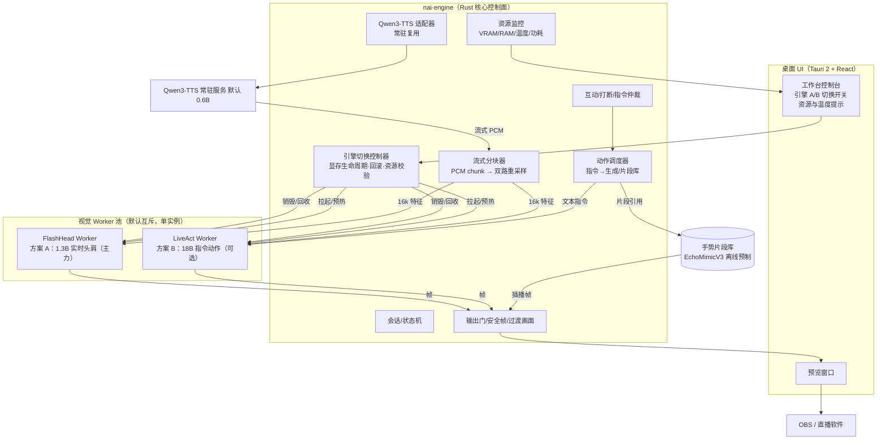

# 智能体赋能的本地数字人直播工作台 · V5.6 硬件适配与长稳优先完整设计方案

| 项目 | 内容 |
|---|---|
| 版本 | V5.6 |
| 日期 | 2026-11-03（UTC+8） |
| 状态 | 在 V5.5 基线上的硬件适配强化版；明确目标机（RTX 5090 Laptop 24GB + 32GB RAM）边界；强化方案 A 主力地位、方案 B 准实时与资源风险管控、系统内存监控与散热策略 |
| 目标机型 | Windows 11 + RTX 5090 Laptop 24GB（Blackwell, sm_120，TGP 95–175W）+ 32GB RAM |
| 核心模型 | Qwen3-TTS（本地流式服务，默认 0.6B 常驻；1.7B 仅方案 A 时可选）+ 双引擎互斥 Worker 池：<br>• **方案 A（主力极速互动版）：SoulX-FlashHead 1.3B**（Lite 高吞吐 / Pro 高画质，实时头肩，无限时长）<br>• **方案 B（可选高拟真动作版）：SoulX-LiveAct 18B**（文本指令手势/全身；本地准实时 + 插帧；强资源约束） |
| 离线内容工具 | EchoMimicV3（Apache-2.0，手势/动作片段预制，方案 A 动作能力主要补充） |
| 快速验证路径 | LiveTalking（P-1）+ FlashHead 官方 Demo + **LiveAct 目标机资源基线实测** |
| 输出 | 本机窗口 + OBS 窗口捕获；可选本地录制；可选 RTMP 直推 |
| 产品形态 | 单人、单机、单直播间、双引擎按需冷切换的本地直播工作台（方案 A 为 8h 主力） |
| 文档关系 | 继承 V5.5 全部机制；V5.6 重点强化目标机硬件边界、系统内存与散热管控；V5.4 及更早版本保持归档 |

---

## 0. 结论与设计立场

V5.6 在 V5.5 基础上做三件事：**硬件边界落地、主力引擎明确、风险前置验证**。

1. **目标机边界明确**：RTX 5090 Laptop 24GB + 32GB RAM 可支撑方案 A 长期实时互动，方案 B 为资源贴顶的可选准实时模式。笔记本 TGP（95–175W）与系统内存是关键约束，必须在设计与验收中前置。
2. **方案 A 为绝对主力**：8 小时不间断互动、弹幕问答、指令动作（片段库）以 FlashHead 为主完成。方案 B 仅用于短时“演艺/手势表演”段落，不作为长播主力。
3. **方案 B 风险管控**：显存贴顶（12–16GB + TTS）、系统内存峰值风险（社区实测 offload 可达 ~30GB）、散热与功耗限制、插帧伪影均为已知项。必须通过目标机基线实测后才能纳入主线。
4. **直播连续性与失败安全**：沿用 V5.5 冷切换流程（过渡画面、音频不断、失败回滚），并强化资源监控与自动建议切回方案 A。

**一句话目标：在目标笔记本上，以 FlashHead 为主力完成 8 小时不间断实时互动直播；期间可按需冷切换到 LiveAct 完成短时指令手势表演再切回；全程资源可控、温度可观测、失败可回滚、不黑屏。**

---

## 1. 版本目标、范围与非目标

### 1.1 目标

| 编号 | 目标 | 验收方式 |
|---|---|---|
| G1 | 本地 Qwen3-TTS 流式合成（默认 0.6B）、首包 ≤150ms、3 秒克隆，**跨引擎切换常驻不中断** | 首包/首音记录 + 切换前后对比 |
| G2-A | 方案 A（FlashHead）运行：实时头肩、唇形精准、无限时长，**作为 8h 主力** | 30 分钟连续口播 + 8h 长稳录像 |
| G2-B | 方案 B（LiveAct）运行：文本指令手势，**短时准实时**（本地插帧或云端） | 指令→动作延迟录像 + 资源基线报告 |
| G3 | 双引擎冷切换：一键切换，显存即时释放与重分配，切换耗时分级达标，**全程不黑屏** | 切换前后 nvidia-smi + 系统内存日志 + 耗时记录 |
| G4 | 切换前后无双嘴、无崩溃、无管道死锁、直播不黑屏 | 30 分钟连续切换压测录像 |
| G5 | 单人操作：开始、静音、接管、停止、打断、切引擎 | 热键/面板实测 |
| G6 | 本机窗口 + OBS 捕获 + 本地录制 | OBS 实际录像回放 |
| G7 | 连续讲解 + 问答 + 弹幕打断 + 指令动作（片段库为主） | 2 小时 / 8 小时长稳测试 |
| G8 | 资源可控、失败有明确降级、温度/功耗/系统内存可观测 | 显存/RAM/温度/功耗日志 |
| G9 | 手势片段库（EchoMimicV3 离线预制）可按指令插播，**作为方案 A 主要动作能力** | 片段触发延迟 ≤300ms 实测 |

### 1.2 非目标（V5.6 明确不做）

- 多工作区、多用户、多角色团队协作；
- 方案 A 与方案 B 同时并发渲染（默认强制互斥；热备模式默认关闭且在本硬件上基本不可用）；
- 官方抖音/快手/视频号连接器、自动开播、commerce；
- 3D 骨骼数字人路线（Warudo/VRM，作为已知备选记录在案，不进主线）；
- 任意舞蹈/精确动作编排（音频驱动 + 指令手势 + 片段库为能力边界）；
- 云端 LiveAct 的自动化部署（V5.6 只定义接入协议，云端运维手动）；
- 在目标笔记本上以方案 B 作为 8 小时主力引擎。

### 1.3 对 V5.5 及硬件评审的处理记录

| 来源 | 建议/问题 | 处理 | 理由 |
|---|---|---|---|
| 硬件评审 | 方案 A 在目标机上高度可行，作为主力 | **采纳并强化** | 显存舒适、实时性好、适合长播 |
| 硬件评审 | 方案 B 显存贴顶 + 32GB RAM 风险 + 笔记本散热 | **采纳并前置** | 社区 offload 峰值 ~30GB；TGP 限制明显 |
| 硬件评审 | 优先验证 LiveAct 资源基线 | **新增 M0-B 验证门** | 必须实测后才纳入主线 |
| V5.5 | 双引擎热切换 + 显存生命周期 | **继承并强化监控** | 增加系统内存与温度自动建议 |
| V5.5 | TTS 常驻复用 | **继承** | 切换不断音 |
| V5.5 | 方案 B 用 LiveAct | **保留但降级为可选** | 本地准实时，非长播主力 |
| V5.5 | 热备模式 | **默认关闭，本硬件基本不可用** | 预算超 24GB |

---

## 2. 产品范围与用户流程

### 2.1 主流程

```text
打开工作台
  → 检查引擎/模型/Qwen3-TTS/OBS/系统资源
  → 默认进入方案 A（FlashHead）
  → 选择形象（参考图）与声线（3 秒克隆可选）
  → 输入主题或资料（可选）
  → 预览：待机 / 说一句 / 做一个动作（片段库）
  → 打开输出窗口 → OBS 捕获
  → 直播中：讲解 / 问答 / 弹幕打断 / 指令动作（片段库） / [按需冷切换方案 B 短时表演]
  → 接管 / 静音 / 停止
  → 结束，生成本场记录（含切换时间线、资源曲线）
```

### 2.2 功能清单

**必须有（V5.6 主线）：**

- 本地 Qwen3-TTS 流式合成、试听、缓存、3 秒克隆（常驻服务，默认 0.6B）；
- **方案 A：SoulX-FlashHead 实时头肩（Lite/Pro 两档，主力）**；
- **方案 B：SoulX-LiveAct 文本指令动作（可选，本地准实时 / 云端实时，短时使用）**；
- 双引擎冷切换（含过渡画面、显存生命周期、失败回滚、资源校验）；
- 指令动作三路触发：操作员按钮/热键、弹幕关键词、LLM 动作标签；
- **手势片段库插播（EchoMimicV3 预制，方案 A 主要动作能力）**；
- 文字问答、连续讲解、软打断（barge-in）；
- 本机预览、OBS 捕获、本地录制；
- 开始/暂停/静音/接管/停止；
- 内容过滤、动作白名单；
- 配置页、状态页（温度/功耗/当前引擎/显存/系统内存）、日志。

**可选（不阻塞主线）：** 通用弹幕 HTTP 入口；礼物感谢；知识文档 FTS；OBS 虚拟摄像头；ASR/VAD；云端 LiveAct 接入。

**明确不做：** 见 §1.2。

---

## 3. 总体架构

### 3.1 逻辑架构



### 3.2 进程拓扑与资源策略

| 进程 | 职责 | 显存策略 | 系统内存策略 |
|---|---|---|---|
| `nai-desktop` | Tauri/React UI、切换开关、状态 | 0 VRAM | 低 |
| `nai-engine` | 会话、LLM、互动/打断/指令仲裁、TTS 适配、流式分块、切换控制器、输出门、资源监控 | < 500 MB | 中 |
| `qwen3-tts` | 本地 TTS 常驻服务（默认 0.6B） | ~4GB **常驻，不随引擎切换释放** | 低–中 |
| `nai-avatar-worker`（动态单实例） | 按当前方案加载 FlashHead（A：6.4–8GB）或 LiveAct（B：FP4/offload 约 12–16GB） | **随切换销毁与重建** | B 模式需重点监控峰值 |
| OBS | 外部直播软件 | 独立外部进程 | 独立 |

### 3.3 技术栈（相对 V5.5 的变化）

- 视觉引擎 1：**SoulX-FlashHead 1.3B**（Lite/Pro，PyTorch，官方推理代码，Apache-2.0）——主力；
- 视觉引擎 2：**SoulX-LiveAct 18B**（FP4/FP8 量化 + SageAttention + T5 CPU offload + block offload；许可见附录 A 风险标注）——可选短时；
- 离线工具：**EchoMimicV3**（Apache-2.0，手势片段预制，方案 A 动作主力补充）；
- 其余沿用：Rust engine、Tauri 2、共享内存媒体 IPC、SQLite WAL、CUDA ≥12.8 / PyTorch ≥2.7（sm_120）。

---

## 4. 双引擎能力对照与媒体管线

### 4.1 引擎能力对照（目标机视角）

| 维度 | 方案 A：SoulX-FlashHead（主力） | 方案 B：SoulX-LiveAct（可选短时） |
|---|---|---|
| 参数量 | 1.3B | 18B（14B 视频 + 4B 音频模块） |
| 画面范围 | 头肩（talking head） | 头肩/半身/全身 + 手部 |
| 指令动作 | ❌（音频驱动）+ **手势片段库插播（主要）** | ✅ 文本指令：比心/捂脸/大笑/头部姿态/表情 |
| 实时性（目标笔记本） | Lite 高吞吐 / Pro 约 15–17FPS（可插帧） | 约 6–10FPS（需插帧至 24FPS）→ 准实时 |
| 显存占用 | 6.4–8GB + TTS ~4GB ≈ 舒适 | 12–16GB + TTS ~4GB ≈ 贴顶 |
| 系统内存风险 | 低 | 高（offload 峰值可能接近 30GB） |
| 散热压力 | 中（可长期） | 高（笔记本 TGP 易触发降频） |
| 长时稳定机制 | Oracle 双向蒸馏 + TACC | Neighbor Forcing + ConvKV Memory |
| 无限时长 | ✅ | ✅（理论上） |
| 适用场景 | **8h 长播主力、高频互动、问答** | 短时演艺互动、手势感谢、全身入镜 |
| 许可 | Apache-2.0 | HF 模型卡 Apache-2.0，GitHub 无 LICENSE（附录 A） |

### 4.2 媒体管线（沿用并强化）

两个引擎均为单模型端到端，无双嘴/接缝问题。

```text
文本流 → 分句 → Qwen3-TTS 流式 PCM（chunk 200–400ms）
 → 分块器（epoch/seq 打标）
 ├─ 48k → 播放队列 → WASAPI（音频主时钟）
 └─ 16k → 当前激活引擎 Worker → BGRA 帧 → 共享内存 → 输出门 → 预览/OBS
```

- 音频主时钟、epoch 防旧帧、迟到帧丢弃、安全帧等机制完整沿用；
- 输出画布：方案 A 默认 720×1280 或 1280×720；方案 B 原生较低分辨率合成到画布；
- 插帧（仅方案 B 本地模式）：RIFE 类实时插帧，**快速手势可能出残影，为已知妥协**，默认开启、可关。

### 4.3 指令动作链路（双通道，片段库优先）

```text
指令源（按钮/弹幕/LLM 标签）
 → 动作调度器（白名单/冷却/优先级）
 ├─ 通道 1（方案 B 激活时）：文本指令 → LiveAct prompt 注入 → 实时生成动作
 └─ 通道 2（方案 A 激活时，主力）：查片段库 → 取「动作_变体N」→ 输出门淡入插播（≤300ms）
      → 播完自动切回实时流
```

- 两通道对上层统一；
- **片段库为方案 A 主要动作能力**，必须优先建设；
- 优先级：停止/接管/打断 > 手动 > 弹幕 > LLM 标签 > 待机。

### 4.4 降级链（V5.6 版，强化资源导向）

1. 方案 B 本地 → 降分辨率 / 开插帧 / 关文本指令 / 强制切回方案 A（温度或内存告警时）；
2. 方案 B → 切方案 A（Pro → Lite）；
3. 方案 A Lite + 片段库兜底；
4. 静态形象 + TTS 音频 + 字幕；
5. 纯文字；
6. 停止。

每步 UI 明示，不静默。温度 ≥87°C 或系统内存紧张时主动建议切回方案 A。

---

## 5. 引擎热切换与显存生命周期

### 5.1 切换流程（Switch Pipeline，沿用并强化校验）

```text
操作员点击切换（A → B）
 1. 资源预检：检查空闲 VRAM、系统内存、温度；不满足则拒绝并提示；
 2. 挂起：软暂停会话，停发新 TTS 请求；已合成音频继续播放；
 3. 过渡画面：输出门切入预录过渡片段/安全帧（不黑屏）；
 4. 排空（drain）：向旧 Worker 发 drain，等待在途帧消费完（≤500ms 超时强杀）；
 5. 销毁：旧 Worker 进程退出，OS 回收显存；
    校验 nvidia-smi 显存回落至基线（TTS 常驻占用）+ 系统内存回落；
 6. 拉起：启动新 Worker，加载目标引擎权重
    （A 档 ≤10s；B 档 ≤90s；UI 显示进度与预计耗时）；
 7. 预热：空转 2–3 帧，测首帧，上报 ready（含实际 VRAM + 系统内存峰值）；
 8. 恢复：epoch 递增，输出门淡入新引擎画面，恢复互动；
 9. 失败回滚：任一步失败 → 回到过渡画面 → 尝试拉起原引擎 →
    仍失败则降级链，全程不黑屏、不静默。
```

### 5.2 切换约束

- **互斥原则（默认）**：同一时刻仅一个视觉 Worker；
- **热备模式**：默认关闭。在本目标机上因显存预算基本不可用，开关置灰并显示原因；
- **切换频率限制**：冷切换每分钟 ≤1 次；
- 切换事件全部入本场时间线；
- 切换中到达的指令动作排队，切换完成后按 epoch 重新路由。

### 5.3 控制 IPC 扩展（protocol v3，沿用）

沿用 V5.5 消息，并增加资源上报字段（vram_mb、sys_ram_mb、temp_c）。

---

## 6. 功能设计（增量部分；未列出的沿用 V5.5）

### 6.1 引擎管理

- 引擎选择：UI 顶部显示当前激活引擎、备选状态；
- 一键切换：按钮 + 确认（显示预计耗时与资源警告）；
- 引擎信息页：版本/权重哈希/许可状态；
- **资源预检**：切换前自动检查显存、系统内存、温度。

### 6.2 指令动作

- 三路触发沿用；
- 执行路由：方案 B 实时生成 / 方案 A 片段库插播；
- **片段库优先建设**，作为方案 A 主要动作能力；
- 动作白名单示例：`heart`、`wave`、`clap`、`thumbs_up`、`bow`、`nod`、`shake`、`smile`、`wink`、`think`。

### 6.3 手势片段库

- 制作工具：EchoMimicV3，工作台提供“片段工坊”；
- 元数据与质量门沿用；
- **更新策略**：优先保证常用动作（比心、挥手、鼓掌、点赞、鞠躬）有足够变体。

### 6.4 直播会话

状态机沿用。切换引擎不改变会话状态。

### 6.5 复盘

时间线新增：`engine_switch`、`action_clip`、资源告警事件。指标新增：切换耗时、片段延迟、温度曲线、系统内存峰值。

---

## 7. 数据模型与配置（V5.6 扩展）

### 7.1 配置示例（关键字段）

```json
{
  "app": {"data_root": "E:/nai-data", "language": "zh-CN", "log_retention_days": 7},
  "engine": {
    "active_pipeline": "flashhead_pro",
    "hot_standby": false,
    "switch_cooldown_s": 60,
    "transition_clip": "assets/clips/transition/default.mp4",
    "schemes": {
      "flashhead_lite": {
        "name": "极速互动·Lite（主力推荐）",
        "vram_budget_mb": 6400,
        "load_est_s": 8,
        "features": ["talk", "unlimited"]
      },
      "flashhead_pro": {
        "name": "极速互动·Pro（高画质）",
        "vram_budget_mb": 8000,
        "load_est_s": 10,
        "features": ["talk", "unlimited", "hq"]
      },
      "liveact_fp4": {
        "name": "高拟真动作版（LiveAct，短时可选）",
        "vram_budget_mb": 14000,
        "load_est_s": 75,
        "features": ["talk", "gesture", "text_instruction", "fullbody"],
        "interpolation": {"enabled": true, "target_fps": 24},
        "offload_flags": ["fp8_kv_cache", "block_offload", "t5_cpu"],
        "remote_endpoint": null
      }
    }
  },
  "tts": {"engine": "qwen3-tts", "model_size": "0.6B",
          "endpoint": "http://127.0.0.1:8000", "stream": true, "chunk_ms": 300},
  "action_clips": {
    "library_path": "assets/clips",
    "fade_ms": 250,
    "max_trigger_per_minute": 6
  },
  "performance": {
    "lock_fps": 25,
    "power_limit_hint_w": 140,
    "temp_alert_c": 87,
    "sys_ram_alert_mb": 28000,
    "auto_degrade_vram_free_mb": 2048,
    "auto_suggest_switch_to_a_on_high_temp": true
  }
}
```

### 7.2 SQLite 表变更

沿用 V5.5，并增加资源事件记录。

---

## 8. API（增量）

沿用 V5.5 新增接口，并在 `/api/status` 中增加系统内存占用、温度、功耗实时数据。

**错误码新增/强化：**

| 码 | 含义 |
|---|---|
| `SWITCH_IN_PROGRESS` | 切换进行中 |
| `RESOURCE_INSUFFICIENT` | 显存或系统内存不足，拒绝切换 |
| `TEMP_TOO_HIGH` | 温度过高，建议切回方案 A |
| `LIVEACT_RAM_RISK` | 方案 B 系统内存风险警告 |

---

## 9. UI（增量）

### 9.1 主界面

顶部状态栏增加系统内存占用与温度实时显示。方案 B 按钮在资源不足或高温时置灰并提示原因。

### 9.2 切换过程 UI

确认对话框显示预计耗时 + 资源警告（尤其方案 B）。全程过渡画面 + 角标。

### 9.3 状态页

- 显存分账条；
- **系统内存分账与峰值**；
- 温度/功耗曲线；
- 引擎许可状态徽标。

---

## 10. 安全与合规

沿用 V5.5。LiveAct 商用前必须书面确认许可。

---

## 11. 性能与资源（目标机强化版）

### 11.1 目标（V5.6 版）

| 指标 | 目标 | 备注 |
|---|---|---|
| TTS 首包 | ≤150ms P95 | 沿用 |
| 首音 / 首帧 | ≤1.2s / ≤0.8s P95 | 沿用 |
| 切换耗时（冷切换） | A 档 ≤10s；B 档 ≤90s | 沿用 |
| 切换直播连续性 | 音频零中断；画面黑屏 = 0 | 硬指标 |
| 指令动作响应 | 片段插播 ≤300ms；LiveAct 生成 ≤4s（本地） | — |
| 方案 A 稳态 | Lite 高吞吐 / Pro ≥15FPS（可插帧） | 目标机实测校准 |
| 方案 B 本地稳态 | ≥6FPS + 插帧至 24FPS | 已知妥协，短时使用 |
| 连续运行 | 8h（以方案 A 为主，含 ≥1 次切换） | 升级 |
| 系统内存峰值 | 方案 A 舒适；方案 B <30GB 且无 OOM | 新增硬指标 |

### 11.2 显存与系统内存预算（V5.6 分账版）

| 组合 | TTS 常驻 | 视觉 Worker | 系统/输出 | VRAM 合计 | 系统 RAM 风险 | 判定 |
|---|---|---|---|---|---|---|
| A-Lite + TTS 0.6B | 4GB | 6.4GB | 3GB | ~13.4GB | 低 | ✅ 舒适（推荐主力） |
| A-Pro + TTS 0.6B | 4GB | 8GB | 3GB | ~15GB | 低 | ✅ |
| B(FP4/offload) + TTS 0.6B | 4GB | 12–16GB | 3GB | 19–23GB | **高（峰值可能 ~30GB）** | ⚠️ 贴顶，必须实测 |
| B + TTS 1.7B | — | — | — | 超预算 | — | ❌ 禁止 |
| 热备 | — | — | — | 超 24GB | — | ❌ 默认不可用 |

- 切换瞬间峰值 = TTS 常驻 + 目标引擎峰值 ≤22GB 硬校验；
- **新增系统内存监控**：方案 B 启动与运行期间持续记录，告警线 28GB。

### 11.3 散热与功耗（笔记本强化）

锁 25fps、功耗提示 130–150W、87°C 告警。**方案 B 连续运行 15–30 分钟必须记录温度曲线**。温度 ≥87°C 时 UI 主动建议一键切回方案 A。笔记本抬高散热、外接电源、关闭不必要后台。

### 11.4 热备模式

默认关闭。本目标机预算不满足，开关置灰。

---

## 12. 部署与安装

沿用 V5.5，双独立 venv。**新增**：安装后强制执行目标机资源基线脚本（FlashHead + LiveAct 短时跑通 + nvidia-smi + 系统内存 + 温度记录）。

Blackwell 适配要点沿用。

---

## 13. 可靠性与故障

### 13.1 故障矩阵（新增/强化）

| 故障 | 行为 | 恢复 |
|---|---|---|
| 方案 B 系统内存峰值过高 / OOM 风险 | 拒绝启动或强制切回方案 A | UI 明确提示 |
| 温度 ≥87°C | 告警 + 建议切回方案 A | 一键切换 |
| 切换中资源不足 | 拒绝切换或回滚 | 提示原因 |
| LiveAct 许可未确认 | 引擎可研究运行，发布/商用开关锁定 | 附录 A 流程 |
| 其余 | 沿用 V5.5 | — |

### 13.2 看门狗

沿用并新增：系统内存持续监控、温度持续监控、切换超时。

---

## 14. 验收（新增硬件相关项）

### 14.1 ACC-V56：硬件适配与长稳

| ID | 场景 | 通过标准 |
|---|---|---|
| ACC-V56-01 | 目标机方案 A 基线 | Lite/Pro 显存符合预算，温度曲线稳定，30 分钟口播无降频 |
| ACC-V56-02 | 目标机方案 B 资源基线 | 短时跑通，记录 VRAM 峰值、系统内存峰值、温度；无 OOM |
| ACC-V56-03 | A→B 冷切换 | ≤90s，全程无黑屏，资源回落正确 |
| ACC-V56-04 | 8h 长稳（方案 A 为主） | 含 ≥1 次切换，无泄漏、无持续掉帧、温度可控 |
| ACC-V56-05 | 片段库动作 | 方案 A 下指令→插播 ≤300ms |
| 其余 | 沿用 ACC-V55 并适配目标机 | — |

### 14.2 阶段门（更新）

| 阶段 | 必须通过 | 退出条件 |
|---|---|---|
| M0 快速验证 | FlashHead Demo + LiveTalking | 第 1 周 |
| **M0-B 方案 B 资源基线** | **目标机 LiveAct 短时跑通 + 资源报告** | **第 1–2 周，决定是否深入** |
| M1 方案 A 闭环 | SETUP、TTS、V56-01 | 30 分钟 + 长稳准备 |
| M2 方案 B 闭环（可选） | V56-02、指令手势 | 资源报告通过后 |
| M3 切换与直播 | 切换流程、片段库 | 30 分钟含切换 |
| M4 长稳发布 | V56-04、许可 | 8h 记录 |

---

## 15. 开发计划（V5.6 修订）

| 阶段 | 时间 | 交付 |
|---|---|---|
| P-1 验证 | 第 0–1 周 | FlashHead Demo + LiveTalking + **LiveAct 目标机资源基线** |
| P0 骨架 | 第 1–2 周 | engine 骨架 + 引擎注册表 + 切换控制器 + 资源监控 |
| P1 方案 A | 第 2–3 周 | FlashHead Worker（主力）+ 片段库基础 |
| P2 方案 B（条件） | 第 4–5 周 | 仅在 M0-B 通过后深入；否则降级为可选 |
| P3 切换与动作 | 第 6–7 周 | 冷切换 + 过渡画面 + 片段工坊强化 |
| P4 打包长稳 | 第 8 周 | 安装包 + 8h（方案 A 为主）+ 验收报告 |

---

## 16. V5.5 → V5.6 变更对照

| V5.5 | V5.6 | 原因 |
|---|---|---|
| 双引擎对等 | **方案 A 明确为主力，方案 B 为可选短时** | 目标机硬件边界 |
| 显存预算 | **显存 + 系统内存双预算 + 告警** | 32GB RAM 风险 |
| 散热提示 | **强化笔记本 TGP 与自动建议切回** | 长期运行现实 |
| 验收 | **新增目标机资源基线门（M0-B）** | 前置验证 |
| 片段库 | **提升为方案 A 主要动作能力** | 降低对方案 B 依赖 |
| 热备 | **本硬件基本不可用，默认关** | 预算超限 |

---

## 17. 附录

### 附录 A：模型与许可证核查清单（沿用并确认）

| 项 | 结论 | 处置 |
|---|---|---|
| SoulX-FlashHead | Apache-2.0 | ✅ 主力可用 |
| SoulX-LiveAct | HF Apache-2.0，GitHub 无 LICENSE | ⚠️ 商用前书面确认；发布开关锁定 |
| EchoMimicV3 | Apache-2.0 | ✅ 片段工坊 |
| Qwen3-TTS | Apache-2.0 | ✅ |

### 附录 B：运行手册（摘要，目标机版）

1. 启动 Qwen3-TTS（默认 0.6B）；
2. 双击启动器 → 资源自检；
3. 默认方案 A → 选形象/试听 → 预览；
4. OBS 捕获；
5. 直播中以方案 A + 片段库为主；需要全身手势时确认资源后冷切换方案 B（短时）；
6. 监控温度与系统内存：异常时一键切回方案 A；
7. 结束导出记录。

### 附录 C：术语（增补）

| 术语 | 说明 |
|---|---|
| 主力引擎 | 方案 A（FlashHead），承担 8h 长播 |
| 可选短时引擎 | 方案 B（LiveAct），仅用于短时演艺 |
| 资源基线 | 目标机上对方案 B 的 VRAM/系统内存/温度实测报告 |
| 系统内存告警线 | 28GB（32GB 机器） |

### 附录 D：与 Vidu S1 的能力映射（更新）

沿用 V5.5，并明确本地方案 A 对等实时头肩，方案 B 为本地妥协补齐。

---

## 18. 最终判断

V5.6 的核心是把 V5.5 的“双引擎可切换”升级为“**目标机硬件现实下的可落地长稳方案**”：

- 用 **FlashHead** 作为绝对主力，在 24GB 笔记本上拿到舒适的实时头肩互动与 8 小时长播能力；
- 用 **片段库** 补齐方案 A 的指令动作，降低对重资源引擎的依赖；
- 用 **LiveAct** 作为可选短时高拟真补充，并强制前置资源基线验证与强监控；
- 用 **系统内存 + 温度双监控 + 自动建议切回** 把笔记本的散热与内存限制置于可预期管理之下；
- 完整继承 V5.5 的切换流程、失败回滚与直播连续性保障。

如果 V5.6 只能交付一件事：**在目标笔记本上，以 FlashHead 完成 8 小时不间断实时互动直播，期间至少一次无黑屏冷切换到 LiveAct 完成短时指令手势表演后切回，全程资源可控、可回放、可接管、可停止。**
