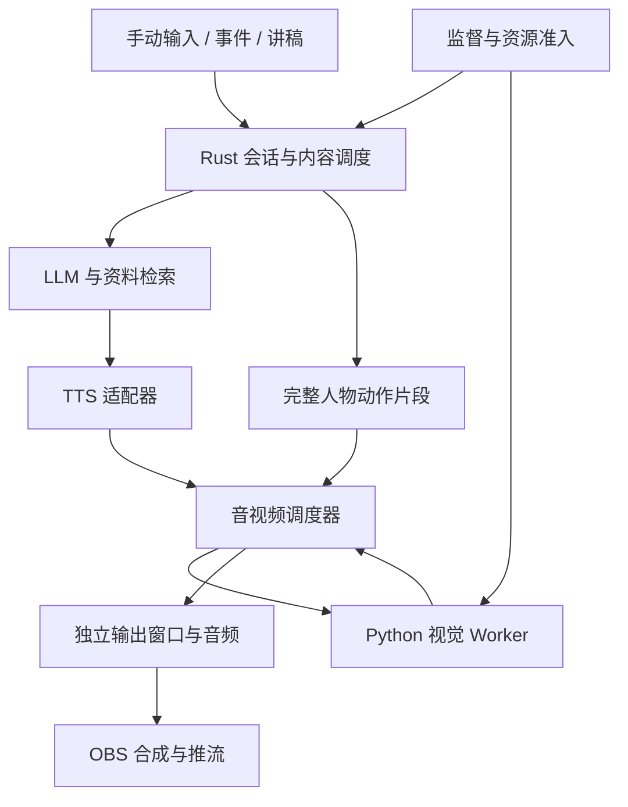

# 智能体赋能的本地数字人直播工作台
# V5.7 完整设计方案：落地闭环与易用优先

| 项目 | 定义 |
|---|---|
| 版本 | V5.7 |
| 日期 | 2026-11-06（UTC+8） |
| 文档性质 | 独立完整开发基线；替代 V5.6 中“沿用 V5.5”的未展开描述 |
| 目标设备 | Windows 11、RTX 5090 Laptop 24GB、32GB RAM；以实机检测结果为准 |
| 产品定位 | 单人、单机、单直播间的数字人直播辅助与协作工作台 |
| 默认路线 | FlashHead Lite 实时肖像 + 已部署 Qwen3-TTS + 内容调度 + OBS 合成推流 |
| 动作路线 | 兼容形象的完整人物预制片段；高级生成后端按能力验证后启用 |
| 本地原则 | 素材、配置、记录默认本地；已有本地 TTS 优先复用；LLM 可接本地或用户选择的 API |
| 发布原则 | 默认路径独立验收；可选后端失败不阻塞主线；性能目标与实测结果严格分开 |

## 0. 核心决策

1. 默认只有“实时互动”模式，内部采用 FlashHead Lite。Pro、LiveAct、云端及未来 3D 后端位于高级能力页，不占据首页，不强制下载。
2. 复用用户已部署的 Qwen3-TTS，不自动替换为 0.6B。保存完整模型 ID、服务实现与版本，实测通过后使用原有 1.7B 或其他变体；仅在资源不足时建议替代。
3. 主线输出为“完整肖像矩形视频 + 同步音频”，OBS 负责背景、字幕、商品画中画、场景和推流。透明抠像是可选增强，不能成为首次开播前置条件。
4. 不默认采用“动态头部 + 任意身体 PNG + 手势视频”的拼接。动作库使用完整人物片段，并标明是否包含固定台词。
5. 加入统一音视频调度器。音频驱动生成与最终播放分离；等对应视频具备播放条件后统一起播，处理背压、时间戳、打断与过期数据。
6. 插帧只改善显示平滑度，不增加模型生成的视频时长吞吐。LiveAct 未通过实机吞吐和时延验证时，只用于离线制作或实验。
7. Worker 切换统一称“冷切换”。界面显示“正在准备表演模式”，明确互动暂缓、过渡画面与等待时间，不承诺任意长度切换中原对话不断音。
8. 不承诺“永不 OOM”“毫秒级任意手势”“自动实现影院级融合”“Rust 杜绝 Python 泄漏”。通过资源准入、长稳验证、进程恢复和人工接管保证可控。
9. 开播默认不要求编辑 JSON、安装所有模型、理解引擎名称或调整显存参数。第一次配置后，重复使用只选择预设并开始预览。
10. 开放接口保留 MCP 工具接入与 A2A 协作方向，均绕过实时媒体关键路径；首版只落地必要的本地接口，不引入独立平台级服务。

## 1. 目标、范围与交付边界

### 1.1 产品目标

- 用户能使用预置示例，在无需平台账号的条件下完成“输入问题—生成回复—配音—口型视频—OBS 录像回放”。
- 用户可导入参考图、选择已有声线、输入主题或资料，并保存为主播预设。
- 同时支持手动输入、连续讲解、问答和外部弹幕事件；没有平台连接器时，以手动输入和模拟事件完成完整验证。
- 直播中一键打断、静音、接管、恢复和停止；任何输出都必须服从这些控制。
- 目标设备完成 8 小时主线运行验证；高级生成模式单独标记验证状态。

### 1.2 范围分级

| 等级 | 内容 | 发布关系 |
|---|---|---|
| 核心交付 | 本地工作台、TTS 接入、Lite Worker、回复调度、音画同步、OBS 输出、接管恢复、资源监控、安装诊断 | 必须全部通过 |
| 标准增强 | 形象预设、完整人物片段、讲稿与术语表、资料检索、OBS 场景配置助手、会话复盘 | 不牺牲核心闭环，按阶段完成 |
| 可选后端 | Pro、LiveAct、视频 Matting、透明视频、离线片段工坊、ASR/VAD、远程推理 | 各自独立验收 |
| 扩展能力 | MCP 工具、A2A 协作、平台连接器、3D 形象 | 保留接口，按明确需求实现 |

不要求首版交付多用户、多租户、插件市场、直播电商交易、自动平台开播或任意全身动作生成。以上扩展不删除，但不作为默认开播路径的依赖。

### 1.3 关键事实与不确定项

FlashHead 官方区分 Lite 与 Pro：Lite 报告单张桌面 RTX 4090 的 96 FPS；Pro 报告单张 4090 约 10.8 FPS，双桌面 5090 可实时。不能据此推导目标笔记本 Pro 15–17 FPS。[S1]

LiveAct 官方示例报告 18B 模型在单张 RTX 5090 上约 6 FPS；该数据不证明本设备能达到实时，也不证明任意社区量化/offload 组合可用。[S2] Qwen3-TTS 的不同模型变体在声音克隆、音色设计与指令控制上有区别，必须按实际模型暴露能力。[S3]

V5.6 中 LiveAct 12–16GB、offload 内存约 30GB、首包 150ms、A 加载 10 秒及 B 加载 90 秒等，均改为待验证参考，不能作为既成事实写入 UI。

## 2. 用户体验与信息架构

### 2.1 首次使用：五步完成试播

1. **环境检查**：识别 GPU、驱动、可用显存/RAM、磁盘空间、运行时；结果分为“可以试播”“可继续但有影响”“需要修复”。仅阻断当前路径必需的问题。
2. **连接声音与大脑**：优先发现上次配置的 TTS 和 LLM；可填写地址并点击测试。不扫描整个局域网，不自动修改用户服务。没有 LLM 时提供预置讲稿；没有 TTS 时提供固定示例音频试播。
3. **选择主播**：使用预置示例或导入参考图；检查人脸、裁剪、方向和分辨率，选择声线并试听。
4. **说一句**：输入一句话，生成可回放的同步音视频；分别显示连接、声音和画面是否正常。
5. **连接 OBS**：默认窗口捕获 + 指定应用音频捕获，生成 10 秒校准录像；用户确认画面和声音后保存预设。

首次安装示例资产与模型权重分离。首次下载时间不计入“完成配置所需时间”；界面显示实际下载大小和进度。

### 2.2 日常流程

打开工作台 → 自动加载上次预设 → 自检 → 预览 → 点击“开始互动” → 用户在 OBS 确认并开始推流。

“开始互动”只启动本地数字人输出，不冒充已经在平台直播。OBS 推流状态可读取；没有连接时显示“平台直播状态未知”。

### 2.3 页面设计

| 页面 | 默认内容 |
|---|---|
| 直播工作台 | 左侧预览；右侧待回答问题、当前讲稿；底部输入框与开始/打断/静音/接管/停止 |
| 主播预设 | 形象、声线、说话风格、背景、默认讲稿、兼容动作 |
| 内容与动作 | 讲稿、资料、术语、片段、固定话术 |
| 连接与设置 | TTS、LLM、OBS、事件入口、数据目录；高级参数折叠 |
| 状态与记录 | 资源、延迟、失败原因、会话时间线、诊断导出 |

首页只展示“可用/准备中/需要处理”及一句明确操作建议。GPU 温度、显存等放在可展开状态栏，不让用户持续盯图调参。

### 2.4 控制语义

| 控制 | 确切行为 |
|---|---|
| 开始 | 启动互动调度，待机画面与输出窗口就绪 |
| 暂停自动互动 | 不接新自动任务，当前句自然结束；手动发言仍可执行 |
| 打断 | 取消当前轮及其未播音视频、字幕和动作，回待机；不停止整场 |
| 静音 | 输出门立即关闭数字人声音并取消当前发言，进入待机；解除后不补播 |
| 接管 | 停止自动发言与动作、关闭数字人声音；按已配置 OBS 接管场景交给真人 |
| 恢复 | 回到待机，继续处理新的有效事件，不重放接管前积压内容 |
| 停止 | 取消任务、输出结束画面并释放本应用持有的资源；OBS 停推由单独明确操作完成 |

热键默认只在窗口内有效；全局热键为可选，需检测冲突。用户可自定义，停止与接管始终高于生成任务。

## 3. 架构与部署形态

### 3.1 职责边界

采用本机多进程架构，不为了“微服务”拆出数据库、消息队列或配置中心。

| 组件 | 职责 | 不承担 |
|---|---|---|
| Tauri 2 + React 桌面端 | 配置、预览控制、状态展示 | 不直接调用模型或驱动播放 |
| Rust Engine | 会话、任务仲裁、内容策略、适配器、调度、监督、SQLite | 不在实时回调中做模型推理 |
| Rust 媒体输出模块/进程 | 持续输出窗口、音频设备、时间戳播放、待机与过渡 | 不随视觉 Worker 重启 |
| Python Avatar Worker | 视觉模型加载、预热、音频特征、视频帧生成 | 不自行播放 TTS、不操控 OBS |
| 已有 TTS 服务 | 文本转音频；按实际能力提供克隆或风格控制 | 不决定任务优先级 |
| LLM 服务 | 流式文本与受限结构化意图 | 不直接执行 OBS、系统或插件操作 |
| OBS | 场景合成、字幕/商品源、录制、编码、推流 | 不提供人体动作几何与遮挡修复 |

桌面端和输出窗口会消耗图形资源，不再写“0 VRAM”。本地 LLM 的权重、KV Cache、工作区必须单独计入总预算。

### 3.2 数据路径



控制面使用本机命名管道或 loopback RPC；数据面使用有界共享内存。MVP 使用 CPU BGRA 帧拷贝以先验证闭环；共享 GPU 纹理仅在分析证明拷贝成为瓶颈后实现。

### 3.3 Windows 与 WSL2

发布首选经验证的 Windows 原生运行时。若视觉依赖无法在 Windows 达标，允许启用独立 WSL2 适配器，但不得静默切换部署路线。

跨 Windows/WSL2 不假设命名共享内存、虚拟摄像机或 GPU 纹理直接互通。M0 必须验证局域本机传输桥：带长度与时间戳的二进制帧/音频通道、有界队列、实际吞吐、复制开销和断线恢复；若达不到预算则该部署组合不可标为支持。不同平台后端由统一接口屏蔽，上层流程一致。

## 4. 模型与能力管理

### 4.1 默认选择

- 视觉：FlashHead Lite，锁定 commit、权重哈希、依赖和已测输入配置。
- TTS：复用现有 Qwen3-TTS 服务与模型；开机检测服务能力，默认不卸载用户模型。
- LLM：复用已配置 OpenAI 兼容服务；允许纯本地或用户选择的 API。声称“全离线”时所有必需服务、模型和素材均须本地可用。
- 本地 7B/4bit 不是必需项，也不把其 4–5GB 当成完整运行峰值。

### 4.2 能力描述

每个适配器上报 `adapter_version`、`model_id`、`model_revision`、`stream_output`、`incremental_text_input`、`cancel`、`instruction_control`、`voice_clone`、`native_fps`、`native_resolution`、`audio_requirements`、`tested_profile_id`。

TTS 输入增量流与音频输出流分别标记。若只支持整段文本生成，则按语义短句请求，不伪装为 token 级双向流式。不能取消的服务采用“取消消费 + 丢弃旧轮输出”，并限制后台在途任务。

### 4.3 模式与可用等级

| 模式 | 默认状态 | 启用条件 |
|---|---|---|
| 实时互动 Lite | 推荐 | 完成整链路基线 |
| 高画质 Pro | 高级可选 | 目标机并行实测达到所标等级 |
| 本地 LiveAct 表演 | 实验/离线 | 指令注入、时长吞吐、资源、首段延迟实测全部完成 |
| 远程生成 | 可选 | 用户配置 endpoint，验证传输、故障降级与数据范围 |
| 片段播放 | 推荐动作补充 | 素材兼容与同步检查通过 |

能力等级为“实时已验证 / 有缓冲播放 / 离线生成 / 未验证”，不以输出 FPS 替代等级。

## 5. 音视频时钟与实时管线

### 5.1 统一标识

所有媒体单元包含 `session_id`、`utterance_id`、`epoch`、`seq`、`pts_us`、`duration_us`。音频另含采样率、通道与采样格式；视频另含宽高、stride、像素格式、原生帧时间和共享内存槽位。

PTS 使用整数时间单位；音频通过累计样本数换算。重采样保持连续状态，不能每个 chunk 重置滤波器。模型特征采样率从适配器读取，禁止假定所有后端都是 16kHz。

### 5.2 流式处理

1. 对 LLM 增量文本做标点/语义分句、数字与术语归一化；首句尽量短，避免逐字合成破坏韵律。
2. TTS 原始 PCM 同时送入特征生成与待播放缓冲；根据需求分别重采样。
3. 视觉 Worker 积累其要求的音频上下文再生成首块，报告音频到视频的时间映射。
4. 音视频调度器达到启动缓冲阈值、确认对应视频可用后统一起播。输出 48kHz 是发布配置，不能改变模型实际所需采样率。
5. 正常播放以音频设备已播放样本为时钟，选取对应 PTS 的视频帧；不让 UI 刷新率主导音画进度。
6. 输出窗口只展示播放中的帧；操作员预览可降刷新率，不能阻塞主输出。

chunk 初值 200–400ms 仅为可调策略；后端上下文可能更长。启动缓冲初值 300–600ms，最终由 M0 调整并记录。低延迟配置不能以反复音频欠载为代价。

### 5.3 背压与掉帧

- 默认仅一个正在发言的任务，最多一个已提交的下一短句；后端不支持并发时严格串行。
- 音频/特征/视频/事件队列均设上限，并按媒体时长与字节数双限流。
- 初始音视频预取高水位 2 秒、低水位 0.5 秒，允许依据基线调整；达到高水位暂停上游，不无界追加。
- 迟到视频允许小量丢弃以追赶音频；持续落后时停止该轮、回待机并解释，不长时间“有声音无口型”。
- 欠载短暂重复最后一帧；超过配置容忍阈值进入缓冲/中止状态，保留输出窗口。
- 模型持续吞吐不足时必须缩小分辨率、降低原生目标或改为预生成，不能用无限加缓冲掩盖。

### 5.4 插帧的硬边界

定义实时因子 `RTF = 生成墙钟时间 / 对应视频时长`。持续实时要求 RTF≤1，发布建议在整链路负载下留出余量，例如 P95≤0.8（设计目标）。

若 25FPS 时基的视频每秒只能算出 6 帧，则每秒仅生成约 0.24 秒内容，RTF 约 4.17。把这些帧插成 25FPS 不能补回未生成的后续动作与口型。只有后端原生就在稀疏时间点覆盖足够视频时长，且按真实 PTS 插值，才可改善平滑度而不改变时长。

因此 LiveAct 的 6FPS 数据必须结合其输出时基与生成时长解读。默认关闭在线插帧，先测真实时长吞吐；插帧启用后重新测延迟、显存和伪影。

### 5.5 打断协议

Engine 递增 epoch → 关闭当前输出与字幕 → 清理已排队音视频和动作 → 发送 cancel → Worker 在安全点确认或超时重启 → 输出待机 → 接受新轮。

新旧轮通过 epoch 与 utterance_id 双重校验。取消确认后仍到达的媒体全部丢弃；共享内存槽位通过引用/序号保护，不读取已覆盖的数据。音频设备已有缓冲计入打断延迟，MVP 禁止使用数秒不可清空的播放队列。

## 6. OBS 输出与透明增强

### 6.1 主线输出

第一条可交付路径为 Windows 独立稳定窗口 + WASAPI 输出，OBS 窗口捕获及应用音频捕获。通过指定音频宿主进程避免把 UI 提示音一起送出；若目标 OBS/系统组合不能可靠隔离，使用明确配置的专用音频设备路由并重新校准。

窗口拥有固定标识、固定画布尺寸，不跟随操作员界面切换而消失。最小化、锁屏、分辨率变化与显示器切换必须单独验证；未验证时不宣称后台任意状态可持续捕获。

### 6.2 音频路由校准

向导播放闪光与短音，OBS 录制回放并测量偏移，保存 `obs_audio_offset_ms` 及采集路径版本。改变输出设备、捕获方法或插件后提示重新校准。默认只保留一条数字人音频输入，检测/提示桌面音频重复采集与回声。

MVP 本地录制由 OBS 执行；工作台负责发起/读取状态，避免同时维护第二套编码器。

### 6.3 推荐场景

| 场景 | 用途 |
|---|---|
| MainScene | 正常互动：数字人、字幕、背景、商品画中画 |
| IntermissionScene | 模型准备、故障或短休息 |
| TakeoverScene | 真人接管；由用户预先配置麦克风和摄像头 |

MainScene 默认完整肖像不透明区域，背景可在 OBS 其余画布布置。商品展示前后关系通过模板选择，不固定放在人物身体下面。

OBS WebSocket 是控制面，采用本机连接与认证；不是视频传输通道。`SetSceneItemEnabled` 控制显隐，媒体重启使用对应媒体动作请求。多个请求即使批量执行也不承诺跨请求事务或 16ms 无缝呈现。[S5]

### 6.4 透明路线

优先验证 Windows `pyvirtualcam + Unity Capture` 的 RGBA 路线；该后端支持透明帧进入 OBS，不能推断所有虚拟摄像机都保留 Alpha。[S4] WSL2 需独立桥接；不直接复用此假设。

透明增强验收包含颜色/Alpha 通道、预乘约定、头发、运动模糊、边缘闪烁、时延和资源峰值。视频 Matting 与逐帧去背景分开测试；默认不在已透明画面叠加去绿边滤镜。

共享纹理/自定义 OBS Source 作为后续优化；替换传输方式时保留时钟、epoch、资源限制和故障协议。

## 7. 形象、动作与换装

### 7.1 主播预设

预设绑定参考图、裁剪区域、声线、语气范围、背景、服装版本、片段集合、允许动作、默认讲稿、OBS 模板与测试记录。每个预设具有版本和内容哈希；修改形象后自动撤销不兼容片段的可用状态。

实时肖像尽量保留肩颈与原始服装。OBS 只做画面排布，不承担头颈追踪、遮挡重建与人体绑定。

### 7.2 片段分类与调度

| 类型 | 是否可叠加任意实时语音 | 播放策略 |
|---|---|---|
| 固定台词动作 | 否 | 使用片段自带音频；关闭实时 TTS 与嘴部视频 |
| 闭口无声动作 | 经审核后有限允许 | 优先句间播放；不在清晰可见嘴部时叠加任意讲话 |
| 待机/过渡 | 否，默认无声 | 用于装载与故障，占用画面但不伪装成正在回答 |
| 可重驱动动作素材 | 待后端验证 | 必须经过新的嘴部驱动及一致性验收后开放 |

片段元数据：`clip_id`、`avatar_version`、`outfit_id`、`action`、`duration_ms`、`audio_policy`、`text`、`entry_pose`、`exit_pose`、`interruptible`、`loopable`、`license_ref`、`quality_state`。

播放流程：校验兼容 → 等句间安全点或取消当前轮 → 预解码首段 → 同步切换画面与声音 → 播放 → 结束姿态过渡 → 回待机/新一轮。开始到可见延迟与等待安全点时间分别统计。

固定台词片段不改变正在回答的内容，也不把旧台词与新回复混播。优先级为停止/接管 > 手动打断 > 手动动作 > 互动回复 > 自动动作 > 连续讲解 > 待机。

### 7.3 换装

默认换装为切换完整形象预设，在句间执行；提前生成该服装参考图与兼容动作。改变形象可能触发模型条件缓存重建，显示“准备新形象”，不承诺 1 帧完成。

只有专门配准并通过头动/遮挡测试的素材包才能启用头身分层。复杂手脸遮挡使用完整人物片段或可控全身后端。

### 7.4 片段工坊

先支持导入、裁剪、静音、绑定预设、标记台词和审核，再加入 EchoMimicV3 离线制作。[S6] 离线生成默认与实时视觉任务互斥，直播期间不自动启动；用户可以在结束后批处理。

首批每个官方示例预设至少准备待机、过渡、欢迎、感谢、挥手等少量高质量素材。用户导入自己的形象时，不伪装已有示例片段兼容。

## 8. 高级引擎冷切换

### 8.1 使用策略

首页不放 A/B 开关。高级能力页显示“尚未安装 / 待验证 / 可离线生成 / 可缓冲播放 / 实时已验证”。未验证的 LiveAct 不进入自动关键词或 LLM 动作路由。

### 8.2 过程与恢复

1. 预检目标配置、实测资源档、服务归属、驱动和许可记录；已有外部 GPU 负载变化时重新核验。
2. 停止新自动任务，等待当前短句结束；达到超时则执行统一打断。
3. 输出模块切到本地无声待机片段/休息画面；可播放独立背景音乐，不假装原对话仍在连续生成。
4. drain 旧 Worker；软退出超时后终止本应用进程；等待实际资源回收，不只检查 `empty_cache()`。
5. 拉起目标 Worker、加载、预热、报告 ready 与资源；使用实测阶段进度，不显示伪精确百分比。
6. 创建新 epoch，确认第一段同步媒体准备好，再进入新模式。
7. 失败时保持休息画面，最多自动重建原模式一次；仍失败则进入静态形象/字幕并提示恢复或接管。

切换期间自动事件只保留少量未过期的新问题；不重放过期感谢或动作。只有最新有效的切换目标保留，禁止切换请求无限排队。

画面连续表示输出窗口持续有有效内容；不代表引擎无缝、互动不停或音频零中断。TTS 通常复用，但紧张配置可以在句间停止本应用托管的 TTS；外部服务未经用户配置不主动卸载。

## 9. 内容、互动与智能体

### 9.1 事件入口

统一事件结构：`event_id`、`source`、`received_at`、`expires_at`、`type`、匿名化用户标识、文本和必要元数据。去重、频率限制、长度限制、TTL 和来源认证在进入 LLM 前执行。

首版提供手动问答、模拟弹幕与带 token 的本机 HTTP 入口。真实平台连接器独立实现；没有连接器时清楚显示“未连接直播平台”。不把未经验证的抓取方式作为产品必需依赖。

默认最多保留 20 条待答事件；一般问题 TTL 初值 60 秒，感谢/动作初值 10 秒。高流量时合并同类问题并丢弃过期事件，始终让操作员可删除和置顶。

### 9.2 回复与知识

讲稿按段落、问题按短答生成；支持暂停讲解插入问答，结束后恢复讲稿游标。资料首版使用 SQLite FTS 检索；每段回答保存来源片段，资料不足时说明不确定或交给操作员。商品价格、规格等事实优先从已确认内容读取。

术语表分离显示文本与发音文本，支持缩写、型号、数字、单位和公式读法。TTS 缓存键包含模型版本、声线、归一化文本、语气、参数；变更后不复用错误音频。

LLM 输出结构限定为回答文本、语气枚举、允许的动作 ID、来源 ID。解析失败时回退为普通文本；任何模型文本都不能直接成为系统命令、OBS 请求或文件路径。

### 9.3 工具与协作边界

核心暴露版本化本地工具：查资料、提交待审回复、列出动作、排队动作、查询会话状态。MCP 适配器复用同一工具层；每个工具声明读写属性、超时、权限和取消语义。

A2A 适配器可将资料整理、回答建议等非实时任务委托给外部智能体，结果作为候选内容返回；不允许其直接获取音频设备或控制输出门。协议版本必须在实现时按官方规范锁定，不在本版假定完整兼容。

外部工具不能阻塞音频回调；超时直接回退本地内容。停止、接管、模型下载和系统设置变更不向普通自动工具开放。

## 10. 状态机、监督与故障处理

### 10.1 状态组合

会话：`idle → preparing → ready → running → stopped`；running 子态包含 `speaking / waiting / paused / takeover / degraded`。

视觉：`unloaded / loading / warming / ready / draining / failed`。输出：`idle / synchronized / transition / muted`。

引擎切换是独立操作状态，会话 ID 不变；切换期间调度进入 paused。状态组合由 Engine 单点更新，UI 不自行猜测 ready。

### 10.2 监督机制

Worker 每秒心跳；心跳超时与无媒体进展分别判断。长句生成有进度心跳不能无限规避输出超时。超时值依据加载和推理实测档设定。

重启仅作用于应用托管进程；采用退避和次数上限，例如 5 分钟内最多 2 次自动重启，超过进入 degraded。输出模块独立于 Worker，可继续播放本地安全素材。

| 故障 | 自动行为 | 用户看到 |
|---|---|---|
| LLM 失败 | 用预置短答或等待手动输入 | “回答服务暂不可用”及重试 |
| TTS 断线/非流式 | 停止当前轮；可退为字幕 | 声音连接诊断 |
| Worker OOM/退出 | 清理旧轮，待机，有限重启 | 当前模式恢复中 |
| 持续视频落后 | 停止当前轮，建议更轻配置 | 原因与一键修复 |
| OBS 断线 | 保持本机输出，重连控制 | “OBS 状态未知”，不停止其他工作 |
| 音频设备改变 | 暂停输出并重新绑定校准 | 选择设备提示 |
| 输出窗口故障 | 尝试重建；OBS 切休息场景仅在控制链可用时执行 | 接管建议 |
| 磁盘不足 | 停止录制/缓存写入，保留核心互动 | 可清理项目列表 |

“无黑屏”限定为 Worker 重启等已覆盖场景；Engine、输出进程、OBS 或系统同时崩溃不能保证，需人工接管。

## 11. 资源管理与目标机适配

### 11.1 完整预算

VRAM 峰值覆盖 LLM 权重/KV、TTS、视觉权重与激活、CUDA context/graph、Matting、插帧、共享帧缓冲、UI、OBS 解码/滤镜/编码和系统图形占用。RAM 覆盖模型加载副本、offload、Python、浏览器、OBS、文件缓存与其他进程。

不再以“24GB 减去几项权重”判断一定可用。每个 profile 保存空闲基线、加载峰值、稳态 P95、瞬态峰值和并行测试结果；报告 MiB/GiB 与 GB 单位。

### 11.2 准入规则

以整机可用资源和已测峰值判断，而非仅各进程数值求和。未测重配置不自动准入直播。

初始策略：保留至少约 2GiB 显存余量；32GB RAM 设备保留约 4GiB 可用物理内存，并同时检查系统提交内存与分页压力。以上为工程初值，需由实际基线修订。空闲下降、持续分页或生成速度不足时阻止新增重任务。

监控每秒采样，事件记录降采样；GPU 温度与厂商限制/降频标记结合判断。传感器不可读时显示未知，不写 0。避免硬编码所有设备统一 87°C 或主动修改 TGP；提供散热与电源提示。

### 11.3 降级顺序

停止离线任务与额外并发 → 降低非关键预览与画面配置 → 关闭透明 Matting/插帧等增强 → 从重视觉模式回 Lite → 若本地 LLM 争用，提示用户选择轻模型或其他已配置服务 → 静态形象 + 声音/字幕 → 接管或停止。

不能在缺少授权/配置时静默把本地内容发送云端。降级改变画质可以自动执行已勾选策略；改变外部服务或卸载用户自有服务只给操作入口。

## 12. 配置与数据模型

### 12.1 两层配置

用户只编辑少数项：主播预设、TTS/LLM 地址、声线、OBS 连接、输出横竖屏、数据目录。高级 profile 由自检生成，模型预算、依赖、缓存和阈值不暴露为日常表单。

```json
{
  "schema_version": "5.7",
  "preset_id": "demo-host",
  "mode": "realtime",
  "avatar": {"backend": "flashhead_lite", "profile_id": "auto-tested"},
  "tts": {"service_id": "existing-qwen", "use_existing_model": true},
  "llm": {"service_id": "configured-llm"},
  "output": {"canvas": "portrait_720p", "transport": "window_capture", "audio_route_id": "calibrated-route"},
  "obs": {"enabled": true, "connection_id": "local-obs"},
  "interaction": {"auto_reply": false, "event_ttl_s": 60, "queue_limit": 20},
  "experimental": {"liveact": false, "matting": false, "interpolation": false}
}
```

`auto-tested` 表示解析到具体已测 profile，不是未经测试自动选参。连接凭据通过本机凭据存储引用，不明文写入 JSON。高级 profile 不包含未经验证的 `fp8_kv_cache` 等假定参数，只映射后端真实支持的配置。

### 12.2 SQLite（WAL）

| 表 | 关键字段 |
|---|---|
| presets | id、version、avatar_ref、voice_ref、scene_ref、content_hash |
| services | id、type、endpoint、capabilities、credential_ref |
| model_profiles | id、model_revision、runtime_hash、hardware_fingerprint、resource_report、validation_level |
| sessions | id、preset_version、started_at、ended_at、status |
| utterances | id、session_id、epoch、text、spoken_text、source_refs、status、timing |
| events | id、session_id、source、type、expires_at、state |
| clips | id、preset_version、metadata、quality_state、asset_hash |
| operations | id、type、state、progress_stage、error_code、started_at、ended_at |
| metrics | session_id、timestamp、metric_name、value、unit |
| audit | timestamp、actor、action、target、result |

媒体文件在磁盘，数据库只存引用。状态变更事务化；配置迁移前备份，失败回滚。会话崩溃后恢复记录与预设，不自动恢复推流或重播旧回复。

缓存按大小上限和最近使用淘汰；运行日志默认 7 天，完整台词/资料留存由用户选择。诊断包默认脱敏，不包含 API Key、原始声音克隆样本或全部资料。

## 13. API 与 IPC 契约

### 13.1 本机应用 API

| 接口 | 语义 |
|---|---|
| GET /api/v1/status | 会话、模式、连接、资源、降级状态 |
| GET /api/v1/capabilities | 当前模型与输出链路可用能力 |
| POST /api/v1/preflight | 创建当前预设自检操作 |
| POST /api/v1/sessions | 创建本地会话 |
| POST /api/v1/sessions/{id}/commands | start、pause、interrupt、mute、takeover、resume、stop |
| POST /api/v1/sessions/{id}/events | 认证后导入事件 |
| POST /api/v1/sessions/{id}/speak | 手动发言 |
| POST /api/v1/sessions/{id}/actions | 白名单动作或片段 |
| POST /api/v1/sessions/{id}/switch | 创建冷切换操作 |
| GET /api/v1/operations/{id} | 加载、切换、诊断进展 |
| POST /api/v1/diagnostics | 创建脱敏诊断导出任务 |

长操作返回 operation_id，支持查询和取消；变更请求带 request_id，重复提交按幂等规则处理。控制事件通过 WebSocket/SSE 通知 UI，媒体不走这些 JSON 事件。

### 13.2 Worker 协议

启动握手：协议版本、能力、模型信息、音频要求、帧格式。命令：load、warmup、begin_utterance、push_audio、end_utterance、cancel、drain、shutdown。事件：progress、ready、frame_ready、cancelled、drained、resource、error。

共享内存采用固定槽位、序号与生命周期确认；缓冲区尺寸根据原生帧大小计算并设硬上限。生产者不能等待消费者无限阻塞，消费者不能持有被回收槽位。协议不兼容时拒绝启动并给明确错误。

### 13.3 错误结构

统一 `code`、`message`、`retryable`、`suggested_action`、`operation_id`。至少包含 SERVICE_UNREACHABLE、MODEL_UNSUPPORTED、STREAMING_UNAVAILABLE、PROFILE_UNVALIDATED、RESOURCE_INSUFFICIENT、MEDIA_UNDERRUN、AV_SYNC_FAILED、SWITCH_IN_PROGRESS、STALE_EPOCH、OBS_DISCONNECTED、DEVICE_CHANGED、LICENSE_REVIEW_REQUIRED。

## 14. 安装、更新与维护

一个桌面安装器 + 按需下载的模型/运行时包。首版默认仅安装 Lite 所需运行时；各视觉后端独立环境、依赖锁和检查脚本，避免某后端升级破坏主线。

CUDA/PyTorch/注意力内核不能简单写成“版本大于等于某值就支持”。发布记录包含驱动版本、Python、PyTorch、CUDA runtime、sm_120 kernel 实测、模型 commit 与哈希；安装器先运行最小 kernel、模型加载与 10 秒生成测试。

下载支持断点续传、哈希验证和磁盘空间预检。安装失败显示阶段与修复入口，不要求用户先阅读长篇命令行教程。允许选择已存在的模型目录，避免重复下载。

TTS 有外部服务与应用托管两种归属：外部服务只检测/调用，不随应用关闭；托管服务由监督器启动和停止。启动顺序是配置/输出安全画面 → 探测服务 → Worker 预热 → OBS 连接检查 → 可开始；OBS 未启动时允许先预览。

更新前保存当前运行时与配置快照；直播中不自动更新、切模型或清缓存。退出时停止应用自有任务，保留用户外部服务。

## 15. 安全、素材与权限

本地 API 默认只监听 loopback；外部事件入口需要 token、长度与速率限制。OBS 开启认证；`ws://127.0.0.1` 是本机明文连接，不称作 TLS 安全连接。跨机访问需单独配置受保护传输。

参考图与声音素材由用户确认使用权限；克隆能力不以“3 秒必定高质量成功”承诺。代码、权重、基础模型、声音、插件与素材分别记录来源与许可，不用仓库一个徽标代替全部核查。

许可状态按具体版本实际核查；本版不重复断言某仓库当前“没有 LICENSE”。仅在发现真实未解决的授权限制时阻断对应分发/使用路径，不对所有高级能力一律附加书面确认要求。

过滤策略可配置，外部事件不直接执行系统操作。日志默认脱敏，远程服务启用前展示将发送的数据类别。真人接管及停止不依赖 LLM、外部工具或网络可用。

## 16. 性能定义、设计目标与验收

### 16.1 测量口径

`t_event` 为工作台接收有效事件时间；`t_text` 为可提交的首段文本就绪；`t_pcm` 为首个有效 PCM；`t_present` 为本地首个有效同步声音/讲话画面呈现。待机帧不能计为回答首帧。

分别记录 TTS 请求→首 PCM、事件→首段文本、事件→本地同步回应、OBS 捕获偏移和直播端到端延迟。平台播放缓冲不混入模型首包指标。

### 16.2 工程目标

以下为 V5.7 初始目标，均需 M0 实机校准；未达标不能改写数据或称为已验证。

| 指标 | 初始目标/发布规则 |
|---|---|
| 主线原生生成吞吐 | 对选定时基 RTF P95≤0.8 为建议目标；持续≤1 为必要条件 |
| 同步输出 | 目标 25FPS 时间线；重复帧/插帧与原生生成帧分别统计 |
| 本地同步回应 | 预热、短上下文、无积压时 P95≤2 秒；≤1 秒为优化目标 |
| TTS 首包 | ≤300ms 为优化目标，按实际服务及文本长度单测；不以此推导整链路 |
| 音画偏移 | 校准后绝对偏移 P95≤80ms，长句与 30 分钟运行无累积漂移 |
| 手动打断 | 命令到本地数字人声音停止 P95≤200ms |
| 片段触发 | 预加载且无当前发言时 P95≤300ms；等待安全点单列 |
| 冷切换 | 必须可取消、可观察、失败可回退；耗时用本机 P50/P95 展示 |
| 主线长稳 | 8 小时无失控队列、无不可恢复崩溃，自动恢复与降级均有记录 |
| 内存 | 暖机后无持续不可解释增长；满足整机准入余量，无持续分页拖慢 |

RTF 测试覆盖短答、长句、情绪语音与动作插播，不能只取最佳样本。延迟至少收集 100 次有效请求并报告分位数、失败率、上下文、文本长度、功耗档和是否缓存命中。

### 16.3 验收用例

| ID | 场景 | 必须证明 |
|---|---|---|
| ACC-01 | 新安装/断网已缓存 | 必需依赖清晰、可按预设离线启动 |
| ACC-02 | 现有 TTS 接入 | 不改用户服务，模型能力识别准确，非增量输入不虚标 |
| ACC-03 | 10 分钟手动问答 | 从文本到 OBS 回放音画完整 |
| ACC-04 | 30 分钟长句与连续讲解 | 无累计漂移、队列有界、语音无接缝爆音 |
| ACC-05 | 发言中反复打断 | 无旧声音、旧字幕、旧帧和旧动作复活 |
| ACC-06 | 固定台词片段插播 | 单一声音与单一人物输出，无双嘴混音 |
| ACC-07 | 接管/静音/恢复 | 不依赖模型响应，恢复不补播旧任务 |
| ACC-08 | Worker OOM/退出注入 | 待机持续、有限重试、失败可接管 |
| ACC-09 | TTS/LLM/OBS 断线 | 状态准确，不谎报开播或恢复成功 |
| ACC-10 | GPU 额外负载/内存压力 | 拒绝新重任务、按策略降级 |
| ACC-11 | 8 小时主线 | 包含问答、讲解、动作、人工接管和恢复；留存录像与指标 |
| ACC-12 | 可选冷切换 | 每个已发布组合验证成功、失败、取消、回退；不要求未交付 LiveAct 参与核心验收 |
| ACC-13 | 透明/WSL2（条件） | 每条发布路径独立验证 Alpha 或跨边界吞吐、同步与恢复 |
| ACC-14 | 易用性 | 首次用户无需修改配置文件，能完成试播并理解三个异常提示 |

8 小时稳定不等于证明 7×24。24/72 小时作为后续扩展验证。单次恢复成功不能掩盖频繁故障，报告必须列自动重启数、降级时长和丢弃轮次。

## 17. 开发组织与实施顺序

### 17.1 建议目录

```text
apps/desktop/                  Tauri 入口与 React 页面
crates/core/                   会话、调度、内容、能力与应用服务
crates/media/                  时钟、缓冲、重采样、输出门与窗口
crates/adapters/               LLM、TTS、OBS、事件与工具适配
crates/protocol/               公共 IPC 类型、版本、错误
workers/flashhead/             Lite/Pro 适配与锁定依赖
workers/liveact/               可选后端，不进入默认包
extensions/mcp/               可选工具协议桥
extensions/a2a/               可选协作协议桥
assets/demo/                   示例形象与兼容片段
profiles/                      经验证的运行档与模板
scripts/                       安装检查、基准、诊断
specs/                         契约、状态表、验收用例
```

media 可先作为 Engine 内独立模块；需要跨崩溃保活时以单独宿主启动。crate 按职责拆分，不为每个类/服务建一个 crate；Python 不反向依赖 UI。

### 17.2 里程碑

| 阶段 | 交付 | 退出条件 |
|---|---|---|
| M0 真实链路验证 | 现有 TTS + Lite + 音画时钟 + OBS 录制、整机资源报告、Windows/WSL2 路线选择 | ACC-02/03 通过，确认持续吞吐与捕获方案 |
| M1 核心可用 | 桌面向导、预设、手动发言、打断、静音、接管 | ACC-04/05/07 通过 |
| M2 直播辅助 | 连续讲解、事件入口、资料/术语、片段插播、OBS 助手 | ACC-06/09 与易用性检查通过 |
| M3 发布稳定 | 安装包、诊断、资源准入、故障注入、长稳 | 核心 ACC-01 至 11、14 通过 |
| E1 可选增强 | Pro、透明链路、离线工坊 | 每项独立能力报告 |
| E2 生成表演 | LiveAct 本地/远程、冷切换 | ACC-12 及吞吐等级验收 |
| E3 开放协作 | MCP/A2A、真实平台连接器 | 契约、权限与取消/超时验证 |

不在缺少 M0 实测时承诺固定八周完成所有能力。M0 之后按实际难点排期；若高级后端无法达标，核心产品照常完成。

### 17.3 指导 Codex 的执行约束

- 每个任务写清输入、输出、契约、验收和不变量；先跑真实最小链路，不以 mock 成功替代硬件成功。
- 编译、类型检查、关键状态与取消测试、真实媒体集成逐层验证；UI 文案和低风险样式不堆砌镜像测试。
- 状态机/epoch/有界队列/幂等/媒体 PTS 等必须有自动化验证；模型画质与真实 OBS 捕获通过录制回放验证。
- 未完成适配器显示 unavailable，禁止返回假 ready、假 FPS、假资源或假下载进度。
- 每阶段更新实现状态：已实现、实机验证、未验证、阻塞原因与证据路径。示例配置与生产代码保持一致。
- 失败优先修复契约与真实问题，不以关闭验收、删除断言或填入常数冒充完成。
- 默认自主完成可逆实现与验证；发布、平台开播和外部权限变更按用户实际授权执行，不把这些动作混入自动测试。

## 18. V5.6 → V5.7 变更对照

| 原设计问题 | V5.7 修正 |
|---|---|
| 多处“沿用 V5.5” | 展开状态、协议、数据、安装、故障、UI 与验收，形成独立基线 |
| Lite 推荐但配置默认 Pro | 默认 Lite；Pro 实机通过后可选 |
| 默认改成 TTS 0.6B | 优先复用已有服务与实际模型，能力/资源不满足再调整 |
| 本地 LLM 资源未分账 | 纳入权重、KV、峰值与并行竞争 |
| Lite/Pro/LiveAct 数据推导目标机表现 | 公开参考与目标机实测分开 |
| 6FPS 插帧到 24FPS 视为准实时补齐 | 以时长吞吐 RTF 判断；插帧不创造未来内容 |
| 冷切换称热切换、要求原音频不断 | 统一冷切换，输出连续与语音连续分开 |
| 片段可覆盖任意实时讲话 | 台词/无声/可重驱动分级，统一音画仲裁 |
| 动态头部拼任意身体 | 默认完整肖像/完整人物片段；几何配准单独验证 |
| 透明虚拟摄像机默认成立 | 主线窗口捕获，Unity Capture RGBA 作为条件增强 |
| 音频路径与 OBS 偏移未闭环 | 独立媒体宿主、统一时钟、路由校准与重复音频检查 |
| 固定温度/显存值即保证稳定 | 整机实测 profile、资源余量、分页/降频与故障恢复 |
| 强制 LiveAct 参与 8h 验收 | 主线独立发布，可选后端分别验证 |
| 首页偏技术参数 | 三项核心输入、一个默认模式、异常给明确动作 |

## 19. 操作手册

### 19.1 日常开播

打开应用 → 加载主播预设 → 检查“声音、画面、OBS” → 点击说一句 → 开始互动 → 在 OBS 检查并开始推流。

讲解中可插入手动问题；动作面板只显示当前形象兼容片段。需要高级表演时进入能力页，明确看到其“实时/缓冲/离线”等级。

### 19.2 出现异常

声音/口型异常先点打断；需要真人处理点接管。系统尝试修复后只回待机，由操作员确认恢复。不要通过反复点击开始制造重叠任务。

### 19.3 结束

停止本地互动 → 在 OBS 停止推流/录制 → 查看本场记录 → 按需导出脱敏诊断或录像。外部 TTS/LLM 保持用户原有运行状态。

## 20. 发布交付清单

- 可安装桌面程序与最小运行时；模型下载及已有模型复用入口。
- 一个可完整试播的示例预设及兼容片段。
- 现有 Qwen3-TTS/LLM 接入说明与能力检测。
- OBS 场景配置说明、音频路由与校准流程。
- 锁定的依赖、模型版本、哈希与许可清单。
- 目标机整链路性能报告、8 小时记录与故障注入结果。
- API/IPC 契约、目录结构、状态机与验收用例。
- 已验证能力矩阵与未验证项目说明；不把文档目标标成产品事实。

## 附录 A：公开依据与核查入口

核查日期：2026-11-06。以下公开数据仅说明上游能力；不是目标笔记本的整链路测试结果。

- [S1] SoulX-FlashHead 官方仓库：https://github.com/Soul-AILab/SoulX-FlashHead
- [S2] SoulX-LiveAct 官方仓库：https://github.com/Soul-AILab/SoulX-LiveAct ，模型卡：https://huggingface.co/Soul-AILab/LiveAct
- [S3] Qwen3-TTS 官方仓库与能力表：https://github.com/QwenLM/Qwen3-TTS
- [S4] pyvirtualcam 支持后端与 Unity Capture RGBA 说明：https://github.com/letmaik/pyvirtualcam
- [S5] OBS WebSocket 5.x 协议：https://github.com/obsproject/obs-websocket/blob/master/docs/generated/protocol.md
- [S6] EchoMimicV3 官方仓库：https://github.com/antgroup/echomimic_v3
- [S7] NVIDIA Laptop 型号与显存对照：https://www.nvidia.com/en-us/geforce/laptops/compare/

## 附录 B：实施不变量

1. 同一时刻只有一个数字人音频输出所有者。
2. 旧 epoch 的音频、视频、字幕和动作永不重新呈现。
3. 所有队列有硬上限，所有长任务可取消或停止消费。
4. UI 的 ready 必须来自实际服务与媒体就绪信号。
5. OBS 连接成功不等于平台已开播。
6. 插帧后的显示帧率不等于原生生成吞吐。
7. 模型 Worker 崩溃不应销毁独立输出宿主。
8. 未验证的高级能力不能自动接管默认主线。
9. 外部用户服务不因应用退出或降级被擅自终止。
10. 操作员接管和停止始终优先于任何模型、工具和自动化任务。
