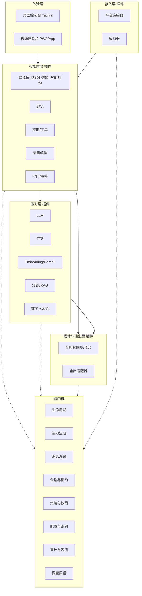
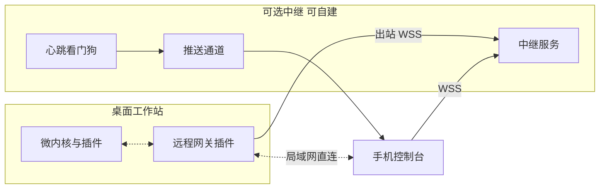

# 直播数字人 + 智能体系统设计方案 V3.0

> 2026-10-07 · 在 V2.3 基础上整体重构：从"数字人直播流水线"升级为"微内核 + 智能体运行时 + 多形态部署"
> 
> 首发抖音，预留快手、视频号；桌面直播为主形态，移动端监控管理为一等公民，移动端出画与云渲染作为可验证的扩展形态。
> 
> 本文是设计与验收方案。凡标注"待验证"的内容，表示尚未经官方文档或实测确认；本版没有做硬件基准，也没有取得任何平台授权。

---

## 一、V2.3 审阅结论与 V3.0 的改动

### 1.1 V2.3 值得保留的部分

引擎与界面分离、独立音视频输出进程与播放租约、`generation_epoch` 全链路取消、能力快照与准入检查、事件幂等与聚合、RAG 分级（R0–R3）与外发权限分离、模型包与 BOM 管理、Gate 式验收。这些在 V3.0 中原样继承（见第十六章映射表）。

### 1.2 V2.3 的主要不足

| 编号 | 问题 | 影响 | V3.0 处理 |
| --- | --- | --- | --- |
| G1 | **没有智能体层。** 全文是"事件→检索→LLM→TTS→口型"的单向流水线，没有感知—决策—行动循环、记忆、技能/工具、节目编排、策略路由 | 只能"被动问答"，达不到"数字人 + 智能体" | 新增智能体运行时（第四章） |
| G2 | **智能体与数字人之间只传一段文本。** 表情、动作、镜头、商品卡、场景切换无法表达 | 数字人只是"会动嘴的播音员" | 引入"表演指令"（Performance Cue），渲染端按能力协商消费（第五章） |
| G3 | **不是微内核。** 虽有 trait 与插件清单，但"模块化单体 + 少量进程"，没有内核服务边界、能力注册、隔离分级 | 难以灵活装配、替换、按部署形态裁剪 | 重构为微内核（第三章） |
| G4 | **部署形态单一**：一台 Windows 工作站；"LLM/TTS 无本地回退"被写成硬约束 | 无法覆盖云渲染、移动端、私有化 | 部署形态矩阵 + Provider 抽象，默认 API，本地/私有化作为可选插件（第六、八章） |
| G5 | **没有移动端方案。** | 无法远程审批、告警、接管 | 移动控制台（第七章）；移动出画可行性分级评估（第七章） |
| G6 | **平台路径遗漏关键分叉。** V2.3 把 \[S2\]\[S3\] 都笼统写成"互动工具"，没有说明产物类型分叉且审核后不可变更 | 选错类型可能返工 | 新增选型决策（第九章） |
| G7 | **进场事件。** V2.3 标"未知" | 设计上容易继续假设有进场事件 | 已核对 \[S2\]\[S3\]：事件类型为点赞、评论、礼物、粉丝团、关注，文档未列进场。设计按"无进场事件"处理 |
| G8 | **平台桥接的运行关系没写清。** exe 插件由直播伴侣用命令行参数启动，伴侣退出时插件须自行退出 \[S2\] | 引擎常驻与"被伴侣拉起"的矛盾 | 明确"桥接小程序 + 常驻引擎"的双进程结构（第九章） |
| G9 | **缺少评估与上线爬坡机制。** 只有静态测试集，没有影子模式、受众模拟、回归门禁 | 无法安全地从人工审核过渡到自动模式 | 新增评估体系（第四章 4.8） |
| G10 | **易用性依赖"高级 TOML"。** 缺少场景包、体检、决策可解释 | 非技术运营难以使用 | 第十二章 |
| G11 | **文档结构：** 决策、风险、验收混在长段落，同一规则多处重复 | 难以作为开发基线 | V3.0 按"定义—架构—能力—部署—治理—路线"重排 |

### 1.3 本版关键决策摘要

1. **微内核**：内核只做生命周期、能力注册、消息总线、会话租约、策略权限、配置密钥、审计观测八件事，其余全部是插件。
2. **智能体运行时作为一类插件**：感知—决策—行动循环、分级认知、记忆、技能、节目编排、守门。
3. **智能体输出"表演指令"而不只是文本**；数字人渲染按能力协商。
4. **数字人形象抽象为三类档位**：写实克隆口型（Rust + ONNX）、2D 风格化、3D 风格化，分别对应不同硬件与部署形态。
5. **云与 API 是一等公民**：统一 Provider 抽象 + AI 网关（可内置、可自建云端），LLM/TTS/Embedding/Rerank/RAG 均可替换；默认 API，保持 V2.3 的"首版不装本地大模型"。
6. **控制面与媒体面分离**：桌面与移动端都是同一"控制 API"的客户端；移动端经直连或中继接入。
7. **默认"人工监督"**：影子模式 → 辅助模式 → 获准自动模式，逐级爬坡，监督在线检测与失联降级。

---

## 二、产品定义：数字人 + 智能体应具备的能力

| 能力域 | 内容 | 首版 | 后续 |
| --- | --- | --- | --- |
| 感知 | 直播间事件（评论、礼物、点赞、关注、粉丝团）、房间状态、观众分层（新老/粉丝等级/是否关注）、情绪与意图分类、风险识别 | ✔ | 画面/多模态感知、语音连麦 ASR |
| 认知 | 分级推理（规则→小模型→大模型）、RAG 检索与证据绑定、多轮上下文、澄清与拒答 | ✔ | 多步工具规划 |
| 记忆 | 工作记忆、本场摘要、知识库（语义记忆）、可选观众记忆（默认关闭） | ✔（前三项） | 跨场次观众偏好 |
| 决策 | 说/不说、先说什么、是否转人工；节目节奏、话题切换、预算与限频 | ✔ | 目标驱动优化建议 |
| 行动 | 说话、表情动作、切换场景/商品卡、查询只读业务系统、通知运营 | ✔（前两项 + 只读查询） | 抽奖/互动玩法、留资 |
| 表达 | 多音色、情感语音、写实/2D/3D 形象、口型与表演同步 | ✔ | 全身动作 |
| 治理 | 内容安全、事实校验、人工审批、紧急接管、审计、数据外发控制、监督在线要求 | ✔ | 自动合规规则更新 |
| 运营 | 脚本/场景包、知识中心、仪表盘、移动端监控、复盘报告 | ✔ | A/B 实验 |
| 学习 | 人工修改回流、坏案例库、离线回放评估 | ✔（评估） | 受控的话术优化建议 |

**边界**：智能体不拥有改价、转账、封禁、商品上下架、对外发布等高风险权限（见 4.5 风险分级）。自动互动是否允许，由平台规则与账号权限决定，不由本系统自行推定。

---

## 三、微内核总体架构

### 3.1 分层与职责



规则：上层只依赖下层的**能力契约**，不依赖具体插件；插件之间不直接引用，通过内核总线与能力注册通信；跨层调用必须经过内核的策略与审计。

### 3.2 内核只做八件事

| 服务 | 职责 | 不做什么 |
| --- | --- | --- |
| 生命周期 | 发现、加载、启停、健康检查、退避重启、依赖顺序 | 不理解业务 |
| 能力注册 | 插件声明 `能力@版本`；消费者按能力名解析，配置决定绑定到哪个实现；支持主备与降级链 | 不选模型 |
| 消息总线 | 带类型的发布订阅、请求响应、双向流；有界队列与背压；**独立控制通道（P0 不被业务队列阻塞）** | 不做业务路由策略 |
| 会话与租约 | 会话、`generation_epoch`、播放租约、取消传播 | 不决定说什么 |
| 策略与权限 | 运行模式门控、权限校验、数据外发策略、风险分级放行、监督在线要求 | 不做内容判断（交给守门插件） |
| 配置与密钥 | 分层配置、Schema 校验、热更新与回滚、凭据引用与保险库 | 不保存明文密钥到配置 |
| 审计与观测 | trace、指标、结构化日志、决策记录、不可变审计 | 不做业务分析 |
| 调度原语 | 截止期、优先级队列、预算令牌、公平调度原语 | 具体策略由调度插件配置 |

**内核体量控制**：内核代码只含上述八项与插件宿主，目标是小到可被完整审阅。任何"为方便"加入内核的业务逻辑都应拒绝。

### 3.3 插件类型

| 类型 | 示例 | 隔离级别 |
| --- | --- | --- |
| connector（平台接入） | douyin-mate-bridge、douyin-play、kuaishou、simulator | T1 子进程（SDK 多为 C++/COM） |
| agent（智能体组件） | 决策器、记忆、技能包、节目编排、守门 | T0 进程内（受信）或 T1 |
| provider（外部能力） | LLM、TTS、Embedding、Rerank、ASR、审核 API | T2 远程 或 T0 适配器 |
| knowledge（知识） | 本地 SQLite/向量、第三方检索、结构化事实库 | T0/T2 |
| avatar（数字人渲染） | ort-photoreal、live2d、vrm3d、cloud-render-proxy | T1 子进程（GPU 隔离） |
| media（媒体） | 混音器、同步器、编码器 | T1 |
| output（输出适配） | 伴侣素材、虚拟摄像头、RTMP、录制、WebRTC 预览 | T1 |
| ui-gateway（控制面网关） | 本地控制 API、远程网关、中继客户端 | T0 |
| analytics（分析评估） | 回放、受众模拟、复盘报告 | T1，非直播时段 |

隔离级别：**T0** 进程内 Rust（仅限受信核心插件）；**T1** 独立子进程，经命名管道/gRPC，崩溃不拖垮内核；**T2** 远程服务，经 TLS。涉及 GPU、第三方 SDK、不受信代码的一律不得放 T0。

### 3.4 契约与版本

- 跨进程契约以 Protobuf / JSON Schema 为准，Rust 类型由其生成；**不使用 Rust 动态库 ABI** 作为长期插件接口。
- 每个插件有 `plugin.toml` 清单；内核启动时做能力协商，缺失的必需能力使会话停留在"未就绪"。
- 能力版本遵循语义化；同一能力主版本内向后兼容；跨主版本通过适配插件过渡。
- 所有流式接口必须表达：序号、正常结束、错误、超时、取消。

插件清单示例（示意，不对应任何真实包）：

```toml
[plugin]
id = "avatar.ort-photoreal"
version = "0.1.0"
kind = "avatar"
isolation = "T1"
protocol = "dh-avatar/1"

[provides]
capabilities = ["avatar.render@1"]

[requires]
capabilities = ["media.clock@1"]

[permissions]
gpu = true
network = []
assets = ["avatar-packages", "model-packages"]

[health]
interval_ms = 2000
restart = "backoff"

[license]
bom_ref = "model-bom:<reviewed>"
```

能力绑定示例：

```toml
[bindings]
"llm.generate@1"   = { primary = "provider.llm.a", fallback = ["provider.llm.b"] }
"tts.synthesize@1" = { primary = "provider.tts.a", fallback = ["provider.tts.b", "cache.audio"] }
"avatar.render@1"  = { primary = "avatar.ort-photoreal", fallback = ["avatar.live2d"] }
"knowledge.search@1" = { primary = "knowledge.local", extra = ["knowledge.remote-a"] }
```

### 3.5 总线主题（核心）

| 主题 | 方向 | 内容 |
| --- | --- | --- |
| `live.event` | connector → agent | 标准化观众事件 |
| `agent.cue` | agent → avatar/media | 表演指令（含文本、情感、动作、场景） |
| `agent.request.review` | agent → ui | 待审批回复 |
| `media.frame` / `media.audio` | avatar/tts → media | 带 PTS 的音视频块 |
| `control.command` | ui → kernel | **独立通道**：静音、接管、暂停、模式切换 |
| `session.state` | kernel → all | 会话、模式、epoch、租约 |
| `audit.record` | all → kernel | 审计记录 |
| `metrics.sample` | all → kernel | 指标 |

### 3.6 避免过度抽象

只对**确有多种实现或替换需求**的点设置插件边界：平台、Provider、知识源、数字人渲染、输出、UI 网关。内部算法（分块、融合、队列实现）保持在插件内部，不抽成内核接口。首版内置插件以 T0 同进程发布，保持"一个安装包"，只有 GPU 渲染、平台桥接、输出走 T1。

---

## 四、智能体运行时（Agent Runtime）

### 4.1 决策循环

```
事件/定时器 → 观察(状态快照) → 决策 → 行动 → 反馈记录
                  ↑                        │
                  └──── 记忆与指标 ◄────────┘
```

- **状态快照**包含：房间状态、当前节目段、当前商品/主题、播报队列、最近 N 句已播内容、观众上下文、API/模型健康、预算余量、运行模式。
- **决策结果**不止"回复什么"，包含：`speak / stay_silent / ask_human / invoke_skill / change_scene / defer`。**沉默是合法动作**，防止数字人"句句必回"。
- 决策器是插件，可替换：默认决策器 = 规则 + 轻量分类 + LLM 生成；后续可替换为更复杂的规划器，不影响内核。

### 4.2 分级认知与模型路由

| 层级 | 触发 | 处理 | 目标耗时（设计值，待实测） |
| --- | --- | --- | --- |
| C0 规则/模板 | 欢迎、礼物感谢、点赞关注、固定 FAQ 精确命中 | 模板 + 变量，经守门检查 | \<50ms 决策 |
| C1 小模型/分类 | 意图、情绪、风险、是否需要检索 | 远端小模型 API 或本地轻量分类器（待验证） | 100–400ms |
| C2 检索增强生成 | 产品问答、需事实依据的问题 | R0/R1/R2 检索 → 大模型生成 → 事实校验 | 受供应商与网络影响 |
| C3 多步/工具 | 需查询外部系统或多步推理 | 仅在人工批准路径或非实时场景 | 不进实时自动路径 |

路由依据：事件类型、风险等级、证据覆盖度、剩余预算、期限。**不把所有问题送给大模型**，这是降低延迟与成本的主要手段。

### 4.3 记忆

| 层 | 内容 | 保存 | 隐私 |
| --- | --- | --- | --- |
| 工作记忆 | 当前对话与近期播报 | 内存，会话结束清除 | 低 |
| 场次记忆 | 本场摘要、已讲主题、已回答问题、已承诺事项 | 会话库，周期滚动摘要 | 中，脱敏 |
| 语义记忆 | 知识库/RAG（沿用 V2.3 第九章） | 本地/远端 | 按外发策略 |
| 观众记忆（可选） | 称呼偏好、互动次数等极少量字段 | **默认关闭**；开启需账号级授权、平台作用域 ID、保留期、一键删除 | 高 |

规则：不跨平台关联身份；不存储观众评论原文的长期画像；平台条款与适用法规对观众数据的要求待核对，不在本文凭空设定。

### 4.4 技能/工具框架

- 技能以声明式描述（名称、参数 Schema、副作用、风险级别、需要的权限、超时），可兼容常见的工具调用协议（例如 MCP 风格的描述，待选型）。
- 技能运行在**策略引擎**之后：LLM 只能"请求"调用，由内核策略判定放行、需人工批准或拒绝。

### 4.5 风险分级

| 级别 | 示例 | 处理 |
| --- | --- | --- |
| R0 只读 | 查商品事实、查知识、查库存快照 | 自动 |
| R1 低风险写 | 向运营发通知、记录待办 | 自动，限频与审计 |
| R2 影响观众可见内容 | 切换商品卡、弹出优惠信息、触发互动 | 需人工批准（或经批准的规则） |
| R3 高风险 | 改价、转账、封禁、对外发布、修改配置 | **禁止由智能体触发** |

### 4.6 节目编排（Show Runner）

- 节目由"段落"组成：开场、讲解、问答、互动、行动号召、收尾，每段有目标时长、素材、可被打断程度与恢复点。
- 编排器决定"主动讲解 vs 响应互动"的配比，并执行 V2.3 的预算与 TTL（沿用其问答/感谢/脚本预算思路，数值作为初值）。
- 被互动打断后，恢复前重新校验话术有效期（价格、优惠、库存），不盲目续播。
- 长时间无事件**不等于**获得自动播报授权；脚本讲解是否允许由平台规则和账号模式决定。

### 4.7 守门（Guard）

守门是独立插件，位于生成与播放之间，不信任上游：

1. 输入侧：昵称与评论按不可信数据处理，识别提示词注入、广告导流、辱骂、敏感话题。
2. 输出侧：违禁词、绝对化用语、承诺类表述、事实与证据一致性（数字、单位、优惠条件）。
3. 流式：语义段审核后才送 TTS；敏感事实整段审核；已播出内容无法撤回，违规发现后只能取消未播部分并记录。
4. 规则版本化、可热更新、有回归测试集。

### 4.8 评估与上线爬坡

| 阶段 | 做法 |
| --- | --- |
| 离线回放 | 导入历史直播互动记录，批量跑决策，输出对比报告 |
| 受众模拟 | 用模型扮演观众产生多样提问、刷屏、诱导、注入攻击，做压力与红队测试 |
| 黄金集 | 事实类、歧义类、无答案类、冲突类、过期优惠类，作为回归门禁（沿用 V2.3 RAG 质量集要求） |
| **影子模式** | 真实直播中智能体照常决策但不发声，由真人对照，记录采纳率与差异 |
| 辅助模式 | 候选回复经人工批准后播放（默认） |
| 获准自动模式 | 仅当平台规则与权限允许，且影子/辅助阶段指标达标；仍有监督在线要求 |

**修改提示词、人设、规则、模型后必须跑黄金集**，未通过不得在直播中生效。

### 4.9 多角色（后续）

首版仅"主播决策 + 守门"两个角色。后续可增加场控（弹幕治理）、运营分析（复盘）、客服（售后）等角色，均作为 agent 插件接入同一总线，不需要改内核。**不在首版引入多智能体自治协作**，避免不可控交互。

---

## 五、数字人层：表演指令与多形态渲染

### 5.1 表演指令（Performance Cue）

智能体与数字人之间的契约，不再只是文本：

```json
{
  "cue_id": "cue-example",
  "utterance_id": "utt-example",
  "generation_epoch": 12,
  "text_for_display": "这款适合日常通勤使用。",
  "text_for_speech": "这款适合日常通勤使用。",
  "voice": { "voice_ref": "voice:host-01", "rate": 1.0, "emotion": "friendly" },
  "performance": {
    "emotion": "friendly",
    "intensity": 0.5,
    "gesture_tag": "explain",
    "gaze": "camera"
  },
  "stage": {
    "scene_ref": null,
    "overlay": null
  },
  "constraints": { "valid_until_ms": 0, "interruptible": true }
}
```

占位值（如 `valid_until_ms: 0`）在实际使用时由调度器填写。

渲染插件声明自己支持的子集（能力协商）：

| 能力 | 写实克隆口型 | 2D 风格化 | 3D 风格化 |
| --- | --- | --- | --- |
| 口型 | 音频驱动重绘嘴部 | 音素/视素映射 | 音素/视素映射 |
| 表情 | 受限：靠切换底版片段，不保证随意表情 | 丰富 | 丰富（混合形状） |
| 手势/动作 | 受限：靠底版片段库 | 动作剪辑 | 骨骼动画 |
| 场景/镜头 | 底版决定 | 自由 | 自由 |
| 终端要求 | NVIDIA GPU（桌面或云） | CPU/集成显卡/手机均可 | 手机/桌面 GPU |

不支持的指令降级处理（忽略或映射到最近的底版片段），并在能力快照中显示，运营在配置时即可看到"该形象支持哪些表演"。

### 5.2 三档形象

| 档位 | 技术路线 | 优点 | 局限 | 适用形态 |
| --- | --- | --- | --- | --- |
| A 写实克隆 | 沿用 V2.3 第五章：Rust + ort + ONNX 完整管线，音频编码器 + 视觉子模型 + 融合 | 真人观感 | 依赖 GPU、需形象制作、表演自由度低、模型许可与导出风险高 | 桌面工作站、云 GPU |
| B 2D 风格化 | Live2D/Spine 类骨骼动画，音素驱动嘴型 | 极轻量、稳定、表现力强、可跑在手机上 | 非真人；Live2D 等 SDK 的商用授权待核对 | 桌面、移动端 |
| C 3D 风格化 | glTF/VRM 类模型，视素 + 混合形状 | 开放格式、可自由换装与镜头 | 制作与调优成本；渲染引擎选型 | 桌面、移动端、云 |

**首版建议**：A 与 B 并行验证。A 是你提出的方案 B 主线；B 作为（1）A 的降级形象，（2）移动端可行路径的验证载体，（3）低配机器的保底。这样降级不再是"静默待机"，而是"切换到轻量形象继续互动"（需运营预先授权，因为观众会看到形象变化）。

### 5.3 写实克隆管线

沿用 V2.3 第五章全部要求（Gate A–D、模型包契约、EP 认证、依赖锁定、取消与降载、无 Python 部署）。V3.0 不改变其结论，仅补充：

- 渲染插件对外只暴露 `avatar.render@1`，内部管线对智能体层不可见。
- 云渲染形态下，同一插件接口由 `avatar.cloud-render-proxy` 实现，远端 GPU 服务执行同样管线。

### 5.4 2D/3D 管线（新增）

```
TTS 音频 → 音素/视素时间轴（来自 TTS 返回或本地轻量分析，待验证）
        → 嘴型参数曲线 + 表演指令映射 → 渲染引擎 → 带 PTS 的视频帧
```

关键验证项：视素时间轴的来源与精度、中文口型自然度、音画偏差（沿用 P95 ≤80ms 初始目标）、手机端持续帧率与发热。

---

## 六、部署形态矩阵

同一套内核与插件，通过**配置 + 插件集**组装出不同形态。

| 形态 | 谁运行内核与智能体 | 谁渲染 | 谁出画到平台 | 谁控制 | 依赖 | 可行性判断 |
| --- | --- | --- | --- | --- | --- | --- |
| **P1 桌面单机** | 桌面 | 桌面 GPU | 桌面输出（伴侣素材/OBS/RTMP） | 桌面控制台 | 平台事件与输出路径 | **高**（主形态） |
| **P2 桌面 + 手机监控管理** | 桌面 | 桌面 | 桌面 | 桌面 + 手机 | 直连或中继 | **高** |
| **P3 桌面 + 云能力** | 桌面 | 桌面 | 桌面 | 桌面/手机 | LLM/TTS/RAG/Embedding API 或自建 AI 网关 | **高**（V2.3 已设定） |
| **P4 云渲染** | 桌面或云 | 云 GPU | 云推流或回传桌面 | 手机/桌面 | 云 GPU 成本、推流权限、延迟 | **中**，技术可行，待验证平台推流权限与成本 |
| **P5 手机出画（风格化形象）** | 手机或云 | 手机（2D/3D） | 手机或经云 | 手机 | **取决于平台能否接收手机端画面**（见第七章 7.3） | **中/待验证**，关键阻塞在平台入口而非算力 |
| **P6 手机本地写实克隆** | 手机 | 手机 | 同 P5 | 手机 | 手机端口型模型的实时性、发热、许可 | **低/待验证**，不进入首版范围 |
| **P7 私有化** | 本地或内网 | 本地 GPU | 本地 | 本地 | 本地 LLM/TTS（作为可选 provider 插件） | **中**，契约已预留，首版不交付 |

形态选择不是互斥：P2 与 P3 可叠加在 P1 之上，P4 可作为 P1 的"备用渲染"。

---

## 七、移动端：监控管理与出画可行性

### 7.1 移动端监控管理（高可行）

**拓扑**



- **直连**：同一局域网，手机扫码获得本机地址与一次性令牌，无需云端。
- **中继**：桌面主动向中继建立**出站**长连接，手机连中继；工作站不开放公网端口。中继可自建或使用托管服务。
- **第三方组网**（用户自行使用的虚拟专用网）作为高级选项，不在产品内置。

**配对与安全**

1. 桌面生成配对二维码（一次性、短有效期），手机生成设备密钥对，完成绑定。
2. 中继转发的**控制与状态通道端到端加密**，中继不可读取观众评论与回复内容（目标；具体协议选型待定）。
3. 角色权限：

| 角色 | 权限 |
| --- | --- |
| 观察者 | 查看状态、指标、脱敏弹幕流 |
| 场控 | + 审批/驳回回复、插播快捷话术、暂停播报、紧急静音 |
| 主播/管理员 | + 切换模式、开始/结束会话、切换商品与场景 |
| 仅桌面 | 修改 API 密钥、导入模型/形象、更改许可与外发策略 |

4. 敏感命令（切换到自动模式、结束会话）需二次确认或生物识别；**紧急静音**不设门槛，所有已配对的场控以上设备可用。
5. 设备可被桌面端随时吊销；吊销立即生效并写审计。

**功能清单**

| 模块 | 内容 |
| --- | --- |
| 实时看板 | 房间与权限状态、会话与模式、延迟分位、输出帧率、GPU/内存、队列长度、API 错误与预算 |
| 审批流 | 待审批回复卡片（候选文本、证据、风险提示），左滑驳回、右滑通过、点开编辑 |
| 接管 | 一键静音、暂停自动互动、切待机、切真人接管 |
| 插播 | 快捷话术、手动输入、语音听写后插播（走审核） |
| 预览 | 低码率预览流或每 1–2 秒快照（避免抢占主机编码与上行带宽） |
| 告警 | 推送：断连、授权失效、延迟超限、预算耗尽、显存/OOM、违规命中 |
| 知识速补 | 临时新增 FAQ/商品事实（进入审核发布流程，不直接生效到价格类事实） |

**可靠性设计**

- **心跳看门狗（云端）**：桌面失联超过阈值，云端向手机推送"数字人主机失联"。这是软件之外唯一能覆盖整机故障的告警手段。
- **监督在线要求（本地）**：自动模式下，若桌面控制台与所有手机监督端均失联超过设定时长，内核自动降到辅助或待机模式。避免"无人看管的自动播报"。
- **弱网**：手机端命令带幂等 ID，网络恢复后不重复执行；状态推送使用差量。
- **命令延迟**：经中继的命令受网络影响，**本地紧急静音按钮与全局热键保持为最终手段**；不能把手机静音当作唯一保障。

**技术选型**

| 方案 | 说明 | 建议 |
| --- | --- | --- |
| PWA | 与桌面共用前端组件（React + TypeScript），经 HTTPS/WSS 访问控制 API；零安装 | **首选起步** |
| Tauri 2 移动端 | 官方支持 iOS/Android；可共享前端与部分 Rust 代码 | 需要原生推送、生物识别时再评估（移动端插件成熟度待验证） |
| 原生 App | 体验最好，成本最高 | 不进首版 |

推送注意：iOS 的网页推送对系统版本与"添加到主屏幕"有要求，国内 Android 推送常需对接厂商通道，均待验证；告警需保证多通道冗余（推送 + 短信/企业协作工具 webhook 可选）。

**与平台入口的结合（待验证的可选思路）**：互动工具的"小程序"类型含半屏"玩法面板" \[S3\]，理论上可在抖音 App 内给主播提供简易控制面板，但其网络访问限制、域名白名单、审核要求文档未写明，不作为首版依赖。

### 7.2 云端与 API 辅助能力（高可行）

移动端或轻量主机不应承担重计算与密钥管理，统一经 **AI 网关**（见第八章）使用 LLM、TTS、Embedding、Rerank、RAG。移动端本身只保留：UI、必要的本地缓存（热点 FAQ/高频商品事实）、轻量渲染（若走 P5）。

### 7.3 移动端数字人直播的可行性分析（关键）

**本次核对的官方文档事实**（\[S2\]\[S3\]，2026-10-07 读取）：

| 项 | 事实 |
| --- | --- |
| 产物类型 | 插件分 **exe 类型** 与 **小程序类型**；exe 仅在直播伴侣运行，小程序类型在抖音 App 与直播伴侣均可运行；**审核通过或上线后产物配置不能变更**，须提前选定 \[S3\] |
| exe 类型能力 | 仅直播伴侣（Windows）；通过管道与伴侣通信；提供 C++ SDK；可推送音视频数据上屏为素材，一个插件最多 6 个素材通道 \[S2\]。文档对视频分辨率的限制在不同版本说法不一致，按伴侣版本核实 |
| 小程序类型形态 | 由"玩法面板"（半屏小程序页，配置与启停）和"玩法卡片"（Canvas 画布，接收直播间开放数据并绘制）组成；同时只能打开一个卡片 \[S3\] |
| 事件类型 | 点赞、评论、礼物、关注变更、粉丝团变更，均需在开放平台申请对应权限；**未列进场事件** \[S2\]\[S3\] |
| 音视频 | **本次读到的小程序类型文档没有说明可推送音视频流或承载全屏数字人视频**；exe 路径有明确的音视频素材通道 |
| 手机开播输出 | 本次**未找到**官方文档说明第三方应用可把手机端画面/声音接入抖音 App 开播；也未核实平台 RTMP 推流的开通条件 |

**由此得出的判断**

1. **移动端的"监控、审批、接管"**：与平台无关，完全可行（7.1）。
2. **云端/API 辅助**：完全可行（7.2）。
3. **数字人画面进入抖音直播间**：官方已确认的"全屏音视频上屏"路径是 PC 直播伴侣 exe 类型。**手机端出画的主要阻塞是平台入口，不是手机算力。**
4. 手机端可行路径（均待验证，按优先级）：

| 路径 | 做法 | 说明 |
| --- | --- | --- |
| ① 手机作为"遥控器"+ PC 出画 | 手机控制，PC 渲染与出画 | 即 P2，已可行，**建议作为"移动端直播"的首版答案** |
| ② 云渲染 + 获授权推流 | 云 GPU 渲染并推流到平台 | 取决于账号是否获得 RTMP 推流权限与平台规则；成本高 |
| ③ 手机渲染 2D/3D + 经 PC 伴侣出画 | 手机算形象，视频流经局域网送 PC，由 PC 的 exe 插件上屏 | 技术可行，手机只是"渲染外设"；价值有限，仅在 PC 无 GPU 时有意义 |
| ④ 小程序卡片展示 2D 形象 | 在直播间卡片 Canvas 绘制轻量角色，音频走何处未知 | 文档未说明声音通路，**不能假设可行**，需联调验证 |
| ⑤ 手机本地写实克隆口型 | 手机端运行口型模型 | 官方开源路线中有面向移动推理框架的示例 \[S12，沿用 V2.3\]，但手机端实时性、发热与许可均无实测，**不进入首版** |

**结论**：移动端直播在首版定义为 **"手机监控管理 + 云/API 辅助 + PC 出画"**（P2+P3）。"手机直接出画并进入抖音直播"作为 P5/P4 的专项验证，先向平台确认入口，再决定是否投入。

---

## 八、云与 API 层：Provider 抽象与 AI 网关

### 8.1 Provider 抽象

统一能力：`llm.generate`、`llm.classify`、`tts.synthesize`、`embedding.embed`、`rerank.rank`、`knowledge.search`、`moderation.check`、`asr.transcribe`（后续）。

每个 Provider 声明：流式/整句、增量输入、取消、并发、限速、计费单位、数据留存与训练使用政策（人工核对填写）、支持的音色/语言。

**修正 V2.3 的一处硬约束**：V2.3 写"不提供本地 LLM/TTS 兜底"，这是**首版交付范围**，不应成为架构禁令。V3.0 保持首版不装本地语言/语音模型，同时保留 provider 插件位，使私有化（P7）无需改内核。

### 8.2 AI 网关（两种部署）

| 模式 | 密钥 | 适用 |
| --- | --- | --- |
| 内置（本机） | 本机保险库 | 桌面单机，P1/P3 |
| 自建/托管云网关 | **密钥保存在云端，终端只持设备令牌** | 多终端、移动端、团队使用、需要统一计费与预算 |

网关功能：

- 供应商路由与故障切换（仅在尚未播放的语句边界切换）
- 限流、并发与**按会话/按角色的预算**
- 响应缓存与语义缓存（**价格、优惠、库存类答案不得语义缓存**；缓存键含知识快照与事实版本）
- 数据外发策略执行（沿用 V2.3 的 `local_only / embedding_allowed / llm_context_allowed / remote_rag_allowed`）
- 用量账本、成本报表、异常用量告警
- 请求签名、设备吊销、区域就近接入

### 8.3 性能手段

| 手段 | 作用 |
| --- | --- |
| 分级路由（4.2） | 多数事件不走大模型 |
| 流式切句 + 句级审核 | 缩短首句延迟 |
| 模板音频缓存 | 欢迎/感谢近零延迟 |
| 预生成 | 对可预测内容（开场、过场、常见 FAQ）在空闲时预合成 |
| 并行检索 | FTS 与查询向量并行，超预算降级 |
| 连接复用与就近区域 | 降低网络抖动 |

---

## 九、平台接入与输出

### 9.1 抖音路径选型（新增决策）

| 方案 | 能做 | 不能确认 | 对本系统的意义 |
| --- | --- | --- | --- |
| exe 类型互动工具 | PC 伴侣内运行；接收开放数据；推送音视频素材上屏 \[S2\] | 数字人用途准入、招募状态、所需权限 | **首选**：唯一已确认的全屏音视频上屏官方路径 |
| 小程序类型互动工具 | 抖音 App 与伴侣均可运行；面板 + Canvas 卡片；接收开放数据 \[S3\] | 能否承载音视频/声音 | 适合"互动面板、状态展示、辅助控制"，不能假定能承载数字人画面 |
| 直播玩法（V2.3 §3.2） | 回调式数据开放；评论能力有关键词限制 | 数字人用途、覆盖 | 备选 |

**因为产物类型审核后不可变更**，申请前必须定案；是否允许同一主体为两种类型分别建插件，待向平台确认。建议先在调试环境完成最小联调再提审。

### 9.2 exe 插件的运行关系（新增）

伴侣以命令行参数启动插件（含管道名、最大通道数、伴侣版本、布局模式），伴侣主动退出时插件须自行退出；若插件被动退出，伴侣会等待重连 \[S2\]。因此：

```
直播伴侣 ──启动──► 桥接程序（C++ SDK，轻量，T1）
                      │ 本机共享内存/命名管道
                      ▼
                 常驻引擎（内核 + 插件）
```

- **桥接程序**极薄：只做管道初始化、事件订阅转发、素材通道创建、音视频包写入。
- **常驻引擎**不受伴侣生命周期支配；桥接退出时引擎进入待机并等待下次启动。
- 视频帧（RGBA）与音频块由输出进程经**共享内存**交给桥接，避免多次序列化；这属于第十一章"媒体面"的一部分。
- 伴侣版本差异（如 7.7.0 后增加版本参数、8.0.0 后礼物种类扩展）由桥接读取版本并写入能力快照。

### 9.3 能力快照与准入

沿用 V2.3 §3.3，调整两点：

- `enter` 状态默认标 `unsupported_in_docs`（依据 \[S2\]\[S3\]），欢迎功能默认使用"首次发言欢迎"。
- 新增 `output.channel_max`、`output.video_limit_source` 等字段，记录从伴侣版本读取到的约束。

### 9.4 事件标准化

沿用 V2.3 §7.1/7.2 的事件信封与礼物语义。补充：点赞事件按平台说明单用户约 2 秒聚合推送、消息幂等语义以 FAQ 为准 \[S2\]；礼物使用加密 ID，需要通过礼物池接口映射名称与价值 \[S2\]。

---

## 十、知识与 RAG

完整沿用 V2.3 第九章（R0–R3、本地 FTS5 + 中文分词、API Embedding + 本地向量、权限与外发策略、快照发布、第三方适配、证据校验、延迟与质量专项）。V3.0 增加：

1. **与记忆的关系**：知识库是"语义记忆"，场次记忆与观众记忆不进入知识库索引。
2. **检索由智能体触发**：C1 分类判断是否需要检索，避免每条弹幕都检索。
3. **移动/多终端形态**：向量与全文索引保留在桌面或云端；手机只缓存热点 FAQ 与高频事实，缓存带版本与有效期。
4. **知识来源插件化**：本地库、第三方检索、企业文档平台均实现 `knowledge.search@1`，路由规则在配置中声明（沿用 V2.3 local/remote/hybrid）。

---

## 十一、实时媒体面

完整沿用 V2.3 第十二、十三章：样本计数时钟、音画同步、水位与缓冲、`generation_epoch` 取消、共享内存数据面、输出适配器与真人接管。V3.0 增加：

- **输出适配器清单**扩展为：伴侣素材桥接、虚拟摄像头、RTMP、本地录制、**WebRTC 预览（供移动端）**。
- **预览与正式输出隔离**：预览走独立低码率编码，关闭预览不得影响正式输出。
- **多形象降级的媒体侧要求**：从写实形象切换到 2D 形象时，音频连续不断，视频在句间切换，并写审计。

---

## 十二、易用性与运营

| 设计 | 内容 |
| --- | --- |
| **场景包（Scene Pack）** | 一个可导入导出的版本化包：人设、知识、脚本/节目编排、规则与话术、形象与音色引用、输出模板、黄金测试集。换直播主题即换场景包 |
| 首次运行向导 | 沿用 V2.3：模拟/实际模式 → API → 形象 → 知识与权限 → 测试 → 输出 → 接管演练；新增"配对手机" |
| **开播体检** | 一键检查：平台授权、API 连通与余额、模型包与形象校验、GPU/显存、音频路由、输出连通、手机监督端在线、预算 |
| **决策可解释** | 工作台点击任一句，查看：触发事件、路由层级、检索证据、守门结果、模型与提示词版本、延迟分解 |
| 模拟演练与影子模式 | 开播前后都可用，降低上线风险 |
| 简易/高级模式 | 普通运营只见场景包、知识、话术、审批；高级用户可见插件绑定、TOML、协议日志 |
| 复盘报告 | 场次互动量、回答覆盖率、人工修改率、拒答原因、延迟与故障、成本 |
| 中文友好 | 全界面中文，术语与平台一致 |

桌面控制台页面沿用 V2.3 §十六，新增：**智能体驾驶舱**（决策流、记忆、技能调用、风险提示）、**设备管理**（手机配对与吊销）、**场景包中心**、**评估中心**（回放、受众模拟、黄金集结果）。

---

## 十三、治理、安全与合规

1. **运行模式门控**：`Shadow / Manual / Assisted / AutoPermitted / Standby`。默认 Assisted，`AutoPermitted` 需能力快照中 `policy.auto_reply_allowed = true` 且人工确认启用。
2. **平台合规**：公开报道中的数字人倡议为 2023 年资料，现行规则待核对（沿用 V2.3 §二）；有接管按钮不等于自动互动合规。
3. **数据外发**：按用途分权限，默认 `local_only`；经云网关的数据同样受策略约束；日志脱敏。
4. **密钥**：本机保险库或云网关保管；配置只含引用；设备令牌可吊销。
5. **插件安全**：插件清单声明权限；T1/T2 隔离；原生库校验与受控路径加载（沿用 V2.3）；用户安装的插件视为受信可执行程序，不是沙箱。
6. **观众数据**：最小化保存；观众记忆默认关闭；保留期与删除流程；平台与法规要求待核对。
7. **许可与 BOM**：模型、形象、音色、2D/3D 引擎与素材、原生依赖分别登记（沿用 V2.3 §11.1，新增 Live2D/3D 引擎与角色素材授权）。
8. **审计**：事件、决策、证据、审批、实际播放内容、命令来源（桌面/手机设备 ID）全量可追溯。

---

## 十四、性能、扩展与资源

### 14.1 延迟预算（设计值，待实测）

沿用 V2.3 §18.1 的口径与目标：任务选中至本地开口 P95 ≤3 秒，模板缓存 ≤1.5 秒。V3.0 增加：

| 路径 | 说明 |
| --- | --- |
| C0 模板 | 跳过 LLM 与检索，主要成本为 TTS 缓存命中与口型首帧 |
| 移动端控制命令 | 报告端到端往返；**不纳入**"开口延迟"，也不作为安全兜底 |
| 预览 | 独立指标，不影响正式输出 |

### 14.2 资源策略

- GPU 只给口型/渲染与编码；LLM/TTS/Embedding 默认 API。
- 本地 CPU：编排、检索、解析、重采样、守门；索引与解析任务默认非直播时段，直播中限速。
- 资源治理器（内核策略）：监控 GPU、显存、CPU、内存、网络、API 预算，触发已认证的降载档位（沿用 V2.3 §5.7，区分 GPU OOM、CPU/内存压力、网络/配额压力）。

### 14.3 扩展路径

| 方向 | 做法 |
| --- | --- |
| 多平台 | 新增 connector 插件与能力快照，不改内核 |
| 多会话/多房间 | 内核会话隔离（独立 epoch、租约、预算、知识绑定）；GPU worker 池；每会话独立输出进程 |
| 多形象 | 同一渲染插件加载多个形象包；会话绑定形象 |
| 云渲染扩容 | 渲染插件的远程实现 + 任务调度，按会话分配 GPU |
| 新模型 | 实现 `avatar.render@1`，通过 Gate 后发布模型包 |
| 私有化 | 新增本地 LLM/TTS provider 插件 |

首版仍限定**单工作站、单会话、单形象**，扩展能力以契约预留，不提前实现。

---

## 十五、实施路线

周期为小团队参考估算，不含平台审批等待；阶段之间是依赖关系，不是严格串行。

| 阶段 | 参考时间 | 交付与继续条件 |
| --- | --- | --- |
| **M0 并行验证** | 2–3 周 | ① 平台：向官方确认数字人用途准入、exe/小程序选型、权限与费用；② 模型：写实管线 Gate A–D 的早期结论 + 2D 形象口型可行性；③ 移动：局域网 PWA 控制 PoC；④ 云：AI 网关 PoC（路由、预算、密钥托管）；⑤ 微内核最小骨架（总线、能力注册、生命周期） |
| **M1 垂直切片** | 约 3 周 | 内核 + 模拟器 + R0/R1 + 规则/模板（C0）+ LLM/TTS API + 一种形象（优先较易通过的档位）+ 录制输出 + 最小桌面控制台 + P0 取消 |
| **M2 智能体 MVP** | 3–4 周 | 决策循环、分级路由、场次记忆、技能框架（R0/R1）、节目编排、守门、表演指令、评估中心（回放 + 黄金集 + 影子模式） |
| **M3 知识与 RAG 完整** | 2–3 周 | R2 混合检索、第三方检索适配器、快照与权限、知识中心 |
| **M4 移动控制台** | 2–3 周 | 配对、中继、审批流、接管、告警、心跳看门狗、监督在线要求 |
| **M5 平台接入与输出** | 1–3 周（不含审批） | 桥接程序 + 常驻引擎、一条真实输出、能力快照、真实事件验收 |
| **M6 发布质量** | 约 2 周 | 干净安装、BOM、故障注入、24/72 小时稳定性、音画同步、备份回滚、安全评审 |
| **M7 受控试播** | 按批准条件 | 影子 → 辅助模式，有限时长，复盘 |
| **M8 扩展专项** | 单独立项 | 云渲染（P4）、手机出画验证（P5）、第二平台、多会话、本地/私有化 provider |

**降级策略**：写实模型 Gate 未通过时，不发布写实形象的正式语音，但 2D 形象 + 智能体 + 知识 + 移动端仍可继续交付，避免整体被单一高风险项卡住。这是引入 B 档形象的主要工程价值。

---

## 十六、与 V2.3 的章节映射

| V2.3 章节 | V3.0 处理 |
| --- | --- |
| 一、技术边界 | 保留，"仅 API"改为"首版默认 API，provider 可扩展"（第八章） |
| 二、目标与边界 | 并入第二章，补充智能体能力域 |
| 三、平台事实与接入 | 更新并新增选型与桥接结构（第九章） |
| 四、总体架构与故障域 | 由微内核架构取代（第三章）；故障域与租约保留 |
| 五、Rust + ONNX 数字人 | 完整保留，作为"写实克隆"档渲染插件（5.3） |
| 六、模块与插件 | 由内核与插件类型取代（第三章） |
| 七、事件与可靠接入 | 保留（9.4） |
| 八、会话与调度 | 调度原语入内核，策略入智能体层（第四章） |
| 九、LLM/知识/RAG | 保留（第十章），LLM 部分并入 Provider 与智能体 |
| 十、TTS | 保留，并入 Provider 抽象与表演指令 |
| 十一、模型/形象/许可 | 保留并扩展 2D/3D |
| 十二、实时媒体 | 保留（第十一章） |
| 十三、输出与接管 | 保留并扩展预览 |
| 十四、可靠性与降级 | 保留，降级链增加"切换轻量形象" |
| 十五、持久化与安全 | 保留，并入第十三章与内核配置/密钥服务 |
| 十六、桌面与 API | 保留，新增移动控制台与驾驶舱（第七、十二章） |
| 十七至二十 | 配置示例、验收、计划、待办按新架构更新（第十五章与下文） |

V2.3 中未在本文展开的细节条款（如中文 FTS 约束、EP 认证表、模型包契约、RAG 质量集、能力快照 JSON）以 V2.3 为准；若与本文冲突，以本文为准。

---

## 十七、风险与待验证事项

| 风险 | 等级 | 应对 |
| --- | --- | --- |
| 平台是否允许该账号/类目的数字人自动互动 | 高 | 能力快照门控 + 人工监督爬坡；以官方书面确认为准 |
| exe/小程序类型选错且不可变更 | 高 | 联调后再提审；向平台确认能否并存 |
| 手机端画面无官方入口进入抖音直播 | 高 | 首版定义为"手机遥控 + PC 出画"；入口确认后再投入 P4/P5 |
| 写实克隆管线导出与许可 | 高 | Gate A–D；2D/3D 形象作为并行保底 |
| 微内核过度抽象拖慢进度 | 中 | 只抽象有多实现的点；首版内置插件同进程发布 |
| 智能体不可控（越权、幻觉、被诱导） | 高 | 风险分级、策略引擎、守门、禁止 R3、影子模式、黄金集门禁 |
| 移动控制通道被劫持 | 高 | 配对密钥、端到端加密、权限分级、吊销、审计 |
| 手机命令延迟不确定 | 中 | 本地静音与热键为最终手段；报告往返延迟 |
| 云网关成为单点或泄露点 | 中 | 密钥分区、最小权限、可自建、可旁路回本机直连 |
| 2D/3D 引擎与角色素材授权 | 中 | 纳入 BOM 与许可审查 |
| 观众数据合规 | 中 | 默认不存画像；保留期与删除；核对平台与法规 |
| 推送与后台保活在不同系统/厂商差异大 | 中 | 多通道告警与降级（短信/协作工具 webhook） |
| 成本不可控 | 中 | 分级路由、缓存、预算与告警 |

**待向平台/供应商确认**：数字人用途准入与现行规则；exe 与小程序类型的并存与审核要求；开放数据权限的申请条件与费用；手机端接入直播画面的官方途径与 RTMP 推流条件；伴侣版本与分辨率约束；各 API 供应商的数据留存政策与流式能力；2D/3D 引擎与角色素材的商用授权。

---

## 十八、资料与核查边界

- **本次（2026-10-07）已读取并核对**：
  - \[S2\] 抖音开放平台：互动工具开发者指南（仅直播伴侣）\
    [https://partner.open-douyin.com/docs/resource/zh-CN/live-interactive-tools/development/tutorial/live-tool-guide](https://partner.open-douyin.com/docs/resource/zh-CN/live-interactive-tools/development/tutorial/live-tool-guide)
  - \[S3\] 抖音开放平台：互动工具开发者指南（抖音 App + 直播伴侣）\
    [https://partner.open-douyin.com/docs/resource/zh-CN/live-interactive-tools/development/tutorial/app-interaction-guide](https://partner.open-douyin.com/docs/resource/zh-CN/live-interactive-tools/development/tutorial/app-interaction-guide)
- **沿用 V2.3 的资料**（\[S1\]、\[S4\]–\[S16\]）：本次未重新核查，使用前仍需按实际版本核对。
- 本文未做任何模型运行、硬件基准、平台授权申请或真实直播验收；所有延迟、帧率、预算数值均为设计目标或初始参数。
- 对移动端推送、Tauri 移动端成熟度、中继端到端加密方案、Live2D 等商用授权、MCP 兼容性的描述，属于工程判断，待验证。